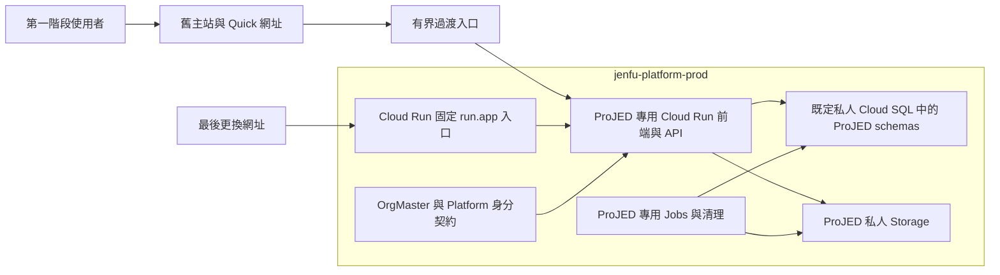

# SPEC-139：ProJED 納入 Jenfu-Platform 的產品與技術交接契約

> 2026-11-25：DEV-142正式資料搬遷與舊網址業務切流已交付；原帳號、工作區／看板、記事、原地PWA更新及草稿恢復同步已通過正式使用者回歸。以[SPEC-142](SPEC-142-projed-production-data-migration.md)為權威；較早準備紀錄依其日期解讀。DEV-139整體仍未完成，最後換址引導與未資格模型仍不啟用。

**2026-11-25 最新執行狀態**：來源 `97891d3`（PR #37／main合併 `5d88415`）已通過CI45457970960並由Cloud Build72bc0fab-3eed-4884-bcfd-2208aa81f52f建置；`projed-prod-dev142-97891d3`承接100%，映像digest `sha256:c85ccff28ff91ca2f059444fc3c7bd635a33333b9667dab57adef1a21b2eed58`。正式資料已一次apply／獨立reconcile，來源fence與NOLOGIN保留；私人HTTP34、兩舊origin HTTP16及四manifest identity通過。Platform023身分修復後，真帳號沿原網址與正常PWA選單可用原資料；同一草稿跨關閉重開恢復、同步、重載讀回，Quick本機待同步／帳號確認／成功提交皆已驗。analysis generation6、七筆既有execution、Scheduler PAUSED、中央私人IAM不變；Gemini／RAG仍停用。恢復與實際版本見[DEV-142恢復紀錄](../reports/DEV-142-precutover-recovery-point-20261124.md)。

**2026-11-23 現行決策：先保留舊主站／Quick 網址及既有 PWA 入口，讓新版前端、登入、API、資料與背景工作改走集中 Google Cloud；在舊網址確認新系統運作後，最後才換 Cloud Run `run.app` 新網址。** 保留 Vite、本機記事、ProJED 獨立權限及 `jenfu-platform-prod` 同專案私人 SQL；既有 Firebase Hosting 僅暫留為過渡入口，不另建新的 Firebase 網站或把業務權威搬回舊專案。正式資料一次搬遷獨立列為 [DEV-142／SPEC-142](SPEC-142-projed-production-data-migration.md)。

本輪人類已起床並明確恢復DEV-142正式搬遷與業務切流，取代較早的「先不切流」限制；依既有具名範圍完成停寫、最終備份、一次匯入核對及舊Hosting導流。原來源資料／網址／PWA保留，最後新網址仍另階段；本輪修正不增加IAM／Secret／billing或容量、不啟用未資格模型，不把資料搬遷完成計作完整DEV-139驗收。

本規格保留架構、資料安全、遷移設計及來源測試適用性；正式業務數量、IAM 實際讀回與非公開營運證據留在任務本機輸出。早期原地升級測試仍只支持原受測 origin／產物，不能證明跨 origin 草稿、安裝或新專案資格已完成。

- 主責：[DEV-139](../dev_task.md#dev-139-jenfu-platform-onboarding)。
- 日期：2026-11-25（Asia/Taipei）；最新正式子交付見SPEC-142與恢復紀錄，本機記事契約見§3.3；歷史候選／artifact依各自原日期與收據識別。
- 狀態：**DEV-142已完成；整體DEV-139尚未結案。** 正式資料與舊origin已切到中央Cloud SQL／新API；原地PWA、記事與草稿回歸通過。最後新origin／跨origin交接、完整真ASR／分析與provider資格仍依原驗收分母，不因子交付完成而縮減。
- 適用範圍：沿現行具名授權維護集中專案、原網址過渡入口及必要同範圍修復；正式資料與舊網址切流結果由DEV-142單獨認列。新網址、模型資格、IAM／Secret／billing擴張與破壞性資料回復不由文件自動授權。
- 直接交接入口：[§11 S1 定案契約](#11-架構決策與-s1-定案契約)、[§12 S1 實作狀態](#12-s1-實作狀態2026-10-26)、[§13 S2 consumer seam](#13-s2-projed-identity-consumer-seam2026-10-26)、[§14 S3 read adapter](#14-s3-http-read-adapter-slice2026-10-26)、[§15 S3 domain command](#15-s3-domain-command-w12026-10-26)、[§16 S3 collaboration command](#16-s3-collaboration-command-w22026-10-27)、[§17 S3 record／activity](#17-s3-recordactivity-w32026-10-27)、[§18 S3 HTTP product wiring](#18-s3-http-product-wiring-w42026-10-27)、[§19 S3 Board transfer](#19-s3-board-transfer-w52026-10-27)、[§20 S3 legacy provider boundary](#20-s3-legacy-provider-boundary-w62026-10-27)、[§21 S3 Quick Task](#21-s3-quick-task-w72026-10-27)、[§22 S3 Task Workbench](#22-s3-task-workbench-w82026-10-27)、[§23 S3 Actor CAS](#23-s3-actor-context-cas-w92026-10-27)、[§24 S3 Task Tracking](#24-s3-task-tracking-w102026-10-27)、[§25 S3 Backup／Import](#25-s3-backupimport-w112026-10-27)、[§26 S3 Account Preferences](#26-s3-account-preferences-w122026-10-27)、[§27 S3 Calendar Subscription](#27-s3-calendar-subscription-w132026-10-27)及[§32 本地開發收斂](#32-s3-local-development-closure-w182026-10-27)；[§11.8 技術主管審查](#118-技術主管審查與最小優化)保留 Rev5 修正理由；既有使用者切換見 [§6.3](#63-既有使用者的切換基線)。
- 決策來源：[DEV-139 人類決策](../dev_task.md#dev-139-jenfu-platform-onboarding)；架構取捨：[ADR-054](../decisions/ADR-054-projed-cloud-run-cloud-sql-boundary.md)。本文件不是其他 owner 已接受或已發布的契約。

## 1. 目的、限制與完成邊界

首階段保留 ProJED 現有工作區、看板、權限與操作流程，先對齊 Cloud Run 雲端架構、Cloud SQL 資料庫及身分契約，保留 React／Vite／Zustand、個人任務、外部協作、Quick Task、多視圖及已可用 AI 功能。身分接入改變可信登入來源及 Session，不重設 ProJED 的業務權限模型。

ProJED 已有使用者，移轉以不丟資料、不重建帳號、不改既有權限為必要條件。2026-11-23 人類將系統／資料搬遷與最後更換網址拆開：先在舊 origin 使用新系統，保留原 PWA 身分與本機儲存，不在資料搬遷窗口要求重裝；最後跨 origin 才處理重新登入、書籤／連結與 PWA 重裝及草稿交接。這不承諾永久保留舊入口、零重登或零停寫。資料窗口偏好低使用量且操作者可確認結果的晚間，演練量測後另排；目前不執行停寫、搬正式資料或切換。

成本採人類最新要求「只要費用不大幅增加即可」。首階段效益為基礎設施及身分契約一致、既有功能與資料授權相容；任務／資料跨系統使用是後續效益，節費及投資回收期不是必要驗收。首階段必須證明新路徑上的原功能及權限行為，不能只以平台可見、登入成功、表格搬入同一 DB 或測試數量認列交付。

完整產品目標仍保留 ProJED／OrgMaster／Jenfu-Platform 真接線、資料與原功能驗收。2026-11-22 人類在本機記事切片後恢復「正式切流前必要準備、部署候選並驗證」；不包含正式切流、來源停寫、業務資料搬入或新 IAM／Secret／billing 的概括擴張。其他 repo 的既有修改仍保留，跨 repo 實作沿各自 native DEV 與隔離分支，不把本文件當外部 owner acceptance。

### 人類產品決策

**D7（2026-11-25，Human Confirmed；方案2）**：最後換網址採「引導完成切換」。待 DEV-142 完成、中央後端在舊網址運作穩定後才執行；舊站依序引導確認草稿、以原帳號登入新站、更新書籤／PWA入口。草稿、原UUID及主／Quick各自帳號隔離沿 §6.2；流程與驗收見 [§6.4.1](#dev139-guided-origin-switch)。原定案時僅更新文件；本輪已開始本機引導預覽與狀態邏輯實作，尚不啟用正式提示、導流、部署或變更正式資源，不將方案／預覽認列為實際換址完成。

**D6（2026-11-23，Human Confirmed；本輪文件）**：採「舊網址先跑新系統，穩定後一次換新網址」，目的為縮小最後使用者更換網址的作業與排錯窗口。原主站／Quick origin 先承載新版前端與中央後端，最後才改 Cloud Run 直接入口；允許規劃有界過渡入口，不表示已核准其新資源／公開權限。資料搬遷特別拆成獨立交付點 DEV-142，其他準備與最後網址切換仍由 DEV-139 管理。D6 取代 D4／D5 的網址先後次序，保留原資料／權限、本機草稿、零留存與費用不大幅增加；現行 active 目標仍只完成切流前準備、部署候選並驗證，原業務資料先不搬遷、原網址／PWA 先不切換。這不是正式停寫、資料搬入、新 writer 或入口 IAM／Secret／credential／billing 的執行授權。

**D5（2026-11-22，Human Confirmed）**：恢復候選準備、部署及驗證，維持零留存，保留原資料、網址與既有 PWA，先不切流。取代 D4 的「不恢復部署」，其 Cloud Run 直接入口、集中專案、本機記事與費用要求維持。只建立 IAM 保護的新候選，不把新服務自身路由視為舊站切換；新增集中專案 IAM／owner 責任的具名差額見 §47.2；人類已另回覆「核准上述具名集中專案差額」，暫停後再明確恢復同一目標，既有核准沿用。

**D4（2026-11-22，Human Confirmed）**：直接採用 Cloud Run `run.app` 入口，不採 Firebase Hosting；撤回 Firebase 網站命名選擇。重用既有 PWA／Quick／outbox，補上編輯草稿持久保存、明確同步狀態與必要回歸，保留工作區／看板／權限、帳號隔離、既有草稿、CAS／回執與零留存。費用不大幅增加；本輪不部署、不切流、不改 IAM／Secret／billing／容量。D4 取代 D3 的自有網域／Hosting 及僅文件限制；D3 的集中專案與跨 origin 恢復責任維持。

**D3（2026-11-21，Human Confirmed）**：採集中 `jenfu-platform-prod` 與自有固定網域方案，保留舊入口過渡，納入 PWA 重裝、離線草稿及連結轉移，維持零留存。實際網域待確認；本輪只更新文件與計畫，先不部署、不切流。D3 取代先前跨專案 Shared VPC、原 origin 永久前門及不需重裝的假設；D1／D2、真 ASR 的原交付分母與資料／授權保護保留。

2026-10-08 的兩項決策均已有明確人類回覆；D2 採最新原文的首階段範圍，不把先前建議或預選的 2A 視為採用：

| ID | 決策與影響 | 已提出選項／目前狀態 |
|---|---|---|
| D1 | 個人／外部帳號的最小登入識別統一登錄於 OrgMaster；Principal publisher、准入及撤銷分層。 | **Human Confirmed**：回答「接受統一登錄最小身分資料（建議）」；私人內容留在 ProJED，登錄不授予公司管理員私人存取權。 |
| D2 | 首階段交付範圍與原功能保留；決定此次不新增跨 app 業務使用情境。 | **Human Confirmed**：原文「保留 ProJED 現有的工作區、看板與權限功能，先處理雲端架構、資料庫和身分契約的對齊」。先前選項中較接近 2C，但以原文為準；Platform 任務摘要與 AI-PDM 專案／看板連結均延後。 |

2026-10-29 人類補充「本次同時完成真 ASR」：DEV-139 的本次完成條件包括真正音訊轉錄、既有錄音UI／worker／cleanup接線及provider實測；不再留待DEV-123後續，也不把fake worker／文字造transcript當完成。DEV-123／ADR-051仍是既有產品語意來源，DEV-139負責同批實作／驗收。保留權限、source version、預算與取消／未知結果保護；新IAM／Secret／credential／billing等責任仍依本任務既有界線處理，安全的source工作續行。

工程命名、局部程式寫法與驗證工具由 RD 決定。D1 固定最小身分資料歸屬，D2 固定首階段基礎對齊及原功能保留；兩者不構成產品實作、跨專案開發或正式環境操作授權。後續跨 app 任務情境另有 re-entry trigger，不再作本階段待決門檻。

使用思考習慣：#效用理論、#限制條件、#可驗證性

## 2. 現行基線與受影響能力

本地查證來源為 ProJED `main@69a5c528774394080717129bac7ba011eb48cd12`；本輪修訂前僅 DEV-139 的四份文件有未提交變更。以下描述 repository 事實，不代表即時正式環境 readback。

| 能力／來源 | 現況與必須保留的契約 | 移轉責任 |
|---|---|---|
| [package.json](../../package.json)、[Vite](../../vite.config.js)、[正式契約](../../scripts/release/production-contract.mjs) | React／Vite 主程式與輕量 Quick entry；Firebase Hosting＋Supabase backend；既有建置版本及 PWA 更新保護。 | ProJED 自有 Node HTTP runtime 提供靜態產物與 API；保留入口及 build-wide artifact identity。 |
| [資料服務](../../src/services/supabase/projedService.ts)、[backend dispatch](../../src/services/dataBackend.ts) | SDK 直讀寫、RPC、工作區／看板／任務／邀請／文件服務；domain DTO 有相容欄位與 canonical ID。 | 建立 provider-neutral HTTP adapter，保留服務行為與 domain mapping，將 SQL、授權、交易留在自有 API。 |
| [初始 schema](../../supabase/migrations/202605140001_initial_projed_schema.sql)、[Auth service](../../src/services/authService.ts) | profiles 外鍵綁 auth.users；SQL 使用 auth.uid()；目前 Google 登入會建立／讀取 profile。 | 新安全主體與本地 user ID 分離，受控映射；搬移 schema、RPC、policy 的語意。不能把舊 SQL 原封不動套到新 DB。 |
| [SPEC-036](SPEC-036-trello-like-workspace-governance.md)、[分享契約](SPEC-026-trello-like-board-share-ui.md)、[角色與能力型別](../../src/types/index.ts) | Workspace 管理與 Board 授權分層；五種角色與可設定的 Board capability matrix；guest 的 tenant identity anchor 不授予其他看板。 | 保留 membership、各 Board 已設定的權限與管理繼承語意，與公司入口／角色契約分開判定；見 §4.4。 |
| [同步 hook](../../src/hooks/useSupabaseSync.ts) | Supabase postgres_changes 觸發 scoped reload；多視圖共用 canonical data。 | 以自有 API 提供受權限約束的同步通知／增量讀取，避免每張畫面各自建立全域資料來源。 |
| [ADR-050](../decisions/ADR-050-mobile-quick-task-entry-and-outbox.md)、[ADR-053](../decisions/ADR-053-quick-task-cross-origin-account-link.md)、[Quick receipt adapter](../../src/services/supabase/quickTaskCaptureService.ts) | local-first、各 App Session、明確認領、immutable owner／captureId、receipt replay 與七日 synced 副本清理。 | 改 provider 仍保留全部資料安全不變條件；新舊 origin 的本機資料另行恢復。 |
| [ADR-051](../decisions/ADR-051-projed-owned-meeting-analysis-pipeline.md)、[AI service](../../src/services/meetingSynthesisService.ts) | ProJED 擁有來源、job／lease、費用、原稿、投影及清理；部分真實 provider qualification 尚未通過。 | 自有 server／worker 承接已可用功能，未合格功能維持原 gate 與 NOT_PASS。 |

## 3. 目標架構與資料權責



- ProJED 前端、單一 app runtime、Jobs／Scheduler、app Secret 與 Storage 的長期管理責任集中於 `jenfu-platform-prod`。沿既有 VPC／runtime subnet 的同專案私人網路連 `jenfu-platform-prod:asia-east1:jenfu-platform-prod-pg`、`jenfu_prod`；不開 SQL public IP，不以 `projed-cc78d` 的跨專案 Shared VPC 關聯為必要條件。
- ProJED 保留自己的 repo、release、服務、runtime／migrator／importer／scheduler 身分、`projed_core`／`projed_contract`、ledger 與資源權限。集中專案不表示與 PDM 合併業務資料、共用 runtime SA、擴張公司管理員的私人存取或建立跨 core FK。app key 仍為 `projed`，其餘系統只消費受控 versioned contract。
- 保留 React／Vite 與實體 `/quick-task/`；同一中央 Cloud Run runtime 提供新版前端與業務 API。既有 Hosting 暫留承載舊網址，不新增 Firebase 網站、負載平衡器／CDN 或常駐容量。長期主網址 `https://projed-prod-9536592944.asia-east1.run.app` 已由候選 provider readback 固定，但私人候選／loopback 測試不代表正式使用者入口已可用。原主／Quick 及最後新 origin 的登入、換帳、登出、Cookie／callback 需分階段真接線；不因同服務就默默共用 Session，不以 wildcard 或未驗證 forwarded host 放寬。
- 舊 `https://projed-cc78d.web.app`、`https://projed-cc78d.firebaseapp.com/quick-task/` 及原主 origin 的 `/quick-task/` 在第一階段是新系統的正常使用入口；最後換網址後才縮為有界恢復與導引。過渡入口不持有第二份業務資料／writer，不作永久 API 平台；舊 Supabase Session 不自動成為新 App Session，token／私人資料不跨 origin 複製，詳 §6。
- Workspace、Board、Task、membership、權限矩陣、invite、profile、receipt、job、audit 與檔案 metadata 仍由 ProJED 擁有。runtime 無 owner、DDL、migrator、BYPASSRLS 或其他 app core 權限，交易內 scope／guard／RLS 與原授權結果保持。
- 私人 Cloud Storage、音訊到期及 exact-generation 清理責任維持；新專案 bucket 的名稱、ACL、物件移轉與到期映射須後續實際綁定，不把舊 bucket 讀回當成新桶已合格。Cloud Run 本機磁碟不作持久儲存。
- durable worker／Jobs 沿 ADR-051 的 claim／lease、預算、取消、unknown outcome 與 publication 保護；不新增無必要 runtime、共用業務權威或 SaaS 條件。模型未取得新專案資格時繼續拒絕，不能只改計費專案或 API key 就啟用。

<a id="dev139-two-stage-rollout"></a>

### 3.0 舊網址先跑新系統，最後再換網址（2026-11-23）

| 工作段 | 交付責任與完成邊界 |
|---|---|
| DEV-139 切流前準備（目前 active） | 準備原網址的新版前端、真 Session／既有 UUID mapping、API／worker／Storage 相容、過渡入口及原地 PWA 更新。部署候選、唯讀與隔離驗證；保留原正式資料、網址與 PWA，不啟用正式新 writer。 |
| DEV-142 正式資料搬遷（獨立交付，未執行） | 另排低使用量且可確認結果的晚間窗口，受控停寫、一次 snapshot／搬移／完整核對，再於舊網址開放新後端唯一 writer。完成條件與恢復只維護於 [SPEC-142](SPEC-142-projed-production-data-migration.md)，不以目前 schema migration 或候選 PASS 結案。 |
| DEV-139 舊網址日常確認 | 正式資料仍在同一新後端，以真使用者日常功能、登入到期、隔夜、弱網草稿與權限行為確認穩定。不新訂固定觀察天數、所有裝置簽到或額外簽核。 |
| DEV-139 最後換新網址 | 只調整使用者入口與必要 origin／Session／callback／PWA 綁定；沿用同一新資料庫與檔案，不安排第二次伺服器資料搬遷。舊入口暫供未完成草稿恢復與導引；入口問題可暫回舊網址使用同一新後端，不能退回舊 Supabase writer。 |

**過渡入口的最小方案。** 現有 Hosting 在 `projed-cc78d`、中央 runtime 在 `jenfu-platform-prod`；[Hosting Cloud Run rewrite](https://firebase.google.com/docs/reference/hosting/rest/v1beta1/sites.versions#CloudRunRewrite) 只有 serviceId／region／tag，現行 Firebase CLI 亦沿 Hosting project 查服務，不能把跨專案直連當作已完成。規劃在舊專案設有界的薄轉送入口，業務程式／Session authority／資料仍留中央，最後換網址後按 §6.4 退出。只允許固定中央目的地、必要路徑／方法／大小與逾時，拒絕任意 URL／SQL／RPC tunnel；代理服務身分只作可信傳輸，不當作使用者授權，也不記錄 cookie、token、正文或音訊。不新增服務帳號 key／長期 bearer bridge。

舊主／Quick origin 分別接新 Session；既有 `server/sessionCookies.ts` 的 host-only `__session` 與 HttpOnly／Secure／SameSite 保護保留。[Hosting 只轉送 `__session` cookie](https://firebase.google.com/docs/hosting/manage-cache#using_cookies)，但這只證明格式可相容，不代表真登入／撤銷已通過。靜態資產／舊版本保留與 rewrite 優先序須避免舊 HTML 攔住新入口；私人 API／callback／Session 維持 no-store，CDN／SW 不快取私人內容。

下一步 source 變更面為 `firebase.json`、`scripts/release/production-contract.mjs`、`src/services/backendMode.ts`、`src/services/httpApi/httpApiClient.ts`、`src/features/quickTaskCapture/origins.ts`、既有 PWA 更新／版本保留、`server/config.ts`／`appSessionService.ts`／`sessionCookies.ts` 及 managed renderer。舊網址發布契約仍固定 Supabase，HTTP client 使用同源 credentials，因此不能只換 DB 位址或把私人 run.app URL 貼進舊前端。先在既有授權內實作／隔離驗證；過渡入口的新 runtime／SA／跨專案最小 invoker／必要公開入口責任及費用影響，查重與量測後另列具名差額。本輪不建立入口、不擴張公開 IAM、不動 Secret／billing／容量；既有私人候選與本機代理測試不轉成正式使用者 gateway。

<a id="dev139-remaining-delivery-plan"></a>

#### 3.0.1 其餘工作交接與階段判定（2026-11-23）

依人類「其他先寫進開發文件」，先補齊下列交接並單獨提交，該回合沒有擴寫程式、建立過渡入口或正式切換。當時未提交的草稿保留；其後持續目標的現況以本表及§3.0.5–§3.0.7為準，下方保留原source／候選證據。文件不改變先前有效的同範圍授權，也不把尚未完成的工作認列完成。

| 工作／主責 | 接手內容與必要驗證 | 現況與依賴 |
|---|---|---|
| 舊網址過渡入口／ProJED | 沿 §3.0 完成薄轉送服務、建置／部署 renderer 與 Hosting 發布契約；固定上游、驗證傳輸身分後才採納原 origin。驗偽造 header／token 拒絕、主／Quick 隔離、body／逾時／取消上限、private no-store、Cookie／redirect 邊界；已送出的未知寫入不自動重送。 | §3.0.5已依核准建立私人relay／最小IAM並發布固定SA transport binding，真Google私人通路14項、中央HTTP36項與PWA18項通過；§3.0.6再以真PG串通兩host登入／原UUID／receipt與拒絕路徑。source binding已不是null。正常舊Hosting尚未接線，留待正式入口動作；私人候選成功不代表已切換舊網址。 |
| 真登入與既有帳號／ProJED＋Platform／OrgMaster 各 owner | 完成 producer publication／可信 pins、原主／Quick callback 與各自 App Session。驗既有 UUID 不變、個人／外部權限、換帳、登入到期與撤權；不得以 email 猜測映射，也不得把入口 SA 當使用者。 | §3.0.7兩owner原生發布及provider讀回已完成，Platform main728e169／OrgMaster master3683cac；v4 pin已隨新私人候選發布，runtime Session組成已啟用。五domain／兩host／真PG隔離證據沿用，正式真使用者Session仍未驗收。正式映射／業務資料搬入由DEV-142承接，本輪不先搬映射；不重做已成功的登入憑證同步或owner發布。 |
| 原網址前端／PWA／本機資料相容／ProJED | 補同 origin 從舊 provider 切換 HTTP 後的 namespace／owner／receipt 恢復及正常入口更新；保留 manifest identity、既有安裝、草稿與舊資產。驗隔夜可輸入、弱網／離線、關閉重開、登入恢復、換帳隔離、CAS 衝突與 unknown readback／防重複。 | 重用 §3.3 與 §47.2 的未變證據，只補真正改變的原網址／Session／provider 組合；loopback 私人代理測試不能代替舊網址升級。沿既有手動更新機制，不強迫重新安裝或清本機資料。 |
| 零留存與背景處理／ProJED | 依既有 provider 契約補目標專案／caller 的 ASR、分析、RAG 與 Job 綁定及必要資格證據；接續階段選擇、不呼叫模型分支、背景執行、取消／費用／unknown 與結果發布驗證。 | §3.0.7的中央cache／logging設定與Speech合成繁中單句CER=0已核對；v4 pin及固定Job binding已發布，generation5受保護空佇列真Cloud SQL／metadata token與原compiled entry通過。CMA／防濫用留存豁免仍未證明，Gemini／RAG binding保持null；完整會議／ASR／結果發布仍未認列完成，不能由空佇列或單句辨識推論。模型阻塞不重開已通過的獨立準備。 |
| 正式資料搬遷／DEV-142 | 一次窗口完成全部來源 writer fence、snapshot、資料／私人檔案／權限／receipt 核對，以及舊網址開新後端唯一 writer。 | 獨立交付與恢復只以 [SPEC-142](SPEC-142-projed-production-data-migration.md) 判定；目前未執行。晚間窗口待演練量測後安排，不在本輪排程。 |
| 舊網址運作確認及最後新網址／DEV-139 | DEV-142 完成後，用舊網址確認原功能、權限、草稿同步及背景處理；再發布新 origin／callback／PWA 與書籤／連結／草稿交接。第一階段正常使用可需要重新登入，最後跨 origin 可能需要重新安裝 PWA。 | 不新增固定觀察天數或全員簽到。最後換址沿同一 Cloud SQL／Storage，不再搬伺服器資料；入口回退仍使用新後端，舊入口退出沿 §6.4，不提前清除恢復能力。 |

**前次文件交付邊界。** 人類指定「其他先寫進開發文件」的回合只同步上述既有工作與狀態，沒有接續程式、候選部署或正式操作；後續active目標仍沿原目標及有效授權，現況見§3.0.5–§3.0.7；文件更新不新增權限。資料搬遷維持 DEV-142 獨立交付，DEV-139 的其餘項目保持待完成。

**正式後端切換與最後換網址不同。** DEV-142 在舊網址開放中央新後端唯一 writer，就是正式業務切流；保留舊網址不代表尚未切流。「先不切流」期間只準備及驗候選。最後換網址則沿用相同中央 DB／Storage，只交接入口、登入與本機資料，不能再次搬伺服器資料或解除舊來源 fence。

**實作順序與放行邊界。** 先收斂入口／身分／原地前端相容的 source 與隔離回歸，再依既有授權更新候選、核實實際接線；模型資格與不需模型分支可獨立推進。只有 SPEC-142 的必要依賴及正式操作責任成立後才進資料窗口；完成資料交付與舊網址日常確認後，才執行最後網址切換。這是既有驗收的分工與排序，不新增 required gate、QA/QC 簽核或另一套完成率。

**體驗與費用。** 每次真正改變入口時，沿 §3.3 同一量測口徑區分首次／已快取，檢查點開到可輸入及真同步狀態；不以 HTTP 200 或本機保存當雲端成功。過渡入口多一跳與可能冷啟動，沿現有監測核對延遲、錯誤及整體用量費是否明顯增加；先優化本機 shell／按需資源，不預設增加常駐容量，也不自行加入固定百分比、SLA 或新成本報表。

**後續候選準備／source 自查（2026-11-23）。** 文件交接已單獨提交 `0f5eba7`；持續目標接續收斂入口 factory 與中央傳輸驗證，不啟用新入口。JOSE `6.2.2` 從既有 lockfile 版本升為 runtime dependency，以真 RS256 簽章／固定 Google key source、issuer／audience／SA subject／email／期限驗證傳輸後，才採用兩個固定舊 origin；不產生使用者 actor、不以環境旗標發布。Relay 保留 actor／source version／錄音 record header、原 `__session` Cookie 與 private no-store／no-referrer，請求保留既有 32 MiB envelope、回應採背壓串流，避免額外 10／16 MiB 截斷原正文／匯入／清單。55秒整體期限涵蓋卡住的 body／token／fetch／stream；取消不再派送，已派送 mutation／callback GET 的未知結果不重送或宣稱成功。

新增入口／Session 17項本機案例、完整 S2 530項、release 41項、strict S2型別（重用既有本機 `pg` types overlay）與 managed boundary 已通過；含較大中文正文／12 MiB匯入、18 MiB串流、HEAD／conditional、Cookie／redirect、逾時與斷線、真 RSA transport＋既有 host-bound Session 的缺失／主與Quick錯用／撤銷／guard變更拒絕。這些是合成身分與 loopback HTTP，不是 Google provider、正式使用者或入口部署證據。原 sandbox loopback EACCES、負向 fixture 的型別轉換及 oversized upload reset 首次失敗保留；分別改以允許本機連線執行、明確負向 cast 及只送超限宣告驗證未讀 body 即拒絕，未把網路 reset 當成功。

Source `41eede303c96e2b0bebebdf6e04774f9fcbaf9ab` 的 [CI45141685539](https://github.com/jedchang0308-jenfu/ProJED/actions/runs/45141685539) 兩 jobs SUCCESS：530 S2／175 S3／18 migration unit／41 release，共764 unit、原lockfile型別、三boundary、compiled artifact、隔離PostgreSQL／snapshot與Linux OCI20通過。首次 Cloud Build `ac8cd88d-b787-44ad-b203-51844adcfef9` 雖建置成功，但 Windows `git archive` 把LF轉CRLF，51 SQL及profile與原ledger位元組不符，已拒絕、不部署，收據／映像保留。改以Git原始blob打包並重新讀壓縮檔逐項核對1703物件；修正版 Cloud Build `4566c830-0b80-42c3-9e2f-452846d75795` 的 provenance／source archive SHA、三registry digests、編譯後JOSE／nonroot／未發布bindings、51 SQL／profile均核對通過。這是封包修正，不改SQL、ledger或重新執行migration，不新增永久gate。

私人 Web 已更新至 `projed-prod-00003-bjv`，runtime digest `sha256:a69ac1143fc57a09f000787ebff0ce05d47bc0f15807872352f6a21389894af8`；只PATCH image／binding／labels，provider讀回IAM、網路、min0／max1／concurrency40不變，舊 `00002-str` 保留。16項唯讀HTTP通過，含真Cloud SQL readiness、精確metadata／主與Quick版本資產、SW、匿名拒絕、偽造legacy transport拒絕及未資格Session／workspace安全404/no-store。18項新候選PWA通過，含真SW、弱網、13小時時鐘模擬及兩次完整browser process重開草稿復原；代理與直接認證HTTP的SW SHA一致。單次觀測首次562ms、快取弱網250ms、模擬隔夜離線297ms，非新的改善前後比較；原§3.3三次中位數／本機36項未變前端證據重用。代理port、隔離browser及合成profile均已清理，migration execution仍原一次、analysis零次；Jobs未部署／執行，未擴IAM、Secret、billing或容量，原資料／網址／PWA未改、不切流。

結果在 `output/dev139-legacy-entry-20261123/candidate-final-verification.json`、同目錄原始建置／拒絕／來源／部署／HTTP收據與 `output/playwright/dev139-private-candidate-pwa/candidate-41eede3-r2.json`。入口binding、production identity pins及四個provider／Job bindings仍停用；直接匿名瀏覽／安裝、真Session、正式使用者映射、實際Hosting入口、零留存資格與DEV-142仍按上表未結案，完整DEV-139保持未完成。

<a id="dev139-legacy-entry-packaging"></a>

#### 3.0.2 舊網址入口封裝與可攜版本保留（2026-11-23）

延續 §3.0.1 的 source 準備；封裝已建置並更新既有私人中央 Web 為 `c3561e5`／`00004-vjk`。薄入口映像只建置核對，未建立或部署新入口 runtime；不建立SA／IAM、不改舊Hosting或正式資料：

- `server/legacyEntryMain.ts` 與明確 `legacy-entry` Docker target只帶六個編譯模組與JOSE，不帶SQL、DB driver、profile或業務前端。check-only不取憑證／連線，null binding在listen／取token前拒絕，shutdown最多8秒且不重送未知寫入；預設web target不變。
- 沿[Hosting靜態檔優先於rewrite](https://firebase.google.com/docs/hosting/full-config#priority_order_of_hosting_responses)，opt-in產生獨立設定與真正空的public目錄，固定舊site／`projed-legacy-entry`／asia-east1，主／Quick／SW／API全路徑轉送；不沿用舊HTML destination、不redirect到run.app，原firebase.json／API-only模式不變。生成結果僅 `PREPARED_NOT_DEPLOYED`。
- [stage-dev139-predecessor.mjs](../../scripts/stage-dev139-predecessor.mjs) 核對原manifest與完整public tree，只複製列明的靜態檔，不搬整個outputs或相鄰env／營運收據。原manifest bytes不改；selection固定manifest／tree SHA及相對dist，容器內重驗。原DEV-083 verifier僅新增呼叫端dist relocation參數，其既有target／contract／file hashes及預設不變。
- `retainHttpVersionHistory` 重用既有catalog／immutable copy與原保留天數。新HTTP檔先完整拒絕舊Supabase origin，之後才原樣保留已驗前版，不全域豁免舊檔名。HTTP build另在public tree外產出 `http-artifact-manifest.json`，固定source、目前metadata、tree／entries及catalog；下一次可驗HTTP前驅，涵蓋舊版→HTTP A→HTTP B。未綁source的本機candidate不作可信前版；舊bundle晚回網的writer fence／unknown／receipt仍由DEV-142處理，資產保留不等於資料搬遷。

準備命令（只產本機設定／靜態輸入，不含deploy）：

```text
node scripts/create-dev139-hosting-config.mjs --mode=legacy-entry --service=projed-legacy-entry --region=asia-east1 --output=output/dev139-legacy-entry-packaging-20261123/firebase.legacy-entry.json
node scripts/stage-dev139-predecessor.mjs --manifest=<已核對live來源的manifest> --dist=<相同tree的public目錄> --output=dev139-predecessor
```

Linux建置仍固定source封包；可攜 `dev139-predecessor/` 是另具manifest／tree SHA的公開靜態輸入，須明列於建置包，不默認Git archive會包含未追蹤目錄。Docker args為 `PROJED_HTTP_BUILD_MODE=legacy-entry`、`PROJED_PREVIOUS_RELEASE_MANIFEST=/app/dev139-predecessor/manifest.json`、`PROJED_SOURCE_REVISION=<已驗source SHA>`，缺前版或source即拒絕。私人candidate可不帶前版，但metadata標 `NOT_SUPPLIED_CANDIDATE_ONLY`，不能據此切換原網址。前版檔案核對只支持來源一致；正式發布仍沿既有流程綁到live readback，不另加人工簽核。

本機入口／Session21、封裝／roundtrip11、release52、原Hosting verifier與strict S2／managed boundary通過。完整S2首輪533/534：既有clock catch-up在並行負載下逾原50ms scheduler deadline而安全拒絕；首失敗保留，負載結束後單檔7/7重播通過，未放寬身分／時鐘保護。Source `c3561e5604536bc3af8116c58aab1c3275be79f5` 的 [CI45152864784](https://github.com/jedchang0308-jenfu/ProJED/actions/runs/45152864784) 已取得兩 jobs SUCCESS，含整版隔離回歸與真 Linux lean entry／portable legacy-entry HTTP build；本輪依既有 `source-ci-45152864784-readback.json` 回填，不重跑或宣稱重新線上核對。不能以 fixture 代替 provider 或正式 PWA 驗收。結果留 `output/dev139-legacy-entry-packaging-20261123/`。

實際舊站前版 `20261123035148-4604c0` 已選取並完成 public-only staging，selection 固定原 manifest／tree SHA（`dev139-predecessor/predecessor-selection.json`），不是業務資料搬遷。Cloud Build `68181ef8-8c2a-4059-9470-12ef19bae52f` 由原 handle 讀回 SUCCESS，九步成功；來源原始blob封包、GCS generation／SHA、51 SQL／profile、四個registry digest、lean入口不帶DB及停用binding均已核對。首次submit因單一參數超過Cloud Build限制回400、沒有建立build，保留失敗；拆分驗證輸入並先查無相同tag建置後才提交修正版，沒有重複建置。實際前版91檔不可變資產在映像內核對通過，外部HTTP artifact manifest亦已取回並驗SHA／source／catalog。

私人中央 Web 只更新 image／binding／labels，讀回新revision `projed-prod-00004-vjk`、runtime digest `sha256:904acd5dc89ba7df8d35860073fde5516d60b2dd8e5942f652544f97fdfaadb9`；原 `00003-bjv` 保留，IAM／網路／min0／max1／concurrency40不變。36項唯讀HTTP通過，包含19檔現役前版的主／Quick固定入口及所引用資產size／SHA、完整版本catalog、目前metadata／SW、真Cloud SQL readiness、匿名SW／偽造transport拒絕及未資格Session／workspace拒絕。18項私人PWA通過，真SW／弱網／13小時模擬隔夜／兩次程序重開草稿復原均只經read-only loopback代理，直接匿名入口仍403；代理與直接認證HTTP的SW SHA一致。單次觀測首次406ms、快取弱網218ms、模擬隔夜離線172ms，非新增改善前後比較，未變前端的§3.3基線證據沿用。

本輪唯讀收尾確認原兩origin的四份公開metadata仍為 `20261123035148-4604c0`；migration execution仍原一次、analysis零次。未部署Job／舊專案薄入口，未搬業務資料或啟用模型，未改原網址／PWA／IAM／Secret／billing／容量；隔離browser、代理port及合成profile均清理。結果：`output/dev139-legacy-entry-packaging-20261123/candidate-final-verification.json`；PWA：`output/playwright/dev139-private-candidate-pwa/candidate-c3561e5-legacy.json`。新入口SA／跨專案invoker及映像拉取差額、Hosting接線、真Session／可信正式映射與provider零留存資格仍未完成；DEV-142未執行，完整DEV-139仍未完成。

<a id="dev139-source-commit-recovery"></a>

#### 3.0.3 現役舊版的提交回覆遺失恢復（2026-11-23）

切流前查核發現原 A06 只用較早的 `0670a0a` 驗未提交／離線草稿，沒有覆蓋來源已提交但回覆遺失的組合；未據此宣稱產品必然雙建。舊版現固定為原站已讀回的 `1437a25`，保留原離線案例，另從正常舊 Quick UI 送出 RPC，讓隔離 PostgreSQL 原子建立來源任務／bytea 回執後才中斷瀏覽器回覆。接著以正式 `TABLES`／`snapshotTypes`／`readSource`／`insertSnapshot`／`readTarget`／`snapshotId` 讀取、匯入及核對原任務與回執兩個 domain；目標使用 importer role。這些函式僅增加供 QA 重用的 export 與預設仍為完整 TABLES 的參數，正式 CLI 的全部來源／fence／空目標／身分／catalog 前置未變。

Source `463aba2` 的 [CI45158688396](https://github.com/jedchang0308-jenfu/ProJED/actions/runs/45158688396) 兩 jobs SUCCESS，已查實 opt-in Quick 案例有執行，並取回 artifact `14810520594` 核對 ZIP digest 及兩份 native PG 回執。未提交案例首次201、重播200；已提交案例首次即200／`created:false`，回執與來源的 owner／captureId／title hash／committedAt 相同，source／target digest一致；兩案例皆單一task／receipt、另一帳號零可見，原本機內容與 clientCreatedAt 維持。原工作區／權限／snapshot及Linux OCI回歸亦通過，不新增 required gate。

本機 focused runner 首次在資料核對通過後因重複關閉 pool 退出失敗，原 `launchfixed/` 失敗及回執保留；`e4ab159` 僅修正該獨立測試入口的關池責任，再以 PostgreSQL 18.4／無視窗 Edge 的新 nonce DB 完整複驗通過。本機兩份既有型別 overlay 與 snapshot 收據3項通過；直接 S3 typecheck 因共用安裝缺 `@types/pg` 的原失敗不改寫，原 lockfile 型別由 CI 證明。相對 CI source 只有未被 full CI 呼叫的 standalone runner 收尾改變，其受影響範圍已由本機複驗補齊，其餘 CI 證據沿用。命令為 `powershell.exe -NoProfile -ExecutionPolicy Bypass -File qa/dev-139/s3/verify-isolated.ps1 -QuickUpgradeOnly -PostgresBin <既有PG bin>`；執行前須在既有測試路徑準備固定 `1437a25` 的舊來源及原lock依賴，不改用現役工作樹當測試資料庫。

證據：`output/dev139-quick-source-recovery-20261123/final-verification.json`、同目錄 CI artifact／首失敗／成功執行與清理結果，以及 `output/qa/dev-139/s3/20261123T104733Z-aa220c6c/result.json`。兩次隔離 PG／服務均結束，四個合成 browser profile 與本次臨時舊來源 worktree已移除，報告／截圖／建置保留；可攜public前版仍由DEV-139保留供後續入口交接，不清原發布證據。這是合成 provider／身分、真 UI／HTTP／PG 及兩個正式 projection 的證據，不是完整 CLI 搬遷、正式來源 fence／Storage、真 Session 或實機已安裝 PWA 驗收。私人候選仍為 §3.0.2 的 `c3561e5`／`00004-vjk`，本段未重建／部署候選或執行Job，DEV-142與實際舊入口／零留存資格仍未完成。

<a id="dev139-entry-stage-environment"></a>

#### 3.0.4 舊／新入口階段的 server 設定（2026-11-23）

查核發現 renderer 的 `PROJED_PUBLIC_APP_URL` 仍固定新 Cloud Run 網址，`calendar.ts`／`calendarIcs.ts` 會據此產生任務深層連結；在 D6 舊網址運作階段會把行事曆使用者提前送往新入口。`renderProjedCloudRun` 現以 `entryStage` 明確選擇，預設 `legacy`；主站／Quick 分別為原 web.app／firebaseapp.com。明確選 `direct` 時，主站使用 provider 已觀察的 `https://projed-prod-9536592944.asia-east1.run.app`、Quick 使用同服務另一個已觀察 origin `https://projed-prod-56gnizku7q-de.a.run.app/quick-task/`，保留 host-only Session 隔離，不新增 runtime／Firebase 網站。這是未發布的最終入口候選設定，不能代替正式 callback／安裝交接驗證。

兩階段統一產生 `PROJED_PUBLIC_APP_URL`、`PROJED_MAIN_PUBLIC_ORIGIN`、`PROJED_QUICK_PUBLIC_ORIGIN`，只接受封閉階段，不接受任意URL或環境覆寫。切換階段不改 DB／Storage／image／IAM／網路／容量／Jobs／Scheduler／provider 資格；不設定啟用 flag、不發布 identity pin／legacy binding，也不重送來源資料。renderer 仍只產生既有 create-only request；實際既有候選的設定更新須讀回同一服務後，僅取這三個環境值，不執行 renderer 的其他資源請求。

本機 release 55項通過，新增以真 `buildCalendarIcs` 驗兩階段的任務連結及原 workspace／board／task ID，並驗主／Quick不同host、階段改變只影響上述三值、未知階段／任意origin拒絕。Source `6229e86` 的 [CI45162466817](https://github.com/jedchang0308-jenfu/ProJED/actions/runs/45162466817) 兩jobs SUCCESS，release55／S2 534／S3 175／migration18、完整隔離PG／snapshot與Linux OCI通過。私人候選只更新這三個環境值，現為 `projed-prod-00005-r4j`；已驗的 app／proxy 解析後digests與source `c3561e5` 不變，舊 `00004-vjk` 保留。11項唯讀HTTP通過，主／Quick／SW／metadata bytes不變、匿名／偽造transport及未資格Session仍拒絕；原18項PWA依相同不可變映像與未變前端重用，沒有宣稱在新revision重跑browser。IAM／網路／容量與migration一次／analysis零次未變，原兩origin metadata仍為 `20261123035148-4604c0`，未改Hosting／原網址／PWA、不搬資料、不切流。結果在 `output/dev139-entry-stage-20261123/final-verification.json`，CI／部署／HTTP及入口設定收據同目錄。上游唯讀 metadata 另存 `output/dev139-precutover-owner-audit-20261123/owner-runtime-readback.json`：當時env篩選未見ProJED SSO專用項，consumer pins仍空；此觀察不能推論DB contract發布狀態，source契約一致不等於已正式發布。既有 owner runtime／IAM／資料及零留存限制不變。

<a id="dev139-private-relay-foundation-proposal"></a>

#### 3.0.5 私人過渡入口的最小差額（2026-11-23，人類已核准／私人候選已驗證）

此提案只為在不變更舊 Hosting／網址的情況下，完成真 Cloud Run metadata token→中央傳輸驗證的私人候選；**不包含公開入口或正式切流**。既有中央三SA／SQL login核准未涵蓋以下舊專案新身分與跨專案信任。唯讀查核證據為 `output/dev139-entry-stage-20261123/private-relay-foundation-delta.json`：舊專案號 `967362299895`，下列SA及relay服務皆404；中央服務／映像庫未有表列grant。操作者已具有建立服務／SA、actAs及私人呼叫權，無須另加操作者IAM。

| 具名範圍 | 最小變更與限制 |
|---|---|
| 舊專案專用SA | 僅在 `projed-cc78d` 建立 `projed-legacy-entry@projed-cc78d.iam.gserviceaccount.com`；不產key、不加SQL／Storage／Secret／模型角色。 |
| 中央服務的單一caller | 將 `roles/run.invoker` 僅授予上述SA，resource限 `projects/jenfu-platform-prod/locations/asia-east1/services/projed-prod`；不授其他app或專案級invoker。 |
| 舊Run service agent讀專用映像庫 | 僅將 `roles/artifactregistry.reader` 授予既有 `service-967362299895@serverless-robot-prod.iam.gserviceaccount.com`，resource限 `projects/jenfu-platform-prod/locations/asia-east1/repositories/projed-release`；目前中央project只有其既有networkViewer，不新增project級reader。 |
| 私人relay候選 | 建立 `projects/projed-cc78d/locations/asia-east1/services/projed-legacy-entry`，使用該專用SA與已驗lean target；IAM保護、`invokerIamDisabled=false`、零常駐、max1、concurrency2、1CPU／256Mi、60秒。無SQL／VPC／volume／Secret；不加入allUsers／allAuthenticatedUsers。這是一個具名新候選資源，不調整中央runtime／SQL容量或billing設定。 |
| 同範圍來源與驗證 | 讀回SA uniqueId與上述resource／IAM後，將固定caller／上游的transport qualification綁到source，沿原CI、專用builder／repository建置及更新私人relay／中央候選，僅做無業務寫入的正常靜態GET與安全拒絕驗證；未知結果先讀回，不逐SHA／digest重問。原有正常分支保護與同PR範圍維持。 |

核准僅涵蓋本表的新身分／兩筆grant／新私人候選及必要來源建置重試；不授owner/editor、Token Creator或服務帳號key，不建立Secret、key或長期credential，不授資料搬入、來源停寫、writer啟用、模型呼叫、公開IAM、Hosting／DNS／PWA切換，也不部署Platform／OrgMaster runtime。零留存與費用不大幅增加維持，provider／identity pins未資格化仍停用。完成此步不等於正常舊網址已接線、真登入／模型資格成立或DEV-142已執行。

人類已對本表回覆「核准」（annotation `aaa5dde4-505e-4bb1-9df8-bf22abd678c2`）。專用SA已建立、uniqueId為 `100626728503472119855`、user-managed key為零；兩筆精確resource grant均已套用並讀回，未加入公開IAM。收據為 `output/dev139-private-relay-20261123/foundation-verified.json`。`config/dev-139/legacy-entry-qualification.json` 保存可公開的精確claims，canonical SHA為 `f85613401c716c8892dc5f972a848a680261911f67f9d53c91faa0de9bec2f95`，與source transport binding一致；此綁定僅讓私人候選接受經Google驗證的專用SA transport，不發布使用者身分／模型資格。22項focused測試及既有strict S2 overlay通過；後續完整CI、映像、中央／relay部署與Google實際通路結果如下。source qualification不等於使用者身分或供應商零留存資格。

第一個建立請求被provider明確拒絕HTTP400：renderer的Gen2與已核准256Mi不相容，未產生服務或operation；原失敗留存 `relay-create-response.json`。依 [Google執行環境規格](https://docs.cloud.google.com/run/docs/configuring/execution-environments)，此無SQL／volume的lean relay改用Gen1，保留1CPU／256Mi／min0／max1／concurrency2，不提高容量或新增權限。修正限純renderer及對應回歸；先讀回同一relay為404後，才可用同一已驗不可變映像重試並保留新收據。這不變更中央runtime／ASR執行環境，也不重建未受影響映像或重跑migration。

完成結果：映像source `e5c2462070eeae3c2cd08589be3d88665ef5f57c` 的 [CI45173861416](https://github.com/jedchang0308-jenfu/ProJED/actions/runs/45173861416)、純renderer修正 `5f3693bfba04592b9728406820eafb43f240e3aa` 的 [CI45175870733](https://github.com/jedchang0308-jenfu/ProJED/actions/runs/45175870733) 均兩jobs SUCCESS，S2 535／S3 175／migration18／release55、隔離PG／snapshot與Linux OCI通過。Cloud Build `94366cc8-b09c-4176-b70b-2bd9495ea2f6` SUCCESS；raw Git封包SHA／storage generation、51 SQL／profile及兩個registry digest均讀回，四個模型／Job binding仍NULL、identity pins仍空。只發布Web與lean relay兩映像，臨時binding-tools不push、不部署；Gen1修正不影響兩個runtime產物，重用相同已驗digest，未重建ASR或執行migration。

中央私人候選為 `projed-prod-00006-jsw`，原 `00005-r4j` 保留；新relay為 `projed-legacy-entry-00001-hgp`，Gen1／1CPU／256Mi／min0／max1／concurrency2、無DB／VPC／Secret，`invokerIamDisabled=false`。中央設定、IAM與兩筆資源grant、專用SA uniqueId及零user-managed key均再次讀回；未授予任何公開caller。36項中央唯讀HTTP與14項relay驗證通過：實際metadata ID token→Google JWKS→固定SA／audience核對成立，主／Quick／SW／metadata bytes相同；匿名、非固定host、偽造transport及不允許path遭拒，未發布App Session仍回404／no-store。固定routing header僅是私人測試selector，**不代表正常Hosting接線或真使用者登入已完成**。

中央新產物另實跑18項無視窗Edge PWA驗證，真SW、弱網、13小時時鐘模擬及兩次完整browser process重開的本機草稿復原皆通過；不是實際等待隔夜、直接公開run.app或真Session驗收。本次唯讀loopback測試「點開到可輸入」首次438ms、已有快取弱網156ms、模擬隔夜離線140ms、第二次離線重開141ms；不可當成真裝置全流程效能保證。自建proxy port／browser／合成profile均已清理，沒有業務寫入或模型呼叫。舊兩origin四份metadata與部署前完全相同，公開release仍 `20261123035148-4604c0`；migration仍原一次、analysis零次，未搬資料、不改Hosting／網址／既有PWA、不切流。

本輪證據集中在 `output/dev139-private-relay-20261123/final-verification.json` 及同目錄source／CI／build／兩服務readback、首次400／後續404／Gen1成功與HTTP收據；PWA原報告為 `output/playwright/dev139-private-candidate-pwa/candidate-e5c2462-private-transport.json`。來源與測試／部署自查分層，不宣稱獨立QC或完整DEV-139完成；真Session／既有使用者映射、owner publication與provider零留存資格仍為後續工作，未啟用模型或傳送真實會議內容。DEV-142仍是獨立且未執行的正式資料交付點；本輪不新增required gate。


<a id="dev139-precutover-identity-speech-preparation"></a>

#### 3.0.6 切流前身分整合與集中專案 Speech 差額（2026-11-23，已核准／foundation、probe及私人候選已驗）

補既有隔離PG runner中的單一整合案例：正式五domain projection／import／digest→舊主／Quick兩個不同host的relay登入callback→持久PG Session沿原UUID→既有capture receipt回`created:false`、另一帳號不可見、跨host nonce／Cookie拒絕、撤權後讀寫拒絕。Owner exchange與Google signing keys採合成fixture，production pins仍空、正式UUID未搬入；同source真PG與CI結果已通過，見下段。本機strict S2／S3與snapshot overlay已通過；首次DOM＋Node fetch型別衝突以`Buffer.concat`實際產生的`Buffer<ArrayBuffer>`精確回傳型別修正，沒有改request bytes或增加複製。

首輪source `8c2c62c` 的 [CI45193327013](https://github.com/jedchang0308-jenfu/ProJED/actions/runs/45193327013) 在新callback案例回401而FAIL；獨立OCI與snapshot完成並通過。原因為既有合成state read刻意落後100ms，新wire卻僅早1ms，違反正式`read_at >= issuedAt`檢查。僅將fixture發行時間改早1000ms並保留60秒上限；加驗wrong-host後pending／PKCE不變、無Set-Cookie、零exchange，再用同pending正常callback。原安全拒絕與首次失敗均保留，不改產品時間檢查。本機PG18嘗試在啟動後等待、尚未進bootstrap；已正常停止自建空PG、清除精確nonce目錄與port並釋放容量lease，功能結果保持NOT_RUN，修正版由既有CI真PG驗證。

修正版source `56086da2e5956c4b47ccc5a4defc79ad5767e20b` 的 [CI45195437782](https://github.com/jedchang0308-jenfu/ProJED/actions/runs/45195437782) 兩jobs SUCCESS：535 S2／175 S3／18 migration／55 release、原生PG73項（含具名新整合）、獨立snapshot與Linux OCI通過。已取回實際log並解析出含`legacy-main-quick-host-bound-login-imported-uuid-pg-session-capture-receipt-and-revocation-synthetic-owner`的PG PASS報告，收據為同目錄`identity-integration-verified.json`／`native-pg-ci-report.json`，首次FAIL與本機未執行功能的startup結果分開保留。新測試與型別修正未改候選行為；TypeScript實際transpile後relay JavaScript與`e5c2462`完全相同（`relay-runtime-reuse-proof.json`），重用§3.0.5已驗私人候選，不重新建置／部署或重跑PWA。不把合成owner／簽章的PG結果當正式Session／Google身分發布驗收。

核准前唯讀刷新位於 `output/dev139-precutover-qualification-20261123/`。ProJED三個舊origin環境值已配置；Platform未見ProJED專用環境項。此觀察僅限env存在性，不能推論DB contract／owner publication不存在。集中專案Speech／Vertex API均DISABLED、具名音訊桶404、analysis Job零execution；cache／三模型logging查詢403均帶`SERVICE_DISABLED`，故設定仍UNKNOWN。相關契約／豁免郵件在目前可用來源未找到，適用條款仍UNKNOWN，不能記為確定沒有合約。

**人類已明確回覆「核准 SPEC §3.0.6」。以下具名Speech／私人音訊差額已套用並讀回，單次probe已成功且一次性Job已清除；source資格、必要CI、Web／分析映像及私人候選驗證均完成，未啟用使用者派送。** §47.2明確延後集中專案的音訊／模型責任；舊專案核准及§3.0.5私人transport不涵蓋本表。完整具名request／固定image／一次性probe參數已備於 `output/dev139-precutover-qualification-20261123/central-speech-audio-proposal.json`。

| 目標 | 最小新增與限制 |
|---|---|
| Speech V1 | 僅啟用`jenfu-platform-prod`的`speech.googleapis.com`；使用既有`projed-prod-runtime@jenfu-platform-prod.iam.gserviceaccount.com`。新增`projects/jenfu-platform-prod/roles/projedSpeechV1Quota`，僅`serviceusage.services.use`，並只授該SA。不預授V2 recognizer或Vertex推論權；若實際拒絕，保留結果再收斂，不自行擴權。 |
| 私人音訊桶 | 僅建`jenfu-platform-prod-projed-meeting-audio`，ASIA-EAST1／STANDARD、uniform access、public access prevention enforced、versioning關閉、soft-delete為0，無retention lock。新增`projects/jenfu-platform-prod/roles/projedMeetingAudio`，僅objects.create／get／delete；只在此bucket授既有runtime SA。既有七天期限與generation清理由app負責，不建依物件建立時間的lifecycle。 |
| 既有背景入口 | 僅在`projects/jenfu-platform-prod/locations/asia-east1/jobs/projed-meeting-analysis`授上述runtime SA `roles/run.invoker`；本差額不執行該analysis Job，不發布Session或模型派送binding。 |
| 一次性真caller probe | 建立並於讀回後清除`projects/jenfu-platform-prod/locations/asia-east1/jobs/projed-speech-qualification`，沿用已驗ASR映像`f111720b…`／source `c3561e5`及同runtime SA；無DB／VPC／Secret，Gen2／1CPU／512Mi／task1／parallel1／maxRetries0／90秒。至多一次送出本機生成的5秒靜音PCM至固定Speech V1，只驗實際caller／IAM／response；未知結果不重送，不傳會議內容、不寫業務資料。此probe不證明辨識品質或完整ASR產品驗收。 |

完成的具名差額與原始收據在 `output/dev139-speech-qualification-20261123/`：Speech API ENABLED、兩custom roles與三筆exact resource grant逐一讀回；音訊桶PAP enforced／uniform access、versioning false／soft-delete 0，foundation階段中央runtime／既有analysis模板未改，後續僅沿既定候選範圍更新映像／binding／labels；migration一次／analysis零次不變。CRM曾因gcloud共用consumer quota回429，首失敗保留；依[官方quota project方法](https://docs.cloud.google.com/docs/quotas/set-quota-project)僅對控制面REST請求指定既定resource project header，未改本機設定、配額上限或billing連結。

一次性Job execution `projed-speech-qualification-skzrv` 成功1次／重試0次，固定runtime SA送出5秒本機合成靜音；Cloud Logging的實際jsonPayload已核對，無會議內容、DB或業務資料寫入。僅證明Speech V1 caller／傳輸，不證明辨識品質或完整ASR流程。Job終止後依fresh UID／etag清除並讀回404，證據留存。`config/dev-139/speech-qualification.json` 將實際probe與私人音訊foundation綁到source，claims SHA `5af1fd87a21f8b5c8312160610266d3083ab63038f76201263e20a87b8517037`。`CURRENT_MEETING_ASR_BINDING`發布此範圍的資格；production pins仍空、Gemini／RAG／背景派送binding仍null。check-only已改為有效Speech資格與pins齊備才報可派送，沒有從env聲稱資格；source `4331115964796c4b82438e9fbd7aede2ab08063b` 的 [CI45200634322](https://github.com/jedchang0308-jenfu/ProJED/actions/runs/45200634322) 兩jobs SUCCESS：537 S2／175 S3／18 migration／55 release、真隔離PG／snapshot與Linux OCI通過；實際nonroot OCI確認有Speech資格但無pins時仍DISABLED，未取credential或呼叫provider。

Cloud Build `39c31e2a-b471-4d94-8ca1-43d79783014f` SUCCESS；raw Git blob 封包 SHA `3cb5097a10f13189dab45ce539c5689652b9346c2798361990e7517746e62ab4`、storage generation、provenance、51 SQL／profile 與兩 registry digest 已核對。Web digest `sha256:51c91bcbe4d3625f40f4c6f73c5f20ad96a338cfa2b25b14042bf480c530dd1a`，ASR digest `sha256:7be182f8002e60796aa986fe52b23ea2f58e504d570af7103f0a69c895472ff1`；只建置／推送這兩個受影響映像。既有 lean relay 的 emitted JavaScript／JOSE 未變，沿用 `00001-hgp`，不重建或部署 relay／migration。

私人 Web 更新為 `projed-prod-00007-cpt`，舊 `00006-jsw` 已讀回保留；analysis Job 僅更新 image／managed binding／source labels，generation 3、execution 仍零。首次 Job PATCH 因誤用不支援的 updateMask 回400；保留拒絕收據，讀回確認原template／labels未變，再依 [Job API](https://docs.cloud.google.com/run/docs/reference/rest/v2/projects.locations.jobs/patch) 以fresh etag及完整保留的template完成更新，未重送未知結果。Web／Job容量、網路、原env與既有IAM不變，未重跑51 SQL或owner window。

同一新revision的36項唯讀HTTP、既有relay到新revision的14項真metadata token／Google JWKS通路與18項PWA通過；含匿名／偽造proof拒絕、未發布Session安全拒絕、前版19檔資產、真SW、弱網、13小時時鐘模擬及兩次完整browser process重開草稿復原。單次量測首次297ms、快取弱網141ms、模擬隔夜離線219ms、第二次離線重開156ms；不是新的前後改善比較或實機隔夜驗收。臨時browser／profile／proxy port與probe Job均已清理。

最終provider讀回：私人桶物件零、兩roles權限及三筆resource grant精確、無額外runtime project grant；Speech ENABLED／Vertex DISABLED，migration仍唯一原execution、analysis零次。兩舊origin四份公開metadata與開始前相同，仍為 `20261123035148-4604c0`，未改Hosting／網址／PWA或搬資料、未切流。結果為 `output/dev139-speech-qualification-20261123/final-verification.json`，其原始provider／artifact／operation收據同目錄；PWA為 `output/playwright/dev139-private-candidate-pwa/candidate-4331115-speech.json`。這些是分層RD自查，不宣稱獨立QC、正常Hosting／真使用者驗收或完整DEV-139結案。

依[Speech官方資料規則](https://docs.cloud.google.com/speech-to-text/docs/v1/data-logging)維持default-off、不opt-in、外部opt-in即撤銷資格；本次實際runtime probe已成立，相應資格限上述caller／傳輸與foundation。Vertex API、Gemini／embedding／RAG、cache／logging修改與內容呼叫仍延後，依[Google零留存規則](https://docs.cloud.google.com/gemini-enterprise-agent-platform/resources/zero-data-retention)補適用契約／豁免及所選模型資格，不由Speech成功推論。未新增SA／key、Token Creator、Secret、source credential、Scheduler或人員權限；不部署Platform／OrgMaster runtime、不搬正式映射／業務資料、不改中央runtime／SQL容量、billing、Hosting／原網址／PWA、不切流。本節是既有任務的差額與證據範圍，不新增required gate。

<a id="dev139-approved-precutover-completion"></a>

#### 3.0.7 三組剩餘準備的合併授權（2026-11-24，Human Approved／執行中）

人類已對三組具體範圍整段回覆「核准」，不是再次核准 §3.0.6 或變更零留存要求：

| 已核准責任 | 執行範圍與保留邊界 |
|---|---|
| 正式身分接線 | `jenfu-platform-prod` 的 Platform／OrgMaster ProJED 身分契約發布、必要 forward-only schema／精確 consumer 授權及對應 runtime 部署，再接 ProJED Session。保留其他 app 相容性；不搬正式使用者映射或業務資料。owner 工作仍用各 repo 現行來源、native migration／release，不以早期 draft 編號或合成 owner 測試取代正式發布證據。 |
| 模型與背景處理驗證 | 啟用中央 Vertex API，只授既有 ProJED runtime SA 必要推論權限；核對並關閉相關內容 logging／cache。以合成、非機密內容驗 Speech 品質及分析／RAG／背景結果發布；雲端寫入僅限可辨識並清理的具名測試資料，不修改既有正式資料。關閉專案 cache 前核對其他 app 影響，維持費用不大幅增加；供應商契約／豁免未實證前相應模型資格與派送仍停用，不以本核准代替零留存證明。 |
| 搬遷基礎準備 | 建中央 `projed-prod-importer@jenfu-platform-prod.iam.gserviceaccount.com`、限定既定 Cloud SQL instance 的 client／instanceUser 與 SQL login，及 `projed-prod-migration-source` Secret；沿用或建立最低權限來源唯讀 credential。Secret accessor 只授該 importer、只限此 Secret，不把來源 credential 帶入 runtime／analysis。只供盤點／準備，不正式搬入、來源停寫或啟用新 writer。 |

同範圍修正、CI、來源合併、映像重建、候選更新及必要恢復一併涵蓋，不因 PR／SHA／digest 改變重問。新增專案／責任面、不可逆 rewrite、公開入口、正式搬遷／切流及最後換網址仍不在本核准內；不新增 required gate 或獨立簽核。既有 §3.0.5／3.0.6 授權與有效證據沿用。

**最新執行狀態（2026-11-24）**：人類本次本機登入已取得 `COMMITTED` 真收據（99秒，Platform版本14）；原生兩owner同步亦COMMITTED，OrgMaster版本21，兩邊GitHub Secret讀回成功。兩個正常selector rotation均APPLIED；Platform首次因backend ADC reauth停在init，讀回確認state／workflow未變後，改用有效既有gcloud token成功。原失敗及自動審查暫擋保留，沒有再次要求人類登入或新增IAM。收據與metadata在 `output/dev139-authorized-foundation-20261124/identity-runtime-audit/`，無password／token payload檔案。

OrgMaster `master@3683cac` 的正常full-release [45374006504](https://github.com/jedchang0308-jenfu/OrgMaster/actions/runs/45374006504)全stage SUCCESS，provider讀回 `orgmaster-prod-6a8b73ff1c2d` 100%／零tag，cf768映像重用、兩個ProJED caller值吻合；schema65重用，migrationsExecuted=0／dataImportsExecuted=0。完整結果見 `output/dev139-orgmaster-schema-069/official-3683cac/native-full-release-verified.json`。Platform A2的routine準備因歷史筆數白名單漏22而拒絕；[PR241](https://github.com/jedchang0308-jenfu/Jenfu-Platform/pull/241)已將上限改為現行權威清單的精確前綴，保留原生12筆下限及source／SQL／manifest／復原證據檢查。56項回歸、真A1封存只讀查核與required CI45374353105通過，正常合併main728e169；exact-main CI45375430064亦SUCCESS。47個runner inputs與infra相同，f000不重建。A3原生source／runtime／infra-reuse／routine-authority／release-intent均PASS，已單次派送 [45376612995](https://github.com/jedchang0308-jenfu/Jenfu-Platform/actions/runs/45376612995)，全stage SUCCESS；provider讀回 `jenfu-platform-prod-1178f25a6eff` 100%／零tag，image `4cea94d1`，native ledger22／applied0／replayed22、六個ProJED runtime值與accept phase吻合，v4 manifest `c5471fa9`以相同source-bound Git bytes核對。收據在 `platform-a3-native-release-verified.json`；A1／A2不改寫或重播。

本分支依兩個已實證的owner發布填入v4身分pin，已依下列候選結果部署至私人零流量revision；既有原UUID mapping／account guard／owner即時狀態仍須通過。disposable kernel不配置正式owner Session，跨owner模擬器只允許loopback目的地，空pin拒絕案例改用明確空pin測試，不把全域「尚未發布」當成隔離條件。43項focused與27項本機HTTP回歸通過；本機首次typecheck缺共用junction的@types/pg，依lockfile sha512補至本任務output並指定原生ESM型別入口，補齊既有SSO常數的d.mts宣告後typecheck通過，未改共用node_modules或依賴。沙盒connect EACCES造成的HTTP失敗及一個等待請求的test child已保留；只停止已驗明卡住的PID25352、port59620已釋放，同一組受影響HTTP檔在允許loopback環境27／27。完整PG／OCI CI仍須按新來源完成，不以此本機結果替代。

新來源 `edb0735` 的 [CI45385166301](https://github.com/jedchang0308-jenfu/ProJED/actions/runs/45385166301) 首次OCI在合法Host／匿名Session案例得到403而非401；同版Node24.12本機echo證明fetch覆寫指定Host，原生HTTP則正確保留。OCI fixture改用有4秒界線的原生HTTP，保留合法Host匿名401、錯誤Host403、無Cookie與no-store，並對正式 `/api/v1/session/login` 驗GET405；未改正式授權程式。首個FAIL保留，獨立PG／snapshot繼續完成，修正後新來源OCI仍待驗證。

修正來源 `ea09b133e4576b042a09af31d91069cd36f12391` 的 [CI45385906394](https://github.com/jedchang0308-jenfu/ProJED/actions/runs/45385906394) 兩jobs SUCCESS：541 S2／175 S3／18 migration／55 release-unit，真PG HTTP75、snapshot67及Linux OCI23均PASS。原失敗run的獨立PG／snapshot亦完成PASS，不改寫OCI失敗。Cloud Build `d8171c4b-d77e-43ed-a212-eefa34561d66` 保留FAIL：任務建置檢查碼的字串替換污染import識別字，runtime已編譯但未通過資格檢查、未部署。R2以同一source archive／generation及CI、只修任務檢查碼，先做node語法檢查，再單次提交 `0a8cae6e-4feb-43c5-8ec9-b090aebdc313`；R2八步驟與推送均SUCCESS，archive provenance／generation、registry Web `517a7e17`／ASR `1e85ac57`、v4 pin／Job binding／Speech資格、LLM／RAG停用及前版資產已核對。新Web `projed-prod-dev139-ea09b13` 已建立、私人 `dev139-session-env` tag為0%，00007-cpt仍100%；analysis更新generation5，runtime SA／IAM／網路／容量與其他spec不變。36項私人HTTP通過，真Cloud SQL readiness、main／Quick／SW、舊版19份入口關聯資產與安全拒絕均核對。首次PATCH因保留舊revision名回409，provider讀回確認未變後才指定新名稱續行；本機verifier另修正未掛tag零流量revision的retired／latestReady語意，以及proxy多架構index與平台digest比較，均保留實際失敗、不放寬HTTP或IAM。背景新映像的受保護空佇列首輪 `projed-meeting-analysis-zcswz` 封鎖到DB IAM metadata token而失敗、無內容請求；只放行既有固定metadata端點後，R2 `projed-meeting-analysis-jbs5m` succeeded1／retry0。先唯讀確認ASR／discussion／LLM／cleanup四佇列均空，再執行原compiled entry；metadata token請求2、內容／模型請求0，dispatchEnabled=true／llmDispatchEnabled=false、scanned／units／failures均0。這是新generation5真Cloud SQL空佇列驗證，非真使用者Session或完整會議驗收。首輪失敗保留，analysis共3次execution含1失敗、均零重試；migration仍原唯一execution，不新增IAM。既有51 SQL與profile bytes相同，無需重跑正式migration；不重跑未變的上游發布或PWA案例。所有輸出在 `output/dev139-published-identity-20261124/`，不新增關卡。

背景呼叫資格沿同一§3.0.7驗證：既有runtime SA已具analysis Job限資源invoker、無public binding。一次性 `projed-job-dispatch-qualification`（1CPU／512Mi／90秒、task1／retry0）只用已驗4331115映像與真metadata SA，經原有dispatcher對既有generation4 analysis Job單次POST；目標映像的identity pins仍空、LLM binding為null，paid dispatch不得啟用。只驗既有Job啟動／SQL transport及空佇列收尾，不傳音訊或會議資料、不新增IAM／Secret；未知結果先讀同一operation／execution，不重送。probe終止後清除自建qualification Job，analysis Job及execution證據保留。已取得真runtime dispatcher accepted；target execution `projed-meeting-analysis-4ptlz` succeeded1／retry0，ASR／discussion／LLM／cleanup scanned與units全零、failures0，模型派送false。自建probe `projed-job-dispatch-qualification-j4r72`已結束，qualification Job已刪並讀回404；原analysis Job UID／generation4／image保持原值。證據在 `output/dev139-job-dispatch-qualification-20261124/`，來源資格 [meeting-job-qualification.json](../../config/dev-139/meeting-job-qualification.json)／claims `e004b81f` 已接回Job binding。這只證明invocation及空佇列SQL transport，不是完整會議／結果發布驗收。

**本輪新增的真caller驗證（2026-11-24）**：既有generation5／相同ASR映像單次執行 `projed-meeting-analysis-fzfg9` succeeded1／retry0；真metadata ID token及兩owner正式HTTP共7項通過。Platform缺caller／錯audience回401；正確runtime SA通過服務身分與原main／Quick callback檢查後，對隨機且不存在的合成碼回400 `sso_code_invalid`。OrgMaster缺caller／錯audience回401，正確caller的空通知body回400 `EXTERNAL_REQUEST_INVALID`，依已發布handler在DB通知前拒絕。未建立使用者Session、邀請或mapping，無模型／會議內容、無新IAM／Secret／部署。證據 `output/dev139-owner-caller-qualification-20261124/verified.json`；analysis共4次，原metadata guard失敗仍保留，migration仍1次。這只證明真服務caller／callback接線與安全拒絕，不能取代真使用者Session／完整會議驗收。

本次COO查核同步文件開頭與§3.0.1兩列的過期「上游未發布／pins空」狀態，改以本節實證結果為準；已完成的憑證同步／owner發布不再作續行前置，未新增簽核或required gate。原UUID映射／正式資料仍由DEV-142獨立交付；Gemini契約未知與完整會議未驗分母保留。

本輪重查 [Google零留存官方條件](https://docs.cloud.google.com/gemini-enterprise-agent-platform/resources/zero-data-retention)及[防濫用說明](https://docs.cloud.google.com/gemini-enterprise-agent-platform/models/abuse-monitoring)：目前所選一般Gemini模型的提示記錄適用性仍取決於實際Cloud契約；cache與內容logging關閉不能證明該契約條件。未取得可查證的適用契約／書面例外，不啟用相關模型，也不自行接受新法律條款或對外提交申請。

以上已完成上游發布與私人候選／空佇列驗證，尚未認列ProJED真Session、完整ASR／背景結果發布完成；原UUID映射、Session及權限檢查不因v4 pin發布而省略，未資格的Gemini／RAG仍拒絕派送。ProJED原資料／網址／PWA與不切流限制保留，Gemini適用零留存契約仍未證明。最新收尾 `output/dev139-published-identity-20261124/final-verification.json`（12:08:43Z）核對新候選 `dev139-ea09b13` tag0%、原00007-cpt仍100%，Job generation5、IAM／容量／網路與其餘spec不變；舊兩origin四份metadata bytes相同。PWA／前端10組來源與4331115完全相同，沿用有效18項PWA證據；本輪未重跑browser，不宣稱新後端的真使用者登入已驗收。背景共3次execution及1次已修正測試失敗均保留，沒有因此切換資料或入口。下方保留較早失敗與修正紀錄，當時的待核准／未發布狀態不覆寫本段最新結果。

目前來源 reader 仍為 NOLOGIN／NOINHERIT、非 superuser／createdb／createrole／replication，兩個已核准私人身分 views 已存在，無需重建。規劃器的 Vertex inference role 已收斂為 `aiplatform.endpoints.predict`，重用獨立 `projedSpeechV1Quota` 的 `serviceusage.services.use`；移除未使用的 Speech V2 recognizer 權限。13 項針對性 renderer 與完整55項 release-unit 已通過；source `1b631e812d80da0a49374aadb0fa2a8d0088e843` 的 [CI45288552473](https://github.com/jedchang0308-jenfu/ProJED/actions/runs/45288552473) 兩jobs SUCCESS，含真隔離PG／snapshot與Linux OCI。這個來源修正只影響foundation規劃／來源ACL準備，不重建或部署未變的Web／ASR映像。繁中辨識測試音訊由本機 Windows Hanhan 合成，不含會議或使用者內容。

本輪首次 SDK refresh 回 `Reauthentication failed`，未取得token即停止；人類回覆後實測已恢復，沿同一三組核准接續，沒有重問授權。該首次失敗保留，後續雲端實際結果見下段，不把source或隔離測試認列正式發布。

來源唯讀 credential 的實際 catalog 查核發現：reader 雖沒有可寫 relation，仍繼承 `PUBLIC` 對寫入 RPC `public.create_tenant_with_owner(text)` 的 EXECUTE；其正常 API 角色已有各自顯式 grant。先於同來源 transaction 試撤 PUBLIC 並 ROLLBACK，確認 reader=false、anon／authenticated／service_role 全部維持true，再依 [來源邊界SQL](../../scripts/dev139-source-reader-execute-boundary.sql) 套用同一精確 REVOKE。provider讀回 reader仍NOLOGIN、可寫relation零、寫入RPC不可執行、三API角色仍可執行、兩個私人views仍存在。該ACL步驟沒有呼叫寫入RPC或修改業務資料，當時尚未產生password；後續credential結果見本節末。此為已核准第3組的credential準備修正，不變更RPC正文、其他功能或來源writer狀態。實際rollback／apply／readback範圍留 `output/dev139-authorized-foundation-20261124/source-acl-readback.json`。

恢復後的 Google foundation 已讀回：Vertex ENABLED；`projedMeetingInference` 僅 `aiplatform.endpoints.predict`，既有 runtime SA 沿已核准獨立 quota role。新增中央 importer SA（UID `107402230019335084803`）、兩個限既定 SQL instance 的 IAM grants與 `CLOUD_IAM_SERVICE_ACCOUNT` login，以及 `projed-prod-migration-source` Secret；Secret accessor僅該importer，versions仍0、user-managed key為0。Secret IAM回傳補上預設version=1，首個比較失敗已保留並修正正規化；讀回已成功，不重送既有grant。中央Web仍 `00007-cpt`、analysis零execution、原migration仍一次，未部署runtime或搬業務資料。

Cache已由DURABLE關閉，實際GET為 `disableCache=true`。PATCH本身已done=true；首個多餘operation lookup回404，直接GET設定確認成功後未重送。embedding config改用相符的us-central1端點，三個既定模型fetch皆明確NOT_FOUND；依[官方設定語意](https://docs.cloud.google.com/gemini-enterprise-agent-platform/models/capabilities/request-response-logging)，未建立config時request/response logging與sharing預設關閉，沒有為已關閉的模型另作設定寫入。這不證明abuse-monitoring豁免；可用Jenfu Drive metadata未找到適用契約／豁免文件，不能推論不存在。Gemini／RAG資格仍null、未呼叫Gemini或傳真實內容。

真runtime SA以既有 `4331115` ASR映像執行一次 `projed-speech-quality-qualification-7kfrc`：本機Hanhan合成3.6428125秒音訊經真ffmpeg／Speech V1，正規化12字CER=0、12個word offsets、succeeded1／retries0。只是單句基本辨識，不是完整會議或多speaker品質驗收。臨時Job已讀回404；合成WAV的精確generation `1795477646612578` 已刪並讀回404，私人桶回零物件。結果與清理在同輪 `speech-quality-probe-verified.json`／`quality-probe-cleanup-verified.json`／`quality-audio-cleanup-verified.json`，無DB或業務資料寫入。

Platform [PR237](https://github.com/jedchang0308-jenfu/Jenfu-Platform/pull/237) 的source `b5833bd8` 已通過 SourceQC45290732348及PG17 native45290724027（central19/19、cleanup全true），同範圍正常合併為 `main@c7016e7e`；exact-main SourceQC45292249874 SUCCESS，兩source Git tree相同。015已由既有native importer-only phase單次套用成功，execution `dev007-projed-importer-3e03e7a14660-h8jh6`／UID `fb681fad-5185-4960-b1ce-ce654118083f`、task1／retry0；receipt核對central importer→既有importer role之ADMIN=false／INHERIT=false／SET=true、directCONNECT=true、ownerCREATE=false，infra暫時membership已恢復且COMMIT／exit0。不重跑app migration或開owner CREATE；013/014 bytes不變。首輪IAM名稱轉OID的42602與QC snapshot漏015均保留，修正後原gate通過。GitHub拒絕不允許的squash方式405後已讀回未merge，再沿repo允許merge方式完成，無force或保護繞過。OrgMaster sealed migrate收據已核對精確SHA：source f7b24350、ledger64、applied4／replayed60，065–068不重跑；此為當時封存收據，不冒稱fresh live ledger65或runtime已發布。

OrgMaster runtime仍綁已發布的60-entry基線，065–068則已有成功的64-entry schema-only收據；兩者不可混當同一基線。既有CLI因此擋住069的64→65 append，已在原CLI加入只限external／migration-only的封存schema前置引用，保留原runtime／traffic與完整prefix、來源及收據驗證。真封存收據只讀parser通過，原156項回歸及最後8項focused通過；[OrgMaster PR279](https://github.com/jedchang0308-jenfu/OrgMaster/pull/279) SourceQC45301846082 SUCCESS，正常合併 `master@d49c11befd781b9ad04ac9087060adc73d40228f`。當時069尚未執行；後續已依下段新runner單次套用，不重跑065–068或偽造runtime發布。helper在runner COPY閉包內，故未把舊f2db runner冒稱新source同輸入。

[Platform PR238](https://github.com/jedchang0308-jenfu/Jenfu-Platform/pull/238) SourceQC45301802996及validate全通過，正常合併 `main@563bc3cd00f219a8014674c4539f5a0efe65bbf2`。兩份owner profile固定ProJED runtime caller email／UID及舊主／Quick origins，Platform維持accept、不開launch；OrgMaster保留獨立Platform principal caller。L4針對現行5／22 migration profile的過期判定同步修正，active coordinator／policy／S1C／Terraform content-hash pins一致，未改歷史收據。來源合併不等於runtime已部署或真Session已驗收。

上游原生發布前的實際落差已集中於 [OrgMaster PR280](https://github.com/jedchang0308-jenfu/OrgMaster/pull/280) 修正：tool rotation只接受兩個既定caller欄位的精確profile差額，其餘migration／infra必須相同；migration-only封存未來candidate目標設定，並以原現役設定驗provider readback，不偽造已部署pins或RELEASED。focused7項通過，涵蓋原597→d49失敗、Secret／現役設定漂移拒絕及sealed65同capsule續行candidate時Job仍只執行一次。SourceQC45310408944通過，正常合併 `master@06edd0c97d9af2f7b29c1589cadc4a5766ad0522` 且exact-master SourceQC45310941455 SUCCESS；原生tool `--check`已由`TOOL_ROTATION_SOURCE_INPUT_DRIFT`轉為`READY_FOR_IMAGE_BUILD`，原失敗保留。新runner `83acc9f4`通過image-only rotation；[migration-only45312484868](https://github.com/jedchang0308-jenfu/OrgMaster/actions/runs/45312484868) SUCCESS，唯一execution `orgmaster-prod-migration-runner-zfbqc`、ledger65／applied1／replayed64、task1／retry0，僅套用069。前後runtime／traffic／control hash相同；準備沿同capsule續行runtime，尚不認列發布。精確收據及讀回見 `output/dev139-orgmaster-schema-069/official-06edd0c/native-final-summary.json`。

Platform候選設定已用原producer驗明只新增六個ProJED值、其餘42個現役值及Secret版本不變，22份SQL Git子樹相同；runner COPY內的provider validator確實改變，不冒用舊5680或已qualified但輸入不同的4d9 digest。新runner Build `888c4afa-15ff-4f84-9440-f56d610e1307`資格PASS、digest `f0004715`；沿正常APP_INFRA_IMAGE_ROTATION只更換Job映像，已產生immutable `PLATFORM-REL-20261124-DEV139-PLATFORM-A1/app-infra.json`（SHA `bcdbec6b28603ada339c5b5fa191159a854ef2bf24cb58fe553ca27bff85dcd0`），不修改controller／Secret／通知channel或擴張完整address set。owner runtime流程仍待完成。

ProJED renderer同步補足Web與背景Job共用Session建構所需的固定broker與主／Quick來源；背景來源隨既有entryStage一致變更，其他Job／Scheduler／foundation設定維持原契約。13項renderer及完整55項release-unit通過；`a050153` 的 [CI45317557146](https://github.com/jedchang0308-jenfu/ProJED/actions/runs/45317557146) 隔離PG與OCI兩jobs SUCCESS。source pins仍空、Gemini／RAG／Job binding未啟用，補環境設定不代表資格發布。未變的 `4331115` Web／ASR映像及前端／PWA證據沿用，後續只更新以下候選設定，不重建映像。

私人Session設定候選已部署：Web只補固定broker，背景 `projed-meeting-analysis` 只補相同broker及既有主／Quick origins；provider精確spec比較確認其餘映像、IAM、SA、網路、容量與環境值不變。Web新revision `projed-prod-00008-cez` 為0%流量，僅保留受既有IAM保護的 `dev139-session-env` 驗證tag；原 `00007-cpt` 明確固定100%，不再假設後續更新會自動將流量送LATEST。Job generation4、execution仍0；migration仍原唯一 `projed-prod-migration-7fsv7`，UID未變，沒有重跑。新tag的14項唯讀HTTP通過：健康／DB readiness、原靜態bytes、未資格Session拒絕、匿名403及舊兩origin四份metadata皆符合；原release仍 `20261123035148-4604c0`。前端及不可變映像未變，原18項PWA證據重用，未宣稱本輪重跑browser或完成真Session。沒有正式映射／業務搬入、模型呼叫、IAM／Secret變更、原Hosting／網址／PWA更新或切流。結果在 `output/dev139-session-env-20261124/final-verification.json`；零流量候選及tag保留作後續交接。

原本未帶`--no-traffic`的更新命令遭自動審查拒絕，沒有執行；改用明確零流量候選後獲准。首個零流量CLI因通用flags位於`--container`後而在本機解析失敗，依已安裝CLI說明修正順序後才單次送出；錯誤Job名稱404亦在來源核對後改正。首次本機spec比較另因provider產生的lastUpdatedTime label變動而失敗，只正規化該欄並驗時間單調，保留全部其他labels與spec檢查。上述失敗保留，不改寫為先前即成功，不重送已完成的部署。

OrgMaster同capsule resume [45314554116](https://github.com/jedchang0308-jenfu/OrgMaster/actions/runs/45314554116) 實際重用prepare／build／migrate，DB Job counter仍213、未重跑069；candidate／entrypoint通過後，verify在共用Platform `/api/auth/firebase/session` 回401 `auth_token_invalid`，尚未到Org SSO／governance。原生recovery成功，fresh provider讀回舊 `orgmaster-prod-a2249fd97021` 100%、candidate tags清除、entry policy還原、control `FINALIZED/PRE_ACTIVATION_ABORTED`；sealed65不down migration。Platform獨立 [45314703619](https://github.com/jedchang0308-jenfu/Jenfu-Platform/actions/runs/45314703619) prepare／build／migrate／candidate通過，verify亦失敗、原生recovery成功，未啟用。保留兩個首敗並集中診斷fixture／驗證契約，不把401當SDK登入失效、不盲重送或宣告runtime發布完成；對應讀回見同輪`runtime-failure-classification-v2.json`。

共享401的後續只讀診斷已確認失敗workflow綁定現存Platform13／OrgMaster20，非誤讀舊selector；Platform舊 `jenfu-platform-prod-6d15cbfef0f8` 仍100%。OrgMaster20在RAM中refresh／account lookup成功，issuer／audience符合現役設定；沿現役相同firebase-admin 14.3.0及原factory，保持`checkRevoked=true`、不啟用user-ADC bypass，補本機user credential所需quota project後驗章通過。兩份現行credential另在RAM比對為同bytes／pair／authTime，latest版本仍13／20，refresh、驗章與account查核成功；沒有Secret／GitHub寫入或Session呼叫。sanitize結果見 `output/dev139-authorized-foundation-20261124/identity-runtime-audit/dev139-platform-orgmaster-current-pair-preflight-20261124.json`，不保存credential／UID／email。最初空白本機API key在provider前停止、SDK dependency503另留原證據，不與正式401混同。依原Session分支排除後，Portal自己的`revokedBefore`為剩餘合理推論，未直接讀SQL或改動撤權狀態；不以credential歷經12天本身判定過期。

既有shared-sync硬綁第三個AI-PDM owner，與本次Platform／OrgMaster範圍不符；修正只加入明確兩owner選項及相容consumer，保留舊三owner receipt、自雜湊、同帳號、Secret版本、來源及原始登入證據檢查。不新增跨系統憑證責任或另一個人工簽核；完成來源檢查後沿既有本機登入頁取得一次新密碼驗證，再同步同一份憑證至這兩個owner。歷史證據不改成新登入證據，若新驗證仍失敗，保留原失敗並診斷，不重複要求登入或重設安全fence。兩owner子集來源已正常合併；新一次本機fresh驗證因PASSWORD_AUTH_TIME_STALE停止，尚未更新憑證或重新發布runtime。

兩owner來源修正的實際結果：[Platform PR239](https://github.com/jedchang0308-jenfu/Jenfu-Platform/pull/239) `2bb9753` 的focused10項、syntax／diff-check及[必要CI45322753343](https://github.com/jedchang0308-jenfu/Jenfu-Platform/actions/runs/45322753343) SUCCESS，正常合併為 `main@a9a1081307f3e6faee341001a8ab5be4a5aad99a`，其[exact-main CI45323431165](https://github.com/jedchang0308-jenfu/Jenfu-Platform/actions/runs/45323431165)亦SUCCESS。[OrgMaster PR281](https://github.com/jedchang0308-jenfu/OrgMaster/pull/281) `c992da0` 的完整受影響Node檔178／178、`500a9b1` 後續focused8／8及[必要CI45322008419](https://github.com/jedchang0308-jenfu/OrgMaster/actions/runs/45322008419) SUCCESS，合成跨repo producer／consumer兩owner payload亦通過。自動核准審查先前拒絕ready通知；人類已具名核准#281，隨後正常ready／merge為 `master@ee0689acdbbd523364d4854aaace1dc6ba7e8987`，[exact-master CI45335066637](https://github.com/jedchang0308-jenfu/OrgMaster/actions/runs/45335066637) SUCCESS，merge tree與受測500相同。該通知阻塞已解除，未繞過draft或保護。精確三個operator／test／doc路徑納入既有app reuse集合，runtime／SQL／Docker／package／未知路徑仍拒絕；30／8／21個tool COPY inputs、infra及app建置輸入相同，未重建83acc工具或重跑069。Platform47個runner inputs及22份SQL亦未變，可沿原機制重用f000；其app無跨source reuse機制，後續沿正常source-bound build，不新增例外。

本輪人類只在Edge「AI測試」的task-owned loopback頁輸入既有密碼；原helper回 `FAILED/PASSWORD_AUTH_TIME_STALE`、ref=null、204秒後結束，未進入Secret mutation（若已進入，原helper須回PARTIAL）。頁面／process／listener已結束，未保存password／token。原始signed auth_time已依finally清除，故不能宣稱當次精確時差根因已實證；安全結果留 `identity-runtime-audit/reauth-first-failure-20261124.json`。已用原 `a9a1081` 重現provider快1秒時guard拒絕、同一合成收據卻通過的落差；[Platform PR240](https://github.com/jedchang0308-jenfu/Jenfu-Platform/pull/240)使guard沿既有30秒clock-skew／300秒age界線，並只輸出invalid／future／old三個固定失敗分類，不輸出claims或帳號。43項受影響自查及必要CI45336648520通過，正常合併 `main@f2920fe354b9686439471a515d9233e1615d2eed`，exact-main CI45337149115亦SUCCESS。修正完成後才開第二次本機驗證頁；該次等待900秒後EXPIRED／ref=null，未取得新的credential證據，頁面／process／listener已關閉，不自動反覆重開；結果在同目錄 `reauth-second-attempt-20261124.json`。不延長收據期限或重設撤權狀態。Platform A2已用原生source-freeze producer建立immutable來源鎖，收據在同目錄 `platform-a2-source-freeze.json`，不代表runtime已部署。

OrgMaster ordinary recovery已於 [PR282](https://github.com/jedchang0308-jenfu/OrgMaster/pull/282) 同一切片收斂：保留真FORWARD_APPLIED terminal，完整重驗原06封存prepare／build／migration65與60→64→65來源鏈，將候選caller設定與現役runtime60分開；普通migrate計畫為UNCHANGED_VERIFIED／pending0，不重跑069或DB Job。原baselineMigrationRef保留RELEASED60，schema65另存appliedSchemaReuse；新release的migration bundle仍綁新source，下一次ordinary沿新65基線，不反覆重開復原。172項受影響回歸、最後3項focused及 `89aa943` 的[必要CI45339093481](https://github.com/jedchang0308-jenfu/OrgMaster/actions/runs/45339093481)通過。真06不可變GCS收據reader／consumer亦通過；首次因新reader誤要求runtime wrapper PASS而失敗，已改為原生producer的精確VERIFIED並保留PASS負例，不改真收據。這只是新code對真收據的只讀查核，published source context仍ee，不宣稱未合併branch已取得發布資格。COPY 30／8／21、infra及app inputs均相同，83acc／cf768沿原機制保留。證據在 `output/dev139-orgmaster-schema-069/applied-abort-recovery/`。自動審查另拒絕#282 ready通知，認為先前只核准#281；當時已把#282與本次同範圍後續通知合併詢問；後續核准、合併及官方來源查核結果見下段，不新增專案gate。

後續人類已核准 #282 及本次 DEV-139 同範圍後續 PR ready 通知，原通知阻塞解除；#282 正常合併為 `master@3683cac1c2705d0c01a344f30ea81b6ec5308c21`，[exact-master CI45362219165](https://github.com/jedchang0308-jenfu/OrgMaster/actions/runs/45362219165) SUCCESS，merge tree與受測89aa相同。官方來源下真封存收據 builder／consumer再次通過；一般 full-release CLI 的只讀 `--check` 回 READY、pendingMigrationCount=0、UNCHANGED_VERIFIED、appliedSchemaReuse ledger65，沿 cf768 app與83acc runner，不新建DB Job。該檢查仍使用原憑證版本20，只證明來源／復原計畫可執行，不等於新憑證或完整發布驗收；實際結果在 `output/dev139-orgmaster-schema-069/official-3683cac/pre-rotation-full-check-result.json`。

Platform A2 原生 runtime-config producer 已成功建立不可變收據（SHA `bd38289b007554e42f49f4c6d0a68677a4a07c5379e3d0c5d3b5a8880e168182`），source f292、沿同一A2來源鎖；48個planned environment及Secret版本引用與A1候選目標相同，未部署runtime。固定來源的第三次本機驗證程序亦於900秒 EXPIRED／ref=null，沒有收到提交或新憑證證據；頁面已關閉、listener已釋放。當時另觀察到 Edge「AI測試」視窗最小化，不推論它就是未提交的根因；待人類還原視窗並表示方便時才重開，不把「已完成」文字回覆當成provider成功收據，不自動延長期限或放寬登入檢查。結果留同一 `identity-runtime-audit/` 的 `platform-a2-runtime-config-produced.json` 及 `reauth-third-attempt-20261124.json`。尚未執行兩owner憑證同步、selector rotation或新native派送；原資料／網址／PWA、零留存及不切流限制不變。

來源TLS使用官方Studio原始碼列出的Supabase公開CA；已實測正確pooler host驗鏈通過、錯誤host被拒，不關閉TLS驗證。來源credential在DB內隨機產生並以一次性公鑰加密；人類更正為核准記憶體直送後，經已用非機密字串驗明不回顯的stdin管道、本機記憶體解密及產品strict bundle parser，單次寫入指定Secret。自動審查先前拒絕的本機payload檔案及命令列傳遞均未執行，未繞過拒絕；未保存payload檔案或顯示明文。只將精確官方公開CA的CRLF正規化為原SHA綁定LF，未放寬parser。provider讀回唯一 `projects/9536592944/secrets/projed-prod-migration-source/versions/1` ENABLED、clientSpecifiedPayloadChecksum=true；首次postcondition因provider回專案編號名稱而失敗，直接讀回確認成功、沒有重送addVersion。來源reader始終NOLOGIN、寫入RPC拒絕、零可寫relation，未讀或搬業務資料。臨時交換表DROP取得工具確認後已讀回不存在；具名臨時GPG agent／私鑰目錄已清除、未碰預設GPG。最終狀態在 `output/dev139-authorized-foundation-20261124/source-credential-preparation-final-readback.json`；先前blocked／失敗紀錄保留為歷史，不再阻擋本次準備。

**2026-11-25 切流前候選收尾**：來源 `7d239c91b5233fcd427d23aea47c06cdcb44389b` 的 [CI45423509034](https://github.com/jedchang0308-jenfu/ProJED/actions/runs/45423509034) 兩jobs SUCCESS；Cloud Build `b9b70c73-0432-40d7-b40a-0a741e58352d` 九步驟成功，Web／ASR／importer均固定registry digest。Web候選 `projed-prod-dev139-7d239c9` 維持私人tag 0%，原 `projed-prod-00007-cpt` 維持100%；IAM、網路及容量與候選前基線相同。36項唯讀HTTP核對真Cloud SQL readiness、51份migration ledger、主程式／Quick／SW、19份前版關聯資產與匿名／錯Host／偽造proof拒絕。沒有真使用者Session或業務寫入。

analysis generation6 的唯一新增execution `projed-meeting-analysis-vhmxn` succeeded1／retry0；四佇列執行前均空，實際compiled entry完成，provider內容請求0、只取得metadata token，沒有模型或會議內容送出。Gemini／RAG仍為null／停用；這是空佇列真Cloud SQL驗證，不是完整會議或真ASR內容驗收。

人類具名核准最長20分鐘的正式來源唯讀盤點後，既有 `projed_dev139_source_reader` 僅暫時開放LOGIN，連線上限1且可寫relation 0；既有importer Job用固定Secret v1、`verify-full` TLS、來源與目標READ ONLY交易只執行一次`plan`。execution `projed-dev139-source-plan-7d239c9-thzbv` succeeded1／retry0，來源snapshot `0adad950…86b2`與先前隔離投影／還原相同；中央目標為空，沒有apply、正式資料搬入或新writer。完成後reader立即恢復NOLOGIN，活躍連線0、可寫relation 0；一次性Job依UID刪除並讀回404。

最終只讀收據 `output/dev139-dev104-projection-20261124/final-precutover-verification.json` 再次核對兩舊origin的四份公開metadata：HTTP200且SHA-256與恢復點逐位元組一致；前端／PWA十組來源輸入在前後候選間未變，因此沿用既有PWA18證據，沒有重跑瀏覽器。13小時案例仍是時鐘模擬，不宣稱真實隔夜等待或新的首次／快取改善量測。Recovery Scheduler保持PAUSED，migration仍只有原1次execution；未改原網址、Hosting、PWA、IAM、Secret、billing或容量，未搬資料、切流或公開候選。PR #33保持draft不影響候選資格，不新增required gate。

<a id="dev139-paused-recovery-preparation"></a>

#### 3.0.8 切流前暫停恢復排程差額（2026-11-24，Human Approved／已驗證並保留PAUSED）

執行前唯讀基線確認中央 Scheduler API 已 ENABLED，既有 service agent 已有 `roles/cloudscheduler.serviceAgent`，操作者沿既有 owner 權限；ProJED 專用 `projed-prod-meeting-scheduler@jenfu-platform-prod.iam.gserviceaccount.com` 與 `projects/jenfu-platform-prod/locations/asia-east1/jobs/projed-meeting-analysis-recovery` 均404。現有 candidate renderer／測試明確輸出 scheduler與其SA為null，不將未排程的候選當成已具有自動恢復能力。實際差額與純renderer選取自查保存在 `output/dev139-recovery-readiness-20261124/readback.json`、`relevant-iam-readback.json`、`proposal.json`；無provider變更。

**人類已核准的精確範圍**（原文「核准暫停排程準備及限定驗證」）：在 `jenfu-platform-prod` 建立上述一個專用SA，不建立SQL login／DB grant／key／Secret；僅在既有 `projects/jenfu-platform-prod/locations/asia-east1/jobs/projed-meeting-analysis` 增加該SA的 `roles/run.invoker` 一筆。建立具名recovery Scheduler，固定OAuth SA、POST原Job `:run`、空JSON body及retryCount=0；最終cron沿原規格 `*/15 * * * *`／Asia/Taipei，但本輪完成後保持 **PAUSED**，不啟用週期執行。既有操作者及Scheduler service agent不新增grant。

建立時先不給Job invoker，以遠期annual schedule建立並立即pause；只有API明確讀回PAUSED及精確target／OAuth／retry／schedule後才授單筆invoker，避免create尚未pause時取得執行能力。修改成原15分鐘cron時仍須保持PAUSED；任何未知結果只讀同一resource／operation，不重建或重送。API的state為output-only，不能假設create支援直接指定PAUSED（[官方Job契約](https://docs.cloud.google.com/scheduler/docs/reference/rest/v1/projects.locations.jobs)）。

核准後以既有runtime對四佇列做一次只讀檢查，任何非空或private／未切流前提改變即停止；再於PAUSED狀態只請求一次Scheduler手動run並讀回原Job execution、caller及安全事件，零自動重試／未知不重送。實際PAUSED手動run回400 FAILED_PRECONDITION，已讀回確認沒有派送；沿人類後續「不要再停」的同範圍執行指示，修正技術前提為先改遠期annual cron、短暫ENABLED僅手動run一次、立即PAUSED後才還原15分鐘cron。PAUSED時如省略scheduleTime，以精確cron／Asia/Taipei計算下次annual；ENABLED後須讀回實際下次排程在遠期且未曾派送，才執行手動run。若前提不符，立即暫停，不重送未知結果（[官方Run契約](https://docs.cloud.google.com/scheduler/docs/reference/rest/v1/projects.locations.jobs/run)）。不送真實會議、不啟用Gemini／RAG、不新增權限範圍、來源credential、billing或Cloud Run／SQL容量，不搬資料、不改原網址／PWA、不切流；僅依本項已核准範圍建立與驗證，其他持續禁止事項保留。這是原有恢復排程的具名責任差額，不新增required gate或要求重跑既有登入／owner／PWA。

**實際完成結果**：專用SA `uniqueId=111542066961612720443` 已建立，user-managed key、project-wide grant、SQL login均0；只在固定analysis Job增加一筆invoker。四佇列只讀preflight `5t8pm` PASS／providerRequests0；PAUSED直接run的400與本機optional timestamp／IAM陣列排序比較失敗均保留。以遠期annual cron排除自動觸發、短暫ENABLED僅完成一次真正的Scheduler手動請求後即PAUSED，最後才還原15分鐘cron。Scheduler AttemptFinished證明固定target回HTTP200，唯一新增預設Job execution `kg48s` succeeded1／retry0；四佇列scanned0、failures0、LLM停用、provider派送unit0。OAuth caller證據為實際Scheduler OAuth SA設定＋AttemptFinished200＋唯一目標execution，Cloud Run raw caller audit在查詢窗口未找到，不冒稱已取得該audit。

最新收尾 `output/dev139-recovery-readiness-20261124/final-verification.json`：排程 **PAUSED**、Job generation5與Web／Job spec不變，analysis共6次（保留原1次失敗），migration仍原唯一execution；原00007-cpt固定100%、新候選tag0%，兩舊origin四份metadata原bytes不變。未搬／寫業務資料、未新增Secret／billing／容量／公開權限或模型資格，沒有啟用週期處理。原來源／CI／候選與PWA證據沿用，不因這次IAM／Scheduler差額重新建Web／ASR映像。

**授權收斂（依人類「再次列出所有需要授權，不要再停」）**：目前切流前的已知操作授權已齊備；同專案／環境／已核准資源與責任內的必要修正、技術前提修復、重試、CI、PR ready／合併及候選更新沿用原授權，不逐SHA／digest／PR／工具命令重問，也不把服務端技術拒絕誤當缺少人類授權。後續仍由人類決定的正式動作合併為兩批：① DEV-142正式資料／原UUID映射搬入、來源停寫／限定reader登入窗口、中央唯一writer、舊網址接新系統及持續啟用恢復排程；必要的舊入口公開權限一併具名。② 最後換Cloud Run新網址、必要的Web公開入口IAM及SSO callback／PWA／連結／草稿交接。這兩批目前不執行，並非本輪新的逐步前置。Gemini零留存契約／豁免是必須實證的外部資格，與操作核准不同，不由同意或cache／logging關閉代替；不自行接受法律條款或對外送件，不要求人類重做已成功登入。上述整理不新增required gate或簽核。

### 3.1 Runtime 工程基線與模組責任

本節固定 ProJED 的技術選型。S1 server 已依 Node `>=24.11.0 <25`／npm `>=11 <12`、`pg ^8.21.0`、TypeScript、`node:http` 實作；本地隔離驗證接受 PostgreSQL 17／18，並記錄實際 major。lockfile 已固定實際解析版本；未來 managed target 仍按實際綁定版本重驗，這不要求 Vite 改成 Next.js。S1 完整契約見 §11、實作結果見 §12。

| 模組 | 責任與禁止跨界 |
|---|---|
| HTTP／靜態入口 | 單一 server 程式與 runtime提供主／Quick shell及同源 `/api/`；各 public origin 的 Session仍獨立。Cloud Run依`PORT`監聽`0.0.0.0`，本地驗證只綁loopback；API 404／錯誤不得落入SPA fallback。檔案路徑只限產物根目錄，禁止traversal；Host／forwarded header不能決定可信entry或授權。 |
| Session／identity adapter | 核實受控 handoff、current state、mapping，產生 server-owned actor；瀏覽器 header／JSON 不能直接建構 actor。未發布 producer 只可作標明 SIMULATION 的測試替身，不能接正式入口。 |
| Domain service／repository | 服務行為、capability、scope 與自有交易；frontend adapter 保留既有 DTO。不得暴露任意 table／RPC／SQL tunnel。 |
| Pool／migration | 每 process 一個有界 pool；runtime DSN 與 migrator credentials 分離。啟動只驗角色、DB identity、schema／ledger 相容及設定，不自動 migrate 或修復 grants。 |
| 同步／worker | 同步只提示重新讀取受權資料；長工作沿原 job／lease／費用／清理責任。API 回應不宣稱 worker 完成。 |

Session／私人 API 回應採 `Cache-Control: no-store`；SW 不快取 API、登入 callback、Session 或私人內容。雜湊靜態資產與 HTML／manifest／SW 的快取及更新沿現有 PWA release 契約，不能用 SPA／離線快取假造登入成功。關閉時停止接收新請求，有界完成／回滾在途交易並關閉 pool；未提交與 commit 結果不明分開記錄。觀測只留 request ID、結果碼、耗時及最小 scope／版本，不記 token、DSN、任務正文或邀請原 token。

### 3.2 受影響綁定、證據與實作差額

下列是後續 RD／release 的變更面，不是本輪可執行的雲端操作表。資源名稱須先查重；網域與需要的新責任確認後才產生具名執行包。

| 變更面 | 新方案與必要核對 | 舊證據適用範圍 |
|---|---|---|
| Profile／renderer／artifact | 檢查 `s3-managed.profile.json`、`shared/dev139ManagedDatabase.mjs`、`scripts/lib/dev139-cloud-run-plan.mjs`、build／binding／release allowlist。目標 project、image repository、主／Quick origin、network、資源完整名稱及 hash 一起重新綁定；不手改已套用 SQL。 | 本輪集中 target／profile／renderer／模型 project guard 改向 `jenfu-platform-prod`；僅 source 設定，不代表新資源、IAM、origin 或資格已建立。舊 profile／映像只證明原來源與原綁定；可評估未變產物重用，但不得把舊 digest／receipt 直接改掛新專案。 |
| SA／SQL IAM login／角色 | 在 `jenfu-platform-prod` 規劃 ProJED 專用 runtime、migrator、importer、scheduler SA，前三者使用各自 SQL IAM login；不借 PDM 或 Platform runtime 身分。保留既有 app NOLOGIN role／schema 與完整 migration ledger，按最小權限重綁 CONNECT／membership。 | 已核准舊 project 的 SA／grant 不等於新 SA 已存在或新權限已核准；SQL bytes／資料語意未變的證據可沿原來源重用，login／ACL／route 另驗。 |
| Jobs／Scheduler／Secret | 專案、SA、固定 Job、執行權、migration owner window、stdout ledger／finally 撤權、Secret resource／version 與執行結果重新核對。候選 create 與執行／排程啟動分開；來源 credential 仍為精確用途及唯讀。 | 不搬用未綁定 Secret，不借其他 app 憑證，不因候選建立成功就啟動寫入或排程；已做的舊資源不自動刪除。 |
| 過渡入口／OAuth／最後新 origin | 先在既有 Hosting 主／Quick origin 接中央 Vite／API／真 Session，最後才換 Cloud Run 直接入口；分別固定 registry／handoff、callback、CORS／CSRF／Cookie、manifest 與可信入口來源，保留必要舊版本資產。 | 既有 Hosting 暫留，不新增 Firebase 網站／另購網域；私人候選／本機代理不證明正式登入／安裝。新過渡 runtime／SA／IAM 與正式 Hosting 切換未由文件授權，舊收據不直接改掛新 origin。 |
| Storage／附件／錄音 | 私人 bucket、最小 ACL、來源 object ref／digest、目標 generation、到期及清理義務一併移轉核對；不因複製延長保留期限或把新 generation 當成原 upload proof。 | 舊 bucket 的設定／空白盤點只對原時間與資源有效；未盤點不視為空，新桶及檔案／播放／清理另驗。 |
| 模型／費用／零留存 | Speech、Vertex、RAG／LLM 的 resource／quota／計費 project、SA caller、模型／region、cache 與內容 logging、適用契約／豁免及實呼叫證據重新綁定至新專案。 | 舊 project 的設定或條款適用性不自動移轉；新資格未成立前 provider／job dispatch 綁定保持停用，不能以 env flag／store=false／刪檔代替零留存證據。 |

只刷新受影響證據，保留未變的資料模型、權限／私人隔離、取消／exactly-once、回復與必要回歸。來源／本機／CI／provider／正式環境各自標示；本輪 source／本機自查不認列雲端候選、實際費用或新目標正式驗收 PASS，也不增加獨立人工簽核 gate。

### 3.3 本機優先記事（2026-11-22）

本節沿既有 A06／A11、T05／T08 補足實例，不新增 required gate、獨立 QA/QC 文件或另一套同步平台。

- **啟動**：沿單一 root worker、既有預快取、版本固定與安全更新。Quick 導覽先讀公開 shell 快取，缺快取才連網；明確 `projed_update_latest` 更新導覽不被舊 shell 攔截。API、Session、私人內容及模型回覆不進 shell 快取。Quick 輸入不等待 Session、看板清單、React 主程式或分析；主程式登入等待／未登入畫面另提供「先記事」直接入口。首次無快取仍需取得程式。
- **Quick 編輯草稿**：沿 `projed-quick-task-v1`／`captures`，DB 版本維持 2；以既有 terminal state 加 `LOCAL_EDITING_DRAFT` 和 local revision 保存輸入，避免舊 client 把尚未確認的文字送出。不新增 capture queue 或 worker。每次 checkpoint 以 owner／project／revision CAS 保存並讀回；按「建立」才以同 capture ID 原子凍結為 immutable outbox 項目。未送出草稿不自動發布。
- **隔離與恢復**：在線先確認目前 Session 的 owner，再恢復同 project 的私人草稿；斷線可沿已驗明本機 binding 歸屬恢復／編輯，不把它當遠端授權。登出／驗明帳號改變即隱藏原私人編輯，原副本仍保留；先輸入、後登入的 unbound 文字不能自動改綁，沿原明確認領。跨頁 local CAS 衝突停止覆寫，使用者可明確另存本機副本。
- **主程式備註**：沿現有 `TaskDetailsModal` 欄位／備註草稿及 CAS／unknown readback，新增專用本機 checkpoint（`projed-task-detail-drafts-v1`）。它具有不同的 task／board／workspace baseline 與生命週期，不承接 Quick capture 同步或另建背景 worker。每 editor 獨立 key，scope 為 account／workspace／board／task，保留 baseline、送出內容與 unknown 狀態。恢復後先經既有 canonical readback，再允許原儲存流程；不直接重播未知操作，不由本機副本宣告雲端成功。確認成功只清對應已確認內容，其他頁不同修改繼續保留；成功關閉前完成本機 checkpoint 收斂，略過過期 render 的 checkpoint，避免已保存資料重開被誤當 unknown。恢復 unknown 時初始化原 per-key settlement 版本，確認後才能清旗標，不直接重送。既有 meeting recovery 不換格式、不改 DB。
- **狀態**：「草稿已存本機、尚未建立」只代表 checkpoint 完成；「已記下、待同步」代表 immutable local capture 已完成；「已同步／已建立」僅 strict owner／capture／title-hash committed receipt 或既有 canonical save readback 成立後顯示。儲存中、本機失敗、驗證失效、遠端失敗及版本衝突不得混成已同步；儲存失敗保留輸入並提供重試／另存，本機未存妥時保留離頁防護。
- **同步與成本**：Quick 沿 verified actor／context revision、lease、固定 capture ID、既有 receipt-first 交易與防重複。未知回應只用原 key 核對既有回執，不另建 ID；權限／payload／owner 衝突保留副本並拒絕覆寫。打字及草稿保存不呼叫模型、不下載看板；不增常駐個體或容量。零留存未資格化的 ASR／LLM／RAG 仍停用。

本輪自查使用本機 HTTP bundle、獨立無視窗 Edge、真實 Service Worker／IndexedDB、合成 Session／回執。量測從導航起至欄位實際接受輸入，首次／已有快取、一般／帶入口參數及離線分開，各三次取中位數。隔夜採關頁重開與時鐘推進 13 小時的模擬，不宣稱真實隔夜待機、實機 iOS／Android、正式網路或正式 provider 已驗收。證據放任務忽略輸出 `output/qa/dev139-local-first/`；入口為 `scripts/verify-dev-139-local-first-quick.py`，本輪有效 35 項行為案例 PASS（未變的 Quick／快取沿原 33 項結果重用；修正後主程式備註 7 項重新執行，包含兩個新增回歸），另直接執行既有 Quick binding 9 項 PASS；儲存空間故障、錯誤回應遺失、相同文字的新意圖與重試 ID、明確認領、主程式入口、實際備註元件重開／衝突／換帳均已實測。原有效失敗與 harness 修正證據保留於本機，不改寫為 PASS。

本機輸入就緒時間（毫秒，3 次中位數；相同 Edge／模擬條件）：

| 情境 | 改善前 | 改善後 |
|---|---:|---:|
| 首次、一般本機網路 | 136.6 | 199.4 |
| 首次、導航延遲 6 秒 | 6144.5 | 6111.2 |
| 已有快取、導航延遲 6 秒 | 111.4 | 105.1 |
| 已有快取、帶一般入口參數且導航延遲 6 秒 | 6061.7 | 45.6 |
| 已有快取、完全離線 | 52.2 | 42.1 |

標準 Quick 路徑原已命中預快取；主要啟動改善是原本落入網路優先的帶參數入口。首次一般網路有樣本波動，未見改善；首次弱網仍須等網路，不宣稱全面加速、消除 Cloud Run 冷啟動或已量到正式費用。

自查：DEV-139 S1／S2／S3 共 696 項單元均完成；首輪 9 項 localhost `EACCES` 保留，允許 localhost 後僅補跑受影響 4 檔／14 項，全部 PASS，其餘 687 項沿同一來源重用。release 40 項及最後更新的 renderer 9 項、前端／server／S2／S3／build overlays strict typecheck、managed boundary／51 份既有 migration bytes、Quick 26 項 static／SW、dual-origin routing、task draft 16 assertions 與 meeting recovery 自查 PASS。共享依賴缺少 `@types/pg` 的原失敗保留，strict server checks 只在忽略輸出內補原 lockfile 型別版本，不修改共享 node_modules。lint 無 error；AuthGate 原有 effect 警告未作無關修改。首輪遠端 CI 保留兩個責任面的有效失敗：OCI fixture 舊桶被新安全綁定拒絕；正常任務成功關閉留下 unknown checkpoint，阻止下一次儲存。已修復 fixture 綁定及產品收斂，另修正 Quick 測試只等待 immutable capture、排除編輯 checkpoint；不改 cleanupEnabled=true、權限拒絕或 unknown readback oracle。修正後既有原生／OCI CI 依實際來源與 Actions 收據認列；上述本機結果不是 provider／正式資料／切流驗收。

重現本機情境：先用隔離 env 的 `VITE_DATA_BACKEND=http`、`PROJED_RELEASE_PROFILE=dev139-http`、具名 `PROJED_RELEASE_ID` 建置 HTTP bundle，再執行 `python -X utf8 scripts/verify-dev-139-local-first-quick.py <bundle> --report <output.json>`。`--measure-only` 與 `--behavior-only` 可只刷新受影響部分；測試自建 localhost／合成身分、獨立無視窗 Edge，結束關閉 browser／server，不使用正式登入或會議內容。

## 4. 身分、Session 與授權契約

### 4.1 安全主體與既有資料歸屬

- 新路徑的安全主體為可信 `principalId`，不是 email、employeeId、legacy UID 或客戶端送來的 owner。D1 已固定 OrgMaster 為最小身分 publisher；provider pair 由 server 驗證，Platform 處理登入／Session／revocation，ProJED 消費受控契約。
- OrgMaster 登錄範圍是 Principal、已核實的登入來源 pair 及必要的准入／安全狀態與版本 metadata；不複製私人 Workspace／Task、草稿、音訊／檔案、receipt 正文或任務行為資料。非員工沿既有個人登入建立最小身分，不因此取得公司角色或其他 app 入口。
- Principal 登入資格與 Employee／公司資格分開。離職、公司角色／入口撤銷或 Board membership 撤銷只收斂相應公司／資源權限；在仍有有效 provider 身分且沒有受控全域安全撤銷時，私人使用沿有效 Principal 保留。真正全域安全撤銷由受控安全契約處理，普通公司管理角色不能以離職處理冒充全域停用私人帳號；被停用的公司 Google 帳號不承諾仍可登入。
- 員工資料是公司資格；個人／外部帳號不建立虛假 Employee。既有公司角色權威仍由 OrgMaster 發布；公司准入不得自動授予私人工作區或其他看板。既有 Workspace 維持原授權，不按 owner 的 email／員工歸屬自動轉成公司 Workspace；公司關聯須有受控且可核實的資料來源。
- 既有 `human_personal` account type 代表人的個人登入憑證，不能據此推定 current producer 已支援非員工。新版需明定 Principal active、可選 Employee／公司資格、ProJED app admission 與其版本，避免以 inner join Employee 排除個人或外部使用者。
- `localUserId` 保留既有 ProJED profile UUID 作業務外鍵與 receipt owner。server 必須用已驗證的 Principal mapping 找到該 ID；它不能作為登入或授權 fallback。
- 新舊 provider 可能有不同 issuer／subject。移轉須核實 owner 發布的綁定鏈，或在受控程序證明兩側帳號控制權；不能直接比較不同 provider UID 或按 email 合併。歧義、缺鏈或一對多衝突保持未綁定／隔離，禁止批次猜測、重派或合併私人資料。
- 未確認映射的使用者可保留本機資料；雲端查詢／補送拒絕。legacy user／task／receipt ID 與來源證據保留，不因認證 provider 變更重建任務。

### 4.2 准入與 Session

| 使用者 | 正常入口與權限來源 | 不可外推的權限 |
|---|---|---|
| 公司使用者 | Platform 正常登入→已指派 ProJED 入口→新版本 handoff→ProJED Session→公司資格與本地 capability/resource。 | Portal 可見／SSO 成功不等於看板管理權，也不產生私人資料讀取權。 |
| 個人使用者 | ProJED 正常登入→OrgMaster 最小非員工 Principal publication→Platform 身分／ProJED Session→個人 Workspace／Board。保留既有個人使用，不新增員工白名單限制。 | 個人登入不產生公司角色或其他 app 入口。 |
| 外部協作者 | Workspace／Board 擁有者邀請指定 Board → OrgMaster 管理員核准 ProJED 外部資格 → 受邀者以相符身分接受有效邀請 → ProJED 啟用指定 Board 成員。 | 登入時依 §4.2.1 將已取得的 Board 與動作納入 Session 快照；操作限於快照涵蓋的範圍。 |
| Worker | 經驗證的 workload identity＋purpose／資源範圍＋active claim／lease；保存發起 Principal。 | 不將 service identity 當成任意人類角色，不以使用者瀏覽器憑證執行全域維護。 |

目標 Session 採各 origin 的 HttpOnly／Secure opaque cookie 與 server-owned session state；mutation 有 CSRF／Origin 驗證。cookie／callback／服務來源限定 exact origin；不以 CORS 代替登入，也不把權威 bearer 或 DB 憑證放入 localStorage／前端 bundle。Quick 的 auth context 只保留本機 owner 提示、epoch 與登出 barrier。

主程式與 Quick 允許登入不同帳號、各自登出，不自動切帳。受控全域撤銷依契約生效；不增加跨 origin 即時畫面刷新或自動 SSO 的產品承諾。

現行 handoff v2 的 employeeId required 與兩個 audience 不能原地放寬成非員工契約。新 consumer／非員工 wire contract 採新版本與相容窗口，issuer／audience／PKCE／CSRF／一次性 code／來源 Session 到期及原始 auth_time／epoch／revocation 保護保留；精確 wire version 由發布 owner 的契約收斂，不在本 repo 冒稱已存在。

<a id="dev139-external-access"></a>

### 4.2.1 外部協作者的邀請、核准與撤權

1. **提出申請。** 具該資源擁有權的 Workspace／Board owner 從 ProJED 分享入口邀請外部人員，限定 Board 與角色。ProJED 保存待接受邀請，通知 OrgMaster 建立 `PENDING` 申請。通知只含識別本次申請、邀請人、登入對象與來源所需資料。待核准或遭拒時，邀請連結、正常登入與個人 Session 均無法開啟受邀看板。個人工作區及內部帳號沿用 §4.2 原入口。
2. **審核外部資格。** OrgMaster 管理員從外部人員清單核准或拒絕。清單顯示登入識別、邀請人、申請來源、狀態（待核准、有效、停用、拒絕）、核准人與時間、最近登入、公司及備註。核准時以已驗證的登入來源綁定並建立或啟用最小 Principal，只授 ProJED 外部協作資格。已有個人 Principal 時沿用同一身分。Email 僅供聯絡，不能當作身分綁定或接受邀請的證明。中央管理員取得的權限限於資格管理，私人工作區、看板及任務內容仍由 ProJED 控制。
3. **接受並啟用。** 受邀者接受時，由 ProJED 後端在同一交易重驗中央資格的目前版本、本次邀請的受邀身分、Board、角色、期限與撤回狀態，再啟用該 Board 的 membership 並保存接受回執。僅收到中央核准仍不能讀取 Board。撤回後才送達的核准、舊申請的重送或已移除的成員均不可藉重播重新取得授權。接受前檢查一次性 token 與期限，接受後以回執關聯的有效授權判斷存取，原 token 到期不會讓正常成員掉權。
4. **取得及使用看板權限。** 登入時，ProJED 僅將中央外部資格有效、邀請已接受且授權仍有效的看板，依其成員角色與能力算入 §4.3 的快照。在既有 Session 中接受新邀請時，該次接受留下成員資格與回執；新增的看板權限於下次登入生效。個人入口也遵循同一規則。
5. **撤權與恢復。** ProJED owner 可單獨移除特定 Workspace／Board 的授權，其他獨立授權依原 scope 處理。OrgMaster 全域停用該外部人員時拒絕該 Principal 的新 Session、使主程式及 Quick 的既有 Session 失效，即使同一 Principal 另有個人入口亦適用。保留並凍結外部成員關係，保留任務、備註及歷史。恢復後須重新登入，逐一依當下有效邀請授權、scope 與 membership 恢復可執行操作。先前由 owner 移除的權限維持撤銷。普通離職、單板移除及拒絕外部申請僅作用於對應資格或資源。

既有外部協作者移轉時保留原 UUID、成員紀錄及內容歸屬。能核實現行中央核准及原邀請授權的成員可沿用原關係。證據不足時凍結受影響的共享範圍，補足對應資格或取得新的有效邀請後再開放。既有 membership、同名或相同 email 均不能自行補作批准。

### 4.3 保護查詢與寫入

1. **登入時計算一次。** 員工、個人與外部協作者的每個新 Session 均採 AI-PDM DEV-121 的登入快照模式。完成登入時在 app transaction mutex 內，用同一 DB 的版本化契約核實 Principal、來源准入、到期與既有 UUID 映射。依 Workspace／Board 成員、SPEC-036 的 owner/admin 繼承、各 Board 能力矩陣（含自訂與空集合）及適用的外部資格，一次算出本人可用的資源範圍與動作，與該 Session 原子保存於伺服器。
2. **操作時套用同一份結果。** 主程式與 Quick 各讀自己的本地有效 Session 及快照；前端依投影顯示操作，API 與資料層共用伺服器快照。一般讀寫、重載、輪詢、重連及以該 Session 執行的背景工作都不重算、不逐次查詢 OrgMaster／Platform，也不重新讀取成員、邀請與角色矩陣來推導本人權限。舊版 Session 缺少快照、已到期、已撤銷或無法確認有效性時，須重新登入。
3. **資源以資料庫事實為準。** 查詢與寫入將快照允許的動作、範圍與目標當下的 Workspace／Board、歸屬及私人可見條件一併套用；瀏覽器提供的 ID 僅供定位。新建資料依相同的本人歸屬或已授權父範圍處理。資源移動、改為私人或換帳後，舊畫面與舊 ID 都不能取得範圍外資料。
4. **權限變動與交易。** 新增授權於下次登入納入快照。登出或到期即結束該 Session；中央停用、移除成員、降低角色或縮減矩陣權限時，依 §5.7 在異動交易中使受影響的舊 Session 失效。恢復資格後須重新登入。寫入在同一交易內套用有效快照、核對資源及業務條件，再提交副作用與 receipt／audit。
5. DB 保留 row/resource policy：trusted server 在交易範圍內設定 actor context，缺 context 拒絕，連線池歸還前不留下前次 actor；helpers／RPC 只讀可信 context，不移植依賴 Supabase JWT 的 auth.uid()。

RLS 是避免漏 scope 的第二層保護；context setter 的可信度來自 server 認證與禁止客戶端直接連 DB，不把可變 GUC 描述為能抵抗已失陷的 runtime。此次跨 owner 撤銷在同一共享 PostgreSQL transaction 經 versioned contract 完成；不外推為其他資料庫或 HTTP 工作流程的原子性。

### 4.4 既有工作區、看板與權限功能保留

工作台與行事曆的人員篩選從所選看板讀取成員，標籤從該看板所屬工作區讀取。一般成員及外部協作者均沿用 Session 已授權的範圍。管理他人行事曆訂閱須具有該看板的管理能力；切換帳號或 Session 時清除前一身分的目錄及待處理的選項。隔離瀏覽器已驗證管理名單 API 拒絕時仍可篩選、同工作區其他看板的人員隔離及標籤載入失敗的提示。[針對性驗證](../../qa/dev-139/s3/filter-options.pw.js)

D2 要求保留使用者功能及授權結果；server/API、policy 與登入 adapter 可替換，Workspace／Board 的產品模型及權限操作不重做。以 SPEC-036、角色與能力型別及資料服務為基線，實作前再核對當時版本；未查證的 live 行為不得由文件推定 PASS。

| 保留面 | 移轉與驗收要求 |
|---|---|
| 工作區／看板 | 保留原 canonical ID、名稱、歸屬、建立／切換／改名／受控移動／刪除及既有管理入口；一般有效登入者建立工作區與建立者 owner 語意沿原契約。不得按員工、email 或新 app registry 重建資料樹。 |
| 角色與 membership | 保留 `owner / admin / project_manager / member / viewer`、Workspace 與 Board 成員區別及 membership／invite 既有狀態。外部 guest 是特定 Board 的存取範圍描述，不另造角色或把 Board 成員自動提升為整個 Workspace 成員權限。 |
| 看板權限設定 | 搬移 `board_role_permissions` 的每 Board／role capabilities，保留非預設及明確空集合設定；沿原 owner 固定能力與其餘角色 normalization，不把所有角色重設為 default。保留原設定／分享操作入口及保存後重載結果。 |
| 管理與繼承 | Workspace owner/admin 依原 capability／Board matrix 計算繼承；Board 管理權不外推為整個 Workspace 管理權。公司角色與 Portal 指派只提供對應公司准入，不能改寫 ProJED membership 或擴張私人存取。 |
| 邀請、撤權與可見性 | 保留既有分享入口、看板範圍與各角色能力。外部邀請沿 §4.2.1 增加中央資格審核。撤權後新請求拒絕，guest 的身分關聯只用於指定 Board。 |

身分 mapping 只把可信 Principal 連到原 `localUserId`，不重派 owner、重新接受 invite 或重算公司員工角色為看板角色。若發現原程式、資料設定、SQL policy 與規格互斥，停止受影響 slice 並先收斂來源；不得以「架構對齊」默默放寬授權或移除現有功能。

### 4.5 外部身分契約的具體交接缺口

只讀查證發現 handoff v2 的 audience 僅含 `orgmaster / ai-pdm`，且 canonical-principal v1、VerifiedJenfuAppSession v1 及現行 admission projection 都仍依賴 Employee。不能只在 ProJED 加 app key 或把一個欄位改 nullable，就宣稱整條路徑支援非員工。以下是交給 owner 審查的需求，未宣稱已有新版、owner acceptance 或 native DEV。

| Owner／輸出 | 必須收斂的契約與相容證據 |
|---|---|
| OrgMaster／Principal publication | 穩定 Principal、已核實 issuer／subject pair、active／security version；Employee／公司資格可選且獨立。不用 email 補 mapping，不藉個人登錄發布私人任務或公司入口；非員工建立／再登入及歧義隔離需正常路徑證據。 |
| Platform／registry、handoff、app Session | 新版本辨識 ProJED 及主／Quick exact callback／client；保留 PKCE、一次性 code、原始 auth time、來源到期、epoch／barrier、服務身分及 CSRF。非員工與舊員工 consumer 都有 schema／正常路徑驗證；不原地放寬 v2。 |
| Platform／current auth state | 當前 `platform_contract.read_principal_auth_state_v3(text)` 及 admission 的可用範圍需由 owner 確認適用 ProJED；0 row／不可確認不得當 epoch 0 或 allow。區分全域安全撤銷、公司准入撤銷及本 App Session 登出，給出版本與有效時間契約。 |
| ProJED／consumer conformance | exact issuer／audience／redirect／consumer ACL、可信 mapping、Session 前置條件及本地 capability；synthetic 員工、非員工、guest、錯 issuer／audience、撤權／失效及 producer unavailable 測例。舊 consumer 的 compatibility receipt 與 ProJED 新路徑 evidence 分開。 |

§4.2.1 的權責交接沿用同一組 owner。ProJED 傳送可辨識同一次邀請的申請通知並保留 Board 授權。OrgMaster 維護外部清單、審核結果與停用／恢復狀態。Platform 及 ProJED 消費目前有效版本並使舊 Session 失效。既有個人登入或一般 ProJED admission 的測試只覆蓋其原範圍，外部雙重核准另依 A03 驗收。

目前 [acceptInvite](../../server/collaborationWrite.ts) 會比對邀請 token、有效期與 actor profile email，之後寫入 membership。接手者須在接受交易接入核准的 Principal 與外部資格；下一次登入依 §4.2.1 建立已授權的快照，後續 Board 請求依 §4.3 套用。

外部交接以 canonical repo／DEV-139／本節 slice 引用來源；目標 owner 在獲人類開發授權後才查其索引選 native ID，提交 owner／source／版本／相容證據。此處不向其他專案派工或修改任何發布契約。

## 5. 資料與 API 交接面

### 5.1 資料不變條件

| Domain | 交接契約 |
|---|---|
| profile／Principal mapping | 本地 UUID、名稱／偏好／membership 外鍵保留；verified mapping 與歷史來源分開；email 僅為聯絡資訊。 |
| Workspace／Board | 沿 tenants／projects 語意與 canonical ID；Board 屬單一 Workspace，搬移不重建 Board ID；私人與公司關聯需有明確來源。 |
| 角色／權限設定 | Workspace／Board membership、原角色與 `board_role_permissions` 按 §4.4 保留；權限空集合不轉 default，平台公司角色不替換本地角色。 |
| Task 與多視圖 | 同一 canonical task；parent、dependencies、placements／tracking、assignees、tags、dates、archive 狀態及人工正文保持。projection ID 不可當 canonical task ID。 |
| 狀態 | TaskStatus 保留 `todo / in_progress / delayed / completed / unsure / onhold`；member 與 invite 狀態沿現行型別，不為平台整合重定義業務生命週期。 |
| invite／membership | 外部資格由 OrgMaster 發布。ProJED 依 §4.2.1 核對資格與邀請，在同一交易接受、更新指定 Board membership 並寫入回執。 |
| Quick receipt | `(localUserId, captureId)` 冪等；首次 titleHash、commit 時間與結果不可變；Task 改名／歸位／刪除後 replay 不重建。 |
| 會議／文件／檔案 | 原稿、來源版本、段落／task links、vector／chunks、job／lease、費用 ledger、projection receipt、retention／cleanup 全部有 owner。未資格驗證功能維持未啟用。 |
| 已有連結／feed | Board 分享、calendar/feed、檔案／知識連結的 identifier 和權限保留；origin 改變須有受控相容處置，不讓有效舊連結默默指向錯誤資源。 |

### 5.2 最小 HTTP 能力

以下是供 RD 估工的介面責任，尚非完整 OpenAPI、route allowlist 或已存在 endpoint。RD Implementation Ready 前由來源服務盤點補齊每種操作 DTO／版本／限制與 caller，不以表格數當 API 數。

| 能力 | 最小 I/O 與成功條件 | 權限／交易責任 |
|---|---|---|
| Session／登入／登出 | verified Principal、localUserId、本 App Session／到期與可辨識帳號；取消登入返回原草稿。 | server 核實 provider 與 mapping；各 origin Session 隔離，不能接受 browser 自述 Principal。 |
| Workspace／Board／member／invite／role permissions | scope-bound 讀取、建立／更新／受控移動／分享／接受／撤銷／權限設定；保留現行 DTO 與成功後 UI 更新。 | 以 Session 快照限制動作及 canonical resource 範圍；權限異動依 §4.3 生效。 |
| Task／tag／dependency／placement | domain 操作及 scoped list；mutation 回傳實際 canonical ID／persisted outcome，支援 stale conflict。 | 不能讓 payload 改寫 owner／Workspace 來逃過檢查；bulk 操作的原子性沿既有語意。 |
| Quick capture | 輸入 captureId、title、可選 workspace hint；owner 由 Session mapping 決定。回傳 committed、captureId、ownerId、titleHash、created、committedAt。 | task＋immutable receipt 同交易；同內容 replay 回首次 receipt，異內容同 key 為 409。workspace hint 須重驗，不先讀業務清單。 |
| 同步／恢復讀取 | 當前 authorized scope 的 change version／通知與 canonical reload；自己 commit 後立即更新，重連後補齊資料。 | 訂閱、poll、read 與重連沿用有效 Session 的快照；Session 失效時停止傳送受保護資料。通知限於授權範圍，重載以目前資源狀態為準。 |
| AI／文件／檔案／feed | 既有 I/O、來源／費用／清理及失敗重試；私有檔案存取經用途與資源驗證。 | provider secret 只在 server；已有 signed URL 的有效窗口與撤權語意不得擅自變寬。 |
| 身分 contract consumer | ProJED 消費受控 Principal／provider mapping、admission、Session／handoff／revocation；非員工及各 origin 相容窗口見 §4。 | owner 核實 issuer／audience／actor current state；保留本地 capability，不以 service allow 代替資源授權。 |

錯誤至少分為 400 輸入不合法、401 Session 無效、403 有效身分但不具權限、404 不存在／不洩漏存在性、409 stale／mapping／冪等衝突、429 限流及 503 依賴不可確認。以穩定錯誤碼與 correlation ID 呈現可恢復訊號；不把 503 或逾時當成空清單／建立失敗後換 ID 再送。

### 5.3 首階段與後續業務串接邊界

D2 已確認先完成基礎對齊。首階段跨系統 consumer 是 ProJED 對 OrgMaster／Platform 身分契約的消費；Platform registry／launch／handoff 可提供登入入口，但沒有任務摘要畫面、任務資料 BFF、AI-PDM project↔Board mapping 或其他 app 任務 API 交付。

首階段不登錄跨 app 任務 consumer、不發布通用 task query／command、不把業務資料外送至 OrgMaster 或 Platform；ProJED 仍是任務、工作區、看板及權限真相 owner。schema／version／ACL 邊界可供後續契約使用，沒有已核准業務 consumer 時拒絕跨 app 業務讀寫；不建立未被要求的通用事件平台、雙向同步或另一份 task master。

業務串接列為 **Future Phase Captured / Not Requested**：待基礎對齊有功能／權限相容證據且人類要求實際串接時，再決定 Platform 摘要、AI-PDM 連結或其他情境，固定 owner、consumer、最小資料揭露、正常入口及驗收，並取得涉及專案的明確開發範圍。私人內容預設不外送；原業務效益尚未驗證，不以 schema 存在或身分登入成功宣稱已交付。

同步選定 **有版本的 polling＋canonical reload**：active client 每 5 秒查受權 scope revision，隱藏頁面暫停，focus／reconnect 立即補讀；本 client commit 後直接更新並重驗資料。通知只回版本／變更訊號、不回私人正文，資料仍由同源 API 受權讀取。S3 以雙 client 的正常 UI、撤權及重連案例驗成功讀取週期內 10 秒收斂；失敗保持可辨識狀態，不把 stale 資料當已同步。完整 cursor／scope DTO、change revision 與容量 verifier 在 S3 契約收斂；不預設引入 WebSocket／SSE、Redis 或常駐分送 worker。改 transport／延遲契約需回架構審查。

### 5.4 既有 provider 呼叫的移轉盤點

盤點範圍不能只限 `dataBackend.ts`；以下 repository 呼叫面已查證，實作前仍須補齊函式／caller／policy／測試逐項清單，並核對當時 source。這是目前估工輸入，不是完整 live capability inventory。

| 呼叫面／直接來源 | 必須接替及保留的行為 |
|---|---|
| [projedService](../../src/services/supabase/projedService.ts)／[backend dispatch](../../src/services/dataBackend.ts) | Workspace／Board CRUD、移轉 preview／move、member／invite／permission、Task／tag／dependency、knowledge／activity／audit、backup preview／import／fingerprint；每個服務結果保留 domain DTO，不能以 CRUD 表數漏掉交易 RPC。 |
| [Auth](../../src/services/authService.ts)／[Quick auth](../../src/features/quickTaskCapture/auth.ts)／[Quick sync](../../src/features/quickTaskCapture/sync.ts) | 主／Quick 獨立登入、取消／登出／切帳、profile 與 frozen owner。HTTP 模式移除必填 bearer 的依賴，保留 auth epoch／context revision／CAS；不得從舊 SDK token 判定新 Session。 |
| [未歸位／placement](../../src/services/supabase/taskWorkbenchUnplacedService.ts)／[tracking](../../src/services/supabase/taskTrackingReferenceService.ts)／[Quick receipt](../../src/services/supabase/quickTaskCaptureService.ts) | 未歸位任務、子樹移動、operation receipt、tracking reference 及同 ID replay；不能只搬 WBS 表。 |
| [工作區／任務同步](../../src/hooks/useSupabaseSync.ts)／[成員同步](../../src/hooks/useMemberSync.ts)／[tag 同步](../../src/hooks/useTagSync.ts) | 授權 scope 的重載、撤權收斂、重連補讀與目前 active Workspace／Board 保留；替代 transport 不改 canonical data。 |
| [帳號偏好](../../src/services/accountPreferencesService.ts)／[任務 filter](../../src/services/supabase/taskFilterPreferenceService.ts)／[行事曆](../../src/services/supabase/calendarSubscriptionService.ts) | 個人 layout／filter、feed token／訂閱 scope／輪替／撤銷與已有連結相容；偏好 owner 只能來自 Session。 |
| [會議分析](../../src/services/meetingSynthesisService.ts)／[RAG](../../src/services/rag/ragRetrievalService.ts)／[診斷](../../src/services/supabase/browserDiagnostics.ts) | Functions／provider／job、知識讀取及診斷目的；Secret、原稿、費用／清理沿原契約。直接 fetch 與動態 endpoint 也納入 inventory，不只搜尋 SDK method。 |

`projedService.checkpointDraft` 目前明確拋出「會議雲端 checkpoint 已停用；請使用本機 recovery。」因此保留本機恢復與現有停用狀態，不順帶啟用雲端 checkpoint。既有 AI qualification 同理。每項盤點需標 `保留／有界替換／維持 gated` 及對應 acceptance，全部取得新路徑相容證據後才可能退出原 provider。

### 5.5 HTTP adapter 的估工基線

下列是 ProJED 自有 API 候選，不是已存在或 external wire endpoint，也尚非完整 OpenAPI。路徑範例用 `workspaceRef / boardRef` 表示前端 ref；API 必須按父 scope 解析 UUID 或既有 legacy ID，回傳仍沿 `legacyOrId` 語意，不把舊前端 ID 直接當 UUID 驗證拒絕。

| 候選操作 | I/O 與重要限制 |
|---|---|
| `GET /api/v1/session`／`POST /api/v1/session/logout` | 回最小本 App `localUserId`、顯示帳號、到期及非秘密 `authContextId`；登入 callback 另沿 owner wire。context ID 由 server 生成並綁定 Session，每次建立／換帳／重建 Session 都改變，只是前置條件，不是 bearer。logout 只作用當次本 App Session。 |
| `GET/POST /api/v1/workspaces`、workspace-scoped Board 操作 | 保留 Workspace／Board DTO、建立者 owner、原 ref、排序／metadata；move 是有 preview 的 domain command，不能改 `tenant_id` 欄位跳過來源／目的權限。 |
| Board-scoped `members / invites / role-permissions` | 沿現行 role／membership／invite DTO；角色矩陣保存完整集合含 `[]`。接受 invite 的 userId／email／Principal 以當次可信身分為準；token 只用於受控接受，hash／期限／一次性／撤銷在 server 驗證，不寫入 log。 |
| Board-scoped `tasks / tags / dependencies` | 回現行 TaskNode 與關聯 DTO；不能經 body 改歸屬、父 scope 或 owner；bulk／delete／restore／upsert 沿原 domain 語意，逐操作補原子性及 retry 契約。 |
| `POST /api/v1/quick-captures` | `{captureId,title,workspaceHint?,expectedAccountId,expectedContextId}`；後兩項僅為 frozen actor 前置條件，必須與當次 Session／mapping 一致，不能用來授權。結果沿原 committed receipt，見 §5.7。 |
| scoped canonical reload／附屬功能 | 依 §5.4 盤點逐項補 read／command，不發布任意 SQL、跨 app task API 或目前 gated provider。同步已選版本 polling，仍須真雙 client、cursor／scope 及容量／費用證據；改 transport 回架構審查。 |

共通 mutation 必須帶送出時凍結的 `expectedAccountId / expectedContextId`，handler 進入業務交易前與當次可信 actor／Session 核對；不一致為 `409 ACTOR_CHANGED`，不自動把舊內容換帳送出。Quick、其他跨帳號佇列及延遲保存都套用同一前置條件。CSRF token 與 exact Origin 檢查另行成立，context ID 不取代它們。

成功 body 由 adapter 轉回現有 domain DTO；錯誤 body 採 `{error:{code,requestId,retryable,retryAfterMs?}}`。`401 AUTH_REQUIRED`、`403 ACCESS_DENIED`、`404 RESOURCE_NOT_FOUND`、`409 ACTOR_CHANGED / STALE_RESOURCE / IDEMPOTENCY_CONFLICT / IDENTITY_MAPPING_CONFLICT`、`429 RATE_LIMITED`、`503 IDENTITY_STATE_UNAVAILABLE / DEPENDENCY_UNAVAILABLE` 與 §5.2 對應。無權讀取的物件不洩漏存在性；有效 actor 的禁止 command 依原授權回拒絕。Quick 舊 `QT_*` 業務錯誤碼由 adapter 保留語意，不把 committed／network-unknown／確定拒絕合併成同一錯誤。

舊 SDK 路徑與新 HTTP 路徑按明確 backend 選擇隔離；新模式設定缺失或依賴失敗時拒絕，不自動 fallback 舊 DB／localStorage role 或把失敗顯示為空清單。HTTP 模式的 cache key、取消與 late response 必須含 account／context／scope，不能只用 URL。

### 5.6 Cloud SQL 資料映射與 policy 交接

目標應用表放 ProJED core；S1 已建立 profile／account guard 的 `0001`／`0002` DDL 與精確 grants。下面其餘內容仍是 S2／S3 完整 domain schema 的估工基線；來源以現行全部 migrations 的合成結果及 [database types](../../src/services/supabase/database.types.ts) 核對，初始 migration 不代表最終 schema。

| 來源／目標責任 | ID、constraints 與移轉要求 |
|---|---|
| `profiles`／本地 profile | 保留 UUID、display name、email 聯絡欄位及 `ui_preferences`；移除對 Supabase `auth.users` 的跨 provider FK，保留 ProJED 業務 FK，不改寫 user／owner UUID。profile 自身不授予登入資格。 |
| 新 verified Principal mapping | 保存 Principal、localUserId、受控來源／版本／proof receipt、有效狀態與歷史。每個當前有效 Principal 與 localUserId 的映射須無歧義；重複／一對多隔離，不合併帳號。provider pair 與 canonical Principal 欄位／唯一約束依 producer contract；不能把舊 `external_auth_id` 當已驗證 mapping。 |
| `tenants / projects` | UUID、`legacy_workspace_id`、Workspace 內 `legacy_board_id`、owner／created_by、metadata／sort 保留；Board 仍單一 tenant。依原唯一範圍解析 legacy ref，不跨 tenant 搜尋第一筆。 |
| `tenant_members / project_members / board_role_permissions` | 成員 key、五種 role、Workspace member status、每 Board role capabilities 保留。現行 project member 沒有獨立 status 欄位，不憑空移轉欄位；tenant／project／user 關聯和 guest anchor 需合成 schema 查證。 |
| `wbs_items / dependencies / tags / links` | 保留 UUID／legacy ref、parent／scope／人工正文／日期／狀態與關聯；目標 constraints 及查詢必須拒絕跨 Board parent／dependency／tag 關聯。資料不符合時 reconciliation 報差異，不自動刪除或改派。 |
| 未歸位／placement／Quick receipt | 保留原字串 capture／task ID、localUserId owner、原 placement operation、不可變 receipt／hash／commit 時間；receipt 不因 task 移動／改名／刪除消失，七日 browser retention 不作用 server receipt。 |
| invite／偏好／feed／檔案／knowledge／job／audit | 依逐項 inventory 搬移 token hash、期限／scope、來源與費用／清理欄位；原 invite／feed link、檔案可讀及 gated 狀態分別驗證，不能漏搬附屬表而只驗 Task count。 |

新的 Session state／mapping proof／receipt 等私有安全資料不給普通 browser query API；runtime 只取得指定表／function 的必要 grants，無 schema CREATE、跨 core、TRUNCATE 或可切至 owner 的 role membership。RLS 覆蓋適用業務表的 read／write，包含 `USING` 及 `WITH CHECK`；owner／SECURITY DEFINER 必須逐項審查，不能假設 enable RLS 就約束它們。若 helper 需要 definer，限定 nonlogin role、exact function ACL、固定 search_path 與 purpose，不允許通用提權函式。

membership／scope 查詢及 legacy lookup 的索引與唯一約束按實際 query／FK 定義；設計需覆蓋 tenant+project+user、tenant+legacy ref 及 owner+captureId，避免每次 policy 全表掃描。使用已核准 extension 與 foundation ownership，app migration 不擅自改 shared extension／public grants。所有無 context、偽造 scope、跨 Board FK、helper 越權與 role escalation 案例須在真 PostgreSQL 驗證。

### 5.7 交易、撤權競態與結果不明

每次自有交易從 pool checkout **同一 client** 執行 BEGIN、actor／scope 的 transaction-local 設定、授權／寫入／receipt／audit 與 COMMIT 或 ROLLBACK，不能用多次 `pool.query` 拼交易。context 只由可信 Session adapter 產生，以參數化 `set_config(..., true)` 設定；policy 缺值／無效值拒絕，不接受 browser 任意指定 context。回滾、取消、commit 失聯都要歸還或銷毀不安全 client，下一位 actor 不繼承前次狀態。這層保護針對可信 server 的查詢失誤，不能宣稱可抵禦已取得 runtime Secret 的任意 SQL 操作者。

本地撤權沿用 **transaction advisory lock＋guard revision**。以 app transaction mutex `projed:runtime-transaction:v1` 排序 `runActorTransaction`，再取得 account shared lock。取得鎖後讀本地 guard 確認原 Session 仍有效，以該 Session 的快照限制本次交易。撤成員或縮減矩陣能力須在異動交易內使涵蓋被撤權限的 Session 失效。record privacy 與跨 Workspace move 也走相同交易核心，按資料當前歸屬套用快照範圍。provider／storage 網路呼叫置於短交易外，沿用既有 timeout。

先完成鎖定及授權的在途交易可以排在撤權前；撤權已提交後才取得 lock 的交易必須按新 revision／權限拒絕。S1 account guard 的外部 admin mutation 仍須取得相同 account exclusive lock；S3 的本地命令沿 app mutex。原 account-only 證據不外推成 Board 撤權 PASS；本版以 native 兩帳號實際等待與既有命令回歸驗證本地排序，見 §41。

中央身分／准入變更採共享 DB 同步 fence：Platform epoch／revoked-before／alias-set 改變，或 OrgMaster ProJED admission 停用／重新啟用時，在發布的同一交易呼叫 `projed_contract.invalidate_google_sessions_v1(text)`，先取得 app mutex、再取得 account exclusive lock，只推進原 UUID 的 guard revision。先持鎖的舊交易可完成；撤銷提交後的舊 actor 在本地 guard 檢查拒絕。登入完成也先取得 app mutex，再以同一 client 核實來源 current state，舊 proof 不得在撤銷後補發 Session。重播相同 status 不變更 revision，rollback 同時回復 source／guard，重新啟用不復活舊 Session；個人帳號 active 狀態與 ProJED 業務權限不因此改寫。

Quick 沿 [現行 invoker RPC](../../supabase/migrations/20261001090000_dev_133_quick_rpc_security_invoker.sql) 與 [model](../../src/features/quickTaskCapture/model.ts)：title 依原外層 whitespace normalization，非空且不超過 500 Unicode code points；保留大小寫、內部空白／換行及正文，不新增 Unicode normalization。SHA-256 用正規化後、outbox 保存的確切 UTF-8 title；captureId 驗證沿現行格式。workspace hint 只是提示，依原語意選有效且本人 active 的 Workspace，不授予其他資源，也不因無效 hint 洩漏存在性。

`(localUserId,captureId)` unique 及同 owner 序列化保護 task／receipt 同交易；同 key 同 hash 回原 commit 時間與 owner、`created:false`，異 hash 回 409，不重寫 receipt。COMMIT 後失聯或 HTTP timeout 為 unknown outcome：先核實同 key 或重送同 key，不換 captureId；只有可核實 committed receipt 才把本機記錄標 synced。新的通用 command 冪等範圍逐操作定義，不能用自動 retry 包裝所有非冪等寫入。

## 6. 資料移轉、PWA 與恢復

### 6.1 Server 資料

正式業務資料搬遷的獨立交付點是 [DEV-142／SPEC-142](SPEC-142-projed-production-data-migration.md)；本節只維護共用資料安全契約。DEV-139 先完成必要準備及候選驗證，當前不搬正式資料。正式搬遷先在舊網址啟用新系統，最後網址切換不重搬 DB／Storage。

1. 建立 schema／table／function／policy／extension、Workspace／Board membership／權限設定、檔案／feed／連結、Auth mapping、job／receipt 的完整 inventory，核對來源實際狀態；migration 檔名不等於 live inventory。
2. 舊 Supabase migration 歷史不改寫。新 Cloud SQL managed DDL 採 ProJED 自有 forward-only migration 與獨立 ledger；shared extensions／foundation 不由 app 搶 ownership。
3. 先以 synthetic／核准 sanitized fixture 在空白隔離 candidate DB 演練完整轉換。正式目標只檢查 ProJED 受管 domain 的可接入／恢復條件，不清空共用 `jenfu_prod` 或其他 app 資料；以一個 repeatable-read 來源 snapshot 及單一目標交易逐 domain 檢查 count、ID／FK、scope、人工內容／checksum 與 receipt，完全一致才 commit。目標已有不明來源資料時先拒絕，不自行覆寫。
4. 本自用系統不建立連續雙寫、CDC或delta平台。正式切換先以可驗證fence停止舊庫全部業務寫入及在途job，再從同一一致性snapshot做一次完整搬移與reconciliation；任一未承接domain或差異即不開放新writer。
5. 新路徑已有寫入後，回復必須說明新資料如何保留、舊 binary 是否可讀、job／receipt 是否仍單一；僅切回 DNS／舊網站不是完整恢復。禁止 destructive/down migration 或手改正式 row。

移轉投影沿現行產品語意：DEV-104 已退場的 `collect_task` 僅從目標權限投影排除，原資料／備份保留；owner 沿現行固定完整能力，缺少的角色列才沿既有建立看板預設補齊，自訂角色及明確 `[]` 不改。其他未知權限保留給既有約束拒絕，收據明列上述正規化，不假稱原始列與衍生列逐位元相同。任務匯入按 `parent_id` 圖先父後子，不信任舊 `depth/path` 快取；缺父、跨看板、重複 ID 或循環拒絕，不 detach、改 ID 或放寬 FK。2026-11-24 使用原加密備份的45表隔離重放、101個FK、提交後重連digest與未知權限拒絕／回滾空庫均通過，見[恢復紀錄](../reports/DEV-142-precutover-recovery-point-20261124.md)；不是正式目標匯入或切流。

### 6.2 Browser 本機資料

Server 搬移與 browser storage 恢復分開驗收。第一階段維持原 origin／manifest identity，原 IndexedDB、localStorage、SW 與安裝不因後端搬遷被清除；透過受控原地更新使用新系統，未更新舊版仍受來源 writer fence，不能向舊庫補寫。known owner 沿原識別碼核身恢復至新唯一 writer，unbound 明確認領，unknown 先核實同 key 的可信回執。這個 same-origin provider 切換也須驗本機 namespace／owner 相容，不因保留 URL 就假定舊草稿自動被新 HTTP adapter 接受。

最後換新 Cloud Run origin 時，IndexedDB、localStorage、Session、SW 及 PWA 安裝仍不共享；新站不能自動讀取舊裝置草稿，也不能宣稱繼承安裝。舊入口提供有界同步或受控匯出／恢復，此時兩入口只連同一新後端，不做第二次 server snapshot；沒有可驗證來源／owner proof、尚未登入或新端不可用時，原副本保留並顯示待恢復，不標已移轉。

- known owner 的 pending 只補送本人；不同帳號拒絕且不顯示該筆私人內容，不改成 unbound。
- unbound 記錄仍需使用者明確確認目的帳號；登入 callback／升級／匯入不自動認領。
- captureId／canonical task ID／receipt key 保留；網路結果不明先核實同 key，不能建立第二筆。
- 登出／切帳／晚到回應以凍結 owner、Session／epoch、source revision 與 CAS 隔離；前一帳號回應不更新目前帳號畫面。
- 未同步資料與人工草稿不因清理、版本升級、origin 切換或恢復被刪除。七日清理只適用已驗證 receipt 的 synced 本機副本，不能用作 server receipt TTL。
- 舊安裝未完成恢復前不能全面 redirect 或刪 SW／IDB；保留現行更新交易、dirty guard 與可辨識恢復入口，不承諾 OS 自動換 icon／origin。

**跨 origin 草稿交接契約。** 匯出／恢復包至少保留格式版本、原 origin／record type、原 owner 或 unbound 狀態、captureId／冪等 key、內容 hash、來源版本、pending／failed／unknown／committed 狀態與已知 receipt；不夾帶 cookie、token、Secret 或 provider 身分明文。包檔視為不可信輸入，需可核實來源／owner 的用途限定恢復證明，新站再以可信 Principal→原 UUID mapping 與當下權限核對；檔案自述 owner、email、名稱或單純 hash 都不能作授權證據。證明簽發／驗證方式與必要資源在後續實作綁定，不藉此另建永久跨 origin 認證 broker。

已知 owner 僅能由本人恢復，另一帳號不得預覽或認領其內容；unbound 仍需使用者明確確認目的帳號，確認期間換帳以 CAS 拒絕，不能改綁已知 owner。結果不明者先查同 key 的可信 source／target receipt 與已完成的 reconciliation：已提交回首次結果；同 key 異內容拒絕；依賴不可確認就保留 unknown，不盲目建新 ID。只有已證明尚未提交且新站已是唯一 writer 才補送，提交後由 API／DB 讀回唯一任務與回執。任一解析、身分、授權或網路失敗均保留舊副本及可辨識恢復狀態；不得先清資料再測匯入。

<a id="63-既有使用者切換基線"></a>

### 6.3 既有使用者的切換基線

「接近無縫」指可驗證的資料與操作延續，不代表所有 Session 自動延續或從未暫停寫入。本節沿人類要求納入開發文件，不把 AI 建議的時間、費用或登入次數寫成人類已核准的正式服務承諾。

| 保留面 | 契約與可觀察驗收 |
|---|---|
| 雲端資料與權限 | 原 profile UUID、Workspace／Board／Task ID、membership、invite 狀態、五種角色及非預設／明確空集合 Board matrix 保留；移轉前後 count／ID／內容與 allow／deny reconciliation 無未解差異。附件、job、receipt 與人工原稿另有完整性證據。 |
| 帳號與登入 | 已核實的原登入身分對應既有 localUserId，使用者不重新註冊或重新建立工作區；Google 登入選同一帳號仍須驗 provider binding chain，不能只看 email。各 App 預留切換時一次正常重新登入，不承諾舊 Supabase Session 自動變成 Platform Session；日後到期／撤銷沿原規則。歧義隔離、資料保留並有恢復入口，不顯示為新空帳號。 |
| 網址與安裝 | DEV-142 搬遷時維持三個舊入口及 PWA 身分，使用者在原網址更新／必要重登，不要求當晚換網址或重裝。舊網址運作確認後才改 Cloud Run 固定 run.app；新 origin／path／Session 與 manifest 綁定另驗，更新書籤、重新核實登入及必要重裝／草稿恢復，不宣稱舊安裝自動變新 origin，不立即刪 SW／IDB／localStorage。 |
| 離線草稿與待送任務 | 在原 browser profile／安裝儲存中保留 known owner、unbound、captureId／hash、人工正文及 pending／failed 狀態；登入、升級或切帳不清空或自動認領。恢復後只以原 key 核實／補送到本人新路徑，結果不明先查 receipt。 |
| 停寫與可恢復性 | 以短暫停寫完成一致性full snapshot／核對，不另建delta平台；時長由正式資料plan與演練量測，可接受窗口在正式 re-entry 確認，不先承諾零停機或固定分鐘數。停寫／登入失效有就地狀態與重試入口，草稿保留，不把錯誤當空資料或成功。 |

不以「所有使用者必須同時更新」作為切換前提。離線舊版回來、舊 SW 繼續供應 bundle、持有舊 Supabase Session 的直接寫入及在途 worker 都須由 server authority 保護；只發布新版前端不能保證舊庫已停止寫入。

<a id="64-保留既有-public-origin-的相容入口"></a>

### 6.4 舊入口過渡、連結轉移與退出

舊主站、獨立 Quick 及主 origin 的 Quick 相容入口在第一階段正常使用中央新系統，透過 §3.0 的有界入口，不設另一個業務 writer 或資料副本。原地升級與 DEV-142 先完成，確認日常運作後才進入下表的新網址／連結交接。最後新網址直接連 `jenfu-platform-prod` 的同一 runtime／DB；舊入口縮為恢復與導引，不作永久 API 平台，不直接跨 origin 複製 Session。保留及退出責任不等於所有歷史裝置都要先線上簽到才可換網址。

| 已發出入口／連結 | 過渡與更新方式 | 拒絕或退出條件 |
|---|---|---|
| 主／Quick 書籤、PWA 啟動入口 | 舊站先呈現遷移與草稿恢復狀態，完成處置後提供新站連結；指引更新書籤及重裝主／Quick PWA。 | 有 dirty／pending／unbound／unknown 或登入歧義時，不無條件 redirect，不清舊儲存；新站可開不代表恢復已完成。 |
| 工作區／看板／任務深層連結 | 以原 canonical ID／legacy ref 及受控 route／query／fragment mapping 導向新站；新站重新登入並判權。 | 不做任意外部 return URL／open redirect，不以連結持有授權；找不到或無權須顯示可辨識結果，不落到錯帳／錯任務。 |
| 分享／邀請連結 | 盤點既有 token、有效期、撤回及接受 receipt；可保留者經短期相容入口轉移並由新站重驗，失效者由有權 owner 重發。 | 不延長舊 token 期限、不重新啟用撤回邀請，不把 URL token 放入公開紀錄；登入／搬網址不等於接受授權。 |
| 行事曆 ICS 訂閱 | 保留原 token／訂閱 scope 與撤銷語意，安排有期限的唯讀相容 feed；實測 client 能否跟隨轉址。不能跟隨者提供新訂閱網址並明確要求更新或重新訂閱。 | 不保證所有行事曆 client 自動更新；不能只改前端連結就關閉舊 feed。新 feed 驗證及已知訂閱處置完成後才退役相容入口。 |
| 附件、錄音、下載與其他已發出連結 | 盤點受權下載路由、signed URL／到期時間及來源 object ref；新站經目前權限產生新連結，需要的唯讀相容路徑限期保留。 | 不建立公開 bucket／永久 bearer bridge，不任意延長 signed URL 或保留期限；失效可辨識並保留資料恢復路徑。 |

**舊入口退出條件。** 核對已知舊裝置及離線使用者的 pending／unbound／unknown、人工草稿與匯入失敗已恢復，回執與唯一任務讀回一致；未上線或無法聯絡的裝置有具名保管／延後處置安排。已發出的邀請、深層連結、訂閱與檔案路徑有轉移結果、仍需保留項與剩餘期限，舊 writer 已停、在途排空且目標資料完整。不能只因新站可開、七日 synced 副本到期或觀察窗口結束就認列退出。實際舊站／Storage／憑證／服務／Billing 退役另依主要動作授權執行，本輪不刪資源；未解恢復義務期間不得先清舊 SW、IndexedDB、localStorage 或待送內容。

過渡入口與最後 Cloud Run 直接入口的 Cookie／CSRF／callback、靜態檔與 rewrite 優先序、HTML／API／SW／manifest 同產物及私人 no-store 保護仍要驗證。主／Quick 即使共用 runtime 也保留各自 Session／換帳語意；不能以 CORS、forwarded host 或跨 origin token 複製代替身分與來源驗證。

<a id="dev139-guided-origin-switch"></a>

#### 6.4.1 方案2：引導完成新網址切換（2026-11-25，程式接線與隔離驗證／正式未啟用）

**執行時機。** DEV-142 正式資料搬遷完成，且同一中央後端在舊網址的登入、工作區／看板／權限、記事同步及必要背景處理已有可查證的穩定運作結果，才進入本階段；沿 §3.0 日常確認，不新增固定觀察天數、全員簽到或另一道人工簽核。未符合前提時不啟用換址提示或轉址。人類本輪要求開始切流前置準備、先確認換網址及PWA引導功能，已實作可操作的本機預覽及共用狀態邏輯；本輪另補唯讀本機草稿盤點；正式登入回執／草稿交接 adapter、固定新網址、主／Quick接線及正式提示尚未啟用。未資格模型仍保持停用，預覽不冒充正式換址或模型驗收。

舊站提示採「ProJED 要換新網址了」，提供「開始更換」與「稍後再做」。提示不打斷正在輸入、強制重載或宣稱所有本機草稿已在雲端。「稍後」仍可沿舊網址使用同一新後端，之後能從原提示或設定再次開始。新站目的地、主／Quick callback及manifest須在實作／發布前固定並驗明，只允許既定目的地；不從任意query或外部return URL決定。

| 使用者步驟 | 程式行為與完成依據 | 未完成／中斷時 |
|---|---|---|
| 1．確認內容已保存 | 從目前舊origin／安裝儲存檢查Quick待送項、編輯中備註及人工草稿；清楚區分已存本機、待同步、已同步、失敗／衝突。可同步者沿原owner／ID／key同步並讀回；未能同步者沿 §6.2 提供受控交接／恢復，保留原內容、版本、帳號及回執。 | 離線、unknown或衝突不標記已完成，不清舊副本；使用者可稍後重試或繼續編輯。開啟新站不代表草稿已交接。 |
| 2．用原帳號登入新站 | 新站建立自己的Session，以可信Principal→原UUID mapping核對目的帳號、原工作區／看板及權限。主／Quick各自核對原帳號，可保留兩入口原本不同的帳號。雲端已存在的資料只讀取，不再複製；需恢復的本機內容依 §6.2 驗身分、權限、版本與同key回執後讀回。 | 取消登入、登入逾期、新站不可用或mapping不明可回舊站；錯帳不預覽／認領他人草稿、不建立替代空帳號、不靜默改owner或覆寫衝突。切帳及晚到回應沿既有CAS／epoch保護。 |
| 3．安裝程式或更新書籤 | 瀏覽器提供明確新網址與更新書籤指引；已安裝主程式／Quick分別提供裝置適用的新PWA安裝／加入主畫面指引。先從新入口開啟、核對原帳號及交接結果，再建議移除舊圖示；保留必要深層連結的原ID與授權檢查。 | 不宣稱舊PWA會自動變新origin，不自動卸載／清儲存。平台無法可靠判定安裝時，提供人工確認步驟；單次安裝事件、開頁或HTTP200均不能代替交接完成。 |

**草稿與進度。** 沿 §6.2 重用既有outbox／編輯草稿／receipt與用途限定恢復證明，不新增第二份業務權威或永久Session bridge。新origin不能直接讀舊IndexedDB／localStorage，cookie／token不跨站複製，私人內容不塞入網址、analytics或公開log。進度至少可區分尚未開始、待處理草稿、待原帳號登入、待更新入口及完成；按來源origin、主／Quick及原帳號隔離，關閉重開後能續行，換帳不沿用前帳號的完成狀態。只有該入口本機內容已有可核實處置、新站原帳號及資料已確認、使用者已驗明日常入口，才顯示完成；不據一台裝置的完成推論其他裝置。原副本清理仍沿 §6.2／§6.4，不因引導完成就刪除未解資料。

**白話文案確認（本機預覽更新）。** 依人類確認的文案，開場補上統一維護／更新的更換原因、原帳號資料保留、舊網址仍可用；三步改用「確認資料／原帳號登入／安裝程式」，補齊手機／電腦安裝、新圖示開啟與可先用瀏覽器的說明。提示不向使用者暴露PWA、origin、交接或同步等技術詞；仍只更新本機預覽，不接正式回執、部署或切流。

**預覽面板與正式畫面的界線（2026-11-25，已確認）。** 右側「試看看不同情況」只供本機預覽與測試，正式環境不顯示，也不能以隱藏面板的方式留在正式頁面。正式畫面只保留使用者需要的更換原因、資料保存、原帳號登入及安裝／書籤引導；拿掉測試面板後不保留右側空欄。

| 項目 | 本機預覽 | 正式環境 |
|---|---|---|
| 主程式／建待辦、原帳號 | 可切換合成程式情境及測試帳號，確認各自進度不混用。 | 依使用者目前開啟的程式與已登入身分取得，不提供模擬帳號選單。 |
| 記事保存、登入與資料狀態 | 可模擬未保存、結果不明、錯帳、過期、無法連線等情況。 | 由實際草稿／既有儲存回執與受信任的登入、原資料及權限檢查決定；使用者不能自行選「資料已存好」或「登入成功」來跳過。 |
| 手機／電腦及安裝結果 | 可切換裝置與按下安裝／取消安裝等測試情境。 | 沿既有裝置判斷顯示對應說明，使用真實安裝能力／事件；不提供模擬裝置或安裝結果選單。 |
| 開站計數、重設測試進度 | 只用來觀察與重跑合成預覽。 | 不顯示模擬開站次數或測試重設按鈕，也不提供網址參數、快捷鍵等方式開啟測試面板。 |

`qa/dev-139/s3/origin-guide.fixture.tsx`、合成資料及預覽建置／服務腳本不得由正式App／Quick入口匯入、掛載或複製到正式公開頁面；只用CSS隱藏不符合本項要求。共用的引導元件可以重用，但其正式資料來源須符合本節既有信任與帳號隔離條件，不能沿用fixture回傳值。

使用者最後確認「我已從新圖示／書籤開啟，帳號與資料都正確」仍保留，這是無法完全自動判斷的日常使用確認，不是讓使用者宣告登入或保存成功。該確認仍須配合實際身分與保存結果；只按下安裝、接受安裝提示或開啟頁面都不直接標記完成。離線、檢查失敗或結果不明時保留未完成狀態與原內容。

後續接線的受影響檢查須確認：正式入口沒有上述測試控制或合成資料；預覽仍明確標示模擬且可重現各情境；真實失敗不能被測試選項或手動完成旗標覆蓋。沿本節既有驗收補查，不另建required gate。上述界線確認原僅補文件；本輪盤點開發見下段，正式接線、部署與換址仍未執行。

**唯讀草稿盤點（2026-11-25，本機開發）。** `src/features/originSwitch/localDraftInventory.ts` 可讀取既有 Quick capture／編輯草稿、任務詳情 checkpoint、會議 IndexedDB／sessionStorage 復原副本及音訊／定位 outbox，僅回傳目前帳號的狀態與數量。Quick 只檢查自己的儲存來源；主站另檢查備註／會議／音訊。未綁帳記錄單獨列為待確認，不自行認領；其他帳號的正文與數量不回傳。這是當下唯讀盤點，不是跨 origin 交接完成證明。

盤點不建立／升級 DB、不改舊 schema、不清理過期草稿、不啟動同步或模型。Quick 的本機 `synced` 旗標不能單獨放行：須核對原 capture／owner／正文 hash，並由 `readQuickReceipt` 取得同 key 的可信回執結果；沒有接上或結果不明仍為 unknown。編輯中、進行過但結果不明的提交、衝突、未綁帳、讀取失敗與不支援格式都不當作空資料；換帳／登入失效或盤點期間編輯 revision 改變使結果不完整。會議復原副本即使超過既有一般復原顯示期限，盤點也不據此忽略未處理內容；兩種儲存的同一 scope 不重複計數，不合併或刪除正文。

本機重現：`python qa/dev-139/s3/verify-local-draft-inventory.py --report output/dev139-origin-guide-preview/inventory-qa`。本輪隔離無視窗 Edge／真 IndexedDB 22項通過，另有原引導狀態14項與受影響 strict typecheck／lint 通過；結果見 `output/dev139-origin-guide-preview/inventory-qa-r7/result.json`。回執 provider 與活動快照仍是合成 adapter，不宣稱實際登入、雲端回執或正式使用者驗收。最初兩次 sandbox 程序等待已停止並保留觀察紀錄，放行同一個本機隔離測試後才取得結果，不以等待當 PASS。正式接線時仍須接既有 Session／editor dirty guard／原回執讀回，並在真正離站／完成前重新檢查；不可用本次盤點取代跨分頁寫入保護、來源／目的身分驗證或草稿交接。本輪未把任何盤點或預覽模組掛進正式 App／Quick。

本輪來源已正常合併最新 `origin/main` `f642c7b`，合併點 `6803c11`，未改 main 或正式環境。合併後完整 S3 unit **198/198** 通過；直接 S3 typecheck 因共享安裝缺少 lockfile 已列的 `@types/pg` 失敗，保留原輸出，再以既有 Platform 相同 **8.23.1** 宣告的本機隔離 overlay 通過，未安裝或修改共享依賴。相關紀錄與來源檔雜湊見同結果目錄的 `verification.json`、`s3-unit.log`、`s3-types.log` 及 `s3-types-overlay.log`；不宣稱遠端 CI 或正式雲端通過。

**原回執唯讀讀回（2026-11-25，source／隔離接線）。** 補齊 `QuickTaskRepository.readReceipt`、`createQuickTaskReceiptHttpDispatcher` 與 HTTP adapter 的 `readReceipt`。候選路由為 `GET /api/v1/quick-tasks/:captureId/receipt`，只接受原 capture ID，沿既有可信 Session／expected actor／交易核心與 owner RLS 查一筆回執；沒有 owner 參數、正文、額外資料權限或新 migration。本人既有提交回 `created:false` 與原 committedAt；不存在或屬於其他帳號都回 `{data:null}`，無法用來判定可以重新新增。無 Session／過期／換帳／不合法ID及非GET均拒絕，API仍採 private no-store。

草稿盤點的 `readQuickReceipt` 只傳原記事識別碼，再核對服務端回執的原 owner／key／正文 hash與已知 committedAt。本機 synced 仍須查證；先前已提交但HTTP回覆遺失、尚無本機成功回執者，也可用同 key 唯讀確認，不新增、重送或修改本機狀態。查不到、異內容、拒絕或失敗保持 unknown。此 dispatcher 目前只由隔離驗證註冊，**正式 runtime、App／Quick與正式引導均未接入**；不能將 source API 或隔離結果當正式雲端證明。

本輪 PostgreSQL **18.4／76項 DB與HTTP檢查**通過，含原 migration套用／冪等及新增本人讀回、跨帳不見、過期、換帳、method拒絕與讀前後task／receipt筆數一致；結果 `output/qa/dev-139/s3/20261125T135106Z-d005ef7a/result.json`。另有 **24項**真IndexedDB／合成回執與 **205項**S3及新增repository／dispatcher unit通過，受影響lint及同lock版pg宣告overlay型別通過，紀錄在 `output/dev139-origin-guide-preview/receipt-qa-r1/`。首次測試fixture的錯誤代碼型別失敗保留於 `types.log`，改用既有 `ACTOR_INVALID`後 `types-r2.log`通過；既有同狀態401的原生HTTP證據仍適用，不因此重跑已通過DB。隔離DB／HTTP已關閉並清除，容量預留已釋放。本輪無模型、正式資料、IAM／Secret／billing／容量配置、部署或切流變更；草稿交接、目的端證明、正式接線與零留存外部資格仍按原分母追蹤，不另增required gate。

來源已推送同一分支並建立草稿 [PR #41](https://github.com/jedchang0308-jenfu/ProJED/pull/41)，不合併／部署。首輪 [CI45628300966](https://github.com/jedchang0308-jenfu/ProJED/actions/runs/45628300966) 的真正PostgreSQL／snapshot、前端型別與unit獨立通過，但後端 `noUncheckedIndexedAccess` 發現新route擷取與新增測試陣列索引的可能undefined，造成後端型別、compiled artifact與OCI失敗；不是provider／資料失敗。原run與 `ci-first-failed.log`保留，在同一PR補上明確非空窄化，不改嚴格設定／gate；使用既有相同pg宣告的server/S2完整overlay與受影響lint通過，修正來源另走原CI驗證，不把首輪整體記為PASS。

**程式接線續行（2026-11-25，人類已核准）。** 人類已明確回覆「開放程式接線，仍不部署／換址」；原暫緩程式接線的限制至此解除，部署、換網址、IAM／Secret／billing限制不變。前一來源 `18db288` 的 [CI45629036385](https://github.com/jedchang0308-jenfu/ProJED/actions/runs/45629036385) 兩jobs SUCCESS：原lock依賴型別與unit、三boundary、compiled artifact、PG17.12 DB／HTTP76項、snapshot67項及Linux OCI23項通過；兩份artifact `15030895561`／`15030760212` 已取回，OCI sourceSha與同run一致、52 migrations，registry push與production release均NOT_RUN。首輪失敗不改寫。

沿新授權將回執dispatcher接到既有kernel HTTP路由；`httpDraftInspector`提供可直接接入 `GuidePorts.inspectDrafts` 的正式資料來源，先沿原Session／expected actor檢查本人，再以原key讀回回執與盤點既有本機內容。五秒請求deadline及source Session／editor revision圍籬阻止晚到結果；離線保留本機狀態、不發網路請求。Guide的main／quick範圍與實際Session entry分開，因此既有同origin Quick可合法驗其Main Session，不錯套獨立Quick帳號。新來源接線6項unit及受影響server/S2、S3隔離型別通過；正常App／Quick畫面、目的端證明及草稿實際保存／恢復接線仍待，不宣稱已完整上線。新來源將沿同一PR／CI續驗，不因前版CI綠燈宣稱新source已通過。

接線來源 `2a4df4a` 的 [CI45631620870](https://github.com/jedchang0308-jenfu/ProJED/actions/runs/45631620870) 已兩jobs SUCCESS，PG17.12 DB／HTTP76、snapshot67與Linux OCI23通過，涵蓋kernel實際回執route與跨帳不可見；52 migrations未變。取回artifact `15030567626`／`15030802177`，OCI精確sourceSha一致、productionRelease與registryPush皆NOT_RUN。報告存於 `output/dev139-origin-guide-preview/receipt-qa-r1/ci-wired/`。接續複核另修正完成前的競爭：等待目的端驗證時舊站可能產生新草稿，`confirmEntry`與恢復complete在目的端回覆後再盤點一次，狀態測試15項通過；此小修尚未包含在上述2a4df4a CI中，後續同批來源再驗，不重寫舊收據。

**新舊入口、目的端證明與安裝接線方向。** 技術複核基於2a4df4a的真碼，不列為額外required gate。後續沿本節原驗收實作：

- 每個實際Session entry使用明確、有限的origin集合，允許過渡期舊／新並行；仍要求stored publicOrigin等於該請求的可信Host所對應origin，Cookie不跨站接受。登入authorize與exchange採已claim login intent的exact callback，不能只依entry替換成另一個固定網址；既有meeting run Session也保留原origin資格。Platform端callback須沿其既有契約實作／驗證，不能用ProJED本機PASS代替。
- 已唯讀核實同一 `projed-prod` 服務提供兩個既有網址，開發採主站 `https://projed-prod-9536592944.asia-east1.run.app/`、獨立Quick `https://projed-prod-56gnizku7q-de.a.run.app/quick-task/`，共用既有runtime／DB、不新增服務。兩者origin分開，保留原本獨立帳號；既有主origin的Quick仍沿Main Session。此為程式接線的固定目的設定，不代表已公開、已部署或已發布callback；讀回metadata見同證據目錄 `cloud-run-origins-readback.json`。
- 目的端證明採一個短效、用途限定的intent／receipt，使用forward-only schema與既有Session證明、owner／purpose RLS及CAS，不建立永久broker、新Secret或泛用Session列舉。綁campaign、source／target origin、Principal→原UUID、guideEntry與實際sessionEntry、source context及原workspace／board／有效能力；目的端以自己的Session驗明並綁精確target context。舊端只讀自己intent的可信結果；期限不得超過兩端Session，換帳／撤銷／context替換／未知commit均先核實同intent，不改綁另一個目的context。有效能力含created-resource權限，不直接hash整包含時間metadata的snapshot。
- URL／訊息只可傳無授權能力的locator，不能夾帶帳號、私人正文或Cookie／token，持有locator不足以完成或讀私人scope。目標登入round-trip與來源關閉重開可續行，但仍重新核實身分與本機草稿；新端無權宣告已讀取舊IDB。
- 舊站只能開具名新入口或顯示指引，不能呼叫自己的native prompt冒充新PWA安裝；安裝／加入主畫面發生在已驗明的新origin及正確entry。來源關閉時，目的端最多顯示新站已確認、仍待回舊站核實內容。完成前保留來源最新草稿檢查與既有手動新入口確認，不憑安裝事件或HTTP200完成。

**有限origin集合與exact callback實作（2026-11-25，開發中）。** `AppSessionService`的每entry origin可保留單字串或明確有限清單，建立時複製／凍結；所有stored Session／intent仍須等於該實際請求origin，舊meeting run也只接受仍在main清單的原origin。Runtime可選 `PROJED_MAIN_ADDITIONAL_PUBLIC_ORIGINS`／`PROJED_QUICK_ADDITIONAL_PUBLIC_ORIGINS` JSON清單，不設定時維持原行為；同一集合產生SSO callbacks，不接受wildcard、重複、不規範URL或新增跨entry共用origin。既有明確共用的primary保留相容性，不把兩個原本獨立帳號合併到同一個新增origin。

Handoff exchange新增server-only `callbackOrigin`，只來自已claim且再次核對的login intent；必須精確命中該entry既定callback。多callback未帶origin即拒絕，單callback保留相容，任意redirectUri欄位仍拒絕。authorize／exchange的redirect_uri、PKCE、state與原Host／Origin綁定不變。前端主／Quick網址配對也識別既有Cloud Run兩origin；舊配對仍回舊網址，不自動導往新站，localhost與相似網域不取得production Quick身分。

本機認證／入口49項及完整S2／S3 **760項**通過，server/S2與S3嚴格型別通過。首次舊exchange expected少新欄位及新fixture埠誤撞既有Quick的失敗保留，已修正測試資料，沒有改安全oracle。兩認證檔原有no-control-regex共9個lint錯誤與基線相同，保留診斷、不關規則；新增／其他受影響檔未新增lint錯誤。唯讀技術複核無具體認證缺陷，不算獨立QC／新gate。既有原生演練已補同一loopback kernel的新直接入口＋舊relay、5次精確callback／PKCE交換、原UUID／回執、跨origin Cookie拒絕與撤權；尚待本輪CI實跑，不以單元通過代替。未新增migration、env實際值、正式callback發布、IAM／Secret／billing或部署。目的端intent／receipt與正常App／Quick UI仍續行。

Origin來源 `34c7381` 的 [CI45636070238](https://github.com/jedchang0308-jenfu/ProJED/actions/runs/45636070238) 型別／unit／boundary／compiled artifact及OCI通過，但新增直接入口的原生登入得403，該native驗收未通過，後續相依案例不冒充已跑。已以一次loopback wire讀回重現：Node fetch把指定Host改為socket位址，而Origin仍是新域名，因此既有Host／Origin拒絕正確運作。只把測試直接通路改用`node:http.request`攜帶正確Host；舊relay、認證規則、角色與SQL未改。原失敗與診斷保留在 `output/dev139-origin-guide-preview/auth-origin-ci-first-failed.log`／`auth-origin-host-diagnosis.json`，修正來源再驗，不重試舊來源或略過拒絕。

第二輪origin來源 `005b5f7` 的 [CI45637429691](https://github.com/jedchang0308-jenfu/ProJED/actions/runs/45637429691) OCI與其他獨立檢查通過，native已完成新舊五次登入／Cookie隔離，但新直接入口寫入仍403，該回歸未通過。後續定位是loopback socket為HTTP，卻模擬HTTPS origin而未帶Cloud Run邊緣協定metadata；只在測試直接通路補正Host與`x-forwarded-proto=https`，仍讓顯式錯誤Origin的負向請求到達原拒絕檢查，未放寬產品規則。補正後本機PostgreSQL18.4 DB／HTTP **77項**完整通過（`output/qa/dev-139/s3/20261125T145141Z-ab580e38/result.json`）；自建DB／HTTP已停止與清除、容量lease已釋放。兩輪失敗保留，不改成PASS。

另補目的端用的有效權限語意比較核心 `originSwitchPermissions`，8項正常／降權／錯工作區／外部Board-only／不可信形狀／重複scope與非修改來源案例通過；輸入必須沿既有 `session_effective_permissions_v1`包含created-resource權限。只比較原scope與有效動作，不以role標籤或整包metadata hash代替。此核心尚未接目的端intent持久化，不代表目的端證明完成。

跨owner來源：Platform [DEV-007 PR #244](https://github.com/jedchang0308-jenfu/Jenfu-Platform/pull/244)／`53f69c72`已補ProJED專用 `PORTAL_PROJED_ADDITIONAL_CALLBACK_URIS` 可選JSON清單，authorize／exchange／cancel共用精確比對；未設定維持舊行為，空query／fragment等拒絕，未改v4 wire。225項受影響測試與型別、[Source QC45637992993](https://github.com/jedchang0308-jenfu/Jenfu-Platform/actions/runs/45637992993)通過，主控已讀核心diff核對；仍為draft，未做本次跨owner原生整合或正式provider驗收。Platform工作樹 `output/dev139-platform-origin-aliases`保留供整合，不改正式owner profile env／fixedValues、不發布callback。後續需要兩邊候選在同一隔離登入流程核實，不用單邊mock宣稱整合完成。

**短效目的端證明與正常入口接線（2026-11-25，source候選）。** 人類已核准程式接線；部署／換址限制不變。新增forward-only `0053_origin_switch_intents_v1`，0001–0052 bytes不改。唯一新table只存campaign、原UUID／Principal、原／新origin及實際entry、source／target context、有效權限基線與最長15分鐘期限，不存草稿正文、email或登入憑證；不授importer寫入、不新增SA／Secret或排程。`originSwitchPermissions`已接repository，created-resource權限與原scope均納入；新增能力不當失敗，原範圍降權或來源權限變動則拒絕。

`GET /api/v1/origin-switch/config`回公開的核准入口設定，未設定 `PROJED_ORIGIN_SWITCH_CAMPAIGN` 即 `{data:null}`；其餘API預設404。設定為server-only JSON `{campaign,routes}`，route明列guide entry、source／target origin及各自Session entry，兩端均須已在既有認證origin清單；不接受瀏覽器指定任意redirect。沒有設定任何正式env值。`POST /api/v1/origin-switch/intents`只接受固定UUID、campaign、entry、targetOrigin；`GET /intents/:id`讀原意圖；`POST /intents/:id/confirm`由目的端自己的真Session確認。三者均沿expected actor／kernel／FORCE RLS，寫入須同源；同UUID／同target context可重播，未知提交先查同id，不更換帳號或context重綁。

RLS只允許具名intent的原context或正確目的context讀取另一端Session，沒有同帳號Session列舉；counterpart讀取權隨期限失效。核實public origin由kernel從自己的已驗Session row設置，不信客戶端欄位。登出沿既有app transaction鎖，與登入替換／目的端確認序列一致；避免撤銷先提交後仍確認成功。複核指出的期限與撤銷競爭已修正，相關原生案例已通過，不另設required gate。

主程式與Quick以非阻塞lazy入口接引導，仍重用既有編輯／本機保存與同步；沒有campaign不顯示提示、不等完整看板或引導完成才允許記事。正式元件不匯入fixture或右側「試看看不同情況」控制。來源以目前Session與editor safety盤點，再使用同key唯讀回執取得保存結果；目的端locator只放隨機UUID於fragment，登入前保存並移除，沒有登入能力。來源端不呼叫原origin的PWA安裝提示；只有已確認的新站可安裝新程式。目的端不能宣稱已盤點舊IDB，最終完成仍在舊站重查保存與目的端證明後，配合使用者從新圖示／書籤開啟的確認。

前端接線43項focused、全src型別及既有同版pg宣告overlay的S3型別均通過；同帳號context更新以既有HTTP actor binding訂閱重掛引導，來源意圖key也綁source context。已知GET 409失效才可由使用者再次前往時建立新意圖，未知或拒絕不換key；目的端未知確認只讀回，不盲重送。

前端正常入口以無視窗Edge跑真Vite頁面與隔離HTTP fixture，**5/5**通過（`output/dev139-origin-guide-preview/frontend-entry-http-r3/result.json`）：停用時main／Quick不出現引導、原Quick草稿關閉重開可恢復、正常AuthGate後顯示引導、未送出的Quick草稿不會建立換址intent、新Quick使用自己的Session確認而不冒稱來源草稿或整體完成。所有網路被攔到本機，使用合成帳號，不是真Google／正式部署證據；首兩次Quick原bootstrap未走入口掛載的有效失敗已保留並修正。主控已檢視390px目的端截圖，安裝步驟與回原網址確認按鈕可讀，沒有測試面板。後端完整S2 **564/564**通過；首次sandbox阻擋loopback EACCES原輸出保留，開放同一隔離loopback後原案例通過，未改產品條件。

認證來源 `602d35b` 的 [CI45639660728](https://github.com/jedchang0308-jenfu/ProJED/actions/runs/45639660728) 已兩jobs SUCCESS，原生PG17與OCI收據已取回至 `output/dev139-origin-guide-preview/auth-origin-ci-green/`；此證據只支持其52版來源。新53版曾因compiled runtime migration清單漏新增路徑而在啟動拒絕，失敗保留 `origin-proof-first-profile-failed.log`，修正同一allowlist後，本機PostgreSQL18.4完整78項通過；接著收窄RLS／補登出互斥後再次78項通過（`output/qa/dev-139/s3/20261125T150901Z-c9910265/result.json`），含真Session／原UUID／降權拒絕、同context並行確認、持久讀回、到期Session讀權取消及原生advisory鎖等待。此份不包含其後新增Quick跨帳與正向確認案例，該差額沿最終來源CI驗證，不改寫舊證據。

最終程式來源 `4f9d346` 的 [CI45643364974](https://github.com/jedchang0308-jenfu/ProJED/actions/runs/45643364974) **兩jobs SUCCESS**：原lock依賴的前後端型別、單元／三boundary與compiled artifact通過，PostgreSQL17.12 DB／HTTP **78項**、snapshot **67項**及Linux OCI／PG17.11 **23項**通過，均含53份migration。最後Quick原帳確認／異帳拒絕已包含，主／Quick各自Session不合併。收據取回 `output/dev139-origin-guide-preview/origin-proof-ci-final/`，`verified-summary.json`逐一核對53份SQL：Windows收據採其checkout CRLF、Linux收據為同SHA的Git bytes；OCI sourceSha完全一致，registryPush／productionRelease皆NOT_RUN，沒有改寫舊收據。task-owned DB／HTTP／本輪Vite已清除，容量lease已釋放；先前交給使用者檢視的預覽另行保留。此後只有本段及直接索引的證據文字更新，程式／SQL／測試輸入不變，不重跑同套驗證。

本批程式接線與隔離驗證完成，ProJED PR #41及Platform PR #244仍保留draft；完整DEV-139未結案。跨owner候選的原始登入整合、正式callback／新址啟用及真實PWA安裝不以本輪HTTP fixture代替；Gemini／RAG零留存外部資格仍未證明而維持停用。不部署、不換網址、不動正式schema或業務資料、不擴IAM／Secret／billing；既有舊網址／PWA／草稿維持原狀。

**跨owner原始登入演練（2026-11-25，本機原生通過）。** 沿Platform既有 `test-dev007-projed-postgres.mjs`與三owner source-flow追加新入口，不另建gate。ProJED的test-only `ownerSessionHttpConsumer`可選 `enableOriginTransition`，於原loopback kernel外建立兩個同程序、僅綁127.0.0.1的main／Quick入口，保留各自Host並拒絕偽造Host；未啟用仍保留舊helper行為，沒有正式runtime／環境設定變更。Platform使用真正config reader驗明並凍結兩個額外callback，正常authorize／token／cancel均呼叫實際handler與repository，OrgMaster使用獨立工作樹 `d49c11b`的本機server artifact；Firebase／OIDC仍明確為LOCAL_SIMULATION，不是真Google資格。

本機PG18.4 **27/27**檢查通過，含**7個**真owner HTTP source-flow案例與**5個**既有登入交易案例。新增main／Quick原UUID、Quick異帳、Cookie／callback跨origin拒絕、exact redirect／PKCE／單次換碼／重播拒絕及取消兩端intent均cancelled且零新增Session；未修改產品拒絕規則。結果 `output/dev139-platform-origin-aliases/output/dev-007/postgres/2026-11-25T15-29-02.371Z-a7a605aa/`封存三方實際source hashes與consumer副本，原生cleanup的clientClosed／clusterStopped／portReleased／tempRemoved／pathConfined皆true；額外入口亦隨helper關閉。當時source含未提交測試差額，已核對573檔實際bytes與提交後c5237b9 checkout完全一致；原head字串不改寫，current-source驗證以下列CI為準。正式callback發布、新址／實機PWA與Gemini／RAG外部零留存資格仍未執行。

跨owner最終來源為Platform `cbb8426f`／ProJED `c5237b9`／OrgMaster `d49c11b`。[Platform required Source QC45647762791](https://github.com/jedchang0308-jenfu/Jenfu-Platform/actions/runs/45647762791)及[native45647877885](https://github.com/jedchang0308-jenfu/Jenfu-Platform/actions/runs/45647877885)皆SUCCESS；artifact已取回 `output/dev139-platform-origin-aliases/output/dev-007/cross-origin-ci-final/`並逐一核對Platform testedSources與ProJED consumer573檔（僅允許checkout CRLF轉換）。owner27／flow7／legacy5、OrgMaster22、中央foundation19與舊foundation19＋4預期拒絕通過，cleanup全true。首輪45646486711的owner新入口已通過，但把中央consumer profile送入舊005／006 foundation造成IAM名稱比對失敗；已恢復獨立legacy fixture的原pin與所有斷言，原失敗不改寫，COO確認屬來源接線錯置後退出、不新增gate。

ProJED `c5237b9`自己的 [CI45646153483](https://github.com/jedchang0308-jenfu/ProJED/actions/runs/45646153483)兩jobs SUCCESS，53份schema、PG17.12 DB／HTTP78／snapshot67及Linux OCI23通過，OCI sourceSha吻合、registryPush／productionRelease皆NOT_RUN。結果 `output/dev139-origin-guide-preview/cross-owner-projed-ci/`。本輪OrgMaster測試工作樹`output/dev139-origin-owner-fixture`已在確認來源／inactive／內容後移除，測過的server bundle按原hash另存本機27項attempt，外部共享依賴保留；交付工作樹與先前使用者預覽保留。本節此後只有證據／直接索引文字更新，不改程式、SQL、測試輸入，不重新執行native。正式Google新入口、callback發布、新PWA安裝與未資格模型仍不因此算完成。

**引導最後一步與中斷保護修正（2026-11-26，來源／隔離驗證，未部署）。** 正常主程式與Quick完整演練先證實「開始使用」只關閉提示而留在舊網址；首失敗保留於 `output/dev139-origin-guide-preview/full-entry-endpoint-before-fix-r1/`。完成動作現重新核對來源草稿、目的端登入／權限及最後期限，再同步導向固定新入口的一般路徑，不帶locator／query；目的端真確認成功即清除本頁sessionStorage locator，避免返回後再進確認迴圈。保留既定三步文案與版面，右側模擬區仍僅預覽。

建立／讀回短效意圖與實際導航拆開：網路等待後再盤點來源草稿，稍後／ESC／帳號context替換／卸載會封住晚到導航；來源的「前往新網址安裝」沿同一流程，不提示安裝舊PWA。最後草稿檢查期間證明到期也不得完成或離站。目的端已登出／失效時，只有已驗證原來源的counterpart讀取回409，供使用者明確重開新意圖；原意圖不改綁，其他403／未知DB結果不轉成可重送。

本機focused unit **39/39**、前後端型別與差額lint（零error、兩個既有Fast Refresh warning）通過。真Vite頁面／IndexedDB配隔離HTTP的正常入口 **10/10**通過，包含main／Quick完整跨頁→各自Session確認→回原頁→最後固定新入口、真RecordSidebar／owner的受控晚到草稿，以及延遲POST時稍後／ESC取消。結果 `output/dev139-origin-guide-preview/full-entry-endpoint-after-fix-r3/result.json`；晚到草稿為公開store action觸發，不冒稱使用者能在modal外打字。Google登入、正式callback、新PWA實際安裝與正式新址皆NOT_RUN；不以HTTP fixture或安裝事件代替最後使用者確認。目的端confirm僅在原POST明確回403 ACCESS_DENIED／400 DOMAIN_DATA_INVALID／409 REVISION_CONFLICT時，持久記為known-rejected，允許下次使用者主動以同id確認；network／5xx／未知commit／成功回應解析失敗仍attempted，只GET讀回，絕不把後續GET403當成原POST未提交。針對性技術審視已核對transaction commit與HTTP分類邊界，不新增required gate。

PostgreSQL18.4原生DB／HTTP **78項**通過（`output/qa/dev-139/s3/20261125T161414Z-657fb739/result.json`），含已撤銷目的端→新Session／新意圖成功、原意圖不可重綁。首輪僅因新增登入後固定交換計數仍為舊值而失敗，保留 `final-navigation-native-20261126.log`；修正預期後同範圍重驗通過，`final-navigation-native-r2-20261126.log`與原生收據並存，自建DB／HTTP清理完成、capacity lease釋放。本次隨後只改前端確定拒絕分支與測試，不使此server／SQL測試失效。此批不修改任何SQL bytes、正式環境或provider資格，原跨owner證據只按其受測來源重用。

本批提交 `bbb1924e262750b444807cb9d2a18f69d57fb062` 的 [CI45652448372](https://github.com/jedchang0308-jenfu/ProJED/actions/runs/45652448372) 兩jobs SUCCESS；PG17.12 DB／HTTP78、snapshot67與Linux OCI／PG17.11 23通過。收據已讀回 `output/dev139-origin-guide-preview/final-navigation-ci/`，`verified-summary.json`核對同一sourceSha及三份收據各53份SQL（Windows checkout CRLF、Linux Git bytes），OCI registryPush／productionRelease皆NOT_RUN。新39項單元亦包含於S3 CI，初次dispatch500經唯讀確認未建立run後才限次重試。原預覽已另目錄建置相容版本，沒有取代使用者保留的預覽。此後僅文件／索引證據補記，不改程式／SQL／測試輸入，不重跑同套CI；原跨owner正式身分發布、新址啟用及真PWA安裝限制維持。

<a id="dev139-candidate-release-next-scope"></a>

**下一階段候選發布提案（2026-11-26，待解除「不部署」限制）。** 本輪「繼續」恢復目標，不自行解讀為撤銷前次「開放程式接線，仍不部署／換址」。來源為ProJED PR #41（程式bbb1924、文件2705a3b）及Platform DEV-007 PR #244（65642005、程式cbb8426f），沿已成功的必要CI與正常分支保護交付；本提案不新增required gate。具體下一階段範圍如下：

- 將上述兩份PR轉ready並依正常保護合併。其後同範圍必要修正沿既有授權與必要回歸／CI收斂，不擴成其他產品改動。
- 在 `jenfu-platform-prod` 建置具來源綁定的正式候選映像；必要的Platform身分相容發布只新增ProJED已固定的兩個Cloud Run callback，保留既有ProJED與其他App入口。OrgMaster本批沒有新來源變更，不因此部署。
- 先核對正式schema ledger；只沿既有migrator套用尚缺的 `0053_origin_switch_intents_v1` forward-only意圖metadata，不改0001–0052 bytes、不改既有業務內容、不搬資料。如現有執行身分／權限不足，保留精確拒絕，不新增IAM／credential或自行開新owner window。
- ProJED只部署IAM保護、0%一般流量的具名候選；保持目前正式revision承接100%，不套用create-only renderer的 `LATEST 100%`到現有服務。實際更新保留既有服務／proxy／網路／容量、正式Job與PAUSED排程，不能將候選當成正式Web切流。
- 使用候選可驗證的真Session、讀取、拒絕與引導路徑；需雲端寫入的案例僅使用具名可清理測試資料，不改既有使用者資料。未公開新入口／未實測裝置安裝的部分仍標未驗，不以代理、HTTP200或PWA安裝事件冒稱正式新網址交接完成。

**本次唯讀基線。** 中央service `projed-prod` 目前為 `projed-prod-board-4059d94` 100%（既有tag `dev139-session-env`），映像為 `asia-east1-docker.pkg.dev/jenfu-platform-prod/projed-release/projed-prod@sha256:9fc9dc667c0e21d0b4a5fa2b0d2c88ec3126579a02929ce1f5c15b42cf835fab`。source `4059d9442a1f25b58531629e46d196758e87296d`已由git ancestry驗明包含於本候選，該正式可讀性修正不會被遺漏；其來源清單已有0052，本批僅新增0053，真正DB ledger仍須執行前讀回。main為f642c7b，PR #41基底一致、工作樹乾淨。此唯讀觀測不是恢復測試、部署或新的正式驗收；真正執行前僅刷新會漂移的revision／traffic／image／ledger，沿用其他有效證據。

**持續排除。** 不換舊網址／介面／既有PWA、不導正式使用者到新origin、不公開中央候選、不切Web流量、不重搬資料；不擴IAM／Secret／credential／billing／容量。零留存未資格的Gemini／RAG保持NULL，不傳會議內容；適用契約／Google豁免及完整真ASR／provider與最終新網址／PWA驗收仍保留於原DEV-139分母。本提案僅供人類一次決定是否恢復上述候選階段，尚未執行。

**候選發布已核准與執行（2026-11-26）。** 人類已明確核准「候選發布與驗證，仍不換址／切流」，解除本提案內候選階段的部署暫緩；持續排除項不變。ProJED #41已正常合併為0712924433843f7bfdc6080299e0379548409df9，Platform #244合併為7e5ee0ea；後續發布設定落差#246經132項focused與Source QC45734544593通過，合併為e2589810。#246只把兩個新callback加入既有v3 profile／exact env validator，保留舊值；沿正常owner runner build／image-only rotation，不新增IAM或Secret，不以修改provider validator為由虛報舊runner輸入等價。

發布前發現必須處理的實際相容性：正式Web的52版profile／舊不可變image在startup與readiness精確核對整個ledger。若先套0053，既有Web會ready503或冷啟動拒絕；0%新candidate不能修正仍承接100%的舊image。唯讀另觀察analysis Job generation6尚綁51版，migration Job generation4；本批不改這兩個正式Job，不因此宣稱真分析可用。

本批source補具名0052→0053相容橋接：profile／binding仍鎖完整53份；只有實際解析的換址campaign未啟用時，startup／readiness／新Job接受兩個具名、逐checksum完全一致的52／53全集。預設及啟用campaign保持strict53；未知版本、錯checksum、缺中間項、亂序、不同profile或未綁checksum仍拒絕，無通用prefix容忍或環境bypass。換址API保持關閉，不改任何SQL bytes或正式ledger。先以此source部署連現役52庫的IAM保護0%候選，才能在不影響使用者下繼續候選驗證。

本機24項targeted與兩個嚴格型別overlay通過。原生PG18.4在nonce DB先逐一執行原1–52份SQL及原子ledger記錄，真檢查0053表不存在，驗相容startup/readiness成功及strict拒絕；再由原migration runner套53並重播，完整79項及真52 probe通過（output/qa/dev-139/s3/20261126T012234Z-00ed1be6/result.json與candidate-release-20261126/bridge-native-r2.log）。首輪因新的前置probe缺少App entry環境而失敗，保留bridge-native-r1.log；修正fixture前置後重驗，正式規則未放寬。其後只將52 probe自己回報的checks併入現有wrapper收據，待CI覆蓋新輸出形狀；不重寫舊79項收據。自建DB及容量lease已清理／釋放。

真正套用正式0053之前，仍須先讓可接受新ledger的相容runtime承接正式流量，並處理受影響Job。該正式revision替換超出本次「0%候選、舊版100%不變」範圍，現在暫緩0053寫入；不以本次核准追認此額外主要動作。先完成已核准的安全獨立候選及上游身分相容工作，再提出具體後續範圍，不新增關卡或另立DEV。零留存與最終新址／PWA驗收分母不變。

<a id="dev139-private-origin-candidate-result"></a>

**私人候選實際結果（2026-11-26，非正式切流）。** 相容橋接PR #42已合併，main `175dc0e0258cb581da54e02b57f628cf5bf2204c` 與受測head `553eb6b32f37d78baa47711d22a2c0753220d907` 的Git tree完全一致。[CI45735653090](https://github.com/jedchang0308-jenfu/ProJED/actions/runs/45735653090)兩jobs SUCCESS，PG17.12共80項（包含真52版probe）、snapshot67及OCI23均通過；53份SQL與Git來源逐份核對。沿用未受影響的正常主／Quick瀏覽器10項結果，不因文件或merge SHA不同重跑。

Cloud Build `817bb362-4c4c-42ed-8e03-c35cb0a960d2` SUCCESS，來源包逐檔驗證Git blob及SHA256。runtime digest `sha256:7ecd63ae3988fcdae09e8346a89ec55ef26314a70e94314471642f07b90addc1`、jobs `sha256:1d9943c130ae1b7a6524962aeaa7554dccecbc6f0dd6d182890057848a2945d6`、ASR `sha256:ed39f03fc91f7b2ddfcb96a2669b733736fa66f34d150424406fa0a8e2dd9b24` 已讀回綁定。首輪build `e41e946c-d4f9-43bb-b700-ac8c687303cf` 因Windows git archive輸出CRLF而與Git／正式LF checksum不同，最終驗證失敗；該產物未發布。修正打包為直接讀取Git blobs，沒有放寬checksum或改SQL，第一輪失敗與新包分開保留。

中央 `projed-prod-origin-175dc0e025` 已ready；私人tag `dev139-origin-175dc0e025` 指向該revision且0%流量。原 `projed-prod-board-4059d94` 仍100%，原tag保留；IAM、網路、容量、正式Jobs及PAUSED排程不變。候選連現役52版資料庫，換址campaign關閉、Gemini／RAG仍NULL；0053尚未套用，未搬資料或寫業務內容。前版public／PWA資產由原正式不可變image取出並逐位元組保留。

候選16項只讀HTTP檢查PASS：live／ready、主／Quick HTML、SW／manifest及build metadata對應已驗映像；舊版HTML可取得；無IAM憑證及偽造relay被拒絕；operator IAM token不能當使用者Session讀私人資料。換址config在campaign關閉時依現行契約回 `{data:null}`／no-store，不含私人資料。首輪錯把此公開的停用metadata當作需Session而判FAIL，已依來源修正oracle至精確null並保留失敗，未放寬使用者API授權。這16項不包含真使用者Session成功、跨新origin交接或裝置PWA安裝，不能冒稱完整產品驗收。

**登入復原熱修與候選差額（2026-11-26）。** PR #44 已合併為 `85a390179e7c7f6dd54bc56b8b482bc6f5f8fca6`，讓正常登入按鈕在 Session 回 `401`、`404` 或 `409 IDENTITY_MAPPING_CONFLICT` 時重新啟動 Jenfu-Platform 登入；其他拒絕仍維持拒絕，不能把 `403 ACCESS_DENIED` 轉成登入。受測 head `820ec4c6bf818a8f08ccbdcfc4afea7325476acf` 的 [CI45741209693](https://github.com/jedchang0308-jenfu/ProJED/actions/runs/45741209693) 兩個 jobs 均 SUCCESS，涵蓋型別、S2／S3、真 PostgreSQL、snapshot 與 OCI。三項 focused unit 另在目前 main 通過。

**登入按鈕等待狀態（2026-11-26，來源修復）。** 主站按登入後保留原登入卡片，按鈕顯示「正在登入…」與載入動畫並停用；同一頁連點／鍵盤重送只啟動一次。取得 authorize URL 後仍維持等待，不能因 `location.assign()` 回傳就解除鎖定。登入期間 auth-shell／active-view readiness 為 false，避免 PWA 自動重載中斷流程；60 秒未離頁即中止該次 HTTP 等待、顯示可重試錯誤，晚到結果不能跳轉或覆寫下一次登入。一般失敗立即恢復按鈕；後端 `409 DB_BUSY` 表示已有登入，保持有界等待而不自動重送；由瀏覽器上一頁快取返回也恢復可重試狀態。不延長 Session、不改准入／權限或私人資料隔離。

回歸入口：`qa/dev-139/s3/loginPending.test.ts`（沿既有 S3 unit CI），及 `npx --yes --package @playwright/cli -c "node scripts/verify-login-pending.mjs"`。後者以隔離無視窗 Edge／合成 HTTP 回覆驗實際 AuthGate，先觀測導向邊界以查核等待 UI，再實際導向合成 SSO；包含鍵盤連點、60 秒逾時、失敗、競爭回覆、晚到結果與上一頁恢復。證據輸出 `output/playwright/login-pending/`，不使用正式身分與業務資料，也不取代正式部署驗收。

正常主畫面的本機無視窗 Edge 回歸以隔離 HTTP fixture 驗舊／新兩個 origin：`IDENTITY_MAPPING_CONFLICT` 只有在本人按下登入後才各送出一次 login，保留 `returnPath`，返回上一頁不會自動登入循環；`ACCESS_DENIED` 仍顯示拒絕、URL 不變且不送 login。四種情況在登入前都不讀 workspace／task／record。完整 R2 先讓未受影響的10項主／Quick／草稿／取消案例通過，但新四項因測試 locator 未包含按鈕裝飾字元而判FAIL；只修正測試 selector 後，R3 針對受影響四項全數PASS，沒有重跑或改寫前10項結果。R1在瀏覽器 assertion 前發生本機啟動觀測逾時，不能算產品失敗或PASS。證據為 `output/dev139-origin-guide-preview/main-recovery-r2/result.json` 與 `main-recovery-r3/result.json`；兩輪任務程序及port均已確認清理。

上述登入測試使用合成 broker／Session 錯誤及同源攔截，不呼叫正式雲端、provider或私人資料，故只證明前端復原及安全拒絕；不取代真帳號雲端登入驗收。既有0%候選 `projed-prod-origin-175dc0e025` 建置於熱修合併前，當時不包含此修正；下列R4正式結果已補齊部署差額，但仍不把HTTP smoke寫成本人登入驗收。

**舊網址登入復原正式結果（2026-11-26）。** PR #46 已將正常畫面回歸併入main，分支精確SHA `eb7b6739b4aff902f9643957f8cafca8c3a805ec` 的 [CI45743510673](https://github.com/jedchang0308-jenfu/ProJED/actions/runs/45743510673) 兩jobs SUCCESS。PR #47 再把舊PWA的 `GET /api/v1/session` 精確 `IDENTITY_MAPPING_CONFLICT` 改以HTTP 401回覆，錯誤碼仍保留 `IDENTITY_MAPPING_CONFLICT`，讓舊版能重新登入；寫入及其他mapping conflict仍維持409，不放寬權限或改資料。受測head `257b0fa6a9e6d3b97d73cd84a82c95bc30af3ece` 的 [CI45745882195](https://github.com/jedchang0308-jenfu/ProJED/actions/runs/45745882195) 兩jobs SUCCESS，包含型別、S2／S3、migration／release、真PostgreSQL、snapshot與Linux OCI；merge後正式source為 `f9a87e3ec2573d6635beea1ca5ecd30af10405e2`。

中央Cloud Run revision `projed-prod-loginfix4-f9a87e3` 已ready並承接100%流量，immutable runtime digest為 `sha256:ccf4006187280bad10caf0e4b058603dba5dbdb1565757dd3968211123040f60`。provider readback再次確認min0／max1／concurrency40、原runtime SA、VPC、Cloud SQL、53份相容binding與既有主／Quick origin不變；舊 `projed-prod-board-4059d94`、R3及先前私人候選tag均保留作回復，不刪revision。舊正式主網址、Quick與`/sw.js`實測200且no-store，匿名`/api/v1/session`回401 `IDENTITY_INVALID`／no-store；切流後一小時內R4的severity ERROR與HTTP 5xx查詢皆為空。正式本人帳號重新登入仍待使用者實際確認，因此不宣稱完整登入驗收。

首輪候選先因新靜態雜湊未同步runtime binding而被startup probe安全拒絕；修正後的第二輪再揭示Windows封包CRLF與canonical LF的profile／migration雜湊不符，兩輪均未承接流量。改以Git canonical位元重建後R3才通過。R4首次Cloud Build提交另因預設source bucket不允許既有專用builder讀取而在建置前被拒，沿R3已成功的區域來源路徑重送，沒有新增IAM或放寬驗證。最終R4沒有執行正式migration、改schema／業務資料、Secret、容量或模型binding；Gemini／RAG仍停用，零留存限制不變。這次正式修復只恢復舊網址／既有PWA登入，不是最後新網址切換或DEV-139結案。

**Platform發布的獨立失敗。** 正常owner流程以 `e2589810`、既有runner image-only rotation及兩個callback執行 `PLATFORM-REL-20261126-DEV139-ORIGIN-A1`；[run45737088740](https://github.com/jedchang0308-jenfu/Jenfu-Platform/actions/runs/45737088740)的prepare／build／migrate／candidate／entrypoint通過，但verify的Workflows execution `65e5f374-1ffc-4b66-b41f-f76d80aee19f` 在create_session回401 `auth_token_invalid`。activate未執行，正常failure recovery成功；正式Platform原revision `jenfu-platform-prod-ff6819b25d22`仍100%，失敗候選tag已清理。

既有smoke Secret version14 refresh及帳號lookup成功、帳號啟用／Email verified；SDK簽章、issuer／audience／uid／auth_time格式與期限檢查通過，但不能只以這些事實宣稱中央登入可用。同一憑證對原正式Platform也實際回相同401，故不是只在新候選出現。operator身分的SDK撤銷查詢另回internal-error，與正式401分開記錄，不以此推定runtime IAM故障。來源上Firebase撤銷與中央revokedBefore均可導致401，目前尚未讀回中央barrier，不宣稱唯一根因。既有正常smoke只做local logout，不能誤判它必然推進全域barrier。

COO檢查僅用來避免重複人工作業：新出現的原正式401使先前成功登入證據不足以支持本次驗證，不能重寫PASS或略過smoke；只更新同一帳號／同一既有smoke憑證資源，不新增身分、權限或required gate。本人已在本機頁完成重新驗證，canonical producer回COMMITTED：既有Secret14→15與既有GitHub Secret更新成功，正常Session／reload／local logout及撤銷檢查均通過。成功收據 `receipts/credential-reauth/2026-11-26T02-04-39.345Z-9421b4c80772d4c5.json`（SHA256 `404d70e5d8c2e9149520b53d6dece0c7fe12a6a2beb581bfc0241086997151f2`）位於原Platform release bucket；沒有保存credential payload。頁面／程序已關閉，port57234已釋放。

<a id="dev139-real-speech-publication-qualification"></a>

**真實 Speech 到無模型結果發布的有界資格驗證（2026-11-26，來源／隔離驗證，未部署）。** 本輪只使用固定 3.64 秒合成繁中音訊（SHA256 `b98e7f4f665da80dea6b6000723c320c1392a38749bfd92441958c6567111263`）與臨時 PostgreSQL 18.4；憑證只在程序記憶體中使用，未寫入檔案或收據。原生 ASR worker 只發出一個 Google Speech V1 請求，結果為 `今天下午3點討論專案進度`，transcript SHA256 `c44ef4b06f829ee7fed5886dc1f8376531baf82164604c8862a2462945b17fe9`，12 個字詞時間點均綁定同一私人音訊來源。私人 checkpoint、discussion assembly 與結果發布均完成；LLM provider保持 `null`，用量帳本證明 Gemini／RAG dispatch為0，本地可完成的結果以 `published` 收旂，不因模型不可用而阻擋發布。

第一個有效失敗發現 Speech raw transcript 的阿拉伯數字 `3` 與 provider word anchor 的中文數字 `三` 無法對齊；修正僅在對齊 fold 正規化數字，不改寫 raw transcript 或 provider word。第二次執行已實際發布，但測試 oracle 錯誤地只接受 `deferred`；修正為「本地可完成即 `published`，真正需模型才 `deferred`」後，最終結果 `output/qa/dev-139/s3/20261126T033724Z-32574256/result.json` PASS。受影響的 discussion／ASR／background 40/40、S3 unit 228/228也通過；三次的provider結果皆已知，沒有重送不明結果。本輪沒有使用正式會議內容、寫正式資料、建置映像、部署、調整流量或變更 IAM／Secret／容量。Gemini／RAG 的零留存契約仍未實證，所以付費模型綁定繼續停用；此 Speech 通過不等於整個 DEV-139 結案。

**來源合併與 runtime 邊界讀回。** 上述修正以 [PR #51](https://github.com/jedchang0308-jenfu/ProJED/pull/51) 合併至 main `0f4f92966720ddfbe4d764a45316aff9bd939f41`；手動綁定精確來源 `00cad60` 的 [DEV-139 CI 45750562709](https://github.com/jedchang0308-jenfu/ProJED/actions/runs/45750562709) 兩個 jobs 皆 SUCCESS，包含乾淨依賴的 server／frontend typecheck、S2／S3、兩組隔離 PostgreSQL、候選 artifact 與 Linux OCI。文件合併本身不會部署；雲端唯讀讀回時，Web 仍是另一正式修復流程發布的 `projed-prod-loginfix5-05b8175` 100%，source `05b8175ab2bdcce9a205849e720468a580a1e92a`，不包含PR #51。正式 `projed-meeting-analysis` 仍為generation 6，source `7d239c91b5233fcd427d23aea47c06cdcb44389b`，綁定只到migration 0051；本輪沒有執行或更新Job。因此「來源／CI已完成」與「正式runtime已更新」必須分開；後續要發布新Job仍需正常release、新映像／binding核對與必要恢復驗證，不可以本次合併當成已完成。

**分析 Job 更新計畫已來源化（2026-11-26，未部署）。** `create:dev-139:analysis-job-update` 只讀取既有 Cloud Run v2 Job readback、精確候選映像與 managed binding，輸出一筆帶原 `etag` 且 `allowMissing=false` 的既有Job PATCH；renderer本身不呼叫provider、不執行Job。它固定 `jenfu-platform-prod/asia-east1/projed-meeting-analysis`，核對原UID／generation／ready狀態，並逐項拒絕service account、VPC／subnet、Cloud SQL volume、CPU／memory、timeout／retry、環境變數、Secret／model旗標或舊binding migration順序漂移。允許的候選差額只有release／source labels、`projed-prod-asr-job@sha256`映像與完整0053 managed binding；原舊網址／Quick origins、私人音訊桶、runtime IAM及零模型設定不變。輸出另保留原labels／template作rollback材料，但要求回滾前重新讀回最新etag，避免以舊收據覆寫並行變更。

針對性5項與完整release unit 60/60、受影響lint、diff check均通過；實際generation 6 readback也通過形狀核對，辨識原binding 51份、候選53份，且`executeJob=false`。這只完成可審查／可回復的發布輸入，不代表新分析映像已建置、Job已更新或真實內容已執行；正式候選仍須綁定實際建置digest並依當下provider readback產生新計畫，Gemini／RAG繼續停用。

**ASR 專用映像建置也已來源化（2026-11-26，未呼叫Cloud Build）。** `create:dev-139:analysis-image-build` 只接受固定中央專案／asia-east1、專用builder SA、精確GCS source generation與archive SHA、不可變正式runtime predecessor及安全release ID，輸出區域Cloud Build request。它只建置／推送 `projed-prod-asr-job` 的 `asr-job` target，不重建或推送Web runtime與migration Jobs；保留原PWA predecessor只為滿足相同artifact／binding契約。build內以固定digest的Docker builder核對來源label、非root worker CMD、ffmpeg、53份migration、managed binding及Gemini／RAG仍為NULL，所有檢查均無網路、read-only執行；輸出要求以SUCCESS readback取得immutable image digest，明列不部署或執行Job。tag不存在、source object generation與predecessor存在性仍是送出前provider precondition，renderer不假造其通過。

針對性4項、完整release unit 64/64、受影響lint與diff check已在本機通過，遠端CI仍須綁本source查核；本段只把過去手工Cloud Build JSON收斂成機械契約，沒有上傳source、建立build、推送tag、改Job或產生費用。Cloud Build成功仍只代表候選artifact，後續必須把其digest與proof binding交給上一段Job update renderer，並以當下Job etag重新產生計畫。

正常 `APP_INFRA_SMOKE_CREDENTIAL_ROTATION` 已通過完整saved-plan／apply／readback，只把原Workflow的numeric pin14改15；維護收據 `PLATFORM-MAINT-20261126-DEV139-SMOKE15/app-infra.json` SHA256 `69ccdaf511b8d0a07c6a6df726fbfd4fb0e9a4a6c65c6b64cc664f518a6199f6`。第一輪輸入絕對路徑被拒、第二輪缺少傳給Terraform backend的現有OAuth token而失敗；均保留。讀回確認Workflow仍14後，修正本機呼叫前提才重試成功，未重建或變更權限。Google SDK已確認有效，不要求重複gcloud登入。

新 `PLATFORM-REL-20261126-DEV139-ORIGIN-A2` 沿recovered A1的FINALIZED／PRE_ACTIVATION_ABORTED基線建立，不直接重跑已清理tag的A1 failed job；source與runtime設定未變。新intent SHA256 `e7d4f5ee62d1e82272baaa30ad268109a525e43c1c35e88ee18075f0cfef21c4`，正常[owner run45740511123](https://github.com/jedchang0308-jenfu/Jenfu-Platform/actions/runs/45740511123)的十個階段全部SUCCESS，control為FINALIZED／RELEASED。build收據為REUSED_PROVIDER_BUILD，沿同一成功映像 `sha256:ed7b560e77671757ac00fc7e015d5dd8345569fe5ba623f90780cb7fcc128117`；migration新增0、核對重播25，沒有重搬資料或改既有SQL。

Platform新版 `jenfu-platform-prod-f715331a1ed5` 已承接100%；這是本次已核准的上游身分相容發布，不是ProJED流量或網址切換。候選Workflows execution `841b0d9a-268f-4a5b-a762-bb0ba0e76e19` 的建立Session／重載／授權讀取200、匿名及local logout後401均PASS；canonical另外驗apps／platform-map讀取及未授權lifecycle拒絕，全部PASS，finalize清除臨時Platform候選tag。與真實前版revision比較，應用env只新增兩個指定ProJED callback的單一欄位；既有正常release metadata `PORTAL_RELEASE_CANDIDATE_ORIGIN` 隨本輪重新綁定，其餘env及Secret引用逐鍵相同，pepper沒有誤用smoke版本15。這些是真Platform Session證據，不等於ProJED新origin／私人候選的使用者Session或裝置PWA驗收。

最終 `candidate-phase-final-readback.json` 再確認ProJED原4059d94仍100%、具名候選0%、原正式ready200，template／網路／容量及兩個正式Job的generation／template均與本批基線一致；因現役strict52仍ready，可排除本次誤套0053。零留存模型維持停用，沒有執行新址導流或ProJED切流。0053仍須在後續人類開放相容runtime正式替換並具備對應恢復條件後才執行；完整DEV-139未因此結案。

本輪機器證據集中在task worktree的 `output/dev139-origin-guide-preview/candidate-release-20261126/`：`ci/verified-summary.json`、`artifact-175dc0e0258c-r2/qualified-artifact.json`、`candidate-deployment-proof.json`、`candidate-http-verified.json`、`platform-controller.json`、`platform-smoke-credential-diagnostic.json`、`platform-smoke-firebase-sdk-r2-diagnostic.json`、`platform-smoke-baseline-comparison.json`、`platform-a2-*-receipt.json`、`platform-a2-github-final.json`及`candidate-phase-final-readback.json`。它們只支持對應來源／映像／環境與已執行行為；必要的真ASR／零留存provider、正式新址與PWA驗收仍在DEV-139完成分母。

**零留存唯讀查核（2026-11-25）。** 已用既有SDK登入唯讀讀回中央 `jenfu-platform-prod` 的 `cacheConfig`，實際 `disableCache=true`；沒有PATCH設定或推論。三個既定model/location的 `fetchPublisherModelConfig`均回404 NOT_FOUND，依[官方logging說明](https://docs.cloud.google.com/gemini-enterprise-agent-platform/models/capabilities/request-response-logging)表示該logging config不存在、預設不記錄；本次不藉此推定模型可用或整體ZDR合格。結果在 `output/dev139-origin-guide-preview/zdr-readonly-20261125.json`及`zdr-model-logging-readonly-20261125.json`，credential僅程序記憶體，沒有payload檔案。

[官方零留存說明](https://docs.cloud.google.com/gemini-enterprise-agent-platform/resources/zero-data-retention)及[abuse monitoring](https://docs.cloud.google.com/gemini-enterprise-agent-platform/models/abuse-monitoring)仍要求核對適用契約與模型範圍，不能把不供訓練、cache關閉或供應商稱ZDR-aligned視為本需求的零內容留存證明。可用郵件的專案／ZDR條件檢索沒有找到核准；Drive僅檢索文件metadata，未找到可識別的Google Cloud Master Agreement或ProJED豁免文件，未讀取不相關文件內容。此檢索範圍有限，不證明契約不存在。現行meeting／RAG binding皆仍為NULL，不啟用Gemini／RAG、不傳會議內容；尚缺可查核的適用契約／Google豁免證據與其後合成provider驗證，不能以程式或checkbox自行補成PASS。

**本輪可確認的實作範圍。** `src/features/originSwitch/` 的共用元件／狀態邏輯依序處理草稿、原帳號、新日常入口；主程式／Quick、來源與目標origin、原帳號及本次換址版本分別保存進度。稍後會保留進度；重開後重新查證草稿與目的身分，不能只信舊localStorage的完成旗標。pending／unknown／衝突／未綁帳號／仍在編輯／離線／盤點失敗均不放行；晚到回應在換帳或取消後失效。安裝accepted／dismissed事件不直接完成，最後須由使用者確認從新圖示或書籤開啟且資料正確，並再驗身分及內容狀態。

預覽檔 `qa/dev-139/s3/origin-guide.fixture.tsx` 只提供合成帳號、內容狀態與模擬登入／安裝，沒有被正式App或Quick入口匯入。`scripts/build-dev139-origin-guide-preview.mjs` 產生單檔HTML，CSP封鎖外部連線；正式候選main／Quick origin依本節已驗的固定路由，尚未啟用；預覽的保留測試網域不會真的開啟。PWA裝置判斷沿既有 `pwaInstallService`，不新增安裝程序、不複製Session、不傳私人內容，也不清除任何業務儲存。

初版預覽重現與歷史結果：`node --import tsx --test qa/dev-139/s3/originGuide.test.ts`（當時14項；目前接線結果以上段為準）；`node scripts/build-dev139-origin-guide-preview.mjs`；`python qa/dev-139/s3/verify-origin-guide.py --report output/dev139-origin-guide-preview/copy-qa-r2/result.json`（18項本機無視窗Edge，含桌面／iOS指引及390／320寬度）。受影響嚴格型別／lint通過。這些只證明共用邏輯及合成預覽，不等於真新origin、真帳號回執、實際原生安裝或正式草稿跨站交接已完成；沒有新增required gate或固定觀察期。

正式接線時，盤點adapter須完整覆蓋本次裝置／入口的既有outbox、任務／會議／其他人工草稿及編輯狀態；不能把無法讀取或未盤點當作零。目的身分adapter須由受信任後端驗證的原Principal／UUID及權限結果提供，不能將query、postMessage、自填信箱或checkbox當作身分證據。保留原ID／key與既有CAS／回執；unknown先讀回、不盲重送。這些現有義務仍未因預覽通過而被縮減。

**驗收沿既有A11、T05及本機草稿案例補驗。** 使用正常舊／新origin及同一新後端，驗主／Quick各自帳號、純雲端資料與有本機草稿兩種起點；覆蓋「稍後」、輸入中提示、弱網／離線、關閉重開、取消／逾期登入、錯帳與換帳、衝突及提交結果不明後恢復。須證明原UUID／權限與正文保留、同key不重建、未核實不顯示完成；書籤／深層連結正確落點，已安裝PWA與一般瀏覽器各有可操作交接。新站失敗仍能回舊入口使用同一新後端；不解除舊Supabase writer fence。此為既有換址驗收的使用者流程，未新增required gate，也不提前退役舊入口。

### 6.5 移轉狀態與單一寫入權威

以下是實作相依與安全狀態，不是正式部署操作表；沒有 resource binding、切流指令或本輪環境操作。

| 設計階段 | 業務寫入權威 | 使用者保護與下一狀態條件 |
|---|---|---|
| 盤點與相容準備 | 舊庫唯一 writer；目標尚未接正式寫入。 | 核對登入／origin／已安裝版本／本機與 server inventory；準備舊站相容更新、verified mapping、就地停寫／恢復入口。未上線使用者的未知狀態不能算已完成。 |
| 隔離演練 | 正式權威不變；目標只用 synthetic／核准 sanitized fixture。 | W14已驗單次full snapshot→空白candidate、整批rollback、count／digest reconciliation及未承接domain拒絕；正式身份、檔案／Storage、舊版／離線恢復與writer fence仍分開驗證。 |
| 最後停寫與核對 | 舊庫所有納入範圍的寫入已 server-fenced；新庫尚未開放業務寫入。 | 直接 SDK／RPC／Functions／worker／在途 job 都有可核實界線；在fence後取得唯一full snapshot並完成核對。任一未解差異不開放新 writer；使用者可保留本機草稿及待送 key。 |
| DEV-142：舊網址啟用新後端 | 新庫唯一 writer；舊庫維持 fence。 | 同一可信 Principal→mapping→Session→API→DB 路徑可用後，先在原主站／Quick 網址與既有 PWA 使用中央新系統；必要時重新登入，維持原安裝 identity 與本機草稿，沿原 ID／key 補送及 receipt readback。這已是正式業務切流，不要求同窗換網址或重裝。新寫入後恢復須保存新資料與單一 job／receipt，不能只連回舊庫。 |
| DEV-139：日常確認後最後換址 | 同一新庫仍唯一 writer；不再搬伺服器資料。 | 舊網址的日常操作及必要回歸確認後，才交接 Cloud Run 直接入口、callback、Session、書籤與 PWA；跨 origin 本機資料不能自動讀取，依 §6.4 保留草稿恢復及必要安裝指引。入口問題可回舊網址使用相同新後端，不能恢復舊 writer。 |
| 保留恢復與退役評估 | 新庫仍唯一 writer；舊入口只提供已驗證的相容／恢復。 | 已知未同步及歧義帳號逐項處理，保留核身後恢復義務。窗口到期不等於所有離線裝置已恢復，不自動刪本機資料／舊資產；入口或資源退役另需證據與對應人類主要動作授權。 |

停止條件：mapping 不可核實、權限／內容不一致、舊寫入仍成功、target 已寫入卻無保留新資料的恢復路徑、Session／回呼不可用或私人內容被快取。停止受影響轉換並保存差異，不能用雙寫、改 owner、重設權限、刪草稿或忽略舊 client 取得 PASS。

### 6.6 移轉 readiness 與恢復條件

快照收據的 `PASS` 只證明受支援 DB domain 的結果，固定標示 `evidenceScope=DATABASE_ONLY`、`legacyStorage.status=NOT_INVENTORIED` 與 `newWriterAllowed=false`，不把未盤點或無權盤點的舊 Storage 當成空白。此收據不授權啟用新 writer；正式啟用仍須完成下列 Storage 承接、全部來源停寫與排空核對。

**舊庫業務表停寫。** `node --import tsx scripts/dev139-source-write-fence.ts apply` 輸出供切換時使用的 SQL；`remove` 輸出回復 SQL。產生 SQL 時不連線。套用時同一交易等待既有交易離開、替舊庫 `public` 與 `private` 的應用表安裝停寫觸發器並核對覆蓋。鎖定逾時會整筆回滾。表仍可讀；SDK、RPC 或背景工作對這些表的新增、修改、刪除與清空均收到 `PT503 / PROJED_SOURCE_WRITE_PAUSED`。正式 importer 的 `plan` 可在停寫前執行；`apply` 與 `reconcile` 會在自己的唯讀快照中再次查核所有觸發器。

舊版六個 Edge 入口共用 `PROJED_LEGACY_WRITE_MODE`。切換窗口將其設為 `paused` 後，新錄音寫入、上傳憑證、背景分析、音訊清理與模型請求在接觸儲存或供應商前回 503。原有授權下的狀態與播放查詢仍可使用。行事曆可繼續提供訂閱，期間略過最近存取時間寫入。未設定與 `open` 沿用正常模式，其他設定值均停寫。

Quick Task 收到精確的 `PT503 / PROJED_SOURCE_WRITE_PAUSED` 後停止該筆自動重送，在原裝置顯示「寫入暫停，已保留」。重新載入或恢復連線仍保留草稿；原帳號可按「恢復後重試」，沿用原提交識別碼核對收據。一般 503 沿用既有結果不明處理。隔離 PostgreSQL 已驗停寫前交易排空、四種資料異動遭拒、停寫中仍可讀，並使用專用來源角色在同一快照中完成移轉與對帳。正式來源仍持續服務。[停寫與移轉 CI](https://github.com/jedchang0308-jenfu/ProJED/actions/runs/44730208522)

正式移轉前須確認各 Edge 都採用停寫版本及設定，並等候在途工作完成、已簽發的 Storage 上傳 URL 到期（舊錄音入口設兩小時）。期間保持來源結構穩定，另核對 Auth 帳號異動、其他可直接寫入 Storage 的來源及外部排程。目標開放業務寫入前才可直接恢復舊庫寫入；目標已有新資料時沿 §6.5 保留新寫入與收據，避免兩邊同時受理。

現行來源已在 W14 之後補齊身分 Session、RAG、會議資料保留、私人音訊傳輸、背景工作及結果發布，並完成 51 份 migration 的隔離 snapshot 演練。最新證據見 §8、§34–§51。正式切換仍需發布 owner 契約與 production pins、核實既有帳號 mapping、取得 writer-fenced 真來源 snapshot，並查證實際 Storage 清單、舊入口與 Session／Cookie／callback、檔案及工作恢復。Inbox 等 optional domain 若出現非空資料，既有 importer blocker 仍須明確承接。

正式資料plan時沿W14命令只輸出table count／digest與阻擋domain，不落地含正文或email的snapshot檔；先處理實際非空的未承接domain，再按A06／A09／A11、T07／T08驗正常使用者路徑。正式切換另確認可接受停寫／恢復窗口、成本與環境／資源主要動作範圍。Cloud Run 直接入口、重新登入、PWA 重裝、離線草稿及既有連結轉移已納入本次計畫。正式主／Quick origin 與 Session 綁定仍須驗明；立即清除舊入口／儲存、零停寫或新增 Session bridge 不在此決策內。來源資料、原權限及恢復義務不因改網址而減少。

## 7. 費用、容量與相容限制

費用比較以同等使用量及可取得的帳單／方案為基線，列出主程式、Quick 兩入口、相容 Hosting、API、同步、worker／AI、私有儲存、SQL 邊際擴容／備份、build／monitoring 與可停止的舊支出；共用訂閱或保留入口未能取消的費用不能計為節省。一次性工程與移轉雙跑／恢復窗口費用分開。

持續費用增量＝新增費用－可停止的既有支出。呈現「既有 tier 可承載／需要擴容」情境及估算範圍，不自行設定「不大幅增加」百分比或要求節費回收期。實際付費／tier 決策在成本證據可審查且有對應授權後處理。尚未取得可歸屬帳單／用量，因此費用條件未驗證，本輪未建立付費資源。

新增 ProJED 後重算所有 effective revisions／instances × pool count × pool max，納入主程式、Quick、worker、candidate、migration／verifier／operator 與既有保留。當前 repo 的三 app capacity 設定只作查證基線，不直接引用成第四 app PASS。先收斂無界 pool／scaling；失敗不自動擴容。

共享 DB 的故障與維護影響適用 ProJED；估工需核對既有 backup／PITR／restore、觀測與恢復契約，不能把整併直接評為可用性提高。正式資料完整性、可接受切換窗口與恢復證據在移轉／release 階段固定。

## 8. 驗收與證據契約

本節定義工程驗收，並記錄各案例實際完成的環境與證據。隔離回歸、編譯產物、正常畫面及正式環境的結果各依實際範圍判定，最新執行結果與仍待驗證項目見下列說明及 §47.1。

既有 A／T 案例仍有效，按 D6 分階段驗收：先驗舊 origin 原地升級、真 Session／API 與草稿 provider 交接；正式資料／fence／新 writer 結果由 DEV-142 單獨判定；最後才完成新 origin／安裝／跨 origin 恢復。DEV-142 不等待新網址發布，但其完成也不替代完整 DEV-139／真 ASR／provider 資格；不新增一組重複案例或 required gate。

Fixture 採 synthetic 私人 A／B、公司 C1／C2、guest G、Workspace／Board 五種角色 `owner / admin / project_manager / member / viewer`，包含不同 Board 權限設定與明確空集合；建立父資料及必要邀請，但案例的建立／修改／同步結果由正常 UI→API→DB delivery path 產生。非正式不使用正式 row、token、音訊或私人草稿。

| ID | 正常入口／actor／操作 | 可觀察結果與 fail-seeking 條件 | 必要證據層 |
|---|---|---|---|
| A01 公司入口 | 有 ProJED 指派與測試看板權限的員工從 Platform 正常入口進 ProJED，改 Task 後重載。 | Principal／local mapping 一致；DB commit 與 UI 重載相同。缺入口、僅有 Portal 可見或已撤權時拒絕；不新增其他 app 權限。 | 正常 UI 導航、API、managed nonprod DB、actor／scope。 |
| A02 個人資料 | A 從 ProJED 登入，既有 Sidebar 建 Workspace／Board／Task；B 與公司管理員用自己的入口查詢同資源；撤回 A 的公司資格後再開私人資料。 | A 正常可用且不用 Employee；B／未授權公司管理員無私人內容。公司資格撤銷不替代全域 Principal 停用；私人使用保留。真正空資料與依賴失敗有不同狀態。 | UI、API＋RLS／transaction DB；OrgMaster／Platform 新版真 producer。 |
| A03 外部協作 | Owner 邀請 G，管理員在 OrgMaster 清單收到申請並分別測拒絕與核准。另測待審時撤邀後才核准、已核准未接受、接受後重新送件、單板移除與全域停用／恢復。 | 待審、拒絕、邀請失效或受邀身分不符均無新增存取。G 接受後以舊 Session 直讀新 Board 仍被拒；下次登入才可依核准角色讀寫，其他 Board 及中央管理員直接讀取皆拒絕。停用後舊 Session 和新登入均拒絕。恢復後新登入僅可使用仍有效的授權，已移除的 Board 與舊 Session 仍拒絕。凍結前後的任務、備註及成員歷史保持一致。 | 分享與 OrgMaster 審核／停用 UI、Session、新舊請求與直接 HTTP 拒絕、membership／回執與歷史讀回。隔離環境驗證晚到及重播。 |
| A04 Quick durable | Quick 起始頁未登入或離線輸入，submit 後重開，再登入與明確認領，前往工作台。 | 先有 IDB commit/readback；遠端 receipt 與同 ID task 唯一。逾時重送、改名／刪除後 replay 不重建；不先載入整個看板。 | 真 IDB、正常 Quick／主程式入口、API／DB receipt、network trace。 |
| A05 切帳與晚到回應 | A 已綁 capture；切換 B，再返回 A；在 callback／claim／commit 期間注入切帳與結果不明。 | B 不看見或補送 A 的內容；A 可同 key 恢復；原回應不污染 B UI；unbound 不自動改綁。 | 同 profile UI、IDB CAS、API actor／receipt；注入證據標明 SIMULATION。 |
| A06 舊 PWA 恢復 | 在舊主／Quick origin 的同一 browser profile／安裝儲存建立 pending、unbound、unknown 與人工草稿；跨新自有 origin 走 §6.2 的同步或受控匯出／恢復、重新登入與 PWA 重裝。 | 原 owner／ID／hash／內容完整；錯帳不可預覽或認領，同 key 不重建；失敗保留原副本，離線回網仍可恢復。新安裝不假稱繼承舊儲存；未完成處置不清 SW／IDB／localStorage，不全面 redirect。 | 舊／新 origin、artifact、真 SW／IDB、UI、恢復證明、API／DB receipt 與 reconciliation；browser／實體安裝證據分層。 |
| A07 協作同步 | A、同 Board 已授權 B 從正常看板入口開相同 canonical task，多視圖更新／刪除與重連。 | committed 變更收斂到同一資料；private／其他 Board 收不到內容。撤權、refresh 失敗不顯示舊內容為當前成功。 | 雙 client UI、transport／API、DB scope／版本。 |
| A08 已可用附屬功能 | 由既有會議草稿、知識／檔案及行事曆入口執行現行可用操作。 | 人工正文、來源、費用及清理責任保留；失敗可重試，未資格功能仍 gated。新外部 provider dispatch 未驗不算 PASS。 | 原功能所需 UI／API／DB／Storage／真 provider；按實際層列結果。 |
| A09 工作區／看板／權限相容 | 五種角色各從既有 Sidebar／看板設定／分享及成員入口，依凍結基線建立／切換／改名／受控移動、保存 Board 權限並重載；用相同隔離 fixture 對照移轉前後 allow／deny。 | ID、歸屬、membership、非預設／空集合 matrix 及 Workspace 繼承一致；有權操作仍可用，無權操作仍拒絕。Board guest 不看到其他 Board，公司 admin 不變成私人 owner；不得增減既有業務權限。 | 舊／新 source 與 fixture、正常 UI、API、DB mapping／policy／role-permissions readback；不需 Platform 摘要或 AI-PDM UI。 |
| A10 DB 與運作邊界 | 隔離 PostgreSQL 驗 policy／pool actor cleanup，核准非正式環境驗各入口 startup、角色與觀測。 | 無 context／跨 core／跨 lifecycle DB／runtime DDL deny；兩入口與全部 workers 計入容量，backup/restore 可證明。 | Disposable 真 PostgreSQL 與 managed nonprod 分層；正式放行另需 Production 證據。 |
| A11 既有使用者切換 | 公司／個人／外部從舊書籤、PWA、邀請、任務深鏈及行事曆訂閱進入過渡，再從新固定網址重新登入、更新連結及重裝 PWA；涵蓋晚回網、mapping 歧義與停寫送出。 | 原 UUID、內容、角色及 matrix 保留；待送／人工草稿有明確恢復結果，錯帳不認領、同 key 唯一。連結按 §6.4 分類，無錯誤落點／假空資料／循環登入；舊入口僅在恢復義務與連結轉移完成後退役。 | 舊／新 origin 正常 UI→真 Session／API→DB／receipt、Hosting／cache trace、跨 origin 恢復／重裝及連結 client 證據、writer-fenced snapshot／reconciliation 與停寫量測。 |

A11 須驗舊入口恢復／轉移及新自有網址上的 Board／Task 修改重載；既有使用者不重新註冊，重新登入與 PWA 重裝則是已選定的搬遷步驟。遇到登入、mapping 或匯入問題，保留資料並提供恢復入口，不得出現假空帳號、錯誤落點或循環重登。先前同 origin 升級證據不能覆蓋跨 origin 恢復。

A03 已由 OrgMaster 管理元件送出核准，經實際 HTTP 與隔離 PostgreSQL 驗證接受邀請、重新登入及看板權限。擁有者撤邀後，晚到的核准得到 409，管理員重新載入後看見「已撤回」。切換帳號後，帶舊帳號綁定查 Session 得到 409，帶目前綁定得到 200。七項流程全數通過，受測版本為 Platform `462d3c61`、OrgMaster `ff6ba9a` 與 ProJED `5d384a1`。此演練使用合成身分。正式登入與託管路徑仍依 T08 查證。[三系統執行紀錄](https://github.com/jedchang0308-jenfu/Jenfu-Platform/actions/runs/44753454323)

A09 已由看板設定修改管理員權限，重載後核對新增權限與清空權限均能保存，其他角色維持原設定。唯讀協作者可點開父、子任務詳情。嘗試修改任務標題或角色權限均得到 403，原擁有者重新查詢後資料一致。此演練使用正常瀏覽器入口與隔離 PostgreSQL。[ProJED 權限回歸](https://github.com/jedchang0308-jenfu/ProJED/actions/runs/44752941134)

A08 人工會議草稿已從既有選單新增、輸入正文、儲存並退出，再重載開回同一筆紀錄。首次 PUT 保留前端草稿 ID，資料庫只有一筆相同正文的草稿；另一帳號的畫面沒有正文，直接 API 回 404。麥克風與語音／模型請求均為零。此正常畫面與隔離 PostgreSQL 證據綁定 `01ebf9454a3b71b4015159e81f0275d78a5d1b99`，原生與 Linux OCI 均通過。驗證期間已修正舊的空工作區查詢覆蓋已載入紀錄，以及儲存晚到回應污染新帳號／編輯內容的問題。另以本機正常畫面與合成 HTTP 驗證登出時取消保留草稿、先儲存再登出、捨棄後不復原；該登出證據未使用 PostgreSQL。真語音與模型仍依各自資格查證。[完整 CI 與瀏覽器證據](https://github.com/jedchang0308-jenfu/ProJED/actions/runs/44761571087)

A07 正常看板新增任務後，另一帳號的清單視圖可見同一任務。以瀏覽器離線注入中斷該帳號，擁有者從正常選單封存、再從回收桶永久刪除，HTTP／PostgreSQL 讀回確認該 ID 已不存在。協作者重連後取得成功的最新查詢，102 毫秒內收斂，切回看板亦沒有復活或私人資料。此案例在 `52f430c` 通過；同批行事曆案例因誤用被預覽排除的群組任務而失敗，整批 CI 仍列失敗，待修正專用有日期任務後續驗。[本次執行與獨立瀏覽器收據](https://github.com/jedchang0308-jenfu/ProJED/actions/runs/44765378305)

A08 行事曆在本機編譯前端、真 HTTP 與隔離 PostgreSQL 18 通過正常設定入口的建立、重載、改名、停用、啟用及輪替。匿名 ICS 包含已納入看板的有日期任務，排除私人看板；狀態依序為停用 410、啟用 200、舊連結 404、新連結 200、再次停用 410。直接 SQL 核對 owner、完整 filters、停用狀態及 token 僅存雜湊，最後清理本案例訂閱及任務。登入身分、節日資料及首頁 Google SDK 靜態資產使用隔離 fixture；HTTP、ICS 與資料庫回應皆為實際執行。修正了群組任務不產生事件的 fixture 假設及 Windows 收據 BOM 解析。完整 CI 仍須涵蓋同版來源與移板修正，本機收據位於 `output/qa/dev-139/s3/20261120T161417Z-e6c5fa28/result.json` 及 `output/playwright/dev-139-calendar-ui/postgres-readback.json`。

A09 移板新增 `0050_session_board_transfer_v1`，只在核心已授權的精確移板交易讀取原成員，並在可證明原權限仍有效時更新發起 Session 的既有看板 scope。保留 capability 與外部 approvedRole 上限，其他舊 Session 撤銷；繼承來源改變而無法證明等權時維持拒絕。移除 upsert 對已由 FK 搬移之 tenant_id 的重複指定，解除未授權欄位更新。原 `0001`–`0049` bytes 保留。本機真 HTTP／PG 已驗 owner、無繼承之顯式 member、純繼承 owner、減權、舊 Session 撤銷及範圍外拒絕；正常側欄另驗移板後以原 Session 重載同任務、私人會議草稿保留、協作者 404。收據分別為 `output/qa/dev-139/bound-board-transfer/172f2979-37c8-4586-8261-bb46e436d13d/result.json` 及 `output/qa/dev-139/s3/20261120T162130Z-7d15a831/result.json`。完整 CI 與新版候選映像仍待核對，舊的 49 份候選不能代表這次移板修正。

`bdb526e` 的完整 CI 已驗上述正常畫面、Calendar SQL 對帳及移板，但稍後舊行事曆 1,001 筆掃描出現 SQL 57014，整批列失敗。以同一資料比較，空移板 context 短路可減少額外 RLS 成本且輸出一致，因此新增 `0051_transfer_read_empty_context_v1`，只在非空 context 才評估原精確移板授權。另修正 LLM worker 對資料庫／本機時鐘差異的 lease 誤拒，執行期限取資料庫到期與本機 150 秒上限較早者；兩項定向回歸與原 11 項 worker 測試通過。修正後本機完整 DatabaseOnly 及來源 `8421432` 的完整 CI 均通過，保留原 2 秒 statement／5 秒 transaction 界線。本機收據為 `output/qa/dev-139/s3/20261120T164121Z-2c6f17a4/result.json`，最終 CI 的正常移板、行事曆與直接 SQL 對帳收據均已讀回。[修正後完整 CI](https://github.com/jedchang0308-jenfu/ProJED/actions/runs/44776232248)｜[保留的先前失敗](https://github.com/jedchang0308-jenfu/ProJED/actions/runs/44772769961)

T07 已用舊版 `0670a0a` 的工作台與 Quick 呼叫程式、Supabase SDK 2.105.4、實際 PostgREST 及隔離 PostgreSQL 演練。停寫前已提交但遺失回應的 Quick 任務可憑原識別碼讀回；停寫期間五次寫入均回 HTTP 503／`PT503`，資料表內容維持一致。解除停寫後再送同一識別碼，仍只有一筆任務及一筆回執。這次驗到舊 SDK 與資料庫的寫入邊界，使用合成登入，正式 Edge 工作者、在途排空與原 Hosting 入口仍須在切換環境查證。[T07 Linux OCI 執行紀錄](https://github.com/jedchang0308-jenfu/ProJED/actions/runs/44748124380/job/136329293641)

受影響的 UI 流程覆蓋正常、載入、空白及錯誤／拒絕；版面或互動改變時，依既有主／Quick 基線檢查 390px 窄版、桌面、overflow、焦點與鍵盤操作，不要求 A01–A11 每列重複排列相同的版面／輸入組合。未受影響且仍有效的證據可重用；純文件／SQL 修改不因 HEAD 改變就重跑全部 UI。身分、資料、權限或舊入口行為受影響時仍驗相應 A／T 案例；使用者取消的 Android 實體裝置 gate 不自行恢復，窄版 browser 不能冒稱實體 PWA PASS。

### 主要失效風險與停止條件

| 失效 | 控制與必須尋找的失敗證據 |
|---|---|
| 按 email 誤綁私人資料／假 Employee 准入 | provider proof／mapping 歧義測例；錯配、私人內容曝光或備援 UID 授權即停止受影響 slice。 |
| 移轉重設 Board 權限／失去原功能 | 非預設與空集合 matrix、五種角色、Workspace 繼承、guest 與 invite 狀態對照；allow／deny 改變、設定無法重載或 ID／membership 重建即 FAIL。 |
| runtime 連線池串用上一帳號 context | 缺 actor、A/B 交錯與 rollback/release 連線測例；其他 scope 成功即 FAIL。 |
| source 逾時後雙建 Task／恢復時清空 pending | unknown-outcome replay、舊 receipt／task 已刪與 IDB readback；重複效果或 pending 被刪即 FAIL。 |
| 前端已換版但舊 client／worker 仍寫舊庫 | T07 從舊直連 SDK／RPC／Functions／worker 實際嘗試寫入並核對 fence／commit 邊界；只驗新版前端停送不足，任一 fence 後舊寫入成功即 FAIL。 |
| 相容入口可開但 Cookie／回呼／SW 不相容 | T08 從新固定網址登入及舊入口恢復／轉移，驗取消／切帳／重開、依賴失效、連結與 PWA 重裝；Cookie 被剝除、API 變 SPA 200、私人快取或假空帳號即 FAIL，不能以 direct run.app 成功覆蓋。 |
| consumer 偽造 Principal／未授權資料被快取 | wrong consumer、forged actor、撤權、private scope、producer unavailable；無可核實 proof 仍 allow 即 FAIL。 |
| 新 app 擠爆共享 DB／背景副作用污染 | 最大 effective revision/pool、恢復及 worker retry；cross-DB 成功或實際容量超 gate 停止，不自動擴資源。 |

build／lint／unit 只支持對應層；API 直接成功不覆蓋 UI 正常入口。遇可見錯誤、非預期全空／全零、錯誤資源導向或資料無法持久化，不以總 assertion 數認列 PASS。

Evidence 必須保存 source revision／dirty boundary、artifact、環境、角色、入口／操作、fixture provenance、DB／receipt 結果與適用 viewport。runtime／UI／fixture 只在明確要求驗證時建立，記錄 purpose／PID tree／port／cleanup；結束後只清理本任務持有的資源並核實釋放。

### 8.1 工程驗證案例與固定本地入口

T01–T08 是對應 A01–A11 的完整工程驗收案例；現有分層命令已在 package.json 建立，包含 S1、S2、S3、migration 與 Hosting／artifact 檢查。各命令只證明實際覆蓋的層；真身分、正式資料、Hosting、writer fence 等未覆蓋部分仍須相應證據，不因本地 PASS 認列完成，也不要求另造一套 verifier 名稱或人工證明。

| 案例／對應驗收 | 前置與操作 | 預期、失敗條件及 evidence |
|---|---|---|
| T01 Pool 隔離／A10 | disposable PostgreSQL 17／18、runtime role、pool max=1；A 讀寫、取消／rollback 後 B 與缺 context 重用同 pool；另驗 commit 失聯。 | B 不讀 A 私料；無 context deny；不安全 client 不再借出。保存真 SQL／role、連線與 transaction outcome；unit/mock 不覆蓋此層。 |
| T02 登入快照與撤權競態／A03、A09 | 登入後在同一 Session 開看板、改任務、寫備註、輪詢與重連；另以直接 API 嘗試讀取範圍外看板。同 Board 正常 mutation 與撤 membership／保存 matrix 交錯，涵蓋非預設及空集合。 | 由實際登入計算入口、上游查詢與資料層 trace 核對：登入計算 1 次；上述日常操作重算 0 次、上游授權查詢 0 次，亦無逐請求讀取成員或矩陣推導權限。範圍外讀取拒絕。依 §5.7 比對 guard、提交順序與 DB 結果，舊 Session 在撤權提交後不能再讀寫或留下副作用；重新登入只計算 1 次，結果反映新權限。 |
| T03 Session 切帳／A05 | Quick 先凍結 A 的 account／context，再使本 App cookie 成為 B；送 A 的 capture，另注入 A 晚到成功回應。 | `ACTOR_CHANGED` 且 B 無 task／receipt；late response 不污染 B UI／IDB。真 Session／browser 證據與 SIMULATION 注入分開。 |
| T04 Legacy ref 與 scope／A09 | 相同 legacy Board ref 位於不同 Workspace、不同 UUID；五種角色與 guest 各從原入口讀／改／保存權限。 | 只解析指定父 scope；原 ref、空集合 matrix、allow／deny 與舊基線一致。保存舊／新 fixture、正常 UI、API DTO 及 DB UUID 對照。 |
| T05 Quick unknown outcome／A04、A05、A06 | 正常 Quick submit 在 DB commit／HTTP 回應間中斷；跨 origin 恢復包重播、切帳、竄改 owner／proof／內容及原任務改名／移動／刪除後 replay。 | 先查可信 receipt，同 key 唯一、原 hash／owner／時間不變；B 不預覽／認領 A 的資料，unbound 明確認領且換帳 CAS 拒絕。異內容 409；未知結果或來源證明無法核實時保留草稿，不另建 key／任務。 |
| T06 依賴與安全邊界／A01、A02、A10 | 真 producer 資格通過後，用無 Employee 的個人、wrong audience、失效 state／mapping、錯 DSN／owner role、API 未知 route／private SW cache 查驗。 | producer 不可確認為可辨識錯誤且無寫入，非員工正常入口可用；錯角色／DB 啟動拒絕，API 不回 SPA／私人快取。保存 owner wire 版本及 HTTP／DB／cache evidence。 |
| T07 Writer fence／A06、A11 | 隔離來源／目標與舊client artifact，從真舊SDK／RPC／Functions及受控worker在fence前後寫入；包含在途提交、fence後full snapshot與target啟用後同key重送。 | 切換前僅source寫、停寫兩側不接受業務寫、啟用後僅target寫；source snapshot與reconciliation可核對，無缺漏／雙effect。已提交target資料可按既定恢復契約保留。保存真舊請求／job、拒絕／commit順序、snapshot／receipt及停寫量測；fixture不能直接seed預期target結果。 |
| T08 Hosting／Session 相容／A01、A02、A05、A06、A11 | 真 producer 與新專案候選路徑具備後，驗自有網域主／Quick 登入、取消、切帳及重開；舊入口恢復後導向、重新安裝及 §6.4 各類連結／行事曆 client；另驗錯 callback／forged host、舊 SW 及依賴失效。 | exact origin／entry／actor 與 Cookie／CSRF 正確，各 App Session 分開；HTML／API revision 相容、API 非 SPA、私人 no-store。舊副本未處置不清除，邀請不復活、深鏈不錯落、feed 不假設自動跟隨轉址；新 target／模型設定不能由舊 project 收據冒認。 |

現有 `npm run dev:local` 與 `scripts/local-test-server.ps1` 是 ProJED 固定 4000 入口，且目前跑 Vite `--mode test`；它本身不證明新 Node API／Cloud SQL 已接入。未來整合驗證在同一入口下依明確 test profile 接入新 API，source acceptance 要核實 profile、代理／同源路徑、actor 及 DB。不得覆蓋使用者的主測試台、清除未知 4000 process 或另留常駐 localhost；需要隔離 server／DB／browser 時記錄 task owner／PID tree／loopback port／cleanup，完畢核實 port released。

本地 verifier 僅測授權的 disposable fixture，不自動連 managed／production DSN。單元、真 PostgreSQL、正常 browser／API、managed nonprod 與真 external producer 的結果分層；任一所需命令、環境或契約不可得時標未充分驗證／阻塞及恢復條件，不能把舊 Supabase PASS 或 checker mock 當新 stack PASS。

2026-10-29 選測精簡：`npm run verify:dev-139:s3:db:isolated` 使用同一 S3 wrapper 的 `-DatabaseOnly`，套用相同有序 migrations、seed、runtime boundary、RLS、權限／工作區／看板與 HTTP／receipt 回歸；不建前端、不啟 browser。收據明列 `S3_DOMAIN_HTTP_DB_LOCAL_ACCEPTANCE`、`browserSmoke=NOT_RUN`，不列 UI check。原 `verify:dev-139:s3:isolated`／`verify:dev-139:s3` 仍包含建置及正常產品 UI／reload。只改 DB／server 時可選前者並重用未受影響的 UI 證據；前端或真 Session 接線仍需對應 UI／身分驗證，A01–A11、T01–T08 與完整交付分母不變。這是既有驗證的選測入口，不是新增 required gate。

本次 RD 自查的 PostgreSQL 18.4 收據為 `output/qa/dev-139/s3/20261028T174743Z-7dfb04fe/result.json`：0001–0017 套用及同 checksum 重跑、DB／HTTP 共 60 checks PASS；`browserSmoke=NOT_RUN` 且 checks 不含 UI。task-owned PostgreSQL、HTTP 已停止，port 54436 已釋放，nonce 暫存目錄已移除；沒有重建前端或接觸正式環境。此結果只支持本地 DB／HTTP 層，未宣稱真 Session、完整 UI 或整體交付完成。

遠端替代入口為 [DEV-139 isolated validation](../../.github/workflows/dev139-native.yml)：只在此開發分支相關 source 變更或手動 dispatch 時，使用 GitHub hosted Windows runner 執行原 S3 `-DatabaseOnly` 與 migration wrapper。兩者各建 nonce PostgreSQL cluster／隨機 credential 並自行清理，不讀正式 Secrets、不連 managed DB；其餘獨立型別／unit／boundary 檢查不因另一項失敗整批取消。只保存去秘密的 `result.json` 七天。此入口提供本機容量不足時的驗證途徑，不要求先取得本機容量例外、不更改 branch protection／required checks，也不把本次 COO 審視設成 gate；結果仍只支持實際執行的合成 fixture／DB／HTTP 層。

## 9. Owner 依賴、分期與實作前出口

| Owner | 此次需交接的能力 | 開發與正式啟用的條件 |
|---|---|---|
| ProJED | 自有 runtime／API、Principal mapping、原工作區／看板／權限相容、業務 policy、資料／PWA／provider 移轉及正常入口驗收。 | D1／D2 已確認；在既有授權內續行 source、測試與隔離演練。真登入啟用仍須已發布的 owner 契約、可信 mapping、current-state 與對應相容證據；未具備時保持 production resolver 關閉。 |
| Jenfu-Platform | ProJED registry／入口、版本化 handoff／Session／revocation、共用 foundation／capacity；首階段沒有任務摘要／業務 BFF。 | 已有 DEV-007 source slice，進度見 §37；未正式發布不阻擋隔離 consumer 開發，但不能啟用正式 wire 或把模擬當真登入。共用資源的新權限仍受 §33 限制。 |
| OrgMaster | D1 已固定非員工最小 Principal／provider publication，加上現有公司角色／scope 與必要准入契約；不存私人任務內容。 | 已沿既有 DEV-057 開發最小 publisher，進度見 §36–§37；沿用該 owner 任務，不另設 native ID／重新立案或人工作證前置。正式發布與新權限依其 owner 契約及 §33。 |
| 後續業務 consumer | Platform 摘要／AI-PDM 連結等尚未要求，不加入首階段估工或驗收。既有身分 consumer 僅作 wire 相容性盤點。 | 人類另決業務情境；各受影響 repo 自有 native DEV／明確開發範圍；不要求無影響 app 重發。 |

此次 owner source 沿用 Jenfu-Platform DEV-007 與 OrgMaster DEV-057；`JENFU/DEV-010`、`JENFU/DEV-012`、`JENFU/DEV-015` 仍是基礎契約引用。跨專案以 canonical repo／native DEV／slice 辨識來源；未核實的 project key 不另成為本地開發門檻。

Rev 8 的 employee-only／無 ProJED audience 是當時基線。現行 owner source 已增加最小 Principal publication、ProJED Session v3／handoff v4，實際 source／CI 與尚未發布的邊界以 §36–§37 為準；不再把舊契約缺口當作所有後續 source 工作的停止條件。production pin set 仍空集合，真 handoff fail closed；callback、App Session、mapping 與真正常登入仍須完成驗證，不因 source／CI 通過而標為整合完成。

S3 read／write route 及 collaboration command 已接入既有 Session actor 與同一 actor transaction。正式 composition 由 `createRuntimeSessionAuth` 組合 Platform handoff、Google→原 UUID mapping、持久化 App Session、撤銷及外部邀請 publisher；production pins 仍為空集合，因此正式 resolver 維持關閉。正常產品已以隔離 Session 驗證接線，正式啟用仍需對應 owner publication 與核准的 origin／contract pins；QA actor 只用於隔離驗證。

### 9.1 三個工作段及目前成熟度

下表仍是 S1／S2／S3 工程能力分工；實際發布順序沿 D6／§3.0，正式資料搬遷由 DEV-142 獨立判定。最後新網址／跨 origin 安裝不是 DEV-142 的前置條件，資料搬遷完成也不替代整體身分／功能／provider／新入口驗收。

下表是既有 source／隔離驗證範圍，不代表集中專案版本已實作。新目標的差額以 §3.2、§6、§47.1 為準；本輪只交付文件及計畫，以下正式操作順序是未來工作，不是執行授權。

沿用同一 DEV-139 與 §9 列出的 owner native task；分段用於辨識依賴與證據範圍，不增設逐段核准。授權以人類原始指示及直接索引為準；文件準備、測試替身或本地 PASS 均不擴張正式權限或繞過身分契約。

| Slice／owner | 現行實作與依賴 | 驗證範圍與正式啟用依賴 |
|---|---|---|
| S1 ProJED runtime／DB 核心 | **RD Implementation Ready＋架構定案**；§11 固定 schema／roles／policy、runtime／actor transaction、checker、migration runner、驗證入口及 source surface。沒有 provider／現有前端切換或真 SSO。 | K01–K08、T01／A10 的限定 local HTTP／DB 層；正常產品 UI 不在 S1。測試 actor 只在隔離 verifier process 內注入，不發布可自述身分的 HTTP auth。 |
| S2 身分 producer／consumer | server-only consumer、持久化 Session、Google→原 UUID proof、登入權限快照、中央撤銷及外部協作已實作。正式組合與版本化 pin 驗證沿用相同路徑；production pins 尚待發布。 | 已用三系統 HTTP、OrgMaster 管理元件及隔離 PostgreSQL 驗證邀請／撤邀／核准、切帳、重新登入與舊 Session 拒絕。身分證明採合成 fixture；正式 owner publication／consumer ACL、真既有帳號 mapping、原公開入口與 Cookie／callback 仍須在相應環境驗證。 |
| S3 ProJED 現有能力移轉 | 工作區／看板／權限、排序與備註 CAS、record／activity、Quick／Workbench、追蹤、備份／匯入、偏好及行事曆已接 HTTP。RAG、文字會議、私人音訊 GCS port、錄音 caller／outbox、ASR／LLM 背景處理、發布及到期清理已實作，資格不足時安全拒絕。legacy Inbox 保留原 owner 隔離與非空 domain blocker。 | `8421432` 的正常畫面、受限 HTTP／PostgreSQL、51 份 snapshot migration 及 Linux OCI 均通過，範圍見 §8。Google provider 真呼叫與零留存資格、正式資料與 Storage snapshot、完整 writer fence、原 Hosting／PWA／Session 路徑及共享容量／費用仍依正式環境查證。 |

S1 本地核心、S2／S3 source 整合與隔離驗證已完成上述範圍，包含實際 Linux 容器、編譯後 Vite、HTTP 與 PostgreSQL。後續以正式 provider／身分／資料、Cloud Run／Cloud SQL、原入口及恢復證據完成對應啟用條件；隔離結果只支持其受測來源、身分與資料。

S2／S3 正式啟用仍需發布 owner wire／consumer ACL／production pins，核實真資料與 mapping、目前來源 domain／Storage 清單及零留存 provider 資格，並驗全來源 fence、舊 PWA 恢復、公開入口 Session／Cookie／callback、共享容量及可歸屬費用。D1／D2 沿既有決策；各依賴限制其相應的啟用動作。

交付順序如下。

1. **Source、隔離驗證與候選映像核對**已完成上述範圍，沿 §8、§47.1 的受測版本與產物核對原功能、權限及 51 份 migration。
2. **正式資料／入口驗證**沿現有 snapshot／rollback／reconciliation、跨 origin Quick／人工草稿恢復、PWA 重裝及限期 Calendar 舊 URL 相容，補真來源 snapshot、verified mapping、目前非空 domain／Storage、全來源 writer fence、Hosting／Cookie／Session 與恢復證據，依 A06／A09／A11、T07／T08 查證。
3. **正式切換／退役**：另有明確正式主要動作與資源範圍，確認可接受停寫／恢復窗口，沿 app-owned release gate 完成真身份→API→DB／storage readback、恢復與觀察；保持單一 writer、新自有網域及有界舊入口恢復；舊裝置／離線義務與連結轉移完成後，舊站／DB／Hosting／Billing 處置另依退役授權。
4. **跨 app 業務使用情境**：基礎對齊有相容證據且人類要求任務／資料串接後，依 §5.3 固定 consumer、最小欄位、授權及正常 UI 驗收；本輪不建立新 DEV 或任務摘要／專案連結實作。

Release Impact Note：hosting／backend／Auth／Session／PWA origin、runtime／migration／Storage 與發布 artifact 受影響。現行 SPEC-083、ADR-053／SPEC-133 的 provider 與 Session 契約持續約束目前 runtime；本規格描述未來受控取代，不提供正式 target、切流／rollback 命令或生效宣告。

## 10. 直接來源與技術依據

外部 repo 僅只讀：`C:/VIBE CODING/Jenfu-Platform/AGENTS.md`、`ai-doc/specs/DEV-010-three-system-database-consolidation-contract.md`、`ai-doc/specs/DEV-015-authentication-authorization-boundary-refactor.md`、`contracts/jenfu-sso-handoff/v2/handoff.schema.json` 與 `config/dev-012/production-capacity-rehearsal.json`，以及 `C:/VIBE CODING/OrgMaster/ai-doc/specs/DEV-057-identity-and-grant-contract-boundary.md` 的現行入口。實作前需重核對適用版本及當時 source state，不以本文件固定其他 owner 的機器綁定。

Rev 3 另只讀核對 Jenfu-Platform `package.json`、canonical-principal／verified-app-session schemas、`config/release/dev006-production-adapter.json`、`config/dev-010/n1b-managed-nonprod.json` 及 rehearsal compose：支持 §3.1 的 Node／pg／PostgreSQL 相容基線與 §4.5 的現行 Employee 缺口。設定、schema、歷史 evidence 與 live readback 分開，本輪沒有查詢外部 credential 或正式 DB。

2026-10-08 查閱的官方依據：

- [Cloud Run runtime contract](https://docs.cloud.google.com/run/docs/container-contract)：HTTP container 與 ephemeral filesystem 的限制支持 server/static 與外部持久儲存責任分離。
- [Cloud Run WebSockets](https://docs.cloud.google.com/run/docs/triggering/websockets)：長連線的 request timeout、重連、跨 instance 同步與計費需納入選型。
- [Cloud SQL connections](https://docs.cloud.google.com/sql/docs/postgres/manage-connections)：pool／連線控制需與 instance 限制一起估算。
- [PostgreSQL 17 RLS](https://www.postgresql.org/docs/17/ddl-rowsecurity.html)、[Supabase RLS](https://supabase.com/docs/guides/database/postgres/row-level-security)：role grants、row policy 與 owner／BYPASSRLS 行為分開核對。
- [node-postgres transactions](https://node-postgres.com/features/transactions)：同一 client 才能形成完整 transaction；pool.query 不能用來拼接交易。
- [IndexedDB origin boundary](https://developer.mozilla.org/en-US/docs/Web/API/IndexedDB_API/Using_IndexedDB#security)：新 origin 無法直接讀舊 origin store。
- [Firebase Hosting→Cloud Run](https://firebase.google.com/docs/hosting/full-config#direct-requests-to-a-cloud-run-container)、[rewrite 命中規則](https://firebase.google.com/docs/hosting/full-config#configure-rewrites)、[Cookie 限制](https://firebase.google.com/docs/hosting/manage-cache#using_cookies)：支持保留既有網址的相容設計；project／region／實際路由、`__session`／callback、artifact／cache 與費用仍需本案驗證，未操作 Firebase 或 Cloud Run。
- [Supabase changelog](https://supabase.com/changelog)：markdown index 因工具 content-type 限制未能載入，改查官方 HTML；實作前依實際版本與受影響能力再核對 breaking changes。本輪沒有執行 provider 升級或採用 changelog 新功能。

## 11. 架構決策與 S1 定案契約

本輪人類來源是「升級到架構確定」。固定 ProJED 目標選型，並將既有 S1 補成完整實作交接，不縮減 D2 原功能保留。**架構定案 Gate 的通過範圍為 S1 runtime／DB 核心**；完整整合仍受 S2 外部 wire 及 S3 domain contract 限制。沒有因範圍拆分將未知條件改成 PASS，沒有新增外部開發或正式操作權。

### 11.1 已固定的架構決策

部署 project／public origin／PWA 安裝策略以 2026-11-21 的 §3、§6 決策為準；原 S1 的 actor、角色、交易、資料安全與可重播契約保留。固定為舊 project 的程式常數與 profile 仍須後續實作，不因文件變更而被視為新目標已通過。

| 決策 | 定案內容／相容限制 |
|---|---|
| Runtime／前端 | Node 24／npm 11、TypeScript、node:http＋pg；單一 ProJED Cloud Run runtime 在 `jenfu-platform-prod` 提供主／Quick shell 與 API，Hosting 亦在同專案。自有網域名稱及主／Quick endpoint 待指定後固定，各 App Session 語意保留；可信 entry 由 Session actor 決定，不由 Host header 決定。保留 React／Vite／Zustand，不引進 ORM、第二 runtime 或另一套 frontend runtime。 |
| DB ownership | app key=`projed`；`projed_core / projed_contract`、lifecycle-specific owner／migrator／runtime、ledger 與單一 DSN。foundation 提供 DB／角色／schema bootstrap；app runner 只管自己的 forward-only DDL。 |
| 身分與權限 | OrgMaster 最小 Principal publisher、Platform handoff／Session／current state、ProJED 本地 UUID mapping／resource capability。S2 trusted adapter 產生 §11.4 唯一內部 `ServerActorV1`，不另建平行 VerifiedActor／identity master，也不讓 DB 或 browser 自行決定 Principal。實際非員工 wire 未發布，S2 保持 gate。 |
| Policy／交易 | trusted transaction-local context、account／resource guard revision、transaction advisory locks、同一 client；runtime 無 owner／BYPASSRLS。S1 只定案 account／profile 核心，Board membership／matrix 的全部 command 在 S3 補契約。 |
| 同步 | 版本 polling＋canonical reload；同一 canonical task，通知不含私人正文。S3 每個可見 App／account／context 只有一個 polling scheduler，合併 workspace index 與 active Board 的受權 scope 檢查；view 不另建 timer／連線。重用 [coalescedAsyncRefresh](../../src/utils/coalescedAsyncRefresh.ts) 的 single-flight／trailing-run 語意，version 未變不重載正文。5 秒 active interval、hidden pause、focus／reconnect 補讀及 10 秒正常週期收斂仍是 S3 驗收目標；cursor／guard、連線與費用需真證據，不套舊三 app PASS。 |
| 檔案／工作 | 私有 Cloud Storage；上傳 intent、hash／bytes／purpose／owner 與完成驗證由 ProJED 擁有，讀取走受權 API或原相同上限的短效 URL。沿 ADR-051 的 DB claim／lease、bounded worker／Job、費用與 cleanup；未資格功能不啟用，不新增通用 queue。 |
| 移轉／本機恢復 | 新自有 origin 的重新登入、書籤更新與 PWA 重裝已納入；舊入口先恢復本機內容再受控導向。先全來源 writer fence，再做一致性 full snapshot／reconciliation，保留 shared DB 的其他 app 資料。依 §6 驗跨 origin export／import／claim、可信來源／目的帳號 proof、原 ID／CAS 與 unknown receipt，未完成前保留舊副本及恢復入口，不新增 delta／雙寫平台。 |

費用限制仍是「不大幅增加」，不把未查證的帳單、第四 app capacity、PITR／恢復或外部 owner acceptance 寫成已通過。kernel 的局部開發不依賴付費 tier 決策；新登入／移轉／managed 環境驗收則須各自 evidence。

### 11.2 S1 的輸出與程式影響面

S1 只建立**本地、隔離資料的 runtime／DB 核心**：啟動／DB boundary、public health 與 synthetic 靜態檔、內部 actor transaction、profile 隔離及 migration／verifier。`UI entry: Out of scope`，因本工作段是基礎核心交付；A01–A09 的正常產品入口仍必須在 S2／S3／演練驗證，不由 kernel 測試代替。

下面是 S1 source surface；2026-10-26 已依本節建立，實際驗證狀態見 §12。

| Source surface | 責任／輸出 |
|---|---|
| `server/index.ts / config.ts / http.ts` | config→有界 pool→DB boundary→listen；health、static allowlist、API fail-closed、request ID、deadline／shutdown。沒有 domain／SSO endpoint。 |
| `server/db.ts / actorTransaction.ts` | db.ts 唯一擁有 pool／checkout／client cleanup、live catalog checker 及 bounded readiness read；actorTransaction.ts 管 actor／context／lock／guard／transaction scope。callback 只取得受生命週期約束的 query port，不取得 PoolClient、release 或另一 pool。 |
| `tsconfig.server.json / tsconfig.server.build.json` | NodeNext／ES2022／Node types；typecheck 包含 S1 verifier，production 編譯只含 server。server 不匯入 Vite／DOM 或 test actor；新 Node bundle 與 frontend dist 分開。 |
| `package.json / package-lock.json` | 確認 Node／npm engines 與 pg `^8.21.0`、@types/pg `^8.23.1`，由 lockfile 固定解析版本；新增 §11.6 命令，不改既有 build、sealed release 或 dev:local 行為。 |
| `db/AGENTS.md / db/migrations/0001_runtime_boundary_v1.sql / 0002_profile_actor_v1.sql` | app-specific ownership 規則、§11.3 objects／policies、forward-only ledger。不能把舊 Supabase SQL 原封搬入或改歷史 migration。 |
| `scripts/check-db-boundary.mjs / scripts/migrate-dev-139-s1.mjs` | static source／DDL boundary 與 runner 分工；兩者讀同一 source profile 的 ordered migration paths／object allowlist。live catalog 查證共用 server/db.ts 的 runtime checker，不在 scripts 再寫一套；runner 只執行本 app migration，不建立 managed DB／角色／foundation。 |
| `qa/dev-139/s1/` | source-controlled bootstrap SQL、synthetic actor／fixture、kernel／HTTP／PG verifier；fixture actor 只在測試 process 內提供，不能進 production import graph 或 HTTP handler。 |
| `config/dev-139/s1-disposable.profile.json` | 唯一 source-controlled 靜態契約：app／kernel version、DB name pattern、角色、loopback policy、ordered migration paths／object allowlist、static fixture path及timeout／pool limits。不寫 nonce／port／PID／credentials 或每輪 artifact hash；wrapper 從凍結 source bytes 產生該 attempt 的非秘密 binding，不修改此 profile。 |
| `output/qa/dev-139/s1/<attempt>/` | results、source／artifact／profile／migration hashes、HTTP／SQL evidence、runtime owner／port／cleanup receipts；不是 runtime authority 或正式 release artifact。 |

禁止改動：其他 repo／submodule、現行 `src/` 行為／backend dispatch、Vite／PWA／manifest／4000 launcher、Firebase／Supabase config／Functions／既有 migrations、正式 release scripts、Terraform／IAM／Secret／部署／遠端 DB。S1 的 profile 是新隔離 DB 的 schema，不修改既有使用者 profile。若這些限制令某測例不可執行，回架構審查，不能擴權。

### 11.3 S1 完整資料與角色契約

S1 使用 PostgreSQL 17／18 disposable cluster，DB name 固定格式 `dev139_s1_<32位小寫hex nonce>`，並保存實際 major。bootstrap 只在本 task 新建的 cluster 建角色／兩個 app schemas 及 verifier-owned sibling fixture；managed lifecycle bootstrap 尚未要求。owner=`projed_owner_disposable`（NOLOGIN）、migrator=`projed_migrator_disposable`、runtime=`projed_runtime_disposable`；三者均 NOSUPERUSER／NOBYPASSRLS／NOCREATEDB／NOCREATEROLE，runtime／migrator NOINHERIT，runtime 無任何 owner／migrator role membership。migrator 只可 SET ROLE 到自身 app owner，不能設定 runtime 取得此能力。

新 disposable DB 的 CONNECT／CREATE／TEMP 預設 PUBLIC grants 由 fixture bootstrap 撤銷，再只給各 role 必要 CONNECT；schema 由 owner 擁有，runtime 沒有 CREATE／TEMP。sibling fixture同樣明確拒絕此runtime CONNECT。使用 process內隨機的 bootstrap／migrator／runtime credentials及loopback SCRAM，秘密只在測試 process／受控暫存credential檔，不能寫source profile／結果或stdout；cleanup刪除已核實owned暫存秘密。現有 trust-mode verifier只作process lifecycle參考，不外推為新的登入隔離證據。

S1 app DDL 固定為下列 objects；所有表與 helpers 由 app owner 擁有，沒有 app-owned public／extensions object、跨 core FK 或 SECURITY DEFINER：

| Object | 欄位、constraint、index 與存取 |
|---|---|
| `projed_core.schema_migrations` | `version text PK, checksum text NOT NULL CHECK 64小寫hex, applied_at timestamptz NOT NULL`；version 綁 manifest 內檔名，checksum 綁確切 bytes。只有 migrator 寫，runtime SELECT 核實；apply row 與該 migration 同交易。 |
| `projed_core.runtime_metadata` | singleton `id smallint PK CHECK=1`、`app_key text NOT NULL CHECK='projed'`、`kernel_contract_version integer NOT NULL CHECK=1`、`database_name text NOT NULL`、`created_at timestamptz NOT NULL`；bootstrap metadata 的 DB name 必須等於 current_database 及本輪已核實的owned binding。runtime SELECT，不能修正 marker。 |
| `projed_core.profiles` | `id uuid PK`；nullable `email / display_name / external_auth_provider / external_auth_id text`、pair UNIQUE；`ui_preferences jsonb NOT NULL DEFAULT '{}'`、`created_at / updated_at timestamptz NOT NULL DEFAULT now()`。保留 §5.6 欄位及原 UUID，沒有 auth.users FK。runtime SELECT 及 column UPDATE `display_name,ui_preferences,updated_at`，無 INSERT／DELETE。 |
| `projed_core.account_authorization_guards` | `local_user_id uuid PK REFERENCES profiles(id) ON DELETE CASCADE`、`active boolean NOT NULL DEFAULT false`、`revision bigint NOT NULL DEFAULT 1 CHECK 1..9223372036854775807`、`updated_at timestamptz NOT NULL DEFAULT now()`。runtime SELECT only；未建立／inactive／revision 不一致一律 deny。fixture bootstrap 為 A／B 明確建 active guard。 |
| `current_actor_user_id_v1() → uuid` | core SQL STABLE SECURITY INVOKER、`SET search_path=pg_catalog`，app object references 全部 schema-qualified；讀 `projed.actor_local_user_id`，只接受小寫 8-4-4-4-12 hex UUID，缺值／空值／不合法以 CASE 先拒絕再 cast，回 NULL。不接受 function 參數當 actor，不讀 auth.uid()。 |
| `actor_context_valid_v1() → boolean` | core SQL STABLE SECURITY INVOKER，同樣固定 `search_path=pg_catalog` 與 schema-qualified app references；principal 1..255 characters、entry main／quick、context canonical UUID、canonical 正整數 revision string 且在 bigint 範圍內均有效，當前 guard active／revision 相符才 true。先驗形狀與範圍再 cast，missing／無效回 false；只讀可信 context 與本 app guard，不驗外部 Principal 真實性。 |

profiles 及 account guards 都 ENABLE／FORCE RLS：guard SELECT policy 只允許 `local_user_id=current_actor_user_id_v1()`，**不呼叫 actor_context_valid**，避免遞迴；profiles SELECT／UPDATE 使用 `id=current_actor_user_id_v1() AND actor_context_valid_v1()`，UPDATE 同時有相同 WITH CHECK，column grants 再限制可改欄位。runtime 不能 insert／delete profile、修改 guard、ledger、metadata 或切 owner；guard 的 active／revision 只由本段 fixture admin 演練，未發布人類帳號撤銷 API。

全部新 objects 的 PUBLIC privileges 撤銷，runtime 只取得 app core USAGE、上述 exact grants 及兩 helper EXECUTE；contract schema 保留且不授予業務 consumer／runtime query。schema CREATE／public CREATE／TRUNCATE／cross-core／其他 lifecycle CONNECT 都要由 checker 驗 deny。只修改新 app objects 的 ACL，不能為讓 checker 通過修改既有 public／shared foundation ACL。PK／pair unique／guard FK 已覆蓋 S1 查詢，不額外建想像中的業務索引。

0001 建 ledger／metadata；0002 建 profile／guard／helpers／RLS／grants。runner 在 migration transaction 內取得 `projed:migration:s1` exclusive advisory lock，核對 ordered manifest／checksum 後 apply；已存在相同 version／checksum 為 no-op，不同 checksum、missing prefix／marker 或未知 migration 即拒絕。S1 新 DB 首次初始化只由 owned bootstrap 明確允許空 app schema；一般 runtime 不會初始化／migrate。失敗 ROLLBACK；斷線先讀 ledger，不能猜成功、修改 applied SQL 或 down migrate。

### 11.4 Actor、交易、啟動與 HTTP 契約

內部 `ServerActorV1` 固定為 readonly `{principalId,localUserId,entry,contextId,expiresAtMs,accountGuardRevision}`；principalId 是 1..255 characters text，localUserId／contextId 是小寫 8-4-4-4-12 hex UUID，entry 是 main／quick，expiresAtMs 是有效 safe integer，accountGuardRevision 是 1..9223372036854775807 的 canonical 正十進位 bigint string。**這不是 wire token 或 browser DTO**；S2 trusted adapter 必須先完成 producer／Session／mapping／前置條件驗證，才可交給 kernel。S1 只有 process 內 synthetic fixture caller，HTTP 不從 cookie／header／body 產生 actor，不能藉 NODE_ENV／query parameter 開測試登入；S1 形狀與 guard 驗證不能證明 Principal 與 localUserId 的真實綁定。

`runActorTransaction(actor, callback)` 的 callback 只得到 `{query(text, values)}` 的 transaction-scoped port，由 closure 持有同一 client。query 逐次 await、同時最多一筆；callback 不得取得 raw client／pool、提交／回滾、改 Session／角色／actor GUC，或自行 release。這是可信 domain code 的用法約束，不是任意 SQL sandbox。port 在每次 dispatch 前檢查 scope active、deadline 與 in-flight；callback 返回時若仍有未完成 query、重入／並行 query，或關閉後再 query，拒絕為 `TRANSACTION_USAGE_INVALID`。未完成 query 不 commit，scope 關閉並銷毀 client；所有離開路徑先關閉 port，再由 db.ts 的同一 lease owner 清理，避免晚到 callback 操作已交給下一 actor 的 client。

唯一順序：

1. 驗 actor 形狀／entry／未到期→在 3 秒內 checkout 同一 client→重新核對未到期→`BEGIN READ COMMITTED`。
2. 參數化設定 transaction-local `projed.actor_principal_id / actor_local_user_id / actor_entry / actor_context_id / actor_guard_revision`；statement timeout 2 秒、lock timeout 1 秒、idle-in-transaction timeout 5 秒。
3. 取得 `hashtextextended('projed:account:' || canonicalUUID,0)` 的 shared transaction advisory lock；以**下一個 statement 的新 snapshot**重讀 guard active／revision，失敗回滾，避免等鎖前的舊 snapshot。
4. 經 query port 執行 trusted callback；沒有 pool.query 交易、外部 network／provider 呼叫、重 CPU 工作或使用者等待；read／write 都走此路徑，沒有 session-level SET／advisory lock。
5. callback 全部 query 已完成→關閉 port→再次核對actor未到期→核心送 COMMIT。取得成功結果才回 caller；COMMIT 前一般錯誤在剩餘 deadline 內 ROLLBACK，確認回滾才可普通 release。COMMIT 已送出卻無可核實結果為 `DB_COMMIT_UNKNOWN`，不再以 ROLLBACK 聲稱未提交、不自動重跑 callback，client 一律銷毀。

transaction deadline 自送出 BEGIN 前啟動，總計5秒（包含 BEGIN／COMMIT／有界回滾），以 monotonic clock 計算，不能逐 statement 重設；actor expiry 仍核對 epoch time。query wrapper／timer 共用核心 scope 的 closed／deadline 狀態，取消或 transport 不明時只由 lease owner 呼叫 `client.release(true)` 一次，並處理晚到 query rejection；不使用 pg 私有 socket／queue、另一 cancel connection，或假定 `client.query({signal})` 會取消 SQL。不能單憑 `query_timeout`／Promise.race 停止等待，就作安全 release 的證據。callback 不輸出 HTTP 或外部副作用；完成、錯誤、取消、shutdown 後 retained port 都不能再 dispatch，沒有背景補 commit／晚到 release。

fixture admin 的 guard 撤銷／版本更新先取相同 key 的 exclusive transaction lock，再更新／提交；runtime 沒有該寫權。這證明本地排序，不能證明外部 Principal 或 Board 撤權。將來所有授權 mutation 的 lock set 與 scope revision 必須在 S2／S3 明列；S1 不先建立通用授權引擎或 shadow company role。

必要設定固定為 `PROJED_ENV=disposable`、`PROJED_APP_ENTRY=main|quick`、server-only `PROJED_DATABASE_URL`、source profile及runtime mode；wrapper 傳入 exact expected DB／runtime role、owned runtime binding、static fixture root／SHA。每輪 binding 含 source profile／migration／artifact hashes、nonce DB／port／PID，從本輪 task-owned wrapper 的凍結輸入與已建立 runtime 取得，runtime startup 再核對；output receipt 只是同一 binding 的非秘密證據副本，不能靠任意改寫 receipt 授權新 target。DB URL 只接受 postgres／postgresql scheme、literal 127.0.0.1、binding port、exact nonce DB／role；拒絕 options／host alias／多 target 及任何 PG env fallback，child runtime 剝離 PG*、migration／bootstrap credentials。S1 不接受 remote host、managed lifecycle name、錯 role或 runtime 不擁有的來源；S2／後續環境須另有明確 contract，不能改 env 就跨入 managed DB。

每 process 只有一個 pool，`max=5 / min=0 / idleTimeoutMillis=30000 / connectionTimeoutMillis=3000`；Client 層明設 `statement_timeout=2000 / lock_timeout=1000 / idle_in_transaction_session_timeout=5000`，actor transaction 再以 transaction-local 設定固定相同上限。所有 checkout（含 startup／readiness）只經 db.ts，無其他 app queue：在同步 check＋pool.connect 之間不 await，`pool.waitingCount>=32` 立即回 `DB_BUSY`，等待由 pg 的單一 FIFO 及3秒 connection timeout 管理。取消／shutdown 時不遺棄 checkout promise；仍在等待者到期或取得 client 時先核對 closed／actor expiry，late checkout 不 BEGIN、不呼叫 callback，lease owner 立即 destroy。pool error listener 記去秘密錯碼，idle client 由 pg 移除，不讓未處理 error 結束 process。

pool max=1 只供 K04，不是正式容量承諾。完整 startup checker 一次核對 current_database/current_user、marker、ledger／binding hashes、自有 objects 的 column／constraint／helper／policy、owner／exact grants／RLS／role membership。live checker 只讀自有 catalog及系統 ACL，不登入其他 lifecycle／讀其他 app core；sibling實際拒絕探測留在隔離 verifier。任一失配退出且不修 DB；schema/catalog 變更需新 source-bound完整 checker evidence，health 的便宜讀取不能取代它。

| HTTP／lifecycle | 契約 |
|---|---|
| `GET /health/live` | 200 `{status:'ok'}`；不查 DB／不含私人狀態；關閉後停止新請求。 |
| `GET /health/ready` | startup boundary 通過；當次以同一 lease、一個 bounded SELECT 核對 DB／role identity、singleton marker及兩個預期 ledger version／checksum，最多checkout3秒＋query2秒。不重掃catalog、不做 sibling connection／role escalation probe、不開第二 pool／背景probe。失敗503 `{status:'unavailable',requestId}`；query timeout／transport不明由lease owner destroy，不回成功空資料。只代表kernel ready，不代表SSO／產品整合；health回應一律no-store。 |
| Synthetic static | GET／HEAD、byte-identical fixture；realpath 必須在明確 root，拒絕 traversal／symlink 逃逸。雜湊 asset immutable、HTML／manifest／SW no-cache；未命中回 404，不執行原 production builder。 |
| `/api/*`、callback、其他 mutation | 未實作／未知路徑全部方法均 404 JSON `ENDPOINT_UNAVAILABLE`／no-store，不能回 SPA／200／SDK fallback；已存在的 health／static 路徑才對不支援方法回 405。forged Principal／user／Session header 不改結果，不記原 header／cookie。 |
| listen／shutdown | 本地 127.0.0.1、OS 分配 port 0；Cloud Run mode config 使用 0.0.0.0／有效 PORT，此段只有 config unit evidence，不冒稱 Cloud Run 已驗。SIGTERM／測試 shutdown 先 stop accepting，8 秒內完成／取消／rollback transaction、pool.end；失聯的 commit 留 unknown，到期銷毀本process持有的clients，不能無界等待pool.end。 |

HTTP request deadline=10 秒、URL／header／body 有明確上限（URL 8 KiB、headers 16 KiB、JSON body 64 KiB），超限拒絕；S1 不接檔案 body。SQL／boundary 詳情只在去秘密的本地 evidence；user-facing response 不帶 SQL、schema inventory、DSN／password 或 task 正文。錯 actor／guard 用 `ACTOR_INVALID / ACCESS_DENIED`，DB／pool問題用 `DB_BOUNDARY_INVALID / DB_BUSY / DB_UNAVAILABLE / DB_COMMIT_UNKNOWN` 並保存 request／transaction outcome，不能回成功空資料。

### 11.5 實作順序、裁量與回送條件

S1 初次建立的 source、bootstrap／checker、pool／actor transaction 與 K01–K08 已完成，見 §12；當時的固定開發順序不再作為後續每次修改的前置。後續按受影響的行為與風險選測，重用仍有效的證據；不另要求一次人工 source freeze、QC 簽核或 Spec Drift Check 才能續行本地開發。 任務索引的跨專案相依與 owner 表已改指向 §36–§37，移除「尚無 native 任務／須重新指定同範圍開發」及「發布要求前不得準備 artifact」的過期前置；未新增 executor、簽核或 required gate。既有 required CI、DB checker 與正式發布執行器仍有效，未執行的驗證不得補寫 PASS。

RD 可在已授權 DEV-139 內補齊必要 API、forward-only schema／policy、mapping／Session 與其測試，並同步更新受影響契約及 checker，不因涉及 schema 或跨模組就重新要求架構核准。既定 framework／ORM、身分權威、私人隔離、actor／lock 安全、原功能與驗收分母仍須維持；新專案／環境／責任、IAM／Secret／credential／billing、正式資料／切流與破壞性操作仍按人類授權邊界處理，本次審視不執行這些操作。patch／digest 綁定須重核實，但不是要求人類重答架構。

source／文件不一致由同一成果負責人在本切片修正並驗證；只有實際需要改變人類已定成果、安全邊界或新增未授權責任時，才停止受影響動作並釐清，安全且獨立的工作繼續。驗證失敗保存原結果；不得只改 oracle／spec 把失敗轉成 PASS。real producer 或工具缺口只阻擋依賴它的案例，不能拿替身宣稱真登入；缺 PostgreSQL 17／18、Node24 或工具時不得偷偷接遠端 DB，managed target 的實際 major 另在該環境重驗。

### 11.6 QA／QC 命令與證據

以下命令已於 2026-10-26 建立；當前分層結果見 §12。這些是可重現的 verifier contract，沒有付費／managed／production 操作。

| 命令 | 固定輸出／失敗行為 |
|---|---|
| `npm run verify:dev-139:s1:typecheck` | tsc NodeNext server／S1 verifier noEmit；不借用 frontend build 成功掩蓋 server 型別錯誤。 |
| `npm run check:db-boundary` | 同一profile的 migration／object allowlist、SQL token／schema／角色／PUBLIC ACL／dynamic SQL 禁止規則；production import graph不含QA actor／對外raw client／另一pool，callback SQL不含transaction／Session控制；exit非0拒絕。static check不代替catalog／RLS。 |
| `npm run verify:dev-139:s1:unit` | config／actor／deadline／static／HTTP error contract，Cloud Run bind config 只標 UNIT；不能 connect 任意 DSN。 |
| `npm run verify:dev-139:s1:isolated` | wrapper 建 task-owned loopback PostgreSQL 17／18，nonce DB／roles／sibling fixtures→bootstrap→`npm run migrate:dev-139:s1:disposable`→catalog、actor／RLS／HTTP／競態。記錄實際 major、profile／migration hashes；finally cleanup／port released，失敗保留 evidence。 |
| `npm run verify:dev-139:s1` | 上四項固定順序聚合，失敗回非零並保留分層結果；聚合命令短路後，安全且獨立的檢查可由各自入口繼續收集，失敗前提所依賴的操作標阻塞，不以續跑忽略必要失敗。不能包入舊 Supabase／production scripts；migration 只接受同 wrapper 已核實的 runtime binding，不靠 output receipt 授權 target、不自行 bootstrap 或改 DSN。 |

| K case | 前置／正常操作與 fail-seeking | 必要 evidence／通過條件 |
|---|---|---|
| K01 boundary／啟動 | 真 PostgreSQL 17／18 正常啟動；換marker／checksum、role、nonce DB／remote DSN或policy／grants時拒絕。隔離verifier另用runtime role對fixture sibling測SELECT／CREATE／CONNECT／SET ROLE／TRUNCATE；檢查source profile在兩次不同nonce attempt後byte不變、binding與target相符，偽造／stale binding拒絕。 | catalog＋HTTP＋process exit；kernel不接sibling DSN、不自動修復，verifier的實際拒絕與startup ACL讀取分層；static profile不混每輪bindings。 |
| K02 forward-only ledger | 新 owned DB apply0001／0002→重跑→alter輸入checksum→中途故障／斷線→ledger readback。 | 同 checksum無副作用，變更／unknown version拒絕；rollback不留半筆，unknown先核實；源 SQL不修改。 |
| K03 profile isolation | admin 只 seed A／B 父 profile＋guard；actor transaction 正常讀／改A display／prefs，再以B actor試讀／改A；缺context／錯UUID／principal空值或超長／錯entry／過期及fakeguardrevision，試改id／email／insert／delete。 | 正常更新＋readback；上述越權或無效context deny，不以owner測runtime。SQL／roles／context與穩定錯碼；不以synthetic Principal測例宣稱真身分／mapping驗證。 |
| K04 pool reuse／T01 | pool max=1，A成功／callbackerror／query或checkout timeout／取消後B接續；對COMMIT回應故障注入。保留port，在完成／錯誤／取消後再query；callback並行／返回仍有query時fail-seeking。填滿32個pool waiters，下一筆拒絕；取消後的late checkout禁止callback／BEGIN。 | B無A context／私料，scope外query無DB dispatch；lease只有一次release或destroy，backend pid及pending counts支持unsafe client不再使用。COMMIT unknown不retry／不以rollback報未提交；沒有第二queue／cancel connection，fault evidence標明注入層。 |
| K05 guard ordering | A transaction取得shared鎖後owner fixture撤權exclusive等待；反向先撤權commit再讓A請求；revision更新同理。 | 既有交易先完成，新請求按inactive／newrevision deny；鎖等待後讀新snapshot。只有本地account guard證據。 |
| K06 HTTP／static | 正常health／asset GET/HEAD，再API未知路徑、錯method、traversal／escaped symlink、超限、ready read timeout／DB unavailable／錯ledger、fakePrincipal/cookie。 | byte/SHA parity；ready最多一個有界SELECT／既有pool，full catalog checker只在startup／明確重新資格化跑；503不洩秘密、不回SPA／200／私人內容。HTTP trace及UNIT／真PG層分開。 |
| K07 source compatibility | 比對禁止source的bytes／既有命令，掃production import graph與bundle；兩entry的kernel配置使用相同artifact。 | src／Vite／PWA／launcher／release／Supabase歷史原樣；沒有QA actor／DB Secret進frontend。僅證明未變範圍，不代替UI回歸PASS。 |
| K08 shutdown／cleanup | 在callback／等待pool時關閉task Node，處理late checkout／query rejection，再停止verified task PostgreSQL tree。 | 8秒內停止新請求、所有port closed／lease有唯一cleanup outcome，沒有late BEGIN／COMMIT或double release；只清taskowned資源、Node／PG ports released及owned秘密刪除，保存cleanupreceipt。 |

每次結果至少含 ProJED HEAD／dirty boundary、涉及source／profile／artifact／migrationSHA、PG／Node版本、實際DB／role／port／PID owner、actor fixture來源、K ID／操作／期望／實際／outcome及cleanup。output不含credential、真人私人資料或任務正文。K03的預期更新由runtime actor callback產生，不能在case前直接seed該結果；source 修正後只刷新受影響的驗證，不另要求人工 freeze／QC 簽核；專案原有 required CI 與正式發布執行器維持。S1證據不外推成A01–A09、managed Cloud SQL、真SSO或Production PASS。

### 11.7 Rev4 Architecture Closure Review（歷史自審；現行結論見 §11.8）

2026-10-08 以 ProJED main@69a5c528774394080717129bac7ba011eb48cd12、Rev3四文件dirty boundary、實際repo／schema／設定／既有isolated verifier進行 **RD架構自我審查**。不是獨立QC，沒有跑產品test／build／DB／runtime。

| Closure 項目 | 對照與定案結果 |
|---|---|
| Source／scope／authority | 本SPEC Rev4、ADR-054、DEV-139與map同一scope；S1禁止改現有產品／外部repo。精確module／順序／命令已寫§11.2／11.5／11.6。 |
| Module／data flow | HTTP不造actor，S2 trusted adapter→S1 actor transaction→自有DB；S1以內部fixture驗核心，正式身份seam保持gate。沒有未決framework／ORM／資料權威。 |
| Schema／permission | §11.3完整欄位／constraints／索引／角色／grants／RLS／helpers／ledger；profile沿database.types，auth.users依賴受控取代，不改來源DB。 |
| State／concurrency／recovery | guard active／revision、shared/exclusive排序、新statement重讀、同client／SET LOCAL、COMMIT_UNKNOWN、forward-only/no-op/checksum與cleanup已固定；不宣稱跨owner原子性。 |
| NFR／可觀察結果 | 明確pool／queue／timeout／HTTP limits／health／static cache／秘密保護；K01–K08及分層證據可以建立並執行，UIOutOfScope只限S1。 |
| Compatibility／future邊界 | 現行正式契約的publickeys／Supabasebackend與PWA保持；原ID／五角色／空matrix／Quick receipt依既有來源保留。S2/S3/演練不能用S1 closure跳過。 |
| Handoff裁量／drift | §11.5固定可改／不可改及第一個偏差即回送；沒有讓coding模型補架構的open choice。S1實作與驗證結果仍待後續工作。 |

**Rev4當時自審曾標S1已定案；本輪技術主管審查發現callback／cleanup／設定交接尚有缺口，不能沿用該宣告代替修正。** Rev5 已修正 §11.2／11.4／K01／K04／K06／K08，現行結論見 §11.8。D1／D2 均已由人類確認；S2／S3完整整合仍需§4.5 owner wire及domain契約，沒有未回覆的人類產品決策。

S2建立profile／mapping或更新guard時，須經新forward-only migration的purpose-specific role／function／policy；不開放普通runtime直接INSERTprofile／改guard，也不能以owner／BYPASSRLS跳過FORCE RLS。S3的成員顯示資料由resource-scoped projection提供，不擴張普通profile query。這是已固定的相容限制，實際function／grants／producer proof仍屬各段的readiness輸出。

抽樣來源 bytes 追溯：`dataBackend.ts` SHA256 `33D96750AC044B467B356F0B17F08C3DE0A37E6456D05B3D8776EA3DEE41C24C`；`database.types.ts` `FD8A418E3BDC3C869F97579A4FAE5669AE1F28C3FC06001C1BF9EE9E3FA9DDCB`；角色／matrix `src/types/index.ts` `2A1E108D229BB8AEC1FC644AF30D29AE8768C5AA258ADADA2D1F6E95FC48DB15`；production contract `2DF2209F9A4999B44DF44F701B75396C741FB6FCBB8512431B51934715D58D46`；既有isolated PG wrapper `FBE2BBEB9C2CDBC99A86753072F60113E0D1CB84B54498155697F630E2AF1204`。

外部只讀 handoff v2 source SHA256 `BCF5A49D184036AC7C5C840B070ADA7CF8FF5BC2DC7B7AEF4A99C7E04A406BD3`、Platform package `0494DCFCBD9B810AF2E3053F0DE2427D9BE7E04715075FFEDA0ED9F78498FDD5`；外部git HEAD查詢因檔案權限失敗，commit與dirty state未知，以當次可讀filebytes追溯，不臆測owner提交／接受。恢復讀權只會補provenance，不自行擴張開發範圍。

S1的transaction-local與transaction advisory lock依據：[PostgreSQL17設定函式](https://www.postgresql.org/docs/17/functions-admin.html)、[PostgreSQL17 advisory locks](https://www.postgresql.org/docs/17/explicit-locking.html#ADVISORY-LOCKS)；同client交易及CloudRun監聽限制沿§10官方依據。這些只支持機制，不證明本地implementation或雲端環境已通過。

### 11.8 技術主管審查與最小優化

2026-10-08 人類要求 rd-tech-lead「審視並優化亞購」，依本任務語境處理架構文件。審查對象是 Rev4四文件及相同HEAD的repo；沒有本次新架構的產品程式可供宣稱通過。真正問題是讓既有功能在同一可信身份→app API→app DB路徑移轉，同時讓S1交接不把連線生命週期交給callback或靠多份設定互相校對。

| 發現／判定 | 因果與最小修正 | 相應證據／剩餘邊界 |
|---|---|---|
| P1：callback生命週期不完整 | 只規定同client仍可能讓retained callback在release後操作下一actor。§11.4 query port在每次dispatch檢查scope；核心獨占transaction control，db.ts獨占lease cleanup，未await／並行query拒絕。 | K04／K08補正常完成、error、取消、late port與late checkout，保持同一八案；synthetic actor不證明SSO。 |
| P1：取消API與outcome不夠具體 | 共用AbortSignal的承諾沒有指定pg可用的取消API；停止等待不代表server停止執行，COMMIT失聯更不能靠rollback證明未提交。固定monotonic budget、closed port、一次release(true)及unknown outcome，移除私有queue／socket或新cancel connection依賴。 | [pg Pool API](https://node-postgres.com/apis/pool)明列release(true)、waitingCount與pool error；[pg Client API](https://node-postgres.com/apis/client)區分statement/query timeout。官方QueryConfig未列signal，本地pg8.20.0／pg-pool3.13.0只作只讀機制參考，不能冒稱目標pg8.21已驗；目標lockfile仍須K04／K08查證。 |
| P2：靜態profile混合每輪binding | nonce／port／PID／hash寫入source profile會逼迫每輪修改source，產生多份設定權威與checker／runner漂移。固定一份靜態profile，wrapper產生一份binding；output只留證據副本。 | K01驗不同attempt來源bytes不變、stale／偽造binding拒絕；沒有新增設定服務、簽章PKI或人工核准。 |
| P2：boundary／health責任混合 | full catalog及sibling實際拒絕需不同權限／fixture；若每次health重做會增加DB與外部coupling。startup自有catalog、ready單一SELECT、isolated verifier實際deny，共用同一manifest／checker。 | K01／K06分層；ready只代表kernel。沒有managed環境／共享capacity或安全資格化PASS。 |
| P2：同步與身份概念可更直接 | 若per-view各自polling會重複讀canonical data；另造VerifiedActor會讓S2與S1保持兩份欄位真相。每App/context一個scheduler＋既有coalescer；內部只用ServerActorV1，local guard只管app本地排序。 | S3真雙client／permission change／費用證據仍待；Company grant撤銷只影響公司scope，不藉account guard停用私人Principal；外部新版不由本repo宣告accepted。 |

使用思考習慣：#多層次分析、#限制條件、#可驗證性

**現行結論：上述缺口已在Rev5文件修正，S1 RD Implementation Ready＋架構定案通過文件審查；完整整合仍有條件。** 此為RD修改後自驗，非獨立QC／程式或效能PASS。S1沿同一source surface及五個verify/check命令、K01–K08交接，沒有另增runtime service、middleware framework、通用授權／query engine、第二queue或每輪人工步驟；未量測工時／帳單，不宣稱已降低成本或提高實際效能。S2真身分／mapping／Session仍未定案；S3完整domain／polling／provider與移轉、共享容量／費用仍依原re-entry條件補證據。

## 12. S1 實作狀態（2026-10-26）

**歷史實作／證據適用性。** §12–§51 中原 source、舊 project／origin／bucket／SA、原地升級及雲端候選描述均依原受測版本解讀，不覆蓋現行 §3／§6／§8–§9。資料／權限核心未變的證據可重用；所有新目標綁定須按 §3.2 更新並查證，不能執行舊 plan 或把舊 receipt 改掛新 project。

已建立 §11.2 指定的 Node／PostgreSQL 核心、兩份 forward-only migration、靜態 profile／attempt binding、migration runner、DB boundary checker、synthetic static／health／API fail-closed runtime、actor transaction 與 isolated verifier。`package.json` 直接固定 Node／npm engines、`pg ^8.21.0`、`@types/pg ^8.23.1` 及 §11.6 六個命令；既有 `src/`、Vite／PWA、Firebase／Supabase config、Functions、舊 migrations、4000 launcher 與 release scripts未修改。

目前 RD 自查結果：

- `npm run verify:dev-139:s1:typecheck`：PASS。
- `npm run check:db-boundary`：PASS。
- `npm run verify:dev-139:s1:unit`：4/4 PASS。
- `npm run verify:dev-139:s1:isolated`：PostgreSQL 18 的 task-owned cluster 完成 migration apply／同 checksum rerun、runtime identity／ledger、A／B RLS、guard revision deny、runtime INSERT deny、health／static／API fail-closed及清理，`S1_LOCAL_ACCEPTANCE` PASS。
- `npm run build:test`：PASS；既有 Vite 產品仍可建置。較大 chunk 與 Browserslist 資料提示是既有非阻塞警告。

這些結果只支持S1本地kernel，不能外推成真Principal mapping、產品UI、Cloud SQL、A01–A11、S2／S3、正式資料移轉或無縫切換PASS。後續S2／S3與W14狀態分別見§13–§28；未來managed target仍以同一migration／boundary verifier查驗實際PostgreSQL major。外部producer、正式移轉／切流仍依原owner與release邊界。

## 13. S2 ProJED identity consumer seam（2026-10-26）

2026-10-26 的基線只有 employee-required handoff v2／platform-auth v1，不能原地放寬或冒充 ProJED wire。現行 owner candidate source 已更新為 §36–§37 的最小 Principal publication、ProJED Session v3／handoff v4；source、正式 publication 與 ProJED 啟用分開認列。

本 repo 已新增 `server/identityConsumer.ts`，只提供 server-only seam：raw input 必須先經注入的 `TrustedIdentityVerifier`，再核對 exact contract version／manifest digest／issuer／`projed` audience、到期／撤銷／current-state期限及唯一 mapping；成功只回既有 `ServerActorV1`，actor 到期取 handoff、來源 Session 與 current-state 三者最早值。mapping missing／ambiguous／inactive／unavailable 分別 fail closed，不用 email 建立 profile，也不自動建立 owner。production pin set 刻意為空，因此現行所有 handoff 均拒絕；HTTP callback、cookie、Session store、mapping DDL及任何登入 route 都沒有開啟。

`qa/dev-139/s2/identityConsumer.test.ts` 的 12 項 SIMULATION 覆蓋：production empty pins／current v2 拒絕、非員工 normalized context、verifier 不可繞過、verifier transport unavailable、version／digest／issuer／audience mismatch、時間／撤銷、mapping missing／ambiguous／inactive／unavailable／transport failure、mapping 等待後到期重驗、identity／revision mismatch及 S1 actor guard。`npm run verify:dev-139:s2` 通過獨立 S2 typecheck、production import graph／DB boundary及 12/12 unit。這只證明 seam fail-closed 與內部轉換，不是 owner wire conformance、真 SSO、App Session、資料庫 mapping 或正常 UI PASS。

正式啟用條件：owner 發布對應 contract／manifest、registry／callback／Session／revocation 與非員工 Principal publication；ProJED 完成 exact pin、既有 UUID proof、Session store、正常主／Quick入口及 T03／T06／T08 驗證。source 開發沿 §9 既有授權續行；上述啟用條件未具備前維持 production pins 空集合與未知 API 404。

### 13.1 v4 verifier 與既有帳號 proof source（2026-10-29）

- `platformHandoff.ts` 以單次 server-to-server PKCE exchange 讀 v4，固定 `/api/sso/token`、ProJED client 與設定的主／Quick exact `/api/auth/jenfu-sso/callback`；拒絕 redirect、錯 issuer／audience、非 Google proof 及不一致的期限／kind／Employee，不自動重試一次性 code。manifest digest 是部署綁定，不是假稱 wire response 含 hash。
- `platformPrincipalState.ts` 綁定 owner 014 的 11 欄 `read_projed_principal_state_v1`。每次呼叫重新讀取、不做 positive cache；零／多列、過舊讀取、identity／Google／kind／Employee／revision／epoch／barrier 漂移拒絕。owner wire 沒有 `publishedAt`，不虛構該欄。`readCurrent` 可供後續 Session 每請求使用，不要求重放已到期的 60 秒 handoff。
- `platformIdentityVerifier.ts` 串接一次 exchange、一次 current-state read 與既有 `IdentityConsumer`。normalized identity 保留 Google subject／principal kind；mapping 必須回傳相同 Google proof。`consumeVerified` 保留同一次驗證的 immutable result，Session 建立不得為取得 metadata 再消耗一次 code。首次 actor 的短效期限不等於 App Session TTL；後者仍須綁原來源 Session 到期並逐請求重驗。
- forward-only `0018_google_identity_proof_v1` 保留 `google_subject → local_user_id`。migration driver 在相同唯讀 repeatable-read snapshot，以 [Supabase 身分契約](https://supabase.com/docs/guides/auth/identities) 的 OAuth `provider_id`／`user_id` 取得原 UUID；有 `identity_data.sub` 時須一致，不使用 email 或 user metadata 填值。proof 作第 33 個 projection 參與原單交易 import／reconcile；無 Google proof 的 profile 保留但不自動綁定。schema／permission、重複 subject、孤兒及 sub 衝突 fail closed，輸出只含 count／digest。
- `GooglePrincipalMappingResolver` 使用既有 runtime pool、唯讀交易與 transaction-local verified Google scope 查 proof，再檢查原 account guard；缺 guard 或 inactive 均拒絕，不自行啟用、不 INSERT profile／guard、不授 Workspace／Board 權限。新 proof table FORCE RLS，runtime 只有限定 SELECT，importer 只有 SELECT／INSERT。`sessionCookies.ts` 只從 native request cookie 讀 opaque token，使用 Hosting 的 `__session`；pending nonce 可與舊 Session 共存，取消不清除舊 Session。它尚未接入 HTTP callback／持久 Session store。

本輪 source 自查與限制：S2 unit 50/50、migration unit 10/10、disposable／managed static boundary 與兩份 PowerShell wrapper parse PASS。正常 `tsc -p tsconfig.server.s2.json` 因共享安裝缺少已宣告的 `@types/pg` 而未通過；本地另以 task temp tsconfig 指向已存在、相同版本 `@types/pg 8.23.1` 的 ESM declaration，server／S2／migration driver 與單元測試 strict typecheck PASS，沒有放寬 strict 或修改共享安裝。首輪 cookie 回歸有一例仍使用 Web Request 假 fixture，修正為 native request 後才通過，不改寫首輪失敗。新增 native mapping／migration cases 已加入原 wrapper，但容量預檢 `dev139-google-proof-native-20261029`（2 GiB reservation）為 BLOCKED，尚未執行本版 PostgreSQL 驗證，不沿用 17-migration 的舊 PASS 冒稱 0018 已驗。production pins、正式 DB／資料、IAM／Secret／credential／billing 及流量均未變；真 Firebase／OIDC、原 8 位使用者的逐帳號 proof、guard 初始化、opaque Session store／nonce callback 與正常入口仍未完成。

### 13.2 持久 Session、正常入口與 guard 匯入 source（2026-10-29）

`0019_app_sessions_v1`、`PostgresAppSessionStore` 與 `appSessionService.ts` 已接成 server-owned intent／Session 路徑。state、browser nonce 與 Session token 各為獨立隨機值，DB 只保存其 hash；PKCE verifier 只在私有 intent 保存至 terminal transition，成功／取消／拒絕時清除。callback 僅接受 owner 實際成功 wire 的 `code/state/iss`，綁定原 origin／entry／return path、一次性 claim、原 UUID mapping 與 account guard。取消先提交時不能建立 Session；完成先提交的取消回 409，不假報已取消。替換舊 Session 按 old Session→intent 鎖順序，原子撤銷舊 token、建立新 context／token 與消耗 intent；revoke 0 row 拒絕。新的 start 可沿舊 cookie 清除先前未知提交／過期的孤兒 intent，不另造清理簽核。

claim／complete 的 COMMIT 結果不明時不重送 SQL 或再次 exchange code，只讀回查本次 claim／state／new-token／context／identity／期限的精確綁定；無法確認仍 fail closed。每個私人 request 重新讀 owner state／mapping，不跨 request 快取；相同 request 的 actor／Session info 共用一次解析。actor 最多使用 10 秒 current-state lease，contextId 沿持久 Session，不每次重建；對前端回報的 `expiresAt` 是 App Session 原來源期限，不能拿 60 秒 handoff 或短效 actor lease 代替。

**2026-11-20 接入契約修正：**依 [Platform DEV-015](https://github.com/jedchang0308-jenfu/Jenfu-Platform/blob/06171a12210178dfb28256f13eafc22c232ec1b6/ai-doc/specs/DEV-015-authentication-authorization-boundary-refactor.md#platform-app-authorization-onboarding)，`actorForSession` 已移除一般 HTTP／背景工作逐次 `states.readCurrent`，保留本地 Session／mapping／account guard 與短 actor horizon；長請求 refresh 亦只重驗本地狀態。真正 handoff 核實仍在登入，`PostgresAppSessionStore.complete` 持 app mutex 後沿同一 client 做最後一次來源 eligibility 查證，再原子發 Session；這不是重新計算業務權限。新增 ProJED 0045 的兩個窄 metadata views 與 invoker-only revoke function，中央角色只取得 versioned contract 權限、沒有 sibling core／私人資料 grants。Platform 022／OrgMaster 068 以 owner trigger 在 source publication 同一交易呼叫；0001–0044 及既有 owner SQL bytes 不改。

本輪 [ProJED CI 44670238352](https://github.com/jedchang0308-jenfu/ProJED/actions/runs/44670238352) 綁 `80cc88fe036270e9ce0718f18fa131e49bfb5375`：672 unit（501／126／14／31）、原 lockfile server／frontend 型別、三 boundary、compiled artifact、PostgreSQL17.11 domain73／snapshot63、45 份 migration 及 OCI18 全通過。原有 invite／workspace／Board／private／CAS／排序回歸保留；新增 native 證明中央 rollback 不停用帳號、在途 app transaction 持鎖時撤銷無法先發布、撤銷後舊 actor 拒絕。native artifacts14599627277（`s3/20261120T035323Z-2943b54b`、`migration/20261120T035441Z-1def7d53`）與 OCI14600285135（`dev139-oci-f4a227f3c5d526cd5bb2d6c5`）已下載讀回；OCI actual=expected45，metadata provider仍 FIXTURE_ONLY，真 IAM／Speech／Cloud SQL／release 不由它證明。

[Platform native CI44670325280](https://github.com/jedchang0308-jenfu/Jenfu-Platform/actions/runs/44670325280) SUCCESS：在真隔離 PostgreSQL 套用 ProJED45／Platform22／OrgMaster68 對應來源，25 個 owner 原始流程／拒絕案例及既有 foundation suite 通過；含中央 epoch、停用／啟用、重播、rollback、缺撤銷執行權時 source 不發布，且中央角色沒有 ProJED core grants。owner source 與 required Source QC 分開追蹤：OrgMaster6190897 的 CI44671976947 已 SUCCESS；Platform06171a12 最後修正 receipt 上限後的 [CI44672413112](https://github.com/jedchang0308-jenfu/Jenfu-Platform/actions/runs/44672413112) 已 SUCCESS。source／RD 自查不冒稱獨立 QC 或正式 Session 發布。

首兩次 ProJED CI44668976836／44669556078 保留 FAIL：第一個被合成來源時間精度檢查攔下，僅 fixture 將 read time 保守置於過去，正式 future-time 與10秒拒絕不變；第二個 rollback 案例缺新增來源 proof，補齊後再驗，未放寬 PK／rollback 斷言。owner CI 找到過期21／63列控制及重複尾段 oracle：執行器上界改沿 exact-source authority，保留未知列／prefix／checksum／receipt及歷史來源綁定。這是既有契約的實作修正，沒有新增 required gate。


登入初始化、取消與本地登出只管理呼叫者 cookie 所指的本地 Session metadata，不以舊帳號仍有私人讀取資格為前置。登出仍檢查固定 origin、CSRF 及 expected account／context，僅在撤銷 exactly one row 後清 cookie，避免晚到的舊帳號登出清除新帳號；確認過期／revoked 的 cookie 可清除後重新登入，無法確認狀態不清。一般私人 GET／mutation 的最新身分、guard 與 resource 授權未放寬。

`server/index.ts` 已透過 `runtimeSessionAuth.ts` 組合真 store、v4 exchange、current-state reader、mapping resolver 與 HTTP ports。Cloud Run 的 service ID token 使用固定 Google metadata identity endpoint、exact broker audience、bounded timeout／body，不借用 access token或環境中的任意 token；依據為 [Cloud Run service identity](https://docs.cloud.google.com/run/docs/securing/service-identity)。server-only 設定見 `.env.example`。production pins 仍為空；環境 flag 不能啟用 unpublished contract，沒有正式 metadata／OIDC 呼叫證據。

Main 正常登入與 Quick 現在使用所在 origin 的 `/api/v1/session/login`，回跳保持同源。獨立 Quick 保留自己的 Session；Main origin 的相容 Quick 沿 Main Session。Quick command 移除與此決策矛盾的 entry-only 拒絕，但仍須 trusted Session、same-origin、expected actor、原 owner／capability 與交易驗證。新增的 HTTP header port 只傳 `Set-Cookie/Location/Referrer-Policy`，私人回應維持 no-store。

`0020_snapshot_account_guards_v1` 讓受控 importer 在同一來源快照匯入已證明 Google→原 UUID 的 guard（active、revision=1），採原 profile.updated_at；沒有 Google proof 的 profile 不猜配。runtime 不新增 guard／profile，也不能啟用 inactive guard。來源 Auth 使用者缺失、停用或刪除時在 target 寫入前以 count／domain 阻擋，不能丟失安全狀態後自動啟用；目前 projection 共 34 個、有序 migration 共 21 份。測試 fixture 重用已匯入的 guard，不暫刪／重設時間以迎合舊測例。

來源現況證據僅為唯讀 aggregate：2026-10-28 19:45:15 UTC，在 Supabase `knodlkxqpcqyrtgwpdst` 的單一 repeatable-read read-only transaction 核對 profiles=8、Auth users=8、Google identities=8、covered profiles=8，無 Google profile／孤兒／無效 subject／重複 subject／disabled Google users 均為 0；另唯讀 catalog 已核實 identity 與 source-user 欄位型別。沒有下載 UUID 對照、帳號內容、token 或密碼，沒有正式寫入；實際搬移仍須由受控 driver 的同一 snapshot proof／reconcile 完成。

2026-11-20 04:32 UTC 刷新唯讀 aggregate：profiles／Auth users／Google identities／Google proof覆蓋均8，未覆蓋、孤兒、重複subject及停用／刪除Google users均0。04:33 UTC另查public＋private catalog共43個relation，直接由現行`findUnclassifiedSourceRelations`驗無未分類項目，Google JSON proof形狀不符亦0；source PostgreSQL17.6。兩筆為分開的repeatable-read read-only盤點，只有counts與catalog metadata，未下載UUID／email／私人內容，沒有寫入；不冒稱正式same-snapshot export／reconciliation。證據位於`output/dev139-foundation-20261120/source-aggregate-inventory.json`及`source-catalog-readback.json`。

同日05:57 UTC，依現行`sourcePreflight`的34項固定predicate重查：33項現存檢查的blocking count皆0，歷史可選`private.quick_task_oauth_clients`仍不存在，沿driver的`to_regclass`語意略過並重新確認未出現。診斷helper第一輪未處理缺表而回42P01，修正helper後才取得本次結果；產品driver本來即處理缺表，未改產品邏輯或抹除首次失敗。06:07 UTC另查ACL metadata：43個應用relation加2個指定Auth來源共45表、40表啟用RLS，專用`projed_dev139_source_reader`尚不存在。後續一次性reader須沿§47.1核對精確SELECT及完整讀取能力，不新增業務policy或借用管理credential。證據為同目錄`source-blocker-readback.json`、`source-blocker-first-failure.json`及`source-security-readback.json`；均為唯讀counts／catalog，沒有UUID、email或正文。這些分開時間的盤點不取代正式driver同一snapshot與writer-fenced reconciliation，也不新增required gate。

同日後續已建立 `projed_dev139_source_reader` 的無登入骨架：NOLOGIN／NOINHERIT／BYPASSRLS、connection limit=1，固定read-only、30分鐘statement timeout與5分鐘idle-in-transaction timeout；只取得資料庫CONNECT、public／private USAGE及43個已分類應用relation的SELECT。Supabase保留的`auth` schema由`supabase_admin`擁有，現行`postgres`只有不可轉授的USAGE，因此即使可授Auth欄位SELECT，專用reader仍無法進入該schema；已撤回曾嘗試的`auth.users`／`auth.identities`直接欄位權限，最終readback確認兩者均不可讀。沒有建立LOGIN／密碼／Secret版本，也沒有讀取或改寫來源業務資料。

為避免借用管理credential或授予保留角色，正式driver改由兩個固定、migration-only的`private.projed_dev139_google_identities_v1`及`private.projed_dev139_auth_users_v1`投影取得Google subject→既有UUID與帳號停用狀態。driver在任何身分資料讀取前固定查核owner=`postgres`、security-barrier=true、非security-invoker、精確7欄型別、private USAGE及relation SELECT，否則以`SOURCE_IDENTITY_PROJECTION_INVALID`拒絕；底層Auth relation的schema shape仍另查。正式來源尚未建立這兩個view：自動核准審查判定這是持久schema與敏感資料邊界變更，既有唯讀credential授權不足，須人類明確核准，故沒有繞過。隔離PostgreSQL演練`20261120T062852Z-e1b871c4`已PASS，包含欄位漂移、security barrier關閉及兩個SELECT撤銷皆在target寫入前拒絕，並完成45份migration、資料保留／cascade與交易rollback回歸；cluster與port由runner清理。這仍不是正式view、Secret、export、apply或reconcile證據。

正式套用與撤除已收斂為`dev139-source-identity-projections.apply.sql`／`.remove.sql`：apply固定create-only、不覆寫未知既有view，owner=`postgres`、security-barrier、Google-only來源及精確7欄；只授既有reader兩個view SELECT並再次撤除其Auth直讀。remove只撤這兩個grant並以`RESTRICT`刪除兩個view，不刪schema／table／role。首版release unit 34/34 PASS；另以task-owned PostgreSQL18實際套用、讀回2個owner／barrier／view SELECT、Auth direct SELECT=false，再撤除讀回0個view，皆PASS。首次sandbox內小型cluster因loopback `10013`在DDL前停止，確認port與暫存清除後以相同小型案例在sandbox外通過；最終temp cluster／listener均為0。此證據使正式操作內容可審閱，不取代尚待的人類核准或正式來源readback。

後續`d0468e5`把同一份apply補成transaction內postflight：在COMMIT前核對兩個view的owner／barrier、精確7欄、reader的view-only SELECT、Auth直讀仍關閉及PUBLIC零grant，任一不符整筆rollback。Focused release unit 35/35與targeted lint PASS；[CI44694286316](https://github.com/jedchang0308-jenfu/ProJED/actions/runs/44694286316)的isolated／OCI兩job均SUCCESS。Artifacts14609773360／14610002096已讀回：snapshot63、domain73、OCI18 checks均PASS並綁45份migration，OCI精確綁`d0468e5`；browser、真provider與productionRelease仍NOT_RUN。正式來源仍零變更，沒有因postflight或CI自動取得套用授權。

再依private schema與Data API邊界把apply收緊：除PUBLIC外，明確撤除既有`anon`／`authenticated`／`service_role`對兩個view的全部權限，postflight亦逐一拒絕這些API role存取；正式source reader仍只得兩個view SELECT且不能直讀Auth。Snapshot fixture先替API roles建立private default SELECT，再由apply移除，故案例實際驗證既有grant被收斂。Focused release unit 36/36與targeted lint PASS；source `e018959ff6b5b1ce6c6b715b42a1e295ab48420f`的[CI44695431614](https://github.com/jedchang0308-jenfu/ProJED/actions/runs/44695431614)兩job均SUCCESS。Artifacts14609674373／14610866361已讀回：snapshot63、domain73、OCI18 checks均PASS，OCI精確綁該source與45/45 migrations；browser、真provider與productionRelease仍NOT_RUN。正式來源仍零變更，未建立LOGIN／Secret或執行export／apply／reconcile；此強化不取代人類對正式schema變更的明確核准。

上述可執行source `7308b1d60468c3fa28ea5000ff040056f88c423d` 的[CI44691983128](https://github.com/jedchang0308-jenfu/ProJED/actions/runs/44691983128)兩jobs均SUCCESS：完整型別／unit／三boundary／compiled artifact、PG17.11 domain73／snapshot63及Linux OCI18全部通過。Snapshot fixture直接載入同一份正式apply SQL；sanitized artifacts `14608418747`／`14608828853`已讀回，三份result均PASS且各綁45份migration hash，OCI另綁exact source、actual=expected45、Docker execution與owned cleanup；metadata仍FIXTURE_ONLY、browser／production release為NOT_RUN。task-owned下載收據位於`output/qa/dev-139/ci-7308b1d60468/`，沒有正式來源寫入。

受測source `effd5e758f56bafb6de0e02bcc0d55702b9a995a` 的 [CI44688269763](https://github.com/jedchang0308-jenfu/ProJED/actions/runs/44688269763)兩個required jobs均SUCCESS：完整lockfile型別／unit／三boundary／compiled Cloud Run candidate、PostgreSQL Session與domain HTTP、snapshot migration及實際Linux OCI／Unix socket全部通過。sanitized artifacts為`dev139-isolated-results` 14607646867（sha256:`f2c550006c361dc82aa8d5fccd091e21279e8e09ca7b123409893d4fc4e7b63b`）與`dev139-isolated-oci-result` 14607412836（sha256:`b717eab8aa152cad458093a3f5b6a717613c9cbf0f942acd818dc26e709e3c51`）。後續只補此收據的文件commit可重用這份可執行source證據；它不代表正式Supabase view／credential、Cloud SQL資料移轉或切流已完成。

本版 source 驗證：S2 85/85、migration unit 13/13、S3 unit 53/53、前端型別與 managed／disposable 21 份 migration 的 boundary PASS。共用本機 dependencies 缺已宣告的 `@types/pg`，server／S2／migration 嚴格型別檢查使用 task-owned 暫存設定指向已存在的同版 8.23.1 declarations，未放寬 production tsconfig；不把它記成原始 aggregate 命令 PASS。下列遠端 CI 以 lockfile 完整安裝後，已通過原 server／S2 型別命令，CI 不依賴本機 overlay。

本版 native Session／移轉案例已加入原 S3／migration wrappers。本機容量預檢仍 BLOCKED（相同 2 GiB request），未在本機啟動本版 cluster；遠端結果分列如下，舊 bundle 不升格。移轉收據已將過期的 `identity-guards-not-imported` 改為 source-derived guard 及停用／刪除／缺來源使用者的 prewrite 拒絕，名稱與實際檢查一致。source／unit／型別不能代表正常 browser、真 Firebase／OIDC、Hosting 或正式資料驗收。

首次遠端 [run 40763175328](https://github.com/jedchang0308-jenfu/ProJED/actions/runs/40763175328)（`78e0995`）：完整 lockfile 安裝後原 server／S2 與 frontend 型別、三組 unit、三種 boundary 均 PASS；兩個隔離 PostgreSQL 17 cluster 均在 DDL 前被 runner 仍停在 0017 的重複清單拒絕，native 驗收未通過。已將 checker／runner 的重複清單合併到共用唯讀 allowlist，仍精確限定來源路徑與順序；runtime 的獨立 ledger／profile 驗證不變。artifact checker 也改為比對 managed profile 的全部 migration path→checksum，移除過期固定 17 份的門檻。三個 profile 的 preconnect 檢查通過，缺少／重排／未知 migration 的三個負例均拒絕且未連 DB；不覆寫首次失敗。

第二輪 [run 40763873903](https://github.com/jedchang0308-jenfu/ProJED/actions/runs/40763873903)（`1f74040`）：PostgreSQL 17.11 的 20 份 migration／34 個 projection、full-snapshot／rollback／reconcile 與 50 個移轉 checks PASS；artifact 為 `migration/20261028T203312Z-b7e415a1/result.json`。S3 已通過新 Google mapping／App Session native helper，之後在行事曆 setup 的單筆 `INSERT … generate_series(1,1001)` 觸發 `57014 statement_timeout`，整組 S3 仍為 FAIL。此 fixture 用於驗證篩選在 feed 的 1000 筆 limit 前執行，並非 1001 筆 mutation 的產品性能門檻；已改為每批最多 100 筆的原 runtime actor transaction，逐批核對建置／清理 row count，仍保留全部 1001 筆與原 feed 斷言，不調 production timeout／RLS／query。待本輪 S3 重驗，不把已通過的移轉演練改寫成失敗或正式驗收。

後續 [run 40764826246](https://github.com/jedchang0308-jenfu/ProJED/actions/runs/40764826246) 已越過分批 fixture，但 feed 回 500；[診斷 run 40765522001](https://github.com/jedchang0308-jenfu/ProJED/actions/runs/40765522001) 定位為 `resolveCalendarFeedActor` 讀 subscription 時，`actor_context_valid_v1` 的 query startup 將已清除的空字串 revision 轉成 bigint，SQLSTATE=`22P02`。這不是已證實的 feed page 效能問題。新增 `0021_safe_actor_context_v1`，以同名 STABLE／SECURITY INVOKER helper 先在 PL/pgSQL 驗形狀及範圍，再執行含 typed revision 的 guard query；原 ACL、active／revision 判定、pool／timeout 與前 20 份 migration bytes 均保留。native helper 補空白／負值／非整數／超界 revision 的零私人列拒絕、合法 context 及 rollback 後同連線拒絕；source 型別／21 份 boundary 已通過，native 修正待重驗。既有移轉 PASS 保留其實際版本，S3 未通過前仍不得升格。

[run 40766511074](https://github.com/jedchang0308-jenfu/ProJED/actions/runs/40766511074)（`6b30525`）已通過 0021 的 malformed／rollback context native 案例、行事曆正常 feed／原 1001 筆篩選及 21 份 migration 移轉演練。S3 隨後在舊 oracle「A 的 unplaced 必須空集合」失敗：同輪已合法由 Main 同 origin Quick 建立 A 的一筆資料。已同步改為精確查核 A 只看得到自己的該筆 capture／title，及 Workbench 相同 ID，仍拒絕 B 的資料與 mismatched-actor capture；不以放寬為任意筆數或刪除正常入口來迎合空集合。完整 S3 待重驗，未標 PASS。

**最新隔離結果：[run 40767127061](https://github.com/jedchang0308-jenfu/ProJED/actions/runs/40767127061)，source `3bd5a2a1dcfb7878cd755683d79462f9e39ecbf7`，整組 CI PASS。** PostgreSQL 17.11 已套用／核對全部 21 份 migration：S3 Session／domain HTTP 62 checks PASS（`s3/20261028T205438Z-77cbbd3c/result.json`，`browserSmoke=NOT_RUN`）；34 個 projection、full-snapshot／rollback／reconcile 與移轉 50 checks PASS（`migration/20261028T205539Z-28789656/result.json`）。原 server／S2 與前端型別、S2 85／S3 53／migration 13 unit、三種 boundary 全通過；另本機以同版 pg declaration overlay 完成 S3 嚴格型別，暫存設定已清理。兩份收據由同 run artifact `12850093670` 核實，wrapper 完成自有 cluster／port 清理；沒有在本機低容量條件下啟動 DB。後續純文件與索引更新可重用此 source 證據，不因 HEAD 改變重跑全部。這些結果仍是合成身分的 DB／HTTP 與資料演練，不是 browser、真 Firebase／OIDC、Hosting／Cloud SQL 或正式資料驗收；新使用者／取消返回與 owner publication 的未完成範圍不變。

本輪取消返回 source：Platform 登入頁新增「返回 ProJED」，先取消自己的暫存 intent，僅 204 才導向固定 `/api/sso/authorize/cancel`；broker 沿原六參數及 main／Quick exact callback allowlist 回傳 `error=access_denied,state,iss`。ProJED 只接受這個精確取消 shape 或原成功 `code,state,iss`，核對 cookie／state／issuer／origin／entry／舊 Session，取消 intent 後回到原本地 path並保留有效舊 Session；完成先贏時沿已完成 recovery，不能假報取消。未知 commit 只回查原 intent，不重新 exchange／complete。S2 全部 92/92 與原嚴格型別（本機同版 pg declaration overlay）PASS；這是 source／unit，不是正常 browser 或真 broker 驗收。

新版 source `e61e045` 的 [CI 40770806874](https://github.com/jedchang0308-jenfu/ProJED/actions/runs/40770806874) 已通過全部 unit、21 份 migration 的 S3／移轉 native 與其餘 boundary，但 Server/S2 typecheck 拒絕測試 query builder 的 `string[][]`（Node 型別要求 iterable tuple）。已明確標註 `[string,string]`，不修改 runtime parser／權限或放寬型別；整組 CI 在修正後結果確認前仍不得標 PASS。

v4 原本已驗證的 email 現由 verifier 正規化為 optional `verifiedEmail`，validator／Session proof/readback 比對已接入；既有無該欄位的合成／持久 proof 仍相容。它不作 Principal／UUID mapping key，也不自行建立帳號。新 Google 使用者（含個人、外部與員工）的首次本地 profile／proof／guard bootstrap 仍待實作；不能以目前八位舊使用者或限定 personal kind 縮減原首次登入能力。

OrgMaster 043／Platform 015 的 forward-only source 修正用於移除 Employee active 與私人登入的不當耦合，owner 發布包已接入對應 suffix／receipt／recovery；native／required CI 按各 PR 與受測來源查核，尚未 formal publication。它不要求舊 ProJED receipt 才能首次准入，仍核對不可變 provider owner、拒絕 disabled admission 自動重啟，不另造 personal Principal 或重綁 pair。其餘功能／資料、雲端、writer fence、切流及 release 仍計入原完成分母。

### 13.3 首次登入註冊與既有帳號相容（2026-10-29）

callback 改用 `IdentityConsumer.verifyIdentity` 單次驗 owner proof、時間與 exact pin，不先要求本地帳號存在；既有 `consumeVerified` 的唯讀 mapping／actor seam 保留。`PostgresAppSessionStore.complete` 在 old Session→intent→Google subject→account 的鎖序下，先核對仍有效的 processing claim，再解析 canonical mapping。active 沿用原 UUID；只有 Google proof 完全不存在、且 owner v4 帶已驗證 email 時，才於同一交易建立新 UUID 的 profile、Google proof、active revision 1 guard、Session 並消耗 intent。個人／外部與 Employee 均可首次註冊，不要求公司任用；既有 proof 的 guard 缺列或 inactive、ambiguous 或 unavailable 一律拒絕，不自動啟用、不依 email 合併或授予工作區／看板權限。

forward-only `0022_first_login_registration_v1` 僅增上述精確 INSERT 欄位與 RLS，綁定 transaction-local server scope、未過期 claim、新 UUID 與尚無 proof 的 Google subject；profile→proof→guard 不用 RETURNING／ON CONFLICT。原有 FORCE RLS、profile 編輯授權、proof／guard 不可更新／刪除與 owner 分工保留。22版的前21份SQL不改寫，原34個snapshot projection不變。這是app-owned schema source，不建立新IAM／credential或更改foundation。

同Google subject的並行首次登入在鎖後重查並沿用第一筆已提交UUID；不同subject即使email相同也保持不同UUID。取消先勝不能建立帳號或Session。COMMIT不明只讀回本次consumed intent、新token／context／identity與canonical mapping，不重做exchange／complete；缺列或任何綁定不符不發cookie。22版 `faa7256006de9832a7e395e7d20f775744b8cfae` 已通過 [CI `40776231350`](https://github.com/jedchang0308-jenfu/ProJED/actions/runs/40776231350)：完整lockfile安裝的原server／S2與frontend型別、S2 101／S3 53／migration13項unit、三種boundary、PostgreSQL Session／domain HTTP與full-snapshot 50項移轉checks PASS。artifact `12855765106` 的兩份result保留各自profile／22份migration hashes與34個projection；browserSmoke為NOT_RUN。本機未啟動PostgreSQL，未以task type overlay替代遠端原命令。

該次native執行已涵蓋personal／external／Employee首登、同subject並行、同email不合併、原UUID、無email／inactive／missing guard拒絕、取消後零Session／proof、新帳號私人工作區／看板及跨帳拒絕，並以真Session PK衝突驗證profile／proof／guard／舊Session revoke全交易回滾。首次收據仍使用wrapper舊62項宣告清單，未列出verifier新增的首登標籤；現行wrapper改為採用成功verifier的實際checks，加上自己執行的migration apply／idempotency，刪除第二份手工清單，不新增數量門檻或required gate。舊收據不改寫，新wrapper待後續CI查證。

另依舊Supabase登入／邀請資料流查證：既有登入會同步verified email，Cloud路徑若只存Session proof卻不更新profile，邀請handler與RLS會沿用舊email。新增forward-only `0023_verified_login_email_v1`，只增 `UPDATE(email)` 欄位權限，invoker trigger要求同一processing claim、原Google proof→UUID及精確verified email，否則42501；無實際email變更及原display name／偏好更新不增加登入claim前置。store在建立canonical actor後、Session／intent提交前同步email；不按email找人、不改UUID／guard／membership。兩個S3 profile與清單目前為23份，前22份SQL不改。自查S2 103/103、原task-owned strict type overlay、三種boundary及PowerShell parse／結果傳遞檢查PASS。native source另補同UUID email更新、新email邀請接受／舊email隱藏、普通actor不能任改email、display name仍可改，以及有效claim重用既有Google proof的profile INSERT拒絕。原22版PASS不代替email／邀請與新wrapper驗證；23版實際結果見下段。

23版首次 [run `40777760725`](https://github.com/jedchang0308-jenfu/ProJED/actions/runs/40777760725) 綁定 `5df66a0`：型別、unit與boundary通過，S3在新email邀請已接受後，測例以看板受邀者呼叫工作區成員管理讀取，被既有權限正確以404拒絕；不是email／UUID更新失敗。已修正由工作區owner核對新成員email，並明確斷言受邀者可讀受邀看板、仍不能管理工作區成員，不放寬產品權限。快照移轉安全獨立續跑並通過，原S3失敗保留。

修正後 [CI `40778320450`](https://github.com/jedchang0308-jenfu/ProJED/actions/runs/40778320450) 綁定 executable source `c4bf25b76d456a75d161ffd03f390c7cc6213257` 全部成功：完整lockfile安裝的原server／S2與frontend型別、S2 103／S3 53／migration13項unit、三種boundary、PostgreSQL 17.11 的23份migration／64項Session與domain HTTP checks及50項full-snapshot移轉checks。artifact `12855383687` 的 `s3/20261028T221549Z-d772b08e/result.json` 已從verifier採入首登與email／邀請兩個標籤；`migration/20261028T221651Z-a7caf582/result.json` 核對34個projection。兩份收據均PASS；browserSmoke仍為NOT_RUN。這次COO修正移除一份手工案例清單，沒有新增required gate；後續僅文件更新，不使未變的執行來源證據失效。

production pins仍為空；真Google／Firebase／服務OIDC、原8位正式使用者、Hosting／PWA、未承接domain與正式移轉／發布仍在原完成分母。

## 14. S3 HTTP read adapter slice（2026-10-26）

已新增 `src/services/httpApi/httpApiClient.ts` 與 `domainReadAdapter.ts`。Transport 只允許 canonical `/api/v1/` 相對路徑，拒絕 absolute／cross-origin／dot-segment rewrite／backslash／control character；使用 `credentials: same-origin`、`cache: no-store`、`redirect: error`，不接受 token provider或自行加 Authorization header。非 JSON／壞 JSON、network failure與穩定 error envelope分開，401／403／404即使body錯誤仍保留原HTTP status，不把錯誤轉成空資料。

本 slice 固定七個唯讀操作：workspace list、workspace member list、workspace tag list、board member list、完整 board role-permission matrix、board task list及dependency list。Resource ref逐段encode並拒絕空值／dot segment／slash／backslash／control character；DTO以現行 domain type fail closed，保留 legacy ID、明確空集合matrix、parent／tag／task status與dependency side。owner role仍依現行固定能力契約；wire若送空或缺少fixed owner abilities則拒絕，不靜默擴權。Task rich content重用現有Lexical allowlist validator，未知／不完整shape不進store。

`0003_domain_read_v1.sql` 已新增 tenant／project、actor scope projection、workspace／board membership、role matrix、task及dependency read model；所有含資源資料的表皆 FORCE RLS，runtime 只有 SELECT，tenant member另要求tenant-level scope，project-only actor不能讀取同workspace其他board。legacy ID保持API相容；UUID arrays拒絕NULL element，浮點排序／offset拒絕NaN及Infinity；server輸出前再驗permission matrix與task note shape。`DomainReadRepository`只接受既有transaction-scoped `ActorQueryPort`，不自行建立actor或持有pool。

`npm run verify:dev-139:s3` 已通過adapter typecheck／13項unit、DB static boundary、server typecheck及PostgreSQL 18 task-owned isolated acceptance。isolated verifier涵蓋migration apply／同checksum rerun、tenant／project scope、workspace／board member、顯式空permission、task parent／dependency／tag mapping、private board 404、missing context零資料、runtime write deny、production resolver absent 404、QA-only opaque Session下HTTP read／write、缺Session 401、錯method 405、跨站寫入403及未知API不落入static fallback；完成後停止task-owned PostgreSQL並清除temp directory。全app `npx tsc --noEmit`及`npm run build:test`亦PASS（既有chunk／Browserslist警告不變）。第一次live migration因schema-qualified index name在PostgreSQL回報syntax error，修正成table同schema index name後重跑通過，原始失敗未改寫。

此 foundation 尚未由`dataBackend.ts`選用。`server/domainReadHttp.ts`／`domainWriteHttp.ts`只接受注入的`TrustedSessionActorResolver`輸出，沒有從header／body自行建立actor；raw path逐段解析，所有`/api/*`未知路徑回JSON 404而不落入SPA。外部wire／App Session尚未發布，production composition刻意不注入resolver，故domain route保持404。沒有真Session／正常UI證據，不宣稱S3或整體功能移轉完成。

## 15. S3 domain command W1（2026-10-26）

`0004_domain_command_v1.sql`、`server/domainWrite.ts`／`domainWriteHttp.ts`及`src/services/httpApi/domainWriteAdapter.ts`完成日常核心 task／dependency／tag command。Task支援create、欄位型patch、原子batch update、delete及整組tag assignment；dependency支援create／set、patch及delete；workspace tag支援CRUD。每次HTTP command只使用同一`runActorTransaction`，batch任一項失敗整批rollback；沒有引入command bus、event sourcing、通用policy engine或SaaS多租戶控制面。

授權由兩層共同保護：RLS固定actor resource scope及最低capability，server依欄位／動作精確要求`create_task`、`edit_task`、`move_task`、`assign_task`、`delete_task`、`create_dependency`或`delete_dependency`。Tenant scope本身不再隱含所有Board的`read_board`；suspended membership即使scope投影尚在亦拒絕。workspace共用tag definition只允許有效tenant-level非viewer管理，project-only外部協作者只能在已授權Board指派既有tag，不能刪除跨Board共用定義。runtime grant限實際insert／update欄位，仍無owner／BYPASSRLS／DDL。

資料完整性固定同Board parent／dependency endpoint、日期順序、dependency同端自迴圈拒絕、多人主責與協作者去重、assignment限有效Board member、tag assignment以`task_tags`＋`wbs_item_tags`為唯一權威。刪除父任務沿既有行為將子任務`parent_id`設NULL；dependency及tag assignment cascade清理。HTTP command要求JSON且限制64 KiB，拒絕cross-site Origin／Sec-Fetch-Site；production未注入resolver時在讀body或觸發DB前404。

本地驗證另覆蓋tenant-only一般成員零Board、suspended project member零Board、明確空capability不套預設值、跨Board parent拒絕、標籤整組清空、多人assignment正規化、batch rollback、日期／dependency constraint、Board成員無capability寫入拒絕、project-scope tag definition拒絕、父任務刪除後子任務保留，以及HTTP capability／cross-site deny。這是 disposable 新目標schema；`0003.wbs_items.tag_ids`不是現行Supabase資料的自動轉換來源。真正資料匯入必須從舊`task_tags`／`wbs_item_tags`及task資料建立catalog與assignment reconciliation，完成前禁止切換writer或宣稱標籤已保留。

workspace／board／member／permission／invite command與resource revision已在§16完成；後續record／activity、Board transfer、Quick／Workbench、Tracking、Backup、偏好、Calendar與migration rehearsal狀態見§17–§28。真Session resolver、正常UI、正式資料inventory／writer fence與發布仍受既有外部owner及§6 gate限制。

## 16. S3 collaboration command W2（2026-10-27）

`0005_collaboration_command_v1.sql`、`server/collaborationWrite.ts`／`collaborationRead.ts`／`collaborationWriteHttp.ts`及`src/services/httpApi/collaborationAdapter.ts`完成日常Workspace建立／改名／刪除、Board建立／改名／排序／刪除、Board成員授予／改角色／移除、完整五角色權限矩陣，以及邀請列出／建立／撤銷／接受。Board建立在同一交易建立建立者membership、精確scope、resource revision及五個permission rows；不新增通用policy engine、event bus、完整Workspace成員管理或排程邀請清理器。

W2以現行UI capability為單一產品契約：有效`project_manager`可建立Board；邀請支援`admin / project_manager / member / viewer`且拒絕owner／未知角色。這修正舊Supabase policy與UI的不一致，不把舊拒絕行為當成要保留的功能。既有owner不能被降權或移除；非owner仍可依原UI升為owner，沒有自行加入單一owner或owner transfer workflow。純Board manager可在kernel核准的精確Board context內加入既有active Workspace成員及刪除其可管理的Board，但不取得一般Workspace成員列表或tenant管理權。完整permission matrix保留明確空集合，未知capability拒絕。

邀請token只以SHA-256雜湊保存，email正規化、期限受限，且同Board／email最多一張pending；接受只信任server actor的profile，不採用client送來的userId／email／displayName，也不能把既有suspended Workspace anchor重新啟用。邀請列本身保存穩定Workspace／Board ref，因此接受後回傳不依賴受邀角色是否有`read_board`。目前S2外部wire尚未發布verified email claim，故production resolver仍停用；本地QA profile只證明命令語意，不代表外部邀請真接入完成。

`resource_revisions`是受權scope的polling／canonical reload訊號，不是授權來源。Task／dependency／tag及本節協作命令都在同一交易遞增對應revision；每個API請求仍以當下membership／capability判斷。移除外部Board成員會停用該精確project scope並遞增其scope revision，新請求立即拒絕；不撤銷Principal、tenant-wide scope或其私人Workspace。重新加入會重新啟用精確scope，不重建帳號。

`npm run verify:dev-139:s3`通過frontend typecheck／13項既有adapter unit、DB static boundary、server typecheck及PostgreSQL 18 task-owned isolated acceptance。新增驗證涵蓋Workspace／Board命令、project-manager建板、五角色矩陣原子建立、owner不可變、邀請role／email／hash／一次性／撤銷、外部成員撤權與私人資料保留、resource revision、HTTP collaboration命令、client identity claim忽略及production collaboration route在讀body／碰DB前404。這是`S3_COLLABORATION_CORE_LOCAL_ACCEPTANCE`，不是獨立QC、真Session、正常產品UI或正式環境證據。

看板跨Workspace搬移在W2刻意未用單欄位更新假裝完成；其完整交易已於§19 W5補齊。W2本身的bounded acceptance範圍不因此改寫為當時已完成。

## 17. S3 record／activity W3（2026-10-27）

`0006_record_activity_v1.sql`、`server/recordActivity.ts`／`recordActivityHttp.ts`及`src/services/httpApi/recordActivityAdapter.ts`完成目前Records／會議畫面實際使用的knowledge record、task link、activity及audit資料面。Record支援Board清單、Task關聯清單、原子upsert／link整組替換與archive；先通過Board scope後，private再限建立者／記錄者讀寫，project／tenant沿現行語意仍須具Board讀寫能力。撤銷Board scope會保留私人row但Board route回404，不新增繞過撤權的out-of-scope私人讀取端點；公司管理員不因管理身分取得private內容。Task link以同Board複合FK拒絕跨Board關聯，archive保留link供明確`includeArchived`歷史讀回。Runtime create把`recordedBy`固定為當次actor，更新不接受client改寫；歷史owner在受控migration保留。RAG在新路徑固定`false`且沒有document／job side effect，保留既有「record成功、provider功能可維持gated」邊界，不順便建立新的AI worker或供應商依賴。

Activity沿`read_activity／write_activity`，workspace activity限具tenant scope的有效成員，Board事件依完整permission matrix；workspace audit限owner／admin，Board audit依`read_audit／write_audit`。普通runtime沒有任意SQL、DDL或PUBLIC權限。相容用audit endpoint只保存server-attributed app event，client不能指定actor，但它本身不證明對應business mutation已提交；權威mutation／receipt仍須由各server command同交易產生。record與activity mutation同交易遞增相應Workspace／Board resource revision；revision只作polling訊號，不能替代RLS。

HTTP route沿相同opaque Session resolver；所有write缺`Origin`、跨scheme或跨host都拒絕，其他domain JSON維持64 KiB。Record request上限為32 MiB、content上限為4 Mi code units，讓最差JSON escaping仍落在目前Node HTTP/1 Cloud Run的32 MiB request限制內；資料移轉須先盤點更大legacy record，不得截斷。[Cloud Run官方限制](https://docs.cloud.google.com/run/quotas#request_limits) Production resolver absent仍在讀body／碰DB前404。client只能送domain payload，actor仍由server context決定。

PostgreSQL 18 task-owned isolated acceptance已覆蓋private／project read差異、viewer寫入拒絕、record link原子保存、archive與歷史讀回、activity capability、audit write、HTTP record／activity adapter及production route fail-closed，證據層級更新為`S3_DOMAIN_CORE_LOCAL_ACCEPTANCE`。W3完成時Luna只讀盤點仍確認adapters未接產品；該缺口已由§18 W4接線及polling consumer收斂，Board transfer再由§19 W5完成。Quick／placement／tracking／backup／preferences／calendar等分期表面，以及S2 external wire、真Session及正式資料仍維持既有阻塞／授權邊界。

## 18. S3 HTTP product wiring W4（2026-10-27）

`VITE_DATA_BACKEND=http`已成為明確第四種backend，不再落入Firebase預設分支。Workspace／Board／member／permission／invite、Task／dependency／tag、record／activity日常方法逐項連到同源HTTP adapter；client傳入的`userId`及invite identity欄位不作Session actor。尚未有原子HTTP能力的workspace／Board restore、Board跨Workspace搬移及整批Task replacement明確拒絕，不退回Firebase／Supabase、localStorage、逐筆寫入或空資料。Tracking與backup仍沿既有capability／unsupported邊界，未偽裝成已移轉。

新增`GET /api/v1/session`、`PATCH /api/v1/session/profile`及`POST /api/v1/session/logout`的server seam與前端adapter。profile只可讀寫當次server-owned actor；顯示名稱寫入要求同源Origin。resolver或logout destroyer未注入時route在讀body／碰DB前404；production composition仍未注入外部wire。HTTP auth模式只檢查既有opaque app Session，不啟動Firebase／Supabase OAuth，也不從email自建帳號；外部owner wire完成前，登入畫面會明確要求由Jenfu-Platform入口取得Session。

`useHttpSync`為每個已登入App context建立單一5秒revision scheduler：hidden頁面不poll，focus／online／重新可見立即補讀；revision未變不重載正文。初次或受權revision變更時先重讀Workspace index，再只刷新active scope的Task、dependency、record、member、permission及tag；撤權造成revision不可見時重讀Workspace index並清除失效active Board。任何讀取失敗保留可辨識錯誤，不把空陣列或stale資料冒充同步成功。這仍是polling／canonical reload，不新增SSE、WebSocket、Redis、event bus或第二套狀態權威。

本地自查：HTTP adapter unit 21/21、全app TypeScript、變更檔targeted ESLint、`VITE_DATA_BACKEND=http` test build及PostgreSQL 18 task-owned isolated acceptance PASS；Session route涵蓋profile讀寫、缺Origin拒絕、logout destroyer及production-disabled 404。證據`output/qa/dev-139/s3/20261027T005340Z-1dfba4d3`只支持本地W4接線與kernel，不是真Jenfu Session、正常瀏覽器UI、雙client 10秒收斂、Cloud Run／Cloud SQL、資料移轉或正式切流。

## 19. S3 Board transfer W5（2026-10-27）

`0007_board_transfer_v1.sql`、`ActorQueryPort.authorizeBoardTransfer`、collaboration repository／HTTP route及前端adapter完成既有Board跨Workspace預覽與確認搬移。Server同時要求來源Board的`move_board_between_workspaces`與目的Workspace的`manage_workspace_settings`；目標相同、來源能力不足或目的管理權不足皆fail closed。搬移前以目前Board title作精確確認，錯誤確認在同一交易rollback；browser只送目標Workspace與確認文字，不能指定actor或繞過Session。

搬移保持同一Board storage／legacy ID及role-permission matrix，透過複合FK `ON UPDATE CASCADE`在單一交易移動Task、dependency、record／link、activity／audit、invite與resource revision。只保留目的Workspace仍為active member的Board成員；pending invite撤銷。來源tag assignment先移除，再依目的Workspace同名／同色tag映射或建立新的目的tag後重建，不把來源Workspace共用tag本體跨租戶搬走。目的端若沒有管理角色，使用當次已驗證的目的Workspace owner／admin作Board manager；來源與目的Workspace及目的Board revision均遞增，並寫入server-attributed activity／audit。此slice也補正新建Workspace原先缺少tenant-level actor scope的問題，否則建立後續tag／Board等命令會回404。

RLS沒有放寬為runtime任意改tenant：transfer context只由server在同一actor transaction核准並綁定精確source tenant／project／target tenant；runtime仍無owner、BYPASSRLS或任意DDL。為讓PostgreSQL在parent key更新的`WITH CHECK`階段看見同一精確目標row，另有只接受該transfer context的project read policy；其餘Board仍不可見。資料庫不含舊Supabase `documents`／RAG job表，preview如實回`documents=0`、`ragDocumentsToResync=0`，不虛構文件移轉完成。

PostgreSQL 18 task-owned isolated acceptance已實際驗證migration apply／idempotency、HTTP preview、title mismatch rollback、三筆Task與四筆record continuity、dependency／tag remap、Board member移除、pending invite撤銷、activity及source／target revision。22/22 adapter／polling單元測試另核對兩個明確POST route與payload；最新證據為`output/qa/dev-139/s3/20261027T011702Z-033066d3`。這是本地synthetic資料與opaque QA Session證據，不是真資料匯入、正常產品UI、Cloud SQL、正式Session或切流證據。

## 20. S3 legacy provider boundary W6（2026-10-27）

HTTP模式已對仍未移轉的舊provider能力fail closed。RAG查詢在Supabase Function前由共用backend mode gate拒絕，頂列入口顯示不可用；會議文字草稿與本機規則整理保留，但錄音、音訊上傳、分析、任務配對及輪詢UI不掛載，service也在Function／Storage前拒絕。Calendar除既有畫面分支外，service現在要求實際backend為Supabase，即使環境仍留有Supabase URL／key，HTTP模式也不能直接操作舊資料表。

Backup維持既有unsupported adapter與application service邊界；HTTP畫面不再自動讀取後端建立備份，建立與匯入操作停用並說明不會退回舊來源。本機選檔與checksum／schema完整性檢查保留，因其不存取雲端或寫入資料。此slice沒有新增替代AI、Calendar或Backup服務，也沒有加入通用capability registry、queue或事件系統；Quick Task與Task Workbench持久化仍由後續slice處理。

本地自查為S3 frontend 24/24、全app TypeScript、變更檔targeted ESLint零error，以及`VITE_DATA_BACKEND=http` test build PASS；targeted ESLint保留一項既有MainLayout effect warning，建置保留既有chunk size及Browserslist資料警告。W6未改DB或server kernel，因此沿用未受影響的W5 PostgreSQL 18證據`output/qa/dev-139/s3/20261027T011702Z-033066d3`，未重跑與本slice無關的isolated DB。以上不是真provider、正常瀏覽器UI、正式Session、Cloud Run／Cloud SQL或切流證據。

## 21. S3 Quick Task W7（2026-10-27）

Quick Task保留既有IndexedDB outbox、離線先記下、帳號claim、lease、重試與compact receipt語意；HTTP模式只替換身分與遠端提交邊界。Quick頁以同源`GET /api/v1/session`驗證server-owned actor及`entry=quick`，local auth context只保存帳號與非秘密`authContextId`綁定，不持有或送出Jenfu bearer token；登出沿用`POST /api/v1/session/logout`。outbox flush由Quick頁傳入實際選用的auth adapter，不再暗中載入Supabase auth cache。舊provider projectRef只會被新HTTP context取代，不會按email或猜測映射既有capture owner；原帳號capture仍保留待人工以已驗證mapping處理。目前無Session時登入按鈕回到主程式／Jenfu入口，不在Quick頁另起Google OAuth或第二套帳號系統。

新增同源`POST /api/v1/quick-tasks`與`0008_unplaced_quick_capture_v1.sql`。Route只接受`entry=quick`；Client只送`captureId`、title與可選workspace hint，owner完全由trusted Session決定。同一actor transaction以owner advisory lock序列化排序，先查不可變`quick_task_capture_receipts`，再原子建立account-owned `unplaced_tasks`與receipt；同capture／同title重送回`created=false`，不同title回409且不增生任務。兩表FORCE RLS只允許目前有效actor讀寫自己的資料，receipt沒有runtime update／delete權限。這不是把Supabase RPC照搬進Cloud SQL，也沒有新增queue、background worker或通用事件框架。

本地自查為S3 frontend 28/28、全app與server TypeScript、targeted ESLint零error、HTTP test build及PostgreSQL 18隔離驗證PASS；單元測試另固定selected auth adapter guard，不允許HTTP snapshot被舊provider cache誤拒。隔離驗證包含migration apply／idempotency、production resolver未注入時404、錯誤Session entry拒絕、同源Quick Session建立、receipt replay、owner隔離、idempotency conflict與cross-site拒絕。當時bundle為`output/qa/dev-139/s3/20261027T013524Z-cac3da62`。尚未驗證真Jenfu Session、實際Quick瀏覽器離線／重連、正式Cloud SQL或資料移轉；Task Workbench缺口已由§22 W8收斂。

## 22. S3 Task Workbench W8（2026-10-27）

`0009_task_workbench_placement_v1.sql`、`server/taskWorkbench.ts`／`taskWorkbenchHttp.ts`及`src/services/httpApi/taskWorkbenchAdapter.ts`完成未歸位任務的account-owned持久化，以及未歸位↔Board的單一DB交易搬移。搬移只接受完整且順序一致的實際subtree，最多200節點；server重新核對來源、目的parent／anchor、封存狀態、cycle與精確`move_task`能力。任務、dependency及record link會在同一交易檢查；仍被dependency或record引用的Board task不得移出，任一失敗全部rollback。排序保留合法小數，不以整數化破壞既有中點排序。

每次placement以owner-scoped operation ledger提供immutable idempotency：同operation／同payload重放先重新核對目前來源與目的Board權限，再回既有結果；不同payload回409。未歸位CRUD與ledger皆FORCE RLS，runtime只獲必要欄位／操作。HTTP list、upsert、delete與placement全部要求主程式Session，且把前端剛讀到的account／auth context當成CAS precondition；cookie若在兩次請求間切帳，server回`ACTOR_CHANGED`，不把另一帳號資料併入原帳號local cache。

舊的未綁定localStorage資料不會自動歸入任何帳號；工作台只顯示數量與「歸入目前帳號」明確操作。認領成功才刪除未綁定副本，失敗保留；遠端、帳號本機與未綁定同ID版本一律保留最新timestamp，平手優先既有遠端／帳號值，避免較舊副本覆寫。一般未歸位編輯仍先保留帳號本機副本；遠端失敗不清本機，下次載入以較新timestamp重送，這是既有local-first恢復而非第二資料權威。

本地驗證通過S3 frontend 33/33、server／全app TypeScript、targeted ESLint零error、HTTP test build、DEV-089 scope 1000次及placement transaction 28/28。PostgreSQL 18 task-owned isolated acceptance實際套用0001–0009兩次並驗證migration idempotency、兩張Workbench表ENABLE＋FORCE RLS catalog、owner隔離、錯entry／actor-context切換拒絕、小數排序、cycle／封存／partial subtree拒絕、雙向placement、idempotency、重放撤權拒絕，以及dependency／record link rollback；最新bundle為`output/qa/dev-139/s3/20261027T021950Z-ec53c1a6`。

此證據只支持本地synthetic資料與opaque QA Session。舊Supabase `inbox_items.promoted_task_node_id`在新schema沒有對應Inbox表，正式資料移轉須先盤點並以可核對的mapping保留或重建該關聯；完成前不得宣稱Quick／Workbench歷史資料已全量相容。真Jenfu Session、正常瀏覽器UI、資料匯入、Hosting／PWA相容及正式切流仍未驗證。

<a id="23-s3-actor-context-cas-w92026-10-27"></a>

## 23. S3 Actor／Context CAS W9（2026-10-27）

§5.5 的共通前置條件已由WorkBench專用保護擴到所有私有HTTP read／mutation。`GET /api/v1/session`仍是唯一不要求expected actor的Session discovery；成功後同一`HttpApiClient`綁定server回傳的`localUserId／authContextId`，後續domain、collaboration、record／activity、Quick、Workbench、profile update及logout自動送兩個非秘密precondition header。server先由opaque cookie解析可信actor，再以共用helper核對；缺值或任一不一致回`409 ACTOR_CHANGED`，不讀body、不進業務交易，也不把header當認證或授權來源。Session discovery失敗會清掉client綁定；成功登出後亦清除。

此修正不新增CSRF framework、token storage、第二Session狀態或每操作人工確認；既有exact Origin／same-site cookie與DB權限仍分層成立。Quick與Workbench保留各自更早凍結的account/context，其他即時私有請求則使用本App最近一次成功Session discovery綁定；若cookie在兩次請求間切換，舊綁定會使server拒絕，要求重新取得Session後再由上層決定是否重送。

本地驗證通過S3 frontend 34/34、server／全app TypeScript、targeted ESLint、HTTP test build、DB static boundary及PostgreSQL 18隔離驗證。真PG／HTTP案例另以B cookie配A expected actor分別嘗試workspace read與task write，均回`ACTOR_CHANGED`且未改資料；Session profile／logout與Quick adapter單元測試核對header綁定。最新bundle為`output/qa/dev-139/s3/20261027T022618Z-f163c745`。這仍不是外部owner wire、真Session provider或正常UI換帳證據。

## 24. S3 Task Tracking W10（2026-10-27）

`0010_task_tracking_reference_v1.sql`、`server/taskTracking.ts`／`taskTrackingHttp.ts`與HTTP adapter完成追蹤副本的Cloud SQL持久化。Reference只保存placement，標題、狀態、日期、標籤及階層內容仍以canonical task為唯一資料來源；HTTP模式支援list、canonical task hydration、create／move／stage／place-staged／remove／restore，且整棵placement subtree最多200筆，以revision、精確subtree及operation ID防止舊畫面、部分搬移或不確定重送破壞資料。

所有mutation在單一actor transaction內重新核對來源／目標`manage_task_reference`、parent／anchor、cycle、duplicate與目前revision；冪等重播亦重新授權，不把舊receipt當持續權限。RLS只讓讀者看可讀目標副本；derived-read session setting僅允許由可見reference取得私有來源的canonical task、必要祖先及tag，不授予來源Board一般讀權。只有管理權、沒有`read_board`的目標角色仍能管理reference；排序以實際相鄰值的中點或尾端+1計算，沒有可表示間距才回衝突。Board→未歸位會阻擋仍有reference的subtree；Board跨Workspace保留同板reference、拒絕active／staged跨板reference，並在同交易清理已移除的跨板tombstone。

本slice沒有新增通用事件系統、RPC框架、第二套Auth、跨服務同步或額外核准文件。驗證通過S3 frontend 38/38、server／全app TypeScript、targeted ESLint、HTTP test build、DB static boundary、DEV-095 model／interaction／backup／cross-mode與DEV-100 staging回歸；PostgreSQL 18 task-owned isolated acceptance實際套用0001–0010兩次，並驗證FORCE RLS、subtree staging、冪等衝突與撤權重播、derived private-source read、manage-only mutation、未歸位guard及Board transfer。最新bundle為`output/qa/dev-139/s3/20261027T025755Z-eea21ec4`，證據層級仍是`S3_DOMAIN_CORE_LOCAL_ACCEPTANCE`；尚未代表正常產品UI、真Jenfu Session、正式Cloud SQL、資料移轉或切流。

## 25. S3 Backup／Import W11（2026-10-27）

`0011_board_backup_import_v1.sql`、`server/backup.ts`／`backupHttp.ts`與HTTP adapter把既有V2／V3看板備份流程接到Cloud SQL。HTTP模式支援讀取Board source／fingerprint、建立copy或replace預覽，以及執行匯入；設定畫面重新啟用既有inspect-first流程、replace前下載目前Board備份及精確名稱確認，不退回Supabase或逐筆browser mutation。V2持續只接受primary task資料；V3保存同Board tracking placement。Payload有10 MiB檔案、10,000 tasks／references與30,000 dependencies上限，並核對checksum、manifest、父子／依賴／追蹤父位置循環與package外引用。

執行固定在單一actor transaction完成重新授權、target fingerprint CAS、advisory lock、idempotency receipt、Board／Task／tag／dependency／tracking寫入及readback fingerprint。Copy建立新Board與來源ID mapping；replace保留Board identity、members與settings，沿目前storage ID更新同ID task，對將刪除且仍被record link或外部tracking reference引用的task fail closed。Backup guard只可由交易核心在重新確認`delete_task`與actor context後設定精確tenant／Board的transaction-local scope；generic read API不因備份RLS取得額外可見性。相同execution／相同request安全重播，不同request拒絕；commit結果未知映射為`COMMIT_UNKNOWN`，UI不自動重送。

本slice未新增scheduler、object storage、加密服務、通用匯入框架或額外簽核。驗證通過S3 frontend 44/44、server TypeScript、DB static boundary、DEV-047 package contract 30/30、model 15/15、local transaction 9/9、DEV-095 backup 4/4、targeted ESLint零error及HTTP test build。PostgreSQL 18 task-owned isolated acceptance實際套用0001–0011兩次，驗證copy／replace、stale target rollback、checksum tamper、跨actor deny、record／tracking blocker、冪等衝突、FORCE RLS與同源POST；最新bundle為`output/qa/dev-139/s3/20261027T032531Z-3ce92109`，證據層級仍是`S3_DOMAIN_CORE_LOCAL_ACCEPTANCE`。這不是正常產品UI、真Jenfu Session、正式Cloud SQL、歷史資料移轉或切流證據。

## 26. S3 Account Preferences W12（2026-10-27）

`0012_account_preferences_v1.sql`與`server/preferencesHttp.ts`把帳號版面偏好及每看板任務篩選接到Cloud SQL。版面沿用`profiles.ui_preferences`，GET／PATCH只讀寫目前Session actor的`layout`，保留其他profile JSON欄位；只接受workspace sidebar寬度、Workbench寬度／未配置比例與Goal收合欄位。現有本機legacy偏好、即時cache與失敗fallback仍保留。每看板篩選由`account_board_task_filter_preferences`保存個人V6查詢；FORCE RLS同時要求row account等於目前actor、有效context及目前仍具該Board的`read_board`，撤權後即不可讀寫。

HTTP adapter提供`GET/PATCH /api/v1/preferences/layout`及`GET/PUT/DELETE /api/v1/preferences/task-filters/{boardRef}`；全部私有route核對expected actor，write要求同源Origin且只允許Main Session。Client仍使用既有local cache／pending journal、遠端讀回與未知版本鎖定；V4／V5升V6時以格式版本與`updated_at`做CAS，V6同版寫入維持既有last-write-wins，不誇稱為逐次revision CAS。Server不接受client account ID；Board ref若在目前actor可見範圍不是唯一結果即fail closed。

本slice沒有新增偏好中心、背景同步器、通用設定registry或新簽核。驗證通過S3 frontend 46/46、server／frontend TypeScript、DB static boundary、DEV-090 contract 10/10、DEV-118 model 17/17、migration 18/18、Calendar edge 6/6、DEV-091 layout 16/16、DEV-121 static 28/28、targeted ESLint零error及HTTP test build。PostgreSQL 18 task-owned isolated acceptance實際套用0001–0012兩次，驗證profile其他JSON保留、task-filter建立／讀回／更新／刪除、衝突、無權Board拒絕、FORCE RLS、production resolver absent及缺Origin不寫入；最新bundle為`output/qa/dev-139/s3/20261027T033548Z-76347c1b`。這不是Calendar subscription替代、真Jenfu Session、正常產品UI、正式資料移轉或切流證據。

## 27. S3 Calendar Subscription W13（2026-10-27）

`0013_calendar_subscriptions_v1.sql`、`server/calendar*.ts`與HTTP adapter把既有Calendar subscription管理及公開ICS feed接到Cloud SQL。Main Session提供list／create／update／enable／disable／rotate／delete與可見Workspace／Board／member references；所有管理write要求同源Origin並核對expected actor。新建與編輯只接受完整v4逐看板快照，server將legacy ref正規化為內部UUID，核對每板`read_board`、所選成員仍有效；跨使用者、無人員或含未指派等廣範圍另要求該板`manage_board_members`。讀取既有資料時保留v1–v4解析相容，不在背景改寫舊列。

公開`GET /api/v1/calendar-feeds/{token}.ics`使用32-byte隨機bearer token；DB只保存SHA-256 hash，list／update不回傳hash或原token，只有create／rotate顯示一次新URL。Feed以獨立機器bearer授權，在同一app mutex／transaction依token hash定位subscription，綁定原owner UUID與目前guard後重鎖id＋hash＋owner。managed feed再依0048窄RLS核對該owner的immutable Google proof，消費OrgMaster 069的版本化point reader；ACTIVE Principal按目前Board capability及有效外部核准重算本次feed範圍，不能借用或要求人類Session。中央明確回UNREGISTERED時，合法舊token只保留原UUID自有Workspace的目前Board權限，共享範圍凍結；缺Google proof、歧義或producer不可確認均拒絕。已停用主體或subscription回410，輪替／刪除使舊token回404，撤銷Board權限後不再輸出該板任務。回應為`text/calendar`且`Cache-Control: no-store`；若設定`PROJED_PUBLIC_APP_URL`才附任務連結。正式平台仍須遮蔽含bearer token的URL path access log。

2026-11-20機器feed回歸：PostgreSQL18.4的0001–0048套用／重播及11個bounded native案例通過，含無human Session、舊token自有私有保留／共享凍結、目前外部資格、私人隔離、中央停用／未知拒絕、owner撤權、成熟invite回執、停用／輪替／刪除及pool context清理；14個unit／adapter案例與嚴格typecheck通過。native中央producer為明示合成契約，OrgMaster真point reader另有11/11 owner native證據，不宣稱正式身分、完整S3或雲端feed驗收。收據為`output/qa/dev-139/s3/20261120T110803Z-abb6a80d/result.json`，證據層級`CALENDAR_MACHINE_LOCAL_ACCEPTANCE`。

既有外部Calendar client只有原URL，token hash無法反推出token。因此切流必須保留舊feed origin/path（或在同path代理到新backend）並搬移原hash、filters、owner mapping；若做不到，就必須由使用者重新產生並更新外部訂閱，不能宣稱無縫。這是資料移轉／release條件，不在本地開發中偽造完成。本slice沒有新增token服務、scheduler、event bus、object storage或簽核層。驗證通過S3 frontend 48/48、server TypeScript、targeted ESLint、DB static boundary、HTTP test build、Calendar ICS、DEV-037、DEV-045 v3 model／feed／builder、DEV-090／091、DEV-118及DEV-121回歸；PostgreSQL 18 task-owned isolated acceptance實際套用0001–0013兩次並驗證FORCE RLS、owner隔離、缺Origin拒絕、hash-only、1,001筆較新非匹配資料後仍能分頁找到舊匹配任務、搬入v1／v2／v3 filters仍可產生feed，以及權限撤銷、停用、輪替、刪除即時失效，bundle為`output/qa/dev-139/s3/20261027T040546Z-7fcc0c97`，證據層級仍是`S3_DOMAIN_CORE_LOCAL_ACCEPTANCE`。這不是真Jenfu Session、正常產品UI、正式資料移轉、舊URL代理、Cloud Run／Cloud SQL發布或切流證據。

## 28. S3 Data Migration Rehearsal W14（2026-10-27）

`0014_snapshot_importer_v1.sql`與`scripts/dev139-data-migration.ts`完成支援domain的一次性資料搬移演練。流程只有`plan／apply／reconcile`：來源以單一`REPEATABLE READ READ ONLY`交易直接讀取，資料只在process記憶體內轉換，不產生含email、正文或token的snapshot檔；目標必須是已套用精確migration ledger的空白candidate DB。`apply`取得transaction advisory lock，以一個`SERIALIZABLE`交易批次INSERT，逐table count／SHA-256及整體snapshot digest完全一致才COMMIT，任一constraint、FK、漂移或連線不確定都rollback。輸出與evidence只含count、digest及阻擋domain，不含原始列。

專用`projed_importer_disposable`不是owner、migrator或runtime，禁止superuser／BYPASSRLS／DDL／UPDATE／DELETE，只對25個映射表有SELECT＋INSERT。來源UUID、Workspace／Board／Task／tag／dependency legacy ref及Calendar token hash保留；nullable legacy ref以原UUID文字補值，assignee欄位合併去重，Quick receipt bytea hash轉hex，tracking reference只搬非primary placement。`actor_scope_access`與`resource_revisions`由來源membership／Workspace／Board導出；`account_authorization_guards`刻意不匯入，必須等真Principal mapping與Session wire核實後另行啟用，不能因搬完資料自動取得登入權。

`plan`會在任何未承接資料存在時拒絕apply，包括Inbox、documents／RAG／LLM、meeting capture／analysis／private projection、tracking staging、未完成Workbench／Tracking／Backup receipt、RAG-enabled record、缺owner／tenant／entity／createdBy及無法精確表示的sort order。這些不是靜默略過清單；正式來源若非空，須先定義保留／轉換或維持原provider，否則不能切流。會議音訊Storage不在DB snapshot內，也不得因DB count一致宣稱已搬移。

`qa/dev-139/migration/verify-isolated.ps1`在task-owned PostgreSQL 18同時建立synthetic source與空白target，驗證正常plan、失敗注入後整筆rollback、完整apply、exact reconcile、第二次apply因target非空拒絕、Inbox非空拒絕、目標row漂移偵測、guard保持0筆，以及importer只有SELECT／INSERT。結果`DEV139_LOCAL_SNAPSHOT_MIGRATION_REHEARSAL` PASS，bundle為`output/qa/dev-139/migration/20261027T042302Z-cfb138a3`，snapshot ID為`4da5a3c42e8503f81a67afa67d1a4f8882bed5d3f7a2c8b62e8a4967e5e0e9f2`。加入`0014`後另重跑S3 48/48 frontend、migration apply／idempotency及完整PostgreSQL domain acceptance PASS，bundle為`output/qa/dev-139/s3/20261027T042723Z-8247f729`。

此W14依自用系統規模移除連續雙寫、CDC、delta服務、migration registry與額外簽核層；正式流程改為「舊writer fence→一致性full snapshot→空白candidate單交易apply／reconcile→切流」。W14當時CLI只接受task-owned loopback binding，證據是synthetic local rehearsal；W17已補managed來源／目標連線契約，但仍不是真Supabase inventory、正式Cloud SQL或正式資料搬移。進入正式切流前仍需外部owner發布ProJED／非員工Session契約、核實真Principal mapping、處理實際未承接domain、建立一次性credential、驗舊origin／PWA與遮蔽access log；credential撤銷、流量切換與rollback屬release責任，不在本地證據中冒稱完成。

## 29. S3 Legacy Calendar URL Compatibility W15（2026-10-27）

`supabase/functions/calendar-feed/compatibilityProxy.mjs`讓既有外部Calendar client可繼續使用原Supabase Edge URL。部署設定`PROJED_CALENDAR_FEED_PROXY_ORIGIN`未提供時完全沿用原Cloud SQL尚未切換前的Supabase查詢；提供時只接受不含userinfo、path、query或fragment的固定HTTPS origin，並將合法43字元base64url token轉送到`/api/v1/calendar-feeds/{token}.ics`。目的地不取自Host、forwarded header或request query，不傳送cookie、Authorization或Supabase key；fetch禁止redirect、10秒逾時、不重試，且代理啟用後任何錯誤都不回退舊資料庫。

代理只保留200 ICS、404與410語意；其他status、網路錯誤、逾時、錯誤Content-Type或不安全設定統一回503。所有回應保留CORS及`Cache-Control: no-store`，只輸出安全的Content-Type與固定文字，不轉送Location、Set-Cookie或上游錯誤內容。Supabase高權限client改為legacy分支才延遲建立，因此proxy-only部署不再需要舊資料庫credential。程式不記錄token或含token的URL；Edge及Cloud Run平台access log遮蔽仍是部署查核，不能由本機unit替代。

`npm run verify:dev-139:calendar-legacy-proxy`已驗未設定時零fetch、固定目標與最小header、畸形token／不安全origin在fetch前拒絕、200／404／410／3xx／5xx、錯誤Content-Type、逾時、no-store、無敏感header轉送、錯誤內容不洩token，以及proxy先於legacy hash／DB且module load不建立Supabase client。DEV-045 v2靜態verifier同步改讀目前`normalizePersistedTaskFiltersV5`／legacy V4 storage型別，21/21通過，並由既有v3 model的14/14行為案例確認v1–v3 materialization；沒有刪除v2 oracle。這只證明本repo相容程式；尚未部署Edge設定、核對Cloud Run invoker／平台log、搬入真token hash／owner／filters或以既有Calendar client讀取正式feed。

W15沒有建立第二套token服務、redirect allowlist、proxy registry、雙寫或額外簽核。它只消除Calendar舊URL需要使用者重新設定的本repo程式缺口；整體單一writer仍以W14的全來源fence為準，舊前端、RPC、Function、worker與離線outbox不能因feed代理可用而繼續寫入。W15當時尚缺的managed runtime及正式來源／目標連線準備由W16／W17補齊本repo候選；外部Session、真資料未承接domain、正式writer fence／apply／reconcile／流量切換與rollback readback仍未執行。

## 30. S3 Managed Cloud Run Candidate W16（2026-10-27）

W16把先前只有loopback的kernel收斂為可建置、可綁定但尚未發布的Cloud Run候選。`config/dev-139/s3-managed.profile.json`固定managed環境、Cloud SQL Unix socket模式、14份不可變migration、靜態產物根目錄與相同API allowlist；runtime binding只能由檔案或單一非秘密`PROJED_RUNTIME_BINDING_JSON`提供，必須精確綁定`project:region:instance`、database、legacy-named app role、migration checksum與Cloud Run artifact metadata hash。startup再由metadata核對Main／Quick兩份HTML hash。DSN只接受`localhost`及唯一`host=/cloudsql/{exact instance}`選項；額外query option、TCP IP、錯socket、錯database／role或任一入口漂移都在listen前拒絕。既有`_disposable`角色名稱是已發布migration內的識別字，不代表managed環境；本輪未改歷史SQL，未為改名新增沒有資料安全效益的migration。

`build:dev-139:cloud-run`以隔離環境強制`VITE_DATA_BACKEND=http`建置Vite及server，拒絕production bundle殘留舊Supabase origin，並產生含release／backend／index hash的metadata。`Dockerfile.dev139`採Node 24 multi-stage build、production dependencies與非root `node`，只帶`dist`、`dist-server`、managed profile及migrations，不烘入binding或credential。首次實際建置揭露TypeScript 6未明示`rootDir`而失敗；補上`server` root後重跑PASS，原失敗不改寫。Docker client存在但daemon不可用，因此本輪只完成artifact／Dockerfile靜態與compiled config載入驗證，明確記為`dockerExecution=NOT_RUN`，不是container runtime PASS。

HTTP runtime新增受限靜態檔與SPA fallback：`/`依設定提供Main或Quick shell，`/quick-task`及其巢狀路由提供Quick shell，已存在asset正常回傳；缺asset、任何`/api/**`、反斜線、NUL及dot traversal都不落入SPA。`verify:dev-139:cloud-run-artifact`實際重建候選、核對metadata／Main／Quick hash、建立14 migration的managed binding，並以compiled `dist-server/config.js`驗證`0.0.0.0:8080`與精確Cloud SQL socket；`verify:dev-139:managed-static`、S1 unit 8/8、server typecheck、targeted ESLint及完整S3 PostgreSQL 18 acceptance均PASS，最新S3 bundle為`output/qa/dev-139/s3/20261027T044618Z-2d9252db`。

相容入口採單一Cloud Run服務，不為Main／Quick另開第二服務與第二連線池。`create:dev-139:hosting-config`從目前`firebase.json`產生候選設定，只在既有rewrite之前加入`/api{,/**}`到明確service／region，保留Main／Quick靜態Hosting／SPA規則與headers且不直接修改live config；Cloud Run image仍帶同源artifact供direct smoke與可逆fallback，但既有public origin的靜態檔不多繞一層runtime。若現行API路徑已有owner即拒絕。兩個既有Firebase Hosting public origin可服務同一site設定並轉送同一runtime，但可信`main / quick`仍必須來自未來簽發的Session actor，不以Host／`x-forwarded-*`／`x-fh-*`作授權來源。此設計沿Firebase官方的Hosting rewrite／Cloud Run與Cookie限制收斂；路由能力不等於本案project、region、invoker、Cookie、cache或費用已驗證。[Hosting](https://firebase.google.com/docs/hosting/)／[Cloud Run rewrite](https://firebase.google.com/docs/hosting/cloud-run)／[Cookie與cache](https://firebase.google.com/docs/hosting/manage-cache)

W16沒有啟動Docker Desktop、連接Cloud SQL、建立雲端資源、改IAM／Secret／billing、修改正式Hosting或執行切流。仍需外部owner提供真ProJED／非員工Session wire；正式階段另需建立Cloud Run／Cloud SQL與最小credential、核實legacy source及未承接domain、執行writer fence／snapshot apply／reconcile、部署Calendar代理與access-log遮蔽、完成真入口／PWA／rollback readback。這些release責任不可由本地candidate或synthetic DB證據取代。

## 31. S3 Managed Snapshot Connection W17（2026-10-27）

W17補齊W14只接受同一loopback binding的本repo缺口。`scripts/dev139-data-migration.ts`保留原`plan／apply／reconcile`及disposable預設，另接受明確`--target=managed`；managed target固定使用W16的source-controlled profile、14份migration與binding，目標URL只接受exact Cloud SQL Unix socket及`projed_importer_disposable`，不允許TCP別名、額外query option、runtime／owner／migrator role。來源與目標binding分開；來源密碼只存在執行當下的`PROJED_MIGRATION_SOURCE_DATABASE_URL`，不寫入binding、stdout或evidence。

`create:dev-139:supabase-source-binding`只產生非秘密Supabase來源描述：project ref、從Dashboard Connect複製的exact host／database／reader role、direct或session模式，以及CA SHA-256。direct只接受`db.{projectRef}.supabase.co:5432`；IPv4執行端可用`*.pooler.supabase.com:5432`的session mode，且role必須帶相同project ref。transaction pooler 6543拒絕，避免把長時間`REPEATABLE READ READ ONLY`快照放進不必要的transaction-pooling路徑。來源DSN只接受`sslmode=verify-full`及絕對`sslrootcert`，連線前核對CA檔hash；BEGIN後再讀回current database／role、read-only及repeatable-read，任一不符即停止。Supabase官方亦將migration／backup導向direct connection，IPv4限制時才用session mode，並說明`verify-full`需CA及hostname驗證。[連線方式](https://supabase.com/docs/guides/database/connecting-to-postgres)／[SSL模式](https://supabase.com/docs/guides/platform/ssl-enforcement)

本地驗證新增`verify:dev-139:migration:connections` 2/2，涵蓋direct／session exact binding、project-ref角色、5432、verify-full、CA漂移、未知欄位及錯host拒絕；全專案TypeScript與targeted ESLint PASS。完整disposable snapshot rehearsal重跑PASS，仍驗單交易rollback／apply、exact reconciliation、target非空、未承接domain、target drift、identity guard不匯入及importer SELECT＋INSERT only；最新bundle為`output/qa/dev-139/migration/20261027T050306Z-f11d93b3`。這是本地等價行為與managed連線契約證據，沒有連正式Supabase或Cloud SQL，也沒有讀取真資料。

W17未新增dump檔、staging bucket、雙寫、CDC、delta service、credential store或人工簽核。正式release仍須由owner建立／撤銷來源reader與目標importer credential、確認CA與實際endpoint、先完成所有舊writer fence，再執行真`plan→apply→reconcile`及流量／rollback readback；若真資料出現§28 blocker，必須先處理該domain，不能以此連線能力跳過。

## 32. S3 Local Development Closure W18（2026-10-27）

W18依最終只讀稽核修正兩個本地P1，沒有新增治理層。managed snapshot的target preflight除既有database／importer identity、superuser及BYPASSRLS外，現在也拒絕`CREATEDB`、`CREATEROLE`、replication及對owner／migrator／runtime的role membership；避免專用importer仍可`SET ROLE`或繼承管理能力。隔離演練逐一注入CREATEDB、CREATEROLE及owner membership，三者均以`IMPORTER_IDENTITY_INVALID`停止。

來源inventory補上`public.llm_access_logs`與`private.quick_task_oauth_clients`。兩者目前沒有已定案的Cloud SQL保留／轉換／退役路徑，因此採最低成本fail-closed：表為空時不阻擋，存在任何資料即在plan列出精確domain並停止，不允許snapshot顯示PASS卻靜默漏資料。完整PostgreSQL 18演練包含單交易rollback／apply／exact reconcile、非空target、既有未承接domain、上述兩類新blocker、target drift、identity guard不匯入及importer SELECT＋INSERT only，最新結果為`output/qa/dev-139/migration/20261027T051001Z-8692c8be`。

`verify:dev-139:s3`現在於task-owned PostgreSQL、編譯後`VITE_DATA_BACKEND=http` Vite artifact及同一Node HTTP server中，以QA專用opaque Session執行一個最小正常產品UI煙霧：載入`B workspace`／`Shared board`／`Shared parent`、確認授權看板導覽、所選看板不顯示private-board task，重載後資料仍在，且實際經`/api/v1/session`、workspace及task API；console／page／same-origin HTTP錯誤為0。產品自動寫入的layout／filter偏好在案例後精確還原，避免污染其後API驗證。最新S3結果為`output/qa/dev-139/s3/20261027T051912Z-a498749a`，browser artifact為`output/playwright/dev-139-http-ui/result.json`；此證據只代表本地QA actor，不代替真Platform Session或既有使用者切換。

因此DEV-139在ProJED repo內的已授權開發範圍收斂為完成。尚未完成者是外部owner wire與release責任：OrgMaster／Jenfu-Platform非員工publication／admission／Session、真Principal mapping，真Supabase inventory及blocker資料處置，Cloud Run／Cloud SQL／Hosting／Calendar代理的container與雲端readback、writer fence、真apply／reconcile、流量與rollback。Docker daemon本輪仍不可用，`dockerExecution=NOT_RUN`保留為環境／release證據缺口，不是未修正的本repo程式缺陷；不得以本地closure冒稱整體整合或正式發布。

## 33. Integration Continuation W19（2026-10-28）

人類要求繼續完成 §32 所列全部剩餘項目，並指定簡單與查核工作由 `gpt-6-luna` xhigh 併行。目標維持真接線、完整資料、相容入口與正式發布，不再以本 repo 的 W18 完成作為整體終點。原工作樹已不存在檔案，但 Git branch／`575d461` 完整；本輪用同 branch 恢復獨立工作樹，主工作區既有 dirty 修改未搬移或覆寫。

### 33.1 已查證的現況與資料缺口

正式來源是既有 Supabase `knodlkxqpcqyrtgwpdst`。2026-10-28 14:33:38 UTC 以 MCP 執行單一唯讀 aggregate SQL，沒有下載私人正文、token 或密碼，也沒有修改正式資料：

| 來源事實 | 實際結果與下一步 |
|---|---|
| 帳號與既有登入證據 | profiles 8；Google identity 8，subject 全部非空且唯一、涵蓋全部 profiles。profile 的 external provider pair 目前全空；後續用已核實 auth identity → Google subject → 新 publisher Principal 的受控 proof 保留原 UUID，不用 email 猜測，不自動建立虛假 Employee。此 aggregate 仍未證明跨 provider 的逐帳號 mapping。 |
| 任務與未承接文件 | wbs_items 638；documents 7、versions 8、chunks 11、rag_sync_jobs 8、RAG-enabled records 7。必須承接原內容與狀態，不能清空或將 rag_enabled 關閉來取得 PASS。 |
| 稽核、費用與清理 | llm_access_logs 4；meeting_artifact_cleanup／meeting_ai_budget_months／meeting_ai_usage_attempts 各 1。需保留 ledger／cleanup 語意，不把紀錄當可刪除 fixture。 |
| 無 owner 的既有工作區 | 9 個 tenants 的 owner_id 為 NULL，且無 tenant membership。保留原 ID／資料，先釐清引用與既有可見性；不得自動指定目前登入者、刪除或擴權。 |
| Storage | 當次 storage.objects aggregate 無列；只代表此時間 DB inventory，尚未形成正式切換 snapshot 或所有外部檔案的完整證據。 |
| private table ACL | list_tables 的通用 RLS 警示另以 pg_catalog／has_table_privilege 核實：五個未開 RLS 的 private tables 對 anon／authenticated 均無 SELECT／寫入權；未依警示擅自改正式 RLS。 |

OrgMaster 與 Platform 的唯讀 source audit 均證明現有 active mapping／admission 依賴有效 Employee；Platform v2 僅 OrgMaster／AI-PDM，v3 僅 FMS，沒有 ProJED audience，不能以放寬舊欄位代替新 wire。Platform 原 DEV-007 的 re-entry 已由本次人類整合要求觸發；實作前沿該 owner 的 native 索引收斂，OrgMaster 另沿其直接任務入口選 native slice。當次查核沒有修改其他 repo。

### 33.2 已完成的程式修正

managed profile、runtime validator、DB checker、migration runner、binding generator 與其正負測試，已從獨立 `projed` DB 改綁既有共用 `jenfu_prod`，符合原共用 DB／app schema 架構。這是未部署設定修正；`0001`～`0014` bytes 與既有角色識別字不改，沒有建立新 database。舊 `projed`／非正式 `jenfu_dev` binding 明確拒絕。

managed profile也固定唯一instance `jenfu-platform-prod:asia-east1:jenfu-platform-prod-pg`；runtime、binding generator與migration runner均核對此值。正向測試使用實際目標，格式正確但錯project／舊instance的binding仍拒絕，不只比較URL與binding兩者是否自洽。

snapshot preflight 由同一來源 read-only repeatable-read transaction 查實際 `public`／`private` catalog，再比對受支援 projection 與既有 domain blockers。Rev33 移除「未分類 relation 即使零筆也阻擋」的門檻：實際 count=0 的持久 relation 僅列入 `emptySourceRelations` 診斷，不要求人工刪表／分類後才可繼續；非空未知 table、partition root、普通 inheritance child 及 materialized view 仍阻擋。foreign table 不觸發 FDW、count 為 null 且維持阻擋；無法計數／讀取時報錯，不推定為空。來源設定 transaction-local `row_security=off`，若 reader 會被 RLS 過濾，查詢直接失敗，避免隱藏資料被誤認為零筆；此設定不授予 BYPASSRLS 或放寬 ACL（[PostgreSQL 說明](https://www.postgresql.org/docs/18/runtime-config-client.html#GUC-ROW-SECURITY)）。普通 view 由底層持久 relation 承接，extension-owned relation 排除。來源阻擋時不讀業務 snapshot、不開始 target transaction 或取得 apply lock；診斷只報名稱／count，不輸出正文。每次 plan／apply／reconcile 都重新檢查當次 snapshot，不能把舊 plan 的零筆結果當作 apply 資格；正式 writer fence 與資料完整性契約不變。

### 33.3 下一個雲端執行範圍與待確認權限

本節保留W19資源提案；2026-10-29已查到private-only SQL與lifecycle IAM登入差距，現行前置及修正方向以[§47](#47-managed-job-artifact-and-real-foundation-gapsw332026-10-29)為準。下述direct-role DSN／共用release identity不是已接受或可套用的正式解法，不按舊文字建立密碼Secret或擴張grant。

`gcloud` 當次讀回：`jenfu-platform-prod / asia-east1 / jenfu-platform-prod-pg` 為 PostgreSQL 17、RUNNABLE，已有 `jenfu_prod`；平台專案沒有 ProJED runtime／service account／Secret／Artifact Registry repo。原 Firebase project `projed-cc78d` 已啟用 Cloud Run、Artifact Registry、Secret Manager，已有 `cloud-run-source-deploy` repo、`cr-build`／`cr-runtime`，以及現有 `projed-ai-backend`；不重用或覆寫該 AI runtime 的身分／Secret。原專案當次僅見 `AI_API_KEY` Secret。

為保留既有 Hosting origin，唯一新業務 runtime 預定為 `projed-cc78d / asia-east1 / projed-prod`，Cloud SQL 仍用 `jenfu-platform-prod:asia-east1:jenfu-platform-prod-pg / jenfu_prod`。Firebase run rewrite 只提供 serviceId／region，安裝中的 firebase-tools `lib/hosting/runTags.js` 也以 Hosting project 解析 Cloud Run resource；不能把平台專案同名 service 當既有 Hosting 已可轉送。此方案不加第二個 edge proxy，與 [Firebase Hosting rewrite](https://firebase.google.com/docs/hosting/full-config#direct_requests_to_a_cloud_run_container) 的設定形狀一致；跨專案 SQL 連線仍須新 grant 與實際 readback。

待人類確認的是新增的 foundation／credential 責任：在 `projed-cc78d` 建立 `projed-prod-runtime` 與 `projed-prod-release` 專用服務帳號、必要的 app-scoped DB connection Secrets（runtime／migrator／一次性 importer 分離）；只授予自身 Secret 讀取、映像與 Job／runtime 所需權限，並在 `jenfu-platform-prod` 授予指定身分的 Cloud SQL 連線及 ProJED schema／角色存取。沿原角色與 forward-only bootstrap／migration 交付，不直接手改正式業務資料、不授 sibling core、owner/editor 或 billing account 權限。實際 Secret 值不進文件／前端／輸出，一次性 importer 依 release 流程撤銷；不新增 SQL instance、共享 tier 或 billing account。

具名Secret規劃為`projed-cc78d`內的`projed-prod-database-url`、`projed-prod-migrator-database-url`及一次性的`projed-prod-importer-database-url`；runtime帳號只讀第一個，release帳號按migration／import Job需要讀後兩個。使用既有`cloud-run-source-deploy`映像repository的ProJED路徑，不為此另建repository。具名權限確認不包含Owner／Editor、sibling core、billing account、共享SQL tier調整或服務刪除。

正式切流仍依序完成新非員工 wire、逐帳號 proof、未承接 domain、舊 client／PWA 相容、全來源 writer fence、backup／restore、snapshot apply／exact reconcile 及正常入口驗證。新 writer 啟用前後的回復分開處理，不能用舊 DB 覆蓋新寫入。這是人類已要求的發布工作，其實際前置缺口與新 IAM／Secret 權限不可由本地 synthetic PASS 取代。

### 33.4 本輪驗證與環境邊界

2026-10-29 COO 抽查的針對性自查：PostgreSQL 18.4 隔離演練 `output/qa/dev-139/migration/20261028T163124Z-762899fb/result.json` 通過 42 項檢查、17 個既有 migrations、32 個 snapshot projections；snapshot ID 與 W21 相同。空未知表保留時 plan／apply／reconcile 可通過且留下診斷；後續 snapshot 插入資料即阻擋，RLS 隱藏資料在 apply 前以 42501 拒絕且 target 維持零筆。普通 inheritance child 的空／非空判定、原 rollback／reconcile、精度、私有資料／權限與正常 Board 搬移回歸均保留；task PostgreSQL 已停止、port／暫存目錄由 wrapper 核實清理。migration connection／catalog unit 4/4、managed static boundary、受影響 ESLint 及針對性 TypeScript 通過；TypeScript 明確解析既有 OrgMaster 安裝的 `@types/pg`，不是 lockfile 完整 build。這是本地 RD 自查，不代表真 Session、正式資料／雲端驗收或獨立 QC；本次抽查不加入 required gate。下列 W19 收據保留當時結果，不要求重新補歷史證據。

`verify:dev-139:s1:unit` 8/8、migration connection／catalog unit 4/4、managed-static、hosting-config及受影響ESLint通過。PostgreSQL 18.4隔離snapshot rehearsal通過，結果為`output/qa/dev-139/migration/20261028T143857Z-ff6d2133/result.json`，含unknown空表／partition／普通inheritance child／materialized view阻擋、真extension-owned table排除、apply零寫入、原rollback／reconcile與importer拒絕。第一輪wrapper因Windows PowerShell 5的跨行`-or`語法解析失敗，修正後才執行DB案例；原失敗未改寫。

恢復工作樹時沒有原node_modules。完整dependency install被容量preflight阻擋，未安裝／清理；本輪透過本工作樹junction唯讀重用主工作區已安裝套件，實際pg為8.20.0（lock為8.21.0）、@types/node為25.2.2（lock為24.0.0），正式artifact需按lock重建驗證。一般server typecheck因該共享安裝缺@types/pg未通過；本地針對性typecheck以現有Platform安裝的@types/pg 8.23.1明確解析（沒有寫入其他repo），發現並修正source binding readerRole缺少型別收斂，追加缺值拒絕案例後零diagnostic。此結果不冒稱lockfile完整建置PASS。Docker daemon仍未運作；未提交雲端build或部署、未修改正式資料／IAM／Secret／流量。

## 34. Legacy Data Retention W20（2026-10-28）

本輪將兩個原本需要人工處置的全面阻擋，改為可直接保留的既有資料形狀；不新增審查 gate、人工 owner 指派或另一套資料狀態。§32／§33 保留當時的 W18／W19 結果，現行規則以下列實作為準。

- `0015_llm_access_log_retention_v1.sql` 與 snapshot projection 承接 `llm_access_logs` 全部十個來源欄位，包括 NULL actor／project、chunk IDs、原始 metadata 與時間。非空本身不再阻擋；只有既有 project 與 tenant 不一致時於唯讀 preflight 拒絕，target 零寫入。FORCE RLS 要求可信 actor 及現行工作區讀取權；不能讀其他 actor 的紀錄，runtime 無 UPDATE／DELETE，importer 維持 SELECT／INSERT。此為紀錄保留，不宣稱 RAG／文件 HTTP 功能已完成。
- `0016_workspace_lifecycle_compatibility_v1.sql` 保留來源允許的 NULL owner 與 owner 刪除後 SET NULL；不刪除工作區／看板／任務，不補 owner、membership 或 scope。無 membership 的舊資料仍不可見，runtime 不得認領或建立無 owner 工作區；DTO 省略空 owner。NULL owner 不再需要人工釐清／指派後才可匯入。非 NULL owner 卻缺有效來源 membership 仍拒絕，避免新 bootstrap 路徑擴權。
- 同一 migration 修正正常看板跨工作區搬移：帳號篩選的 composite FK 隨 project scope CASCADE；moving actor 的 scope refresh 只在 kernel 已驗證的 target transfer context 下允許。使用既有 repository 的 remove reference → preview → move 流程驗證，不放寬一般 actor scope 更新、tag、member 或 tracking 約束。
- snapshot driver 保留 PostgreSQL JSON／JSONB 原文字並區分 SQL NULL，不經 JS number；date／timestamp 以 UTC、ISO 文字保留微秒，不經 JS Date。既有 apply／reconcile 同時檢查 JSON string、JSON literal null、任意精度數值與微秒，不另建核准或證據流程。測例確認長小數最後一位與同毫秒內一微秒的 target 漂移均回 `RECONCILIATION_MISMATCH`。

驗證通過：PostgreSQL 18.4 隔離 rehearsal（0001–0016）、單交易失敗全回滾、exact reconcile、未授權／撤權拒絕、無 owner 資料與零擴權、看板搬移保留 log／偏好及 rollback；結果為 `output/qa/dev-139/migration/20261028T151116Z-3198a550/result.json`，snapshot ID `1d16a25e8ac592ef20c80741b9687d00c29394a1b105c484a3f49b4a79e84f04`。task-owned PostgreSQL 已停止且暫存目錄已移除。S1 unit 8/8、S3 unit 48/48、migration connection／catalog unit 4/4、managed static 16 份 migration、受影響 ESLint 及 diff check 通過。針對性 TypeScript 沿 §33.4 明確借用既有 @types/pg，零 diagnostic；不是 lockfile 完整 build 或獨立 QC。

原失敗保留：初版搬移測例發現偏好 FK 阻擋；改走正常產品 command 後，又發現 cascade 後 actor scope upsert 的 RLS 拒絕，均由 0016 修正。中間手寫 SQL 搬移未遵循 member／tag／tracking 前提、及 helper 缺 `expectedSubtreeIds` 屬測例輸入問題，已改用實際 command／正確參數，未鬆綁產品約束。複審發現 JSON 數值與 timestamp 精度損失後才補保真及 drift 負例；舊整秒 fixture 的 PASS 不作此項證據。

目前已支援的 LLM log／NULL-owner 工作區無須額外人工清理門檻；正式來源 plan／apply／reconcile 仍待執行。Inbox、文件／RAG、會議 ledger／cleanup、Storage、Quick OAuth client 等尚未承接資料，以及真 Session／舊入口／writer fence／雲端與發布仍按其實際缺口處理，不以刪資料、關功能或本地 synthetic PASS 縮減交付。

## 35. Document Source Retention W21（2026-10-28）

### 35.1 文件資料與權限承接

本節描述 W21 當時的資料保留切片；現行 runtime 的 record mirror／worker 權限由 §38 與 0024／0025 延伸，不再把下列歷史 read-only 狀態當成目前 RAG 的實作限制。

`0017_document_source_retention_v1.sql` 與既有 snapshot driver 承接 `documents`、`document_versions`、`document_chunks`、`document_embeddings`、`rag_sync_jobs`、`external_rag_objects`。原 ID、正文、版本／chunk 關聯、provider object ID、JSON、微秒、model／dimension 及 job 狀態均保留；不重建文件、不重設 failed／running 為 pending，也不在匯入時呼叫 provider。S3／managed profile 為 17 份有序 migration，S1 仍只有 0001／0002；不改既有 migration bytes。

六類表的全面非空阻擋改為具體 tenant／project／document／version／chunk 不一致的唯讀 preflight；任一不一致仍在 target 零寫入時停止。target 使用同 app composite FK／cascade 防止跨工作區關聯，全部 FORCE RLS 並撤銷 PUBLIC；record 的 source_document_id 補回來源既有的刪文件 SET NULL 行為，保留 record 本身，並檢查同 tenant reference。runtime 僅可 SELECT 四類文件資料，私人文件只授原作者／更新者，project 文件重驗目前看板能力；knowledge-record mirror 必須對應原 published、RAG-enabled record 及其 source_document_id、tenant／project，並遵守原 record 權限。版本、分段與 embedding 只能沿可見 parent 讀取。runtime 沒有 corpus 寫入，也沒有 job／external-object 存取；一次性 importer 保持 SELECT／INSERT，未因此變成 worker 或 owner。

來源 pgvector(3072) 保存 float32 component；此保留切片轉為原生 `real[]`，保留相同 3072 個有限、非 NULL component 與原 model／dimension 欄位。投影在來源 DB 用原生 `embedding::real[]` cast，driver 傳遞 array，不重新計算 embedding 或混用 model，也不在共享 DB 安裝 extension。來源當次實際為 pgvector 0.8.0、`extra_float_digits=0`；此設定會將 real／float8 文字截短，故 source／target transaction 都固定 `extra_float_digits=3`，再按相同精確表示 reconcile。[PostgreSQL 官方說明](https://www.postgresql.org/docs/current/datatype-numeric.html#DATATYPE-FLOAT)及[pgvector cast 定義](https://github.com/pgvector/pgvector/blob/master/sql/vector.sql)支持此資料型別與輸出責任。這是資料保留契約，沒有宣稱 ANN index／檢索效能或 RAG 功能完成；若實際效能需要 index，另以 forward-only 變更承接。

正常看板搬移的 preview 現讀取受既有 RLS 限制的可見文件／RAG 文件數，不再固定回 0；隱藏私人資料不因 aggregate 放寬。文件及其 child、job／external mapping 的工作區隨 project 關聯 cascade，既有產品 command 的資料保留另做回歸。

2026-10-28 當次 Supabase 唯讀 catalog／aggregate 查核：documents 7、versions 8、chunks 11、embeddings 0、sync jobs 8、external objects 0；六類關聯及 record-document scope mismatch 均為 0。未下載私人正文／provider 憑證，也未寫正式資料。另在同來源以純 SELECT 合成 3072 維向量：default 0 下 stored component 正確但文字 roundtrip 為 false；transaction 設為 3 後原生 cast／文字 roundtrip 都為 true。這是實際 extension 上的合成值證據，不是正式 embedding 資料搬移或切流 snapshot。

### 35.2 未完成的責任

W21 當時的 `knowledge_records WHERE rag_enabled` blocker 與 `CHECK (NOT rag_enabled)` 用來防止尚無索引／檢索路徑時切換；現行 source 由 §38 的 0024 與精確 preflight 取代。本版 native 尚未通過前不宣稱該功能已交付；不能僅憑 corpus 保留、文件修訂或靜態 PASS 解除驗收責任。來源會議 cleanup／budget／usage 各一筆的語意亦未以搬表宣稱完成：cleanup 的 capture／run FK 父資料、storage／provider 刪除責任、月度 reserved／spent／unknown counters 與 usage settlement 均須一起承接，不能重算 counters 或假裝 provider 已清除。既有 meeting provider qualification 的 Pending 不改為 PASS。

真 Session 的下一步沿各 owner 原生入口實作：OrgMaster DEV-057 的非員工 publisher／admission（現有 Employee 契約保留），Platform DEV-007 的 app onboarding 重入及 ProJED 新版本 audience，再接 ProJED verifier／mapping／opaque Session。當次唯讀 source 查核可用基線為 OrgMaster `origin/master@4e6744adc28f99590e629f1b35ad62a69fe7cb26`、Platform `main@1ffd6ec93be60ad0d97c5a77e3c4978c74686471`；兩邊都仍要求 Employee，沒有已發布的 ProJED 非員工 wire。OrgMaster DEV-058／060 的 dirty publisher／auth 檔案須保留，後續在獨立工作樹協調整合，不覆寫或把 dirty 本身視為永久阻擋。這些是現況與後續工程工作，不是 owner 已接受契約或新的人工簽核。

### 35.3 驗證與失敗保留

最新完整 PostgreSQL 18.4 rehearsal 為 `output/qa/dev-139/migration/20261028T153841Z-5a19aca2/result.json`：32 個 snapshot projection、0001–0017、39 項既有／針對性檢查通過，snapshot ID `7f40c564707f396a96f1c29dec150237589940f216ac74a0ef4abcd25e73762d`。其中六類合成 corpus counts 為 4／5／5／2／5／2；包含全欄位 digest、正文／版本保留、source scope 不符零寫入、私人及未授權看板／mirror／子資料拒絕、撤權即隱藏、不可寫入、finite embedding／FK 拒絕、record mirror 刪除 SET NULL、刪板／工作區 cascade、正常 repository command 搬移後保留文件／版本／chunk／embedding 與原時間／JSON，最後回滾。source DB default 0、target default -1 刻意不同，driver 的精確設定仍可 apply／reconcile；3.1415927→3.1415925 的 float32 漂移會拒絕，還原後再通過。task PostgreSQL／暫存資源已清理。

第一輪 SQL 的無 actor 測例錯把 guard revision 設為空字串，觸發既有 bigint 解析拒絕；其他獨立回歸與真 command 已繼續收集，沒有把該次標為 PASS。測例改用新 connection 的真正未設定 actor 後通過，沒有鬆綁 actor 驗證。原 `20261028T153459Z-c73dd593` PASS 僅證明一般輸出設定下的 corpus 保留；後續來源原生浮點查核發現 default 0 的精度問題，才加入兩端精確輸出及漂移負例，以上述最新 bundle 為現行證據。

S1 unit 8/8、migration connection／catalog unit 4/4、S3 unit 48/48、managed static、受影響 ESLint 及針對性 TypeScript 通過；TypeScript 仍沿 §33.4 使用既有外部 @types/pg，未宣稱 lockfile 完整 build、Docker／雲端驗收或獨立 QC。最初 counts 型別仍為 literal 0 的兩個 diagnostic 已隨實際 count 修為 number；資料型別與必要回歸保留，不新增 required gate 或人工報表。

## 36. OrgMaster Minimum Principal Publication W22（2026-10-29）

OrgMaster 依既有 DEV-057，在獨立工作樹 `C:/VIBE CODING/.worktrees/OrgMaster/dev057-projed-principals-20261028` 完成最小 publisher source，commit `a9a6e675644cf0eceada2f75d55e53863c409912`，已推送 [draft PR 187](https://github.com/jedchang0308-jenfu/OrgMaster/pull/187)。這是來源開發與本地驗證，不是正式 owner wire 已發布。

- 新 contract `orgmaster.projed-principal.v1`／`POST /api/internal/projed-principals/v1`：既有服務 caller OIDC 驗證後，由 OrgMaster 重新驗 Firebase ID token／Google subject，body 不能指定 Principal／issuer／Employee，email 不作 mapping key。回傳 exact provider pair、Google subject、穩定 Principal、kind、nullable Employee、int64 mapping revision 與發布時間；schema 見 [owner source](https://github.com/jedchang0308-jenfu/OrgMaster/blob/a9a6e675644cf0eceada2f75d55e53863c409912/contracts/projed-principal/v1/publication.schema.json)。
- 新 forward-only `041` 保留 Employee v1／舊 lifecycle 寫入，另以 immutable v2 owner／provider-pair reservation 擋跨 Principal 重綁；舊 writer 的 ON CONFLICT 與 managed guard 填值路徑同樣受保護。個人／外部 Principal 不建假 Employee、不授業務角色；已停用的 Employee pair 不繞道自動變 personal。
- App-scoped ProJED admission 不等於 Workspace／Board 業務權限。Platform 可讀 `orgmaster_contract.v_projed_principal_admissions_v1` 決定 ProJED 身分准入／入口；私人與既有協作權限仍由 ProJED 自有 membership／permission 控制，不另加公司角色指派作個人使用前置。
- writer 在同一 statement／transaction 核對實際 `SESSION_USER`、既有 workload provider／owner 與專用 publication purpose permission，無 runtime 直接 core DML。相同 request＋proof 重播同一 receipt；異 proof 或過期 mapping revision 拒絕，不存 raw token／email 或私人任務內容。

本地驗證：unit／repository／API／server composition／舊 auth 共 54/54、fixture helper 14/14、TypeScript、前端／server build、staged DB boundary PASS（build 保留既有 chunk-size warning）。原生 PostgreSQL 18 checks PASS，owner bundle=`output/qa/dev-057/projed-principal/2026-10-28T16-39-12-377Z-3b64190a/result.json`，先建 31 OrgMaster＋11 Platform fixture，再補齊未修改的 OrgMaster 032–040 並套 041；cleanup 全部成功。舊 17-check bundle、source-byte drift 與 runtime core-read 42501 失敗保留在 owner DEV-057，不改寫為 PASS。

下一步是 Platform DEV-007 接入此 publication／current admission、個人 Principal epoch、ProJED 專用新版 Session／handoff，再接本 repo verifier／既有使用者 proof／opaque Session。Platform 已從最新 `origin/main@a861bde73b82f858b8bece0eb60e4d97a0428069` 建立獨立 `codex/dev007-projed-session` 工作樹 `C:/VIBE CODING/.worktrees/Jenfu-Platform/dev007-projed-session-20261029`；保留 DEV-021 的 013 loopback callback 與既有 v2／v3 consumer，不放寬舊 Employee／audience。

Platform consumer source 已提交 `fb49bc02c6786634d7ad0a2ca56d928fcfb4529c`：新增 exact contract parser、server-to-server publication client 與 current admission reader。73/73 本地 unit（新 contract 18／client 15／reader 16＋舊 client 24）及全專案 TypeScript PASS；首輪漏匯入版本 constant 與型別收斂失敗修正後才通過。這些元件尚未接 runtime／Session；DEV-007 已從 Future Capsule 重入，直接契約為該 repo `ai-doc/specs/DEV-007-projed-onboarding.md`，014 與 Session v3／handoff v4 仍待實作。

上述為首版 source 歷史。現行 OrgMaster package 已沿既有 owner flow append 041／042／043 至 41 entries，保留前 38 entries 與原 041／042 bytes；runner 僅接受 exact ledger prefix 38／39／40／41。source `9cf402276689d30df120ff822341215dcf8a0ebf` required CI `40775539127` 成功，consumer-owned native 21/21 PASS，含 inactive Employee 既有 Google pair 首次新 Firebase admission。首次19/21的 fixture lookup 與第二次20/21的 requestId 失敗保留；詳見 owner DEV-057。正式 tool image、owner migration／publication 與真 Firebase／OIDC 未完成；不以這些 source 結果啟用 ProJED production pins。

## 37. Platform ProJED Session and Handoff W23（2026-10-29）

Platform DEV-007 在 draft [PR 157](https://github.com/jedchang0308-jenfu/Jenfu-Platform/pull/157) 提交 ProJED 個人登入、Session v3 與 handoff v4 source，backend commit `5743e7395f633b8b2bb9623d13862456e9b21069`；required CI run `40742718562` 成功。OrgMaster DEV-057 的 042 source 為 `5d4cf716c006e2372b3f8e98b0899acdcc82389a`，draft [PR 187](https://github.com/jedchang0308-jenfu/OrgMaster/pull/187) required CI run `40742218639` 成功。兩個 PR／CI 都是 source 證據，不代表已發布或已連真 Firebase／OIDC。

- Platform 新 consumer 讀取 OrgMaster publication 與 current admission／epoch；v4 handoff aggregate manifest 為 `c5471fa9686566cf2ecb42f6f78f52eed5188e36bcfd8208609a96fc0f829e6a`，canonical state contract 為 `platform_contract.read_projed_principal_state_v1(text,text,text)`。014 package source `96acb191` 的 required CI `40745023043` 已成功；目前 package 已包含 015，完整現行證據見下段。state manifest 的 `CANDIDATE_UNAPPLIED` 指正式 schema 尚未套用，不能解讀成未執行隔離 native 測試。
- Session v3 支援 `employeeId=null` 個人 Principal，驗證已映射 Google proof、current admission／mapping revision 與 auth epoch；主站與 Quick 使用各自 exact callback。v4 handoff 綁定來源 Session、當次 callback、PKCE 與 mapping revision。已消耗結果可依相同證據 recovery，錯帳號拒絕；取消或 epoch／mapping 漂移阻止 App Session，pair 限流在 publication 前拒絕且不建新 admission；取消時跨 owner 的最小 Principal publication 可能已完成，不承諾跨系統回滾，仍不得產生 App Session 或私人資料寫入，舊 Session／handoff 版本仍維持既有 Employee 契約。ProJED business grant 仍由 workspace／board membership 與 permission 決定。
- Platform auth／app unit 436 項 PASS；一般 unit run 有 11 項 PostgreSQL 專用案例按設計 skip。隔離原生 bundle `C:/VIBE CODING/.worktrees/Jenfu-Platform/dev007-projed-session-20261029/output/dev-007/postgres/2026-10-28T18-06-03.014Z-6087acd7/` 的 `result.json` 為 `LOCAL_SYNTHETIC_POSTGRES_ONLY`、`production=false`、18/18 checks PASS；`source-flow.json` 為 6/6 ProJED flow PASS；`legacy-login.json` 為 5/5 舊登入交易 PASS。該 bundle 記錄 `sourceRevision=fb49bc02c6786634d7ad0a2ca56d928fcfb4529c`，並確認測試 source hashes 未變；不得把該較早的本地測試 revision 冒稱為 PR 157 commit。cleanup 收據的 client、cluster、port、temporary path 與 confinement 欄位全為 true。
- 驗證涵蓋 personal null Employee、舊 Portal cookie 隔離、epoch invalidation、一次性 handoff／replay 拒絕、Quick 獨立 callback、owner HTTP 中取消、mapping revision 漂移拒絕，以及 rate-limit 在 publication 前拒絕並釋放 intent。這些 PG 測試使用合成 identity ports／本地 OrgMaster HTTP；Firebase／OIDC 仍是 `LOCAL_SIMULATION`，CI/build 不是已部署真身分證據。

現行 Platform source `b814e616f6af844802fcd12ee9677302e234aa87` 的 required [Source QC `40775654619`](https://github.com/jedchang0308-jenfu/Jenfu-Platform/actions/runs/40775654619) 與 joint [native `40775644662`](https://github.com/jedchang0308-jenfu/Jenfu-Platform/actions/runs/40775644662) 均成功；native 綁定 OrgMaster `9cf4022`，Platform 24/24、OrgMaster 21/21 PASS，含真本地 HTTP source-flow、015 Employee private initializer／新 Firebase pair barrier、舊登入與 cleanup。Firebase／OIDC 仍為模擬；前兩次 fixture 失敗保留於 owner 規格。015 的 frozen legacy alias digest／ledger 不擴張到新 v2-only pair，state 重用不重設非零 epoch。Platform owner profile／runner／receipt／abort recovery 已擴至15 entries，舊 receipts 仍按自身來源驗證；部署順序為 OrgMaster 041／042／043 → Platform 014／015 → 對應 runtime。這些 source 套件尚無正式 immutable runner image 或 owner DDL／publication。

ProJED 自有 opaque Session、主／Quick callback、Google→原 UUID proof 與逐 request current-state 的 source 已接線，首次登入 source／新版 native 進度見 §13.3；真身分、原 8 位正式使用者逐帳號 mapping、未承接 domain、Cloud Run／SQL readback、Hosting／PWA、全來源 writer fence、正式移轉、切流、恢復與 release 仍計入原完成分母。Production pins 維持空集合；本輪沒有新增 required gate，未執行正式 DDL、IAM／Secret 或 traffic change。

## 38. Record RAG Lifecycle and Retrieval W24（2026-10-29）

### 38.1 原行為與最小接線

本輪 source 唯讀聚合顯示有 7 份啟用文件／對應 published records、11 個 chunks 與 8 個 pending Google jobs；不是空白功能，不能用保留資料表或關閉 RAG 代替承接。HTTP backend 現沿既有前端 RAG service 接 `POST /api/v1/workspaces/:workspaceRef/rag:query`，保留 workspace／board scope、回答及來源引用形狀，沒有 legacy provider 回退或新的登入權威。

`RecordActivityRepository` 與 `knowledgeRecordRagMirror.ts` 在同一 actor transaction 儲存 record、source pointer、document、append-only version、2800 字分段與 pending job。只有 published／non-private record 可啟用；同內容／visibility 與完整目前分段重用既有版本及工作，不因重存重付 provider 費用。新編輯使用帶版本標記的 SHA-256，既有來源 hash／vectors 先原樣保留，未修改資料不全量重算。改為 private／draft／archived 時停用 mirror、使待處理工作失效並清除本地 current chunks／vectors，保留 pointer／歷史 versions；不假報已刪除外部 provider 物件。

2026-11-20現行transport已取代W24的GEMINI_API_KEY／Developer API路徑：`createQualifiedCloudRagProvider`只用固定 `projed-cc78d` 與metadata短期IAM token，embedding沿[Cloud predict API](https://docs.cloud.google.com/gemini-enterprise-agent-platform/reference/models/text-embeddings-api)，generation固定Google Cloud global端點。保留 `gemini-embedding-001`／3072維、Flash-Lite／Flash原選擇與既有輸入／時間界線；不改成未列入資格的替代模型。沒有另建queue、vector database、extension或SQL migration；推論權限沿§47.1同一runtime最小角色，無新增API key Secret。查詢仍採RLS可見資料的完整cosine排序後才取top count；本輪小型corpus沒有ANN或商業擴展要求，也沒有已量測的正式效能承諾。

`CURRENT_RAG_BINDING`維持null，須包含實際project、embedding及兩個generation models、abuse豁免／cache及內容logging停用的來源證據才可啟用；meeting-only資格不覆蓋Flash-Lite。新renderer列出三個模型及各自location以供原有qualification讀回，沒有增加另一套簽核。輸送保留單次POST、總deadline與同源／actor／RLS／來源再驗；取消後晚到IAM token不得再送內容。回應須為原模型、正常結束、無cached content／tool output，thought不回傳；embedding須為未截斷且finite float32／非零的3072維向量。原2800字分段及既有vectors保留，不以模型限制截斷正文或改寫資料；長輸入若超過Cloud模型token上限會安全拒絕並顯示索引不完整，真實語料長度、跨API向量相容性及品質仍待原provider資格／產品驗證，不以合成vector認列完成。

RD針對性自查：Cloud adapter 11項unit、三檔strict型別、affected lint與三boundary PASS；首次完整本機型別檢查發現新test的KernelError literal不在既有union，已修fixture，不改runtime error契約。共用node_modules另缺 `@types/pg`，故完整server／S3型別不宣稱本機PASS；下列CI按原lockfile安裝已完整通過。Native RAG fixture已改經真正Cloud adapter＋合成IAM／model wire，保留原owner／guest／private拒絕、index續作、撤權／來源競爭及cleanup；compiled verifier另查未發布資格不取得token、runtime無API-key啟用分支。不以synthetic內容或fixture qualification當正式Google核准。

受測source `9c4bd643415d62afd48be8e5ad20f3965832ae63` 的[CI44647679915](https://github.com/jedchang0308-jenfu/ProJED/actions/runs/44647679915)兩jobs SUCCESS：668 unit（497／126／14／31）、完整型別、三boundary、compiled artifact、PostgreSQL17.11 domain73／snapshot63、44份migration與OCI18 PASS。Artifacts14589223567／14588628606已回讀：native `s3/20261120T004319Z-cebee45d`／`migration/20261120T004426Z-265235e3`均PASS；OCI `dev139-oci-f14578595c0ff1730f4bef79` source相符、actual=expected44、owned cleanup PASS。雲端IAM、真Speech／模型、Cloud SQL、registry push、browser及正式發布仍未驗；後續只補本段收據，不重跑未受影響程式。

### 38.2 資料、權限與可恢復邊界

0024 以 published／non-private lifecycle check 取代全面 `NOT rag_enabled`，保留 private 安全限制；移轉 preflight 只拒絕不合法啟用或來源關聯，不要求合法 RAG 資料先人工清空。record mirror 寫入限 exact persisted record scope 及目前寫入資格；一般讀取維持 0017 的 source pointer／目前 record 權限，不因維護 mirror 取得一般私人讀取。Source document 刪除仍可沿既有 FK SET NULL，不以強制非空 pointer 破壞既有 cascade／恢復。

普通查詢有界消費目前可讀的持久 jobs，每次最多索引 16 chunks、同時最多 4 個 provider 呼叫；工作以 exact document／current version/hash／隨機 claim 與短 lease 綁定。成功分段可在後續查詢續做，不能只因任意一批成功就將整份文件標為 synced。連續失敗最多 3 次，成功的部分進度重設失敗計數；provider 不自動重送，COMMIT 不明只回查同一 claim／已寫分段，不再次付費索引。尚未完成索引時，回答明示資料未完整可查。

Provider 網路呼叫在資料庫交易外；查詢、索引結果寫回、答案送出前重新解析目前 Session／owner state／mapping 及來源資格。改版、撤權、封存或取消後不接受舊 claim 的晚到寫入／回答；一般 actor 不可偽造 job、來源 provenance 或任意 vector 寫入。Embedding DML 只允許目前未過期 claim、目前 chunk／version/hash 與 Google 3072 維；其他 app、external-object DML、IAM／Secret／billing 均不擴張。

### 38.3 驗證範圍與尚未完成

本版 focused source／unit 與 strict 型別檢查已加入既有 S2／S3 入口；原隔離流程新增 RAG 正常查詢、編輯去重、private／draft／archive、board-only guest、越權零 provider 呼叫、索引中封存、分段續做及 raw actor 偽造拒絕。原 full-snapshot rehearsal 以合法 published mirror 驗 plan／apply／reconcile，另保留不合法狀態 target 零寫入、精度、FK／cascade、權限與 rollback。沒有增加 required gate、人工報表或 COO 簽核。

**現行 25-migration native 已通過，精確受測版本與收據見本節末段**；新增 helper 使用真隔離 PostgreSQL／HTTP，但身分與 Gemini 仍是 synthetic fixture，不是真 Firebase／OIDC 或 provider qualification。遠端 lockfile typecheck／native receipt 另依實際結果記錄，不沿用 23-migration PASS。真身分、正式 provider／Secret／雲端及原使用者／入口、meeting capture／worker／budget／cleanup、Inbox、Storage、Quick OAuth、writer fence／正式移轉／切流／恢復及 release 仍屬完整完成分母；本節不縮減驗收。

首次 [CI 40784672992](https://github.com/jedchang0308-jenfu/ProJED/actions/runs/40784672992)（`08e4abc7d52fb0efb5e89b02a39f523715371e16`）完整 lockfile 原型別命令、S2 131／S3 58／migration 13 項 unit、三種 boundary 與 24 份 migration apply／idempotency 通過；S3 首次 RAG HTTP 回 `DB_UNAVAILABLE`，移轉則在最初 importer 身分負例前被不一致的舊 fixture 擋下，兩組 native 均 FAIL，沒有合格 result receipt。已修正 live snapshot 對不存在 dependency.created_at 的引用，將 fixture 初始雙方停用並維持後續合法啟用／非法狀態負例；這些 source 修正尚不能把首輪 FAIL 改為 PASS。

同一資料流檢查另發現 worker 在設 scope 前使用 FOR SHARE／job FOR UPDATE，會受既有 UPDATE RLS 拒絕；[PostgreSQL 17 policy 規則](https://www.postgresql.org/docs/17/sql-createpolicy.html)明確包含這些 row-lock 命令。worker 現先設定 exact scope，以同一文件 advisory lock 防止重複 claim，再按 document→job 順序鎖定。新增 forward-only `0025_rag_lock_and_fk_compatibility_v1` 的文件 lock policy 使用 `WITH CHECK(false)`，只允許對已可讀文件鎖定、不新增修改權限；另只略過 owner 的巢狀 FK 所造成、其餘欄位完全相同的 tenant cascade／version pointer SET NULL，保留原工作與移轉／恢復語意，不改已提交的 0024 bytes。已加 worker lock 不能寫文件、version detach 與 savepoint 還原回歸；provider／SQL 失敗僅記錄安全 phase、錯碼及 SQLSTATE，不記 query、SQL、身分或原始 provider 回應。

第二輪 [CI 40785729079](https://github.com/jedchang0308-jenfu/ProJED/actions/runs/40785729079)（`7af085e4d83b9b71c56f1fbcea2ef809594e8f7f`）的 25 migrations apply／idempotency、RAG 正常查詢／編輯／停用／guest／續做及偽造拒絕已走過；S3 最後的索引中封存案例得到 `403 ACCESS_DENIED`，舊 oracle 只接受 `409 RAG_INDEX_STALE` 而 FAIL。現行 RLS 可先隱藏來源，兩種安全拒絕都合法；測試改驗這兩個明確拒絕碼，繼續要求零回答生成、零晚到向量、原 pointer 及 superseded／清 lease。未改 runtime 或把任意錯誤視為通過。獨立移轉在 Windows PowerShell 將 psql -c 的 fixture JSON 雙引號移除而 FAIL，現以 jsonb_build_object 建立相同合成資料；不調權限或略過 apply/reconcile。首輪與第二輪 FAIL 仍保留，下一輪只在實際通過後記錄收據。

第三輪 [CI 40786113196](https://github.com/jedchang0308-jenfu/ProJED/actions/runs/40786113196)（`ddf9c1dc4834d1b68bf1ac8f8007afb6bbc38e4e`）S3 65 checks PASS（artifact `12860150199`）；獨立 snapshot 已通過資料／精度及 SQL retention，正常搬移 fixture 仍以 2 份文件為 oracle，合法 published mirror 加入後實際為 3 而 FAIL。已同步 counts=3 並保留實際正常搬移、FK 與 rollback 驗證，不降低驗收。修正後 `b95a1625993a4d795de134030fca840028d585de` 的 [CI 40786590083](https://github.com/jedchang0308-jenfu/ProJED/actions/runs/40786590083) 全部成功；原始三輪失敗不改寫。

舊來源可對同一文件保留多個 pending／synced 工作。consumer 現只選目前 Google／無外部 store 的未完成工作，版本／hash／legacy metadata 必須與目前來源相符；不因另一個 pending 工作就重新開啟已完整 synced 的工作。新增真隔離 HTTP 回歸：插入相同目前版本的第二個 pending job，查詢後兩個 job 均 synced，既有 vectors 重用、僅新的問題做一次 embedding。這取代以歷史工作狀態阻擋有效查詢的行為，不刪除歷史工作或額外重付索引費用。

**現行 executable `7b5320999e05b26375a1dc3451cd3e3253ae8ada` 的 [CI 40787289331](https://github.com/jedchang0308-jenfu/ProJED/actions/runs/40787289331) 全部成功**：完整 lockfile 的原 server/S2、frontend 與 S3 strict 型別命令，S2 131／S3 58／migration 13 項 unit，三種 boundary，PostgreSQL 17.11／Node v24.22.1 的 25 份 migration apply／idempotency、S3 65 checks 與 full-snapshot 53 checks／34 projections 均 PASS。artifact `12859947245` 的 `s3/20261028T232815Z-036bbb2b/result.json` 與 `migration/20261028T232924Z-5363deaf/result.json` 已核對，均綁定 25 份 migration；S3 browserSmoke=NOT_RUN。新增 RAG source／測試 ESLint 與本地 task overlay 型別 PASS；較廣檔案 lint 曾回報既有 appSession/http 控制字元 validator 的 no-control-regex，沒有將整個 repo lint 記為 PASS。本輪只驗 RD source／真隔離 SQL與HTTP、合成 identity／provider；真 Gemini、Firebase／OIDC、provider cleanup、正式 data／Cloud／Hosting／切流／release 仍未驗收。Production identity pins 維持空集合，未操作正式資料或 IAM／Secret／credential／billing／traffic，COO 審視不成為 required gate。

## 39. Meeting Text Synthesis and Legacy Inbox Isolation W25（2026-10-29）

### 39.1 原功能接線與授權邊界

原 Supabase `synthesize_meeting_record` 會進行會議文字 AI 整理；先前 HTTP backend 落入一般非 Supabase 分支，會靜默改成本機規則。本輪 `meetingSynthesisService` 明確接 `POST /api/v1/workspaces/:workspaceRef/boards/:boardRef/meeting:synthesize`，三個原有草稿／專案變化 caller 均提供目前 scope。這是文字草稿整理；不把 DEV-123 尚待 qualification 的音訊轉錄冒稱已完成。

請求只接受原 `meeting-synthesis-v2` 輸入，沿原 title／participants／raw content／task／activity 上限、去重、低價值活動篩除、完整任務路徑修復及內容品質規則。純 mention syntax 與結構修復共用同一實作，舊 helper 路徑保留轉匯；server 與 frontend 各自驗 output。新 server 保留原文換行，避免兩個完整 task path 變成同一行而失去直接證據。provider 不合格的 JSON、未知 task／不完整內容不回傳合格草稿，不自行執行任務操作。

沿既有 `GEMINI_API_KEY` 與原 `gemini-3.5-flash`→`gemini-3.1-flash-lite` 選擇：只在明確 model unavailable 時嘗試下一模型；400 憑證／參數錯誤不誤分類成 model fallback（[官方錯誤與重送說明](https://ai.google.dev/gemini-api/docs/troubleshooting)）。401／quota／暫時不可用／未知結果不自動重送。server-only `GEMINI_MEETING_SYNTHESIS_MODEL` 可釘定其中一個模型，釘定時不再 fallback。JSON generationConfig 沿 [Gemini structured output](https://ai.google.dev/gemini-api/docs/structured-output) 介面；正式 key、model／provider qualification 尚未完成。本機 30 秒或 server 明確 timeout 可沿原功能回傳有提示的 deterministic 草稿；caller 取消、授權或其他 provider 失敗不假回退，也不轉打舊 Supabase。

server 先驗 same-origin／expected account-context、目前 Session 與精確 board 的 `read_board`；來源是使用者提交的草稿 snapshot，不以 client task list 當成可讀其他私人資料或變更 task 的權限。此 endpoint 不抓取私人 record／task 正文、不寫 record 或 task，只在回覆前再次驗 Session／mapping／resource，記錄本 actor 的 project-scoped prompt hash／安全執行統計。真正儲存仍走原 record 授權與 link 完整性。網路在交易外，取消後不追加成功寫入；回覆來源、帳號／context、看板或原文 signature 漂移就失效。前端丟棄晚到結果並只結束自己的 loading generation，不覆寫新草稿／新請求，手動插入的步驟狀態仍保留。

### 39.2 Inbox、OAuth 與來源 inventory 的實際範圍

2026-10-29 再次用單一 read-only repeatable-read aggregate 核對既有正式來源：`public.inbox_items=0`、`storage.objects=0`；各 meeting capture／segment／pointer／run／transcript／resolution／match／draft-projection 表均 0，cleanup／budget-month／usage-attempt 各 1。catalog 明確顯示 `private.quick_task_oauth_clients` 不存在；首次直接引用該 optional relation 的 aggregate 以 42P01 失敗後，改以 catalog 列出實際 relation 再查 counts，沒有把缺表偽稱為零列，也沒有正式資料寫入。

source 查核證實目前正常 Quick Task 使用帳號 outbox→未歸位 task；沒有前端呼叫舊 `inbox_items` 或 `promote_inbox_item_to_task` 的路徑。舊 localStorage Inbox 仍有向工作台收斂的入口，但原來不比對 createdBy，可能將另一帳號內容自動歸戶；現在只接受 createdBy 精確等於目前穩定 accountId 的 untriaged／未 promoted 項目，await 後再核對目前登入帳號。未知、未綁定與別帳號資料留在原 key，不刪除、不猜配、不送 API。新 Quick Task／工作台的正常 HTTP 功能及原 owner isolation 沿既有回歸，不另建未存在的 Cloud Inbox API。

上述現況不等於完成正式 snapshot、舊 client fence 或 Storage 搬移。若舊 Inbox／OAuth relation 出現非空資料，既有 importer blocker 仍要求明確承接，不能漏掉；舊 RPC client_id 邊界不塞進新 opaque Session。音訊 capture／worker／review／projection、private ledger 的完整保留與清理責任仍未承接，不能由父表零列推定三筆 server ledger 可刪除，也不開啟目前未 qualified 的音訊 paid provider。

### 39.3 驗證與剩餘分母

本輪 source 自查：S2／S3 unit 與新增 provider 錯誤分類 focused case PASS；含原 helper compatibility、input／path／quality、HTTP adapter、真 store deferred response、切帳／context／看板／手動編輯／過期 catch、timeout／caller abort 及舊 Inbox 所有權行為。server/S2 與 frontend／S3 strict 檢查通過；本機 pg 型別仍沿既有 task overlay 借用相同版本 declaration，不放寬 source tsconfig 或裝共享依賴。新 helper/server 的 esbuild memory-only bundle、受影響新檔 ESLint 與 static boundaries 已自查；不是正式 container／browser 或 provider qualification。

新增原 S3 native helper，沿正常 HTTP／runtime RLS 建立並清理本測試的 workspace／board：驗 owner／board-only reader、零 task／record 寫入、安全 audit、未授權與錯 scope／origin／expected actor、model fallback、quota／不可用不重送、品質拒絕、網路中撤權與 context 漂移的晚回覆拒絕。首輪 executable `bcecabc9305b226015849e3b3c1b783d9f5539a5` 的 [CI 40791770726](https://github.com/jedchang0308-jenfu/ProJED/actions/runs/40791770726) 中，原 lockfile 型別、unit、boundary 與獨立 full-snapshot 53 checks 通過；S3 首個有效失敗是新增 synthetic success fixture 使用本地 deterministic fallback，重複敘述被既有 `DUPLICATE_NARRATIVE` oracle 拒絕。現已改為合乎原品質契約的 synthetic provider 輸出，未放寬 oracle；修正版結果見下段。合成 provider 不冒稱真 Gemini。production pins、原完成分母與 §33 新 foundation 權限界線維持，沒有新增 required gate 或人工簽核。

**現行 executable `53604df4a30c93732270301557468ed53ae98d39` 的 [CI 40792424932](https://github.com/jedchang0308-jenfu/ProJED/actions/runs/40792424932) 全部成功**：完整 lockfile 的原 server/S2、frontend 與 S3 strict 型別命令，S2 141／S3 72／migration 13 項 unit、三種 boundary；PostgreSQL 17.11／Node v24.22.1 的 25 份 migration apply／idempotency、S3 66 checks 與 full-snapshot 53 checks／34 projections 均 PASS。artifact `12862392319` 的 `s3/20261029T001340Z-a9f12149/result.json` 與 `migration/20261029T001435Z-e6955b03/result.json` 已核對；browserSmoke=NOT_RUN，provider／identity 仍為合成。新版 helper 的取消案例觀察 server abort 後才釋放晚回 provider，成功 audit 筆數不增加；撤權與 context 漂移同樣不產生成功 audit。沒有執行正式資料、IAM／Secret／credential／billing 或 traffic 操作。

## 40. Meeting Source Retention and Compiled Artifact W26（2026-10-29）

### 40.1 原會議資料與復原責任

原 importer 將七張 public meeting 表及四張 private projection／cleanup／budget／usage 表全部列為非空 blocker；即使 capture 已刪除，獨立清理義務與用量／預算紀錄仍須保留。0026 承接全部 11 類最終來源欄位，包含 paused、source freeze／version、reservation、review、lease／retry 與 provider_mode。原 ID、人工決策、原稿／逐字稿、未知用量、清理狀態及時間均保留，不補造父列、結算費用或假報已清理。usage 的 capture／run 是來源本來沒有 FK 的歷史 UUID；不因父項不存在而丟棄或補造父項。

capture 綁原 record 的 tenant／project；pointer 與 match 的 scope 從 capture 衍生並以 composite FK 綁同 Board 的 task。transcript 的 producer、resolution 的 transcript／latest run、projection 的 record／applied run 綁同 capture。cleanup 保留 nullable capture／run 與原 SET NULL；新增 pair FK 只在刪 run 時清 run_id，不連帶抹掉仍存在的 capture 關聯。金額維持 bigint TWD micros；numeric 與 JSONB 維持原精度，時間維持 microseconds，沒有經 JS number／Date 截斷。

十一張表均 FORCE RLS、撤銷 PUBLIC，僅既有一次性 importer 有 SELECT／INSERT；runtime 不取得原始音訊／逐字稿或全域費用／清理 ledger 的直接讀寫。snapshot 仍在同一 read-only repeatable-read source 與單一 target 交易內做精確 reconciliation；全面非空 blocker 改為實際 record／capture／run／Board 關聯不符的 preflight。衍生 scope 的 join 在讀取前先核對來源，不能靜默漏列。target 不一致仍 rollback，原 importer／帳號映射／私人隔離與前 25 份 SQL 不改寫。

本輪只讀既有 Supabase catalog 的欄位／型別／約束，與原 DEV-123 三份 DDL 合成結果核對；沒有下載正式原稿、音訊、Secret 或改寫正式列。§39 的列數是該次快照基線，不能當正式 fence 後的新 snapshot。原 schema 的 cleanup SET NULL 與 usage 無 FK 保留，不把 server ledger 當可刪除 fixture。

### 40.2 可編譯與載入的 production artifact

新 meeting server 會匯入共用的 src/utils／shared 純模組；原 build 的 rootDir=server 無法包含這些輸入。tsconfig 改以 repo root 編譯，統一輸出 dist-server/server/index.js／config.js，同步 Docker CMD、builder 與原 artifact verifier。verifier 實際匯入 emitted meeting module，核對 Node ESM 共用模組可解析，且只載入設定、不啟 server／DB pool。既有遠端隔離 workflow 執行原 artifact verifier，涵蓋完整 lockfile 的 server emit、Vite build、主／Quick 入口 hash、managed migration binding 與無舊 Supabase origin；它取代額外的 production noEmit 重複編譯，不是新增正式放行關卡。Docker／provider／Cloud SQL 連線仍各需實際證據。

### 40.3 本版驗證與剩餘範圍

本地 S2 141／S3 72／migration 13 項 unit、source 型別 overlay、三種 static boundary 與 PowerShell parse 已自查；overlay 仍只借用既有同版 pg declaration，不改 lockfile／strict，也不宣稱完整 production build。原 migration wrapper 加入合法的 11 類 source fixture、錯 scope 零寫入、原值／NULL／精度、runtime 拒絕與 cleanup detach／usage orphan 的回歸；首輪 26-migration 結果與修正版見下段，不沿用 25-migration PASS。

資料承接不等於音訊 HTTP 控制面、worker、Storage 或正式清理已接線。原 paid provider qualification 未通過即維持拒絕；原 capture／review 的可用範圍仍須按真 artifact 查證，不以舊 QA gated 標記假設整個功能從未可用。文字草稿與 §39 AI 接線保留；真身分／既有 UUID、真 provider、音訊控制與清理責任、Cloud Run／SQL／Hosting、writer fence、正式移轉／恢復、切流與 release 仍計入完整目標。Production identity pins 維持空集合；本輪未執行正式資料、IAM／Secret／credential／billing 或 traffic 操作。

首輪 executable `5e9ea8b0f0b98e36e6500d53a289c30a5825b7d6` 的 [CI 40794482497](https://github.com/jedchang0308-jenfu/ProJED/actions/runs/40794482497) 中，原 lockfile 型別／unit／boundary、compiled artifact 與 S3 PostgreSQL／HTTP 已通過；snapshot 的新 meeting retention 與獨立案例繼續執行，整體仍 FAIL。第一個有效失敗是舊 LLM retention 的正常 Board delete 在 cascade 中被 pointer→task RESTRICT 過早拒絕；document retention 在相同共因下也失敗，兩者均保留，沒有略過或改 oracle。

forward-only 0027 將 meeting 內的 task／producer-run／review／projection 六個相關 FK 改為 NO ACTION NOT DEFERRABLE：讓同一 Board／record 刪除命令完成整個 cascade，再於 statement 結束核對；仍有引用的獨立 task／run delete 必須拒絕，caller 不能延後到 transaction commit。前 26 份 SQL bytes 不改寫，scope／唯一約束、cleanup SET NULL、RLS、grants 與 source preflight 不放寬。時序依 [PostgreSQL 17 constraint 契約](https://www.postgresql.org/docs/17/sql-createtable.html)；實際相容性仍由同版 native 重驗，不以文件推論記 PASS。新增負例同時驗單獨刪除被引用 task／run 拒絕；舊 LLM／document 與正常 product transfer 回歸保留。第二輪結果見下段。

本輪 gcloud 唯讀現況與 §33 相符：專用 runtime／release SA、projed-prod 與 projed-prod* Secrets 尚無；原 AI runtime、AI_API_KEY、既有映像 repo 及共用 PostgreSQL 17／jenfu_prod 仍存在。僅讀 metadata／IAM policy，不讀 Secret 版本內容或 token；cr-build／既有 repo 存在不等於已證明可免新 IAM push 映像。本輪不建立這些資源，不重用原 AI runtime 的身分或 Secret。

第二輪 executable `dbb15ae6b9b1e4d36dc34ce09c1d46acaf79e045` 的 [CI 40795674391](https://github.com/jedchang0308-jenfu/ProJED/actions/runs/40795674391) 中，compiled artifact、S3 PostgreSQL／HTTP 與其他獨立結果仍通過；兩個 Board delete 回歸仍在 nested RI cascade 內被 pointer→task 的 statement-local 檢查拒絕。0027 的假設不足，不能用一份通用文件推論 native 已通過。

現行 forward-only 0028 將這六個 NO ACTION FK 改為 DEFERRABLE INITIALLY DEFERRED，於交易 commit 確認無跨 scope／孤立引用；不是放棄 FK 或刪除會議證據。snapshot driver 及 domain transaction 必須成功 commit 才能回成功，故失敗仍整筆回滾。原 retention SQL 明確切 immediate 驗 FK 負例；共用 actor transaction 將 server-confirmed class 23 COMMIT 拒絕映為既有 `DOMAIN_DATA_INVALID`／409，銷毀 lease 且不重送，不誤標未知結果。網路中斷及其他尚未分類錯誤仍為 `DB_COMMIT_UNKNOWN`；新增四項 focused unit 驗真 callback／COMMIT 次數、失敗不回結果與 lease disposal。另以 exact disposable binding 的獨立 native helper，建立並清理自己的會議 fixture，實際驗 task／run／capture 的非法刪除 COMMIT 拒絕及完整 Board cascade COMMIT 成功。前 27 份 SQL 不改寫，原 LLM／document／product regressions 保留。**28-migration 修正版已通過，精確版本與收據見下段。**

**W26 executable `2e09dbb6b1ba7ed3f90f4f8e4aaecedc7b230bb6` 的 [CI 40797847954](https://github.com/jedchang0308-jenfu/ProJED/actions/runs/40797847954) 全部成功**：完整 lockfile 的原 server/S2、frontend 與 S3 strict 型別命令，S2 145／S3 72／migration 13 項 unit，三種 boundary；compiled artifact 完成 server emit／Vite build、emitted meeting module 載入、主／Quick hash 與 managed binding。PostgreSQL 17.11／Node v24.22.1 套用並核對 28 份 migration，S3 66 checks 與 full-snapshot 60 checks／45 projections PASS，包含 11 類 meeting 的 18 筆合成來源。新 native helper 的八項 check 證明 task／run／capture 刪除在 COMMIT 以 23503 拒絕、失敗後原 fixture 完整、正常 Board cascade COMMIT 成功及自建 fixture 清理完成；原 LLM／document／正常 product transfer 回歸也通過。

artifact `12864871506` 的 `s3/20261029T010454Z-a787e45a/result.json` 與 `migration/20261029T010617Z-7f757dcb/result.json` 已核對，均綁定 28 份 SQL。S3 browserSmoke=NOT_RUN，artifact verifier dockerExecution=NOT_RUN；本輪使用遠端 task-owned PostgreSQL，沒有啟動本機 DB 或套用容量風險例外。此證據只支持 source／編譯與隔離 SQL／HTTP，不冒稱 Docker image、真 Google／Firebase／Gemini、正式 Cloud Run／SQL／資料或獨立 QC 驗收。正式 runtime／SA／Secrets、音訊 HTTP 控制面與 provider／Storage／cleanup 接線及完整切流／release 分母維持。


## 41. Meeting Capture Control W27（2026-10-29）

### 41.1 受控 API 與交易邊界

新增同源、Main Session 與 expected actor 綁定的 `POST /api/v1/meeting-control`，提供 begin／status／progress／pause／resume／stop／append-pointer／cancel／revise-source。mutation 必須帶當前 source version；同 record／key 的 begin 回原 capture，其他 active capture 衝突拒絕。epoch 歷史、pointer sequence／batch digest 不可倒退或換批覆寫，pointer 批次以兩次 SQL 完成；stop 以 server 時間為起點保留七天，不接受 client 延長保留期。私有會議仍只按原 record 權限授權，不因同 Board editor 身分可見。

forward-only `0029` 只開精確 RLS／column grants。cancel 的 capture、run、cleanup obligation 與預算退款在同一交易完成；只有明確 pending、仍 reserved 且確定尚未 dispatch 的 attempt 可退，重送不重退。running／failed_retryable、unknown 及 legacy NULL 的用量保持原值；預算餘額不足或 ledger 缺列整筆 rollback。舊資料沒有 dispatch／storage backend 證據時保持 NULL，清理端不得猜後端或刪除物件。這不代表新分析 worker、清理執行器或舊來源 retirement 已完成。

### 41.2 音訊與 review caller 保護

加入可注入的 private GCS audio port：固定 API host／canonical object path、10 MiB segment 上限、create-only generation precondition、generation-bound 讀取與刪除、不自動重試、bounded response 及錯誤遮蔽。generation precondition 與讀取參數依 [GCS insert](https://docs.cloud.google.com/storage/docs/json_api/v1/objects/insert)、[get](https://docs.cloud.google.com/storage/docs/json_api/v1/objects/get)及 [delete](https://docs.cloud.google.com/storage/docs/json_api/v1/objects/delete)官方規格核對；這版只有 fake-fetch 驗證，沒有正式 bucket、metadata credential 接線、物件上傳／播放 HTTP proxy 或 provider 存取；不能將 source bucket 當成音訊 bucket。後續音訊採同源代理，不為 browser signed URL 另外要求 CORS 或 signer 權限。

review／decision／playback 將 account、auth context、Workspace、Board、record、capture 與 generation 綁定原請求；切換 scope／卸載忽略舊 success、error 及 finally，停止 audio 並釋放物件 URL。review 寫回 draft 前再次核對原 signature，保留同草稿的人工編輯。HTTP UI 錄音仍未啟用，文字草稿／文字 synthesis 沿既有路徑；錄音分析、上傳、review decision／projection 全功能仍計入完整交付，不能把本控制面切片當錄音移轉完成。

### 41.3 驗證與交付狀態

新增 native capture HTTP fixture，使用自己建立的 Workspace／Board／private draft，並只在 exact nonce disposable DB 以 fixture admin 建立自己的 usage／budget／cleanup rows；取消退款、unknown／legacy 不退款、重播與跨 editor 拒絕都由實際 HTTP／SQL readback 驗證。另一 native helper 觀察不同帳號交易在 advisory lock 的實際等待；原 11 類保留／FK／完整 snapshot 回歸仍保留。這些沿既有 CI 執行，不新增 required gate。本版 native CI 已通過，精確 source 與收據見下方最終結果；本地 source typecheck、fake-fetch 與 component harness 不代表正式身分／資料／雲端或獨立 QC。


本版首個 native CI [`40803354384`](https://github.com/jedchang0308-jenfu/ProJED/actions/runs/40803354384)（source `9d55b58`）保留為失敗：serialization helper 將合法省略的 connectionMode 當成錯誤，尚未進入 capture HTTP 與其後 domain 驗證；既有 config 契約省略時為 loopback，修正 helper 沿相同契約。獨立 full-snapshot 演練仍完成，artifact `12867595054` 的 `migration/20261029T015847Z-b3616277/result.json` 為 PASS，套用29份 migration、60 checks；不拿這份收據替代未執行的 HTTP 案例。續修同時保留一般任務的 NULL node_type 語意：現有 createTask 可以產生 NULL，前端沿 task 解讀，因此 forward-only `0030` 讓 pointer 接受 NULL ordinary task，仍拒 group／archived／異 Board。新 helper 失敗會收集後繼續安全且獨立的舊 domain 回歸，最後整體仍 FAIL，不隱藏錯誤或產生 PASS 收據。


第二個 native CI [`40803914365`](https://github.com/jedchang0308-jenfu/ProJED/actions/runs/40803914365)（source `c1e0e18`）證明兩帳號 advisory wait、capture begin／epoch／pointer／stop 已執行，但新 finance fixture 的重複 VALUES 造成 42601，清理也重複呼叫 pool.end。已修這兩處 helper；取消退款與後續拒絕仍須重驗。安全的既有 domain 回歸繼續完成後，驗證器按保存的失敗回 FAIL；獨立30-migration full snapshot 仍 PASS。HTTP 5xx 只記 request ID、穩定 code 與 SQLSTATE，不記 SQL、原始列或 credential，以便追查實際下一個失敗。


第三個 native CI [`40804488769`](https://github.com/jedchang0308-jenfu/ProJED/actions/runs/40804488769)（source `bf631db`）已完成 cancel／replay 與三類 run 狀態讀回；usage readback 查詢漏帶新增的 failed_retryable attempt ID，造成 3≠4，保留為失敗並補回原查核對象，不改預期四筆或狀態 oracle。原退款額度、private 拒絕及後續案例仍待整體成功收據。續版亦保留舊 API 的 finalPointerSequence=-1 空集合語意，並驗 stopped 仍能收 pointer、第二次 stop 不改首次 server anchor／七天期限；review revision 及其他 counter 仍限制非負 safe integer。


控制面 source `da494b742e3db143b45946264680520e8e038d5a` 的 [CI 40805053863](https://github.com/jedchang0308-jenfu/ProJED/actions/runs/40805053863) 已全部成功，包含取消／重播、原退款與 unknown／legacy／failed_retryable 保留、私人拒絕、空 pointer sentinel 與停止期限，以及原 domain／移轉回歸。續版只擴充同一 native fixture：從自己的 pending segment 實際建立並讀回唯一 GCS cleanup obligation（不早於 upload token 到期）；先製造自己 budget 餘額不足，驗整筆取消 rollback、run／usage／新 obligation 無部分提交，再恢復原預留款正常取消。這兩項補驗已由下方新版 CI 驗證，不以 da494b7 收據替代；未新增執行器或 required gate。


**W27 最終受測 source `22c7bcce3ac67f0563dc2e4bba5db5addf4a96ad` 的 [CI 40805657744](https://github.com/jedchang0308-jenfu/ProJED/actions/runs/40805657744) 全部成功。** 原 lockfile 的 server／S2、frontend／S3 型別，S2 172／S3 77／migration 13 項 unit、三種 boundary 與 compiled artifact 均 PASS。PostgreSQL 17.11／Node 24.22.1 的 30 份 migration、S3 68 checks 與 full-snapshot 60 checks／45 projections PASS。新 native fixture 實際證明預算不足時先前的 capture／run／usage／新 cleanup 寫入全部 rollback，恢復自己預留款後正常取消只退 explicit pending；running、failed_retryable、unknown、legacy NULL 保留，cancel 重播不重退。新建的 pending GCS segment 只產生一個相同 locator／backend 的 cleanup obligation，due_at 不早於 upload token 期限，原 obligation 也保留；均不執行物件刪除。預期的失衡案例只記安全 SQLSTATE P0001。

artifact `12867324321` 的 `s3/20261029T022208Z-e4049a37/result.json` 與 `migration/20261029T022322Z-fd92d6f1/result.json` 已讀回，均為 PASS 並綁定30份 SQL。browserSmoke=NOT_RUN、dockerExecution=NOT_RUN；GCS 為 fake-fetch／SQL fixture，identity／provider 仍非正式資格。後續文件提交只刷新本節／直接索引與 db 授權說明，未變 executable inputs 時重用此證據。本輪未啟動本機 PostgreSQL、未使用容量風險例外，也未操作正式資料、IAM／Secret／credential／billing 或 traffic。HTTP 音訊上傳／播放、分析 worker、review decision／projection、新 dispatch marker 的原子寫入及 cleanup 執行器仍須接齊；真 Session、既有使用者 proof、正式資料／雲端／舊入口、writer fence、切流及發布仍計入完整目標，Production Resolver Disabled／未 Release。


## 42. Meeting Audio Transport W28（2026-10-29）

新增同源 `PUT/GET /api/v1/meeting-audio/{segmentId}` 與 control 的 reserve-segment／verify-segment。PUT 只接受既有 Session、expected actor、source version 與原 reservation 的 MIME／size；server 從 DB scope 組 canonical path，整段 body 上限10 MiB，不接受 client 指定 bucket／object generation／遠端 URL。GCS create-only 網路放在交易外，SHA／bytes 由 server 先保存，只有實際 readback 相符且 fresh actor／record／version／capture state／retention 仍有效才能標 verified。GET 要求 record binding，讀回後再次授權與核 generation／SHA，輸出 no-store binary；前端 transport 取 Blob，之後以本機 object URL 播放，沒有公開或短效 GCS URL。

forward-only `0031` 沿既有 cleanup obligation 保存不可猜的 server operation token、expected bytes／SHA、outcome 與 string generation，不另造通用 ledger。Token 不回傳 browser；只授 server-held token 的精確 settlement purpose 更新該 obligation，不能更新 segment、global budget 或其他 obligation。故取消／撤權／parent delete 後晚到成功仍能留下清理 proof，業務 verified 寫回必須拒絕。Unknown／pending 不再 POST，只做 readback；明確未送出／4xx 拒絕才可在重新授權後重 claim／更新兩小時 reservation。Claim COMMIT 不明且尚未呼叫 storage 時，只在 exact-token readback 後記 locally known not-sent，不把未知結果當已上傳。程序在 claim 與 provider 呼叫之間死亡而又沒有 readable object 時仍保留 unknown obligation／本機 outbox，不宣稱已清理或自動完成。

舊來源的 purge 只按兩小時 due_at，可能早於七天音訊期限；取消後 signed URL 又可能晚到。新 reservation 的 cleanup due 不早於已有 server retention anchor（尚未 stop 時先保守預留七天）與 upload deadline，stop trigger 同交易推進到正式 audio_expires_at，保留既有更晚 obligation；重複 stop 不改既有停止時間／期限。過期 upload token 不阻止已有 operation 的 readback，但新 provider 寫入仍受目前 capture／保留期限制。Unknown remote write 不能只因 lease／本地 timeout 到期就宣稱 quiescent／deleted；實際 cleanup runner 仍待接線，必須保留此界線並拒猜 legacy NULL backend。

Runtime composition 只在設定獨立 `PROJED_MEETING_AUDIO_BUCKET` 時建立 GCS port；沒有預設 source bucket、Secret 或其他 runtime 身分。OAuth access token 使用 Cloud Run 固定 metadata `/service-accounts/default/token`，與 SSO OIDC identity token 分開；有界 JSON／總 timeout、Bearer／expires_in 檢查、60秒提前刷新與單程序 singleflight/cache。這些依 [Cloud Run service identity](https://docs.cloud.google.com/run/docs/securing/service-identity)與 [REST authentication](https://docs.cloud.google.com/docs/authentication/rest)核對；僅 fake-fetch測試，未取得正式 token 或新增 bucket／IAM。

新增前端 reserve／binary upload／verify／playback adapter，沿單一 app HttpApiClient 與 frozen expected actor；錯誤不自動重送，Blob 回來後再核目前 account/context，拒 remote／signed URL 與任何 operation token。此版尚未接通完整錄音產品流程：既有 HTTP UI gate 不開啟，complete-upload、analysis worker、review decision／projection、錄音 caller scope／IndexedDB outbox 整合與實際 cleanup runner 仍需完成；不把 transport 或合成 bytes 當完整錄音可用。Production Resolver Disabled／未 Release，正式身分、既有使用者、資料／雲端／相容入口、writer fence、切流及發布仍保留在完整目標。

本版沿原 CI 增補 native audio fixture：原生 HTTP／restricted runtime／private draft／fake GCS map，檢查不重送 unknown、lost reply readback、取消與 parent delete 期間晚到不寫 verified而保留 cleanup proof、七天 anchor 與 token 過期後恢復。Fake provider／合成 byte、unit／strict overlay 不代表真 GCS、音訊 codec／browser、真 Principal 或正式驗收；完整 native CI 已由下方最終收據驗證，不新增 required gate。


首個 W28 CI [`40811308552`](https://github.com/jedchang0308-jenfu/ProJED/actions/runs/40811308552)（source `6a8412b`）保留兩個獨立失敗：compiled artifact 的 managed runtime migration registry 漏加0031，與新 audio reserve 的42501拒絕；原型別／unit／boundary及獨立31-migration snapshot演練仍完成，整體 FAIL。Runtime 兩份相同的 S3 path arrays 已收斂為單一常數供 disposable／managed 使用，不再各自漏改；CLI／profile的 exact binding檢查保留。Reserve／claim 的期限先前經 pg Date→JS毫秒→DB往返，會破壞 policy 所要求的微秒精確相等；現改同一 SQL 從 segment／capture 取用期限並寫 obligation，沒有放寬 equality／RLS。Native readback 同時比對兩表完整 timestamp 相等，修正版仍待重驗，前31份SQL bytes不改。


Source `e024924988d39427453cb04a5c1815264fa06dc1` 的 [CI 40812192557](https://github.com/jedchang0308-jenfu/ProJED/actions/runs/40812192557) 已全部成功，包含 managed artifact、31份 migration 與 audio HTTP／snapshot。這證明兩份 runtime registry 與 SQL 原值期限修正後仍保留精確 RLS。續版再將 upload ACK 後的 readback 前置條件由只有 fresh Session，補為 fresh record／capture／version／retention scope；取消或 parent delete 已生效時，僅清算既有 cleanup proof，不再讀 object body。Native 會比對兩個競態前後的 storage read counter，續版已由下方獨立收據驗證，不以 e024924 代替新行為驗證。


**W28 最終受測 source `34ff1371f76e3be9b3b382b8ea8bc85ed16f86da` 的 [CI 40813196530](https://github.com/jedchang0308-jenfu/ProJED/actions/runs/40813196530) 全部成功。** 原 lockfile 的 server／S2、frontend／S3 strict 型別、S2 189／S3 91／migration 13項 unit、三種 boundary 與 compiled artifact 均 PASS；PostgreSQL 17.11／Node 24.22.1 套用31份 migration，S3 69 checks 與 full-snapshot 60 checks／45 projections PASS。

Native audio fixture 走真 HTTP→restricted runtime→PostgreSQL 與 fake GCS map：normal PUT／GET 的 bytes／SHA與超過 JS safe integer 的 generation 字串一致，claim期限在兩表保持微秒精確相等；同內容重播及並行 PUT不重送 provider POST，不同 body／MIME拒絕；lost reply／unknown 僅以 readback恢復，舊 upload期限過期不妨礙確認已寫物件。Private同 Board editor／outsider、wrong actor／origin皆拒絕。Stop後 cleanup不早於七天anchor；取消與 parent delete期間晚到只清算原 proof，segment／timestamp不變、未verified／未重建，而且兩個已失效scope的storage read counter都沒有增加。原account／Workspace／Board／permission、W27退款與rollback、資料精度／FK／snapshot回歸保留。

artifact `12870968944` 的 `s3/20261029T034046Z-90187e43/result.json` 與 `migration/20261029T034202Z-0bb9e6f2/result.json` 已讀回，PASS且各自綁31份SQL。browserSmoke=NOT_RUN、dockerExecution=NOT_RUN；音訊為合成byte，GCS／metadata／identity／provider均不是正式資格。後續文件提交只刷新規格／直接索引與db授權文字，executable inputs未變時重用此證據。本輪未啟動本機DB，未取得正式token、建立bucket或操作正式資料／IAM／Secret／credential／billing／traffic。

完整目標仍含 recorder caller的 frozen account/context／record/capture/sourceVersion、IndexedDB outbox owner與歷史無provenance資料保留／復原、complete-upload、analysis／review／projection、cleanup runner、真身分／既有使用者／provider、Docker image及雲端／正式移轉／相容入口／writer fence／切流／發布。舊recorder的非同步onstop會讀可變refs與當下全域Session，舊outbox又只帶capture key；接線時不能替歷史row猜owner或用最新sourceVersion背書。HTTP錄音gate繼續關閉，待完整流程完成才開；本節source／隔離PASS不縮減原驗收分母，未Release。


## 43. Recording Caller and Owned Outbox W29（2026-10-29）

沿用既有會議收音、暫停／繼續、停止及明確續傳流程，補上切帳、換 Session／工作區／看板／草稿／capture 與卸載的生命週期保護。RecordSidebar 從目前 stores 讀取實際 scope；每次開始／復原建立獨立 fence，失效即不可復活。begin 回覆只能同步發布自己的 capture；麥克風權限或 begin 晚到時停止本次取得的 stream，不更新新草稿。capture-start callback 以當前 store 的同一草稿 metadata 合併，保留 begin 等待期間的修改；每個 capture 保存獨立時間、manifest、pending promises 與來源版本，每個 MediaRecorder 保存自己的 chunks／index／epoch／停止時間；舊 onstop 不讀新 recorder 的可變 refs。暫停後 pointer sequence 接續，停止時凍結音訊時間，不把網路等待算進錄音。

IndexedDB 原 database／stores 不刪除或搬移；新列 key 與 metadata 同時綁 account、workspace、Board、record、capture、sourceVersion。所有 segment／pointer put、list、delete 都要求 exact scope，寫入／刪除以 transaction complete 才回成功；abort 拒絕並關閉 connection。歷史 schema-1 列缺 owner／version 時保留原資料，不能歸戶給目前帳號、以新 status version 代填或自動清除。晚到 onstop 可將已取得的 bytes 封存到原 owner scope，但不發後續網路、不刪 outbox、不更新已卸載或新 scope 的 UI。只在可確認同 account／record／capture／原 sourceVersion 時提供明確續傳；已變版資料保留，不挪到新版。

錄音 service 抽為可注入純 factory，既有 Supabase adapter 保留 feature gate／review／decision 行為。progress／pause／resume／append-pointer 都傳原 sourceVersion，不從新 status 代填；每個 invoke 前後，以及 reserve→hash→storage→verify 的各步都核對原操作與 abort；已送出的 Supabase request 不能宣稱被取消，但失效後不再發下一步或接受結果。Reserve 的版本／index 與原 binding 不符即在 storage 前拒絕；normal／alreadyVerified 收據都須與本地 bytes／SHA 及 reservation 的 segment／version／path 相符，才能確認上傳並刪本機副本。未知或失敗不自動重送，未確認副本保留。

本輪針對性自查涵蓋真正 React callbacks 的 late microphone／begin、舊 finally、新／舊 recorder 分段、卸載後只封存、版本不同不續傳，並驗正常暫停／繼續／停止與失敗保留；service 與 IDB 交易各有 focused race／abort／provenance 負例。DEV-123 舊靜態 smoke 因 refs 改為 per-capture state 而失敗，已同步檢查位置；同時將過期的 review callback 名稱與 HTTP gate 斷言對齊現行契約，未移除資料／權限／來源保護。本地完整 frontend strict 型別、S3 strict overlay、S3 117 項 unit、DEV-123 純契約 smoke 與 diff-check 均 PASS。W29 source `9fe00482b5d4186f905b9f63fc47ec78655713a0` 的 [CI 40815695236](https://github.com/jedchang0308-jenfu/ProJED/actions/runs/40815695236) 已全部成功：原 lockfile server／frontend strict 型別、S2 189／S3 117／migration 13 項 unit（共319項）、三種 boundary、compiled Cloud Run candidate／managed binding，以及 PostgreSQL 17.11／Node 24.22.1 的31份 migration、S3 69 checks、snapshot 60 checks／45 projections 均 PASS。artifact `12872855783` 已讀回 `s3/20261029T040725Z-a1367e39/result.json` 與 `migration/20261029T040833Z-d8d7e9b8/result.json`，均 PASS。最終受測 source `82dc77ac320637c9e62b5280fb6d4b2a25e0b091` 只移除測試檔尾空白，其 [CI 40815746209](https://github.com/jedchang0308-jenfu/ProJED/actions/runs/40815746209) 亦全部成功；artifact `12872267620` 已讀回 `s3/20261029T041132Z-8d93ef76/result.json` 與 `migration/20261029T041228Z-e3424679/result.json`，同為31份 migration、69／60 checks、45 projections PASS。上述兩次 CI 均已包含 W29 caller 測試；後續文件提交不改受測 executable。

本輪沒有 SQL／grant／migration、正式資料、provider／metadata 呼叫或本機 DB／browser runtime。HTTP 錄音仍停用；這是完整接線的前置產品實作，尚不代表 Cloud SQL 音訊分析功能完成。complete-upload、analysis worker／review／projection、cleanup runner、begin 未知結果復原、真身分／既有使用者／provider、Docker／雲端／正式移轉／舊入口／writer fence／切流／發布仍計入同一 DEV-139 完成分母，未 Release；未新增 required gate。


下一個 Cloud SQL complete-upload 切片沿用 [原 handler](../../supabase/functions/meeting_capture_control/index.ts) 與 [最終 timeline SQL](../../supabase/migrations/20260915133000_dev_123_manifest_timeline_integrity.sql)：同一交易核對 editor／record／版本／期限及已 verified 音訊 bytes／SHA／path／MIME／timeline，再凍結來源、以 source-vN 唯一鍵建 run 與一次預算預留。Partial／missing 不建 run；已凍結只接受相同來源 hash 重播。原 pointer hash 僅是 client 提交且保存的值，不能宣稱已有 server 重新計算的完整性證據；awaiting_budget 亦不能假報已排程。原非 fake worker 仍以 PROVIDER_QUALIFICATION_REQUIRED 拒絕，排 run 不等於完成 provider dispatch。新 runtime 需沿既有 pending／unknown 退款邊界，不更改前31份 SQL 或新增人工治理關卡。


## 44. Meeting Upload Completion W30（2026-10-29）

Cloud SQL `/api/v1/meeting-control` 加入 complete-upload。Main Session／expected actor／同源要求沿原入口；normalizer 拒絕 client 指定 provider／actor／budget，以原 capture 與 sourceVersion、opaque manifest hashes 及音訊 manifest 入交易。原 API 的 camel／snake timeline alias 保留；本地 segmentId／uploadState 不是已上傳的證明，真正依資料庫 verified row 的 bytes／SHA／path／MIME／epoch／offset／gap／overlap 逐欄核對。Complete 必須從0連續覆蓋該版本全部 segment，已知 pending／unknown 不能靜默略去。Partial／missing 可只封存目前可確認的子集合，不建分析工作。

Forward-only 0032 沿既有 editor／private record 與交易核心鎖，在同一交易凍結來源、以 source-vN 唯一鍵建立 run、決定 queued／awaiting_budget 並保留第一次費用。相同完整來源與相同兩 hash 重播回原 run，不再碰預算或更新 deadline；改版、不同 hash／timeline／bytes／SHA、過期或取消都拒絕。使用原 server Asia/Taipei 月份、1,000,000,000 TWD micros 預設月額度與10,000,000 micros 首次預留，沿用來源的整數單位及 metadata，並非新增計費或 SaaS 配額。不足時 run/capture awaiting_budget、reserved=0，不造 usage attempt，也不把重播當重新排程。

Runtime grant 限 exact completion purpose、current month 與新 run；budget INSERT 只給 month、UPDATE trigger 只允許固定10,000,000增額，原額度／已花費／負值或失衡不可被完成流程改寫。Usage 只可為該 run:0 建 pending/reserved，來源 capture／run／月份綁定不猜配；未提供一般 ledger 查詢、provider dispatch 或 worker 權限。Source freeze、run、usage 與 budget 任何一步失敗都整筆 rollback，unknown COMMIT 沿既有保護，不自動建立另一 attempt。原 cancellation 仍只退明確未送出的 pending 預留，未知／in-flight 不退款。

Pointer hash 沿原來源作保存與重播對照，沒有宣稱 server 重新計算 pointer 完整性。provider_mode／model／price_version 沿舊來源的預留標記；不表示該模型目前可用、完成 provider qualification 或已發送付費請求。HTTP 錄音 UI 仍關閉，analysis／review／projection、cleanup runner、begin 未知結果復原、真身分／既有使用者／provider、Docker／雲端／正式資料／舊入口／writer fence／切流與發布均仍在 DEV-139 完成分母。

本輪 server／S2 與 S3 strict overlay、S2 195 項 unit、三項 static boundary 及 diff-check 已通過；32-migration native HTTP、once／不足預算／故障原子回滾及 snapshot 的同版實際結果已由下方最終收據驗證。前31份 SQL bytes 不改，沒有正式資料寫入、IAM／Secret／credential／billing、provider 呼叫或新增 required gate。


首輪 source `b368a54d4151f6d8557c6a22a931f9c7505a84a4` 的 [CI 40818252072](https://github.com/jedchang0308-jenfu/ProJED/actions/runs/40818252072) 整體 FAIL；full lockfile 型別／unit／三項 boundary／compiled artifact 與獨立32-migration snapshot均完成，snapshot artifact `12873144027` 的 `migration/20261029T043435Z-4bd68e10/result.json` 為60 checks／45 projections PASS。第一個有效失敗在新 native fixture 的凍結後 reserve 負例：既有 audio endpoint 按 W28 契約回 MEETING_STORAGE_CONFLICT／409，而 fixture 誤期待 capture endpoint 的 REVISION_CONFLICT／409。只對齊該既有 code，HTTP409拒絕、zero storage calls與資料不變的斷言保留，沒有放寬行為或改32份SQL。另補過期與取消後 complete 不凍結／不復活／不再預留的直接負例；新版 native結果另行驗證，不以首輪snapshot或前版收據代替。


**W30 最終受測 source `fed1f9e1219658f17a9e4b13441a4110e3c0078a` 的 [CI 40818685810](https://github.com/jedchang0308-jenfu/ProJED/actions/runs/40818685810) 全部成功。** 原 lockfile 的 server／frontend strict 型別、S2 195／S3 117／migration 13項 unit（共325）、三項 boundary、compiled Cloud Run candidate／managed binding PASS；PostgreSQL 17.11／Node 24.22.1 套用32份 migration，S3 70 checks與snapshot 60 checks／45 projections PASS。

本版 native 以真 HTTP／restricted runtime／PostgreSQL 驗證 completion；verified音訊／GCS proof由 nonce admin fixture 預置，音訊 transport 則由同批原 W28 native fixture驗證，並非真 provider／瀏覽器錄音。案例證明 pending段不能漏列、partial／missing不建run、同一index欄位不符拒絕、純陣列反序仍可完成、並行與重播只建一組run／usage及一次預留、預算不足不建usage或假排程、原private／origin／actor拒絕、凍結後 reserve／progress／pointer不寫，以及取消只退pending一次。Usage INSERT故障注入後，budget／run／來源凍結整筆rollback，移除自己trigger再正常重試成功；過期與取消後complete亦拒絕，不復活或再留款。

artifact `12873996244` 已讀回 `s3/20261029T043924Z-bf734ca8/result.json` 與 `migration/20261029T044039Z-30a26da7/result.json`，兩者均PASS並綁32份SQL。首輪FAIL保留於上段，32份SQL bytes沒有在提交後改寫。browserSmoke=NOT_RUN、dockerExecution=NOT_RUN；後續文件提交不改受測executable。本輪未啟動本機DB／browser，未操作正式資料、IAM／Secret／credential／billing／traffic或呼叫真provider。完整管線／真Session／既有使用者／provider、雲端／正式移轉／舊入口／writer fence／切流與發布仍續行，未Release，未新增required gate。


## 45. Human Review and Draft Projection W31（2026-10-29）

沿舊來源 review／decide-match／save-projection 接上 Cloud SQL 的 meeting-control；Main Session、expected actor、同源與私人 editor scope 沿原入口，不採 client tenant／project 作授權。Review 只呈現目前 source version／非空 active transcript，保留歷史與未啟用的部分結果於 DB，不將其當成目前已完成的來源。舊worker可能先留部分 transcript再失敗，故active revision為NULL時回空清單、對具體未啟用resolution決策回404，不猜選任一版本；未來worker切換active revision須同交易推進review revision，讓同一CAS亦涵蓋結果發布。回傳原 segments／candidate shape、目前 sourceVersion 及可直接重送的 recordUpdatedAt 微秒 token；不得經 JS Date 轉成毫秒再當 CAS。既有 task legacy ref、NULL node_type 一般任務、pointer-only 證據及 explicit human add 的語意保留。

Decide 必須提供 sourceVersion 與 resolution revision，依輸入順序原子執行 accept／reject／add／replace／clear-all；accept 必須已有候選，只有 pointer 的候選不能直接接受，但人工 add／replace 可明確指定任務。任務必須在同 Board、未 archived 且非 group。結果只更新 human decision／corrected actor／resolution與capture review revision，不改 transcript、原 suggestion score／quote 或人工稿。整批操作任何一項錯誤均 rollback；重播舊 revision 會拒絕，不覆寫新決定。

Projection 限同一 record／capture／sourceVersion，以原始 recordUpdatedAt 與 review revision 作必要 CAS，維持來源只從 draft 開始；可明確存成 draft／published／archived。只修改傳入的 title／content／status／metadata，不重寫 visibility、owner、occurred／started／ended 原值；避免通用 record upsert 的毫秒輸入破壞既有時間精度。taskLinks 解析同 Board canonical／legacy ref，保留使用者指定 role，補入 server-owned accepted links，不以 pointer 自動接受或覆寫人工內容。Accepted links 亦限目前來源，過期或異 Board 的 accepted task 不靜默丟棄。

同 requestKey／payload／capture 的 replay 回目前 saved record，不重寫、增加版本或重新製作 mirror；同 key 不同 payload 拒絕。新投影在同一 actor transaction 寫 record／links／projection bookkeeping，再沿既有 reconcileKnowledgeRecordMirror 及 resource revision 更新；任一步失敗都 rollback。33只授 exact purpose 的 human match／resolution／projection 欄位，舊32份 SQL bytes 不改，無新表、index、worker或全域 ledger 權限。

舊 Edge worker 的 non-fake 分支沒有真正轉錄音訊，fake 分支從現有文字造測試 transcript；不能將其當 ASR 完成。真實 transcription、worker claim／dispatch／未知結果與費用結算、cleanup、begin 未知結果復原、完整 HTTP 錄音 UI、真身分／既有使用者／provider、雲端／正式資料／writer fence／舊入口／切流與發布仍計入 DEV-139 完整分母。這輪先完成後續轉錄結果所需的人工處理路徑，不變更正式資料或另增人工作業／required gate。

Input focused 8項、S2共203項unit、server／S2與S3 strict型別、三項static boundary及diff-check已通過；本版33-migration／native HTTP／projection故障rollback／snapshot結果已由下方同版CI收據驗證。HTTP錄音UI仍停用，未Release；未呼叫真provider或執行正式資料／IAM／Secret／credential／billing／traffic變更。


首輪 source `68a3dfc9cc41c96d9b755410044e02616773dda5` 的 [CI 40821776480](https://github.com/jedchang0308-jenfu/ProJED/actions/runs/40821776480) 整體FAIL，型別／unit／三項boundary／compiled artifact與獨立33-migration snapshot均完成；artifact `12874333733` 的 `migration/20261029T051242Z-5f49e468/result.json` 為60checks／45projections PASS。第一個有效失敗是 native concurrent fixture要求只有一列decision，但原 add 語意會保留未操作候選：actual是accepted及suggested各一列。修正該oracle為兩列各一、resolution revision只增1，仍要求並行一勝一409，不以刪除未選候選通過測試；33份SQL及實作不改。後續projection／deferred rollback尚待續版同版native結果，不沿用snapshot替代全體成功。


續版 `9c8b2461ef318c96ef87b13f041b0b3bdc2f0442` 的 [CI 40822200994](https://github.com/jedchang0308-jenfu/ProJED/actions/runs/40822200994) 仍FAIL，獨立snapshot亦完成。前述併行CAS負例已通過，後續投影oracle卻以未篩選的首列候選作勝者，沿用了「只剩一列」的同一錯誤假設；actual projected link不存在於該錯選候選。現改由DB decision=accepted精確查一列、核對勝者帶入且未操作suggested候選不帶入，產品程式與33份SQL不改。兩次首個有效失敗均保留；新版結果另驗，不假稱既有snapshot可替代尚未完成的deferred COMMIT rollback。


**W31 最終受測 source `5da37e794474cfa2e83445f1c6db7b538aebfbc1` 的 [CI 40822736839](https://github.com/jedchang0308-jenfu/ProJED/actions/runs/40822736839) 全部成功。** 原lockfile server／frontend strict型別、S2 203／S3 117／migration 13項unit（共333）、三項boundary、compiled Cloud Run candidate／managed binding PASS。PostgreSQL17.11／Node24.22.1 套用33份migration，S3 71checks、snapshot60checks／45projections PASS；artifact `12874863260` 已讀回 `s3/20261029T052213Z-cd290c4e/result.json` 及 `migration/20261029T052323Z-d7747179/result.json`，兩者均PASS並綁33份SQL。

Native證明private same-Board member／outsider拒絕，舊來源及activeNULL半成品保留但不作current；人工accept／reject／add／replace／clear-all、pointer-only guard、legacy ref、跨Board／group／archived拒絕、multiop rollback與併行CAS均通過。投影保留人工內容／metadata／role及原時間／visibility／owner，補入且只補accepted連結，完整微秒／review CAS、same-key replay／不同payload衝突、published後拒新寫入、RAG mirror／resource revision同步與deferred COMMIT故障後record／links／projection／RAG／revision全rollback均通過。前兩次fixture錯誤仍保留上述FAIL收據，產品實作與33份SQL bytes在首輪提交後沒有改寫；後續文件提交不改受測executable。browserSmoke=NOT_RUN、dockerExecution=NOT_RUN，尚非正式身分／provider／發布證據。

2026-10-29正式metadata唯讀再確認：ProJED `asia-east1` 仍只有原 `projed-ai-backend`／`00004-8tv` 100% traffic；目標projed-prod、projed-prod-runtime／release SA及projed-prod前綴Secret仍無，音訊bucket未配置。只有run-sources bucket（不得當audio）；root直接讀原始JSON確認uniform_bucket_level_access=true、public_access_prevention=inherited，不依空的camel-case欄位推論未設定，也不宣稱物件公開／私有狀態已qualified。共享jenfu-platform-prod-pg仍RUNNABLE／POSTGRES_17；沒有連入DB。OrgMaster PR187仍open draft／HEAD46f6a3c，Platform PR157仍open draft／HEAD2124457，source QC綠燈不是正式契約publication或真Session proof。本輪未操作雲端設定、IAM、Secret版本、正式資料或traffic。

範圍查核另確認[REL-003](../release/REL-003-DEV-123-20260917.md)曾開放正式錄音入口作validation，但明列fake worker及真provider未qualification；[ADR-051](../decisions/ADR-051-projed-owned-meeting-analysis-pipeline.md)也未證明ASR已存在。不能將「補做真ASR」描述成「搬遷曾正式可用的ASR」，也不能由當時build flag推斷目前live flag。當時提出是否讓真ASR續DEV-123或併入本次的範圍選項；2026-10-29人類已明確選擇本次同時完成，現行驗收包含真ASR，不再列待答。這項查核不新增required gate。


## 46. Actual Linux OCI runtime qualification（W32，2026-10-29）

已補上先前 dockerExecution=NOT_RUN 的實際映像驗證，沿原 isolated workflow 增加 Linux OCI job，未新增人工或 required gate。`RuntimeDatabase.readiness` 的 checkout 原在 try 外，DB 連線拒絕會使 HTTP async handler rejection；現一併納入 false 路徑，正常 release／失敗 destroy 已取得的 lease 一次。4 項 focused unit及真容器的 DB 停止／恢復驗證均 PASS。

`scripts/verify-dev139-oci.mjs` 在 disposable Linux CI 建置真 `Dockerfile.dev139` 的 linux/amd64 build/runtime image；以同次 image 產物生成 binding，在 nonce-owned、network=none、無 TCP listener 的 PostgreSQL17容器套33份migration並重跑驗冪等。runtime 使用 node 非root、read-only filesystem、production dependencies與compiled entry；實測 main／Quick HTML與asset hashes、錯誤static binding啟動拒絕、ledger漂移ready=503／恢復、DB中斷ready=503且live=200／DB恢復ready=200，以及SIGTERM exit=0。Production pins仍空，session／private API須404 ENDPOINT_UNAVAILABLE；這是未發布入口的安全拒絕，不能稱為真Session驗證。

Binding以容器內實際profile／SQL／static metadata bytes為準；本次33份SQL與profile hash另核對同commit Git blobs相符。Windows工作目錄可能因CRLF與Linux OCI bytes不同，不能把Windows本機binding移植為Linux映像的proof；正式migration／runtime執行包須沿同一immutable image產物綁定，不改寫已提交SQL或正規化後掩蓋漂移。這沿既有exact checksum責任，未增加人工簽核。

**最終受測 source `12bb7230284323e8f02f4e820796ac182dcede3a` 的 [CI40825183016](https://github.com/jedchang0308-jenfu/ProJED/actions/runs/40825183016) 兩個jobs全部成功。** 原lockfile server／frontend strict型別、S2 207／S3 117／migration13（共337）unit、三boundary與compiled artifact PASS；Windows PostgreSQL17.11／Node24.22.1 native71checks、snapshot60checks及33份migration PASS。artifact `12876700794` 已讀回 `s3/20261029T055005Z-a849ba12/result.json` 與 `migration/20261029T055118Z-ca8075eb/result.json`。OCI artifact `12876611221`／`dev139-oci-5036a0015b72557a4fb00d8e/result.json` 為PASS，9checks、實際與expected migration count均33；image `sha256:8874bad29879d377f8005b42d63898151c24f1d2c02343f6bb416ad499c0e631` 僅為本次隔離產物，沒有registry push或正式部署。

首個有效失敗保留：[CI40824511064](https://github.com/jedchang0308-jenfu/ProJED/actions/runs/40824511064)／source `836ed78`／artifact `12876271308` 的OCI init exit=2，因官方entrypoint的psql固定走`/var/run/postgresql`而harness僅開shared socket；該輪獨立Windows job仍完成PASS。改為保留容器內預設socket及exact shared socket後，[CI40824778316](https://github.com/jedchang0308-jenfu/ProJED/actions/runs/40824778316)兩jobs成功；Luna續查再修正cleanup僅接受精確具名NotFound，daemon／context／transport錯誤不假報已清除。最終收據已覆蓋這個差異，歷史FAIL不覆寫。

自建container／socket volume／image tags依nonce label核對後清除，暫存credential檔清除；沒有廣域prune、正式資料、雲端設定或IAM／Secret／credential／billing變更，也沒有啟動Windows本機DB。browserSmoke、真Session、Cloud SQL readback、registry push與production release仍為NOT_RUN；合成managed-shaped Unix socket不是正式Cloud SQL。所有已提交migration bytes保留。

後續直接補§33.3的ProJED專用foundation／release執行包，目前仍缺精確app-scoped IAM／Secret／service-job動作，不能以本節PASS宣稱正式接線完成。完整HTTP錄音／清理、真使用者proof、provider資格、Hosting／舊入口、writer fence、正式apply／reconcile／recovery、切流及release仍按原分母續行。當時的ASR範圍問題已由2026-10-29人類「本次同時完成真 ASR」解決：納入本次完整驗收，不另增查核gate。


## 47. Managed Job artifact and real foundation gaps（W33，2026-10-29）

<a id="471-2026-11-20-最小-foundation-變更提案"></a>

### 47.1 集中專案的重新綁定與後續計畫

現行 target 為 `jenfu-platform-prod`，長期採 Cloud Run run.app 直接入口，不使用 Firebase Hosting；主／Quick exact origin／Session 隔離仍須實際綁定。以 §3.2 的 profile、服務／SA、SQL IAM login、Job／Scheduler、Secret、Storage、OAuth／origin、模型及費用／資格綁定表作為後續實作差額；先核對具名資源與所需權限，再取得相應操作授權。既有 Cloud SQL／schema／角色與已套用 SQL 不改寫，app 身分不與 PDM 或 Platform 共用。

先前 `projed-cc78d` 跨專案 Shared VPC host／service-project 操作引導及候選執行包，**不再是本方案的前置或可直接執行的部署計畫**。尚未做的引導停止；若已執行，只保留實際狀態／責任紀錄，不自動停用關聯、撤回 IAM 或刪除資源。已完成修復與未執行項分開記錄，公開文件不複製其實際 IAM／營運讀回。

後續順序為：完成本機記事改善與 source 回歸 → 固定主／Quick endpoint 與 Session 隔離／owner 契約及具名資源計畫 → 以新綁定建立並驗候選、身分／私人隔離及 provider 安全拒絕 → 補 §6 跨 origin 草稿／連結／PWA 恢復與單一 writer 演練 → 另經正式操作授權才執行資料移轉、切流及舊入口退役。D4 的本機記事切片只進行 source／必要測試／文件；最新 D5 已恢復候選部署與驗證，集中專案差額及仍禁止的正式動作依下方 §47.2。

零留存的適用契約、SA caller／模型／project、cache／內容 logging 及 provider 實測以新專案證據為準。未資格化的 ASR／LLM／RAG 路徑繼續停用；不能以舊 project 已關 cache／logging、Files 刪除、store=false、改費用專案或舊 image 自帶 null 綁定，取代新專案的資格與拒絕驗證。

歷史來源投影與候選 artifact 的具名執行、正式資料聚合及 IAM 讀回留在任務本機證據；原 Git／CI 來源仍供確認未變邏輯與 hash。下列歷史錨點保留導覽，不表示舊 artifact 已通過新目標資格。

<a id="dev139-source-views-applied"></a>
<a id="dev139-cloud-49"></a>
<a id="dev139-cloud-51"></a>

<a id="472-恢復候選後的最小集中專案差額2026-11-22待具名確認"></a>
<a id="dev139-central-candidate-foundation"></a>

### 47.2 恢復候選後的最小集中專案差額（2026-11-22，已核准）

D5 已授權部署候選；人類另已具名核准以下集中專案差額。先前 `projed-cc78d` 的 foundation 不直接重放，同範圍 SHA、digest、API 請求修正或失敗恢復不重新要求批准。這不是新的 required gate。

| 責任 | 本次範圍與保護 |
|---|---|
| 建置與來源 | 新建 `jenfu-platform-prod` 的 `projed-prod-builder` SA；只授專用 `asia-east1/projed-release` repository writer、`roles/logging.logWriter`，以及既有 `jenfu-platform-prod_asia-east1_cloudbuild` 桶中 `dev139/` 來源前綴的 objectViewer。來源只匯出已驗 commit 的必要 Git blobs；不含 `.env`、credential、本機輸出或業務資料。沿既有 operator actAs，不新增人員 Owner／Editor。 |
| 執行與 SQL | 新建同專案 `projed-prod-runtime`、`projed-prod-migrator` SA 與兩個相應 SQL IAM login；各只授 exact `jenfu-platform-prod-pg` 的 Cloud SQL client／instanceUser，DB CONNECT／membership 由 Platform owner 路徑精確配對本 app role。Runtime 不取得 owner、其他 app core 或 migration 權限。 |
| Owner window | 將 Platform DEV-007 owner renderer／reader 與新目標、兩用途候選登入配對；已 qualified SQL bytes 保留，以 forward-only 差額接入。只套 ProJED 的 51 份有序 schema migration、核對 ledger，finally 撤回暫時 owner CREATE。既有 DB／app ACL、舊 login／來源資料不重寫、不匯入業務 snapshot。Owner coordinator 只取得具名 `projed-prod-migration` 的 get／run／execution／operation 及該次 migration ledger stdout 所需讀取權。 |
| 新資源與執行 | 專用 `projed-release` repo、既有來源桶的任務前綴、新 IAM 保護的 `projed-prod` service、`projed-prod-migration` 與未排程的 `projed-meeting-analysis` Job。只執行建置、owner migration window 及非業務寫入的候選驗證；不執行分析 Job、不建 Scheduler、不授匿名 invoker。 |
| 延後責任 | 本次不建立 importer／migration Secret、不授來源 credential、不建音訊桶或模型 IAM、不啟用 Speech／Vertex；未資格化 provider／dispatch 保持 null。若後續確實需要上述責任，再沿具名差額處理，不為了候選一次開齊正式切流資源。 |

費用保護：沿既定 min=0／max=1、concurrency=40、現有 SQL tier 與私人網路；不增常駐容量、不改 billing。新 repo 延續原 ProJED 無自動付費掃描的行為，明確指定 `vulnerabilityScanningConfig.enablementConfig=DISABLED`，不變更其他 repo 的掃描策略（[官方 repository 設定](https://docs.cloud.google.com/artifact-registry/docs/reference/rest/v1/projects.locations.repositories#VulnerabilityScanningConfig)）。保留原映像及既有來源物件，候選以新 tag／immutable digest 識別，不覆寫 recovery reference。

本輪 readback／權限／PWA 基線及來源封存留在忽略輸出 `output/dev139-candidate-20261122/`。目前執行產物來源為 CI 通過的 `2e14d7e`（原 `8089d0c` 產物保留）；新 Cloud Build 的來源物件 generation／SHA256、三個 registry digest、同映像產生的 51 份 SQL／profile binding、非 root 與 null provider 綁定均已核對。兩個新 Job 尚無 execution；owner 的 PostgreSQL17／required source CI 已通過，正式 owner window／健康 Web 候選、真 Session 或正式 provider 驗收仍未完成。新候選的驗證不替代 §6 的跨 origin 草稿恢復、單一 writer 與正式切流準備。

候選 provider 請求修正：Cloud Run v2 `serviceId`／`jobId` 決定 create 名稱，body 省略 `name`；完整 resource name 保留於 desired state／owner admission／讀回，不把 HTTP create body 當成 provider 已存在的資源。候選 owner input 明列 `central-candidate`，拒絕默認回舊專案路徑。此 deployment planner 修正不改 runtime／Job 程式、profile 或 SQL；可重用已驗映像，但必須分別記錄 planner 與 artifact 來源。原 CreateJob 400、CLI staging 403 與修正後讀回留在同一任務輸出，不改寫原失敗。

<a id="dev139-owner-coordinator-delta"></a>

#### 47.2.1 Owner coordinator 的臨時讀取／執行差額（2026-11-23 已核准）

原 §47.2 核准的三 SA、七項 foundation IAM 與兩 SQL IAM login 不重問、不重放。2026-11-23 人類另明確核准「本次 owner window 的兩小時臨時權限，以及 Platform #230 改為 ready 並合併 main」。先前持久 Job／Logging IAM 請求的自動審查拒絕留存；改依以下已核准的臨時界線執行，不以其他工具繞過或擴張。

具名對象為既有 `dev010-prod-iac@jenfu-platform-prod.iam.gserviceaccount.com`，不新增 SA、TokenCreator、key 或 Secret。已核准僅本次 DEV-139 window 使用、每個 binding 最多兩小時自動失效且結束撤除的差額：

| Role | 精確 permissions | IAM scope |
|---|---|---|
| `projedMigrationCoordinator` | `run.jobs.get`、`run.jobs.run`、`run.executions.get` | 只綁 `projects/jenfu-platform-prod/locations/asia-east1/jobs/projed-prod-migration`。 |
| `projedMigrationOperationReader` | `run.operations.get` | `jenfu-platform-prod` 的 Cloud Run operation metadata 讀取，不授其他 Job 執行／修改。 |
| `projedMigrationLedgerReader` | `logging.logEntries.list` | project 級讀取能力；程式固定查本次 migration execution 的 stdout，但 query filter **不是**逐筆 IAM 隔離，授權時明確揭露此可見範圍。 |

只影響 owner coordinator，不授 runtime／一般使用者讀 logs 或執行 migration。沿既有 admission 先確認實際 Job／operation／stdout 可讀，才開啟 owner CREATE window；映像與必要前置完成後才授予臨時 binding，重試沿原 expiry、不滑動延長，成功或失敗都撤除本任務新增的綁定並讀回，其他 grants 保留。Platform #230 已依保護規則合併至 `a9a514f6`，exact-main CI 成功，owner／SQL 受影響檔案與已驗版本一致；未因此部署 Platform runtime。此為既有 window 的已核准執行界線，不新增 required gate。

**2026-11-23 實際執行與修正範圍**：正式 source-freeze 與 owner tool build `c67cb812-afc2-4873-8c57-2e811d09bb3b` 已 PASS，原 `a9a514f6` 映像／provenance 保留。臨時 Job／operation／stdout admission 已實際通過，Logging 首輪 403 在有界唯讀等待後恢復，未新增 permission。Cloud Run create 的系統變數 `CLOUD_RUN_JOB` 必須由 provider 注入，已修正 HTTP 序列化；對應 source 修正收斂於 [Platform #232](https://github.com/jedchang0308-jenfu/Jenfu-Platform/pull/232)，已依人類核准合併 main `c6138d78`；exact-main CI 45097853034 SUCCESS，未部署 Platform runtime。

同一 owner Job 僅執行一次，prepare 回報 `CREATOR_ADMIN_MEMBERSHIP_DRIFT`、finalizer 回報 `INFRA_OWNER_MEMBERSHIP_DRIFT`；未重送。後續唯讀 catalog 證實 ProJED 四個 app groups 與兩個 schema 均不存在，DB ACL 無 app owner CREATE；migration／analysis Job 各零 execution，Web service 404。三項臨時 IAM member 均已撤回，其他 grants 保留；原 expiry 固定為 `2026-11-23T03:05:56Z`，不因重試延後。

真 IAM SA 的 provider membership 為 `cloudsqliamserviceaccount`，不是人員登入的 `cloudsqliamuser`（[Google 官方角色說明](https://docs.cloud.google.com/sql/docs/postgres/users)）。ProJED 共用 migrator／runtime／背景 Job session validator 改採前者；仍逐一檢查 exact lifecycle identity、固定 app role、所有可達角色的危險 flags、DB owner 與 sibling core 隔離。OCI fixture 補入實際 SA 系統 membership，並驗 unsafe system role／未知 inherited parent 仍拒絕。來源 `2e14d7e` 的 [CI 45094404450](https://github.com/jedchang0308-jenfu/ProJED/actions/runs/45094404450) 兩 jobs SUCCESS；已讀回 S3 74、snapshot 67、bound board transfer 及 OCI 20 項結果，包含新增 SA 正向與安全拒絕。這些是原生 PG17／隔離 OCI 證據，不是 Google IAM／Cloud SQL 正式 qualification。 修正版候選 Build `5e946c9d-9ce2-4ff5-9965-74c743f9bb0f` 已 SUCCESS，已核對來源 archive／provenance、51 SQL／profile hash、三個 registry digest 及四個模型／派送 binding 為 null；`candidate-plan-r2` 已產生，兩個 Job 已改綁修正版並讀回零 execution，尚未建立 Web。舊映像與收據保留。Platform creator／infra ledger bootstrap 的差異先以 catalog 與既有 bootstrap 路徑釐清，不刪 guard、不手動修改正式角色、不重播其他 app 的 bootstrap。原三入口、manifest、SW 的八份 hash 與圖示／PWA identity 比對均未變；這不代表已驗證安裝裝置或跨 origin 恢復。

補充唯讀事實：真目標為 PostgreSQL 17.11，`createrole_self_grant` 為空／default；此設定並非舊 guard 失敗的已證原因；下段以固定 provider probe 補齊實際 creator 形狀。現有 infra owner 安全屬性已讀回，operator 對它的 MEMBER／SET／USAGE 均為 false，ledger 亦不可直接讀。既有 Platform R34 正式 bootstrap 收據與 exact-source 程式證實其採臨時 GRANT → ledger → REVOKE，而非永久 ADMIN；這只支持重用其生命週期，不推論目前 provider 權限永遠不變。後續固定 creator probe 僅在既定四個 app roles 均不存在時觀測 CREATE 後的 catalog，必須 ROLLBACK 並比對本次範圍已復原；不授 app／infra／runtime 權限、不開 DB CREATE、不建 schema 或 applied ledger，觀測不等於授權通過。此為本次具體 provider 差異的有界診斷，不新增正式 required gate；須依適用 source／image 流程資格化後才執行。

Platform #232 的固定 probe 已完成 source `7ebf8506` 交付：[required Source QC 45096993421](https://github.com/jedchang0308-jenfu/Jenfu-Platform/actions/runs/45096993421) 與 [原生 PG17 45096996948](https://github.com/jedchang0308-jenfu/Jenfu-Platform/actions/runs/45096996948) 均 SUCCESS。已讀回 central 8 項及兩組 self-grant 觀測，rollback／scoped catalog hash 復原、cluster／port／temp cleanup 全部通過；009 僅是固定四個 NOLOGIN roles 的 CREATE／SELECT／ROLLBACK，不要求 operator 擁有 probe 不需要的 CREATEDB，不寫 applied ledger、不作授權 admission。第一次來源快照缺漏與原生 OID JSON 型別失敗保留；已補來源閉包、明確數值轉換與有界安全失敗證據。#232 已依人類核准合併 `c6138d78`，exact-main CI 45097853034 SUCCESS。支援映像 Build `7366406f-3898-4ff6-8924-70fd208270c1` 的來源／provenance／SBOM／scan 已通過；實際 provider probe 單次成功，四個安全 NOLOGIN roles 的 creator membership 為零，PG17.11／self-grant 空值，rollback 後本次範圍 hash 完全復原，不作授權 admission、不寫 ledger。這確認舊「必有 ADMIN-only creator edge」假設與真目標不符；後續僅修 owner bootstrap／精確 SA 邊與暫時 infra ledger lifecycle，不為滿足 fixture 新增永久 ADMIN。兩個既有 candidate Jobs 已以 fresh etag 改綁 `2e14d7e` 映像／實際 binding，讀回仍各零 execution；尚未跑 app migration 或建立 Web。未新增正式 required gate。


**2026-11-23 第二次 owner window**：人類已核准 [Platform #233](https://github.com/jedchang0308-jenfu/Jenfu-Platform/pull/233) 及本次候選完成前 ProJED／Platform／OrgMaster 同範圍必要來源修正，在 CI／受影響回歸通過後沿正常保護合併；不擴張 IAM／Secret／billing／容量、資料／網址／PWA 或 runtime 部署責任，不授切流。#233 合併 main `0fd95617`，exact-main [Source QC 45101509338](https://github.com/jedchang0308-jenfu/Jenfu-Platform/actions/runs/45101509338) SUCCESS；010／011 的 branch Source QC 與原生 PG17 亦已通過。支援映像 Build `48e75e9a-1a76-4fef-8be6-b7991ee7e466` 的來源／provenance／SBOM／scan 已通過。

第二次 Job `dev007-projed-window-0e2dbade5c7c` 僅執行一次；Cloud SQL 在 `GRANT projed_migrator_disposable ... GRANTED BY CURRENT_USER` 回報 42501，明確要求 grantor 的 ADMIN option，prepare 交易失敗，未啟動 app migration。隨後 readback 對不存在的 owner role 回報 42704，不能將此當成已取得完整 finalizer PASS。三項臨時 IAM 已撤回且保留其他 grants，原固定到期時間未延長；後續唯讀 catalog 已確認四個 app groups／兩 schema 均不存在、owner CREATE 無殘留，migration／analysis 仍各零 execution。失敗 execution／SQL 日誌與唯讀復原觀測分別保存於本輪輸出，不將原失敗改寫為 PASS。依 [PostgreSQL 17 GRANT 契約](https://www.postgresql.org/docs/17/sql-grant.html)，指定 grantor 需持有 ADMIN option；省略 grantor 的實際 Cloud SQL 行為仍須觀測，不能直接猜測重送、增加永久 ADMIN 或以 native fixture 取代 provider 證據。Web 候選與 HTTP 驗證僅完成腳本準備，尚未執行；未搬業務資料、啟用模型、部署 Platform／OrgMaster runtime 或切流。這是現有具體相容性修正，不新增 required gate。


後續 [Platform #234](https://github.com/jedchang0308-jenfu/Jenfu-Platform/pull/234) 的固定 012 grant-lifecycle probe 與 cleanup-only collector 已通過 Source QC 45104329602／PG17 native 45104334276（central 14、legacy foundation 23、Platform 26、OrgMaster 22，cleanup 全通過），沿正常保護合併 main `fa3de285`。合併前後 Git tree 相同，重用成功來源證據；官方 producer 的 protected merged-source／artifact qualification 仍執行，不另加人工 exact-main CI 等待關卡。支援映像 Build `16e240b8-4aa5-4ebb-bdea-17229d54a00c` 已資格化。真 Cloud SQL 固定探測單次完成九步：三條 app edge 的 grantor 均為 `cloudsqladmin`、ADMIN=false／INHERIT=false／SET=true；infra 暫時 edge 為同 grantor、false／true／true，SET／零列 ledger read／RESET／REVOKE 均成功。完整 ROLLBACK 與 catalog hash 復原已確認，不寫 applied ledger、不作授權 admission，不能算 app migration 或 Web 候選通過。013／014 forward-only 修正已於 [Platform #235](https://github.com/jedchang0308-jenfu/Jenfu-Platform/pull/235) 完成並合併 main `2dda877a`：Source QC 45106153052／PG17 native 45106156301 均 SUCCESS，central 17、legacy 23、Platform 26、OrgMaster 22 全部通過並完成清理；已核對 013／014 Git blobs 與原生收據。完整 managed／native 模型逐一核對 app 及暫時 infra grantor／flags，未知、重複或混搭仍拒絕；撤回後 baseline 相等，014 先獨立提交關閉 owner CREATE，再做 ledger。005–012 與既有 011 歷史 ledger 不改，不新增永久 ADMIN。App validator 不鎖 app-edge grantor，runtime inputs 未變，沿用 `2e14d7e` 產物與有效回歸。原 IAM window 已於 `2026-11-23T03:05:56Z` 到期且撤除，未自動延長；新 window 在來源／映像／執行包備妥後另作具名期限確認。R2 的 42704 是 cleanup 後的讀回錯誤，不據此推論 011 ledger 未 commit；原歷史 ledger 保留，不重寫或要求補齊無關歷史才能交付。


<a id="dev139-owner-window-r3-renewal"></a>

**R3 已具名續開並執行，原父 FAIL 保留**：人類已回覆「核准同範圍新一輪最長兩小時」，本輪 condition 固定到 `2026-11-23T05:41:32Z`，不滑動延長。Owner 支援 Build `5680151e-dbe5-4903-a800-fff55059dd3c` 已資格化，來源 main `2dda877a`、013／014 bytes 不變。R3 Job `dev007-projed-window-57efb93223b6` 單次執行 `...-b2c2q` 回報 `DEV007_PROJED_JOB_EXECUTION_FAILED`；實際 child `projed-prod-migration-7fsv7` 已成功且僅一個 execution，51 份 stdout ledger 的順序／checksum 與 `2e14d7e` 產物完全相同。唯讀 catalog 已確認四 app roles／兩 schemas 正確、owner CREATE 關閉、infra membership 回復空集，三項臨時 IAM 已撤回；原父 FAIL 不改寫為 PASS，不直接重送已成功 migration。

已證實的 provider wire 差異：v2 `Execution.job` 為同 Job 短名稱；其 immutable template 未回傳 VPC、SQL volume／mount。相同 execution 的 v1 snapshot 已讀回，同 UID 與 Job UID／generation 配對，annotations 明列原私人網路、egress 與 exact Cloud SQL instance；其他 image／SA／command／args／env／retry／terminal counts 符合。這是核對器相容性缺口，不以刪掉隔離檢查、current mutable Job 猜補歷史或手動改 gate PASS 解決。修正已由下方 #236 與獨立復原結果核實；原父 FAIL 保留。

013／014 的現行 infra ledger 對 operator 沒有直接 SELECT，實際唯讀查詢回報 42501。必要 metadata 觀測明確標 `readOnly=false`，只沿已核准的暫時 infra GRANT／SET／兩筆版本 read／RESET／REVOKE，再 ROLLBACK 與比對 catalog 復原；不開 owner CREATE、不重播成功 013／014、不新增 applied ledger、永久 reader 或新 credential。獨立 reconciliation Job 已單次執行；其 Cloud Run adapter 只讀既有 migration execution／stdout，不再啟動 child，輸出復原結果並連回原父 FAIL。這些是同一候選範圍必要 recovery，受本輪固定 expiry；原 `03:05:56Z` condition／歷史收據保留，不新增 required gate。

**2026-11-23 候選實測結果**：

- [Platform #236](https://github.com/jedchang0308-jenfu/Jenfu-Platform/pull/236) 已依正常保護合併 main `b8452dd0`；與受測 `4a52a769` Git tree 相同。Source QC [45111867898](https://github.com/jedchang0308-jenfu/Jenfu-Platform/actions/runs/45111867898)／PG17 native [45111863444](https://github.com/jedchang0308-jenfu/Jenfu-Platform/actions/runs/45111863444) 通過（central18、legacy23、Platform26、Org22，cleanup 全通過）。保留首輪 legacy fixture 失敗，不放寬安全契約；005–014 SQL 未變。支援 Build `1915c2fb-73fc-4f38-b203-72dbb3dc2ffa` 已完成來源／provenance 資格化。
- Reconciliation execution `dev007-projed-reconcile-e9b0364aec04-pd2c8` 成功，結果 `RECONCILED_AFTER_PARENT_FAILURE`：同一 migration execution 的 51 項順序／checksum 全吻合，child execution 集合未變；兩筆 infra ledger 及 CREATE 關閉已核對，暫時 role 交易 ROLLBACK／catalog hash 復原。三項本輪 IAM 已立即撤回，不等 expiry。原 R3 父 FAIL 不改寫。
- ProJED source 仍為 `2e14d7ee94a10bfb726f97e983591726687ef3f1`，重用 Cloud Build `5e946c9d-9ce2-4ff5-9965-74c743f9bb0f` 的已驗映像。候選 revision `projed-prod-00001-c8p`，provider 已回報固定入口 `https://projed-prod-9536592944.asia-east1.run.app`，Quick 為同 origin `/quick-task/`。IAM 保護、min0／max1／concurrency40，未加入匿名 invoker；Proxy revision 的 linux/amd64 digest 已以原釘選 multi-platform index bytes／SHA 證明，未換映像。
- 12 項唯讀 HTTP 核對通過：匿名403、live／ready200（真 Cloud SQL／51 migrations）、主／Quick 固定版本 HTML／JS 與來源版本一致；未資格化 Session／workspace API 回傳 `404 ENDPOINT_UNAVAILABLE`／`no-store`，這是安全關閉，不是真登入通過。首輪煙霧腳本假設直接 HTML script 路徑，已改沿既有 OCI 的 pinned-entry 方式；原失敗紀錄保留。
- 隔離無視窗 Edge 已驗 Quick 可輸入、本機保存、線上關頁重開復原，沒有遠端寫入或模型請求。首次觀測 328ms、補驗266ms，僅為新候選單次觀測，不能作改善前後中位數或快取驗收。`/sw.js` 因私人 IAM 回403，結果明列 `BLOCKED_PRIVATE_IAM_SERVICE_WORKER`，離線／隔夜及已快取開啟仍未在新 origin 完成；不為通過測試擴張公開權限。原 §3.3 本機35項／Quick binding9項有效證據保留，範圍不外推。測試隔離瀏覽器已關閉。

實際 provider／HTTP／browser 收據留 `output/dev139-candidate-20261122/owner-reconciliation-verified.json`、`web-candidate-deployment-proof.json`、`web-candidate-http-verified.json` 與 `web-candidate-local-draft-result.json`。沒有搬入業務資料、模型派送或改動舊網址／Hosting／PWA／DNS；未切流。正式 Session／資料映射、provider 零留存、跨 origin 草稿／安裝與完整 DEV-139 分母保留。

<a id="dev139-private-candidate-pwa"></a>

**當前候選續行**：下方 `95d9de5`／`00002-str` 為前一輪結果；最新來源 `41eede3`／`00003-bjv` 的來源封包修正、CI、16項HTTP／18項PWA與仍未完成範圍見 [§3.0.1](#dev139-remaining-delivery-plan)。原失敗／收據保留，不覆寫或重跑未變驗證。

**私人候選 PWA 復原（2026-11-23）**：已正常 merge `origin/main` 的 `1437a25`，merge commit `761a32fa`，保留 main 的任務備註鍵盤刪除修正；沒有 rebase／force push 或改動其他工作樹。前述 IAM403 是測試頁面標頭未涵蓋 Service Worker 下載，不是改成公開 `/sw.js` 的理由。[Google 官方私人服務測試方式](https://docs.cloud.google.com/run/docs/authenticating/developers)使用本機認證代理；本專案的 Windows／無視窗驗證重用既有 Python／Edge，代理只綁 `127.0.0.1`、只對固定候選轉送 GET／HEAD，拒絕其他業務 API、跨站、外部 URL 與 redirect。沿既有 operator 登入，不新增 IAM／credential，token 僅在代理程序記憶體，不進頁面、SW、profile或收據。這不是正式 gateway，也不替代產品 Session。

可重現入口為 `python -B scripts/verify-dev-139-private-candidate-pwa.py --deployment-proof <已驗候選收據> --report <新的結果檔>`；受測 revision／image 必須與 provider readback 相同，原匿名拒絕及測前／測後 IAM policy 不變亦查核。瀏覽器只存合成的未綁定本機草稿，代理不改寫回應內容；離線同時關閉 browser network 與代理 upstream。修正版真實候選 `projed-prod-00002-str` 的18項通過，含 `/sw.js` 200、真 SW 控制、弱網快取、13小時時鐘推進與兩次完整 browser process 重啟後的保存／復原，恢復連線仍保留未同步草稿。代理取得的 SW bytes／SHA 與直接認證 HTTP 回應相同。單次觀測首次484ms、弱網快取203ms、模擬隔夜離線219ms，僅支持代理下此輪條件，不作新的改善前後比較。直接 HTTPS `run.app` 的無認證瀏覽／安裝，以及真產品 Session／雲端同步不宣稱通過。代理、隔離瀏覽器與合成 profile 均已清理；既有網址／PWA 未動。

首輪另暴露 module 接線前的輸入：欄位可編輯，但既有 editor 只等下一個 input／blur／pagehide 才寫入。以原 Git blob 做確定性重現（`EARLY_INPUT_NOT_CHECKPOINTED`）後，安裝 listener 時補一次現值 checkpoint；不等 Session、不自動綁至稍後登入帳號、不送遠端。原失敗與修正後真 editor／IndexedDB 回歸均保留。本機新 HTTP bundle 的 Quick／實際任務備註36項、strict S3 typecheck、受影響 lint、release41及代理安全拒絕4項通過。首輪深層輸出 EPERM 保留，改專屬短路徑重建後通過，未刪既有輸出或放寬程式檢查。

本輪 source `95d9de58a95082ff4e9e7214b4a896881e4865e8` 的 [CI45116273249](https://github.com/jedchang0308-jenfu/ProJED/actions/runs/45116273249) 全部通過，含 PG17／OCI／既有權限與 snapshot 回歸及代理拒絕4項；Cloud Build `a64392ba-66bb-48e2-ad57-d3cd3cfee96d` 的 source archive／provenance、51 SQL／profile、三 registry digests 與四個 NULL provider binding 已核對。候選 runtime digest `sha256:e0abc6dfe2d1aca86009dce05182bcdd8595c3eed3315c305478a2fb3f631d68`，只更新既有私人 Web 的 image／binding／labels，IAM／網路／min0-max1-concurrency40 不變。新候選14項唯讀 HTTP 通過，涵蓋真 Cloud SQL readiness、精確靜態 metadata hash、SW／主與Quick固定版本資產及未資格化 API 拒絕；不作真 Session 驗收。唯讀收尾確認 migration execution 仍唯一 `projed-prod-migration-7fsv7`，analysis仍零次；51 SQL／schema 未變，不重跑 migration、不重開 owner IAM。舊 `00001-c8p` revision及映像已讀回保留，原資料／網址／PWA／DNS 未改、未切流。

本輪收據在 `output/playwright/dev139-private-candidate-pwa/`：`attempt-1.json`（保留首輪失敗）、`attempt-2.json`（原候選18項）、`early-input-baseline.json`／`early-input-fixed.json`、`merged-local-regression.json` 與 `candidate-95d9de5.json`（新候選18項）。新 Cloud Build／部署／14項HTTP及收尾綁定留 `output/dev139-candidate-pwa-20261123/candidate-final-verification.json` 與同目錄原始收據。不把舊 revision 的結果當成新 source 資格，沒有新增 required gate，原完整 DEV-139 分母不縮減。


## 48. Managed IAM login and app role context（W34，2026-10-29）

Managed profile／binding改為`cloud-sql-iam`，固定runtime／migrator／importer三個不同IAM DB logins（`projed-prod-<purpose>@projed-cc78d.iam`）。Runtime的無密碼DSN只可連本container group的127.0.0.1:5432 private IAM proxy；兩個Job只可連exact instance的/cloudsql Unix socket，透過metadata每次執行取得短期token，不把token寫進DSN。舊direct app-role／帶password／錯用途或project的managed URL拒絕，不保留未發布的密碼fallback。Disposable profile／既有33份SQL bytes不變。

共用`shared/dev139ManagedDatabase.mjs`在進入app role前核對真正SESSION_USER、DB、IAM login／app group安全屬性、精確membership、非DB owner及無sibling core USAGE／CREATE。Runtime／importer不得有owner／migrator或其他app role membership；migrator只允許自己的migrator／owner鏈。隨後只能SET ROLE固定app role並核對SESSION_USER仍是原IAM login、current_user為該app role；RuntimeDatabase每次checkout套用，失敗destroy client不交給actor transaction。這保留0029／0031／0032依current_user執行的原ledger／cleanup guard，不以變更登入身分略過防護。Migration的owner切換維持transaction-local；importer無owner或DDL權。

原migrator與snapshot driver重用此helper；Node pg Job用明確host/user/password選項，避免connectionString中的空password覆蓋短期token。Metadata失敗／無效回覆只回安全code、不自動重送；原來源TLS／repeatable-read／精度／原子apply／exact reconcile保留。Helper與types編入runtime／Job，沒有新增Node connector SDK或更改平台IAM／network。

Focused release16項、S1設定案例、strict S2／jobs no-emit overlay與affected lint PASS。查核修正sibling schema拒絕同時核USAGE及CREATE；本機lint另修正Node globals與finally可能覆蓋原錯誤，不鬆綁規則。遠端OCI新增三個IAM-shaped PostgreSQL login、NOLOGIN app groups、固定角色配對、錯用途登入／owner membership／sibling CREATE拒絕與恢復；isolated loopback network及metadata fixture不接外網，並保留DB outage／recovery。這不是Google IAM token或真proxy authentication qualification，result明列metadataProvider=FIXTURE_ONLY、cloudIamAuthentication／proxyAuthentication／productionIdentity=NOT_RUN；原Windows業務／RLS／snapshot回歸繼續。CI結果由下列最終收據核實，fixture不外推正式資格。

本輪只實作登入與角色適配，shared VPC／Direct VPC、正式IAM users／CONNECT／membership、owner bootstrap、真proxy image及其私網配置與provider readback仍須完成；不擅自啟用API、建立SA、Secret、公開SQL或寫正式資料。完整Session／既有使用者、會議管線與provider、Hosting／原origin、writer fence、正式snapshot／恢復／切流及release原分母保留。

**W34受測source `ab68782df63d66ceefe21d611c4ddf9e2eade0cf` 的 [CI40830527602](https://github.com/jedchang0308-jenfu/ProJED/actions/runs/40830527602)兩jobs全部成功。** 原lockfile server／frontend strict型別、S2 207／S3 117／migration13／release16（共353）unit、三boundary及compiled runtime／Job artifact PASS。PostgreSQL17.11／Node24.22.1原生71checks與snapshot60checks／45projections、33migrations PASS；artifact `12878124674` 已讀回 `s3/20261029T064254Z-e887a7c8/result.json` 與 `migration/20261029T064414Z-2492eb2d/result.json`。

OCI artifact `12878865460`／`dev139-oci-2c265dadeb87c584c7e1ff5e/result.json` 已讀回14checks PASS：三用途SESSION_USER／app-role配對、錯用途不切role、runtime有owner membership或sibling CREATE即ready503，撤銷錯grant後ready恢復；原33份migration重播、Web／Job binding一致、私有API安全拒絕、DB停復機及Web SIGTERM與owned cleanup皆通過。Runtime image ID `sha256:a98533c9fff35fcfe8f4cea01f3b2f66003b7dc0155c6a491b75ec18ee5616d0`、jobs image ID `sha256:1d703dbd03cf34a120dde6d6a591f2d457fb6f7bdcda5caf592e0d5626a6adb6`只代表本次隔離產物，沒有registry push或正式部署。metadataProvider=FIXTURE_ONLY，cloudIamAuthentication／proxyAuthentication／productionIdentity／cloudSqlReadback仍NOT_RUN；真正IAM認證、owner provisioned grants及network route尚未qualified。

唯讀比對Platform DEV-007 migration014確認Principal-state reader的窄EXECUTE grant仍指向`projed_runtime_disposable`，本輪固定app-role context保留此consumer邊界；該owner source未更動、尚未正式publication。後續補同版本source的proxy／VPC service-job renderer與owner bootstrap執行包，再沿既有授權確認新增IAM／network責任；本輪不以合成PG或metadata成功宣稱真Session、正式資料、切流或release。

## 49. Cloud Run create renderer and source Secret bundle（W35，2026-10-29）

新增 `npm run create:dev-139:cloud-run-plan -- --input=<file> [--output=<file>]`。輸入包含 releaseId、40字元 sourceRevision、固定 ProJED Artifact Registry 路徑的 runtime／jobs／analysis manifest digest、同映像產生的 managed binding、音訊 bucket 與數字型 sourceBundleVersion；拒絕 mutable tag、latest、其他 target 與任意 env override。程式只輸出 IAM 保護的 `projed-prod` service、四個 migrate／plan／apply／reconcile Job、獨立 `projed-meeting-analysis` Job，以及每15分鐘的 recovery Scheduler與具名 foundation 需求；七個 REST request 均為 create，不能覆寫既有服務。Scheduler建立後會定期呼叫固定Job，因此屬待核准的雲端執行責任；純renderer不會執行任何請求。Renderer不證明輸入digest／binding來源，也不取代artifact／release驗證；尚無registry push、provider apply、排程啟用或traffic activation。

Runtime 使用獨立 lifecycle SA、已釘 digest 的 Cloud SQL Proxy sidecar（private-ip／auto-iam-authn／lazy-refresh），只接本 container group 的 loopback。Job 沿既有 Cloud SQL volume 與短期 metadata token，不新增 connector SDK 或持久 SQL 密碼。Runtime 不掛來源 Secret；migrator 不取得 importer 的來源憑證。Source bundle Secret 固定 `projed-prod-migration-source` 並釘數字版本，只授 importer 讀取；正式建立、寫入版本與 grant 尚未執行。此 foundation candidate 建立後，其新 service 立即以100% latest-ready 路由並要求 IAM invocation；renderer 明列這個初始狀態（[Cloud Run v2 Service API](https://docs.cloud.google.com/run/docs/reference/rest/v2/projects.locations.services)）。真 Session／production pin、匿名 invocation及 Hosting 曝光留待正式相容發布，不會變更既有服務／Hosting traffic，也不以新 run.app 可達宣稱原入口完成。

本輪唯讀查得兩 project 同屬 organization `361825816000`，既有 SQL host VPC 的 `/24` runtime subnet 在 asia-east1、Private Google Access 已開且 PSA peer 存在；host project 尚未啟用 Shared VPC。ProJED 的 Compute API 未開，attachment 狀態因此仍未知。Host 沒有 Cloud Router／NAT，故 renderer 選 **PRIVATE_RANGES_ONLY**：私有 SQL 經既有 host subnet，Google／Supabase 公開 HTTPS 及來源 pooler 使用 Cloud Run 一般外送；不為此新增 NAT、SQL instance 或公開 SQL IP。這是待實施的 Shared VPC／Direct VPC 方案，並非已確認路由；實際 subnet 可用 IP 容量尚未知。新增權限明列三個 app SA、精確 SQL instance 的 cloudsql.client／instanceUser、Cloud Run service agent 的 host NetworkViewer／精確 subnet NetworkUser，以及 importer 專屬 SecretAccessor；不自行授 Owner／Editor 或組織管理權。

Managed snapshot wrapper 改以唯一 `PROJED_MIGRATION_SOURCE_BUNDLE_FILE` 掛載 `{bundleVersion:1,sourceBinding,databaseUrl,sslRootCertPem}`，替代 wrapper 原本分散的 source binding／DSN 輸入，混用拒絕；底層 migration CLI 的既有介面保留。Bundle 固定 source project、verify-full、port5432、完整路由帳號與 CA SHA256，限制大小；只在本 Job 暫存目錄以0600寫 CA／binding，改寫 sslrootcert 路徑，交 compiled source contract 再核對後才啟動 driver。Child 只取得本用途環境，錯誤遮罩使用實際 materialized DSN；finally 清除自建檔案。沒有讀取、建立或輸出正式 source credential。

Session pooler 的連線帳號為 `role.projectRef`，真正 PostgreSQL `current_user` 為去掉一次專案尾碼的 role；來源核對現區分兩者，URL 仍綁完整帳號，不放寬錯 suffix／錯 role。官方 [Supabase 連線文件](https://supabase.com/docs/guides/database/connecting-to-postgres#endpoints-and-ip-versions)及 [Supavisor routing source](https://github.com/supabase/supavisor/blob/main/lib/supavisor/handler_helpers.ex#L449-L480)支持此差異。真 source TLS／pooler authentication 與完整 snapshot 尚未執行。

Direct VPC 冷啟動可能先有 proxy listener、稍後才有可用私網路由。Runtime 僅對初始唯讀 boundary checkout 的明確網路／pg-pool transport timeout 做最多150秒等待，位於180秒 app startup probe內；認證、權限、binding、ledger 或未知錯誤立即拒絕。逾時保留第一個有效錯誤，log 只有嘗試次數與時間，不輸出 DSN；業務 command、Job apply 及未知寫入不因此重送。依據 [Google Direct VPC 文件](https://docs.cloud.google.com/run/docs/configuring/vpc-direct-vpc)，真 route 仍須 provider qualification。

Owner bootstrap在W35仍是缺口；現行Platform DEV-007已補`db/dev-010/005_dev007_projed_production_roles.sql`／`006_dev007_projed_revoke_owner_create.sql`、metadata-token runner與Job renderer，受測source及範圍見下段。005建立精確NOLOGIN app groups／IAM membership／CONNECT，僅在migration window授owner DB CREATE；006先撤銷並讀回，再記ledger，ledger失敗不恢復CREATE。ProJED schema／app ledger仍由本repo migrations建立，不改PUBLIC、sibling ACL或凍結SQL。外層coordinator的005 → 完整app migrations → always006、真正IAM／網路與immutable image／正式執行仍待接齊，renderer不能當成可直接apply的完整foundation。

2026-10-30核對Platform既有DEV-007工作樹與[PR157](https://github.com/jedchang0308-jenfu/Jenfu-Platform/pull/157)：本輪source `4b11b60b3810c63cd5c4716945557ce0fd93ad61`移除plan／validator固定`last=0033`的過期界線，精確改為`managed` source profile的全部有序entries；既有target、角色／grantor檢查及always finalize不變，005／006 bytes未改。12 focused helper／runner unit PASS；[required Source QC40915396401](https://github.com/jedchang0308-jenfu/Jenfu-Platform/actions/runs/40915396401)與[native40915386857](https://github.com/jedchang0308-jenfu/Jenfu-Platform/actions/runs/40915386857)均SUCCESS。Artifact`12916285773`已讀回Platform24／OrgMaster21 PASS、foundation19 PASS＋4預期拒絕／注入失敗，三套cleanup全部true；foundation僅實跑ProJED0001，不由本repo39-migration回歸推論005→全部app migrations→006已整鏈驗證。舊a4268 source的相同有限資格與歷史失敗仍保留owner DEV-007；本輪未改正式ACL或新增required gate。

2026-10-31 Platform source `998b89568adb1abadf1872e1f0967f4262360c9e`已在原runner補owner window core，確認005 readback後只呼叫一次app migration adapter，finally006並核對CREATE已撤銷；partial／漂移／unknown不成功，primary／finalizer錯誤分開保留。28 focused unit／syntax／staged boundary PASS，native改鎖ProJED qualified `896645a684f625c2faaeba1f7005f41ebe30e252`全部42份，驗mid-chain故障撤權、精確prefix readback、新window補齊及最終sibling ACL。未複製JS parser或建立test-only自動恢復。[required Source QC41100270016](https://github.com/jedchang0308-jenfu/Jenfu-Platform/actions/runs/41100270016)與[native41100258590](https://github.com/jedchang0308-jenfu/Jenfu-Platform/actions/runs/41100258590)待終態；CLI main仍單phase，正式Cloud Job adapter／source-image admission、真IAM／Session及執行未完成，core不冒稱正式coordinator已交付。005／006與ProJED0001–0042 bytes保持不變。

本機 release25、source connection3、startup6 focused unit、affected lint及既有 strict S2 no-emit 型別 overlay PASS；overlay 借用現有 pg 宣告，原 lockfile 完整型別與 native／OCI 結果仍以遠端 CI 為準。另以 Google Run v2 Discovery（revision20261023）一次性唯讀核對五個 fixture create body 的欄位／型別／enum，均相容；這不是 provider admission 或部署證據，也不新增 network schema check 為 required gate。新增 OCI case 使用掛載的合成 bundle，compiled child 在錯 target 安全拒絕且不洩憑證，實際結果見下列收據。容量風險的單次授權保留，但本輪仍使用遠端隔離資源，未在本機建立 DB／Docker。

**W35受測 source `1f5f8897aa3370057d697ec1ab7bd17a95e47f9a` 的 [CI40834881396](https://github.com/jedchang0308-jenfu/ProJED/actions/runs/40834881396) 兩 jobs 全部成功。** 原 lockfile strict server／frontend型別、S2 213／S3 117／migration14／release25（共369）unit、三boundary及compiled runtime／Job artifact PASS。PostgreSQL17.11／Node24.22.1 原生71checks、snapshot60checks／45table projections及33migrations PASS；artifact `12880004258` 已讀回 `s3/20261029T072437Z-189c2c74/result.json` 與 `migration/20261029T072555Z-05b80dad/result.json`。

OCI artifact `12880153312`／`dev139-oci-8804b677207a83722ea9ac71/result.json` 已讀回15checks PASS，新增 mounted source bundle 的 compiled child 拒絕與不洩漏案例，並保留原migration重播、IAM-shaped login／role isolation、權限與ledger漂移、DB outage／recovery、SIGTERM及owned cleanup。Runtime image ID `sha256:12dc3bf8ae26fd5af8e5e88e1439766d041e7dcd1d1076a8a3773b4298eff3d7`、jobs image ID `sha256:94af35f68955f13a3012a2c59b913df81e2058bc4152e0e42d2d4713fa420277`只屬隔離產物，沒有registry push。33份SQL與profile共34個SHA256另核對同commit Git blob完全相符，沒有改寫migration bytes或以Windows CRLF binding代替Linux產物。metadataProvider=FIXTURE_ONLY，cloudIamAuthentication／proxyAuthentication／sourceSupabaseAuthentication／productionIdentity／cloudSqlReadback／browser／productionRelease仍NOT_RUN。

Focused review 另修正新service的預設路由說明、OCI失敗診斷也遮合成source密碼／CA marker，以及renderer hash欄位的型別檢查。新request bodies以Google Discovery欄位／型別／enum再確認PASS，沒有把這次審查或網路查核設成required gate。此輪沒有正式DB、IAM／Secret／credential／billing／network／traffic操作；Platform／OrgMaster其他worktree仍保留原狀。下一步完成上述Platform中立role bootstrap與owner執行接線；真Session、使用者映射、資料／原功能、原origin、writer fence、recovery、切流及正式發布仍計入完整目標。

## 50. Real ASR and zero-retention decision（2026-10-29）

人類已明確要求「本次同時完成真 ASR」，並選擇「維持零留存，採可符合條件的 Google Cloud 路徑（建議）」。真音訊轉錄、HTTP錄音／status／review、durable worker與cleanup均計入DEV-139；不延後DEV-123、不把其歷史fake worker造文字結果當ASR。既有來源／人工內容／pointer／review與預算／取消／unknown-result語意仍保留，正式IAM／API／billing等新責任依原界線處理。

[Google目前Gemini Developer API資料政策](https://ai.google.dev/gemini-api/docs/zdr)明列付費服務的防濫用prompt／response保留，store=false與手動刪Files不會消除該獨立留存。因此舊SPEC-123的Gemini Developer專案ZDR假設不可當成已符合；本次不將其用於真實會議內容。此結論不推論Vertex／Cloud Speech或任何實際project已獲資格，亦不解除資料保留限制。

後續matching／compose若採Google Cloud上的Gemini，須另依[官方零留存說明](https://docs.cloud.google.com/gemini-enterprise-agent-platform/resources/zero-data-retention)核對所選模型與project的abuse logging、request-response logging及跨請求cache；不能由Cloud Speech資格推論其已符合。官方亦提供project `cacheConfig` 唯讀查詢與關閉cache方式，[abuse monitoring](https://docs.cloud.google.com/gemini-enterprise-agent-platform/models/abuse-monitoring)區分適用契約／模型。實際project適用條款、例外與cache狀態目前未核實；這是既有人類零留存條件在後續內容處理的延續，不阻擋不傳送真實內容的開發或ASR帳務回收，不自行變更帳戶條款、權限或project設定。

本輪重讀官方頁面，支援模型的implicit cache亦有預設開啟的durable儲存；本案沿`disableCache=true`全部停用後讀回，不把僅停durable／RAM暫存推論為整個project已符合。2026-10-29實際唯讀查詢`projed-cc78d`：`us-central1-aiplatform.googleapis.com/v1/projects/projed-cc78d/cacheConfig`回403，故cache設定仍未知；Service Usage enabled inventory確認`aiplatform.googleapis.com`與`speech.googleapis.com`均未啟用。僅讀取metadata，未enable API、改cache／IAM／Secret／credential／billing或送任何會議內容，正式provider qualification仍未完成。

採用Cloud Speech-to-Text **V1同步Recognize**，固定 `https://speech.googleapis.com/v1/speech:recognize`、`cmn-Hant-TW`、`default` model與word offsets。V1[資料使用FAQ](https://docs.cloud.google.com/speech-to-text/docs/v1/data-usage-faq)明列sync在記憶體處理、未參與data logging時不儲存內容；[V1語言表](https://docs.cloud.google.com/speech-to-text/docs/v1/speech-to-text-supported-languages)及[Recognize](https://docs.cloud.google.com/speech-to-text/docs/reference/rest/v1/speech/recognize)支持所需輸入／回應。先前V2草案的繁中Private GA／Preview與專屬留存政策未核實，不作本輪預設依賴。原五分鐘GCS source不改，worker在記憶體解碼並切最多50秒PCM子段，避開provider Files、conversation state及batch transcript保留；不是把Operation刪除或GET404當零留存證據。固定billing project為ProJED，實際project logging設定、API／權限、價格及轉錄品質仍須qualified，不預填帳戶已符合。

目標DB已有run queue／source version／lease／usage／cleanup與transcript表，但0001–0033尚未授ASR worker claim／dispatch／settle／transcript INSERT，HTTP錄音caller亦未接齊。沿原run與nonce／token責任補forward-only0034及後續worker migration／接線，不另建通用queue。先完成安全source／合成媒體測試，再由真provider、普通使用入口與資料／費用／取消／清理讀回證據驗收；本節與W35的369 unit／15 OCI均不代表ASR完成。

## 51. Owner foundation qualification and ASR components（W36–W37，2026-10-29）

### 音訊清理接線（0042／Rev78，2026-10-31已通過隔離驗證）

最終受測source `896645a684f625c2faaeba1f7005f41ebe30e252` 的 [CI41098779700](https://github.com/jedchang0308-jenfu/ProJED/actions/runs/41098779700)兩jobs SUCCESS：658 unit（494／122／14／28）、原lockfile型別／三boundary／compiled artifact、native domain72／snapshot60及OCI18／42 migrations全部PASS。Artifacts `12997077955`（s3/20261030T172827Z-1bc3525e、migration/20261030T172919Z-1c1e1734）及 `12997486519`（dev139-oci-5f47d75d9255d66ba920add6）已讀回；兩份native receipt各有42份migration hash，OCI精確source、migrationCount=expected=42、dockerExecution及owned cleanup均PASS。0001–0042自此保留qualified bytes。Storage為synthetic，metadataProvider為FIXTURE_ONLY；此結果不證明實際bucket永久purge、真Speech／LLM或正式Session／雲端／發布，完整分母維持。以下首輪／第二輪失敗與修正保留其原證據範圍，不再是現行阻塞。

沿既有`meeting_artifact_cleanup`及15分鐘recovery Job補上GCS purge，不新增queue或required gate。`0042`只開metadata scan、150秒lease claim與exact-token finish；沒有原Session也可處理自己的到期義務，但不能讀record正文／transcript／LLM checkpoint。RPC短期purpose只讀capture生命週期，排除created／recording／paused及未到期audio／upload期限。Capture刪除前保存stop／cancel／delete適用七天錨點至原due，FK SET NULL後仍保留義務。既有已detached的GCS義務無法還原完整生命週期，migration保守延長七天；歷史NULL或Supabase backend不自動指派GCS。這不是對正式物件執行刪除。

Storage增加有界、可指定generation的metadata probe；只有404可證該generation不存在，403／5xx／timeout不能當missing。Known generation不碰replacement；unknown upload只有actual bytes、SHA、size及同generation均符合原proof才可刪該generation。沒有upload token的明確未送出與已有token但missing分開；後者仍unknown，不假報quiescent。每unit最多一次generation-fenced DELETE，結果未知先probe exact generation，不盲重送；只有明確missing才結清deleted。未完成hash驗證的generation一律不保存成upload proof，SQL亦禁止unknown／conflict升級generation，防止後續Job誤刪。Metadata finish獨立於caller abort，仍須未過lease及原token。

清理host在既有analysis Job內先跑一次，最多20個scan／4個unit，與後續ASR／discussion／LLM共用600秒截止與150秒headroom。Storage qualification缺失時不claim；不把使用者重新登入當作purge前提。Failure／unknown留15分鐘backoff，其他獨立義務繼續；logs只含aggregate數量及固定錯誤碼。真正GCS bucket的soft-delete／versioning及精確權限仍須資格化，不能用一般GET404推定實體物件已永久移除。

本機S2 494項PASS（含generation信任提升修正）、S2／S3 strict同版本PG宣告overlay、affected lint與兩份42-migration static profile PASS。新增native cases沿isolated資料與synthetic storage驗時限、lease／stale token、actor拒絕、unknown不升級、錯hash／replacement不刪、parent-delete錨點及private-body拒絕；實際native／OCI結果待本版CI。先前完整41份基線仍為下節`f69b73c...`；不以unit／static成功宣稱42份已資格化。

並行source審查另收緊候選0042的maintenance RLS：scan／claim／finish必須沒有business actor，claim只可讀exact obligation的parent capture，finish不授capture讀取；anchor仍由parent-delete trigger維護。正常actor query port原已拒絕`set_config`，本次是SQL邊界的防禦補強，沒有證據顯示HTTP client能設定maintenance purpose。Native加direct runtime policy負例及purpose／capture GUC恢復，避免只驗RPC拒絕卻未覆蓋policy；未改0001–0041。

首輪source `13b85d5f85351253814553057fb07af8d578b1a3` 的 [CI41097032163](https://github.com/jedchang0308-jenfu/ProJED/actions/runs/41097032163)整體FAIL。658 unit、原lockfile型別／三boundary／compiled artifact及OCI18／42 migrations PASS；已讀回artifact `12996073831`（dev139-oci-1485b0174701843d5700eff6），精確source、Docker execution及owned cleanup check均PASS，metadataProvider仍FIXTURE_ONLY。Native cleanup功能斷言走完後，catalog roles把PG `name[]`當作`text[]`比較而FAIL；獨立snapshot另在既有retention oracle未列0042必要cleanup欄位grant時FAIL。現將catalog query明確轉text[]，同步兩份精確column oracle，保留table-wide／DELETE／importer拒絕及功能斷言。兩項有效失敗均保留，沒有domain／snapshot成功result artifact；修正版native／OCI尚待同版CI，不以OCI成功替代完整資格。

第二輪source `a7ba0db43ddab72f2e7c7a2e6ceb14ba12c21e24` 的 [CI41098081638](https://github.com/jedchang0308-jenfu/ProJED/actions/runs/41098081638)仍整體FAIL：新增actor／exact-parent RLS負例已走完，domain在catalog checker將table-level DELETE傳給僅支援column privileges的函式時回`22023`。現column oracle只列精確SELECT／INSERT／UPDATE，DELETE保留獨立`has_table_privilege=false`斷言，未少驗刪除拒絕。獨立snapshot60與OCI18／42 migrations PASS；artifacts `12997546053`（migration/20261030T172457Z-ce061572）及`12996219615`已讀回，domain沒有成功result。其他658 unit／原lockfile型別／三boundary／compiled artifact PASS；此修正只改QA，0042功能SQL與0001–0041不變，完整domain資格待修正版。

本次gcloud唯讀已恢復，無須沿用先前重新登入阻塞。精確project `projed-cc78d` 目前Run／Storage／Artifact Registry／Secret Manager API已啟用，Compute／SQL Admin／Speech／Vertex AI／Scheduler未啟用。asia-east1只有既有`projed-ai-backend`，沒有Job；專案bucket清單僅`run-sources-projed-cc78d-asia-east1`，不是音訊桶，且有七天soft delete。本輪未查runtime env，不能據此排除跨project bucket；沒有以它或fixture冒充合格audio bucket。Cloud LLM cache／abuse／logging與真provider品質仍UNKNOWN，三份binding仍未發布。後續需具名audio bucket、API／IAM／network及owner foundation執行包的明確授權；目前只讀盤點，沒有變更資源、正式資料或traffic。

### 階段編排與原子發布（0041／Rev75–77，2026-10-30已通過隔離驗證）

目前完整受測source為`f69b73c251529354ed20275168cd5a834182cec6`：[CI40989463156](https://github.com/jedchang0308-jenfu/ProJED/actions/runs/40989463156)兩jobs SUCCESS。625 unit（461／122／14／28）、原lockfile型別／三boundary／compiled artifact、PG17.11 domain71／snapshot60、41份migration與Linux OCI18全部PASS。已讀回artifacts `12949225449`（s3/20261030T020740Z-1d508b0e、migration/20261030T020902Z-277dde93）及`12948602081`（dev139-oci-5b78a1f2f8215d123fb9c208），OCI精確source SHA與migrationCount=expected=41、owned cleanup均已核對。原生正例已走完256字provider ID結算、兩段retrieve→match→compose→publication、WBS變動重查及空／單葉／取消分支；私人摘要隔離、人工決策保留與原record不變亦通過。0001–0041自此保留qualified bytes，後續schema變更另加forward migration。這是source／隔離資格；metadataProvider=FIXTURE_ONLY，真ASR／LLM、正式Session、正常browser、Cloud SQL readback及production release仍NOT_RUN。

`meetingLlmPlan`在原Session的actor transaction讀取目前run／discussion、實際private input/result hash與live WBS。沒有有效current index就使用lexical／pointer，不為取得空結果而呼叫embedding；候選為空時只保存固定`{"matches":[]}`本機進度，不造provider dispatch、usage或費用。空來源直接完成空結果；單discussion沿用原文；多discussion依既有fanout8 plan逐節點compose。只有實際checkpoint可供重用，matching snapshot、當前prompt或compose childHash改變時不能拿舊結果宣稱完成。完成plan攜帶實際input/result hash proofs，並非以處理步數或記憶體輸出當ready。

新增forward-only`0041_meeting_analysis_publication_v1`；0001–0040已資格化bytes保持原樣。本機進度與publisher各有窄INSERT/RPC範圍。Publisher與當前WBS重查放在同一actor/write transaction，核對原Session／來源、完整discussion及compose coverage、已存proofs與已知費用後，才原子寫入review、切active revision及run/capture ready。所有AI關聯維持suggested／needs_review，不依未校準分數自動接受；model relation保留於candidate snapshot。已有human-reviewed、clear-all或protected ranges的resolution完整保留；不更新record正文、標題、metadata或人工projection。

最終摘要仍在FORCE RLS、append-only的private `compose/final` checkpoint，不放run cursor、scan或費用manifest。原Session以外的使用者只可依目前record既有權限讀取已發布、仍為active來源的摘要；其他unit input/result不因發布放寬。正常review回傳nullable summary，舊資料沒有摘要時為null，非法型別拒絕；既有review介面加唯讀摘要，不自動填寫或覆寫人工draft。

查核同時修正手動會議合成的舊呼叫路徑：HTTP不再將meeting provider缺失轉給Developer API RAG provider；production僅以同一份已資格化Cloud LLM binding建立adapter，固定3.5 Flash且只有一次JSON generation。原預設3.5不可用時切3.1的行為已取消，避免切往未列入本次資格的模型；native原案例改驗單次失敗／不新增成功audit，正常owner／reader、取消、權限與品質案例保留。這是既有零留存要求的落實，非用縮小驗收範圍遮掩未完成。其他RAG功能沒有變更。

`meetingLlmPipeline`在真正local／publish寫入交易內重跑planner；paid unit離開交易後才進既有單次worker。各host每輪最多20項metadata／4個private步驟，temporary identity／DB故障不當成撤銷。Managed Job正常CMD由`meetingBackgroundHost`接ASR→discussion→LLM；只有已提交的來源／checkpoint進度才續跑下一輪，所有phase共用原600秒截止並保留150秒派送headroom。失敗、unknown或只完成metadata recovery的run，本Job內不得再進private work；其他獨立run繼續。沒有進度立即結束，不做timer polling、遞迴jobs.run或provider重送。LLM為null仍可執行免模型分支及有完整證據的publisher。各輪真實計數累加，log只有metadata，不含來源文字或身分。

Production HTTP明確注入已資格化Cloud Speech upload repository；binding／bucket不符回503 `ASR_PROVIDER_UNQUALIFIED`，不建立舊fake queue。新上傳與prepare仍在同一原Session交易，prepare不複製身分。COMMIT確認後才以獨立Job binding呼叫固定`jobs.run`一次，POST空`{}`、無overrides，5秒涵蓋token與回應；unknown不重送，durable queue由後續排程恢復。Completion原始idempotent位元不可被prepare回執覆蓋，replay不再觸發Job。未確認COMMIT不派送。Job呼叫能力與Speech／LLM零留存資格分開，三份binding目前均未發布，不以env或fixture啟用真provider。

Analysis Job用專用asr-job不可變映像與既有CMD，runtime SA／IAM socket／私網，taskCount=parallelism=1、maxRetries=0、timeout=600s。恢復排程每15分鐘、OAuth專用無DB權限的Scheduler SA、retryCount=0；web runtime與Scheduler各僅綁固定Job的內建`roles/run.invoker`，無cancel／overrides或project-wide權限，避免新增custom role管理（[官方角色權限](https://docs.cloud.google.com/run/docs/reference/iam/roles#cloud_run_invoker)）。此頻率以立即啟動為主、恢復為輔，降低空轉執行；實際費用仍待專案資格化，不宣稱帳單已符合。正式Job／排程／IAM建立、音訊清理、真provider／Session、browser、cloud readback與切流發布仍須完成。

上一版完整基線為`9be3187a523f37bf5c1109a79cd046d31902f628`的[CI40928475291](https://github.com/jedchang0308-jenfu/ProJED/actions/runs/40928475291)，兩jobs SUCCESS。原lockfile型別、unit／三boundary／compiled artifact、PG17.11 domain71／snapshot60、40份migration及OCI18 PASS。已讀回 artifacts `12921287871`（s3/20261029T181527Z-a7f80457、migration/20261029T181648Z-2b80d1fb）及`12920229850`（dev139-oci-28fdd3c5506550c894feedd0），owned cleanup PASS；provider metadata是FIXTURE_ONLY，正式IAM／Speech／Cloud SQL／Session／browser／release仍NOT_RUN。

本Rev75新增planner／host、summary parser／caller回歸與41份migration的native publication案例；真DB fixture沿正常ASR／discussion建立，synthetic transport只提供有界回應。案例包含兩段retrieve→match→compose→publish、current WBS變更後只重做matching並重用獨立embedding／compose、零模型的空來源／單葉略過compose、無候選local不動ledger、缺proof／未知費用阻擋、取消後不發布、human clear-all／protected保留、summary RLS與record完全不變。完整本機S2 442項及S3 122項PASS，strict同版本PG宣告overlay／frontend檢查亦已過；新native／OCI結果仍待本版CI，不拿40份基線代替。本機曾因新增proofs欄位的舊empty oracle與pipeline union narrowing未同步而失敗，已在原案例修正；沒有改舊SQL或增加required gate。

首版`b57c566ba1abc3ae260a0b6b6a5f0a793dedb1d6`的[CI40985662364](https://github.com/jedchang0308-jenfu/ProJED/actions/runs/40985662364)605 unit（442／122／14／27）、原lockfile型別／三boundary／compiled artifact及41份snapshot60 PASS。Domain在進入publication前的合成ASR fixture被0037的word時間上界正確拒絕（`42501 MEETING_ASR_SETTLEMENT_INVALID`）：原三詞固定0–300ms超過該PCM unit實際範圍，已改依已驗dispatch起訖等分，不改ASR guard或SQL。OCI獨立因check-only exact oracle漏列新增`llmDispatch:DISABLED`而失敗，已同步同一欄位；後續原生／容器案例仍須同版重驗，兩個失敗均保留。

續版`6bf9a5784fb260302bedff1faf292893177ca264`的[CI40986644955](https://github.com/jedchang0308-jenfu/ProJED/actions/runs/40986644955)仍FAIL，獨立snapshot及unit／型別／boundary／compiled artifact通過。Domain進入local負例後揭露0041的真實RLS缺陷：在設publication phase之前`SELECT run FOR UPDATE`會被UPDATE policy隱藏，正常回false而未檢查source。候選0041改在既有全域app transaction advisory lock內做普通SELECT；local無run UPDATE，publisher實際UPDATE仍須精確phase／RLS／guard，沒有增grant或放寬拒絕。Native先斷言原Session source live，再保持錯source必須42501。OCI獨立因maintenance exact oracle仍漏LLM輸出而失敗，已同步目前累加shape。Rev76的focused背景／上傳／派送與release純測試已通過，完整原生結果待本版CI，不把先前40份基線或DDL成功當成publication PASS。

Rev76 source `6f6d2bf06553c732c3f6fddbf1e09d104c3166dc` 的[CI40988052664](https://github.com/jedchang0308-jenfu/ProJED/actions/runs/40988052664)624 unit（460／122／14／28）、原lockfile型別／三boundary／compiled artifact及41份snapshot60 PASS，Linux OCI18亦PASS。已讀回artifacts `12948265945`（dev139-oci-1e004375afcf42c826389034，含owned cleanup）與`12947873349`（migration/20261030T015427Z-901f67dc）。Domain通過原Session live、local空match及拒絕案例後，在paid unit結算遭`2201B invalid repetition count(s)`：0040的responseId regex使用`{1,256}`，超過PostgreSQL ARE量詞界限。原0001–0040保持bytes；候選0041僅以CREATE OR REPLACE保留原settlement函式全部身分／租約／費用／unknown語意，把此一驗證改為1–256字長度加原字元集合。新增實際256字合法ID的完整結算與257字／空值／非法字元原生拒絕；新版結果另驗，不以OCI或snapshot替代尚未完成的publisher。

Cloud上傳重播若已過run deadline，僅在idempotent receipt後讀精確run的到期布林；明確過期回409並rollback，不prepare、不派送。缺失／非法metadata及真正prepare guard失敗仍503，不將同名42501一律降為revision conflict。既有terminal completion的409不改，沒有新增自動重啟或費用預留入口。

本次唯讀雲端刷新遇到`gcloud`需重新驗證、不能在非互動模式刷新憑證，未登入或修改credential；目前API／Job／Scheduler／audio bucket／cache／abuse及logging狀態均未重新確認，不沿用舊觀察宣稱現況或ZDR。已請人類重新登入，程式與隔離驗證繼續。真正provider內容呼叫、雲端資源/IAM建立與正式資料／切流仍未執行。

### 下游LLM unit持久化與費用隔離（0040，2026-10-30已通過隔離驗證）

新增forward-only`0040_meeting_llm_units_v1`，原0001–0039 bytes不改。沿既有run的150秒lease與原main AppSession，為retrieve／match／compose保存FORCE RLS、runtime append-only的私有input／result checkpoint；run cursor及usage manifest只放stage／unit key／input hash／attempt／租約與數值帳務資訊。無actor的scan／readback／recovery不讀私人內容；run／usage policy以exact run/token metadata scope分開，不讓policy互查形成RLS遞迴。Checkpoint隨owned capture/run cascade，無FK的usage仍保留其原UUID及費用責任。

每次claim、dispatch、完成結果存放都重新解析原Session；matching重驗live WBS selected snapshots及相鄰discussion，compose依當前原文與已驗私有child結果重建plan／childHash。已取消、過期、失權、錯source或舊lease只准結算自己attempt，不寫私人結果、不動新lease。未知claim／COMMIT不換token重領；同token先讀事實收據，不能因觀察不明重新POST。Known pending逾期可在原Session仍有效時續行一次，最多兩個attempt按run＋stage＋unitKey計，不因input hash改變重設；metadata的舊期限也不能回收仍有效的真run lease。

費用沿既有Asia/Taipei月NT1000帳本，LLM逐attempt獨立預留，不使用Speech pool／token。依[Cloud標準Global定價](https://cloud.google.com/model-garden/pricing)，3.5 Flash input／response與reasoning採1.50／9.00 USD每百萬tokens及既有40 TWD/USD buffer；保守預留完整context，再對candidate／thought各給一份完整65536 output allowance，向上取NT111。這是單次暫時reservation，已知結果按實際回報tokens的60／360 microTWD估算結算並釋放未用額，不是每次固定費用或invoice；無cache折扣假設。Embedding的Cloud表未定義count單位，以目前800 codepoint query的UTF8 bytes、2048-token上限及可驗billable-character count的較大值估上界，最多4096 count／6 microTWD，預留30000 microTWD；不偷換Developer API單位。未知結果保留預留、停止該run新的付費stage。實際project pricing／零留存資格仍未完成，新增程式不因此啟用付費派送。

`meetingLlmRepository`把provider前後檢查及private checkpoint放在同一actor transaction，費用結算才可在actor前置失效時轉metadata-only；fallback去除result正文、保留數值usage與限定provider識別。已進SQL或COMMIT的失敗不轉第二個交易。SQL也拒絕manifest NULL、透過completed.code把正文存到帳務欄、未知usage欄位及超界計價。原取消／ASR guard只對新精確LLM phase交給新guard，不擴大一般DML；deadline finish僅終止無lease的下游metadata，不會建立ready／resolution或覆寫人工資料。

本機S2 404項、S2／S3 strict同版本PG宣告overlay、affected lint及兩S3 boundary PASS。首個boundary failure為未同步0040 ordered-path contract，已在原兩處path list追加；native helper初次typecheck誤引用callback內的`makeDiscussionBatch`，已改用正常`runMeetingDiscussionUnit`而非複製組裝邏輯。新PG helper在既有upload驗證最後，以另一筆正常ASR／assembly fixture及同Session下的nonce cloned run驗claim/replay、原Session／RLS／source拒絕、費用exactly-once、真租約回收、跨hash兩次上限、取消及metadata-only，保留舊獨立預算斷言。首版`379ad5b4a2679008564d6a4a9d533ccaa3822c9f`的[CI40924356439](https://github.com/jedchang0308-jenfu/ProJED/actions/runs/40924356439)單元567項（404／122／14／27）、型別、三boundary及compiled artifact PASS；Windows domain／snapshot及Linux OCI均在0040載入遇到`42601 syntax error at end of input`，下游native案例未執行，不算獨立產品失敗或PASS。修正PL/pgSQL `IF`比較內未括起的`CASE`表達式後，仍須遠端40-migration native／OCI重驗，不拿下列39份收據代替。未在本機啟DB／Docker或呼叫provider，也不新增required gate。

第二版`aec4c9a05c42cba29dde08b357e47e30b04a7509`的[CI40925498936](https://github.com/jedchang0308-jenfu/ProJED/actions/runs/40925498936)已通過同567 unit、型別／三boundary／compiled artifact與Linux OCI18／40 migrations；artifact `12919419731`（`dev139-oci-3885c8c9bc4e68629afea4bb`）已讀回，owned cleanup PASS，metadata provider仍是FIXTURE_ONLY，其餘正式IAM／Speech／Session／browser／Cloud SQL／release均NOT_RUN。Windows domain首次在LLM claim遇到`42501 permission denied for table meeting_ai_budget_months`：新函式的`SELECT *`讀取了既有column grant未開放的`updated_at`；snapshot獨立遇到新LLM column grant未同步舊exact oracle。已將新usage／budget查詢改為既有允許欄位的精確投影、不增加grants，並在原retention loop同步新欄位、private checkpoint及helper；native須重驗，不以OCI可載入代替行為通過。

`meetingLlmWorker`候選已補單次retrieve／match／compose的claim→dispatch→provider→private settlement；沒有在network I/O期間持有actor transaction。Dispatch COMMIT未知只以read-only確認原token，settlement COMMIT未知先讀同token的事實收據，查無才將同payload重送一次，不重送provider。Readback若是recovery先存的unknown／未發布收據，照實回報，不把本機結果當已存；只有實際private checkpoint可供後續使用。原Session／source／current WBS與lease的發布判定仍由repository及SQL執行。Generation的已知usage即使內容無法解析也入帳；embedding向量不可用時保留已驗數值usage作unusable結算，缺失／非法用量仍unknown保留預留。Worker不做多餘countTokens模型請求，也不偽造free branch的provider dispatch。新增driver unit11項與provider focused11項PASS；新增native路徑以真repository／SQL配synthetic transport驗結果及費用，尚待CI，不是真provider或ZDR證據。

以上候選完整S2 416項、S2及S3 strict同版本PG宣告overlay、affected lint與script syntax PASS；worker test首次S2檢查的stage type錯誤匯入及空字串聯集已修，不以只含S3的overlay充作S2通過。`50c0f01c38e07e612570dd5040a25117b63aff62`的[CI40927243819](https://github.com/jedchang0308-jenfu/ProJED/actions/runs/40927243819)579 unit（416／122／14／27）、型別／三boundary／compiled artifact、snapshot60及OCI18／40 migrations PASS。已讀回 artifacts `12920024499`（migration/20261029T180910Z-f230a7d6）與`12920338300`（dev139-oci-e13705fbf03d13a02c563765），owned cleanup PASS。Domain的LLM helper及真driver／SQL案例已走到最後，隨後外層Session fixture在取消capture後錯誤仍期待worker Session可讀而失敗（`verifyAsrSessionBinding`，undefined≠context UUID）；已改該callback明確期待terminal查詢NULL，不改正式Session／取消guard。Domain整批仍未PASS，須受影響重驗；獨立snapshot與OCI成功不擴算正常browser／Google provider／正式環境。

另補`readMeetingTaskRagCoverage`：重用同一fresh document／完整chunks／目前task proof SQL，以NULL參數略過score，不造dummy vector、不呼叫provider或重建索引；僅回覆coverage，供後續selector在沒有有效index時直接走lexical／pointer。原positive-vector排序維持；unit7項與新native complete／incomplete coverage案例已補，native待CI。

0040當時尚缺的selector／免provider分支／bounded host／finalizer，已由上方Rev75候選接續，不把單次driver或未驗新候選算成完整分析。實際零留存／OrgMaster與Platform真Session、既有使用者及資料、完整foundation migration window、Cloud Run／SQL／Storage／Hosting／舊入口、writer fence／reconcile／恢復／切流與正式發布繼續計入DEV-139。

### Task-only retrieval、matching 與 bounded compose 核心（2026-10-30）

`meetingTaskRead`只讀目前actor可讀的同tenant／project有效task／milestone，保留legacy NULL task與completed狀態，排除group／archived／其他看板。WBS canonical文字與歷史FNV hash抽至`shared/wbsRagSource`供原client index與server共用；chunk normalize亦共用並保留UTF-16 offsets，原索引文字／hash不變，不重建整個專案。RAG的`contentHash`仍是原格式；candidate的`sourceHash`則採目前WBS row＋tags的DB SHA256，snapshot再綁定送模型的文字、path、updatedAt及source hash。

Task-only檢索只接受Google／gemini-embedding-001／3072維的current版本。除hash外必須比對完整canonical內容、目前task state、連續chunk index／extent從0覆蓋到尾及全部current chunk向量，最後才在完整合格corpus按cosine排序取top6；缺／舊索引只標incomplete並用文字／pointer降級，不偷偷補索引。`readCurrentMeetingTaskSnapshots`重新讀取目前來源並比對snapshot，可識別parent path改名而child timestamp／index內容未變的情況；後續provider回覆存放須在同一個重新授權的actor transaction使用此重驗，不能只比child updatedAt或FNV hash。

純候選核心先live scope filter，再合併lexical4／RAG6／pointer2並以未用文字候選補滿12，分數同值按canonical UUID穩定排序；代碼只作完整boundary比對，不將`T-12`／`T-123`共同前綴當命中。每個model candidate文字最多800 Unicode code points。Matching prompt只以本discussion的原文及local zero-based inclusive word quote作證據，前後400字脈絡不能當本段引文；解析拒絕unknown欄位／任務／越界quote與重複task。`related`／`decision`／`action`只是關係分類，evidenceScore仍是未校準的model訊號，不授權改task或自動接受。

Compose plan以fanout8形成穩定merge tree，每個子摘要／輸出最多2000 Unicode code points；provider只看該node至多8個direct child摘要，回覆需覆蓋相同unique child IDs，無關排列不作拒絕理由。完整有序leaf coverage與hash由server沿已驗child結果重建，不要求模型在根節點回抄整場UUID，亦不把完整transcript塞入舊同步合成endpoint。Empty／single leaf明確處理，不製造空摘要；coverage只證來源與輸入完整性，parser不宣稱能證明語意真實。

首版核心source `906c1cd70171746a931d1dd87b940e88238e99cb` 的 [CI40913132805](https://github.com/jedchang0308-jenfu/ProJED/actions/runs/40913132805)兩jobs SUCCESS：原lockfile strict型別、538 unit（375／122／14／27）、三boundary／compiled artifact、PG17.11 domain71／snapshot60、39 migrations及OCI18 PASS。Artifacts `12915226911`（s3/20261029T163758Z-106de3d8、migration/20261029T163846Z-ba7070bc）與`12915705417`（dev139-oci-1659bc5d08421b9bf2875cef）已讀回。新增native helper沿既有meeting-upload檢查，用同一nonce workspace的獨立board實驗八個task完整排序、latest stale／同宣告hash異內容、連續overlap／缺口／缺尾、missing embedding、舊state與ancestor path失效、outsider及錯source version拒絕。Metadata仍FIXTURE_ONLY，真provider／cloud IAM／browser／正式SQL／release NOT_RUN。

Source審查續修三個具體邊界，不改0001–0039或grants：chunk range保留numeric整數／範圍判定，再轉bigint，避免合法`N.0`因text cast出現22P02，native加入scaled JSON number正例；matching重用ASR literal word alignment，拒絕不存在於raw的word anchor，保留NFKC等價原文；compose以目前plan的children重算中間結果childHash，拒絕相同ID但leaf內容已變的舊checkpoint，單次memo避免重複展開。上述修正版與下列Cloud transport的本版受測收據見下段，不沿用首版收據代替新增案例。

`googleCloudMeetingProvider`新增固定ProJED OAuth的text-only Cloud transport，尚未接Job：query採us-central1的[embedding Predict](https://docs.cloud.google.com/gemini-enterprise-agent-platform/reference/models/text-embeddings-api)、`RETRIEVAL_QUERY`／3072維／autoTruncate=false；matching／compose保留既定`gemini-3.5-flash`候選與global endpoint，提供同prompt／generation config的[countTokens](https://docs.cloud.google.com/gemini-enterprise-agent-platform/reference/rest/v1/projects.locations.publishers.models/countTokens)及非streaming [generateContent](https://docs.cloud.google.com/gemini-enterprise-agent-platform/reference/models/inference)。每method最多一次POST，不做model fallback或隱式重送；輸入／回應／時間有界，無Files、conversation history、tools或explicit cachedContent。完成／阻擋／截斷結果都保留可驗證的[usage metadata](https://docs.cloud.google.com/gemini-enterprise-agent-platform/reference/rest/v1/GenerateContentResponse#UsageMetadata)，缺資料不記零；thought text不作結果，非STOP／cached context／model漂移標unusable，不把無正文當免費。Embedding token／billable-character數只是provider metadata，費率單位仍待qualification，不猜作invoice；adapter不授予零留存、費率或派送資格。

修復source `f90202ca6e00f2ed12c798577878c6316d6b15d6` 的 [CI40914809823](https://github.com/jedchang0308-jenfu/ProJED/actions/runs/40914809823)兩jobs SUCCESS：原lockfile strict型別、552 unit（389／122／14／27）、三boundary／compiled artifact、PG17.11 domain71／snapshot60、39 migrations及OCI18 PASS。Artifacts`12914979598`（s3/20261029T164958Z-cf51b0aa、migration/20261029T165118Z-7d438c60）與`12914573630`（dev139-oci-f1a6d3f62798c90f0e20158d）已讀回；新增scaled-number正例實跑，provider10項測試僅fake fetch，含token延遲期間取消仍零POST、body／fetch期限、512KiB response cap、非法JSON／UTF8及不可用生成結果保留usage。Owned cleanup PASS；metadata仍fixture，真Cloud IAM／provider／browser／SQL／release NOT_RUN。2026-10-30嘗試唯讀Cloud Console查核data logging時停在Google重新驗證身分頁，設定仍未知；未操作密碼、data logging或API開關，不以登入頁當資格證據。

尚未接durable retrieve-query／match／compose的預留、派送、結算／checkpoint與finalizer，也沒有把目前core／synthetic結果認列成真ASR或analysis ready。原零留存、人工優先、private資料、migration／writer fence／正式切流發布分母全部保留，不新增required gate。

後續LLM的向量、候選、回覆與摘要checkpoint沿editor-only私有儲存隔離；run cursor只留進度／ID／hash，不能讓無actor的metadata掃描或費用結算讀到私人內容。Provider前後重驗selected snapshot及原Session，和同交易的結果存放一起完成，人工resolution／正文與links仍由既有review／CAS路徑維護。

下一個持久化切片沿既有run／Job：assembly done後每discussion一個retrieve-query及matching unit，再處理fanout8 compose node；各次provider I/O放在短actor transaction之外，回覆後重新解析原Session、重驗scope／source／lease及selected snapshots後存editor-only checkpoint。沿既有usage／月額做各stage費用預留，不借用Speech專用cost pool／ASR checkpoint，不另建queue；取消或失權只做exact-attempt accounting，不發布內容。既有`meeting_task_match_results`／resolution仍是human review面，不能直接拿來當草稿checkpoint或宣稱ready。

### Discussion persistence 與有界 host（0039）

`0039`沿既有run／revision／lease與原main AppSession，從private ASR checkpoint組裝discussion草稿；不另建queue／service／scheduler。每個來源以最多16段一批原子新增transcript與cursor，每unit最多8批，沿150秒lease與10秒headroom。Canonical source-wide字詞、時間、來源SHA／generation與完整coverage須一致；原Session、權限、source、deadline或lease失效即停止私人寫入。重疊去重只接受literal文字及唯一時間對應，大小寫／字寬差異保留字詞；NFKC仍只用於raw alignment。

草稿沿既有revision／segment唯一索引append-only，runtime只增精確12欄INSERT；已提交批次須以同內容讀回，不以cursor移動猜成功。Unknown commit先唯讀查核，證明未提交且lease仍有效才允許一次相同payload重送。換lease後舊token不得改寫，續跑重算後核對既存邊界hash／word cursor；Session失效不轉maintenance寫私人內容。Scan與exact-token finish僅處理run metadata，保留capture／checkpoint／usage／budget。原0001–0038 SQL不改。

現有ASR Job在同一10分鐘取消signal內接discussion host，每輪最多20筆metadata／4個source unit。私人工作由原Session resolver啟用，與付費ASR資格分開；Session契約未發布仍只做metadata。完成assembly後run仍queued／retrieve，active revision、capture與resolution不變；matching／compose／publisher尚須完成，不能顯示整場analysis ready。原workspace／看板／權限及正式資料／切流發布範圍不縮減，無新增required gate。

本機509 unit（S2 346／S3 122／migration14／release27）、strict app／S2／S3／jobs同版本宣告overlay與affected lint PASS。既有native upload helper新增實際repository factory、claim競爭／重播、wrong source／word／Session、撤銷、expired／stale lease、metadata-only finish及完成草稿仍inactive／budget不變；遠端結果見下列受測source收據。一次本機migration rehearsal在SQL仍更新時，以`BINDING_INVALID`停止於source-preflight（expected exit 2、actual 1），catalog oracle未執行、不列PASS；nonce `c0ae0b81df5a4d72a31d07d4ecf2832e` 的temp root與postgres process已核對不存在，原port未記錄，不猜值。後續PG／OCI只用現有遠端CI；本輪只有隔離fixture與metadata讀取，未動正式資料或雲端IAM／Secret／credential／billing，亦無provider內容派送。

Source `4b9e9b76d22e9da39a9f6f068dc647d105d1d0f5` 的 [CI40899598294](https://github.com/jedchang0308-jenfu/ProJED/actions/runs/40899598294)整體FAIL：domain upload helper的新Session撤銷案例在cleanup嘗試還原已提交的撤銷，觸發既有`app_session_revoke_v1`不可逆保護（23514）。此為fixture錯誤，不削弱guard；改在同一admin fixture交易中以真runtime role與已驗有效scope先驗not_committed，再撤銷並驗append拒絕，最後rollback整個交易，不反轉已提交Session。成功factory append與後段案例在首輪仍未執行，不列PASS。獨立原lockfile型別／509unit／三boundary／compiled artifact、PG17.11 snapshot60及OCI18／39 migrations通過；artifacts `12909735538`（migration/20261029T151937Z-2a39a0ec）與 `12908487226`（dev139-oci-64878bb795339f876e82f4f1）已讀回。僅修native harness，0039 SQL與正式Session語意不變，完整修復source續跑同一既有CI。

Source `f6a317482f29458b667ce8b739860d010057fdf4` 的 [CI40901292375](https://github.com/jedchang0308-jenfu/ProJED/actions/runs/40901292375)仍整體FAIL，與前輪撤銷fixture失敗獨立：新claim／拒絕／真repository append與readback／草稿inactive斷言已走完，舊cleanup卻先單獨刪除producer run，觸發transcript外鍵23503。保留此FK，刪除多餘的單獨run DELETE，改沿既有workspace原子cascade清理capture／transcript／run；未放寬RLS、取消或資料完整性。獨立509 unit／原lockfile型別／三boundary／compiled artifact、snapshot60與OCI18／39 migrations仍PASS。Artifacts `12909603251`（migration/20261029T152944Z-cfdbabfb）及`12909612701`（dev139-oci-10a121fe32b8f3bb0aec64c1）已讀回；metadata為fixture，cloud IAM／真ASR／release NOT_RUN。整組domain驗證仍未PASS，修正同一native helper後續跑，不把功能斷言已走完當整體通過。

修復source `c10fa37ec028352bd5cd1360a20e98ddf1f4ee6a` 的 [CI40902613232](https://github.com/jedchang0308-jenfu/ProJED/actions/runs/40902613232)兩jobs SUCCESS：原lockfile strict型別／509 unit（346／122／14／27）／三boundary／compiled artifact、PG17.11 domain71／snapshot60、OCI18及39 migrations全數PASS。Artifacts `12908964105`（s3/20261029T153606Z-baede8e5、migration/20261029T153724Z-63b6e646）與`12910840224`（dev139-oci-ee0cced52b75aa4ab6c3e17e）已讀回；discussion真factory／撤銷拒絕／exact readback／inactive草稿與FK保護、workspace cascade／owned cleanup，以及容器預設CMD的ASR＋discussion metadata正常入口均已實跑。兩輪有效失敗保留，未改0039 SQL、不可逆Session guard或FK，也不新增required gate。Metadata／IAM仍是fixture，normal browser／真ASR／正式cloud／release NOT_RUN；RAG／matching／resolution／compose／publisher、cleanup與原外部Session／既有使用者資料／舊入口／writer fence／切流發布仍全部計入DEV-139，不以草稿或隔離CI結案。

### 現行 ASR host 與回收候選（0038）

`meetingAsrJob.ts` 使用 managed main 的 runtime IAM／Unix socket 與既有 Session resolver，不開 HTTP port、不借 migrator／importer、不複製使用者 cookie。每次掃描最多20筆 metadata、派送最多4個 unit，整次有10分鐘期限；每 unit 在150秒 lease結束前10秒中斷storage／decoder／provider I/O，留下獨立帳務結算時間。掃描順序每分鐘輪轉，暫時不可用的前頁不永久遮住其他工作。程序停止後不領新 unit，已送出結果照原 token 結算，未知 COMMIT 不在同程序重領／重送。

Forward-only `0038_meeting_asr_control_v1` 在同一 app transaction lock 內重讀 run／unit／pool：過期 pending 才能按未送出清算，已 dispatched 只可記 usage unknown；未到期或新的 lease 不受 stale scan影響。原 Session仍有效且0037重試條件成立時可排第二attempt；Session無效只改run／ledger metadata，不寫private checkpoint／capture。Tokenless pool僅釋放未分配餘額，餘額歸零且replay不再退款；owner status沿既有0037規則修復terminal capture佔位。新增helper均invoker／固定search_path／非PUBLIC、runtime-only，沒有新queue或一般ledger API，0001–0037 bytes保持不變。

專用 `asr-job` image繼承既有media layer，普通web預設仍為`final`。`--check-only` 在config／credential／DB載入前回報CHECK_ONLY、runtime NOT_CONNECTED及provider NOT_RUN；既有OCI verifier將實跑compiled entry、ffmpeg與egress trap，不將check-only當provider通過。`CURRENT_MEETING_ASR_BINDING`目前NULL，Production identity pins仍空；正式project的API／data-logging／bucket資格尚未完成時，新音訊派送停用，但安全的逾期／費用回收不因此停用。暫時性identity state／DB失敗不當作Session撤銷。

本機466 unit（S2 305／S3 120／migration14／release27）、S2／S3 strict同版本宣告overlay、受影響lint與兩S3 boundary PASS；原生PG recovery與OCI正常入口結果見下列受測source收據。最終discussion≤30秒／800字、來源詞索引重編、RAG／matching／resolution／publisher、cleanup、真provider與正常入口、外部Session與既有資料、雲端／舊origin／writer fence／切流發布仍計入DEV-139完成分母；不增加required gate。

0038首輪 source `3e30ec8228f35dac80d86a7143654697a68281d0` 的 [CI40879190180](https://github.com/jedchang0308-jenfu/ProJED/actions/runs/40879190180) 整體FAIL：新增pending recovery已完成，但fixture先由completion建立舊10,000,000微元預留，再拍before基線；prepare替換預留後，測試誤以新增48,000為全程差額，實際為−9,952,000。已將五組基線移至fixture建立前，保留pending／unknown hold、活躍lease拒絕退款及lost/orphan淨0的語意，不改0038或先前SQL。後續新native cases尚未執行，不以此輪宣稱完整回收通過。原lockfile型別／466 unit／三boundary／compiled artifact、snapshot60與OCI17／38 migrations均獨立PASS；artifacts `12899702608`（migration/20261029T131254Z-77555cfa）及 `12899473258`（dev139-oci-5985f67991435d828cf36ed1）已讀回。ASR image `sha256:9ce1a23d84da6b2726675360a55bcf26cbeb86db7a354e6df8fcfc19c4c48389`實跑非root／ffmpeg／offline check-only，owned cleanup PASS；metadata仍fixture，provider NOT_RUN。修復source續用同CI驗證。

修復 source `a2b872fecc1b50a742006f9f5a23c267b8d094c2` 的 [CI40880215240](https://github.com/jedchang0308-jenfu/ProJED/actions/runs/40880215240)兩jobs SUCCESS：466 unit、原lockfile型別／三boundary／compiled artifact、PG17.11 domain71／snapshot60及OCI17／38 migrations全部PASS。Artifacts `12899892837`（s3/20261029T131827Z-cb3982d1、migration/20261029T131946Z-b3dacb4c）與 `12898879834`（dev139-oci-9c6306f261c74182f203d5fa）已讀回。原meeting-upload helper已實跑五組回收／stale scan／lost Session／orphan案例，包含真repository、費用差額、無private寫入、GUC恢復及無額外UPDATE grants；第一輪fixture FAIL保留。後續補專用容器預設CMD在同一隔離DB的maintenance正常啟動／退出，不新增required gate；目前provider／正式雲端／正常browser／release仍NOT_RUN。

正常入口補驗 source `97b51d3f86dcfa6635b22bb82d49dabfddc371cd` 的 [CI40881548437](https://github.com/jedchang0308-jenfu/ProJED/actions/runs/40881548437)兩jobs SUCCESS：原lockfile型別／466 unit／三boundary／compiled artifact、domain71／snapshot60及OCI18／38 migrations全部PASS。已讀回artifacts `12900213741`（s3/20261029T132742Z-771a0a4b、migration/20261029T132857Z-1c3227c0）及 `12899994042`（dev139-oci-510ca99038ab12f470839898）。ASR image `sha256:4accd9949a91376fc6edb71054386165d4a5bd6d946b8b577959e96168302f3e`以預設CMD、runtime IAM-shaped login、短期metadata fixture token及Unix socket進入真compiled host；精確local SCRAM規則要求token，空佇列回報dispatchDisabled／全0計數後正常退出，測後還原隔離HBA並完成owned cleanup。這是實際容器／PostgreSQL認證路徑，仍非Google IAM／Cloud SQL或真ASR provider資格；0001–0038 SQL bytes不再修改，正式環境及完整產品交付持續未結案。

### Discussion assembly 與來源定位回聽候選

`meetingDiscussionAssembly.ts`每次處理一個frozen verified source（最多7個checkpoint），驗capture／source version／ID／原SHA與generation、連續unit／chunk及完整sample coverage，同來源decoded SHA一致；沿既有normalizer與±2秒decoder slack，不裁掉真實samples。缺件、錯序、跨capture或proof漂移拒絕。Generator逐段輸出，不一次載入整場轉錄，不寫DB／active revision或標ready。

固定`dev139.discussion.v1`以句末、800ms停頓、整數邊界最多30秒／800 Unicode code points切段；discussion不跨provider chunk接縫，不增加換行或拼黏英文詞。NFKC／case fold僅供word與raw對齊，未錨定的非標點文字拒絕；raw保留原始slice，normalized為identity mapping。每個上傳source的`source_word_index`跨chunk累加，換source重設；輸出`sourceAudioRanges`的`from_word/to_word`是source-wide inclusive索引，後續candidate的`fromWord/toWord`則是該discussion內wordOffsets的local inclusive索引。只在相鄰source真實重疊、宣告幾何吻合且文字／時間唯一對應時去重；不明或模糊時保留，不全場刪重複句、不壓平gap。前後各400 code points context由獨立helper提供，不加入本段evidence。

HTTP review對完整且一致的word source anchor選exact verified current-source row，明確來源不可用時回null，不改播重疊檔案；無單一明確anchor的legacy維持原time fallback。新增optional `audioSourceStartOffsetMs/EndOffsetMs`，回聽在metadata就緒後將capture時間轉為檔內位置，於discussion終點停止。切帳／換capture／卸載會清除自己的audio與事件，舊`play()`晚完成不得停掉新audio。舊資料沒有來源時間欄位時維持原行為。

本機新增assembler14項、caller7項、strict app／S2／S3及affected lint PASS；native review fixture已改為真正contract的`fromWord/toWord`與合成word anchors，包含重疊decoy精確選檔及來源purged時禁止換檔、finally還原。Source `3ab60a5358dd8b23130648b4c62709445673caea` 的 [CI40888164747](https://github.com/jedchang0308-jenfu/ProJED/actions/runs/40888164747)兩jobs SUCCESS：原lockfile型別／482 unit（319／122／14／27）／三boundary／compiled artifact、PG17.11 domain71／snapshot60、OCI18及38 migrations全部PASS。Artifacts `12902554707`（s3/20261029T140844Z-817936b2、migration/20261029T140937Z-62f0d05a）與 `12903168014`（dev139-oci-653a8a901de8848b6b2ab0a1）已讀回；新native來源選擇／purged拒絕及quote roundtrip皆在既有helper實跑，owned cleanup PASS。普通browser／真麥克風／provider仍NOT_RUN。此輪不改0001–0038 SQL。下一步仍須把完整來源assembly持久化、RAG／matching／resolution／compose及publisher接回durable host，沿原Session／source／取消／費用與人工內容保護；現有ASR完成只到retrieve，不因pure helper或回聽修正宣稱整場分析完成。

Platform DEV-007 source `a4268b68a054ed95b99198a9f822abf340ef4ce7` 的 [Source QC40841930197](https://github.com/jedchang0308-jenfu/Jenfu-Platform/actions/runs/40841930197)及[native40841924869](https://github.com/jedchang0308-jenfu/Jenfu-Platform/actions/runs/40841924869)均PASS。Neutral005／006只處理ProJED專用roles／membership／CONNECT與初次owner database CREATE window；migrator→owner正常DDL鏈保留，runtime／importer不入owner。SQL接受可SET實際DB owner、或operator非effective owner且有direct CREATE／CONNECT grant option兩條路徑；未知路徑拒絕。006先提交撤CREATE及catalog讀回，再寫ledger；metadata失敗不會回滾已完成撤權。同SQL checksum的重播保留原合法ledger source，不為無關GitSHA重建歷史。

Native artifact `12883615809` 的 `output/dev-007/foundation/2026-10-29T08-27-37.429Z-b41e4866/result.json` 已讀回PASS，19項檢查及4項預期拒絕／注入失敗（runtime/importer SET owner、migration22012、006 checksum conflict），無FAIL／BLOCKED；另Platform24及OrgMaster21 checks PASS。測試以真非superuser IAC session驗兩種grantor配置、錯target／role drift不修復、同SQL來源重用、ProJED0001 raw blob建立schema、故障後撤權與admin row／sibling ACL保留。0001來自ProJED `1f5f889`，不是完整33 migrations或真IAM認證。Cluster／port／temp cleanup全true，沒有本機DB或正式環境操作。首輪及第二輪fixture／source snapshot失敗保留在Platform DEV-007唯一spec，不把Source QC PASS代替native、也不重寫FAIL。

`server/meetingAudioPcm.ts`與`server/googleCloudSpeechProvider.ts`是後續ASR的獨立元件：前者以固定pipe-only ffmpeg、乾淨child env、受控timeout／abort和sample上限解碼，保留合理2秒codec／clock容差，不裁切原samples，分為50秒PCM；10MiB source上限與既有audio input共用。後者用metadata-token port作一次V1 inline PCM請求、固定model／語言／billing target、禁redirect／重試／Files／LRO，保留HTTPstatus及requestSent／usageUnknown；不回傳原始錯誤、token、audio，缺billing metadata不補零，合法空protobuf results保留no-speech語意。這些元件尚未接worker／HTTP錄音入口，不代表真ASR完成。

Focused fake-child／fake-fetch17項、strict S2 no-emit overlay及affected lint PASS；新decoder最初缺五個KernelError union成員的型別失敗已補精確code，沒有鬆綁型別。Docker新增獨立media-runtime layer提供ffmpeg，普通web／migration image不增media toolchain；既有Linux OCI驗證在DB／HTTP檢查後用nonce-owned、非root、read-only、network=none容器實跑五種合成音訊格式與sample分片。下列遠端CI已核實真codec結果；只支持合成tone／codec，不是語音辨識、帳戶零留存或provider資格，沒有API啟用或付費呼叫。

**W37 source `4b8fd1446a4e09e754e87e0d3853ef1eda54b205` 的 [CI40844810661](https://github.com/jedchang0308-jenfu/ProJED/actions/runs/40844810661) 兩jobs成功。** 原lockfile strict server／frontend、三boundary與compiled artifact PASS；S2 230／S3 117／migration14／release25共386 unit PASS。Native artifact `12884910836` 的PG17.11移轉60／S3 71checks PASS，33 migrations與45table projections保持；browser smoke NOT_RUN。OCI artifact `12883969193` 的16checks PASS，非root／read-only／network=none以FFmpeg5.1.9解碼52.125秒合成tone：WAV／WebM／OGG各834000 samples、MP3 835200、MP4 835584，依800000 samples上限切兩段，保留codec padding；owned container／socket／volume／credential cleanup PASS。Runtime／jobs／media image IDs分別`sha256:3aebd37dd0a96f63f469afe2f87479eb8ff5bfeabb59b731f39db4c43a3a5bab`／`sha256:cd28e16012d6ede55a7754458b9aab0991a47e23388a974c5a7a142c06aea112`／`sha256:2c1cc2db4a026d26dd1cb5c8f5ade7e20187be322f9a87615bf1513e7fdea9ce`，僅屬隔離產物，不是已push的manifest digest。metadata與IAM仍為fixture，speech recognition／provider／正式cloud／release NOT_RUN。

W38接回現有HTTP錄音／review：`meetingAnalysisService`使用既有meeting-control與audio端點，reserve→帶actor的PUT→verify保留source version、SHA、bytes與取消／切帳保護；HTTP meeting draft走save-projection以保留record／review CAS。Sidebar解除HTTP隱藏，預算不足不再顯示已排隊；原feature flag與legacy來源仍依既有入口。這是candidate接線，尚無正常browser／真麥克風驗收；HTTP retry尚無server實作，不假裝支援。

`meetingAsrWorker.ts`新增一個bounded unit核心：從claim核對canonical GCS路徑、generation／hash／bytes／MIME，解碼保留samples，按50秒chunk送一次provider；送前需repository確認目前actor／Principal／source／lease／deadline／budget。Dispatch COMMIT不明只讀回同claim，不重領或重送；provider未知結果保留usage_unknown，已送出後取消仍交accounting-only結算，不將取消當免費。Word offsets保留實際音訊來源與全局時間，不由文字長度造時間；provider允許的100ms末端rounding明確收斂至實際sample末點，整個詞已超出來源則拒絕並保留未知用量，不截音訊。此核心的repository仍是明確待實作的DB seam，mock測試不能證明DB grants／防晚到寫入，尚無可運行的durable host。

`googleCloudSpeechPricing.ts`採[V1無data logging標準價](https://cloud.google.com/speech-to-text/pricing)$0.024/min、逐request向上進位1秒，16kHz samples以BigInt計算、最多兩attempt預留；不扣免費額、不賦予unknown重送權。40 TWD/USD是保守預算換算，並非即期匯率或invoice actual，現有NT1000/月不增加；W38 aggregate estimator缺totalBilledTime時仍為未知、不補零，成功Recognize的現行估值規則見下列W41。Focused核心14／價格6項、frontend adapter/service/caller/review37項、affected lint與app types PASS；S2／S3 strict overlay亦PASS。W38 source `4128ebe09b1086d739f7a41a5d075c3b80e13584` 的 [CI40848061654](https://github.com/jedchang0308-jenfu/ProJED/actions/runs/40848061654) 整體FAIL：S3 unit的共享dataBackend fixture漏新增isHttpBackend匯出，5例在esbuild harness載入前失敗，S3為114 PASS／5 FAIL。獨立的S2 250／migration14／release25、原lockfile型別／三boundary／compiled artifact、PG17移轉60／domain71與OCI16均PASS，未取消或把整體改記PASS。已補fixture並增加HTTP草稿確實走projection CAS而非普通upsert的caller案例，既有caller預設仍非HTTP，新案例獨立HTTP模組並finally還原fixtures；整組S3 120/120與affected lint PASS。新source待CI，不沿用舊CI作新source執行證據。已知local checkout缺pg宣告，overlay只借用現有相同版本宣告，不修改lock或放寬tsconfig。

後續以既有run／lease／usage／cleanup落實worker repository／forward-only migration、durable host及零留存project readback；worker逐unit重新核對Principal／guard／既有UUID與private-record／Board權限，以run綁定建立時的AppSession context，沿既有撤銷／期限及sourceSessionExpiresAtMs核對，不複製cookie或bearer至Job、不延長Session；handoff60秒是交換期限，並非AppSession壽命。ASR Job沿runtime IAM identity／固定app role新增exact Unix連線入口，不借用migrator或importer身分。完整原功能、使用者與資料、正常origin、writer fence／恢復／切流／發布仍計入目標；本次沒有IAM／Secret／credential／billing擴張、正式資料寫入或付費provider呼叫，也不新增required gate。

W38 fixture修復 source `793e319a62757fddd42377f68f98069f002346b3` 的 [CI40849409859](https://github.com/jedchang0308-jenfu/ProJED/actions/runs/40849409859)兩jobs SUCCESS；S2 250／S3 120／migration14／release25共409 unit、原lockfile型別／三boundary／compiled artifact PASS，PG17.11 domain71／snapshot60與33 migrations／OCI16 PASS；artifacts `12885739333`／`12886007956`已讀回，generated tone與provider NOT_RUN界線不變。不是改寫原40848061654的5項FAIL，後續0034與Session resolver尚不在該受測source內。

W39新增forward-only`0034_meeting_asr_session_binding_v1`：只加run→既有main AppSession的不可變context UUID reference、exact-run metadata讀取及same-context bind，沒有新auth table／通用queue、cookie複製、延長Session或ASR dispatch／transcript權限。綁定由既有actor transaction重新授權來源；trigger限制唯一新欄位、完整凍結來源／未到期run與active同actor Session，rebind拒絕，原cancel guard保留。歷史匯入run的新欄位預設NULL，不猜配當前使用者；Session實體刪除保留該reference，missing Session停止、不得因此開放換綁；bound Session policy亦直接排除revoked／expired。

`PostgresAppSessionStore.readMeetingRunSession`以exact run的唯讀transaction取得既有proof；`resolveMeetingRunActor`與HTTP共用同一`actorForSession`，每次重讀目前Platform state與canonical mapping、核對UUID／guard／revoked／source-session horizon，fresh actor仍最多10秒，不因handoff過期重做交換或新增owner。Production pins空時先拒絕、不碰Session store。27項Session unit（含4個新ASR分組）、S2／S3 strict overlay與三boundary PASS；原auth service的7個未修改ASCII regex有既有`no-control-regex` lint errors，新增Store／native helper lint無error，不宣稱全檔lint綠燈。Native在原meeting-upload helper加入nonce-owned proof／Session的bind／replay、無Session／rebind／跨帳拒絕、exact-run讀取、logout、實體Session刪除後禁止換綁及singleton pool實際同backend PID的context清理；首次W39 source `a8c32c5dc7cce7e71dfb355545f3334023b39f66` 的 [CI40851257157](https://github.com/jedchang0308-jenfu/ProJED/actions/runs/40851257157)整體FAIL：原生domain／新增Session binding與OCI34份migration已通過，snapshot retention oracle仍停在舊UPDATE欄位清單，精確拒絕新增authorization_context_id。已只補此欄位與bind helper的runtime-only／非PUBLIC EXECUTE核對，沒有擴成table級UPDATE、跳過oracle或修改SQL bytes；其他獨立check繼續完成，整體待修復source CI。不能把mock resolver或W38結果當新SQL已全部驗證。

W39修復source `f8f536bc40290b3bc1bdd8f58df718cadc7304d2` 的 [CI40853073178](https://github.com/jedchang0308-jenfu/ProJED/actions/runs/40853073178)兩jobs SUCCESS：原lockfile型別／三boundary／compiled artifact、S2 254／S3 120／migration14／release25共413 unit PASS；PG17.11 domain71／snapshot60、34份migration及OCI16 PASS。已讀回artifacts `12887973207`（`s3/20261029T095616Z-a67a343d/result.json`、`migration/20261029T095733Z-779f99dd/result.json`）與`12888720566`（`dev139-oci-fe94e457ff4e75f31a64f403/result.json`）；0034 canonical Git blob SHA256 `b2fd3ca2e9d9c9d6e1288e6ea13885cbd0df1a195924d0c9158abf165cdcfdf4`與OCI相同，不混用Windows CRLF hash。新bind／delete／rebind／backend-PID assertions在原meeting-upload helper內無條件await完成，未另新增命名case gate；snapshot精確grants／helper EXECUTE oracle已通過。原40851257157 FAIL保留，未改寫0034 bytes來重跑。OCI仍是合成IAM／音訊、owned cleanup PASS，真Speech／provider auth／Cloud SQL／browser／正式release NOT_RUN。

2026-10-29唯讀ProJED enabled-service inventory有56項，未啟用`speech.googleapis.com`；未啟用API或更動權限，亦不由此推論data-logging設定已qualified。下一步仍是ASR dispatch／usage與transcript repository、durable host／cleanup，再做實際project零留存與provider／正常入口驗證；Session binding完成不代表真ASR或完整DEV-139已完成。

W40新增forward-only`0035_meeting_cloud_speech_reservation_v1`：Cloud Speech模式的completion沿舊來源驗證完成後，在同一actor transaction綁main Session、核對GCS verified generation／hash／size與時長，按$0.024/min、40 TWD/USD預算值、逐request進位1秒與兩attempt預留全來源上界，包含2秒decoder slack；現有NT1000/月不增加。舊Gemini預留僅在pending／reserved／actual NULL且尚無處理進度時可替換，舊usage保留known-zero/superseded-before-dispatch的事實；NULL dispatch／未知或已處理legacy拒絕，不清帳猜配。Budget行鎖與數值上限、run升級／cost pool採原子交易，idempotent replay不重留款。舊cancel／Session guard保留，新的cancel invariant防新增column grants擴張取消目的；沒有ASR dispatch、transcript或一般ledger API。

`MeetingUploadRepository({cloudSpeech:true})`接上此原子準備流程，普通HTTP runtime目前尚未啟用該選項，須隨真正worker／provider接線完成後使用，不能把DB queued當作已辨識。原meeting-upload native helper加上預算不足不建pool、legacy unknown不退款、精確CHECK fault令pool INSERT失敗時全交易回滾、成功／重播與取消一次退款、月額不得由runtime提高。此新SQL與新增DB assertions尚待本輪遠端CI，既有34-migration證據不外推。

Google官方[Speech定價說明](https://cloud.google.com/speech-to-text/pricing)明列實收server error不計費；provider／unit核心現在只對確收500–599且分類吻合者給`rejected_unbilled`，逾時／transport／malformed與4xx仍unknown，不新增自動重送。Focused provider／worker24項PASS。`managedRuntimeJobConnectionOptions`新增固定runtime IAM login／exact Unix socket及每新connection取得短期token的async password callback；既有web只loopback proxy、migrator/importer helper不接受runtime的限制保留。10項managed DB helper unit、S2／S3 strict overlays與三boundary PASS；metadata與IAM仍僅合成，尚無runtime Job host或正式API啟用。

W40首次source `86242d76056d700e3c2505dda29c83464fbb8fd7` 的 [CI40857913489](https://github.com/jedchang0308-jenfu/ProJED/actions/runs/40857913489)在0035新草案CREATE FUNCTION的CASE條件解析失敗（42601），DB／snapshot／OCI相同前置失效；尚未進入新預留行為案例。0035未曾成功套用或發布，修正此未套用草案的CASE括號；0001–0034不改。原FAIL保留，不以通過的unit／types代替DB驗收；修復source續用原CI，無正式操作。

W40修復source `ae735dd471c0118e291368cbb81a6349c2040182` 的 [CI40858423982](https://github.com/jedchang0308-jenfu/ProJED/actions/runs/40858423982)兩jobs SUCCESS：S2 255／S3 120／migration14／release27共416 unit、原lockfile型別／三boundary／compiled artifact PASS；PG17.11 domain71／snapshot60及35份migration、OCI16 PASS。已讀回artifacts `12890781648`／`12891000337`；原meeting-upload helper的滿額、unknown拒絕、指定CHECK rollback、96,000微TWD預留／replay／cancel assertions已執行，並非只看migration能套用。前次42601 FAIL保留為同一前置失效，未把衍生DB失敗當多個獨立缺陷。新0035已通過套用／重播，後續維持forward-only。Provider、Google IAM／真runtime Job連線、Cloud SQL、browser及正式release仍NOT_RUN；實際claim／dispatch／settle／transcript與background host仍是下一段，未以動態預留完成縮減完整DEV-139分母。


W41的forward-only `0036_meeting_asr_claim_dispatch_v1`候選沿現有run領取一個來源／50秒chunk，使用150秒lease與server-only UUID token；同token可讀回同claim，其他token不能重領未到期unit。每attempt的保守預留從既有cost pool分配，月預留不重加；unit identity與token唯一約束保留。送出意圖只保存7個sample／digest／offset欄位，不保存provider音訊或raw transcript；送前再次核對原main Session與其source-session horizon、private-record權限、原source version／GCS generation與hash／metadata、lease／deadline及預留月份。取消、過期、撤銷、錯Session／token／source均不可取得paid intent。原prepare／cancel欄位不變保護維持；0001–0035已qualified bytes不改。這是claim／dispatch SQL與隔離案例候選，尚未具備settlement、lease recovery、transcript發布或durable host，不啟用普通runtime的Cloud Speech選項；完整DEV-139與真ASR驗收分母保留。

成功Recognize的費用處理精簡：官方[回應契約](https://docs.cloud.google.com/speech-to-text/docs/reference/rest/v1/speech/recognize)的totalBilledTime是可選metadata，[V1價格](https://cloud.google.com/speech-to-text/pricing)按送入音訊、channel及每request一秒進位。因此已確定成功、且已知實際送出的16kHz單聲道PCM sample數時，缺metadata可依精確樣本長度向上估算，不再要求額外人工帳單證據才能接受結果；標記budget_estimate_not_invoice，不宣稱invoice actual或零費用。存在metadata時仍驗證不超過PCM上界。無回應／未知結果繼續usage_unknown、保留預留、禁止自動重送；估值不授予重試權，不提高NT1000月額。這項精簡不更動供應商零留存條件，也不新增required gate。


W41首輪source `db3541b9241f29d4fa737fc3e98d274b86bf1edf` 的 [CI40862926097](https://github.com/jedchang0308-jenfu/ProJED/actions/runs/40862926097)整體FAIL：新增native fixture先對固定payload keys排序，expected卻將chunkIndex排在chunkCount之前；在claim行為之前即斷言失敗。已刪除這個只重述常數形狀的重複斷言，保留真正SQL payload檢查、競爭／replay／source／Session拒絕案例，沒有放寬安全oracle。36份SQL套用／重播、snapshot及OCI已獨立PASS，其他檢查照常完成；新claim／dispatch行為仍NOT_RUN，待修復source CI，不把migration套用等同新行為通過。本次不改任何SQL bytes。

同批補`meetingAsrSettlementInput`的JSON-safe normalizer：沿既有provider文字／詞數上限、保留小數毫秒、校驗source word index與unit時間範圍，成功結果以精確samples估值，不保留raw provider error。Focused 9項與S2 strict overlay PASS；此元件尚未接DB settlement，不代表已能結算或發布逐字稿。


V1正式接線的權限收斂：官方[V1 REST quickstart](https://docs.cloud.google.com/speech-to-text/docs/v1/transcribe-api?hl=en)列Service Usage Consumer；目前provider固定x-goog-user-project，先以quota project的serviceusage.services.use（或該預設角色）作最窄候選，不因V2角色表就預授roles/speech.client，也不建立Speech credential Secret。這是官方文件與header的推導，尚非實際IAM／Recognize驗證；若實際拒絕，依具體permission收斂，不直接擴成Owner／Editor。API仍未啟用。Data logging的官方[已記載入口](https://docs.cloud.google.com/speech-to-text/docs/v1/enable-data-logging?hl=en)是Console的Cloud Speech API → Data logging；公開REST catalog未找到讀取此設定的方法，因此仍須查明實際project opt-in狀態，不能以預設關閉或API目前disabled代替。這是既有零留存條件的查證，不新增通用人工簽核或required gate。


W41修復source `a4b44dc603ff1a437c2e43a15844796191100423` 的 [CI40863711838](https://github.com/jedchang0308-jenfu/ProJED/actions/runs/40863711838)兩jobs SUCCESS：原lockfile型別、三boundary、compiled artifact及433 unit（S2 272／S3 120／migration14／release27）PASS；36 migrations、PG17.11 domain71／snapshot60、OCI16 PASS。已讀回artifacts `12892628224`（s3/20261029T111649Z-ec510a6f、migration/20261029T111808Z-0f4a2633）及`12892986580`（dev139-oci-97a553bd3b91567066ec1a68）。原meeting-upload helper現在實際完成雙獨立transaction競爭恰一方claim、同token replay與96,000月預留不變／48,000 pool allocation、錯Session／token／改變GCS source拒絕、dispatch replay及Session刪除後拒絕、dispatch後取消保留in-flight預留。首輪固定keys斷言FAIL保留；不以OCI套用代替這些行為結果。沒有provider、正式IAM／DB或切流操作。

背景Job的source接線補齊：`loadRuntimeConfig(env,{managedJob:true})`是程式-only選項，限managed/main，驗證精確runtime IAM／Unix socket；一般web仍走原loopback規則，環境變數不能啟用Job transport。`RuntimeDatabase`以同一shared helper為每條新連線取得短期metadata token，checkout仍核對SESSION_USER／runtime app role及membership，不以migrator/importer代替；認證錯誤保留安全代碼、不暴露token provider訊息。`createRuntimeSessionAuth`僅向server組合提供同一resolveMeetingRunActor，沒有新增HTTP端點；production pins空時仍先拒絕、不讀Session store。新增4項transport測試、既有managed DB10項與ASR Session4項、strict overlay／affected lint PASS；原lockfile整體CI待本次source。仍未新增Job host或啟用Cloud Speech；後續須以同交易settlement關閉unsent false-return、取消與跨月預留，exact token只授accounting-only，不授私人內容發布。


Job接線受測source `09fbbbc61071fbdbeca7d1f55c85e3842b343bf3` 的 [CI40864705531](https://github.com/jedchang0308-jenfu/ProJED/actions/runs/40864705531)兩jobs SUCCESS：原lockfile strict型別、三boundary／compiled artifact及437 unit（276／120／14／27）PASS；PG17.11 domain71／snapshot60、36 migrations與OCI16 PASS。已讀回artifacts `12892718933`（s3/20261029T112429Z-316f5ef5、migration/20261029T112546Z-f7a23f6f）與`12893002396`（dev139-oci-f98879052eafb06593ae9719）。SQL與上一輪a4b44dc完全相同，背景Job transport新增案例只驗program-only設定、每新連線token callback與既有role guard，metadata／IAM仍為fixture；真runtime Job連線、provider／project logging資格、Cloud SQL／normal browser與正式release仍NOT_RUN。沒有把此CI／文件收據當成settlement、durable host或完整DEV-139完成。


0037結算候選沿既有usage／budget新增exact-token RPC，成功費用以microTWD整數入帳；unit預留與pool未分配餘額分開結清，不重複退款。相同payload重播回原metadata receipt、不重扣款；不同payload拒絕，已記unknown的收據不由普通settle猜改。Unknown保留unit預留、只放回未用pool；確證未送出或明確unbilled的暫時失敗才可在目前授權／原月份及兩attempt預留內重試。舊token不能釋放新lease仍需的pool。原月已送出的成功回應可跨月結算／保存；若尚有ASR來源待處理則關閉舊月pool並保留成功checkpoint，停止新派送，不跨月挪用預留；後續有界retry／resume仍須完成。新spent欄位不得沿舊cancel路徑任意更新；取消已部分消費的pool只退remaining，不退原始總額。所有變動同交易，沿原app mutation lock，先證明token再鎖run／unit／pool／month，run RLS不反查usage形成遞迴。

真ASR transport結果存獨立private `meeting_asr_unit_results`：保留每個來源／chunk的實際word anchors及sample coverage，runtime僅SELECT／INSERT，FORCE RLS；父capture／run／source刪除會清內容，獨立usage只留accounting metadata。不把50秒chunk當SPEC-123的最終<=30秒／800字discussion，不用未跑matcher冒充零候選。全部ASR完成後run僅queued／resume_stage=retrieve，capture仍非ready、active revision不變；最終討論分段、跨chunk來源詞索引重編、RAG／候選與resolution及正式publisher仍計入完整交付，尚未實作完成。來源snapshot沒有這張中間結果表，因此不造importer映射或grant。

Dispatch增加真正唯讀的exact-payload readback RPC；unknown COMMIT不重跑mark來取得派送權。最後chunk須覆蓋來源時長±2秒，跨chunk也核對相同decoded digest／chunk count，避免5分鐘來源只送50秒卻被當完成。非空逐字稿須帶真word anchors；SQL核對來源ID、詞序／時間與metadata，保留provider的小數毫秒。失效Session／取消／source刪除後只結算費用、不存checkpoint；capture的private狀態不由失效background actor改寫。合法owner重新查詢status時，依目前權限與同source version把terminal run同步至capture，釋放卡住的active slot，來源內容／active pointer不變。

原meeting-upload native helper加入成功checkpoint／費用與same-token replay、錯來源anchor回滾、取消與Session刪除後accounting-only、未知用量保留、expired pending的有界重試、dispatch readback正反例與owner status收斂。清理移除需逐階段手工擴充的金額白名單：保留起始預算不存在／nonce自建所有權、limit與非負總額、刪自有run／usage後同月無foreign資料才刪自建budget。各行為原本的精確金額assert保留；不是放寬case或新增required gate。Focused33項與三boundary／strict overlays的本次結果依實際自查記錄，新增SQL／DB assertions仍待原生CI；前次437 unit／36 migrations證據不外推為0037已通過。沒有provider呼叫、正式資料、IAM／Secret／credential／billing／network／traffic操作。


0037首輪source `2751eae4adfe8716b9b561515735733debbd29e3` 的 [CI40870597208](https://github.com/jedchang0308-jenfu/ProJED/actions/runs/40870597208)整體FAIL：新的SQL套用與domain71（結算／replay／source刪除cascade／unknown／owner status等）、441 unit（280／120／14／27）、原lockfile型別與三boundary／compiled artifact、OCI16／37 migrations均獨立PASS；snapshot在meeting-retention.sql精確UPDATE oracle仍缺run resume_stage／actual_twd_micros／next_attempt_at及budget spent_twd_micros時拒絕，未達完整snapshot PASS。原FAIL保留。已只把四個欄位加入對應oracle，沒有擴成table UPDATE、跳過runtime privileges或改SQL；新checkpoint的RLS／ACL oracle須在修復source真正執行完後才認列。已讀回artifacts `12895493686`（s3/20261029T120944Z-c30d02e2）及`12895038770`（dev139-oci-eac091303c1ad666aadb58a4）；SQL bytes維持不變。

`meetingAsrRepository`補上實際SQL persistence與transaction factory：每次從原Session重新取得actor並授權目前record，綁定exact run／lease／payload；claim或callback／COMMIT錯誤不暗中取得第二claim或另走accounting重試。Mark／readback為false時，在同交易關閉已證未送出的unit，避免core早退漏預留；未知dispatch COMMIT只調真正read RPC，再依已知未送出事實結清，不重mark／POST。只有actor前置條件未成立、尚未進入SQL callback時才轉accounting-only；該交易清空business actor context，仍用runtime role與exact token，不受原取消signal阻止必要費用結算，也不授內容存放。Native取消case改以真repository factory在已查無Session下完成首筆accounting，再以原SQL replay驗不重扣。Focused repository10項、完整S2 290項及strict overlays／affected lint PASS，原生factory路徑待本次CI；沒有把SQL mock當正式IAM／ASR成功。Durable host、完整recovery、最終discussion／任務候選與publisher及真provider資格仍續行。


修復source `1c45af89dd344203b38f9ad62c0d4134a7ffd157` 的 [CI40872083750](https://github.com/jedchang0308-jenfu/ProJED/actions/runs/40872083750)仍整體FAIL，但與首輪oracle失敗獨立：新repository／actor-free helper已走完，後段一般協作HTTP在verify-pg.ts:1373遇ACTOR_INVALID；全suite共用的synthetic actor自建立僅60秒，擴充後在該點逾期。451 unit（290／120／14／27）、原lockfile型別、三boundary／compiled artifact、snapshot60（含修復的四欄及新checkpoint ACL／5 helpers）、OCI16／37 migrations均已PASS，未取消獨立驗證。Artifacts `12896293389`（migration/20261029T122257Z-734b3f81）與`12895499378`（dev139-oci-dde2c967769657831be19a83）已讀回；domain整組仍未PASS，不沿用首輪domain冒稱新factory全域回歸完成。只延長這個nonce隔離suite的共享合成actor至同CI有界20分鐘，正式actor／Session短時效、source horizon及撤銷／expiry guards不改；既有S1 actor過期拒絕assert亦已直接執行PASS。這是harness生命週期修正，不放寬真身分驗收、延長正式Session或新增required gate。SQL bytes不改，完整修復source續跑同CI。


0037修復source `b93b40f4569acce5dd366d690226b6fc0307568a` 的 [CI40873354609](https://github.com/jedchang0308-jenfu/ProJED/actions/runs/40873354609)兩jobs SUCCESS：451 unit（S2 290／S3 120／migration14／release27）、原lockfile strict型別／三boundary／compiled artifact PASS；PG17.11 domain71／snapshot60、37份移轉與OCI16 PASS。已讀回artifacts `12896932993`（s3/20261029T123029Z-b5c89ad2、migration/20261029T123144Z-a61a9c87）與`12897620424`（dev139-oci-0508d0d98d77e62731fdf00a）。新增SQL／checkpoint ACL／5 helpers精確grants、真repository actor-free首次結算與同payload重播、source刪除cascade／ledger保留、readonly dispatch readback、owner status收斂、ASR完不重領及unknown／pending lease assertions均在原meeting-upload helper完成；不是僅看schema可套用或mock PASS。首輪oracle及第二輪shared fixture expiry失敗均保留，未改0001–0037 bytes或放寬正式actor／安全拒絕。正式provider、Google IAM／Cloud SQL／normal browser與release仍NOT_RUN；durable host／完整recovery、最終討論分段與來源詞索引重編、RAG／候選／resolution及正式publisher、外部Session、資料／舊origin／writer fence／切流發布全部仍計入完成分母，沒有因本輪451或private checkpoint結案。


<a id="dev139-orgmaster-user-directory"></a>
## OrgMaster 使用者清單的最小帳號契約（2026-11-25）

人類已要求 OrgMaster 可查全部 ProJED 個人／外部帳號的登入資格與啟用狀態，並停用／恢復；已確認維持現有已驗證 Google 首登建立個人帳號方式。此為 DEV-139 的管理可見性補齊，實際 UI／Session 管理命令歸 ORGMASTER/DEV-057，不新增私人內容讀取或註冊核准條件。

2026-11-25 人類確認的介面收斂：OrgMaster 改為「所有使用者」，依 OrgMaster／AI-PDM／JF-FMS／ProJED 分頁，身分僅分員工／非員工；ProJED personal／external 合併為非員工顯示，原外部協作資格及准入仍獨立。彙整只按可信 Principal，不以 Email 合併；新增 OrgMaster 自有唯讀 071，不改 ProJED 0052、既有 Google 首登、CAS／撤權與私人資料隔離。ProJED 操作仍限自身 App；其他系統沿原角色管理與發布資格契約。本輪僅來源與隔離驗證，無正式部署／切流。

`0052_orgmaster_user_directory_v1.sql` 提供 `projed_contract.read_user_directory_v1()` 及 `set_user_active_v1(uuid,bigint,boolean)`。讀取僅含帳號 ID、Google subject、Email、顯示名稱、guard active/revision；不提供 workspace／board／task。包含已搬遷而尚未在新平台首登的既有 Google proof/profile，故既有帳號不需為管理可見性先登入。既有 OrgMaster owner/migrator 只獲限定 metadata view／函式；OrgMaster runtime 沒有 ProJED core 或直接 contract 存取權。ProJED owner 沿原 IAM owner role mapping 部署，不新增正式 IAM／Secret。

停用與現行 domain transaction／account 撤銷採同一鎖順序，在交易內 CAS 更新 guard，主站／Quick 舊 Session 無法再用；恢復前進新 revision，舊 Session 不復活。兩種動作均不刪 profile、工作區、看板、任務或本機草稿，不改其他 App 身分。OrgMaster 070 用 verified Session＋exact app-admin 授權並原子保存 command receipt；Email 不當授權鍵，外部已撤銷邀請不因恢復帳號而恢復。

交付順序：先 ProJED 0052 metadata contract，再 OrgMaster 070／前後端；正式部署仍沿各 owner 正常來源及發布入口，未包含在本次來源開發內。未具備契約時管理 API 明確回 unavailable，不能回傳空清單冒充成功。必要驗證使用兩方實際 SQL 的隔離 PostgreSQL，涵蓋未首登帳號、有效非管理員拒絕、跨 owner 私人內容隔離、並行／CAS／重送、主站Quick舊 Session fence、恢復與 rollback；OrgMaster UI／API 沿其原任務記錄，不新增 required gate。零留存、現行 URL／PWA、正式資料及模型啟用狀態不變。
