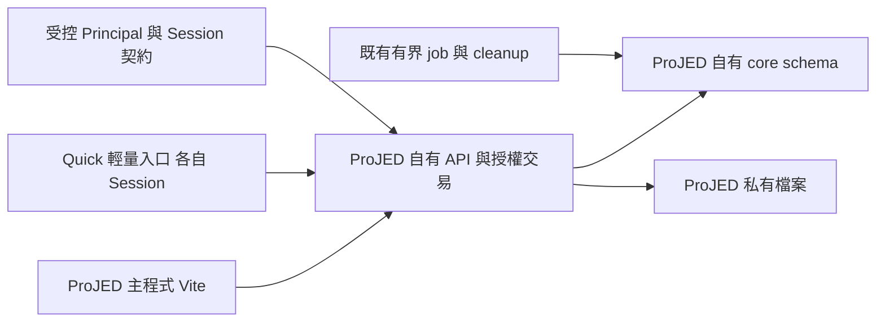

# SPEC-139：ProJED 納入 Jenfu-Platform 的產品與技術交接契約

- 主責：[DEV-139](../dev_task.md#dev-139-jenfu-platform-onboarding)。
- 日期：2026-10-27（Asia/Taipei）；版本：Rev 24（S3 Calendar Subscription W13）。
- 文件狀態：**S1：Implemented／Local Acceptance PASS（PostgreSQL 18）；S2：ProJED consumer seam Implemented／External Wire Blocked；S3：domain core、collaboration、record／activity、HTTP產品接線、看板跨工作區搬移、舊provider邊界、Quick Task、Task Workbench、Task Tracking、Backup／Import、帳號偏好、Calendar subscription管理／ICS feed及全私有API actor/context CAS Implemented／Production Resolver Disabled**。ProJED 技術選型已固定；完整整合仍缺 owner 發布的 ProJED／非員工 wire、真Session resolver、資料移轉、相容入口及正常產品UI證據，不作整體 ready 宣告。
- 適用階段：2026-10-26 使用者已要求完成 DEV-139 開發；本版記錄 S1 runtime／DB 核心、S2 consumer seam，以及 S3 domain／collaboration／record／activity、opaque Session產品入口、HTTP backend selector、單一revision polling scheduler、Board transfer、legacy provider fail-closed邊界、Quick Task outbox同步、Task Workbench雙向原子放置、Task Tracking reference持久化、Backup／Import交易式替代、帳號偏好同步與Calendar subscription／ICS feed替代的本地驗證。正式發布／切流、正式資料、IAM／Secret／billing及其他repo不在本地開發授權內。
- 直接交接入口：[§11 S1 定案契約](#11-架構決策與-s1-定案契約)、[§12 S1 實作狀態](#12-s1-實作狀態2026-10-26)、[§13 S2 consumer seam](#13-s2-projed-identity-consumer-seam2026-10-26)、[§14 S3 read adapter](#14-s3-http-read-adapter-slice2026-10-26)、[§15 S3 domain command](#15-s3-domain-command-w12026-10-26)、[§16 S3 collaboration command](#16-s3-collaboration-command-w22026-10-27)、[§17 S3 record／activity](#17-s3-recordactivity-w32026-10-27)、[§18 S3 HTTP product wiring](#18-s3-http-product-wiring-w42026-10-27)、[§19 S3 Board transfer](#19-s3-board-transfer-w52026-10-27)、[§20 S3 legacy provider boundary](#20-s3-legacy-provider-boundary-w62026-10-27)、[§21 S3 Quick Task](#21-s3-quick-task-w72026-10-27)、[§22 S3 Task Workbench](#22-s3-task-workbench-w82026-10-27)、[§23 S3 Actor CAS](#23-s3-actor-context-cas-w92026-10-27)、[§24 S3 Task Tracking](#24-s3-task-tracking-w102026-10-27)、[§25 S3 Backup／Import](#25-s3-backupimport-w112026-10-27)、[§26 S3 Account Preferences](#26-s3-account-preferences-w122026-10-27)及[§27 S3 Calendar Subscription](#27-s3-calendar-subscription-w132026-10-27)；[§11.8 技術主管審查](#118-技術主管審查與最小優化)保留 Rev5 修正理由；既有使用者切換見 [§6.3](#63-既有使用者的切換基線)。
- 決策來源：[DEV-139 人類決策](../dev_task.md#dev-139-jenfu-platform-onboarding)；架構取捨：[ADR-054](../decisions/ADR-054-projed-cloud-run-cloud-sql-boundary.md)。本文件不是其他 owner 已接受或已發布的契約。

## 1. 目的、限制與完成邊界

首階段保留 ProJED 現有工作區、看板、權限與操作流程，先對齊 Cloud Run 雲端架構、Cloud SQL 資料庫及身分契約，保留 React／Vite／Zustand、個人任務、外部協作、Quick Task、多視圖及已可用 AI 功能。身分接入改變可信登入來源及 Session，不重設 ProJED 的業務權限模型。

ProJED 已有使用者，移轉必須以「不丟資料、不重建帳號、不改權限、不強迫重裝」為相容目標，先保留既有網址再分階段替換後端。切換時預留各 App 的正常重新登入及經演練確認的短暫停寫；零重登／零停寫尚無實作證據，不能承諾。人類要求將評估寫入文件，未指定可接受停寫分鐘數、恢復窗口或授權正式切換；這些實際界線在移轉／release re-entry 收斂。

成本採人類最新要求「只要費用不大幅增加即可」。首階段效益為基礎設施及身分契約一致、既有功能與資料授權相容；任務／資料跨系統使用是後續效益，節費及投資回收期不是必要驗收。首階段必須證明新路徑上的原功能及權限行為，不能只以平台可見、登入成功、表格搬入同一 DB 或測試數量認列交付。

目前只修改 ProJED 的本地獨立工作樹；其他專案來源只讀。沒有跨專案修改、付費資源、IAM／Secret、遠端 DB、正式資料或流量操作授權。本地文件中的 owner 分工不能代替人類對其他目標專案與動作的授權。

### 人類產品決策

2026-10-08 的兩項決策均已有明確人類回覆；D2 採最新原文的首階段範圍，不把先前建議或預選的 2A 視為採用：

| ID | 決策與影響 | 已提出選項／目前狀態 |
|---|---|---|
| D1 | 個人／外部帳號的最小登入識別統一登錄於 OrgMaster；Principal publisher、准入及撤銷分層。 | **Human Confirmed**：回答「接受統一登錄最小身分資料（建議）」；私人內容留在 ProJED，登錄不授予公司管理員私人存取權。 |
| D2 | 首階段交付範圍與原功能保留；決定此次不新增跨 app 業務使用情境。 | **Human Confirmed**：原文「保留 ProJED 現有的工作區、看板與權限功能，先處理雲端架構、資料庫和身分契約的對齊」。先前選項中較接近 2C，但以原文為準；Platform 任務摘要與 AI-PDM 專案／看板連結均延後。 |

工程命名、局部程式寫法與驗證工具由 RD 決定。D1 固定最小身分資料歸屬，D2 固定首階段基礎對齊及原功能保留；兩者不構成產品實作、跨專案開發或正式環境操作授權。後續跨 app 任務情境另有 re-entry trigger，不再作本階段待決門檻。

使用思考習慣：#效用理論、#限制條件、#可驗證性

## 2. 現行基線與受影響能力

本地查證來源為 ProJED `main@69a5c528774394080717129bac7ba011eb48cd12`；本輪修訂前僅 DEV-139 的四份文件有未提交變更。以下描述 repository 事實，不代表即時正式環境 readback。

| 能力／來源 | 現況與必須保留的契約 | 移轉責任 |
|---|---|---|
| [package.json](../../package.json)、[Vite](../../vite.config.js)、[正式契約](../../scripts/release/production-contract.mjs) | React／Vite 主程式與輕量 Quick entry；Firebase Hosting＋Supabase backend；既有建置版本及 PWA 更新保護。 | ProJED 自有 Node HTTP runtime 提供靜態產物與 API；保留入口及 build-wide artifact identity。 |
| [資料服務](../../src/services/supabase/projedService.ts)、[backend dispatch](../../src/services/dataBackend.ts) | SDK 直讀寫、RPC、工作區／看板／任務／邀請／文件服務；domain DTO 有相容欄位與 canonical ID。 | 建立 provider-neutral HTTP adapter，保留服務行為與 domain mapping，將 SQL、授權、交易留在自有 API。 |
| [初始 schema](../../supabase/migrations/202605140001_initial_projed_schema.sql)、[Auth service](../../src/services/authService.ts) | profiles 外鍵綁 auth.users；SQL 使用 auth.uid()；目前 Google 登入會建立／讀取 profile。 | 新安全主體與本地 user ID 分離，受控映射；搬移 schema、RPC、policy 的語意。不能把舊 SQL 原封不動套到新 DB。 |
| [SPEC-036](SPEC-036-trello-like-workspace-governance.md)、[分享契約](SPEC-026-trello-like-board-share-ui.md)、[角色與能力型別](../../src/types/index.ts) | Workspace 管理與 Board 授權分層；五種角色與可設定的 Board capability matrix；guest 的 tenant identity anchor 不授予其他看板。 | 保留 membership、各 Board 已設定的權限與管理繼承語意，與公司入口／角色契約分開判定；見 §4.4。 |
| [同步 hook](../../src/hooks/useSupabaseSync.ts) | Supabase postgres_changes 觸發 scoped reload；多視圖共用 canonical data。 | 以自有 API 提供受權限約束的同步通知／增量讀取，避免每張畫面各自建立全域資料來源。 |
| [ADR-050](../decisions/ADR-050-mobile-quick-task-entry-and-outbox.md)、[ADR-053](../decisions/ADR-053-quick-task-cross-origin-account-link.md)、[Quick receipt adapter](../../src/services/supabase/quickTaskCaptureService.ts) | local-first、各 App Session、明確認領、immutable owner／captureId、receipt replay 與七日 synced 副本清理。 | 改 provider 仍保留全部資料安全不變條件；新舊 origin 的本機資料另行恢復。 |
| [ADR-051](../decisions/ADR-051-projed-owned-meeting-analysis-pipeline.md)、[AI service](../../src/services/meetingSynthesisService.ts) | ProJED 擁有來源、job／lease、費用、原稿、投影及清理；部分真實 provider qualification 尚未通過。 | 自有 server／worker 承接已可用功能，未合格功能維持原 gate 與 NOT_PASS。 |

## 3. 目標架構與資料權責

- 主程式的基礎部署單位為 Vite 靜態檔＋Node API 的 ProJED Cloud Run 服務。既有獨立 Quick PWA origin／manifest identity 依 ADR-053 保留；估工基線包含主程式與 Quick 兩個 ProJED 自有 Cloud Run 入口、同一套 server 業務實作及各自同源 Session/API。這是兩個入口，不新增另一套業務資料權威或 app key。
- 不為登入簡化合併 origin、強制重裝或共享 token。既有使用者預設保留現行主／Quick public origin，由相容入口轉送至 Cloud Run；`run.app` 是 runtime 服務位址，不要求使用者立即改網址。相容窗口及入口退役條件見 §6.3–§6.6；實際服務／環境綁定後續核實，不臆造正式 target。
- ProJED 宣告 app key `projed`，自有 schema 固定 `projed_core`／`projed_contract`；平台 registry 的實際登錄列為 S2 owner 工作，不宣稱已登錄。Workspace、Board、Task、membership、Board role permissions、invite、profile、receipt、job、audit、檔案 metadata 都由 ProJED 擁有；不得寄存在 Platform core。contract schema 保留受控邊界，首階段不因此建立任務摘要 endpoint 或賦予其他 app 業務資料讀取權。
- 同一 lifecycle DB 使用 app-specific owner／migrator／runtime、ledger、Secret 及單一目標 DSN。runtime 無 DDL、owner、migrator、BYPASSRLS 或其他 app core 權限；跨 app 只使用版本化 contract 與明確 consumer ACL。
- app-specific `db/AGENTS.md`、S1 SQL 與 DB boundary checker 已建立並通過靜態自查；根目錄治理規則未修改，完整 domain SQL 仍屬 S3。
- 檔案持久化選定 ProJED 私有 Cloud Storage。API 驗證用途與資源權限，DB 保存 metadata／cleanup obligation；不把 Cloud Run 本機磁碟當作持久儲存。不建立共用公開 bucket；實際 bucket／IAM 綁定及移轉驗收屬後續環境範圍。
- durable job 沿 ADR-051 的獨立生命週期使用有界 worker／Job；沒有獨立工作責任的 handler 留在 API。禁止靠 HTTP 回應後的記憶體工作宣稱完成持久處理。

API 與 worker 可讀取其他 owner 已發布的 contract，但不能操作其 core、ledger 或 outbox。共用 SQL instance 不建立跨 core FK 或跨 owner 的假原子交易。

### 3.1 Runtime 工程基線與模組責任

本節固定 ProJED 的技術選型。S1 server 已依 Node `>=24.11.0 <25`／npm `>=11 <12`、`pg ^8.21.0`、TypeScript、`node:http` 實作；本地隔離驗證接受 PostgreSQL 17／18，並記錄實際 major。lockfile 已固定實際解析版本；未來 managed target 仍按實際綁定版本重驗，這不要求 Vite 改成 Next.js。S1 完整契約見 §11、實作結果見 §12。

| 模組 | 責任與禁止跨界 |
|---|---|
| HTTP／靜態入口 | 同一套 server 程式，按主／Quick entry 設定提供各自產物及同源 `/api/`。Cloud Run 依 `PORT` 監聽 `0.0.0.0`，本地驗證只綁 loopback；API 404／錯誤不得落入 SPA fallback。檔案路徑只限產物根目錄，禁止 traversal。 |
| Session／identity adapter | 核實受控 handoff、current state、mapping，產生 server-owned actor；瀏覽器 header／JSON 不能直接建構 actor。未發布 producer 只可作標明 SIMULATION 的測試替身，不能接正式入口。 |
| Domain service／repository | 服務行為、capability、scope 與自有交易；frontend adapter 保留既有 DTO。不得暴露任意 table／RPC／SQL tunnel。 |
| Pool／migration | 每 process 一個有界 pool；runtime DSN 與 migrator credentials 分離。啟動只驗角色、DB identity、schema／ledger 相容及設定，不自動 migrate 或修復 grants。 |
| 同步／worker | 同步只提示重新讀取受權資料；長工作沿原 job／lease／費用／清理責任。API 回應不宣稱 worker 完成。 |

Session／私人 API 回應採 `Cache-Control: no-store`；SW 不快取 API、登入 callback、Session 或私人內容。雜湊靜態資產與 HTML／manifest／SW 的快取及更新沿現有 PWA release 契約，不能用 SPA／離線快取假造登入成功。關閉時停止接收新請求，有界完成／回滾在途交易並關閉 pool；未提交與 commit 結果不明分開記錄。觀測只留 request ID、結果碼、耗時及最小 scope／版本，不記 token、DSN、任務正文或邀請原 token。

## 4. 身分、Session 與授權契約

### 4.1 安全主體與既有資料歸屬

- 新路徑的安全主體為可信 `principalId`，不是 email、employeeId、legacy UID 或客戶端送來的 owner。D1 已固定 OrgMaster 為最小身分 publisher；provider pair 由 server 驗證，Platform 處理登入／Session／revocation，ProJED 消費受控契約。
- OrgMaster 登錄範圍是 Principal、已核實的登入來源 pair 及必要的准入／安全狀態與版本 metadata；不複製私人 Workspace／Task、草稿、音訊／檔案、receipt 正文或任務行為資料。非員工沿既有個人登入建立最小身分，不因此取得公司角色或其他 app 入口。
- Principal 登入資格與 Employee／公司資格分開。離職、公司角色／入口撤銷或 Board membership 撤銷只收斂相應公司／資源權限；在仍有有效 provider 身分且沒有受控全域安全撤銷時，私人使用沿有效 Principal 保留。真正全域安全撤銷由受控安全契約處理，普通公司管理角色不能以離職處理冒充全域停用私人帳號；被停用的公司 Google 帳號不承諾仍可登入。
- 員工資料是公司資格；個人／外部帳號不建立虛假 Employee。既有公司角色權威仍由 OrgMaster 發布；公司准入不得自動授予私人工作區或其他看板。既有 Workspace 維持原授權，不按 owner 的 email／員工歸屬自動轉成公司 Workspace；公司關聯須有受控且可核實的資料來源。
- 既有 `human_personal` account type 代表人的個人登入憑證，不能據此推定 current producer 已支援非員工。新版需明定 Principal active、可選 Employee／公司資格、ProJED app admission 與其版本，避免以 inner join Employee 排除個人或外部使用者。
- `localUserId` 保留既有 ProJED profile UUID 作業務外鍵與 receipt owner。server 必須用已驗證的 Principal mapping 找到該 ID；它不能作為登入或授權 fallback。
- 新舊 provider 可能有不同 issuer／subject。移轉須核實 owner 發布的綁定鏈，或在受控程序證明兩側帳號控制權；不能直接比較不同 provider UID 或按 email 合併。歧義、缺鏈或一對多衝突保持未綁定／隔離，禁止批次猜測、重派或合併私人資料。
- 未確認映射的使用者可保留本機資料；雲端查詢／補送拒絕。legacy user／task／receipt ID 與來源證據保留，不因認證 provider 變更重建任務。

### 4.2 准入與 Session

| 使用者 | 正常入口與權限來源 | 不可外推的權限 |
|---|---|---|
| 公司使用者 | Platform 正常登入→已指派 ProJED 入口→新版本 handoff→ProJED Session→公司資格與本地 capability/resource。 | Portal 可見／SSO 成功不等於看板管理權，也不產生私人資料讀取權。 |
| 個人使用者 | ProJED 正常登入→OrgMaster 最小非員工 Principal publication→Platform 身分／ProJED Session→個人 Workspace／Board。保留既有個人使用，不新增員工白名單限制。 | 個人登入不產生公司角色或其他 app 入口。 |
| 外部協作者 | 正常登入→看板邀請接受→指定 Board membership；邀請期限、一次性接受與撤銷由 ProJED 驗證。 | Board guest 身分不公開其他看板／工作區，也不授予平台其他 app。 |
| Worker | 經驗證的 workload identity＋purpose／資源範圍＋active claim／lease；保存發起 Principal。 | 不將 service identity 當成任意人類角色，不以使用者瀏覽器憑證執行全域維護。 |

目標 Session 採各 origin 的 HttpOnly／Secure opaque cookie 與 server-owned session state；mutation 有 CSRF／Origin 驗證。cookie／callback／服務來源限定 exact origin；不以 CORS 代替登入，也不把權威 bearer 或 DB 憑證放入 localStorage／前端 bundle。Quick 的 auth context 只保留本機 owner 提示、epoch 與登出 barrier。

主程式與 Quick 允許登入不同帳號、各自登出，不自動切帳。受控全域撤銷依契約生效；不增加跨 origin 即時畫面刷新或自動 SSO 的產品承諾。

現行 handoff v2 的 employeeId required 與兩個 audience 不能原地放寬成非員工契約。新 consumer／非員工 wire contract 採新版本與相容窗口，issuer／audience／PKCE／CSRF／一次性 code／來源 Session 到期及原始 auth_time／epoch／revocation 保護保留；精確 wire version 由發布 owner 的契約收斂，不在本 repo 冒稱已存在。

### 4.3 保護查詢與寫入

1. 驗證當次 Session、Principal current state、來源到期及撤銷狀態；producer 無法確認時拒絕，不以歷史 allow cache 補權限。
2. 解析 server-side mapping 與 canonical Workspace／Board／Task；使用者提供的 resource ID 只作查找，不能決定歸屬或角色。
3. 驗證當前公司准入／scope（僅適用公司資源）與 ProJED membership／capability。Workspace owner/admin 的繼承能力沿 SPEC-036；一般公司管理角色不等於 Workspace owner。
4. 自有交易內核對資源、membership／授權版本及副作用範圍，執行業務寫入與 receipt／audit。已提交撤權後的新請求必須拒絕；在途交易的排序／版本重驗規則於實作契約固定。
5. DB 保留 row/resource policy：trusted server 在交易範圍內設定 actor context，缺 context 拒絕，連線池歸還前不留下前次 actor；helpers／RPC 只讀可信 context，不移植依賴 Supabase JWT 的 auth.uid()。

RLS 是避免漏 scope 的第二層保護；context setter 的可信度來自 server 認證與禁止客戶端直接連 DB。不得把可變 GUC 描述為能抵抗已失陷的 runtime。涉及跨 owner 的 current state 重驗沿其 contract，不能承諾未存在的分散式原子性。

### 4.4 既有工作區、看板與權限功能保留

D2 要求保留使用者功能及授權結果；server/API、policy 與登入 adapter 可替換，Workspace／Board 的產品模型及權限操作不重做。以 SPEC-036、角色與能力型別及資料服務為基線，實作前再核對當時版本；未查證的 live 行為不得由文件推定 PASS。

| 保留面 | 移轉與驗收要求 |
|---|---|
| 工作區／看板 | 保留原 canonical ID、名稱、歸屬、建立／切換／改名／受控移動／刪除及既有管理入口；一般有效登入者建立工作區與建立者 owner 語意沿原契約。不得按員工、email 或新 app registry 重建資料樹。 |
| 角色與 membership | 保留 `owner / admin / project_manager / member / viewer`、Workspace 與 Board 成員區別及 membership／invite 既有狀態。外部 guest 是特定 Board 的存取範圍描述，不另造角色或把 Board 成員自動提升為整個 Workspace 成員權限。 |
| 看板權限設定 | 搬移 `board_role_permissions` 的每 Board／role capabilities，保留非預設及明確空集合設定；沿原 owner 固定能力與其餘角色 normalization，不把所有角色重設為 default。保留原設定／分享操作入口及保存後重載結果。 |
| 管理與繼承 | Workspace owner/admin 依原 capability／Board matrix 計算繼承；Board 管理權不外推為整個 Workspace 管理權。公司角色與 Portal 指派只提供對應公司准入，不能改寫 ProJED membership 或擴張私人存取。 |
| 邀請、撤權與可見性 | 保留既有分享／邀請／接受／撤銷流程與 scope；撤權後新請求拒絕，guest 的 identity anchor 不暴露其他 Board。各角色操作是否允許，必須與凍結基線一致。 |

身分 mapping 只把可信 Principal 連到原 `localUserId`，不重派 owner、重新接受 invite 或重算公司員工角色為看板角色。若發現原程式、資料設定、SQL policy 與規格互斥，停止受影響 slice 並先收斂來源；不得以「架構對齊」默默放寬授權或移除現有功能。

### 4.5 外部身分契約的具體交接缺口

只讀查證發現 handoff v2 的 audience 僅含 `orgmaster / ai-pdm`，且 canonical-principal v1、VerifiedJenfuAppSession v1 及現行 admission projection 都仍依賴 Employee。不能只在 ProJED 加 app key 或把一個欄位改 nullable，就宣稱整條路徑支援非員工。以下是交給 owner 審查的需求，未宣稱已有新版、owner acceptance 或 native DEV。

| Owner／輸出 | 必須收斂的契約與相容證據 |
|---|---|
| OrgMaster／Principal publication | 穩定 Principal、已核實 issuer／subject pair、active／security version；Employee／公司資格可選且獨立。不用 email 補 mapping，不藉個人登錄發布私人任務或公司入口；非員工建立／再登入及歧義隔離需正常路徑證據。 |
| Platform／registry、handoff、app Session | 新版本辨識 ProJED 及主／Quick exact callback／client；保留 PKCE、一次性 code、原始 auth time、來源到期、epoch／barrier、服務身分及 CSRF。非員工與舊員工 consumer 都有 schema／正常路徑驗證；不原地放寬 v2。 |
| Platform／current auth state | 當前 `platform_contract.read_principal_auth_state_v3(text)` 及 admission 的可用範圍需由 owner 確認適用 ProJED；0 row／不可確認不得當 epoch 0 或 allow。區分全域安全撤銷、公司准入撤銷及本 App Session 登出，給出版本與有效時間契約。 |
| ProJED／consumer conformance | exact issuer／audience／redirect／consumer ACL、可信 mapping、Session 前置條件及本地 capability；synthetic 員工、非員工、guest、錯 issuer／audience、撤權／失效及 producer unavailable 測例。舊 consumer 的 compatibility receipt 與 ProJED 新路徑 evidence 分開。 |

外部交接以 canonical repo／DEV-139／本節 slice 引用來源；目標 owner 在獲人類開發授權後才查其索引選 native ID，提交 owner／source／版本／相容證據。此處不向其他專案派工或修改任何發布契約。

## 5. 資料與 API 交接面

### 5.1 資料不變條件

| Domain | 交接契約 |
|---|---|
| profile／Principal mapping | 本地 UUID、名稱／偏好／membership 外鍵保留；verified mapping 與歷史來源分開；email 僅為聯絡資訊。 |
| Workspace／Board | 沿 tenants／projects 語意與 canonical ID；Board 屬單一 Workspace，搬移不重建 Board ID；私人與公司關聯需有明確來源。 |
| 角色／權限設定 | Workspace／Board membership、原角色與 `board_role_permissions` 按 §4.4 保留；權限空集合不轉 default，平台公司角色不替換本地角色。 |
| Task 與多視圖 | 同一 canonical task；parent、dependencies、placements／tracking、assignees、tags、dates、archive 狀態及人工正文保持。projection ID 不可當 canonical task ID。 |
| 狀態 | TaskStatus 保留 `todo / in_progress / delayed / completed / unsure / onhold`；member 與 invite 狀態沿現行型別，不為平台整合重定義業務生命週期。 |
| invite／membership | 接受邀請、更新 membership、回執在同一自有交易；guest identity anchor 不擴張 workspace 可見性。 |
| Quick receipt | `(localUserId, captureId)` 冪等；首次 titleHash、commit 時間與結果不可變；Task 改名／歸位／刪除後 replay 不重建。 |
| 會議／文件／檔案 | 原稿、來源版本、段落／task links、vector／chunks、job／lease、費用 ledger、projection receipt、retention／cleanup 全部有 owner。未資格驗證功能維持未啟用。 |
| 已有連結／feed | Board 分享、calendar/feed、檔案／知識連結的 identifier 和權限保留；origin 改變須有受控相容處置，不讓有效舊連結默默指向錯誤資源。 |

### 5.2 最小 HTTP 能力

以下是供 RD 估工的介面責任，尚非完整 OpenAPI、route allowlist 或已存在 endpoint。RD Implementation Ready 前由來源服務盤點補齊每種操作 DTO／版本／限制與 caller，不以表格數當 API 數。

| 能力 | 最小 I/O 與成功條件 | 權限／交易責任 |
|---|---|---|
| Session／登入／登出 | verified Principal、localUserId、本 App Session／到期與可辨識帳號；取消登入返回原草稿。 | server 核實 provider 與 mapping；各 origin Session 隔離，不能接受 browser 自述 Principal。 |
| Workspace／Board／member／invite／role permissions | scope-bound 讀取、建立／更新／受控移動／分享／接受／撤銷／權限設定；保留現行 DTO 與成功後 UI 更新。 | canonical resource、role/capability、當前 membership／Board matrix；禁止跨 scope 寫入。 |
| Task／tag／dependency／placement | domain 操作及 scoped list；mutation 回傳實際 canonical ID／persisted outcome，支援 stale conflict。 | 不能讓 payload 改寫 owner／Workspace 來逃過檢查；bulk 操作的原子性沿既有語意。 |
| Quick capture | 輸入 captureId、title、可選 workspace hint；owner 由 Session mapping 決定。回傳 committed、captureId、ownerId、titleHash、created、committedAt。 | task＋immutable receipt 同交易；同內容 replay 回首次 receipt，異內容同 key 為 409。workspace hint 須重驗，不先讀業務清單。 |
| 同步／恢復讀取 | 當前 authorized scope 的 change version／通知與 canonical reload；自己 commit 後立即更新，重連後補齊資料。 | 每次訂閱／poll/read 重驗權限；禁全域廣播私人內容。通知不是資料權威，刪除／撤權以重新授權的結果收斂。 |
| AI／文件／檔案／feed | 既有 I/O、來源／費用／清理及失敗重試；私有檔案存取經用途與資源驗證。 | provider secret 只在 server；已有 signed URL 的有效窗口與撤權語意不得擅自變寬。 |
| 身分 contract consumer | ProJED 消費受控 Principal／provider mapping、admission、Session／handoff／revocation；非員工及各 origin 相容窗口見 §4。 | owner 核實 issuer／audience／actor current state；保留本地 capability，不以 service allow 代替資源授權。 |

錯誤至少分為 400 輸入不合法、401 Session 無效、403 有效身分但不具權限、404 不存在／不洩漏存在性、409 stale／mapping／冪等衝突、429 限流及 503 依賴不可確認。以穩定錯誤碼與 correlation ID 呈現可恢復訊號；不把 503 或逾時當成空清單／建立失敗後換 ID 再送。

### 5.3 首階段與後續業務串接邊界

D2 已確認先完成基礎對齊。首階段跨系統 consumer 是 ProJED 對 OrgMaster／Platform 身分契約的消費；Platform registry／launch／handoff 可提供登入入口，但沒有任務摘要畫面、任務資料 BFF、AI-PDM project↔Board mapping 或其他 app 任務 API 交付。

首階段不登錄跨 app 任務 consumer、不發布通用 task query／command、不把業務資料外送至 OrgMaster 或 Platform；ProJED 仍是任務、工作區、看板及權限真相 owner。schema／version／ACL 邊界可供後續契約使用，沒有已核准業務 consumer 時拒絕跨 app 業務讀寫；不建立未被要求的通用事件平台、雙向同步或另一份 task master。

業務串接列為 **Future Phase Captured / Not Requested**：待基礎對齊有功能／權限相容證據且人類要求實際串接時，再決定 Platform 摘要、AI-PDM 連結或其他情境，固定 owner、consumer、最小資料揭露、正常入口及驗收，並取得涉及專案的明確開發範圍。私人內容預設不外送；原業務效益尚未驗證，不以 schema 存在或身分登入成功宣稱已交付。

同步選定 **有版本的 polling＋canonical reload**：active client 每 5 秒查受權 scope revision，隱藏頁面暫停，focus／reconnect 立即補讀；本 client commit 後直接更新並重驗資料。通知只回版本／變更訊號、不回私人正文，資料仍由同源 API 受權讀取。S3 以雙 client 的正常 UI、撤權及重連案例驗成功讀取週期內 10 秒收斂；失敗保持可辨識狀態，不把 stale 資料當已同步。完整 cursor／scope DTO、change revision 與容量 verifier 在 S3 契約收斂；不預設引入 WebSocket／SSE、Redis 或常駐分送 worker。改 transport／延遲契約需回架構審查。

### 5.4 既有 provider 呼叫的移轉盤點

盤點範圍不能只限 `dataBackend.ts`；以下 repository 呼叫面已查證，實作前仍須補齊函式／caller／policy／測試逐項清單，並核對當時 source。這是目前估工輸入，不是完整 live capability inventory。

| 呼叫面／直接來源 | 必須接替及保留的行為 |
|---|---|
| [projedService](../../src/services/supabase/projedService.ts)／[backend dispatch](../../src/services/dataBackend.ts) | Workspace／Board CRUD、移轉 preview／move、member／invite／permission、Task／tag／dependency、knowledge／activity／audit、backup preview／import／fingerprint；每個服務結果保留 domain DTO，不能以 CRUD 表數漏掉交易 RPC。 |
| [Auth](../../src/services/authService.ts)／[Quick auth](../../src/features/quickTaskCapture/auth.ts)／[Quick sync](../../src/features/quickTaskCapture/sync.ts) | 主／Quick 獨立登入、取消／登出／切帳、profile 與 frozen owner。HTTP 模式移除必填 bearer 的依賴，保留 auth epoch／context revision／CAS；不得從舊 SDK token 判定新 Session。 |
| [未歸位／placement](../../src/services/supabase/taskWorkbenchUnplacedService.ts)／[tracking](../../src/services/supabase/taskTrackingReferenceService.ts)／[Quick receipt](../../src/services/supabase/quickTaskCaptureService.ts) | 未歸位任務、子樹移動、operation receipt、tracking reference 及同 ID replay；不能只搬 WBS 表。 |
| [工作區／任務同步](../../src/hooks/useSupabaseSync.ts)／[成員同步](../../src/hooks/useMemberSync.ts)／[tag 同步](../../src/hooks/useTagSync.ts) | 授權 scope 的重載、撤權收斂、重連補讀與目前 active Workspace／Board 保留；替代 transport 不改 canonical data。 |
| [帳號偏好](../../src/services/accountPreferencesService.ts)／[任務 filter](../../src/services/supabase/taskFilterPreferenceService.ts)／[行事曆](../../src/services/supabase/calendarSubscriptionService.ts) | 個人 layout／filter、feed token／訂閱 scope／輪替／撤銷與已有連結相容；偏好 owner 只能來自 Session。 |
| [會議分析](../../src/services/meetingSynthesisService.ts)／[RAG](../../src/services/rag/ragRetrievalService.ts)／[診斷](../../src/services/supabase/browserDiagnostics.ts) | Functions／provider／job、知識讀取及診斷目的；Secret、原稿、費用／清理沿原契約。直接 fetch 與動態 endpoint 也納入 inventory，不只搜尋 SDK method。 |

`projedService.checkpointDraft` 目前明確拋出「會議雲端 checkpoint 已停用；請使用本機 recovery。」因此保留本機恢復與現有停用狀態，不順帶啟用雲端 checkpoint。既有 AI qualification 同理。每項盤點需標 `保留／有界替換／維持 gated` 及對應 acceptance，全部取得新路徑相容證據後才可能退出原 provider。

### 5.5 HTTP adapter 的估工基線

下列是 ProJED 自有 API 候選，不是已存在或 external wire endpoint，也尚非完整 OpenAPI。路徑範例用 `workspaceRef / boardRef` 表示前端 ref；API 必須按父 scope 解析 UUID 或既有 legacy ID，回傳仍沿 `legacyOrId` 語意，不把舊前端 ID 直接當 UUID 驗證拒絕。

| 候選操作 | I/O 與重要限制 |
|---|---|
| `GET /api/v1/session`／`POST /api/v1/session/logout` | 回最小本 App `localUserId`、顯示帳號、到期及非秘密 `authContextId`；登入 callback 另沿 owner wire。context ID 由 server 生成並綁定 Session，每次建立／換帳／重建 Session 都改變，只是前置條件，不是 bearer。logout 只作用當次本 App Session。 |
| `GET/POST /api/v1/workspaces`、workspace-scoped Board 操作 | 保留 Workspace／Board DTO、建立者 owner、原 ref、排序／metadata；move 是有 preview 的 domain command，不能改 `tenant_id` 欄位跳過來源／目的權限。 |
| Board-scoped `members / invites / role-permissions` | 沿現行 role／membership／invite DTO；角色矩陣保存完整集合含 `[]`。接受 invite 的 userId／email／Principal 以當次可信身分為準；token 只用於受控接受，hash／期限／一次性／撤銷在 server 驗證，不寫入 log。 |
| Board-scoped `tasks / tags / dependencies` | 回現行 TaskNode 與關聯 DTO；不能經 body 改歸屬、父 scope 或 owner；bulk／delete／restore／upsert 沿原 domain 語意，逐操作補原子性及 retry 契約。 |
| `POST /api/v1/quick-captures` | `{captureId,title,workspaceHint?,expectedAccountId,expectedContextId}`；後兩項僅為 frozen actor 前置條件，必須與當次 Session／mapping 一致，不能用來授權。結果沿原 committed receipt，見 §5.7。 |
| scoped canonical reload／附屬功能 | 依 §5.4 盤點逐項補 read／command，不發布任意 SQL、跨 app task API 或目前 gated provider。同步已選版本 polling，仍須真雙 client、cursor／scope 及容量／費用證據；改 transport 回架構審查。 |

共通 mutation 必須帶送出時凍結的 `expectedAccountId / expectedContextId`，handler 進入業務交易前與當次可信 actor／Session 核對；不一致為 `409 ACTOR_CHANGED`，不自動把舊內容換帳送出。Quick、其他跨帳號佇列及延遲保存都套用同一前置條件。CSRF token 與 exact Origin 檢查另行成立，context ID 不取代它們。

成功 body 由 adapter 轉回現有 domain DTO；錯誤 body 採 `{error:{code,requestId,retryable,retryAfterMs?}}`。`401 AUTH_REQUIRED`、`403 ACCESS_DENIED`、`404 RESOURCE_NOT_FOUND`、`409 ACTOR_CHANGED / STALE_RESOURCE / IDEMPOTENCY_CONFLICT / IDENTITY_MAPPING_CONFLICT`、`429 RATE_LIMITED`、`503 IDENTITY_STATE_UNAVAILABLE / DEPENDENCY_UNAVAILABLE` 與 §5.2 對應。無權讀取的物件不洩漏存在性；有效 actor 的禁止 command 依原授權回拒絕。Quick 舊 `QT_*` 業務錯誤碼由 adapter 保留語意，不把 committed／network-unknown／確定拒絕合併成同一錯誤。

舊 SDK 路徑與新 HTTP 路徑按明確 backend 選擇隔離；新模式設定缺失或依賴失敗時拒絕，不自動 fallback 舊 DB／localStorage role 或把失敗顯示為空清單。HTTP 模式的 cache key、取消與 late response 必須含 account／context／scope，不能只用 URL。

### 5.6 Cloud SQL 資料映射與 policy 交接

目標應用表放 ProJED core；S1 已建立 profile／account guard 的 `0001`／`0002` DDL 與精確 grants。下面其餘內容仍是 S2／S3 完整 domain schema 的估工基線；來源以現行全部 migrations 的合成結果及 [database types](../../src/services/supabase/database.types.ts) 核對，初始 migration 不代表最終 schema。

| 來源／目標責任 | ID、constraints 與移轉要求 |
|---|---|
| `profiles`／本地 profile | 保留 UUID、display name、email 聯絡欄位及 `ui_preferences`；移除對 Supabase `auth.users` 的跨 provider FK，保留 ProJED 業務 FK，不改寫 user／owner UUID。profile 自身不授予登入資格。 |
| 新 verified Principal mapping | 保存 Principal、localUserId、受控來源／版本／proof receipt、有效狀態與歷史。每個當前有效 Principal 與 localUserId 的映射須無歧義；重複／一對多隔離，不合併帳號。provider pair 與 canonical Principal 欄位／唯一約束依 producer contract；不能把舊 `external_auth_id` 當已驗證 mapping。 |
| `tenants / projects` | UUID、`legacy_workspace_id`、Workspace 內 `legacy_board_id`、owner／created_by、metadata／sort 保留；Board 仍單一 tenant。依原唯一範圍解析 legacy ref，不跨 tenant 搜尋第一筆。 |
| `tenant_members / project_members / board_role_permissions` | 成員 key、五種 role、Workspace member status、每 Board role capabilities 保留。現行 project member 沒有獨立 status 欄位，不憑空移轉欄位；tenant／project／user 關聯和 guest anchor 需合成 schema 查證。 |
| `wbs_items / dependencies / tags / links` | 保留 UUID／legacy ref、parent／scope／人工正文／日期／狀態與關聯；目標 constraints 及查詢必須拒絕跨 Board parent／dependency／tag 關聯。資料不符合時 reconciliation 報差異，不自動刪除或改派。 |
| 未歸位／placement／Quick receipt | 保留原字串 capture／task ID、localUserId owner、原 placement operation、不可變 receipt／hash／commit 時間；receipt 不因 task 移動／改名／刪除消失，七日 browser retention 不作用 server receipt。 |
| invite／偏好／feed／檔案／knowledge／job／audit | 依逐項 inventory 搬移 token hash、期限／scope、來源與費用／清理欄位；原 invite／feed link、檔案可讀及 gated 狀態分別驗證，不能漏搬附屬表而只驗 Task count。 |

新的 Session state／mapping proof／receipt 等私有安全資料不給普通 browser query API；runtime 只取得指定表／function 的必要 grants，無 schema CREATE、跨 core、TRUNCATE 或可切至 owner 的 role membership。RLS 覆蓋適用業務表的 read／write，包含 `USING` 及 `WITH CHECK`；owner／SECURITY DEFINER 必須逐項審查，不能假設 enable RLS 就約束它們。若 helper 需要 definer，限定 nonlogin role、exact function ACL、固定 search_path 與 purpose，不允許通用提權函式。

membership／scope 查詢及 legacy lookup 的索引與唯一約束按實際 query／FK 定義；設計需覆蓋 tenant+project+user、tenant+legacy ref 及 owner+captureId，避免每次 policy 全表掃描。使用已核准 extension 與 foundation ownership，app migration 不擅自改 shared extension／public grants。所有無 context、偽造 scope、跨 Board FK、helper 越權與 role escalation 案例須在真 PostgreSQL 驗證。

### 5.7 交易、撤權競態與結果不明

每次自有交易從 pool checkout **同一 client** 執行 BEGIN、actor／scope 的 transaction-local 設定、授權／寫入／receipt／audit 與 COMMIT 或 ROLLBACK，不能用多次 `pool.query` 拼交易。context 只由可信 Session adapter 產生，以參數化 `set_config(..., true)` 設定；policy 缺值／無效值拒絕，不接受 browser 任意指定 context。回滾、取消、commit 失聯都要歸還或銷毀不安全 client，下一位 actor 不繼承前次狀態。這層保護針對可信 server 的查詢失誤，不能宣稱可抵禦已取得 runtime Secret 的任意 SQL 操作者。

本地撤權採 **transaction advisory lock＋guard revision**：保護查詢／一般業務寫入取得對應 scope 的 shared lock，撤權／membership／matrix／scope 轉移取得 exclusive lock，再重讀 guard 與權限；需要 exclusive 時一開始就取得，不在同一交易升級 shared。鎖 key 含 `projed` namespace，依 account、Workspace、Board、資源及 canonical ID 排序，去重後逐一取得；hash 碰撞只允許多等候，不能使授權成功。跨 Workspace move 鎖來源／目的並整體原子提交；所有改變該 scope 授權的命令必須走同一排序，不能繞過 guard。

先完成鎖定及授權的在途交易可以排在撤權前；撤權已提交後才取得 lock 的交易必須按新 revision／權限拒絕。S1 固定 account guard／profile 查詢的完整契約於 §11；Workspace／Board guard 與所有 domain command 的完整實作契約仍屬 S3，不把 account-only 驗證外推為 Board 撤權 PASS。

外部 Principal／公司准入的撤銷無法和 ProJED DB 假造跨 owner 原子性。每次保護請求核實 current state，寫入前按 producer 的 epoch／barrier 契約重驗；版本／到期失效或 producer unavailable 不寫入。owner 必須交付在途請求及撤銷可觀察生效界線，尚未收斂時不能宣稱零窗口或沿用歷史 allow cache。

Quick 沿 [現行 invoker RPC](../../supabase/migrations/20261001090000_dev_133_quick_rpc_security_invoker.sql) 與 [model](../../src/features/quickTaskCapture/model.ts)：title 依原外層 whitespace normalization，非空且不超過 500 Unicode code points；保留大小寫、內部空白／換行及正文，不新增 Unicode normalization。SHA-256 用正規化後、outbox 保存的確切 UTF-8 title；captureId 驗證沿現行格式。workspace hint 只是提示，依原語意選有效且本人 active 的 Workspace，不授予其他資源，也不因無效 hint 洩漏存在性。

`(localUserId,captureId)` unique 及同 owner 序列化保護 task／receipt 同交易；同 key 同 hash 回原 commit 時間與 owner、`created:false`，異 hash 回 409，不重寫 receipt。COMMIT 後失聯或 HTTP timeout 為 unknown outcome：先核實同 key 或重送同 key，不換 captureId；只有可核實 committed receipt 才把本機記錄標 synced。新的通用 command 冪等範圍逐操作定義，不能用自動 retry 包裝所有非冪等寫入。

## 6. 資料移轉、PWA 與恢復

### 6.1 Server 資料

1. 建立 schema／table／function／policy／extension、Workspace／Board membership／權限設定、檔案／feed／連結、Auth mapping、job／receipt 的完整 inventory，核對來源實際狀態；migration 檔名不等於 live inventory。
2. 舊 Supabase migration 歷史不改寫。新 Cloud SQL managed DDL 採 ProJED 自有 forward-only migration 與獨立 ledger；shared extensions／foundation 不由 app 搶 ownership。
3. 先以 synthetic／核准 sanitized fixture 演練完整轉換；逐 domain 檢查 count、ID／FK、scope、人工內容／checksum、receipt 與檔案可讀性，保存可重放 reconciliation 差異。
4. 正式切換前必須有單一 writer authority 與可驗證 fence；初始 snapshot／delta／最後停寫邊界及在途 job 由後續 migration 契約固定。不得新舊雙寫後靠時間戳猜勝者。
5. 新路徑已有寫入後，回復必須說明新資料如何保留、舊 binary 是否可讀、job／receipt 是否仍單一；僅切回 DNS／舊網站不是完整恢復。禁止 destructive/down migration 或手改正式 row。

### 6.2 Browser 本機資料

Server 搬移與 browser storage 恢復分開驗收。IndexedDB、Session、SW 及 manifest 綁 origin／安裝環境；若另換新 run.app public origin，不能直接讀舊 origin。§6.3–§6.4 優先保留既有 origin，仍須驗證舊版 client／SW／IDB 升級。舊入口在受控窗口保留核身後補送或可驗證匯出／匯入；具體 transport、來源 proof、import CAS 與目的帳號確認在移轉實作契約固定。

- known owner 的 pending 只補送本人；不同帳號拒絕且不顯示該筆私人內容，不改成 unbound。
- unbound 記錄仍需使用者明確確認目的帳號；登入 callback／升級／匯入不自動認領。
- captureId／canonical task ID／receipt key 保留；網路結果不明先核實同 key，不能建立第二筆。
- 登出／切帳／晚到回應以凍結 owner、Session／epoch、source revision 與 CAS 隔離；前一帳號回應不更新目前帳號畫面。
- 未同步資料與人工草稿不因清理、版本升級、origin 切換或恢復被刪除。七日清理只適用已驗證 receipt 的 synced 本機副本，不能用作 server receipt TTL。
- 舊安裝未完成恢復前不能全面 redirect 或刪 SW／IDB；保留現行更新交易、dirty guard 與可辨識恢復入口，不承諾 OS 自動換 icon／origin。

### 6.3 既有使用者的切換基線

「接近無縫」指可驗證的資料與操作延續，不代表所有 Session 自動延續或從未暫停寫入。本節沿人類要求納入開發文件，不把 AI 建議的時間、費用或登入次數寫成人類已核准的正式服務承諾。

| 保留面 | 契約與可觀察驗收 |
|---|---|
| 雲端資料與權限 | 原 profile UUID、Workspace／Board／Task ID、membership、invite 狀態、五種角色及非預設／明確空集合 Board matrix 保留；移轉前後 count／ID／內容與 allow／deny reconciliation 無未解差異。附件、job、receipt 與人工原稿另有完整性證據。 |
| 帳號與登入 | 已核實的原登入身分對應既有 localUserId，使用者不重新註冊或重新建立工作區；Google 登入選同一帳號仍須驗 provider binding chain，不能只看 email。各 App 預留切換時一次正常重新登入，不承諾舊 Supabase Session 自動變成 Platform Session；日後到期／撤銷沿原規則。歧義隔離、資料保留並有恢復入口，不顯示為新空帳號。 |
| 網址與安裝 | repository 正式主入口為 `https://projed-cc78d.web.app`；SPEC-133 §3 的獨立 Quick 為 `https://projed-cc78d.firebaseapp.com/quick-task/`，另保留主 origin 的 `/quick-task/` 相容入口。這是現行來源基線而非本輪 live readback／新發布 target；沿原 manifest id／start_url／scope 與 SW 更新保護，不要求換 origin 或重裝。 |
| 離線草稿與待送任務 | 在原 browser profile／安裝儲存中保留 known owner、unbound、captureId／hash、人工正文及 pending／failed 狀態；登入、升級或切帳不清空或自動認領。恢復後只以原 key 核實／補送到本人新路徑，結果不明先查 receipt。 |
| 停寫與可恢復性 | 可設計短暫停寫完成最後 delta／核對，但時長由演練量測、可接受窗口在正式 re-entry 確認；不先承諾零停機或固定分鐘數。停寫／登入失效有就地狀態與重試入口，草稿保留，不把錯誤當空資料或成功。 |

不以「所有使用者必須同時更新」作為切換前提。離線舊版回來、舊 SW 繼續供應 bundle、持有舊 Supabase Session 的直接寫入及在途 worker 都須由 server authority 保護；只發布新版前端不能保證舊庫已停止寫入。

### 6.4 保留既有 public origin 的相容入口

- 開發設計基線為既有 Firebase Hosting public origin→受控 rewrite→ProJED Cloud Run runtime／自有 API→Cloud SQL。主／Quick 仍共用同一套業務實作、各 origin Session 及唯一資料權威；Hosting 只保留入口／路由責任，不新增認證 broker、token bridge、task master 或舊庫雙寫。
- Firebase 官方支援 Hosting URL rewrite 至 Cloud Run；這支持過渡路徑可設計，不證明本案環境已可轉送。Hosting site／Cloud Run 的 project、region、服務路由、網路／發布權責及費用須實際核對；不推定現行站點可直接轉送到任意另一個 GCP project。[官方路由依據](https://firebase.google.com/docs/hosting/full-config#direct-requests-to-a-cloud-run-container)
- Hosting 轉送 Cookie 一般只保留 `__session`。S2 必須收斂相容入口的 cookie／state／callback 契約並驗證；不得把既有 cookie 名稱直接套用後宣稱成功，也不能改用前端 bearer／跨 origin 複製來繞過限制。HttpOnly／Secure、exact public origin、CSRF／Origin、期限／撤銷及 `no-store` 保護沿 §4.2，不信任任意 forwarded host／return URL。[官方 Cookie 限制](https://firebase.google.com/docs/hosting/manage-cache#using_cookies)
- 主 origin 的 `/quick-task/` 相容入口沿該 origin 的 Session；獨立 Quick origin 可登入另一帳號。S2／S3 需固定 public origin／app entry／runtime route 的對應，不能因兩個 Cloud Run 服務或同名 Cookie 新增第三套帳號狀態、共享跨 origin Session 或自動切帳。
- Hosting 靜態檔優先於 rewrite，且現行 `firebase.json` 有 Quick／SPA fallback。S3 必須核對實際命中順序、HTML／SW／manifest／assets 與 API 的同一 artifact／相容 revision；API／登入錯誤不能回 SPA 200，私人 API／Session／callback 不被 CDN 或 SW 快取。舊版不相容時保存本機內容並引導更新／恢復，不能靜默送入另一個帳號。[官方 rewrite 規則](https://firebase.google.com/docs/hosting/full-config#configure-rewrites)
- 保留 Hosting 是有界相容責任，不取消 Cloud Run／Cloud SQL 對齊方向。其流量、發布與保留費用納入 §7；未驗證舊使用者恢復與替代入口前，不能把 Hosting／舊站已停止的支出算為節省，也不能先做 Billing unlink 或退役。

### 6.5 移轉狀態與單一寫入權威

以下是實作相依與安全狀態，不是正式部署操作表；沒有 resource binding、切流指令或本輪環境操作。

| 設計階段 | 業務寫入權威 | 使用者保護與下一狀態條件 |
|---|---|---|
| 盤點與相容準備 | 舊庫唯一 writer；目標尚未接正式寫入。 | 核對登入／origin／已安裝版本／本機與 server inventory；準備舊站相容更新、verified mapping、就地停寫／恢復入口。未上線使用者的未知狀態不能算已完成。 |
| 隔離演練 | 正式權威不變；目標只用 synthetic／核准 sanitized fixture。 | 先具 S2 真身份與 S3 原功能替代契約；演練 snapshot／有界 delta、各角色與檔案／receipt reconciliation、舊版／離線恢復、writer fence 及新寫入後的恢復。 |
| 最後停寫與核對 | 舊庫所有納入範圍的寫入已 server-fenced；新庫尚未開放業務寫入。 | 直接 SDK／RPC／Functions／worker／在途 job 都有可核實界線；固定最後 delta／來源水位並完成核對。任一未解差異不開放新 writer；使用者可保留本機草稿及待送 key。 |
| 啟用新路徑 | 新庫唯一 writer；舊庫維持 fence。 | 同一可信 Principal→mapping→Session→API→DB 路徑可用後，原網址／PWA 進新版；原 ID／key 補送及 receipt readback。新寫入後恢復須保存新資料與單一 job／receipt，不能只切回舊網站。 |
| 保留恢復與退役評估 | 新庫仍唯一 writer；舊入口只提供已驗證的相容／恢復。 | 已知未同步及歧義帳號逐項處理，保留核身後恢復義務。窗口到期不等於所有離線裝置已恢復，不自動刪本機資料／舊資產；入口或資源退役另需證據與對應人類主要動作授權。 |

停止條件：mapping 不可核實、權限／內容不一致、舊寫入仍成功、target 已寫入卻無保留新資料的恢復路徑、Session／回呼不可用或私人內容被快取。停止受影響轉換並保存差異，不能用雙寫、改 owner、重設權限、刪草稿或忽略舊 client 取得 PASS。

### 6.6 移轉 readiness 與恢復條件

本節是移轉相容契約與驗收基線，**尚非移轉 RD Implementation Ready／Release Ready**，不擴張 S1 核心定案範圍。S2 尚須發布非員工 wire／admission／revocation、verified legacy mapping proof、各入口 Session／Cookie／callback 與取消／切帳契約；S3 尚須完整 domain adapter、舊版 API／SW／IDB 相容、全部寫入來源 fence、source 水位／delta／reconciliation／檔案與 job 恢復及 Hosting 路由／artifact 契約。

下一次移轉演練準備時，在同一 DEV 補可重現 fixture／命令與恢復證據，按 A06／A09／A11、T07／T08 驗正常使用者路徑；正式切換另確認可接受停寫／恢復窗口、成本與環境／資源主要動作範圍。沒有新的 PWA 重裝、資料揭露或零重登需求；若日後要求換 public origin、立即移除 Hosting、零停寫或另造 Session bridge，先回架構／產品影響審查。

## 7. 費用、容量與相容限制

費用比較以同等使用量及可取得的帳單／方案為基線，列出主程式、Quick 兩入口、相容 Hosting、API、同步、worker／AI、私有儲存、SQL 邊際擴容／備份、build／monitoring 與可停止的舊支出；共用訂閱或保留入口未能取消的費用不能計為節省。一次性工程與移轉雙跑／恢復窗口費用分開。

持續費用增量＝新增費用－可停止的既有支出。呈現「既有 tier 可承載／需要擴容」情境及估算範圍，不自行設定「不大幅增加」百分比或要求節費回收期。實際付費／tier 決策在成本證據可審查且有對應授權後處理。尚未取得可歸屬帳單／用量，因此費用條件未驗證，本輪未建立付費資源。

新增 ProJED 後重算所有 effective revisions／instances × pool count × pool max，納入主程式、Quick、worker、candidate、migration／verifier／operator 與既有保留。當前 repo 的三 app capacity 設定只作查證基線，不直接引用成第四 app PASS。先收斂無界 pool／scaling；失敗不自動擴容。

共享 DB 的故障與維護影響適用 ProJED；估工需核對既有 backup／PITR／restore、觀測與恢復契約，不能把整併直接評為可用性提高。正式資料完整性、可接受切換窗口與恢復證據在移轉／release 階段固定。

## 8. 驗收與證據契約

本節定義後續驗收，不代表本輪已執行。文件升級只驗證決策追溯、引用、索引及契約一致性；不啟動 runtime、build、DB 或瀏覽器。

Fixture 採 synthetic 私人 A／B、公司 C1／C2、guest G、Workspace／Board 五種角色 `owner / admin / project_manager / member / viewer`，包含不同 Board 權限設定與明確空集合；建立父資料及必要邀請，但案例的建立／修改／同步結果由正常 UI→API→DB delivery path 產生。非正式不使用正式 row、token、音訊或私人草稿。

| ID | 正常入口／actor／操作 | 可觀察結果與 fail-seeking 條件 | 必要證據層 |
|---|---|---|---|
| A01 公司入口 | 有 ProJED 指派與測試看板權限的員工從 Platform 正常入口進 ProJED，改 Task 後重載。 | Principal／local mapping 一致；DB commit 與 UI 重載相同。缺入口、僅有 Portal 可見或已撤權時拒絕；不新增其他 app 權限。 | 正常 UI 導航、API、managed nonprod DB、actor／scope。 |
| A02 個人資料 | A 從 ProJED 登入，既有 Sidebar 建 Workspace／Board／Task；B 與公司管理員用自己的入口查詢同資源；撤回 A 的公司資格後再開私人資料。 | A 正常可用且不用 Employee；B／未授權公司管理員無私人內容。公司資格撤銷不替代全域 Principal 停用；私人使用保留。真正空資料與依賴失敗有不同狀態。 | UI、API＋RLS／transaction DB；OrgMaster／Platform 新版真 producer。 |
| A03 外部協作 | 有分享能力的 owner 從看板分享入口邀請 G；G 正常登入接受後操作，owner 再撤權。 | 僅核准 Board 可見；只讀／寫依實際 membership；其他 Board deny，撤權後新請求 deny。重播／已撤銷 invite 不產生 membership。 | 分享／接受／撤權 UI、API、DB。 |
| A04 Quick durable | Quick 起始頁未登入或離線輸入，submit 後重開，再登入與明確認領，前往工作台。 | 先有 IDB commit/readback；遠端 receipt 與同 ID task 唯一。逾時重送、改名／刪除後 replay 不重建；不先載入整個看板。 | 真 IDB、正常 Quick／主程式入口、API／DB receipt、network trace。 |
| A05 切帳與晚到回應 | A 已綁 capture；切換 B，再返回 A；在 callback／claim／commit 期間注入切帳與結果不明。 | B 不看見或補送 A 的內容；A 可同 key 恢復；原回應不污染 B UI；unbound 不自動改綁。 | 同 profile UI、IDB CAS、API actor／receipt；注入證據標明 SIMULATION。 |
| A06 舊 PWA 恢復 | 同一 browser profile／已安裝儲存建立舊版未同步記錄／人工草稿，先驗原 origin 升級；有核准換 origin 情境時另驗受控恢復。 | known owner、原 ID／hash／內容完整；新版重載可讀、失敗時舊副本仍可恢復；不刪 SW／IDB 解決更新。保留已安裝入口，不強迫重裝。僅新頁可達不算通過。 | 舊／新 artifact、真 SW／IDB、UI、API／DB reconciliation；窄版量測，browser／實體 installed evidence 分層。 |
| A07 協作同步 | A、同 Board 已授權 B 從正常看板入口開相同 canonical task，多視圖更新／刪除與重連。 | committed 變更收斂到同一資料；private／其他 Board 收不到內容。撤權、refresh 失敗不顯示舊內容為當前成功。 | 雙 client UI、transport／API、DB scope／版本。 |
| A08 已可用附屬功能 | 由既有會議草稿、知識／檔案及行事曆入口執行現行可用操作。 | 人工正文、來源、費用及清理責任保留；失敗可重試，未資格功能仍 gated。新外部 provider dispatch 未驗不算 PASS。 | 原功能所需 UI／API／DB／Storage／真 provider；按實際層列結果。 |
| A09 工作區／看板／權限相容 | 五種角色各從既有 Sidebar／看板設定／分享及成員入口，依凍結基線建立／切換／改名／受控移動、保存 Board 權限並重載；用相同隔離 fixture 對照移轉前後 allow／deny。 | ID、歸屬、membership、非預設／空集合 matrix 及 Workspace 繼承一致；有權操作仍可用，無權操作仍拒絕。Board guest 不看到其他 Board，公司 admin 不變成私人 owner；不得增減既有業務權限。 | 舊／新 source 與 fixture、正常 UI、API、DB mapping／policy／role-permissions readback；不需 Platform 摘要或 AI-PDM UI。 |
| A10 DB 與運作邊界 | 隔離 PostgreSQL 驗 policy／pool actor cleanup，核准非正式環境驗各入口 startup、角色與觀測。 | 無 context／跨 core／跨 lifecycle DB／runtime DDL deny；兩入口與全部 workers 計入容量，backup/restore 可證明。 | Disposable 真 PostgreSQL 與 managed nonprod 分層；正式放行另需 Production 證據。 |
| A11 既有使用者切換 | 公司／個人／外部使用者從原書籤、主 PWA、獨立 Quick 及同 origin 相容入口重新開啟；完成需要的正常登入，再讀原 Board／Task、修改並重載；加入舊版離線回網、mapping 歧義與停寫中送出。 | 不重註冊／重建資料／改權限／強迫重裝；原 ID 與 allow／deny 一致。各 origin 可選不同帳號，原 owner pending 不錯送；停寫不清空或誤報成功，解除後同 key 唯一讀回。登入／mapping 失敗有恢復入口，不出現假空帳號或循環重登。 | 同 browser profile 舊／新 artifact、正常 UI→真 Session／API→DB／receipt、Hosting／cache trace、fence／delta reconciliation、停寫量測；SIMULATION 與實體安裝證據分列。 |

所有 UI 案例覆蓋正常、載入、空白、錯誤／拒絕、窄版與鍵盤。viewport 以既有 ProJED 主／Quick 適用基線檢查，至少包含 390px 窄版及桌面；量測 overflow、焦點與可見內容。使用者取消的 Android 實體裝置 gate 不因 provider 變更自行恢復；窄版 browser 不能冒稱實體 PWA PASS。

### 主要失效風險與停止條件

| 失效 | 控制與必須尋找的失敗證據 |
|---|---|
| 按 email 誤綁私人資料／假 Employee 准入 | provider proof／mapping 歧義測例；錯配、私人內容曝光或備援 UID 授權即停止受影響 slice。 |
| 移轉重設 Board 權限／失去原功能 | 非預設與空集合 matrix、五種角色、Workspace 繼承、guest 與 invite 狀態對照；allow／deny 改變、設定無法重載或 ID／membership 重建即 FAIL。 |
| runtime 連線池串用上一帳號 context | 缺 actor、A/B 交錯與 rollback/release 連線測例；其他 scope 成功即 FAIL。 |
| source 逾時後雙建 Task／恢復時清空 pending | unknown-outcome replay、舊 receipt／task 已刪與 IDB readback；重複效果或 pending 被刪即 FAIL。 |
| 前端已換版但舊 client／worker 仍寫舊庫 | T07 從舊直連 SDK／RPC／Functions／worker 實際嘗試寫入並核對 fence／commit 邊界；只驗新版前端停送不足，任一 fence 後舊寫入成功即 FAIL。 |
| 相容入口可開但 Cookie／回呼／SW 不相容 | T08 從原網址登入、取消／切帳／重開、遇依賴失敗並驗各 origin；Cookie 被剝除、API 變 SPA 200、私人快取或假空帳號即 FAIL，不能以 direct run.app 成功覆蓋。 |
| consumer 偽造 Principal／未授權資料被快取 | wrong consumer、forged actor、撤權、private scope、producer unavailable；無可核實 proof 仍 allow 即 FAIL。 |
| 新 app 擠爆共享 DB／背景副作用污染 | 最大 effective revision/pool、恢復及 worker retry；cross-DB 成功或實際容量超 gate 停止，不自動擴資源。 |

build／lint／unit 只支持對應層；API 直接成功不覆蓋 UI 正常入口。遇可見錯誤、非預期全空／全零、錯誤資源導向或資料無法持久化，不以總 assertion 數認列 PASS。

Evidence 必須保存 source revision／dirty boundary、artifact、環境、角色、入口／操作、fixture provenance、DB／receipt 結果與適用 viewport。runtime／UI／fixture 只在明確要求驗證時建立，記錄 purpose／PID tree／port／cleanup；結束後只清理本任務持有的資源並核實釋放。

### 8.1 工程驗證案例與固定本地入口

以下把新增工程契約對應回 A01–A11；沒有另增產品功能或把 simulation 升格。每個 verifier 在實作 slice 建立後才有可執行命令，現階段名稱／命令未存在，不能認列執行或 PASS。

| 案例／對應驗收 | 前置與操作 | 預期、失敗條件及 evidence |
|---|---|---|
| T01 Pool 隔離／A10 | disposable PostgreSQL 17／18、runtime role、pool max=1；A 讀寫、取消／rollback 後 B 與缺 context 重用同 pool；另驗 commit 失聯。 | B 不讀 A 私料；無 context deny；不安全 client 不再借出。保存真 SQL／role、連線與 transaction outcome；unit/mock 不覆蓋此層。 |
| T02 撤權競態／A03、A09 | 同 Board 正常 mutation 與撤 membership／保存 matrix 交錯，包含非預設及空集合；操作由各角色 API 發起。 | 結果按 §5.7 排序，已提交撤權後的新操作 deny；不得靠測試直接寫預期結果或只比單次 allow。保存 request、guard／revision、commit ordering 及 DB readback。 |
| T03 Session 切帳／A05 | Quick 先凍結 A 的 account／context，再使本 App cookie 成為 B；送 A 的 capture，另注入 A 晚到成功回應。 | `ACTOR_CHANGED` 且 B 無 task／receipt；late response 不污染 B UI／IDB。真 Session／browser 證據與 SIMULATION 注入分開。 |
| T04 Legacy ref 與 scope／A09 | 相同 legacy Board ref 位於不同 Workspace、不同 UUID；五種角色與 guest 各從原入口讀／改／保存權限。 | 只解析指定父 scope；原 ref、空集合 matrix、allow／deny 與舊基線一致。保存舊／新 fixture、正常 UI、API DTO 及 DB UUID 對照。 |
| T05 Quick unknown outcome／A04、A05 | 正常 Quick submit 後在 DB commit／HTTP 回應間中斷；同 key 重送，再改名／移動／刪 task 後 replay；另送異 title。 | 同 key 唯一 receipt、原 hash／owner／時間、replay 不重建；異內容 409。UI／IDB、實際 commit／receipt 證據；注入的位置及限制明示。 |
| T06 依賴與安全邊界／A01、A02、A10 | 真 producer 資格通過後，用無 Employee 的個人、wrong audience、失效 state／mapping、錯 DSN／owner role、API 未知 route／private SW cache 查驗。 | producer 不可確認為可辨識錯誤且無寫入，非員工正常入口可用；錯角色／DB 啟動拒絕，API 不回 SPA／私人快取。保存 owner wire 版本及 HTTP／DB／cache evidence。 |
| T07 Writer fence／A06、A11 | 隔離來源／目標與舊 client artifact，從真舊 SDK／RPC／Functions 及受控 worker 在 fence 前後寫入；包含在途提交、最後 delta 與 target 啟用後同 key 重送。 | 切換前僅 source 寫、停寫兩側不接受業務寫、啟用後僅 target 寫；source 水位與 reconciliation 可核對，無缺漏／雙 effect。已提交 target 資料可按既定恢復契約保留。保存真舊請求／job、拒絕／commit 順序、delta／receipt 及停寫量測；fixture 不能直接 seed 預期 target 結果。 |
| T08 Hosting／Session 相容／A01、A02、A05、A11 | 真 producer／核准非正式 Hosting→Cloud Run 路徑具備後，從相容主／Quick origin 正常登入、取消、切帳及重開；驗同 origin Quick、錯 callback／forged host、CDN／SW 舊 bundle 與依賴失效。 | 相容 Cookie 到 server 且綁 exact public origin／entry／actor；各 App Session 分開，錯 origin／actor 拒絕。HTML／API revision 相容、API 非 SPA、私人 no-store；無登入循環／跨帳號／假空資料。保存正常 UI、Cookie attributes 的去秘密摘要、路由／artifact／cache／Session／DB 證據；localhost mock 或 direct run.app 不覆蓋此層。 |

現有 `npm run dev:local` 與 `scripts/local-test-server.ps1` 是 ProJED 固定 4000 入口，且目前跑 Vite `--mode test`；它本身不證明新 Node API／Cloud SQL 已接入。未來整合驗證在同一入口下依明確 test profile 接入新 API，source acceptance 要核實 profile、代理／同源路徑、actor 及 DB。不得覆蓋使用者的主測試台、清除未知 4000 process 或另留常駐 localhost；需要隔離 server／DB／browser 時記錄 task owner／PID tree／loopback port／cleanup，完畢核實 port released。

本地 verifier 僅測授權的 disposable fixture，不自動連 managed／production DSN。單元、真 PostgreSQL、正常 browser／API、managed nonprod 與真 external producer 的結果分層；任一所需命令、環境或契約不可得時標未充分驗證／阻塞及恢復條件，不能把舊 Supabase PASS 或 checker mock 當新 stack PASS。

## 9. Owner 依賴、分期與實作前出口

| Owner | 此次需交接的能力 | 進入實作前的條件 |
|---|---|---|
| ProJED | 自有 runtime／API、Principal mapping、原工作區／看板／權限相容、業務 policy、資料／PWA／provider 移轉及正常入口驗收。 | D1／D2 已確認；本地實作要求；對應 slice 完整工程契約與 app-specific DB checker。 |
| Jenfu-Platform | ProJED registry／入口、版本化 handoff／Session／revocation、共用 foundation／capacity；首階段沒有任務摘要／業務 BFF。 | 人類明確授權此專案與對應動作；owner 本地 native DEV、身分 producer／consumer manifest 及相容證據。 |
| OrgMaster | D1 已固定非員工最小 Principal／provider publication，加上現有公司角色／scope 與必要准入契約；不存私人任務內容。 | 人類明確授權此專案與動作；owner 決定 native DEV／受控 slice，不把舊 DEV-057 自動重新派工。 |
| 後續業務 consumer | Platform 摘要／AI-PDM 連結等尚未要求，不加入首階段估工或驗收。既有身分 consumer 僅作 wire 相容性盤點。 | 人類另決業務情境；各受影響 repo 自有 native DEV／明確開發範圍；不要求無影響 app 重發。 |

現行引用為 `JENFU/DEV-010`、`JENFU/DEV-012`、`JENFU/DEV-015` 與 `ORGMASTER/DEV-057` 的既有契約；不是此次工作的 native DEV。ProJED 跨專案 project key 尚未核實，先用 canonical repo／DEV-139／slice 描述來源，正式跨專案登錄時核對。

Rev 8 沿既有架構完成 S1，並落地 §13 的 ProJED S2 consumer seam。現行外部契約仍只有 employee-required 的 handoff v2／platform-auth v1，且 audience／app registry 沒有 `projed`；因此 production pin set 保持空集合，所有真 handoff fail closed。這不是把 S2 標為整合完成：Platform／OrgMaster owner wire、callback、App Session、mapping schema 與真正常登入仍未發布或驗證。

S3 fail-closed read／write route及 collaboration command 已完成本地實作：只接受由上層注入的可信 Session actor resolver，並以同一 actor transaction 呼叫 repository。沒有 resolver 的 production composition 保持404；正常產品接入及登入切換仍須S2 owner wire。不得用QA simulation、S1 synthetic actor或任意header／body取代真Session。

### 9.1 三個工作段及目前成熟度

使用同一 DEV-139 的估工工作段，沒有建立其他 repo 的 native task。分段是讓依賴可查證；文件準備不能當作已取得實作授權，也不讓測試替身繞過身分契約。

| Slice／owner | 估工輸出與依賴 | 驗收邊界／實作前仍需補齊 |
|---|---|---|
| S1 ProJED runtime／DB 核心 | **RD Implementation Ready＋架構定案**；§11 固定 schema／roles／policy、runtime／actor transaction、checker、migration runner、驗證入口及 source surface。沒有 provider／現有前端切換或真 SSO。 | K01–K08、T01／A10 的限定 local HTTP／DB 層；正常產品 UI 不在 S1。測試 actor 只在隔離 verifier process 內注入，不發布可自述身分的 HTTP auth。 |
| S2 身分 producer／consumer | ProJED server-only consumer seam 已實作：只接受 verifier output、exact contract pin、有效時間／撤銷與唯一 mapping，成功只產生既有 `ServerActorV1`；production pins 空集合，QA simulation 不進 production import graph。§4.5 的 OrgMaster／Platform owner wire、非員工准入及撤銷仍待 owner。 | 本地 seam 12/12 PASS，不是 A01／A02／A03／A05／A11 或 T03／T06／T08 的真登入證據。external acceptance、既有帳號 mapping proof、相容 origin／Cookie／callback／Session state／期限與在途撤銷界線仍需收斂；其他專案開發另需其明確授權。 |
| S3 ProJED 現有能力移轉 | frontend read／write、workspace／board／member／permission／invite、record／activity、resource revision、明確HTTP backend、單一polling scheduler、Board跨Workspace搬移、Quick／Workbench、Task Tracking、Backup／Import及帳號版面／看板篩選偏好已實作；`0003`～`0012`以scope／capability RLS、同一actor transaction、冪等receipt及fail-closed route保護。disposable PostgreSQL驗證tenant-only member不取得Board、suspended member拒絕、顯式空權限、owner不可變、邀請一次性／撤銷、原子batch／transfer／import rollback、追蹤投影、偏好帳號／看板隔離、production resolver absent 404及同源HTTP read／write。 | 本地adapter與DB／HTTP acceptance只證明bounded foundation；QA cookie-to-actor mapping不進production graph，不是真Session或A03–A11／T02／T04／T05／T07／T08證據。Calendar、RAG／會議音訊provider替代、§6資料匯入／移轉與舊client／Hosting／PWA相容、容量／費用及正常UI仍需完成；無完整替代／相容證據不能退出原provider。 |

S1 已完成本地核心；S2 已完成不依賴外部 wire 的 consumer seam，外部 producer／Session 路徑仍阻塞；S3 W1–W13 的 bounded slices 已本地實作及驗證，但沒有整體 architecture closure。S1／S2 seam及S3 QA Session都不能宣稱正常產品 UI／SSO／整合完成。真身分依賴會阻止新登入切換與整合驗收，但不阻止獨立的 domain adapter 開發。

S2／S3 的 readiness 缺口：已發布 owner wire／consumer ACL／非員工及在途撤銷契約；Calendar與仍需保留的provider替代；資料演練的合成 schema／verified mapping／delta／全來源 fence／reconciliation／舊 PWA 恢復；Hosting／各 public origin Session／Cookie／callback／artifact 相容；共享容量及可歸屬費用證據。沒有未決產品 D1／D2；這些是具體工程／owner 依賴，不要求人類重新選相同方案。

後續 capsule：

1. **首階段基礎對齊的非正式實作**：補到 RD Implementation Ready，再在明確專案／本地或非正式範圍內實作 runtime／API、schemas／roles、identity consumer、同步與檔案替代；以 A01–A05／A07–A10 驗原功能與權限，不新增業務串接 UI。
2. **資料／PWA 演練**：完整 migration、verified mapping、全來源 writer fence、delta／reconciliation、匯入 proof／CAS、Hosting／舊 client 相容、容量／恢復與 rollback compatibility 定案；用隔離資料與真 browser 正常舊入口驗 A06／A09／A11、T07／T08 並量測停寫，不複製正式私資料。
3. **正式切換／退役**：另有明確正式主要動作與資源範圍，確認可接受停寫／恢復窗口，沿 app-owned release gate 完成真身份→API→DB／storage readback、恢復與觀察；保持單一 writer 與既有 public origin 相容，舊站／DB／Hosting／Billing 處置另有退役 gate。
4. **跨 app 業務使用情境**：基礎對齊有相容證據且人類要求任務／資料串接後，依 §5.3 固定 consumer、最小欄位、授權及正常 UI 驗收；本輪不建立新 DEV 或任務摘要／專案連結實作。

Release Impact Note：hosting／backend／Auth／Session／PWA origin、runtime／migration／Storage 與發布 artifact 受影響。現行 SPEC-083、ADR-053／SPEC-133 的 provider 與 Session 契約持續約束目前 runtime；本規格描述未來受控取代，不提供正式 target、切流／rollback 命令或生效宣告。

## 10. 直接來源與技術依據

外部 repo 僅只讀：`C:/VIBE CODING/Jenfu-Platform/AGENTS.md`、`ai-doc/specs/DEV-010-three-system-database-consolidation-contract.md`、`ai-doc/specs/DEV-015-authentication-authorization-boundary-refactor.md`、`contracts/jenfu-sso-handoff/v2/handoff.schema.json` 與 `config/dev-012/production-capacity-rehearsal.json`，以及 `C:/VIBE CODING/OrgMaster/ai-doc/specs/DEV-057-identity-and-grant-contract-boundary.md` 的現行入口。實作前需重核對適用版本及當時 source state，不以本文件固定其他 owner 的機器綁定。

Rev 3 另只讀核對 Jenfu-Platform `package.json`、canonical-principal／verified-app-session schemas、`config/release/dev006-production-adapter.json`、`config/dev-010/n1b-managed-nonprod.json` 及 rehearsal compose：支持 §3.1 的 Node／pg／PostgreSQL 相容基線與 §4.5 的現行 Employee 缺口。設定、schema、歷史 evidence 與 live readback 分開，本輪沒有查詢外部 credential 或正式 DB。

2026-10-08 查閱的官方依據：

- [Cloud Run runtime contract](https://docs.cloud.google.com/run/docs/container-contract)：HTTP container 與 ephemeral filesystem 的限制支持 server/static 與外部持久儲存責任分離。
- [Cloud Run WebSockets](https://docs.cloud.google.com/run/docs/triggering/websockets)：長連線的 request timeout、重連、跨 instance 同步與計費需納入選型。
- [Cloud SQL connections](https://docs.cloud.google.com/sql/docs/postgres/manage-connections)：pool／連線控制需與 instance 限制一起估算。
- [PostgreSQL 17 RLS](https://www.postgresql.org/docs/17/ddl-rowsecurity.html)、[Supabase RLS](https://supabase.com/docs/guides/database/postgres/row-level-security)：role grants、row policy 與 owner／BYPASSRLS 行為分開核對。
- [node-postgres transactions](https://node-postgres.com/features/transactions)：同一 client 才能形成完整 transaction；pool.query 不能用來拼接交易。
- [IndexedDB origin boundary](https://developer.mozilla.org/en-US/docs/Web/API/IndexedDB_API/Using_IndexedDB#security)：新 origin 無法直接讀舊 origin store。
- [Firebase Hosting→Cloud Run](https://firebase.google.com/docs/hosting/full-config#direct-requests-to-a-cloud-run-container)、[rewrite 命中規則](https://firebase.google.com/docs/hosting/full-config#configure-rewrites)、[Cookie 限制](https://firebase.google.com/docs/hosting/manage-cache#using_cookies)：支持保留既有網址的相容設計；project／region／實際路由、`__session`／callback、artifact／cache 與費用仍需本案驗證，未操作 Firebase 或 Cloud Run。
- [Supabase changelog](https://supabase.com/changelog)：markdown index 因工具 content-type 限制未能載入，改查官方 HTML；實作前依實際版本與受影響能力再核對 breaking changes。本輪沒有執行 provider 升級或採用 changelog 新功能。

## 11. 架構決策與 S1 定案契約

本輪人類來源是「升級到架構確定」。固定 ProJED 目標選型，並將既有 S1 補成完整實作交接，不縮減 D2 原功能保留。**架構定案 Gate 的通過範圍為 S1 runtime／DB 核心**；完整整合仍受 S2 外部 wire 及 S3 domain contract 限制。沒有因範圍拆分將未知條件改成 PASS，沒有新增外部開發或正式操作權。

### 11.1 已固定的架構決策

| 決策 | 定案內容／相容限制 |
|---|---|
| Runtime／前端 | Node 24／npm 11、TypeScript、node:http＋pg；兩個 Cloud Run 入口使用同套 server，entry=`main / quick`，各自同源 Session。保留 React／Vite／Zustand，不引進 ORM 或另一套 frontend runtime。 |
| DB ownership | app key=`projed`；`projed_core / projed_contract`、lifecycle-specific owner／migrator／runtime、ledger 與單一 DSN。foundation 提供 DB／角色／schema bootstrap；app runner 只管自己的 forward-only DDL。 |
| 身分與權限 | OrgMaster 最小 Principal publisher、Platform handoff／Session／current state、ProJED 本地 UUID mapping／resource capability。S2 trusted adapter 產生 §11.4 唯一內部 `ServerActorV1`，不另建平行 VerifiedActor／identity master，也不讓 DB 或 browser 自行決定 Principal。實際非員工 wire 未發布，S2 保持 gate。 |
| Policy／交易 | trusted transaction-local context、account／resource guard revision、transaction advisory locks、同一 client；runtime 無 owner／BYPASSRLS。S1 只定案 account／profile 核心，Board membership／matrix 的全部 command 在 S3 補契約。 |
| 同步 | 版本 polling＋canonical reload；同一 canonical task，通知不含私人正文。S3 每個可見 App／account／context 只有一個 polling scheduler，合併 workspace index 與 active Board 的受權 scope 檢查；view 不另建 timer／連線。重用 [coalescedAsyncRefresh](../../src/utils/coalescedAsyncRefresh.ts) 的 single-flight／trailing-run 語意，version 未變不重載正文。5 秒 active interval、hidden pause、focus／reconnect 補讀及 10 秒正常週期收斂仍是 S3 驗收目標；cursor／guard、連線與費用需真證據，不套舊三 app PASS。 |
| 檔案／工作 | 私有 Cloud Storage；上傳 intent、hash／bytes／purpose／owner 與完成驗證由 ProJED 擁有，讀取走受權 API或原相同上限的短效 URL。沿 ADR-051 的 DB claim／lease、bounded worker／Job、費用與 cleanup；未資格功能不啟用，不新增通用 queue。 |
| 移轉／本機恢復 | 優先保留既有 public origin／PWA，由相容入口轉至 Cloud Run；source snapshot＋有界 delta＋全來源單一 writer fence、不可變 reconciliation，沿 §6.3–§6.6。若換 origin 另驗 export／import／claim、server 核實來源／目的帳號 proof、原 ID／CAS。Cookie／callback、route／artifact、proof／bundle／恢復格式在 S2／S3／演練補齊，未完成前保留可恢復入口。 |

費用限制仍是「不大幅增加」，不把未查證的帳單、第四 app capacity、PITR／恢復或外部 owner acceptance 寫成已通過。kernel 的局部開發不依賴付費 tier 決策；新登入／移轉／managed 環境驗收則須各自 evidence。

### 11.2 S1 的輸出與程式影響面

S1 只建立**本地、隔離資料的 runtime／DB 核心**：啟動／DB boundary、public health 與 synthetic 靜態檔、內部 actor transaction、profile 隔離及 migration／verifier。`UI entry: Out of scope`，因本工作段是基礎核心交付；A01–A09 的正常產品入口仍必須在 S2／S3／演練驗證，不由 kernel 測試代替。

下面是 S1 source surface；2026-10-26 已依本節建立，實際驗證狀態見 §12。

| Source surface | 責任／輸出 |
|---|---|
| `server/index.ts / config.ts / http.ts` | config→有界 pool→DB boundary→listen；health、static allowlist、API fail-closed、request ID、deadline／shutdown。沒有 domain／SSO endpoint。 |
| `server/db.ts / actorTransaction.ts` | db.ts 唯一擁有 pool／checkout／client cleanup、live catalog checker 及 bounded readiness read；actorTransaction.ts 管 actor／context／lock／guard／transaction scope。callback 只取得受生命週期約束的 query port，不取得 PoolClient、release 或另一 pool。 |
| `tsconfig.server.json / tsconfig.server.build.json` | NodeNext／ES2022／Node types；typecheck 包含 S1 verifier，production 編譯只含 server。server 不匯入 Vite／DOM 或 test actor；新 Node bundle 與 frontend dist 分開。 |
| `package.json / package-lock.json` | 確認 Node／npm engines 與 pg `^8.21.0`、@types/pg `^8.23.1`，由 lockfile 固定解析版本；新增 §11.6 命令，不改既有 build、sealed release 或 dev:local 行為。 |
| `db/AGENTS.md / db/migrations/0001_runtime_boundary_v1.sql / 0002_profile_actor_v1.sql` | app-specific ownership 規則、§11.3 objects／policies、forward-only ledger。不能把舊 Supabase SQL 原封搬入或改歷史 migration。 |
| `scripts/check-db-boundary.mjs / scripts/migrate-dev-139-s1.mjs` | static source／DDL boundary 與 runner 分工；兩者讀同一 source profile 的 ordered migration paths／object allowlist。live catalog 查證共用 server/db.ts 的 runtime checker，不在 scripts 再寫一套；runner 只執行本 app migration，不建立 managed DB／角色／foundation。 |
| `qa/dev-139/s1/` | source-controlled bootstrap SQL、synthetic actor／fixture、kernel／HTTP／PG verifier；fixture actor 只在測試 process 內提供，不能進 production import graph 或 HTTP handler。 |
| `config/dev-139/s1-disposable.profile.json` | 唯一 source-controlled 靜態契約：app／kernel version、DB name pattern、角色、loopback policy、ordered migration paths／object allowlist、static fixture path及timeout／pool limits。不寫 nonce／port／PID／credentials 或每輪 artifact hash；wrapper 從凍結 source bytes 產生該 attempt 的非秘密 binding，不修改此 profile。 |
| `output/qa/dev-139/s1/<attempt>/` | results、source／artifact／profile／migration hashes、HTTP／SQL evidence、runtime owner／port／cleanup receipts；不是 runtime authority 或正式 release artifact。 |

禁止改動：其他 repo／submodule、現行 `src/` 行為／backend dispatch、Vite／PWA／manifest／4000 launcher、Firebase／Supabase config／Functions／既有 migrations、正式 release scripts、Terraform／IAM／Secret／部署／遠端 DB。S1 的 profile 是新隔離 DB 的 schema，不修改既有使用者 profile。若這些限制令某測例不可執行，回架構審查，不能擴權。

### 11.3 S1 完整資料與角色契約

S1 使用 PostgreSQL 17／18 disposable cluster，DB name 固定格式 `dev139_s1_<32位小寫hex nonce>`，並保存實際 major。bootstrap 只在本 task 新建的 cluster 建角色／兩個 app schemas 及 verifier-owned sibling fixture；managed lifecycle bootstrap 尚未要求。owner=`projed_owner_disposable`（NOLOGIN）、migrator=`projed_migrator_disposable`、runtime=`projed_runtime_disposable`；三者均 NOSUPERUSER／NOBYPASSRLS／NOCREATEDB／NOCREATEROLE，runtime／migrator NOINHERIT，runtime 無任何 owner／migrator role membership。migrator 只可 SET ROLE 到自身 app owner，不能設定 runtime 取得此能力。

新 disposable DB 的 CONNECT／CREATE／TEMP 預設 PUBLIC grants 由 fixture bootstrap 撤銷，再只給各 role 必要 CONNECT；schema 由 owner 擁有，runtime 沒有 CREATE／TEMP。sibling fixture同樣明確拒絕此runtime CONNECT。使用 process內隨機的 bootstrap／migrator／runtime credentials及loopback SCRAM，秘密只在測試 process／受控暫存credential檔，不能寫source profile／結果或stdout；cleanup刪除已核實owned暫存秘密。現有 trust-mode verifier只作process lifecycle參考，不外推為新的登入隔離證據。

S1 app DDL 固定為下列 objects；所有表與 helpers 由 app owner 擁有，沒有 app-owned public／extensions object、跨 core FK 或 SECURITY DEFINER：

| Object | 欄位、constraint、index 與存取 |
|---|---|
| `projed_core.schema_migrations` | `version text PK, checksum text NOT NULL CHECK 64小寫hex, applied_at timestamptz NOT NULL`；version 綁 manifest 內檔名，checksum 綁確切 bytes。只有 migrator 寫，runtime SELECT 核實；apply row 與該 migration 同交易。 |
| `projed_core.runtime_metadata` | singleton `id smallint PK CHECK=1`、`app_key text NOT NULL CHECK='projed'`、`kernel_contract_version integer NOT NULL CHECK=1`、`database_name text NOT NULL`、`created_at timestamptz NOT NULL`；bootstrap metadata 的 DB name 必須等於 current_database 及本輪已核實的owned binding。runtime SELECT，不能修正 marker。 |
| `projed_core.profiles` | `id uuid PK`；nullable `email / display_name / external_auth_provider / external_auth_id text`、pair UNIQUE；`ui_preferences jsonb NOT NULL DEFAULT '{}'`、`created_at / updated_at timestamptz NOT NULL DEFAULT now()`。保留 §5.6 欄位及原 UUID，沒有 auth.users FK。runtime SELECT 及 column UPDATE `display_name,ui_preferences,updated_at`，無 INSERT／DELETE。 |
| `projed_core.account_authorization_guards` | `local_user_id uuid PK REFERENCES profiles(id) ON DELETE CASCADE`、`active boolean NOT NULL DEFAULT false`、`revision bigint NOT NULL DEFAULT 1 CHECK 1..9223372036854775807`、`updated_at timestamptz NOT NULL DEFAULT now()`。runtime SELECT only；未建立／inactive／revision 不一致一律 deny。fixture bootstrap 為 A／B 明確建 active guard。 |
| `current_actor_user_id_v1() → uuid` | core SQL STABLE SECURITY INVOKER、`SET search_path=pg_catalog`，app object references 全部 schema-qualified；讀 `projed.actor_local_user_id`，只接受小寫 8-4-4-4-12 hex UUID，缺值／空值／不合法以 CASE 先拒絕再 cast，回 NULL。不接受 function 參數當 actor，不讀 auth.uid()。 |
| `actor_context_valid_v1() → boolean` | core SQL STABLE SECURITY INVOKER，同樣固定 `search_path=pg_catalog` 與 schema-qualified app references；principal 1..255 characters、entry main／quick、context canonical UUID、canonical 正整數 revision string 且在 bigint 範圍內均有效，當前 guard active／revision 相符才 true。先驗形狀與範圍再 cast，missing／無效回 false；只讀可信 context 與本 app guard，不驗外部 Principal 真實性。 |

profiles 及 account guards 都 ENABLE／FORCE RLS：guard SELECT policy 只允許 `local_user_id=current_actor_user_id_v1()`，**不呼叫 actor_context_valid**，避免遞迴；profiles SELECT／UPDATE 使用 `id=current_actor_user_id_v1() AND actor_context_valid_v1()`，UPDATE 同時有相同 WITH CHECK，column grants 再限制可改欄位。runtime 不能 insert／delete profile、修改 guard、ledger、metadata 或切 owner；guard 的 active／revision 只由本段 fixture admin 演練，未發布人類帳號撤銷 API。

全部新 objects 的 PUBLIC privileges 撤銷，runtime 只取得 app core USAGE、上述 exact grants 及兩 helper EXECUTE；contract schema 保留且不授予業務 consumer／runtime query。schema CREATE／public CREATE／TRUNCATE／cross-core／其他 lifecycle CONNECT 都要由 checker 驗 deny。只修改新 app objects 的 ACL，不能為讓 checker 通過修改既有 public／shared foundation ACL。PK／pair unique／guard FK 已覆蓋 S1 查詢，不額外建想像中的業務索引。

0001 建 ledger／metadata；0002 建 profile／guard／helpers／RLS／grants。runner 在 migration transaction 內取得 `projed:migration:s1` exclusive advisory lock，核對 ordered manifest／checksum 後 apply；已存在相同 version／checksum 為 no-op，不同 checksum、missing prefix／marker 或未知 migration 即拒絕。S1 新 DB 首次初始化只由 owned bootstrap 明確允許空 app schema；一般 runtime 不會初始化／migrate。失敗 ROLLBACK；斷線先讀 ledger，不能猜成功、修改 applied SQL 或 down migrate。

### 11.4 Actor、交易、啟動與 HTTP 契約

內部 `ServerActorV1` 固定為 readonly `{principalId,localUserId,entry,contextId,expiresAtMs,accountGuardRevision}`；principalId 是 1..255 characters text，localUserId／contextId 是小寫 8-4-4-4-12 hex UUID，entry 是 main／quick，expiresAtMs 是有效 safe integer，accountGuardRevision 是 1..9223372036854775807 的 canonical 正十進位 bigint string。**這不是 wire token 或 browser DTO**；S2 trusted adapter 必須先完成 producer／Session／mapping／前置條件驗證，才可交給 kernel。S1 只有 process 內 synthetic fixture caller，HTTP 不從 cookie／header／body 產生 actor，不能藉 NODE_ENV／query parameter 開測試登入；S1 形狀與 guard 驗證不能證明 Principal 與 localUserId 的真實綁定。

`runActorTransaction(actor, callback)` 的 callback 只得到 `{query(text, values)}` 的 transaction-scoped port，由 closure 持有同一 client。query 逐次 await、同時最多一筆；callback 不得取得 raw client／pool、提交／回滾、改 Session／角色／actor GUC，或自行 release。這是可信 domain code 的用法約束，不是任意 SQL sandbox。port 在每次 dispatch 前檢查 scope active、deadline 與 in-flight；callback 返回時若仍有未完成 query、重入／並行 query，或關閉後再 query，拒絕為 `TRANSACTION_USAGE_INVALID`。未完成 query 不 commit，scope 關閉並銷毀 client；所有離開路徑先關閉 port，再由 db.ts 的同一 lease owner 清理，避免晚到 callback 操作已交給下一 actor 的 client。

唯一順序：

1. 驗 actor 形狀／entry／未到期→在 3 秒內 checkout 同一 client→重新核對未到期→`BEGIN READ COMMITTED`。
2. 參數化設定 transaction-local `projed.actor_principal_id / actor_local_user_id / actor_entry / actor_context_id / actor_guard_revision`；statement timeout 2 秒、lock timeout 1 秒、idle-in-transaction timeout 5 秒。
3. 取得 `hashtextextended('projed:account:' || canonicalUUID,0)` 的 shared transaction advisory lock；以**下一個 statement 的新 snapshot**重讀 guard active／revision，失敗回滾，避免等鎖前的舊 snapshot。
4. 經 query port 執行 trusted callback；沒有 pool.query 交易、外部 network／provider 呼叫、重 CPU 工作或使用者等待；read／write 都走此路徑，沒有 session-level SET／advisory lock。
5. callback 全部 query 已完成→關閉 port→再次核對actor未到期→核心送 COMMIT。取得成功結果才回 caller；COMMIT 前一般錯誤在剩餘 deadline 內 ROLLBACK，確認回滾才可普通 release。COMMIT 已送出卻無可核實結果為 `DB_COMMIT_UNKNOWN`，不再以 ROLLBACK 聲稱未提交、不自動重跑 callback，client 一律銷毀。

transaction deadline 自送出 BEGIN 前啟動，總計5秒（包含 BEGIN／COMMIT／有界回滾），以 monotonic clock 計算，不能逐 statement 重設；actor expiry 仍核對 epoch time。query wrapper／timer 共用核心 scope 的 closed／deadline 狀態，取消或 transport 不明時只由 lease owner 呼叫 `client.release(true)` 一次，並處理晚到 query rejection；不使用 pg 私有 socket／queue、另一 cancel connection，或假定 `client.query({signal})` 會取消 SQL。不能單憑 `query_timeout`／Promise.race 停止等待，就作安全 release 的證據。callback 不輸出 HTTP 或外部副作用；完成、錯誤、取消、shutdown 後 retained port 都不能再 dispatch，沒有背景補 commit／晚到 release。

fixture admin 的 guard 撤銷／版本更新先取相同 key 的 exclusive transaction lock，再更新／提交；runtime 沒有該寫權。這證明本地排序，不能證明外部 Principal 或 Board 撤權。將來所有授權 mutation 的 lock set 與 scope revision 必須在 S2／S3 明列；S1 不先建立通用授權引擎或 shadow company role。

必要設定固定為 `PROJED_ENV=disposable`、`PROJED_APP_ENTRY=main|quick`、server-only `PROJED_DATABASE_URL`、source profile及runtime mode；wrapper 傳入 exact expected DB／runtime role、owned runtime binding、static fixture root／SHA。每輪 binding 含 source profile／migration／artifact hashes、nonce DB／port／PID，從本輪 task-owned wrapper 的凍結輸入與已建立 runtime 取得，runtime startup 再核對；output receipt 只是同一 binding 的非秘密證據副本，不能靠任意改寫 receipt 授權新 target。DB URL 只接受 postgres／postgresql scheme、literal 127.0.0.1、binding port、exact nonce DB／role；拒絕 options／host alias／多 target 及任何 PG env fallback，child runtime 剝離 PG*、migration／bootstrap credentials。S1 不接受 remote host、managed lifecycle name、錯 role或 runtime 不擁有的來源；S2／後續環境須另有明確 contract，不能改 env 就跨入 managed DB。

每 process 只有一個 pool，`max=5 / min=0 / idleTimeoutMillis=30000 / connectionTimeoutMillis=3000`；Client 層明設 `statement_timeout=2000 / lock_timeout=1000 / idle_in_transaction_session_timeout=5000`，actor transaction 再以 transaction-local 設定固定相同上限。所有 checkout（含 startup／readiness）只經 db.ts，無其他 app queue：在同步 check＋pool.connect 之間不 await，`pool.waitingCount>=32` 立即回 `DB_BUSY`，等待由 pg 的單一 FIFO 及3秒 connection timeout 管理。取消／shutdown 時不遺棄 checkout promise；仍在等待者到期或取得 client 時先核對 closed／actor expiry，late checkout 不 BEGIN、不呼叫 callback，lease owner 立即 destroy。pool error listener 記去秘密錯碼，idle client 由 pg 移除，不讓未處理 error 結束 process。

pool max=1 只供 K04，不是正式容量承諾。完整 startup checker 一次核對 current_database/current_user、marker、ledger／binding hashes、自有 objects 的 column／constraint／helper／policy、owner／exact grants／RLS／role membership。live checker 只讀自有 catalog及系統 ACL，不登入其他 lifecycle／讀其他 app core；sibling實際拒絕探測留在隔離 verifier。任一失配退出且不修 DB；schema/catalog 變更需新 source-bound完整 checker evidence，health 的便宜讀取不能取代它。

| HTTP／lifecycle | 契約 |
|---|---|
| `GET /health/live` | 200 `{status:'ok'}`；不查 DB／不含私人狀態；關閉後停止新請求。 |
| `GET /health/ready` | startup boundary 通過；當次以同一 lease、一個 bounded SELECT 核對 DB／role identity、singleton marker及兩個預期 ledger version／checksum，最多checkout3秒＋query2秒。不重掃catalog、不做 sibling connection／role escalation probe、不開第二 pool／背景probe。失敗503 `{status:'unavailable',requestId}`；query timeout／transport不明由lease owner destroy，不回成功空資料。只代表kernel ready，不代表SSO／產品整合；health回應一律no-store。 |
| Synthetic static | GET／HEAD、byte-identical fixture；realpath 必須在明確 root，拒絕 traversal／symlink 逃逸。雜湊 asset immutable、HTML／manifest／SW no-cache；未命中回 404，不執行原 production builder。 |
| `/api/*`、callback、其他 mutation | 未實作／未知路徑全部方法均 404 JSON `ENDPOINT_UNAVAILABLE`／no-store，不能回 SPA／200／SDK fallback；已存在的 health／static 路徑才對不支援方法回 405。forged Principal／user／Session header 不改結果，不記原 header／cookie。 |
| listen／shutdown | 本地 127.0.0.1、OS 分配 port 0；Cloud Run mode config 使用 0.0.0.0／有效 PORT，此段只有 config unit evidence，不冒稱 Cloud Run 已驗。SIGTERM／測試 shutdown 先 stop accepting，8 秒內完成／取消／rollback transaction、pool.end；失聯的 commit 留 unknown，到期銷毀本process持有的clients，不能無界等待pool.end。 |

HTTP request deadline=10 秒、URL／header／body 有明確上限（URL 8 KiB、headers 16 KiB、JSON body 64 KiB），超限拒絕；S1 不接檔案 body。SQL／boundary 詳情只在去秘密的本地 evidence；user-facing response 不帶 SQL、schema inventory、DSN／password 或 task 正文。錯 actor／guard 用 `ACTOR_INVALID / ACCESS_DENIED`，DB／pool問題用 `DB_BOUNDARY_INVALID / DB_BUSY / DB_UNAVAILABLE / DB_COMMIT_UNKNOWN` 並保存 request／transaction outcome，不能回成功空資料。

### 11.5 實作順序、裁量與回送條件

S1 順序固定：先加 node／pg source與 typecheck、config／static／HTTP contract tests→disposable bootstrap／manifest／checker／兩 migration→pool／actor transaction→K01–K08 真 PG 與 HTTP verifier→針對結果修正→source freeze／QC／Spec Drift Check。所有新命令先建立，再進相應驗證；沒有執行過的命令不能補寫 PASS。

RD 可決定局部函式拆分、命名、錯誤訊息繁中翻譯、SQL 排版及符合契約的測試工具寫法。不得自行改 framework／ORM、schema／roles／actor fields、lock模式／順序、正常 API／身份來源、RLS、profile 可改欄位、timeout／pool gate、backend fallback、provider／PWA／主測試台、跨專案範圍或 acceptance。patch／digest 綁定須重核實，但不是要求人類重答架構。

首次 source／文件不一致、需新 public API／schema／policy／跨模組責任、S1 必須改禁止檔案、real producer 缺口或任一 K 案例不能按定義執行時，停止受影響工作、保存差異並回到 DEV-139 架構審查；不得改 verifier／spec 讓錯誤變 PASS。缺相容 PostgreSQL 17／18、Node24 或工具是環境 prerequisite，不得偷偷接遠端 DB；managed target 的實際 major 另在該環境重驗。

### 11.6 QA／QC 命令與證據

以下命令已於 2026-10-26 建立；當前分層結果見 §12。這些是可重現的 verifier contract，沒有付費／managed／production 操作。

| 命令 | 固定輸出／失敗行為 |
|---|---|
| `npm run verify:dev-139:s1:typecheck` | tsc NodeNext server／S1 verifier noEmit；不借用 frontend build 成功掩蓋 server 型別錯誤。 |
| `npm run check:db-boundary` | 同一profile的 migration／object allowlist、SQL token／schema／角色／PUBLIC ACL／dynamic SQL 禁止規則；production import graph不含QA actor／對外raw client／另一pool，callback SQL不含transaction／Session控制；exit非0拒絕。static check不代替catalog／RLS。 |
| `npm run verify:dev-139:s1:unit` | config／actor／deadline／static／HTTP error contract，Cloud Run bind config 只標 UNIT；不能 connect 任意 DSN。 |
| `npm run verify:dev-139:s1:isolated` | wrapper 建 task-owned loopback PostgreSQL 17／18，nonce DB／roles／sibling fixtures→bootstrap→`npm run migrate:dev-139:s1:disposable`→catalog、actor／RLS／HTTP／競態。記錄實際 major、profile／migration hashes；finally cleanup／port released，失敗保留 evidence。 |
| `npm run verify:dev-139:s1` | 上四項固定順序聚合，遇失敗停止且保留分層結果；不能包入舊 Supabase／production scripts。migration 命令只接受同 wrapper 已核實的runtime binding，不靠output receipt授權target、不自行bootstrap或改DSN。 |

| K case | 前置／正常操作與 fail-seeking | 必要 evidence／通過條件 |
|---|---|---|
| K01 boundary／啟動 | 真 PostgreSQL 17／18 正常啟動；換marker／checksum、role、nonce DB／remote DSN或policy／grants時拒絕。隔離verifier另用runtime role對fixture sibling測SELECT／CREATE／CONNECT／SET ROLE／TRUNCATE；檢查source profile在兩次不同nonce attempt後byte不變、binding與target相符，偽造／stale binding拒絕。 | catalog＋HTTP＋process exit；kernel不接sibling DSN、不自動修復，verifier的實際拒絕與startup ACL讀取分層；static profile不混每輪bindings。 |
| K02 forward-only ledger | 新 owned DB apply0001／0002→重跑→alter輸入checksum→中途故障／斷線→ledger readback。 | 同 checksum無副作用，變更／unknown version拒絕；rollback不留半筆，unknown先核實；源 SQL不修改。 |
| K03 profile isolation | admin 只 seed A／B 父 profile＋guard；actor transaction 正常讀／改A display／prefs，再以B actor試讀／改A；缺context／錯UUID／principal空值或超長／錯entry／過期及fakeguardrevision，試改id／email／insert／delete。 | 正常更新＋readback；上述越權或無效context deny，不以owner測runtime。SQL／roles／context與穩定錯碼；不以synthetic Principal測例宣稱真身分／mapping驗證。 |
| K04 pool reuse／T01 | pool max=1，A成功／callbackerror／query或checkout timeout／取消後B接續；對COMMIT回應故障注入。保留port，在完成／錯誤／取消後再query；callback並行／返回仍有query時fail-seeking。填滿32個pool waiters，下一筆拒絕；取消後的late checkout禁止callback／BEGIN。 | B無A context／私料，scope外query無DB dispatch；lease只有一次release或destroy，backend pid及pending counts支持unsafe client不再使用。COMMIT unknown不retry／不以rollback報未提交；沒有第二queue／cancel connection，fault evidence標明注入層。 |
| K05 guard ordering | A transaction取得shared鎖後owner fixture撤權exclusive等待；反向先撤權commit再讓A請求；revision更新同理。 | 既有交易先完成，新請求按inactive／newrevision deny；鎖等待後讀新snapshot。只有本地account guard證據。 |
| K06 HTTP／static | 正常health／asset GET/HEAD，再API未知路徑、錯method、traversal／escaped symlink、超限、ready read timeout／DB unavailable／錯ledger、fakePrincipal/cookie。 | byte/SHA parity；ready最多一個有界SELECT／既有pool，full catalog checker只在startup／明確重新資格化跑；503不洩秘密、不回SPA／200／私人內容。HTTP trace及UNIT／真PG層分開。 |
| K07 source compatibility | 比對禁止source的bytes／既有命令，掃production import graph與bundle；兩entry的kernel配置使用相同artifact。 | src／Vite／PWA／launcher／release／Supabase歷史原樣；沒有QA actor／DB Secret進frontend。僅證明未變範圍，不代替UI回歸PASS。 |
| K08 shutdown／cleanup | 在callback／等待pool時關閉task Node，處理late checkout／query rejection，再停止verified task PostgreSQL tree。 | 8秒內停止新請求、所有port closed／lease有唯一cleanup outcome，沒有late BEGIN／COMMIT或double release；只清taskowned資源、Node／PG ports released及owned秘密刪除，保存cleanupreceipt。 |

每次結果至少含 ProJED HEAD／dirty boundary、涉及source／profile／artifact／migrationSHA、PG／Node版本、實際DB／role／port／PID owner、actor fixture來源、K ID／操作／期望／實際／outcome及cleanup。output不含credential、真人私人資料或任務正文。K03的預期更新由runtime actor callback產生，不能在case前直接seed該結果；需要source改動的失敗先回RD，freeze後再QC。S1證據不外推成A01–A09、managed Cloud SQL、真SSO或Production PASS。

### 11.7 Rev4 Architecture Closure Review（歷史自審；現行結論見 §11.8）

2026-10-08 以 ProJED main@69a5c528774394080717129bac7ba011eb48cd12、Rev3四文件dirty boundary、實際repo／schema／設定／既有isolated verifier進行 **RD架構自我審查**。不是獨立QC，沒有跑產品test／build／DB／runtime。

| Closure 項目 | 對照與定案結果 |
|---|---|
| Source／scope／authority | 本SPEC Rev4、ADR-054、DEV-139與map同一scope；S1禁止改現有產品／外部repo。精確module／順序／命令已寫§11.2／11.5／11.6。 |
| Module／data flow | HTTP不造actor，S2 trusted adapter→S1 actor transaction→自有DB；S1以內部fixture驗核心，正式身份seam保持gate。沒有未決framework／ORM／資料權威。 |
| Schema／permission | §11.3完整欄位／constraints／索引／角色／grants／RLS／helpers／ledger；profile沿database.types，auth.users依賴受控取代，不改來源DB。 |
| State／concurrency／recovery | guard active／revision、shared/exclusive排序、新statement重讀、同client／SET LOCAL、COMMIT_UNKNOWN、forward-only/no-op/checksum與cleanup已固定；不宣稱跨owner原子性。 |
| NFR／可觀察結果 | 明確pool／queue／timeout／HTTP limits／health／static cache／秘密保護；K01–K08及分層證據可以建立並執行，UIOutOfScope只限S1。 |
| Compatibility／future邊界 | 現行正式契約的publickeys／Supabasebackend與PWA保持；原ID／五角色／空matrix／Quick receipt依既有來源保留。S2/S3/演練不能用S1 closure跳過。 |
| Handoff裁量／drift | §11.5固定可改／不可改及第一個偏差即回送；沒有讓coding模型補架構的open choice。S1實作與驗證結果仍待後續工作。 |

**Rev4當時自審曾標S1已定案；本輪技術主管審查發現callback／cleanup／設定交接尚有缺口，不能沿用該宣告代替修正。** Rev5 已修正 §11.2／11.4／K01／K04／K06／K08，現行結論見 §11.8。D1／D2 均已由人類確認；S2／S3完整整合仍需§4.5 owner wire及domain契約，沒有未回覆的人類產品決策。

S2建立profile／mapping或更新guard時，須經新forward-only migration的purpose-specific role／function／policy；不開放普通runtime直接INSERTprofile／改guard，也不能以owner／BYPASSRLS跳過FORCE RLS。S3的成員顯示資料由resource-scoped projection提供，不擴張普通profile query。這是已固定的相容限制，實際function／grants／producer proof仍屬各段的readiness輸出。

抽樣來源 bytes 追溯：`dataBackend.ts` SHA256 `33D96750AC044B467B356F0B17F08C3DE0A37E6456D05B3D8776EA3DEE41C24C`；`database.types.ts` `FD8A418E3BDC3C869F97579A4FAE5669AE1F28C3FC06001C1BF9EE9E3FA9DDCB`；角色／matrix `src/types/index.ts` `2A1E108D229BB8AEC1FC644AF30D29AE8768C5AA258ADADA2D1F6E95FC48DB15`；production contract `2DF2209F9A4999B44DF44F701B75396C741FB6FCBB8512431B51934715D58D46`；既有isolated PG wrapper `FBE2BBEB9C2CDBC99A86753072F60113E0D1CB84B54498155697F630E2AF1204`。

外部只讀 handoff v2 source SHA256 `BCF5A49D184036AC7C5C840B070ADA7CF8FF5BC2DC7B7AEF4A99C7E04A406BD3`、Platform package `0494DCFCBD9B810AF2E3053F0DE2427D9BE7E04715075FFEDA0ED9F78498FDD5`；外部git HEAD查詢因檔案權限失敗，commit與dirty state未知，以當次可讀filebytes追溯，不臆測owner提交／接受。恢復讀權只會補provenance，不自行擴張開發範圍。

S1的transaction-local與transaction advisory lock依據：[PostgreSQL17設定函式](https://www.postgresql.org/docs/17/functions-admin.html)、[PostgreSQL17 advisory locks](https://www.postgresql.org/docs/17/explicit-locking.html#ADVISORY-LOCKS)；同client交易及CloudRun監聽限制沿§10官方依據。這些只支持機制，不證明本地implementation或雲端環境已通過。

### 11.8 技術主管審查與最小優化

2026-10-08 人類要求 rd-tech-lead「審視並優化亞購」，依本任務語境處理架構文件。審查對象是 Rev4四文件及相同HEAD的repo；沒有本次新架構的產品程式可供宣稱通過。真正問題是讓既有功能在同一可信身份→app API→app DB路徑移轉，同時讓S1交接不把連線生命週期交給callback或靠多份設定互相校對。

| 發現／判定 | 因果與最小修正 | 相應證據／剩餘邊界 |
|---|---|---|
| P1：callback生命週期不完整 | 只規定同client仍可能讓retained callback在release後操作下一actor。§11.4 query port在每次dispatch檢查scope；核心獨占transaction control，db.ts獨占lease cleanup，未await／並行query拒絕。 | K04／K08補正常完成、error、取消、late port與late checkout，保持同一八案；synthetic actor不證明SSO。 |
| P1：取消API與outcome不夠具體 | 共用AbortSignal的承諾沒有指定pg可用的取消API；停止等待不代表server停止執行，COMMIT失聯更不能靠rollback證明未提交。固定monotonic budget、closed port、一次release(true)及unknown outcome，移除私有queue／socket或新cancel connection依賴。 | [pg Pool API](https://node-postgres.com/apis/pool)明列release(true)、waitingCount與pool error；[pg Client API](https://node-postgres.com/apis/client)區分statement/query timeout。官方QueryConfig未列signal，本地pg8.20.0／pg-pool3.13.0只作只讀機制參考，不能冒稱目標pg8.21已驗；目標lockfile仍須K04／K08查證。 |
| P2：靜態profile混合每輪binding | nonce／port／PID／hash寫入source profile會逼迫每輪修改source，產生多份設定權威與checker／runner漂移。固定一份靜態profile，wrapper產生一份binding；output只留證據副本。 | K01驗不同attempt來源bytes不變、stale／偽造binding拒絕；沒有新增設定服務、簽章PKI或人工核准。 |
| P2：boundary／health責任混合 | full catalog及sibling實際拒絕需不同權限／fixture；若每次health重做會增加DB與外部coupling。startup自有catalog、ready單一SELECT、isolated verifier實際deny，共用同一manifest／checker。 | K01／K06分層；ready只代表kernel。沒有managed環境／共享capacity或安全資格化PASS。 |
| P2：同步與身份概念可更直接 | 若per-view各自polling會重複讀canonical data；另造VerifiedActor會讓S2與S1保持兩份欄位真相。每App/context一個scheduler＋既有coalescer；內部只用ServerActorV1，local guard只管app本地排序。 | S3真雙client／permission change／費用證據仍待；Company grant撤銷只影響公司scope，不藉account guard停用私人Principal；外部新版不由本repo宣告accepted。 |

使用思考習慣：#多層次分析、#限制條件、#可驗證性

**現行結論：上述缺口已在Rev5文件修正，S1 RD Implementation Ready＋架構定案通過文件審查；完整整合仍有條件。** 此為RD修改後自驗，非獨立QC／程式或效能PASS。S1沿同一source surface及五個verify/check命令、K01–K08交接，沒有另增runtime service、middleware framework、通用授權／query engine、第二queue或每輪人工步驟；未量測工時／帳單，不宣稱已降低成本或提高實際效能。S2真身分／mapping／Session仍未定案；S3完整domain／polling／provider與移轉、共享容量／費用仍依原re-entry條件補證據。

## 12. S1 實作狀態（2026-10-26）

已建立 §11.2 指定的 Node／PostgreSQL 核心、兩份 forward-only migration、靜態 profile／attempt binding、migration runner、DB boundary checker、synthetic static／health／API fail-closed runtime、actor transaction 與 isolated verifier。`package.json` 直接固定 Node／npm engines、`pg ^8.21.0`、`@types/pg ^8.23.1` 及 §11.6 六個命令；既有 `src/`、Vite／PWA、Firebase／Supabase config、Functions、舊 migrations、4000 launcher 與 release scripts未修改。

目前 RD 自查結果：

- `npm run verify:dev-139:s1:typecheck`：PASS。
- `npm run check:db-boundary`：PASS。
- `npm run verify:dev-139:s1:unit`：4/4 PASS。
- `npm run verify:dev-139:s1:isolated`：PostgreSQL 18 的 task-owned cluster 完成 migration apply／同 checksum rerun、runtime identity／ledger、A／B RLS、guard revision deny、runtime INSERT deny、health／static／API fail-closed及清理，`S1_LOCAL_ACCEPTANCE` PASS。
- `npm run build:test`：PASS；既有 Vite 產品仍可建置。較大 chunk 與 Browserslist 資料提示是既有非阻塞警告。

這些結果只支持 S1 本地 kernel，不能外推成真 Principal mapping、產品 UI、Cloud SQL、A01–A11、S2／S3、資料移轉或無縫切換 PASS。下一個獨立工作段是 S3 domain adapter；未來 managed target 仍以同一 migration／boundary verifier查驗實際 PostgreSQL major。外部 producer、正式移轉／切流仍依原 owner 與 release 邊界。

## 13. S2 ProJED identity consumer seam（2026-10-26）

外部 owner 的現行 source contract 已再核對：`jenfu.sso-handoff.v2` 只允許 `orgmaster / ai-pdm` 且要求 `employeeId`；`jenfu.platform-auth.v1` 亦沒有 `projed` appId 且要求 Employee；OrgMaster 沒有非員工外部協作者 Principal publication。現行 v2 不可原地放寬或冒充 ProJED wire。

本 repo 已新增 `server/identityConsumer.ts`，只提供 server-only seam：raw input 必須先經注入的 `TrustedIdentityVerifier`，再核對 exact contract version／manifest digest／issuer／`projed` audience、到期／撤銷／current-state期限及唯一 mapping；成功只回既有 `ServerActorV1`，actor 到期取 handoff、來源 Session 與 current-state 三者最早值。mapping missing／ambiguous／inactive／unavailable 分別 fail closed，不用 email 建立 profile，也不自動建立 owner。production pin set 刻意為空，因此現行所有 handoff 均拒絕；HTTP callback、cookie、Session store、mapping DDL及任何登入 route 都沒有開啟。

`qa/dev-139/s2/identityConsumer.test.ts` 的 12 項 SIMULATION 覆蓋：production empty pins／current v2 拒絕、非員工 normalized context、verifier 不可繞過、verifier transport unavailable、version／digest／issuer／audience mismatch、時間／撤銷、mapping missing／ambiguous／inactive／unavailable／transport failure、mapping 等待後到期重驗、identity／revision mismatch及 S1 actor guard。`npm run verify:dev-139:s2` 通過獨立 S2 typecheck、production import graph／DB boundary及 12/12 unit。這只證明 seam fail-closed 與內部轉換，不是 owner wire conformance、真 SSO、App Session、資料庫 mapping 或正常 UI PASS。

恢復條件：人類授權對應 Jenfu-Platform／OrgMaster 專案開發後，由各 owner 發布新版本 contract／manifest、ProJED registry／callback／Session／revocation及非員工 Principal publication；ProJED 再以 exact pin、forward-only mapping migration、正常主／Quick入口及 T03／T06／T08 證據接通。未取得前維持 production pins 空集合與未知 API 404。

## 14. S3 HTTP read adapter slice（2026-10-26）

已新增 `src/services/httpApi/httpApiClient.ts` 與 `domainReadAdapter.ts`。Transport 只允許 canonical `/api/v1/` 相對路徑，拒絕 absolute／cross-origin／dot-segment rewrite／backslash／control character；使用 `credentials: same-origin`、`cache: no-store`、`redirect: error`，不接受 token provider或自行加 Authorization header。非 JSON／壞 JSON、network failure與穩定 error envelope分開，401／403／404即使body錯誤仍保留原HTTP status，不把錯誤轉成空資料。

本 slice 固定七個唯讀操作：workspace list、workspace member list、workspace tag list、board member list、完整 board role-permission matrix、board task list及dependency list。Resource ref逐段encode並拒絕空值／dot segment／slash／backslash／control character；DTO以現行 domain type fail closed，保留 legacy ID、明確空集合matrix、parent／tag／task status與dependency side。owner role仍依現行固定能力契約；wire若送空或缺少fixed owner abilities則拒絕，不靜默擴權。Task rich content重用現有Lexical allowlist validator，未知／不完整shape不進store。

`0003_domain_read_v1.sql` 已新增 tenant／project、actor scope projection、workspace／board membership、role matrix、task及dependency read model；所有含資源資料的表皆 FORCE RLS，runtime 只有 SELECT，tenant member另要求tenant-level scope，project-only actor不能讀取同workspace其他board。legacy ID保持API相容；UUID arrays拒絕NULL element，浮點排序／offset拒絕NaN及Infinity；server輸出前再驗permission matrix與task note shape。`DomainReadRepository`只接受既有transaction-scoped `ActorQueryPort`，不自行建立actor或持有pool。

`npm run verify:dev-139:s3` 已通過adapter typecheck／13項unit、DB static boundary、server typecheck及PostgreSQL 18 task-owned isolated acceptance。isolated verifier涵蓋migration apply／同checksum rerun、tenant／project scope、workspace／board member、顯式空permission、task parent／dependency／tag mapping、private board 404、missing context零資料、runtime write deny、production resolver absent 404、QA-only opaque Session下HTTP read／write、缺Session 401、錯method 405、跨站寫入403及未知API不落入static fallback；完成後停止task-owned PostgreSQL並清除temp directory。全app `npx tsc --noEmit`及`npm run build:test`亦PASS（既有chunk／Browserslist警告不變）。第一次live migration因schema-qualified index name在PostgreSQL回報syntax error，修正成table同schema index name後重跑通過，原始失敗未改寫。

此 foundation 尚未由`dataBackend.ts`選用。`server/domainReadHttp.ts`／`domainWriteHttp.ts`只接受注入的`TrustedSessionActorResolver`輸出，沒有從header／body自行建立actor；raw path逐段解析，所有`/api/*`未知路徑回JSON 404而不落入SPA。外部wire／App Session尚未發布，production composition刻意不注入resolver，故domain route保持404。沒有真Session／正常UI證據，不宣稱S3或整體功能移轉完成。

## 15. S3 domain command W1（2026-10-26）

`0004_domain_command_v1.sql`、`server/domainWrite.ts`／`domainWriteHttp.ts`及`src/services/httpApi/domainWriteAdapter.ts`完成日常核心 task／dependency／tag command。Task支援create、欄位型patch、原子batch update、delete及整組tag assignment；dependency支援create／set、patch及delete；workspace tag支援CRUD。每次HTTP command只使用同一`runActorTransaction`，batch任一項失敗整批rollback；沒有引入command bus、event sourcing、通用policy engine或SaaS多租戶控制面。

授權由兩層共同保護：RLS固定actor resource scope及最低capability，server依欄位／動作精確要求`create_task`、`edit_task`、`move_task`、`assign_task`、`delete_task`、`create_dependency`或`delete_dependency`。Tenant scope本身不再隱含所有Board的`read_board`；suspended membership即使scope投影尚在亦拒絕。workspace共用tag definition只允許有效tenant-level非viewer管理，project-only外部協作者只能在已授權Board指派既有tag，不能刪除跨Board共用定義。runtime grant限實際insert／update欄位，仍無owner／BYPASSRLS／DDL。

資料完整性固定同Board parent／dependency endpoint、日期順序、dependency同端自迴圈拒絕、多人主責與協作者去重、assignment限有效Board member、tag assignment以`task_tags`＋`wbs_item_tags`為唯一權威。刪除父任務沿既有行為將子任務`parent_id`設NULL；dependency及tag assignment cascade清理。HTTP command要求JSON且限制64 KiB，拒絕cross-site Origin／Sec-Fetch-Site；production未注入resolver時在讀body或觸發DB前404。

本地驗證另覆蓋tenant-only一般成員零Board、suspended project member零Board、明確空capability不套預設值、跨Board parent拒絕、標籤整組清空、多人assignment正規化、batch rollback、日期／dependency constraint、Board成員無capability寫入拒絕、project-scope tag definition拒絕、父任務刪除後子任務保留，以及HTTP capability／cross-site deny。這是 disposable 新目標schema；`0003.wbs_items.tag_ids`不是現行Supabase資料的自動轉換來源。真正資料匯入必須從舊`task_tags`／`wbs_item_tags`及task資料建立catalog與assignment reconciliation，完成前禁止切換writer或宣稱標籤已保留。

workspace／board／member／permission／invite command與resource revision已在§16完成。下一個可獨立工作段是盤點並補齊實際使用中的record／activity／backup／tracking、看板跨工作區搬移與polling consumer；`dataBackend` selector只在新路徑的必要表面足夠且能fail closed後接入。真Session resolver、正常UI、資料匯入／writer fence與發布仍受既有外部owner及§6 gate限制。

## 16. S3 collaboration command W2（2026-10-27）

`0005_collaboration_command_v1.sql`、`server/collaborationWrite.ts`／`collaborationRead.ts`／`collaborationWriteHttp.ts`及`src/services/httpApi/collaborationAdapter.ts`完成日常Workspace建立／改名／刪除、Board建立／改名／排序／刪除、Board成員授予／改角色／移除、完整五角色權限矩陣，以及邀請列出／建立／撤銷／接受。Board建立在同一交易建立建立者membership、精確scope、resource revision及五個permission rows；不新增通用policy engine、event bus、完整Workspace成員管理或排程邀請清理器。

W2以現行UI capability為單一產品契約：有效`project_manager`可建立Board；邀請支援`admin / project_manager / member / viewer`且拒絕owner／未知角色。這修正舊Supabase policy與UI的不一致，不把舊拒絕行為當成要保留的功能。既有owner不能被降權或移除；非owner仍可依原UI升為owner，沒有自行加入單一owner或owner transfer workflow。純Board manager可在kernel核准的精確Board context內加入既有active Workspace成員及刪除其可管理的Board，但不取得一般Workspace成員列表或tenant管理權。完整permission matrix保留明確空集合，未知capability拒絕。

邀請token只以SHA-256雜湊保存，email正規化、期限受限，且同Board／email最多一張pending；接受只信任server actor的profile，不採用client送來的userId／email／displayName，也不能把既有suspended Workspace anchor重新啟用。邀請列本身保存穩定Workspace／Board ref，因此接受後回傳不依賴受邀角色是否有`read_board`。目前S2外部wire尚未發布verified email claim，故production resolver仍停用；本地QA profile只證明命令語意，不代表外部邀請真接入完成。

`resource_revisions`是受權scope的polling／canonical reload訊號，不是授權來源。Task／dependency／tag及本節協作命令都在同一交易遞增對應revision；每個API請求仍以當下membership／capability判斷。移除外部Board成員會停用該精確project scope並遞增其scope revision，新請求立即拒絕；不撤銷Principal、tenant-wide scope或其私人Workspace。重新加入會重新啟用精確scope，不重建帳號。

`npm run verify:dev-139:s3`通過frontend typecheck／13項既有adapter unit、DB static boundary、server typecheck及PostgreSQL 18 task-owned isolated acceptance。新增驗證涵蓋Workspace／Board命令、project-manager建板、五角色矩陣原子建立、owner不可變、邀請role／email／hash／一次性／撤銷、外部成員撤權與私人資料保留、resource revision、HTTP collaboration命令、client identity claim忽略及production collaboration route在讀body／碰DB前404。這是`S3_COLLABORATION_CORE_LOCAL_ACCEPTANCE`，不是獨立QC、真Session、正常產品UI或正式環境證據。

看板跨Workspace搬移在W2刻意未用單欄位更新假裝完成；其完整交易已於§19 W5補齊。W2本身的bounded acceptance範圍不因此改寫為當時已完成。

## 17. S3 record／activity W3（2026-10-27）

`0006_record_activity_v1.sql`、`server/recordActivity.ts`／`recordActivityHttp.ts`及`src/services/httpApi/recordActivityAdapter.ts`完成目前Records／會議畫面實際使用的knowledge record、task link、activity及audit資料面。Record支援Board清單、Task關聯清單、原子upsert／link整組替換與archive；先通過Board scope後，private再限建立者／記錄者讀寫，project／tenant沿現行語意仍須具Board讀寫能力。撤銷Board scope會保留私人row但Board route回404，不新增繞過撤權的out-of-scope私人讀取端點；公司管理員不因管理身分取得private內容。Task link以同Board複合FK拒絕跨Board關聯，archive保留link供明確`includeArchived`歷史讀回。Runtime create把`recordedBy`固定為當次actor，更新不接受client改寫；歷史owner在受控migration保留。RAG在新路徑固定`false`且沒有document／job side effect，保留既有「record成功、provider功能可維持gated」邊界，不順便建立新的AI worker或供應商依賴。

Activity沿`read_activity／write_activity`，workspace activity限具tenant scope的有效成員，Board事件依完整permission matrix；workspace audit限owner／admin，Board audit依`read_audit／write_audit`。普通runtime沒有任意SQL、DDL或PUBLIC權限。相容用audit endpoint只保存server-attributed app event，client不能指定actor，但它本身不證明對應business mutation已提交；權威mutation／receipt仍須由各server command同交易產生。record與activity mutation同交易遞增相應Workspace／Board resource revision；revision只作polling訊號，不能替代RLS。

HTTP route沿相同opaque Session resolver；所有write缺`Origin`、跨scheme或跨host都拒絕，其他domain JSON維持64 KiB。Record request上限為32 MiB、content上限為4 Mi code units，讓最差JSON escaping仍落在目前Node HTTP/1 Cloud Run的32 MiB request限制內；資料移轉須先盤點更大legacy record，不得截斷。[Cloud Run官方限制](https://docs.cloud.google.com/run/quotas#request_limits) Production resolver absent仍在讀body／碰DB前404。client只能送domain payload，actor仍由server context決定。

PostgreSQL 18 task-owned isolated acceptance已覆蓋private／project read差異、viewer寫入拒絕、record link原子保存、archive與歷史讀回、activity capability、audit write、HTTP record／activity adapter及production route fail-closed，證據層級更新為`S3_DOMAIN_CORE_LOCAL_ACCEPTANCE`。W3完成時Luna只讀盤點仍確認adapters未接產品；該缺口已由§18 W4接線及polling consumer收斂，Board transfer再由§19 W5完成。Quick／placement／tracking／backup／preferences／calendar等分期表面，以及S2 external wire、真Session及正式資料仍維持既有阻塞／授權邊界。

## 18. S3 HTTP product wiring W4（2026-10-27）

`VITE_DATA_BACKEND=http`已成為明確第四種backend，不再落入Firebase預設分支。Workspace／Board／member／permission／invite、Task／dependency／tag、record／activity日常方法逐項連到同源HTTP adapter；client傳入的`userId`及invite identity欄位不作Session actor。尚未有原子HTTP能力的workspace／Board restore、Board跨Workspace搬移及整批Task replacement明確拒絕，不退回Firebase／Supabase、localStorage、逐筆寫入或空資料。Tracking與backup仍沿既有capability／unsupported邊界，未偽裝成已移轉。

新增`GET /api/v1/session`、`PATCH /api/v1/session/profile`及`POST /api/v1/session/logout`的server seam與前端adapter。profile只可讀寫當次server-owned actor；顯示名稱寫入要求同源Origin。resolver或logout destroyer未注入時route在讀body／碰DB前404；production composition仍未注入外部wire。HTTP auth模式只檢查既有opaque app Session，不啟動Firebase／Supabase OAuth，也不從email自建帳號；外部owner wire完成前，登入畫面會明確要求由Jenfu-Platform入口取得Session。

`useHttpSync`為每個已登入App context建立單一5秒revision scheduler：hidden頁面不poll，focus／online／重新可見立即補讀；revision未變不重載正文。初次或受權revision變更時先重讀Workspace index，再只刷新active scope的Task、dependency、record、member、permission及tag；撤權造成revision不可見時重讀Workspace index並清除失效active Board。任何讀取失敗保留可辨識錯誤，不把空陣列或stale資料冒充同步成功。這仍是polling／canonical reload，不新增SSE、WebSocket、Redis、event bus或第二套狀態權威。

本地自查：HTTP adapter unit 21/21、全app TypeScript、變更檔targeted ESLint、`VITE_DATA_BACKEND=http` test build及PostgreSQL 18 task-owned isolated acceptance PASS；Session route涵蓋profile讀寫、缺Origin拒絕、logout destroyer及production-disabled 404。證據`output/qa/dev-139/s3/20261027T005340Z-1dfba4d3`只支持本地W4接線與kernel，不是真Jenfu Session、正常瀏覽器UI、雙client 10秒收斂、Cloud Run／Cloud SQL、資料移轉或正式切流。

## 19. S3 Board transfer W5（2026-10-27）

`0007_board_transfer_v1.sql`、`ActorQueryPort.authorizeBoardTransfer`、collaboration repository／HTTP route及前端adapter完成既有Board跨Workspace預覽與確認搬移。Server同時要求來源Board的`move_board_between_workspaces`與目的Workspace的`manage_workspace_settings`；目標相同、來源能力不足或目的管理權不足皆fail closed。搬移前以目前Board title作精確確認，錯誤確認在同一交易rollback；browser只送目標Workspace與確認文字，不能指定actor或繞過Session。

搬移保持同一Board storage／legacy ID及role-permission matrix，透過複合FK `ON UPDATE CASCADE`在單一交易移動Task、dependency、record／link、activity／audit、invite與resource revision。只保留目的Workspace仍為active member的Board成員；pending invite撤銷。來源tag assignment先移除，再依目的Workspace同名／同色tag映射或建立新的目的tag後重建，不把來源Workspace共用tag本體跨租戶搬走。目的端若沒有管理角色，使用當次已驗證的目的Workspace owner／admin作Board manager；來源與目的Workspace及目的Board revision均遞增，並寫入server-attributed activity／audit。此slice也補正新建Workspace原先缺少tenant-level actor scope的問題，否則建立後續tag／Board等命令會回404。

RLS沒有放寬為runtime任意改tenant：transfer context只由server在同一actor transaction核准並綁定精確source tenant／project／target tenant；runtime仍無owner、BYPASSRLS或任意DDL。為讓PostgreSQL在parent key更新的`WITH CHECK`階段看見同一精確目標row，另有只接受該transfer context的project read policy；其餘Board仍不可見。資料庫不含舊Supabase `documents`／RAG job表，preview如實回`documents=0`、`ragDocumentsToResync=0`，不虛構文件移轉完成。

PostgreSQL 18 task-owned isolated acceptance已實際驗證migration apply／idempotency、HTTP preview、title mismatch rollback、三筆Task與四筆record continuity、dependency／tag remap、Board member移除、pending invite撤銷、activity及source／target revision。22/22 adapter／polling單元測試另核對兩個明確POST route與payload；最新證據為`output/qa/dev-139/s3/20261027T011702Z-033066d3`。這是本地synthetic資料與opaque QA Session證據，不是真資料匯入、正常產品UI、Cloud SQL、正式Session或切流證據。

## 20. S3 legacy provider boundary W6（2026-10-27）

HTTP模式已對仍未移轉的舊provider能力fail closed。RAG查詢在Supabase Function前由共用backend mode gate拒絕，頂列入口顯示不可用；會議文字草稿與本機規則整理保留，但錄音、音訊上傳、分析、任務配對及輪詢UI不掛載，service也在Function／Storage前拒絕。Calendar除既有畫面分支外，service現在要求實際backend為Supabase，即使環境仍留有Supabase URL／key，HTTP模式也不能直接操作舊資料表。

Backup維持既有unsupported adapter與application service邊界；HTTP畫面不再自動讀取後端建立備份，建立與匯入操作停用並說明不會退回舊來源。本機選檔與checksum／schema完整性檢查保留，因其不存取雲端或寫入資料。此slice沒有新增替代AI、Calendar或Backup服務，也沒有加入通用capability registry、queue或事件系統；Quick Task與Task Workbench持久化仍由後續slice處理。

本地自查為S3 frontend 24/24、全app TypeScript、變更檔targeted ESLint零error，以及`VITE_DATA_BACKEND=http` test build PASS；targeted ESLint保留一項既有MainLayout effect warning，建置保留既有chunk size及Browserslist資料警告。W6未改DB或server kernel，因此沿用未受影響的W5 PostgreSQL 18證據`output/qa/dev-139/s3/20261027T011702Z-033066d3`，未重跑與本slice無關的isolated DB。以上不是真provider、正常瀏覽器UI、正式Session、Cloud Run／Cloud SQL或切流證據。

## 21. S3 Quick Task W7（2026-10-27）

Quick Task保留既有IndexedDB outbox、離線先記下、帳號claim、lease、重試與compact receipt語意；HTTP模式只替換身分與遠端提交邊界。Quick頁以同源`GET /api/v1/session`驗證server-owned actor及`entry=quick`，local auth context只保存帳號與非秘密`authContextId`綁定，不持有或送出Jenfu bearer token；登出沿用`POST /api/v1/session/logout`。outbox flush由Quick頁傳入實際選用的auth adapter，不再暗中載入Supabase auth cache。舊provider projectRef只會被新HTTP context取代，不會按email或猜測映射既有capture owner；原帳號capture仍保留待人工以已驗證mapping處理。目前無Session時登入按鈕回到主程式／Jenfu入口，不在Quick頁另起Google OAuth或第二套帳號系統。

新增同源`POST /api/v1/quick-tasks`與`0008_unplaced_quick_capture_v1.sql`。Route只接受`entry=quick`；Client只送`captureId`、title與可選workspace hint，owner完全由trusted Session決定。同一actor transaction以owner advisory lock序列化排序，先查不可變`quick_task_capture_receipts`，再原子建立account-owned `unplaced_tasks`與receipt；同capture／同title重送回`created=false`，不同title回409且不增生任務。兩表FORCE RLS只允許目前有效actor讀寫自己的資料，receipt沒有runtime update／delete權限。這不是把Supabase RPC照搬進Cloud SQL，也沒有新增queue、background worker或通用事件框架。

本地自查為S3 frontend 28/28、全app與server TypeScript、targeted ESLint零error、HTTP test build及PostgreSQL 18隔離驗證PASS；單元測試另固定selected auth adapter guard，不允許HTTP snapshot被舊provider cache誤拒。隔離驗證包含migration apply／idempotency、production resolver未注入時404、錯誤Session entry拒絕、同源Quick Session建立、receipt replay、owner隔離、idempotency conflict與cross-site拒絕。當時bundle為`output/qa/dev-139/s3/20261027T013524Z-cac3da62`。尚未驗證真Jenfu Session、實際Quick瀏覽器離線／重連、正式Cloud SQL或資料移轉；Task Workbench缺口已由§22 W8收斂。

## 22. S3 Task Workbench W8（2026-10-27）

`0009_task_workbench_placement_v1.sql`、`server/taskWorkbench.ts`／`taskWorkbenchHttp.ts`及`src/services/httpApi/taskWorkbenchAdapter.ts`完成未歸位任務的account-owned持久化，以及未歸位↔Board的單一DB交易搬移。搬移只接受完整且順序一致的實際subtree，最多200節點；server重新核對來源、目的parent／anchor、封存狀態、cycle與精確`move_task`能力。任務、dependency及record link會在同一交易檢查；仍被dependency或record引用的Board task不得移出，任一失敗全部rollback。排序保留合法小數，不以整數化破壞既有中點排序。

每次placement以owner-scoped operation ledger提供immutable idempotency：同operation／同payload重放先重新核對目前來源與目的Board權限，再回既有結果；不同payload回409。未歸位CRUD與ledger皆FORCE RLS，runtime只獲必要欄位／操作。HTTP list、upsert、delete與placement全部要求主程式Session，且把前端剛讀到的account／auth context當成CAS precondition；cookie若在兩次請求間切帳，server回`ACTOR_CHANGED`，不把另一帳號資料併入原帳號local cache。

舊的未綁定localStorage資料不會自動歸入任何帳號；工作台只顯示數量與「歸入目前帳號」明確操作。認領成功才刪除未綁定副本，失敗保留；遠端、帳號本機與未綁定同ID版本一律保留最新timestamp，平手優先既有遠端／帳號值，避免較舊副本覆寫。一般未歸位編輯仍先保留帳號本機副本；遠端失敗不清本機，下次載入以較新timestamp重送，這是既有local-first恢復而非第二資料權威。

本地驗證通過S3 frontend 33/33、server／全app TypeScript、targeted ESLint零error、HTTP test build、DEV-089 scope 1000次及placement transaction 28/28。PostgreSQL 18 task-owned isolated acceptance實際套用0001–0009兩次並驗證migration idempotency、兩張Workbench表ENABLE＋FORCE RLS catalog、owner隔離、錯entry／actor-context切換拒絕、小數排序、cycle／封存／partial subtree拒絕、雙向placement、idempotency、重放撤權拒絕，以及dependency／record link rollback；最新bundle為`output/qa/dev-139/s3/20261027T021950Z-ec53c1a6`。

此證據只支持本地synthetic資料與opaque QA Session。舊Supabase `inbox_items.promoted_task_node_id`在新schema沒有對應Inbox表，正式資料移轉須先盤點並以可核對的mapping保留或重建該關聯；完成前不得宣稱Quick／Workbench歷史資料已全量相容。真Jenfu Session、正常瀏覽器UI、資料匯入、Hosting／PWA相容及正式切流仍未驗證。

## 23. S3 Actor／Context CAS W9（2026-10-27）

§5.5 的共通前置條件已由WorkBench專用保護擴到所有私有HTTP read／mutation。`GET /api/v1/session`仍是唯一不要求expected actor的Session discovery；成功後同一`HttpApiClient`綁定server回傳的`localUserId／authContextId`，後續domain、collaboration、record／activity、Quick、Workbench、profile update及logout自動送兩個非秘密precondition header。server先由opaque cookie解析可信actor，再以共用helper核對；缺值或任一不一致回`409 ACTOR_CHANGED`，不讀body、不進業務交易，也不把header當認證或授權來源。Session discovery失敗會清掉client綁定；成功登出後亦清除。

此修正不新增CSRF framework、token storage、第二Session狀態或每操作人工確認；既有exact Origin／same-site cookie與DB權限仍分層成立。Quick與Workbench保留各自更早凍結的account/context，其他即時私有請求則使用本App最近一次成功Session discovery綁定；若cookie在兩次請求間切換，舊綁定會使server拒絕，要求重新取得Session後再由上層決定是否重送。

本地驗證通過S3 frontend 34/34、server／全app TypeScript、targeted ESLint、HTTP test build、DB static boundary及PostgreSQL 18隔離驗證。真PG／HTTP案例另以B cookie配A expected actor分別嘗試workspace read與task write，均回`ACTOR_CHANGED`且未改資料；Session profile／logout與Quick adapter單元測試核對header綁定。最新bundle為`output/qa/dev-139/s3/20261027T022618Z-f163c745`。這仍不是外部owner wire、真Session provider或正常UI換帳證據。

## 24. S3 Task Tracking W10（2026-10-27）

`0010_task_tracking_reference_v1.sql`、`server/taskTracking.ts`／`taskTrackingHttp.ts`與HTTP adapter完成追蹤副本的Cloud SQL持久化。Reference只保存placement，標題、狀態、日期、標籤及階層內容仍以canonical task為唯一資料來源；HTTP模式支援list、canonical task hydration、create／move／stage／place-staged／remove／restore，且整棵placement subtree最多200筆，以revision、精確subtree及operation ID防止舊畫面、部分搬移或不確定重送破壞資料。

所有mutation在單一actor transaction內重新核對來源／目標`manage_task_reference`、parent／anchor、cycle、duplicate與目前revision；冪等重播亦重新授權，不把舊receipt當持續權限。RLS只讓讀者看可讀目標副本；derived-read session setting僅允許由可見reference取得私有來源的canonical task、必要祖先及tag，不授予來源Board一般讀權。只有管理權、沒有`read_board`的目標角色仍能管理reference；排序以實際相鄰值的中點或尾端+1計算，沒有可表示間距才回衝突。Board→未歸位會阻擋仍有reference的subtree；Board跨Workspace保留同板reference、拒絕active／staged跨板reference，並在同交易清理已移除的跨板tombstone。

本slice沒有新增通用事件系統、RPC框架、第二套Auth、跨服務同步或額外核准文件。驗證通過S3 frontend 38/38、server／全app TypeScript、targeted ESLint、HTTP test build、DB static boundary、DEV-095 model／interaction／backup／cross-mode與DEV-100 staging回歸；PostgreSQL 18 task-owned isolated acceptance實際套用0001–0010兩次，並驗證FORCE RLS、subtree staging、冪等衝突與撤權重播、derived private-source read、manage-only mutation、未歸位guard及Board transfer。最新bundle為`output/qa/dev-139/s3/20261027T025755Z-eea21ec4`，證據層級仍是`S3_DOMAIN_CORE_LOCAL_ACCEPTANCE`；尚未代表正常產品UI、真Jenfu Session、正式Cloud SQL、資料移轉或切流。

## 25. S3 Backup／Import W11（2026-10-27）

`0011_board_backup_import_v1.sql`、`server/backup.ts`／`backupHttp.ts`與HTTP adapter把既有V2／V3看板備份流程接到Cloud SQL。HTTP模式支援讀取Board source／fingerprint、建立copy或replace預覽，以及執行匯入；設定畫面重新啟用既有inspect-first流程、replace前下載目前Board備份及精確名稱確認，不退回Supabase或逐筆browser mutation。V2持續只接受primary task資料；V3保存同Board tracking placement。Payload有10 MiB檔案、10,000 tasks／references與30,000 dependencies上限，並核對checksum、manifest、父子／依賴／追蹤父位置循環與package外引用。

執行固定在單一actor transaction完成重新授權、target fingerprint CAS、advisory lock、idempotency receipt、Board／Task／tag／dependency／tracking寫入及readback fingerprint。Copy建立新Board與來源ID mapping；replace保留Board identity、members與settings，沿目前storage ID更新同ID task，對將刪除且仍被record link或外部tracking reference引用的task fail closed。Backup guard只可由交易核心在重新確認`delete_task`與actor context後設定精確tenant／Board的transaction-local scope；generic read API不因備份RLS取得額外可見性。相同execution／相同request安全重播，不同request拒絕；commit結果未知映射為`COMMIT_UNKNOWN`，UI不自動重送。

本slice未新增scheduler、object storage、加密服務、通用匯入框架或額外簽核。驗證通過S3 frontend 44/44、server TypeScript、DB static boundary、DEV-047 package contract 30/30、model 15/15、local transaction 9/9、DEV-095 backup 4/4、targeted ESLint零error及HTTP test build。PostgreSQL 18 task-owned isolated acceptance實際套用0001–0011兩次，驗證copy／replace、stale target rollback、checksum tamper、跨actor deny、record／tracking blocker、冪等衝突、FORCE RLS與同源POST；最新bundle為`output/qa/dev-139/s3/20261027T032531Z-3ce92109`，證據層級仍是`S3_DOMAIN_CORE_LOCAL_ACCEPTANCE`。這不是正常產品UI、真Jenfu Session、正式Cloud SQL、歷史資料移轉或切流證據。

## 26. S3 Account Preferences W12（2026-10-27）

`0012_account_preferences_v1.sql`與`server/preferencesHttp.ts`把帳號版面偏好及每看板任務篩選接到Cloud SQL。版面沿用`profiles.ui_preferences`，GET／PATCH只讀寫目前Session actor的`layout`，保留其他profile JSON欄位；只接受workspace sidebar寬度、Workbench寬度／未配置比例與Goal收合欄位。現有本機legacy偏好、即時cache與失敗fallback仍保留。每看板篩選由`account_board_task_filter_preferences`保存個人V6查詢；FORCE RLS同時要求row account等於目前actor、有效context及目前仍具該Board的`read_board`，撤權後即不可讀寫。

HTTP adapter提供`GET/PATCH /api/v1/preferences/layout`及`GET/PUT/DELETE /api/v1/preferences/task-filters/{boardRef}`；全部私有route核對expected actor，write要求同源Origin且只允許Main Session。Client仍使用既有local cache／pending journal、遠端讀回與未知版本鎖定；V4／V5升V6時以格式版本與`updated_at`做CAS，V6同版寫入維持既有last-write-wins，不誇稱為逐次revision CAS。Server不接受client account ID；Board ref若在目前actor可見範圍不是唯一結果即fail closed。

本slice沒有新增偏好中心、背景同步器、通用設定registry或新簽核。驗證通過S3 frontend 46/46、server／frontend TypeScript、DB static boundary、DEV-090 contract 10/10、DEV-118 model 17/17、migration 18/18、Calendar edge 6/6、DEV-091 layout 16/16、DEV-121 static 28/28、targeted ESLint零error及HTTP test build。PostgreSQL 18 task-owned isolated acceptance實際套用0001–0012兩次，驗證profile其他JSON保留、task-filter建立／讀回／更新／刪除、衝突、無權Board拒絕、FORCE RLS、production resolver absent及缺Origin不寫入；最新bundle為`output/qa/dev-139/s3/20261027T033548Z-76347c1b`。這不是Calendar subscription替代、真Jenfu Session、正常產品UI、正式資料移轉或切流證據。

## 27. S3 Calendar Subscription W13（2026-10-27）

`0013_calendar_subscriptions_v1.sql`、`server/calendar*.ts`與HTTP adapter把既有Calendar subscription管理及公開ICS feed接到Cloud SQL。Main Session提供list／create／update／enable／disable／rotate／delete與可見Workspace／Board／member references；所有管理write要求同源Origin並核對expected actor。新建與編輯只接受完整v4逐看板快照，server將legacy ref正規化為內部UUID，核對每板`read_board`、所選成員仍有效；跨使用者、無人員或含未指派等廣範圍另要求該板`manage_board_members`。讀取既有資料時保留v1–v4解析相容，不在背景改寫舊列。

公開`GET /api/v1/calendar-feeds/{token}.ics`使用32-byte隨機bearer token；DB只保存SHA-256 hash，list／update不回傳hash或原token，只有create／rotate顯示一次新URL。Feed先以token hash找出owner，再用現行guard revision建立ServerActorV1，第二個actor transaction重鎖同一subscription id＋hash，並由既有Board RLS／capability重新判斷目前可見資料；停用回410，輪替／刪除使舊token回404，撤銷Board權限後不再輸出該板任務。回應為`text/calendar`且`Cache-Control: no-store`；若設定`PROJED_PUBLIC_APP_URL`才附任務連結。正式平台仍須遮蔽含bearer token的URL path access log。

既有外部Calendar client只有原URL，token hash無法反推出token。因此切流必須保留舊feed origin/path（或在同path代理到新backend）並搬移原hash、filters、owner mapping；若做不到，就必須由使用者重新產生並更新外部訂閱，不能宣稱無縫。這是資料移轉／release條件，不在本地開發中偽造完成。本slice沒有新增token服務、scheduler、event bus、object storage或簽核層。驗證通過S3 frontend 48/48、server TypeScript、targeted ESLint、DB static boundary、HTTP test build、Calendar ICS、DEV-037、DEV-045 v3 model／feed／builder、DEV-090／091、DEV-118及DEV-121回歸；PostgreSQL 18 task-owned isolated acceptance實際套用0001–0013兩次並驗證FORCE RLS、owner隔離、缺Origin拒絕、hash-only、1,001筆較新非匹配資料後仍能分頁找到舊匹配任務、搬入v1／v2／v3 filters仍可產生feed，以及權限撤銷、停用、輪替、刪除即時失效，bundle為`output/qa/dev-139/s3/20261027T040546Z-7fcc0c97`，證據層級仍是`S3_DOMAIN_CORE_LOCAL_ACCEPTANCE`。這不是真Jenfu Session、正常產品UI、正式資料移轉、舊URL代理、Cloud Run／Cloud SQL發布或切流證據。
