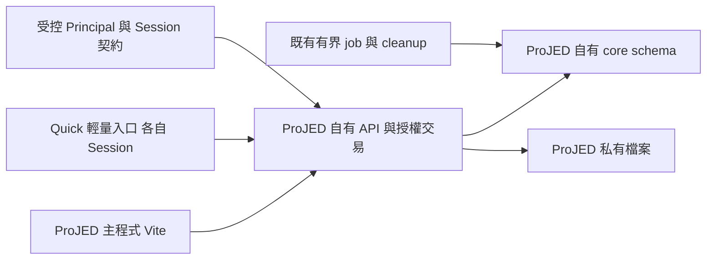

# SPEC-139：ProJED 納入 Jenfu-Platform 的產品與技術交接契約

- 主責：[DEV-139](../dev_task.md#dev-139-jenfu-platform-onboarding)。
- 日期：2026-10-29（Asia/Taipei）；版本：Rev 60（Cloud Run renderer／來源bundle／啟動連線容錯隔離 CI PASS；正式foundation／Session續行）。
- 文件狀態：**整合與發布續行中；W22 OrgMaster publisher 與 W23 Platform Session／handoff source 均有 draft PR／required CI PASS，隔離驗證 PASS；Production Resolver Disabled；未 Release**。Firebase／OIDC 真身分與完整 Session 部署、RAG／文字會議真 provider 資格、錄音管線與剩餘資料處置、雲端 readback、舊入口、writer fence、切流及正式發布仍計入完成分母。W22 owner source 見 [§36](#36-orgmaster-minimum-principal-publication-w222026-10-29)，W23 Platform source 與驗證邊界見 [§37](#37-platform-projed-session-and-handoff-w232026-10-29)；W21 承接六類文件／同步資料與精度保護見 [§35](#35-document-source-retention-w212026-10-28)；W20 資料保留見 §34，具體資源與待確認的新權限仍見 §33。本輪未寫正式資料、切流或變更 IAM／Secret／credential／billing。
- 適用階段：S1–S3 本地切片歷史見 §12–§32；2026-10-28 續行授權見 [DEV-139 人類決策與授權範圍](../dev_task.md#1-人類決策與授權範圍)，涵蓋 ProJED／OrgMaster／Jenfu-Platform 的 source 整合工作。正式整合與發布仍是完整目標，不以本地切片完成替代；新責任權限依 §33 處理。定期審視不是續行或發布的 required gate；本輪未執行正式資料寫入、切流或 IAM／Secret／credential／billing 變更。
- 直接交接入口：[§11 S1 定案契約](#11-架構決策與-s1-定案契約)、[§12 S1 實作狀態](#12-s1-實作狀態2026-10-26)、[§13 S2 consumer seam](#13-s2-projed-identity-consumer-seam2026-10-26)、[§14 S3 read adapter](#14-s3-http-read-adapter-slice2026-10-26)、[§15 S3 domain command](#15-s3-domain-command-w12026-10-26)、[§16 S3 collaboration command](#16-s3-collaboration-command-w22026-10-27)、[§17 S3 record／activity](#17-s3-recordactivity-w32026-10-27)、[§18 S3 HTTP product wiring](#18-s3-http-product-wiring-w42026-10-27)、[§19 S3 Board transfer](#19-s3-board-transfer-w52026-10-27)、[§20 S3 legacy provider boundary](#20-s3-legacy-provider-boundary-w62026-10-27)、[§21 S3 Quick Task](#21-s3-quick-task-w72026-10-27)、[§22 S3 Task Workbench](#22-s3-task-workbench-w82026-10-27)、[§23 S3 Actor CAS](#23-s3-actor-context-cas-w92026-10-27)、[§24 S3 Task Tracking](#24-s3-task-tracking-w102026-10-27)、[§25 S3 Backup／Import](#25-s3-backupimport-w112026-10-27)、[§26 S3 Account Preferences](#26-s3-account-preferences-w122026-10-27)、[§27 S3 Calendar Subscription](#27-s3-calendar-subscription-w132026-10-27)及[§32 本地開發收斂](#32-s3-local-development-closure-w182026-10-27)；[§11.8 技術主管審查](#118-技術主管審查與最小優化)保留 Rev5 修正理由；既有使用者切換見 [§6.3](#63-既有使用者的切換基線)。
- 決策來源：[DEV-139 人類決策](../dev_task.md#dev-139-jenfu-platform-onboarding)；架構取捨：[ADR-054](../decisions/ADR-054-projed-cloud-run-cloud-sql-boundary.md)。本文件不是其他 owner 已接受或已發布的契約。

## 1. 目的、限制與完成邊界

首階段保留 ProJED 現有工作區、看板、權限與操作流程，先對齊 Cloud Run 雲端架構、Cloud SQL 資料庫及身分契約，保留 React／Vite／Zustand、個人任務、外部協作、Quick Task、多視圖及已可用 AI 功能。身分接入改變可信登入來源及 Session，不重設 ProJED 的業務權限模型。

ProJED 已有使用者，移轉必須以「不丟資料、不重建帳號、不改權限、不強迫重裝」為相容目標，先保留既有網址再分階段替換後端。切換時預留各 App 的正常重新登入及經演練確認的短暫停寫；零重登／零停寫尚無實作證據，不能承諾。人類要求將評估寫入文件，未指定可接受停寫分鐘數、恢復窗口或授權正式切換；這些實際界線在移轉／release re-entry 收斂。

成本採人類最新要求「只要費用不大幅增加即可」。首階段效益為基礎設施及身分契約一致、既有功能與資料授權相容；任務／資料跨系統使用是後續效益，節費及投資回收期不是必要驗收。首階段必須證明新路徑上的原功能及權限行為，不能只以平台可見、登入成功、表格搬入同一 DB 或測試數量認列交付。

2026-10-28 人類選取前述剩餘工作並要求「請繼續執行直到完成」，已將 ProJED／OrgMaster／Jenfu-Platform 真接線與正式移轉／發布納入本次目標；先前僅本地開發的敘述保留為 W18 歷史範圍，不再用它縮減新目標。新建 IAM／Secret／credential、共用 foundation grant 與費用擴張依人類全域協作規範另確認；§33 列出已查證的具體範圍。其他 repo 的既有修改仍保留，跨 repo 實作沿各自 native DEV 與隔離分支，不把本文件當外部 owner acceptance。

### 人類產品決策

2026-10-08 的兩項決策均已有明確人類回覆；D2 採最新原文的首階段範圍，不把先前建議或預選的 2A 視為採用：

| ID | 決策與影響 | 已提出選項／目前狀態 |
|---|---|---|
| D1 | 個人／外部帳號的最小登入識別統一登錄於 OrgMaster；Principal publisher、准入及撤銷分層。 | **Human Confirmed**：回答「接受統一登錄最小身分資料（建議）」；私人內容留在 ProJED，登錄不授予公司管理員私人存取權。 |
| D2 | 首階段交付範圍與原功能保留；決定此次不新增跨 app 業務使用情境。 | **Human Confirmed**：原文「保留 ProJED 現有的工作區、看板與權限功能，先處理雲端架構、資料庫和身分契約的對齊」。先前選項中較接近 2C，但以原文為準；Platform 任務摘要與 AI-PDM 專案／看板連結均延後。 |

工程命名、局部程式寫法與驗證工具由 RD 決定。D1 固定最小身分資料歸屬，D2 固定首階段基礎對齊及原功能保留；兩者不構成產品實作、跨專案開發或正式環境操作授權。後續跨 app 任務情境另有 re-entry trigger，不再作本階段待決門檻。

使用思考習慣：#效用理論、#限制條件、#可驗證性

## 2. 現行基線與受影響能力

本地查證來源為 ProJED `main@69a5c528774394080717129bac7ba011eb48cd12`；本輪修訂前僅 DEV-139 的四份文件有未提交變更。以下描述 repository 事實，不代表即時正式環境 readback。

| 能力／來源 | 現況與必須保留的契約 | 移轉責任 |
|---|---|---|
| [package.json](../../package.json)、[Vite](../../vite.config.js)、[正式契約](../../scripts/release/production-contract.mjs) | React／Vite 主程式與輕量 Quick entry；Firebase Hosting＋Supabase backend；既有建置版本及 PWA 更新保護。 | ProJED 自有 Node HTTP runtime 提供靜態產物與 API；保留入口及 build-wide artifact identity。 |
| [資料服務](../../src/services/supabase/projedService.ts)、[backend dispatch](../../src/services/dataBackend.ts) | SDK 直讀寫、RPC、工作區／看板／任務／邀請／文件服務；domain DTO 有相容欄位與 canonical ID。 | 建立 provider-neutral HTTP adapter，保留服務行為與 domain mapping，將 SQL、授權、交易留在自有 API。 |
| [初始 schema](../../supabase/migrations/202605140001_initial_projed_schema.sql)、[Auth service](../../src/services/authService.ts) | profiles 外鍵綁 auth.users；SQL 使用 auth.uid()；目前 Google 登入會建立／讀取 profile。 | 新安全主體與本地 user ID 分離，受控映射；搬移 schema、RPC、policy 的語意。不能把舊 SQL 原封不動套到新 DB。 |
| [SPEC-036](SPEC-036-trello-like-workspace-governance.md)、[分享契約](SPEC-026-trello-like-board-share-ui.md)、[角色與能力型別](../../src/types/index.ts) | Workspace 管理與 Board 授權分層；五種角色與可設定的 Board capability matrix；guest 的 tenant identity anchor 不授予其他看板。 | 保留 membership、各 Board 已設定的權限與管理繼承語意，與公司入口／角色契約分開判定；見 §4.4。 |
| [同步 hook](../../src/hooks/useSupabaseSync.ts) | Supabase postgres_changes 觸發 scoped reload；多視圖共用 canonical data。 | 以自有 API 提供受權限約束的同步通知／增量讀取，避免每張畫面各自建立全域資料來源。 |
| [ADR-050](../decisions/ADR-050-mobile-quick-task-entry-and-outbox.md)、[ADR-053](../decisions/ADR-053-quick-task-cross-origin-account-link.md)、[Quick receipt adapter](../../src/services/supabase/quickTaskCaptureService.ts) | local-first、各 App Session、明確認領、immutable owner／captureId、receipt replay 與七日 synced 副本清理。 | 改 provider 仍保留全部資料安全不變條件；新舊 origin 的本機資料另行恢復。 |
| [ADR-051](../decisions/ADR-051-projed-owned-meeting-analysis-pipeline.md)、[AI service](../../src/services/meetingSynthesisService.ts) | ProJED 擁有來源、job／lease、費用、原稿、投影及清理；部分真實 provider qualification 尚未通過。 | 自有 server／worker 承接已可用功能，未合格功能維持原 gate 與 NOT_PASS。 |

## 3. 目標架構與資料權責

- 基礎部署單位為 Vite 靜態檔＋Node API 的單一 ProJED Cloud Run 服務。既有主程式與獨立 Quick PWA 的兩個 public origin／manifest identity 依 ADR-053 保留，皆由各自 Hosting 前門將 `/api/**` 轉送至同一 runtime；可信 `main / quick` entry 由未來簽發的 App Session actor 決定，不由 Host／forwarded header 決定。兩個 public origin 不等於兩個 runtime，也不新增另一套業務資料權威或 app key。
- 不為登入簡化合併 origin、強制重裝或共享 token。既有使用者預設保留現行主／Quick public origin，由相容入口轉送至 Cloud Run；`run.app` 是 runtime 服務位址，不要求使用者立即改網址。相容窗口及入口退役條件見 §6.3–§6.6；實際服務／環境綁定後續核實，不臆造正式 target。
- ProJED 宣告 app key `projed`，自有 schema 固定 `projed_core`／`projed_contract`；平台 registry 的實際登錄列為 S2 owner 工作，不宣稱已登錄。Workspace、Board、Task、membership、Board role permissions、invite、profile、receipt、job、audit、檔案 metadata 都由 ProJED 擁有；不得寄存在 Platform core。contract schema 保留受控邊界，首階段不因此建立任務摘要 endpoint 或賦予其他 app 業務資料讀取權。
- 同一 lifecycle DB 使用 app-specific owner／migrator／runtime、ledger、Secret 及單一目標 DSN。runtime 無 DDL、owner、migrator、BYPASSRLS 或其他 app core 權限；跨 app 只使用版本化 contract 與明確 consumer ACL。
- app-specific `db/AGENTS.md`、S1 SQL 與 DB boundary checker 已建立並通過靜態自查；根目錄治理規則未修改，完整 domain SQL 仍屬 S3。
- 檔案持久化選定 ProJED 私有 Cloud Storage。API 驗證用途與資源權限，DB 保存 metadata／cleanup obligation；不把 Cloud Run 本機磁碟當作持久儲存。不建立共用公開 bucket；實際 bucket／IAM 綁定及移轉驗收屬後續環境範圍。
- durable job 沿 ADR-051 的獨立生命週期使用有界 worker／Job；沒有獨立工作責任的 handler 留在 API。禁止靠 HTTP 回應後的記憶體工作宣稱完成持久處理。

API 與 worker 可讀取其他 owner 已發布的 contract，但不能操作其 core、ledger 或 outbox。共用 SQL instance 不建立跨 core FK 或跨 owner 的假原子交易。

### 3.1 Runtime 工程基線與模組責任

本節固定 ProJED 的技術選型。S1 server 已依 Node `>=24.11.0 <25`／npm `>=11 <12`、`pg ^8.21.0`、TypeScript、`node:http` 實作；本地隔離驗證接受 PostgreSQL 17／18，並記錄實際 major。lockfile 已固定實際解析版本；未來 managed target 仍按實際綁定版本重驗，這不要求 Vite 改成 Next.js。S1 完整契約見 §11、實作結果見 §12。

| 模組 | 責任與禁止跨界 |
|---|---|
| HTTP／靜態入口 | 單一 server 程式與 runtime提供主／Quick shell及同源 `/api/`；各 public origin 的 Session仍獨立。Cloud Run依`PORT`監聽`0.0.0.0`，本地驗證只綁loopback；API 404／錯誤不得落入SPA fallback。檔案路徑只限產物根目錄，禁止traversal；Host／forwarded header不能決定可信entry或授權。 |
| Session／identity adapter | 核實受控 handoff、current state、mapping，產生 server-owned actor；瀏覽器 header／JSON 不能直接建構 actor。未發布 producer 只可作標明 SIMULATION 的測試替身，不能接正式入口。 |
| Domain service／repository | 服務行為、capability、scope 與自有交易；frontend adapter 保留既有 DTO。不得暴露任意 table／RPC／SQL tunnel。 |
| Pool／migration | 每 process 一個有界 pool；runtime DSN 與 migrator credentials 分離。啟動只驗角色、DB identity、schema／ledger 相容及設定，不自動 migrate 或修復 grants。 |
| 同步／worker | 同步只提示重新讀取受權資料；長工作沿原 job／lease／費用／清理責任。API 回應不宣稱 worker 完成。 |

Session／私人 API 回應採 `Cache-Control: no-store`；SW 不快取 API、登入 callback、Session 或私人內容。雜湊靜態資產與 HTML／manifest／SW 的快取及更新沿現有 PWA release 契約，不能用 SPA／離線快取假造登入成功。關閉時停止接收新請求，有界完成／回滾在途交易並關閉 pool；未提交與 commit 結果不明分開記錄。觀測只留 request ID、結果碼、耗時及最小 scope／版本，不記 token、DSN、任務正文或邀請原 token。

## 4. 身分、Session 與授權契約

### 4.1 安全主體與既有資料歸屬

- 新路徑的安全主體為可信 `principalId`，不是 email、employeeId、legacy UID 或客戶端送來的 owner。D1 已固定 OrgMaster 為最小身分 publisher；provider pair 由 server 驗證，Platform 處理登入／Session／revocation，ProJED 消費受控契約。
- OrgMaster 登錄範圍是 Principal、已核實的登入來源 pair 及必要的准入／安全狀態與版本 metadata；不複製私人 Workspace／Task、草稿、音訊／檔案、receipt 正文或任務行為資料。非員工沿既有個人登入建立最小身分，不因此取得公司角色或其他 app 入口。
- Principal 登入資格與 Employee／公司資格分開。離職、公司角色／入口撤銷或 Board membership 撤銷只收斂相應公司／資源權限；在仍有有效 provider 身分且沒有受控全域安全撤銷時，私人使用沿有效 Principal 保留。真正全域安全撤銷由受控安全契約處理，普通公司管理角色不能以離職處理冒充全域停用私人帳號；被停用的公司 Google 帳號不承諾仍可登入。
- 員工資料是公司資格；個人／外部帳號不建立虛假 Employee。既有公司角色權威仍由 OrgMaster 發布；公司准入不得自動授予私人工作區或其他看板。既有 Workspace 維持原授權，不按 owner 的 email／員工歸屬自動轉成公司 Workspace；公司關聯須有受控且可核實的資料來源。
- 既有 `human_personal` account type 代表人的個人登入憑證，不能據此推定 current producer 已支援非員工。新版需明定 Principal active、可選 Employee／公司資格、ProJED app admission 與其版本，避免以 inner join Employee 排除個人或外部使用者。
- `localUserId` 保留既有 ProJED profile UUID 作業務外鍵與 receipt owner。server 必須用已驗證的 Principal mapping 找到該 ID；它不能作為登入或授權 fallback。
- 新舊 provider 可能有不同 issuer／subject。移轉須核實 owner 發布的綁定鏈，或在受控程序證明兩側帳號控制權；不能直接比較不同 provider UID 或按 email 合併。歧義、缺鏈或一對多衝突保持未綁定／隔離，禁止批次猜測、重派或合併私人資料。
- 未確認映射的使用者可保留本機資料；雲端查詢／補送拒絕。legacy user／task／receipt ID 與來源證據保留，不因認證 provider 變更重建任務。

### 4.2 准入與 Session

| 使用者 | 正常入口與權限來源 | 不可外推的權限 |
|---|---|---|
| 公司使用者 | Platform 正常登入→已指派 ProJED 入口→新版本 handoff→ProJED Session→公司資格與本地 capability/resource。 | Portal 可見／SSO 成功不等於看板管理權，也不產生私人資料讀取權。 |
| 個人使用者 | ProJED 正常登入→OrgMaster 最小非員工 Principal publication→Platform 身分／ProJED Session→個人 Workspace／Board。保留既有個人使用，不新增員工白名單限制。 | 個人登入不產生公司角色或其他 app 入口。 |
| 外部協作者 | 正常登入→看板邀請接受→指定 Board membership；邀請期限、一次性接受與撤銷由 ProJED 驗證。 | Board guest 身分不公開其他看板／工作區，也不授予平台其他 app。 |
| Worker | 經驗證的 workload identity＋purpose／資源範圍＋active claim／lease；保存發起 Principal。 | 不將 service identity 當成任意人類角色，不以使用者瀏覽器憑證執行全域維護。 |

目標 Session 採各 origin 的 HttpOnly／Secure opaque cookie 與 server-owned session state；mutation 有 CSRF／Origin 驗證。cookie／callback／服務來源限定 exact origin；不以 CORS 代替登入，也不把權威 bearer 或 DB 憑證放入 localStorage／前端 bundle。Quick 的 auth context 只保留本機 owner 提示、epoch 與登出 barrier。

主程式與 Quick 允許登入不同帳號、各自登出，不自動切帳。受控全域撤銷依契約生效；不增加跨 origin 即時畫面刷新或自動 SSO 的產品承諾。

現行 handoff v2 的 employeeId required 與兩個 audience 不能原地放寬成非員工契約。新 consumer／非員工 wire contract 採新版本與相容窗口，issuer／audience／PKCE／CSRF／一次性 code／來源 Session 到期及原始 auth_time／epoch／revocation 保護保留；精確 wire version 由發布 owner 的契約收斂，不在本 repo 冒稱已存在。

### 4.3 保護查詢與寫入

1. 驗證當次 Session、Principal current state、來源到期及撤銷狀態；producer 無法確認時拒絕，不以歷史 allow cache 補權限。
2. 解析 server-side mapping 與 canonical Workspace／Board／Task；使用者提供的 resource ID 只作查找，不能決定歸屬或角色。
3. 驗證當前公司准入／scope（僅適用公司資源）與 ProJED membership／capability。Workspace owner/admin 的繼承能力沿 SPEC-036；一般公司管理角色不等於 Workspace owner。
4. 自有交易內核對資源、membership／授權版本及副作用範圍，執行業務寫入與 receipt／audit。已提交撤權後的新請求必須拒絕；在途交易的排序／版本重驗規則於實作契約固定。
5. DB 保留 row/resource policy：trusted server 在交易範圍內設定 actor context，缺 context 拒絕，連線池歸還前不留下前次 actor；helpers／RPC 只讀可信 context，不移植依賴 Supabase JWT 的 auth.uid()。

RLS 是避免漏 scope 的第二層保護；context setter 的可信度來自 server 認證與禁止客戶端直接連 DB。不得把可變 GUC 描述為能抵抗已失陷的 runtime。涉及跨 owner 的 current state 重驗沿其 contract，不能承諾未存在的分散式原子性。

### 4.4 既有工作區、看板與權限功能保留

D2 要求保留使用者功能及授權結果；server/API、policy 與登入 adapter 可替換，Workspace／Board 的產品模型及權限操作不重做。以 SPEC-036、角色與能力型別及資料服務為基線，實作前再核對當時版本；未查證的 live 行為不得由文件推定 PASS。

| 保留面 | 移轉與驗收要求 |
|---|---|
| 工作區／看板 | 保留原 canonical ID、名稱、歸屬、建立／切換／改名／受控移動／刪除及既有管理入口；一般有效登入者建立工作區與建立者 owner 語意沿原契約。不得按員工、email 或新 app registry 重建資料樹。 |
| 角色與 membership | 保留 `owner / admin / project_manager / member / viewer`、Workspace 與 Board 成員區別及 membership／invite 既有狀態。外部 guest 是特定 Board 的存取範圍描述，不另造角色或把 Board 成員自動提升為整個 Workspace 成員權限。 |
| 看板權限設定 | 搬移 `board_role_permissions` 的每 Board／role capabilities，保留非預設及明確空集合設定；沿原 owner 固定能力與其餘角色 normalization，不把所有角色重設為 default。保留原設定／分享操作入口及保存後重載結果。 |
| 管理與繼承 | Workspace owner/admin 依原 capability／Board matrix 計算繼承；Board 管理權不外推為整個 Workspace 管理權。公司角色與 Portal 指派只提供對應公司准入，不能改寫 ProJED membership 或擴張私人存取。 |
| 邀請、撤權與可見性 | 保留既有分享／邀請／接受／撤銷流程與 scope；撤權後新請求拒絕，guest 的 identity anchor 不暴露其他 Board。各角色操作是否允許，必須與凍結基線一致。 |

身分 mapping 只把可信 Principal 連到原 `localUserId`，不重派 owner、重新接受 invite 或重算公司員工角色為看板角色。若發現原程式、資料設定、SQL policy 與規格互斥，停止受影響 slice 並先收斂來源；不得以「架構對齊」默默放寬授權或移除現有功能。

### 4.5 外部身分契約的具體交接缺口

只讀查證發現 handoff v2 的 audience 僅含 `orgmaster / ai-pdm`，且 canonical-principal v1、VerifiedJenfuAppSession v1 及現行 admission projection 都仍依賴 Employee。不能只在 ProJED 加 app key 或把一個欄位改 nullable，就宣稱整條路徑支援非員工。以下是交給 owner 審查的需求，未宣稱已有新版、owner acceptance 或 native DEV。

| Owner／輸出 | 必須收斂的契約與相容證據 |
|---|---|
| OrgMaster／Principal publication | 穩定 Principal、已核實 issuer／subject pair、active／security version；Employee／公司資格可選且獨立。不用 email 補 mapping，不藉個人登錄發布私人任務或公司入口；非員工建立／再登入及歧義隔離需正常路徑證據。 |
| Platform／registry、handoff、app Session | 新版本辨識 ProJED 及主／Quick exact callback／client；保留 PKCE、一次性 code、原始 auth time、來源到期、epoch／barrier、服務身分及 CSRF。非員工與舊員工 consumer 都有 schema／正常路徑驗證；不原地放寬 v2。 |
| Platform／current auth state | 當前 `platform_contract.read_principal_auth_state_v3(text)` 及 admission 的可用範圍需由 owner 確認適用 ProJED；0 row／不可確認不得當 epoch 0 或 allow。區分全域安全撤銷、公司准入撤銷及本 App Session 登出，給出版本與有效時間契約。 |
| ProJED／consumer conformance | exact issuer／audience／redirect／consumer ACL、可信 mapping、Session 前置條件及本地 capability；synthetic 員工、非員工、guest、錯 issuer／audience、撤權／失效及 producer unavailable 測例。舊 consumer 的 compatibility receipt 與 ProJED 新路徑 evidence 分開。 |

外部交接以 canonical repo／DEV-139／本節 slice 引用來源；目標 owner 在獲人類開發授權後才查其索引選 native ID，提交 owner／source／版本／相容證據。此處不向其他專案派工或修改任何發布契約。

## 5. 資料與 API 交接面

### 5.1 資料不變條件

| Domain | 交接契約 |
|---|---|
| profile／Principal mapping | 本地 UUID、名稱／偏好／membership 外鍵保留；verified mapping 與歷史來源分開；email 僅為聯絡資訊。 |
| Workspace／Board | 沿 tenants／projects 語意與 canonical ID；Board 屬單一 Workspace，搬移不重建 Board ID；私人與公司關聯需有明確來源。 |
| 角色／權限設定 | Workspace／Board membership、原角色與 `board_role_permissions` 按 §4.4 保留；權限空集合不轉 default，平台公司角色不替換本地角色。 |
| Task 與多視圖 | 同一 canonical task；parent、dependencies、placements／tracking、assignees、tags、dates、archive 狀態及人工正文保持。projection ID 不可當 canonical task ID。 |
| 狀態 | TaskStatus 保留 `todo / in_progress / delayed / completed / unsure / onhold`；member 與 invite 狀態沿現行型別，不為平台整合重定義業務生命週期。 |
| invite／membership | 接受邀請、更新 membership、回執在同一自有交易；guest identity anchor 不擴張 workspace 可見性。 |
| Quick receipt | `(localUserId, captureId)` 冪等；首次 titleHash、commit 時間與結果不可變；Task 改名／歸位／刪除後 replay 不重建。 |
| 會議／文件／檔案 | 原稿、來源版本、段落／task links、vector／chunks、job／lease、費用 ledger、projection receipt、retention／cleanup 全部有 owner。未資格驗證功能維持未啟用。 |
| 已有連結／feed | Board 分享、calendar/feed、檔案／知識連結的 identifier 和權限保留；origin 改變須有受控相容處置，不讓有效舊連結默默指向錯誤資源。 |

### 5.2 最小 HTTP 能力

以下是供 RD 估工的介面責任，尚非完整 OpenAPI、route allowlist 或已存在 endpoint。RD Implementation Ready 前由來源服務盤點補齊每種操作 DTO／版本／限制與 caller，不以表格數當 API 數。

| 能力 | 最小 I/O 與成功條件 | 權限／交易責任 |
|---|---|---|
| Session／登入／登出 | verified Principal、localUserId、本 App Session／到期與可辨識帳號；取消登入返回原草稿。 | server 核實 provider 與 mapping；各 origin Session 隔離，不能接受 browser 自述 Principal。 |
| Workspace／Board／member／invite／role permissions | scope-bound 讀取、建立／更新／受控移動／分享／接受／撤銷／權限設定；保留現行 DTO 與成功後 UI 更新。 | canonical resource、role/capability、當前 membership／Board matrix；禁止跨 scope 寫入。 |
| Task／tag／dependency／placement | domain 操作及 scoped list；mutation 回傳實際 canonical ID／persisted outcome，支援 stale conflict。 | 不能讓 payload 改寫 owner／Workspace 來逃過檢查；bulk 操作的原子性沿既有語意。 |
| Quick capture | 輸入 captureId、title、可選 workspace hint；owner 由 Session mapping 決定。回傳 committed、captureId、ownerId、titleHash、created、committedAt。 | task＋immutable receipt 同交易；同內容 replay 回首次 receipt，異內容同 key 為 409。workspace hint 須重驗，不先讀業務清單。 |
| 同步／恢復讀取 | 當前 authorized scope 的 change version／通知與 canonical reload；自己 commit 後立即更新，重連後補齊資料。 | 每次訂閱／poll/read 重驗權限；禁全域廣播私人內容。通知不是資料權威，刪除／撤權以重新授權的結果收斂。 |
| AI／文件／檔案／feed | 既有 I/O、來源／費用／清理及失敗重試；私有檔案存取經用途與資源驗證。 | provider secret 只在 server；已有 signed URL 的有效窗口與撤權語意不得擅自變寬。 |
| 身分 contract consumer | ProJED 消費受控 Principal／provider mapping、admission、Session／handoff／revocation；非員工及各 origin 相容窗口見 §4。 | owner 核實 issuer／audience／actor current state；保留本地 capability，不以 service allow 代替資源授權。 |

錯誤至少分為 400 輸入不合法、401 Session 無效、403 有效身分但不具權限、404 不存在／不洩漏存在性、409 stale／mapping／冪等衝突、429 限流及 503 依賴不可確認。以穩定錯誤碼與 correlation ID 呈現可恢復訊號；不把 503 或逾時當成空清單／建立失敗後換 ID 再送。

### 5.3 首階段與後續業務串接邊界

D2 已確認先完成基礎對齊。首階段跨系統 consumer 是 ProJED 對 OrgMaster／Platform 身分契約的消費；Platform registry／launch／handoff 可提供登入入口，但沒有任務摘要畫面、任務資料 BFF、AI-PDM project↔Board mapping 或其他 app 任務 API 交付。

首階段不登錄跨 app 任務 consumer、不發布通用 task query／command、不把業務資料外送至 OrgMaster 或 Platform；ProJED 仍是任務、工作區、看板及權限真相 owner。schema／version／ACL 邊界可供後續契約使用，沒有已核准業務 consumer 時拒絕跨 app 業務讀寫；不建立未被要求的通用事件平台、雙向同步或另一份 task master。

業務串接列為 **Future Phase Captured / Not Requested**：待基礎對齊有功能／權限相容證據且人類要求實際串接時，再決定 Platform 摘要、AI-PDM 連結或其他情境，固定 owner、consumer、最小資料揭露、正常入口及驗收，並取得涉及專案的明確開發範圍。私人內容預設不外送；原業務效益尚未驗證，不以 schema 存在或身分登入成功宣稱已交付。

同步選定 **有版本的 polling＋canonical reload**：active client 每 5 秒查受權 scope revision，隱藏頁面暫停，focus／reconnect 立即補讀；本 client commit 後直接更新並重驗資料。通知只回版本／變更訊號、不回私人正文，資料仍由同源 API 受權讀取。S3 以雙 client 的正常 UI、撤權及重連案例驗成功讀取週期內 10 秒收斂；失敗保持可辨識狀態，不把 stale 資料當已同步。完整 cursor／scope DTO、change revision 與容量 verifier 在 S3 契約收斂；不預設引入 WebSocket／SSE、Redis 或常駐分送 worker。改 transport／延遲契約需回架構審查。

### 5.4 既有 provider 呼叫的移轉盤點

盤點範圍不能只限 `dataBackend.ts`；以下 repository 呼叫面已查證，實作前仍須補齊函式／caller／policy／測試逐項清單，並核對當時 source。這是目前估工輸入，不是完整 live capability inventory。

| 呼叫面／直接來源 | 必須接替及保留的行為 |
|---|---|
| [projedService](../../src/services/supabase/projedService.ts)／[backend dispatch](../../src/services/dataBackend.ts) | Workspace／Board CRUD、移轉 preview／move、member／invite／permission、Task／tag／dependency、knowledge／activity／audit、backup preview／import／fingerprint；每個服務結果保留 domain DTO，不能以 CRUD 表數漏掉交易 RPC。 |
| [Auth](../../src/services/authService.ts)／[Quick auth](../../src/features/quickTaskCapture/auth.ts)／[Quick sync](../../src/features/quickTaskCapture/sync.ts) | 主／Quick 獨立登入、取消／登出／切帳、profile 與 frozen owner。HTTP 模式移除必填 bearer 的依賴，保留 auth epoch／context revision／CAS；不得從舊 SDK token 判定新 Session。 |
| [未歸位／placement](../../src/services/supabase/taskWorkbenchUnplacedService.ts)／[tracking](../../src/services/supabase/taskTrackingReferenceService.ts)／[Quick receipt](../../src/services/supabase/quickTaskCaptureService.ts) | 未歸位任務、子樹移動、operation receipt、tracking reference 及同 ID replay；不能只搬 WBS 表。 |
| [工作區／任務同步](../../src/hooks/useSupabaseSync.ts)／[成員同步](../../src/hooks/useMemberSync.ts)／[tag 同步](../../src/hooks/useTagSync.ts) | 授權 scope 的重載、撤權收斂、重連補讀與目前 active Workspace／Board 保留；替代 transport 不改 canonical data。 |
| [帳號偏好](../../src/services/accountPreferencesService.ts)／[任務 filter](../../src/services/supabase/taskFilterPreferenceService.ts)／[行事曆](../../src/services/supabase/calendarSubscriptionService.ts) | 個人 layout／filter、feed token／訂閱 scope／輪替／撤銷與已有連結相容；偏好 owner 只能來自 Session。 |
| [會議分析](../../src/services/meetingSynthesisService.ts)／[RAG](../../src/services/rag/ragRetrievalService.ts)／[診斷](../../src/services/supabase/browserDiagnostics.ts) | Functions／provider／job、知識讀取及診斷目的；Secret、原稿、費用／清理沿原契約。直接 fetch 與動態 endpoint 也納入 inventory，不只搜尋 SDK method。 |

`projedService.checkpointDraft` 目前明確拋出「會議雲端 checkpoint 已停用；請使用本機 recovery。」因此保留本機恢復與現有停用狀態，不順帶啟用雲端 checkpoint。既有 AI qualification 同理。每項盤點需標 `保留／有界替換／維持 gated` 及對應 acceptance，全部取得新路徑相容證據後才可能退出原 provider。

### 5.5 HTTP adapter 的估工基線

下列是 ProJED 自有 API 候選，不是已存在或 external wire endpoint，也尚非完整 OpenAPI。路徑範例用 `workspaceRef / boardRef` 表示前端 ref；API 必須按父 scope 解析 UUID 或既有 legacy ID，回傳仍沿 `legacyOrId` 語意，不把舊前端 ID 直接當 UUID 驗證拒絕。

| 候選操作 | I/O 與重要限制 |
|---|---|
| `GET /api/v1/session`／`POST /api/v1/session/logout` | 回最小本 App `localUserId`、顯示帳號、到期及非秘密 `authContextId`；登入 callback 另沿 owner wire。context ID 由 server 生成並綁定 Session，每次建立／換帳／重建 Session 都改變，只是前置條件，不是 bearer。logout 只作用當次本 App Session。 |
| `GET/POST /api/v1/workspaces`、workspace-scoped Board 操作 | 保留 Workspace／Board DTO、建立者 owner、原 ref、排序／metadata；move 是有 preview 的 domain command，不能改 `tenant_id` 欄位跳過來源／目的權限。 |
| Board-scoped `members / invites / role-permissions` | 沿現行 role／membership／invite DTO；角色矩陣保存完整集合含 `[]`。接受 invite 的 userId／email／Principal 以當次可信身分為準；token 只用於受控接受，hash／期限／一次性／撤銷在 server 驗證，不寫入 log。 |
| Board-scoped `tasks / tags / dependencies` | 回現行 TaskNode 與關聯 DTO；不能經 body 改歸屬、父 scope 或 owner；bulk／delete／restore／upsert 沿原 domain 語意，逐操作補原子性及 retry 契約。 |
| `POST /api/v1/quick-captures` | `{captureId,title,workspaceHint?,expectedAccountId,expectedContextId}`；後兩項僅為 frozen actor 前置條件，必須與當次 Session／mapping 一致，不能用來授權。結果沿原 committed receipt，見 §5.7。 |
| scoped canonical reload／附屬功能 | 依 §5.4 盤點逐項補 read／command，不發布任意 SQL、跨 app task API 或目前 gated provider。同步已選版本 polling，仍須真雙 client、cursor／scope 及容量／費用證據；改 transport 回架構審查。 |

共通 mutation 必須帶送出時凍結的 `expectedAccountId / expectedContextId`，handler 進入業務交易前與當次可信 actor／Session 核對；不一致為 `409 ACTOR_CHANGED`，不自動把舊內容換帳送出。Quick、其他跨帳號佇列及延遲保存都套用同一前置條件。CSRF token 與 exact Origin 檢查另行成立，context ID 不取代它們。

成功 body 由 adapter 轉回現有 domain DTO；錯誤 body 採 `{error:{code,requestId,retryable,retryAfterMs?}}`。`401 AUTH_REQUIRED`、`403 ACCESS_DENIED`、`404 RESOURCE_NOT_FOUND`、`409 ACTOR_CHANGED / STALE_RESOURCE / IDEMPOTENCY_CONFLICT / IDENTITY_MAPPING_CONFLICT`、`429 RATE_LIMITED`、`503 IDENTITY_STATE_UNAVAILABLE / DEPENDENCY_UNAVAILABLE` 與 §5.2 對應。無權讀取的物件不洩漏存在性；有效 actor 的禁止 command 依原授權回拒絕。Quick 舊 `QT_*` 業務錯誤碼由 adapter 保留語意，不把 committed／network-unknown／確定拒絕合併成同一錯誤。

舊 SDK 路徑與新 HTTP 路徑按明確 backend 選擇隔離；新模式設定缺失或依賴失敗時拒絕，不自動 fallback 舊 DB／localStorage role 或把失敗顯示為空清單。HTTP 模式的 cache key、取消與 late response 必須含 account／context／scope，不能只用 URL。

### 5.6 Cloud SQL 資料映射與 policy 交接

目標應用表放 ProJED core；S1 已建立 profile／account guard 的 `0001`／`0002` DDL 與精確 grants。下面其餘內容仍是 S2／S3 完整 domain schema 的估工基線；來源以現行全部 migrations 的合成結果及 [database types](../../src/services/supabase/database.types.ts) 核對，初始 migration 不代表最終 schema。

| 來源／目標責任 | ID、constraints 與移轉要求 |
|---|---|
| `profiles`／本地 profile | 保留 UUID、display name、email 聯絡欄位及 `ui_preferences`；移除對 Supabase `auth.users` 的跨 provider FK，保留 ProJED 業務 FK，不改寫 user／owner UUID。profile 自身不授予登入資格。 |
| 新 verified Principal mapping | 保存 Principal、localUserId、受控來源／版本／proof receipt、有效狀態與歷史。每個當前有效 Principal 與 localUserId 的映射須無歧義；重複／一對多隔離，不合併帳號。provider pair 與 canonical Principal 欄位／唯一約束依 producer contract；不能把舊 `external_auth_id` 當已驗證 mapping。 |
| `tenants / projects` | UUID、`legacy_workspace_id`、Workspace 內 `legacy_board_id`、owner／created_by、metadata／sort 保留；Board 仍單一 tenant。依原唯一範圍解析 legacy ref，不跨 tenant 搜尋第一筆。 |
| `tenant_members / project_members / board_role_permissions` | 成員 key、五種 role、Workspace member status、每 Board role capabilities 保留。現行 project member 沒有獨立 status 欄位，不憑空移轉欄位；tenant／project／user 關聯和 guest anchor 需合成 schema 查證。 |
| `wbs_items / dependencies / tags / links` | 保留 UUID／legacy ref、parent／scope／人工正文／日期／狀態與關聯；目標 constraints 及查詢必須拒絕跨 Board parent／dependency／tag 關聯。資料不符合時 reconciliation 報差異，不自動刪除或改派。 |
| 未歸位／placement／Quick receipt | 保留原字串 capture／task ID、localUserId owner、原 placement operation、不可變 receipt／hash／commit 時間；receipt 不因 task 移動／改名／刪除消失，七日 browser retention 不作用 server receipt。 |
| invite／偏好／feed／檔案／knowledge／job／audit | 依逐項 inventory 搬移 token hash、期限／scope、來源與費用／清理欄位；原 invite／feed link、檔案可讀及 gated 狀態分別驗證，不能漏搬附屬表而只驗 Task count。 |

新的 Session state／mapping proof／receipt 等私有安全資料不給普通 browser query API；runtime 只取得指定表／function 的必要 grants，無 schema CREATE、跨 core、TRUNCATE 或可切至 owner 的 role membership。RLS 覆蓋適用業務表的 read／write，包含 `USING` 及 `WITH CHECK`；owner／SECURITY DEFINER 必須逐項審查，不能假設 enable RLS 就約束它們。若 helper 需要 definer，限定 nonlogin role、exact function ACL、固定 search_path 與 purpose，不允許通用提權函式。

membership／scope 查詢及 legacy lookup 的索引與唯一約束按實際 query／FK 定義；設計需覆蓋 tenant+project+user、tenant+legacy ref 及 owner+captureId，避免每次 policy 全表掃描。使用已核准 extension 與 foundation ownership，app migration 不擅自改 shared extension／public grants。所有無 context、偽造 scope、跨 Board FK、helper 越權與 role escalation 案例須在真 PostgreSQL 驗證。

### 5.7 交易、撤權競態與結果不明

每次自有交易從 pool checkout **同一 client** 執行 BEGIN、actor／scope 的 transaction-local 設定、授權／寫入／receipt／audit 與 COMMIT 或 ROLLBACK，不能用多次 `pool.query` 拼交易。context 只由可信 Session adapter 產生，以參數化 `set_config(..., true)` 設定；policy 缺值／無效值拒絕，不接受 browser 任意指定 context。回滾、取消、commit 失聯都要歸還或銷毀不安全 client，下一位 actor 不繼承前次狀態。這層保護針對可信 server 的查詢失誤，不能宣稱可抵禦已取得 runtime Secret 的任意 SQL 操作者。

本地撤權採 **transaction advisory lock＋guard revision**。自用規模目前以單一 app transaction mutex `projed:runtime-transaction:v1` 排序所有 `runActorTransaction` callback，再取得既有 account shared lock，以下一個 statement 重讀 guard 與當下權限。membership、matrix、record privacy 與跨 Workspace move 均走相同核心，不再要求尚未實作的多層 scope lock set 或 shared→exclusive 升級。外部 provider／storage network 不得放在這些短交易內；既有 lock／statement／transaction timeout 保留，沒有量測的平行吞吐效益不作承諾。若真實使用出現鎖競爭，再按具體資料流拆 scope，不先建立通用鎖管理框架。

先完成鎖定及授權的在途交易可以排在撤權前；撤權已提交後才取得 lock 的交易必須按新 revision／權限拒絕。S1 account guard 的外部 admin mutation 仍須取得相同 account exclusive lock；S3 的本地命令沿 app mutex。原 account-only 證據不外推成 Board 撤權 PASS；本版以 native 兩帳號實際等待與既有命令回歸驗證本地排序，見 §41。

外部 Principal／公司准入的撤銷無法和 ProJED DB 假造跨 owner 原子性。每次保護請求核實 current state，寫入前按 producer 的 epoch／barrier 契約重驗；版本／到期失效或 producer unavailable 不寫入。owner 必須交付在途請求及撤銷可觀察生效界線，尚未收斂時不能宣稱零窗口或沿用歷史 allow cache。

Quick 沿 [現行 invoker RPC](../../supabase/migrations/20261001090000_dev_133_quick_rpc_security_invoker.sql) 與 [model](../../src/features/quickTaskCapture/model.ts)：title 依原外層 whitespace normalization，非空且不超過 500 Unicode code points；保留大小寫、內部空白／換行及正文，不新增 Unicode normalization。SHA-256 用正規化後、outbox 保存的確切 UTF-8 title；captureId 驗證沿現行格式。workspace hint 只是提示，依原語意選有效且本人 active 的 Workspace，不授予其他資源，也不因無效 hint 洩漏存在性。

`(localUserId,captureId)` unique 及同 owner 序列化保護 task／receipt 同交易；同 key 同 hash 回原 commit 時間與 owner、`created:false`，異 hash 回 409，不重寫 receipt。COMMIT 後失聯或 HTTP timeout 為 unknown outcome：先核實同 key 或重送同 key，不換 captureId；只有可核實 committed receipt 才把本機記錄標 synced。新的通用 command 冪等範圍逐操作定義，不能用自動 retry 包裝所有非冪等寫入。

## 6. 資料移轉、PWA 與恢復

### 6.1 Server 資料

1. 建立 schema／table／function／policy／extension、Workspace／Board membership／權限設定、檔案／feed／連結、Auth mapping、job／receipt 的完整 inventory，核對來源實際狀態；migration 檔名不等於 live inventory。
2. 舊 Supabase migration 歷史不改寫。新 Cloud SQL managed DDL 採 ProJED 自有 forward-only migration 與獨立 ledger；shared extensions／foundation 不由 app 搶 ownership。
3. 先以 synthetic／核准 sanitized fixture 演練完整轉換；目標必須是空白candidate DB，以一個repeatable-read來源snapshot及單一目標交易逐domain檢查count、ID／FK、scope、人工內容／checksum與receipt，完全一致才commit。
4. 本自用系統不建立連續雙寫、CDC或delta平台。正式切換先以可驗證fence停止舊庫全部業務寫入及在途job，再從同一一致性snapshot做一次完整搬移與reconciliation；任一未承接domain或差異即不開放新writer。
5. 新路徑已有寫入後，回復必須說明新資料如何保留、舊 binary 是否可讀、job／receipt 是否仍單一；僅切回 DNS／舊網站不是完整恢復。禁止 destructive/down migration 或手改正式 row。

### 6.2 Browser 本機資料

Server 搬移與 browser storage 恢復分開驗收。IndexedDB、Session、SW 及 manifest 綁 origin／安裝環境；若另換新 run.app public origin，不能直接讀舊 origin。§6.3–§6.4 優先保留既有 origin，仍須驗證舊版 client／SW／IDB 升級。舊入口在受控窗口保留核身後補送或可驗證匯出／匯入；具體 transport、來源 proof、import CAS 與目的帳號確認在移轉實作契約固定。

- known owner 的 pending 只補送本人；不同帳號拒絕且不顯示該筆私人內容，不改成 unbound。
- unbound 記錄仍需使用者明確確認目的帳號；登入 callback／升級／匯入不自動認領。
- captureId／canonical task ID／receipt key 保留；網路結果不明先核實同 key，不能建立第二筆。
- 登出／切帳／晚到回應以凍結 owner、Session／epoch、source revision 與 CAS 隔離；前一帳號回應不更新目前帳號畫面。
- 未同步資料與人工草稿不因清理、版本升級、origin 切換或恢復被刪除。七日清理只適用已驗證 receipt 的 synced 本機副本，不能用作 server receipt TTL。
- 舊安裝未完成恢復前不能全面 redirect 或刪 SW／IDB；保留現行更新交易、dirty guard 與可辨識恢復入口，不承諾 OS 自動換 icon／origin。

### 6.3 既有使用者的切換基線

「接近無縫」指可驗證的資料與操作延續，不代表所有 Session 自動延續或從未暫停寫入。本節沿人類要求納入開發文件，不把 AI 建議的時間、費用或登入次數寫成人類已核准的正式服務承諾。

| 保留面 | 契約與可觀察驗收 |
|---|---|
| 雲端資料與權限 | 原 profile UUID、Workspace／Board／Task ID、membership、invite 狀態、五種角色及非預設／明確空集合 Board matrix 保留；移轉前後 count／ID／內容與 allow／deny reconciliation 無未解差異。附件、job、receipt 與人工原稿另有完整性證據。 |
| 帳號與登入 | 已核實的原登入身分對應既有 localUserId，使用者不重新註冊或重新建立工作區；Google 登入選同一帳號仍須驗 provider binding chain，不能只看 email。各 App 預留切換時一次正常重新登入，不承諾舊 Supabase Session 自動變成 Platform Session；日後到期／撤銷沿原規則。歧義隔離、資料保留並有恢復入口，不顯示為新空帳號。 |
| 網址與安裝 | repository 正式主入口為 `https://projed-cc78d.web.app`；SPEC-133 §3 的獨立 Quick 為 `https://projed-cc78d.firebaseapp.com/quick-task/`，另保留主 origin 的 `/quick-task/` 相容入口。這是現行來源基線而非本輪 live readback／新發布 target；沿原 manifest id／start_url／scope 與 SW 更新保護，不要求換 origin 或重裝。 |
| 離線草稿與待送任務 | 在原 browser profile／安裝儲存中保留 known owner、unbound、captureId／hash、人工正文及 pending／failed 狀態；登入、升級或切帳不清空或自動認領。恢復後只以原 key 核實／補送到本人新路徑，結果不明先查 receipt。 |
| 停寫與可恢復性 | 以短暫停寫完成一致性full snapshot／核對，不另建delta平台；時長由正式資料plan與演練量測，可接受窗口在正式 re-entry 確認，不先承諾零停機或固定分鐘數。停寫／登入失效有就地狀態與重試入口，草稿保留，不把錯誤當空資料或成功。 |

不以「所有使用者必須同時更新」作為切換前提。離線舊版回來、舊 SW 繼續供應 bundle、持有舊 Supabase Session 的直接寫入及在途 worker 都須由 server authority 保護；只發布新版前端不能保證舊庫已停止寫入。

### 6.4 保留既有 public origin 的相容入口

- 開發設計基線為既有 Firebase Hosting public origin→受控 rewrite→ProJED Cloud Run runtime／自有 API→Cloud SQL。主／Quick 仍共用同一套業務實作、各 origin Session 及唯一資料權威；Hosting 只保留入口／路由責任，不新增認證 broker、token bridge、task master 或舊庫雙寫。
- Firebase 官方支援 Hosting URL rewrite 至 Cloud Run；這支持過渡路徑可設計，不證明本案環境已可轉送。Hosting site／Cloud Run 的 project、region、服務路由、網路／發布權責及費用須實際核對；不推定現行站點可直接轉送到任意另一個 GCP project。[官方路由依據](https://firebase.google.com/docs/hosting/full-config#direct-requests-to-a-cloud-run-container)
- Hosting 轉送 Cookie 一般只保留 `__session`。S2 必須收斂相容入口的 cookie／state／callback 契約並驗證；不得把既有 cookie 名稱直接套用後宣稱成功，也不能改用前端 bearer／跨 origin 複製來繞過限制。HttpOnly／Secure、exact public origin、CSRF／Origin、期限／撤銷及 `no-store` 保護沿 §4.2，不信任任意 forwarded host／return URL。[官方 Cookie 限制](https://firebase.google.com/docs/hosting/manage-cache#using_cookies)
- 主 origin 的 `/quick-task/` 相容入口沿該 origin 的 Session；獨立 Quick origin可登入另一帳號。S2／S3需固定public origin／app entry／Session actor的對應；兩個origin共用runtime也不能新增第三套帳號狀態、共享跨origin Session或自動切帳。
- Hosting 靜態檔優先於 rewrite，且現行 `firebase.json` 有 Quick／SPA fallback。S3 必須核對實際命中順序、HTML／SW／manifest／assets 與 API 的同一 artifact／相容 revision；API／登入錯誤不能回 SPA 200，私人 API／Session／callback 不被 CDN 或 SW 快取。舊版不相容時保存本機內容並引導更新／恢復，不能靜默送入另一個帳號。[官方 rewrite 規則](https://firebase.google.com/docs/hosting/full-config#configure-rewrites)
- 保留 Hosting 是有界相容責任，不取消 Cloud Run／Cloud SQL 對齊方向。其流量、發布與保留費用納入 §7；未驗證舊使用者恢復與替代入口前，不能把 Hosting／舊站已停止的支出算為節省，也不能先做 Billing unlink 或退役。

### 6.5 移轉狀態與單一寫入權威

以下是實作相依與安全狀態，不是正式部署操作表；沒有 resource binding、切流指令或本輪環境操作。

| 設計階段 | 業務寫入權威 | 使用者保護與下一狀態條件 |
|---|---|---|
| 盤點與相容準備 | 舊庫唯一 writer；目標尚未接正式寫入。 | 核對登入／origin／已安裝版本／本機與 server inventory；準備舊站相容更新、verified mapping、就地停寫／恢復入口。未上線使用者的未知狀態不能算已完成。 |
| 隔離演練 | 正式權威不變；目標只用 synthetic／核准 sanitized fixture。 | W14已驗單次full snapshot→空白candidate、整批rollback、count／digest reconciliation及未承接domain拒絕；正式身份、檔案／Storage、舊版／離線恢復與writer fence仍分開驗證。 |
| 最後停寫與核對 | 舊庫所有納入範圍的寫入已 server-fenced；新庫尚未開放業務寫入。 | 直接 SDK／RPC／Functions／worker／在途 job 都有可核實界線；在fence後取得唯一full snapshot並完成核對。任一未解差異不開放新 writer；使用者可保留本機草稿及待送 key。 |
| 啟用新路徑 | 新庫唯一 writer；舊庫維持 fence。 | 同一可信 Principal→mapping→Session→API→DB 路徑可用後，原網址／PWA 進新版；原 ID／key 補送及 receipt readback。新寫入後恢復須保存新資料與單一 job／receipt，不能只切回舊網站。 |
| 保留恢復與退役評估 | 新庫仍唯一 writer；舊入口只提供已驗證的相容／恢復。 | 已知未同步及歧義帳號逐項處理，保留核身後恢復義務。窗口到期不等於所有離線裝置已恢復，不自動刪本機資料／舊資產；入口或資源退役另需證據與對應人類主要動作授權。 |

停止條件：mapping 不可核實、權限／內容不一致、舊寫入仍成功、target 已寫入卻無保留新資料的恢復路徑、Session／回呼不可用或私人內容被快取。停止受影響轉換並保存差異，不能用雙寫、改 owner、重設權限、刪草稿或忽略舊 client 取得 PASS。

### 6.6 移轉 readiness 與恢復條件

W14已使「受支援DB domain的一次性full-snapshot搬移」達到本地RD rehearsal PASS，但整體仍非 Release Ready。S2尚須發布非員工wire／admission／revocation、verified legacy mapping proof、各入口Session／Cookie／callback與取消／切帳契約；正式切換尚須核對未承接的Inbox、RAG、會議／Storage資料，完成舊版API／SW／IDB相容、全部寫入來源fence、檔案與job恢復及Hosting路由／artifact契約。

正式資料plan時沿W14命令只輸出table count／digest與阻擋domain，不落地含正文或email的snapshot檔；先處理實際非空的未承接domain，再按A06／A09／A11、T07／T08驗正常使用者路徑。正式切換另確認可接受停寫／恢復窗口、成本與環境／資源主要動作範圍。沒有新的PWA重裝、資料揭露或零重登需求；若日後要求換public origin、立即移除Hosting、零停寫或另造Session bridge，先回架構／產品影響審查。

## 7. 費用、容量與相容限制

費用比較以同等使用量及可取得的帳單／方案為基線，列出主程式、Quick 兩入口、相容 Hosting、API、同步、worker／AI、私有儲存、SQL 邊際擴容／備份、build／monitoring 與可停止的舊支出；共用訂閱或保留入口未能取消的費用不能計為節省。一次性工程與移轉雙跑／恢復窗口費用分開。

持續費用增量＝新增費用－可停止的既有支出。呈現「既有 tier 可承載／需要擴容」情境及估算範圍，不自行設定「不大幅增加」百分比或要求節費回收期。實際付費／tier 決策在成本證據可審查且有對應授權後處理。尚未取得可歸屬帳單／用量，因此費用條件未驗證，本輪未建立付費資源。

新增 ProJED 後重算所有 effective revisions／instances × pool count × pool max，納入主程式、Quick、worker、candidate、migration／verifier／operator 與既有保留。當前 repo 的三 app capacity 設定只作查證基線，不直接引用成第四 app PASS。先收斂無界 pool／scaling；失敗不自動擴容。

共享 DB 的故障與維護影響適用 ProJED；估工需核對既有 backup／PITR／restore、觀測與恢復契約，不能把整併直接評為可用性提高。正式資料完整性、可接受切換窗口與恢復證據在移轉／release 階段固定。

## 8. 驗收與證據契約

本節定義後續驗收，不代表本輪已執行。文件升級只驗證決策追溯、引用、索引及契約一致性；不啟動 runtime、build、DB 或瀏覽器。

Fixture 採 synthetic 私人 A／B、公司 C1／C2、guest G、Workspace／Board 五種角色 `owner / admin / project_manager / member / viewer`，包含不同 Board 權限設定與明確空集合；建立父資料及必要邀請，但案例的建立／修改／同步結果由正常 UI→API→DB delivery path 產生。非正式不使用正式 row、token、音訊或私人草稿。

| ID | 正常入口／actor／操作 | 可觀察結果與 fail-seeking 條件 | 必要證據層 |
|---|---|---|---|
| A01 公司入口 | 有 ProJED 指派與測試看板權限的員工從 Platform 正常入口進 ProJED，改 Task 後重載。 | Principal／local mapping 一致；DB commit 與 UI 重載相同。缺入口、僅有 Portal 可見或已撤權時拒絕；不新增其他 app 權限。 | 正常 UI 導航、API、managed nonprod DB、actor／scope。 |
| A02 個人資料 | A 從 ProJED 登入，既有 Sidebar 建 Workspace／Board／Task；B 與公司管理員用自己的入口查詢同資源；撤回 A 的公司資格後再開私人資料。 | A 正常可用且不用 Employee；B／未授權公司管理員無私人內容。公司資格撤銷不替代全域 Principal 停用；私人使用保留。真正空資料與依賴失敗有不同狀態。 | UI、API＋RLS／transaction DB；OrgMaster／Platform 新版真 producer。 |
| A03 外部協作 | 有分享能力的 owner 從看板分享入口邀請 G；G 正常登入接受後操作，owner 再撤權。 | 僅核准 Board 可見；只讀／寫依實際 membership；其他 Board deny，撤權後新請求 deny。重播／已撤銷 invite 不產生 membership。 | 分享／接受／撤權 UI、API、DB。 |
| A04 Quick durable | Quick 起始頁未登入或離線輸入，submit 後重開，再登入與明確認領，前往工作台。 | 先有 IDB commit/readback；遠端 receipt 與同 ID task 唯一。逾時重送、改名／刪除後 replay 不重建；不先載入整個看板。 | 真 IDB、正常 Quick／主程式入口、API／DB receipt、network trace。 |
| A05 切帳與晚到回應 | A 已綁 capture；切換 B，再返回 A；在 callback／claim／commit 期間注入切帳與結果不明。 | B 不看見或補送 A 的內容；A 可同 key 恢復；原回應不污染 B UI；unbound 不自動改綁。 | 同 profile UI、IDB CAS、API actor／receipt；注入證據標明 SIMULATION。 |
| A06 舊 PWA 恢復 | 同一 browser profile／已安裝儲存建立舊版未同步記錄／人工草稿，先驗原 origin 升級；有核准換 origin 情境時另驗受控恢復。 | known owner、原 ID／hash／內容完整；新版重載可讀、失敗時舊副本仍可恢復；不刪 SW／IDB 解決更新。保留已安裝入口，不強迫重裝。僅新頁可達不算通過。 | 舊／新 artifact、真 SW／IDB、UI、API／DB reconciliation；窄版量測，browser／實體 installed evidence 分層。 |
| A07 協作同步 | A、同 Board 已授權 B 從正常看板入口開相同 canonical task，多視圖更新／刪除與重連。 | committed 變更收斂到同一資料；private／其他 Board 收不到內容。撤權、refresh 失敗不顯示舊內容為當前成功。 | 雙 client UI、transport／API、DB scope／版本。 |
| A08 已可用附屬功能 | 由既有會議草稿、知識／檔案及行事曆入口執行現行可用操作。 | 人工正文、來源、費用及清理責任保留；失敗可重試，未資格功能仍 gated。新外部 provider dispatch 未驗不算 PASS。 | 原功能所需 UI／API／DB／Storage／真 provider；按實際層列結果。 |
| A09 工作區／看板／權限相容 | 五種角色各從既有 Sidebar／看板設定／分享及成員入口，依凍結基線建立／切換／改名／受控移動、保存 Board 權限並重載；用相同隔離 fixture 對照移轉前後 allow／deny。 | ID、歸屬、membership、非預設／空集合 matrix 及 Workspace 繼承一致；有權操作仍可用，無權操作仍拒絕。Board guest 不看到其他 Board，公司 admin 不變成私人 owner；不得增減既有業務權限。 | 舊／新 source 與 fixture、正常 UI、API、DB mapping／policy／role-permissions readback；不需 Platform 摘要或 AI-PDM UI。 |
| A10 DB 與運作邊界 | 隔離 PostgreSQL 驗 policy／pool actor cleanup，核准非正式環境驗各入口 startup、角色與觀測。 | 無 context／跨 core／跨 lifecycle DB／runtime DDL deny；兩入口與全部 workers 計入容量，backup/restore 可證明。 | Disposable 真 PostgreSQL 與 managed nonprod 分層；正式放行另需 Production 證據。 |
| A11 既有使用者切換 | 公司／個人／外部使用者從原書籤、主 PWA、獨立 Quick 及同 origin 相容入口重新開啟；完成需要的正常登入，再讀原 Board／Task、修改並重載；加入舊版離線回網、mapping 歧義與停寫中送出。 | 不重註冊／重建資料／改權限／強迫重裝；原 ID 與 allow／deny 一致。各 origin 可選不同帳號，原 owner pending 不錯送；停寫不清空或誤報成功，解除後同 key 唯一讀回。登入／mapping 失敗有恢復入口，不出現假空帳號或循環重登。 | 同 browser profile 舊／新 artifact、正常 UI→真 Session／API→DB／receipt、Hosting／cache trace、writer fence後full-snapshot reconciliation與停寫量測；SIMULATION 與實體安裝證據分列。 |

受影響的 UI 流程覆蓋正常、載入、空白及錯誤／拒絕；版面或互動改變時，依既有主／Quick 基線檢查 390px 窄版、桌面、overflow、焦點與鍵盤操作，不要求 A01–A11 每列重複排列相同的版面／輸入組合。未受影響且仍有效的證據可重用；純文件／SQL 修改不因 HEAD 改變就重跑全部 UI。身分、資料、權限或舊入口行為受影響時仍驗相應 A／T 案例；使用者取消的 Android 實體裝置 gate 不自行恢復，窄版 browser 不能冒稱實體 PWA PASS。

### 主要失效風險與停止條件

| 失效 | 控制與必須尋找的失敗證據 |
|---|---|
| 按 email 誤綁私人資料／假 Employee 准入 | provider proof／mapping 歧義測例；錯配、私人內容曝光或備援 UID 授權即停止受影響 slice。 |
| 移轉重設 Board 權限／失去原功能 | 非預設與空集合 matrix、五種角色、Workspace 繼承、guest 與 invite 狀態對照；allow／deny 改變、設定無法重載或 ID／membership 重建即 FAIL。 |
| runtime 連線池串用上一帳號 context | 缺 actor、A/B 交錯與 rollback/release 連線測例；其他 scope 成功即 FAIL。 |
| source 逾時後雙建 Task／恢復時清空 pending | unknown-outcome replay、舊 receipt／task 已刪與 IDB readback；重複效果或 pending 被刪即 FAIL。 |
| 前端已換版但舊 client／worker 仍寫舊庫 | T07 從舊直連 SDK／RPC／Functions／worker 實際嘗試寫入並核對 fence／commit 邊界；只驗新版前端停送不足，任一 fence 後舊寫入成功即 FAIL。 |
| 相容入口可開但 Cookie／回呼／SW 不相容 | T08 從原網址登入、取消／切帳／重開、遇依賴失敗並驗各 origin；Cookie 被剝除、API 變 SPA 200、私人快取或假空帳號即 FAIL，不能以 direct run.app 成功覆蓋。 |
| consumer 偽造 Principal／未授權資料被快取 | wrong consumer、forged actor、撤權、private scope、producer unavailable；無可核實 proof 仍 allow 即 FAIL。 |
| 新 app 擠爆共享 DB／背景副作用污染 | 最大 effective revision/pool、恢復及 worker retry；cross-DB 成功或實際容量超 gate 停止，不自動擴資源。 |

build／lint／unit 只支持對應層；API 直接成功不覆蓋 UI 正常入口。遇可見錯誤、非預期全空／全零、錯誤資源導向或資料無法持久化，不以總 assertion 數認列 PASS。

Evidence 必須保存 source revision／dirty boundary、artifact、環境、角色、入口／操作、fixture provenance、DB／receipt 結果與適用 viewport。runtime／UI／fixture 只在明確要求驗證時建立，記錄 purpose／PID tree／port／cleanup；結束後只清理本任務持有的資源並核實釋放。

### 8.1 工程驗證案例與固定本地入口

T01–T08 是對應 A01–A11 的完整工程驗收案例；現有分層命令已在 package.json 建立，包含 S1、S2、S3、migration 與 Hosting／artifact 檢查。各命令只證明實際覆蓋的層；真身分、正式資料、Hosting、writer fence 等未覆蓋部分仍須相應證據，不因本地 PASS 認列完成，也不要求另造一套 verifier 名稱或人工證明。

| 案例／對應驗收 | 前置與操作 | 預期、失敗條件及 evidence |
|---|---|---|
| T01 Pool 隔離／A10 | disposable PostgreSQL 17／18、runtime role、pool max=1；A 讀寫、取消／rollback 後 B 與缺 context 重用同 pool；另驗 commit 失聯。 | B 不讀 A 私料；無 context deny；不安全 client 不再借出。保存真 SQL／role、連線與 transaction outcome；unit/mock 不覆蓋此層。 |
| T02 撤權競態／A03、A09 | 同 Board 正常 mutation 與撤 membership／保存 matrix 交錯，包含非預設及空集合；操作由各角色 API 發起。 | 結果按 §5.7 排序，已提交撤權後的新操作 deny；不得靠測試直接寫預期結果或只比單次 allow。保存 request、guard／revision、commit ordering 及 DB readback。 |
| T03 Session 切帳／A05 | Quick 先凍結 A 的 account／context，再使本 App cookie 成為 B；送 A 的 capture，另注入 A 晚到成功回應。 | `ACTOR_CHANGED` 且 B 無 task／receipt；late response 不污染 B UI／IDB。真 Session／browser 證據與 SIMULATION 注入分開。 |
| T04 Legacy ref 與 scope／A09 | 相同 legacy Board ref 位於不同 Workspace、不同 UUID；五種角色與 guest 各從原入口讀／改／保存權限。 | 只解析指定父 scope；原 ref、空集合 matrix、allow／deny 與舊基線一致。保存舊／新 fixture、正常 UI、API DTO 及 DB UUID 對照。 |
| T05 Quick unknown outcome／A04、A05 | 正常 Quick submit 後在 DB commit／HTTP 回應間中斷；同 key 重送，再改名／移動／刪 task 後 replay；另送異 title。 | 同 key 唯一 receipt、原 hash／owner／時間、replay 不重建；異內容 409。UI／IDB、實際 commit／receipt 證據；注入的位置及限制明示。 |
| T06 依賴與安全邊界／A01、A02、A10 | 真 producer 資格通過後，用無 Employee 的個人、wrong audience、失效 state／mapping、錯 DSN／owner role、API 未知 route／private SW cache 查驗。 | producer 不可確認為可辨識錯誤且無寫入，非員工正常入口可用；錯角色／DB 啟動拒絕，API 不回 SPA／私人快取。保存 owner wire 版本及 HTTP／DB／cache evidence。 |
| T07 Writer fence／A06、A11 | 隔離來源／目標與舊client artifact，從真舊SDK／RPC／Functions及受控worker在fence前後寫入；包含在途提交、fence後full snapshot與target啟用後同key重送。 | 切換前僅source寫、停寫兩側不接受業務寫、啟用後僅target寫；source snapshot與reconciliation可核對，無缺漏／雙effect。已提交target資料可按既定恢復契約保留。保存真舊請求／job、拒絕／commit順序、snapshot／receipt及停寫量測；fixture不能直接seed預期target結果。 |
| T08 Hosting／Session 相容／A01、A02、A05、A11 | 真 producer／核准非正式 Hosting→Cloud Run 路徑具備後，從相容主／Quick origin 正常登入、取消、切帳及重開；驗同 origin Quick、錯 callback／forged host、CDN／SW 舊 bundle 與依賴失效。 | 相容 Cookie 到 server 且綁 exact public origin／entry／actor；各 App Session 分開，錯 origin／actor 拒絕。HTML／API revision 相容、API 非 SPA、私人 no-store；無登入循環／跨帳號／假空資料。保存正常 UI、Cookie attributes 的去秘密摘要、路由／artifact／cache／Session／DB 證據；localhost mock 或 direct run.app 不覆蓋此層。 |

現有 `npm run dev:local` 與 `scripts/local-test-server.ps1` 是 ProJED 固定 4000 入口，且目前跑 Vite `--mode test`；它本身不證明新 Node API／Cloud SQL 已接入。未來整合驗證在同一入口下依明確 test profile 接入新 API，source acceptance 要核實 profile、代理／同源路徑、actor 及 DB。不得覆蓋使用者的主測試台、清除未知 4000 process 或另留常駐 localhost；需要隔離 server／DB／browser 時記錄 task owner／PID tree／loopback port／cleanup，完畢核實 port released。

本地 verifier 僅測授權的 disposable fixture，不自動連 managed／production DSN。單元、真 PostgreSQL、正常 browser／API、managed nonprod 與真 external producer 的結果分層；任一所需命令、環境或契約不可得時標未充分驗證／阻塞及恢復條件，不能把舊 Supabase PASS 或 checker mock 當新 stack PASS。

2026-10-29 選測精簡：`npm run verify:dev-139:s3:db:isolated` 使用同一 S3 wrapper 的 `-DatabaseOnly`，套用相同有序 migrations、seed、runtime boundary、RLS、權限／工作區／看板與 HTTP／receipt 回歸；不建前端、不啟 browser。收據明列 `S3_DOMAIN_HTTP_DB_LOCAL_ACCEPTANCE`、`browserSmoke=NOT_RUN`，不列 UI check。原 `verify:dev-139:s3:isolated`／`verify:dev-139:s3` 仍包含建置及正常產品 UI／reload。只改 DB／server 時可選前者並重用未受影響的 UI 證據；前端或真 Session 接線仍需對應 UI／身分驗證，A01–A11、T01–T08 與完整交付分母不變。這是既有驗證的選測入口，不是新增 required gate。

本次 RD 自查的 PostgreSQL 18.4 收據為 `output/qa/dev-139/s3/20261028T174743Z-7dfb04fe/result.json`：0001–0017 套用及同 checksum 重跑、DB／HTTP 共 60 checks PASS；`browserSmoke=NOT_RUN` 且 checks 不含 UI。task-owned PostgreSQL、HTTP 已停止，port 54436 已釋放，nonce 暫存目錄已移除；沒有重建前端或接觸正式環境。此結果只支持本地 DB／HTTP 層，未宣稱真 Session、完整 UI 或整體交付完成。

遠端替代入口為 [DEV-139 isolated validation](../../.github/workflows/dev139-native.yml)：只在此開發分支相關 source 變更或手動 dispatch 時，使用 GitHub hosted Windows runner 執行原 S3 `-DatabaseOnly` 與 migration wrapper。兩者各建 nonce PostgreSQL cluster／隨機 credential 並自行清理，不讀正式 Secrets、不連 managed DB；其餘獨立型別／unit／boundary 檢查不因另一項失敗整批取消。只保存去秘密的 `result.json` 七天。此入口提供本機容量不足時的驗證途徑，不要求先取得本機容量例外、不更改 branch protection／required checks，也不把本次 COO 審視設成 gate；結果仍只支持實際執行的合成 fixture／DB／HTTP 層。

## 9. Owner 依賴、分期與實作前出口

| Owner | 此次需交接的能力 | 開發與正式啟用的條件 |
|---|---|---|
| ProJED | 自有 runtime／API、Principal mapping、原工作區／看板／權限相容、業務 policy、資料／PWA／provider 移轉及正常入口驗收。 | D1／D2 已確認；在既有授權內續行 source、測試與隔離演練。真登入啟用仍須已發布的 owner 契約、可信 mapping、current-state 與對應相容證據；未具備時保持 production resolver 關閉。 |
| Jenfu-Platform | ProJED registry／入口、版本化 handoff／Session／revocation、共用 foundation／capacity；首階段沒有任務摘要／業務 BFF。 | 已有 DEV-007 source slice，進度見 §37；未正式發布不阻擋隔離 consumer 開發，但不能啟用正式 wire 或把模擬當真登入。共用資源的新權限仍受 §33 限制。 |
| OrgMaster | D1 已固定非員工最小 Principal／provider publication，加上現有公司角色／scope 與必要准入契約；不存私人任務內容。 | 已沿既有 DEV-057 開發最小 publisher，進度見 §36–§37；沿用該 owner 任務，不另設 native ID／重新立案或人工作證前置。正式發布與新權限依其 owner 契約及 §33。 |
| 後續業務 consumer | Platform 摘要／AI-PDM 連結等尚未要求，不加入首階段估工或驗收。既有身分 consumer 僅作 wire 相容性盤點。 | 人類另決業務情境；各受影響 repo 自有 native DEV／明確開發範圍；不要求無影響 app 重發。 |

此次 owner source 沿用 Jenfu-Platform DEV-007 與 OrgMaster DEV-057；`JENFU/DEV-010`、`JENFU/DEV-012`、`JENFU/DEV-015` 仍是基礎契約引用。跨專案以 canonical repo／native DEV／slice 辨識來源；未核實的 project key 不另成為本地開發門檻。

Rev 8 的 employee-only／無 ProJED audience 是當時基線。現行 owner source 已增加最小 Principal publication、ProJED Session v3／handoff v4，實際 source／CI 與尚未發布的邊界以 §36–§37 為準；不再把舊契約缺口當作所有後續 source 工作的停止條件。production pin set 仍空集合，真 handoff fail closed；callback、App Session、mapping 與真正常登入仍須完成驗證，不因 source／CI 通過而標為整合完成。

S3 fail-closed read／write route及 collaboration command 已完成本地實作：只接受由上層注入的可信 Session actor resolver，並以同一 actor transaction 呼叫 repository。沒有 resolver 的 production composition 保持404；正常產品接入及登入切換仍須S2 owner wire。不得用QA simulation、S1 synthetic actor或任意header／body取代真Session。

### 9.1 三個工作段及目前成熟度

沿用同一 DEV-139 與 §9 列出的 owner native task；分段用於辨識依賴與證據範圍，不增設逐段核准。授權以人類原始指示及直接索引為準；文件準備、測試替身或本地 PASS 均不擴張正式權限或繞過身分契約。

| Slice／owner | 估工輸出與依賴 | 驗收邊界／實作前仍需補齊 |
|---|---|---|
| S1 ProJED runtime／DB 核心 | **RD Implementation Ready＋架構定案**；§11 固定 schema／roles／policy、runtime／actor transaction、checker、migration runner、驗證入口及 source surface。沒有 provider／現有前端切換或真 SSO。 | K01–K08、T01／A10 的限定 local HTTP／DB 層；正常產品 UI 不在 S1。測試 actor 只在隔離 verifier process 內注入，不發布可自述身分的 HTTP auth。 |
| S2 身分 producer／consumer | ProJED server-only consumer seam 已實作：只接受 verifier output、exact contract pin、有效時間／撤銷與唯一 mapping，成功只產生既有 `ServerActorV1`；production pins 空集合，QA simulation 不進 production import graph。OrgMaster／Platform owner source 見 §36–§37，可在既有授權內續行隔離整合。 | 本地 seam 12/12 PASS，不是 A01／A02／A03／A05／A11 或 T03／T06／T08 的真登入證據。正式 owner publication／consumer ACL、既有帳號 mapping proof、相容 origin／Cookie／callback／Session state／期限與在途撤銷仍須驗證；新權限與正式動作不由 source 授權推定。 |
| S3 ProJED 現有能力移轉 | frontend read／write、workspace／board／member／permission／invite、record／activity、resource revision、明確HTTP backend、單一polling scheduler、Board跨Workspace搬移、Quick／Workbench、Task Tracking、Backup／Import、帳號偏好、Calendar subscription／ICS feed、W14 full-snapshot rehearsal及W15舊Calendar URL代理已實作；`0003`～`0014`以scope／capability RLS、同一actor transaction、冪等receipt、專用importer及fail-closed route保護。disposable PostgreSQL另驗空白candidate單交易搬移、rollback、digest reconcile、非空目標／未承接domain／漂移拒絕。 | 本地adapter與DB／HTTP acceptance只證明bounded foundation；W18已用QA actor完成正常HTTP產品UI／reload煙霧，但cookie-to-actor mapping不進production graph，不是真Session或A03–A11／T02／T04／T05／T07／T08證據。RAG／會議音訊／Inbox與Storage尚未承接；正式資料plan、writer fence、舊client／Hosting／PWA相容部署、容量／費用及真Session／正式入口UI仍需完成，不能退出原provider。 |

S1 已完成本地核心；S2 consumer seam 與 §36–§37 owner source 可在隔離環境續行整合，真 producer／Session 尚未完成部署驗證；S3 W1–W18的bounded slices已本地實作及驗證。本地QA Session已驅動編譯後Vite artifact、真HTTP API及隔離PostgreSQL完成正常產品UI煙霧，但這不是真Platform SSO／既有帳號mapping或正式環境證據。synthetic migration fixture、managed連線契約、未部署相容代理與未執行Docker container仍不能宣稱正式資料、無縫切換或整合完成。

S2／S3 正式啟用的 readiness 缺口：已發布owner wire／consumer ACL／非員工及在途撤銷契約；真資料plan與verified mapping；Inbox、RAG、會議／Storage等未承接domain的處置；全來源fence、舊PWA恢復、Hosting／各public origin Session／Cookie／callback／artifact相容；共享容量及可歸屬費用證據。沒有未決產品D1／D2；依賴只限制相應啟用／正式動作，不阻擋安全且獨立的 source／測試工作，也不要求人類重新選相同方案。

後續 capsule：

1. **首階段基礎對齊的非正式實作**：補到 RD Implementation Ready，再在明確專案／本地或非正式範圍內實作 runtime／API、schemas／roles、identity consumer、同步與檔案替代；以 A01–A05／A07–A10 驗原功能與權限，不新增業務串接 UI。
2. **資料／PWA 演練**：W14已完成支援domain的本地full-snapshot／rollback／reconciliation，W15已準備Calendar舊URL代理；後續只補真資料plan、verified mapping、未承接domain、全來源writer fence、Hosting／舊client相容部署、容量／恢復與rollback compatibility，並用真browser正常舊入口驗A06／A09／A11、T07／T08及量測停寫，不複製正式私資料。
3. **正式切換／退役**：另有明確正式主要動作與資源範圍，確認可接受停寫／恢復窗口，沿 app-owned release gate 完成真身份→API→DB／storage readback、恢復與觀察；保持單一 writer 與既有 public origin 相容，舊站／DB／Hosting／Billing 處置另有退役 gate。
4. **跨 app 業務使用情境**：基礎對齊有相容證據且人類要求任務／資料串接後，依 §5.3 固定 consumer、最小欄位、授權及正常 UI 驗收；本輪不建立新 DEV 或任務摘要／專案連結實作。

Release Impact Note：hosting／backend／Auth／Session／PWA origin、runtime／migration／Storage 與發布 artifact 受影響。現行 SPEC-083、ADR-053／SPEC-133 的 provider 與 Session 契約持續約束目前 runtime；本規格描述未來受控取代，不提供正式 target、切流／rollback 命令或生效宣告。

## 10. 直接來源與技術依據

外部 repo 僅只讀：`C:/VIBE CODING/Jenfu-Platform/AGENTS.md`、`ai-doc/specs/DEV-010-three-system-database-consolidation-contract.md`、`ai-doc/specs/DEV-015-authentication-authorization-boundary-refactor.md`、`contracts/jenfu-sso-handoff/v2/handoff.schema.json` 與 `config/dev-012/production-capacity-rehearsal.json`，以及 `C:/VIBE CODING/OrgMaster/ai-doc/specs/DEV-057-identity-and-grant-contract-boundary.md` 的現行入口。實作前需重核對適用版本及當時 source state，不以本文件固定其他 owner 的機器綁定。

Rev 3 另只讀核對 Jenfu-Platform `package.json`、canonical-principal／verified-app-session schemas、`config/release/dev006-production-adapter.json`、`config/dev-010/n1b-managed-nonprod.json` 及 rehearsal compose：支持 §3.1 的 Node／pg／PostgreSQL 相容基線與 §4.5 的現行 Employee 缺口。設定、schema、歷史 evidence 與 live readback 分開，本輪沒有查詢外部 credential 或正式 DB。

2026-10-08 查閱的官方依據：

- [Cloud Run runtime contract](https://docs.cloud.google.com/run/docs/container-contract)：HTTP container 與 ephemeral filesystem 的限制支持 server/static 與外部持久儲存責任分離。
- [Cloud Run WebSockets](https://docs.cloud.google.com/run/docs/triggering/websockets)：長連線的 request timeout、重連、跨 instance 同步與計費需納入選型。
- [Cloud SQL connections](https://docs.cloud.google.com/sql/docs/postgres/manage-connections)：pool／連線控制需與 instance 限制一起估算。
- [PostgreSQL 17 RLS](https://www.postgresql.org/docs/17/ddl-rowsecurity.html)、[Supabase RLS](https://supabase.com/docs/guides/database/postgres/row-level-security)：role grants、row policy 與 owner／BYPASSRLS 行為分開核對。
- [node-postgres transactions](https://node-postgres.com/features/transactions)：同一 client 才能形成完整 transaction；pool.query 不能用來拼接交易。
- [IndexedDB origin boundary](https://developer.mozilla.org/en-US/docs/Web/API/IndexedDB_API/Using_IndexedDB#security)：新 origin 無法直接讀舊 origin store。
- [Firebase Hosting→Cloud Run](https://firebase.google.com/docs/hosting/full-config#direct-requests-to-a-cloud-run-container)、[rewrite 命中規則](https://firebase.google.com/docs/hosting/full-config#configure-rewrites)、[Cookie 限制](https://firebase.google.com/docs/hosting/manage-cache#using_cookies)：支持保留既有網址的相容設計；project／region／實際路由、`__session`／callback、artifact／cache 與費用仍需本案驗證，未操作 Firebase 或 Cloud Run。
- [Supabase changelog](https://supabase.com/changelog)：markdown index 因工具 content-type 限制未能載入，改查官方 HTML；實作前依實際版本與受影響能力再核對 breaking changes。本輪沒有執行 provider 升級或採用 changelog 新功能。

## 11. 架構決策與 S1 定案契約

本輪人類來源是「升級到架構確定」。固定 ProJED 目標選型，並將既有 S1 補成完整實作交接，不縮減 D2 原功能保留。**架構定案 Gate 的通過範圍為 S1 runtime／DB 核心**；完整整合仍受 S2 外部 wire 及 S3 domain contract 限制。沒有因範圍拆分將未知條件改成 PASS，沒有新增外部開發或正式操作權。

### 11.1 已固定的架構決策

| 決策 | 定案內容／相容限制 |
|---|---|
| Runtime／前端 | Node 24／npm 11、TypeScript、node:http＋pg；單一 Cloud Run runtime提供主／Quick shell與API，兩個既有public origin仍維持各自同源Session。可信entry由Session actor決定，不由Host header決定。保留React／Vite／Zustand，不引進ORM、第二runtime或另一套frontend runtime。 |
| DB ownership | app key=`projed`；`projed_core / projed_contract`、lifecycle-specific owner／migrator／runtime、ledger 與單一 DSN。foundation 提供 DB／角色／schema bootstrap；app runner 只管自己的 forward-only DDL。 |
| 身分與權限 | OrgMaster 最小 Principal publisher、Platform handoff／Session／current state、ProJED 本地 UUID mapping／resource capability。S2 trusted adapter 產生 §11.4 唯一內部 `ServerActorV1`，不另建平行 VerifiedActor／identity master，也不讓 DB 或 browser 自行決定 Principal。實際非員工 wire 未發布，S2 保持 gate。 |
| Policy／交易 | trusted transaction-local context、account／resource guard revision、transaction advisory locks、同一 client；runtime 無 owner／BYPASSRLS。S1 只定案 account／profile 核心，Board membership／matrix 的全部 command 在 S3 補契約。 |
| 同步 | 版本 polling＋canonical reload；同一 canonical task，通知不含私人正文。S3 每個可見 App／account／context 只有一個 polling scheduler，合併 workspace index 與 active Board 的受權 scope 檢查；view 不另建 timer／連線。重用 [coalescedAsyncRefresh](../../src/utils/coalescedAsyncRefresh.ts) 的 single-flight／trailing-run 語意，version 未變不重載正文。5 秒 active interval、hidden pause、focus／reconnect 補讀及 10 秒正常週期收斂仍是 S3 驗收目標；cursor／guard、連線與費用需真證據，不套舊三 app PASS。 |
| 檔案／工作 | 私有 Cloud Storage；上傳 intent、hash／bytes／purpose／owner 與完成驗證由 ProJED 擁有，讀取走受權 API或原相同上限的短效 URL。沿 ADR-051 的 DB claim／lease、bounded worker／Job、費用與 cleanup；未資格功能不啟用，不新增通用 queue。 |
| 移轉／本機恢復 | 優先保留既有public origin／PWA，由相容入口轉至Cloud Run；先全來源writer fence，再以單一一致性full snapshot匯入空白candidate並做不可變reconciliation，沿§6.3–§6.6，不新增delta／雙寫平台。若換origin另驗export／import／claim、server核實來源／目的帳號proof、原ID／CAS。Cookie／callback、route／artifact、proof／bundle／恢復格式在S2／S3／演練補齊，未完成前保留可恢復入口。 |

費用限制仍是「不大幅增加」，不把未查證的帳單、第四 app capacity、PITR／恢復或外部 owner acceptance 寫成已通過。kernel 的局部開發不依賴付費 tier 決策；新登入／移轉／managed 環境驗收則須各自 evidence。

### 11.2 S1 的輸出與程式影響面

S1 只建立**本地、隔離資料的 runtime／DB 核心**：啟動／DB boundary、public health 與 synthetic 靜態檔、內部 actor transaction、profile 隔離及 migration／verifier。`UI entry: Out of scope`，因本工作段是基礎核心交付；A01–A09 的正常產品入口仍必須在 S2／S3／演練驗證，不由 kernel 測試代替。

下面是 S1 source surface；2026-10-26 已依本節建立，實際驗證狀態見 §12。

| Source surface | 責任／輸出 |
|---|---|
| `server/index.ts / config.ts / http.ts` | config→有界 pool→DB boundary→listen；health、static allowlist、API fail-closed、request ID、deadline／shutdown。沒有 domain／SSO endpoint。 |
| `server/db.ts / actorTransaction.ts` | db.ts 唯一擁有 pool／checkout／client cleanup、live catalog checker 及 bounded readiness read；actorTransaction.ts 管 actor／context／lock／guard／transaction scope。callback 只取得受生命週期約束的 query port，不取得 PoolClient、release 或另一 pool。 |
| `tsconfig.server.json / tsconfig.server.build.json` | NodeNext／ES2022／Node types；typecheck 包含 S1 verifier，production 編譯只含 server。server 不匯入 Vite／DOM 或 test actor；新 Node bundle 與 frontend dist 分開。 |
| `package.json / package-lock.json` | 確認 Node／npm engines 與 pg `^8.21.0`、@types/pg `^8.23.1`，由 lockfile 固定解析版本；新增 §11.6 命令，不改既有 build、sealed release 或 dev:local 行為。 |
| `db/AGENTS.md / db/migrations/0001_runtime_boundary_v1.sql / 0002_profile_actor_v1.sql` | app-specific ownership 規則、§11.3 objects／policies、forward-only ledger。不能把舊 Supabase SQL 原封搬入或改歷史 migration。 |
| `scripts/check-db-boundary.mjs / scripts/migrate-dev-139-s1.mjs` | static source／DDL boundary 與 runner 分工；兩者讀同一 source profile 的 ordered migration paths／object allowlist。live catalog 查證共用 server/db.ts 的 runtime checker，不在 scripts 再寫一套；runner 只執行本 app migration，不建立 managed DB／角色／foundation。 |
| `qa/dev-139/s1/` | source-controlled bootstrap SQL、synthetic actor／fixture、kernel／HTTP／PG verifier；fixture actor 只在測試 process 內提供，不能進 production import graph 或 HTTP handler。 |
| `config/dev-139/s1-disposable.profile.json` | 唯一 source-controlled 靜態契約：app／kernel version、DB name pattern、角色、loopback policy、ordered migration paths／object allowlist、static fixture path及timeout／pool limits。不寫 nonce／port／PID／credentials 或每輪 artifact hash；wrapper 從凍結 source bytes 產生該 attempt 的非秘密 binding，不修改此 profile。 |
| `output/qa/dev-139/s1/<attempt>/` | results、source／artifact／profile／migration hashes、HTTP／SQL evidence、runtime owner／port／cleanup receipts；不是 runtime authority 或正式 release artifact。 |

禁止改動：其他 repo／submodule、現行 `src/` 行為／backend dispatch、Vite／PWA／manifest／4000 launcher、Firebase／Supabase config／Functions／既有 migrations、正式 release scripts、Terraform／IAM／Secret／部署／遠端 DB。S1 的 profile 是新隔離 DB 的 schema，不修改既有使用者 profile。若這些限制令某測例不可執行，回架構審查，不能擴權。

### 11.3 S1 完整資料與角色契約

S1 使用 PostgreSQL 17／18 disposable cluster，DB name 固定格式 `dev139_s1_<32位小寫hex nonce>`，並保存實際 major。bootstrap 只在本 task 新建的 cluster 建角色／兩個 app schemas 及 verifier-owned sibling fixture；managed lifecycle bootstrap 尚未要求。owner=`projed_owner_disposable`（NOLOGIN）、migrator=`projed_migrator_disposable`、runtime=`projed_runtime_disposable`；三者均 NOSUPERUSER／NOBYPASSRLS／NOCREATEDB／NOCREATEROLE，runtime／migrator NOINHERIT，runtime 無任何 owner／migrator role membership。migrator 只可 SET ROLE 到自身 app owner，不能設定 runtime 取得此能力。

新 disposable DB 的 CONNECT／CREATE／TEMP 預設 PUBLIC grants 由 fixture bootstrap 撤銷，再只給各 role 必要 CONNECT；schema 由 owner 擁有，runtime 沒有 CREATE／TEMP。sibling fixture同樣明確拒絕此runtime CONNECT。使用 process內隨機的 bootstrap／migrator／runtime credentials及loopback SCRAM，秘密只在測試 process／受控暫存credential檔，不能寫source profile／結果或stdout；cleanup刪除已核實owned暫存秘密。現有 trust-mode verifier只作process lifecycle參考，不外推為新的登入隔離證據。

S1 app DDL 固定為下列 objects；所有表與 helpers 由 app owner 擁有，沒有 app-owned public／extensions object、跨 core FK 或 SECURITY DEFINER：

| Object | 欄位、constraint、index 與存取 |
|---|---|
| `projed_core.schema_migrations` | `version text PK, checksum text NOT NULL CHECK 64小寫hex, applied_at timestamptz NOT NULL`；version 綁 manifest 內檔名，checksum 綁確切 bytes。只有 migrator 寫，runtime SELECT 核實；apply row 與該 migration 同交易。 |
| `projed_core.runtime_metadata` | singleton `id smallint PK CHECK=1`、`app_key text NOT NULL CHECK='projed'`、`kernel_contract_version integer NOT NULL CHECK=1`、`database_name text NOT NULL`、`created_at timestamptz NOT NULL`；bootstrap metadata 的 DB name 必須等於 current_database 及本輪已核實的owned binding。runtime SELECT，不能修正 marker。 |
| `projed_core.profiles` | `id uuid PK`；nullable `email / display_name / external_auth_provider / external_auth_id text`、pair UNIQUE；`ui_preferences jsonb NOT NULL DEFAULT '{}'`、`created_at / updated_at timestamptz NOT NULL DEFAULT now()`。保留 §5.6 欄位及原 UUID，沒有 auth.users FK。runtime SELECT 及 column UPDATE `display_name,ui_preferences,updated_at`，無 INSERT／DELETE。 |
| `projed_core.account_authorization_guards` | `local_user_id uuid PK REFERENCES profiles(id) ON DELETE CASCADE`、`active boolean NOT NULL DEFAULT false`、`revision bigint NOT NULL DEFAULT 1 CHECK 1..9223372036854775807`、`updated_at timestamptz NOT NULL DEFAULT now()`。runtime SELECT only；未建立／inactive／revision 不一致一律 deny。fixture bootstrap 為 A／B 明確建 active guard。 |
| `current_actor_user_id_v1() → uuid` | core SQL STABLE SECURITY INVOKER、`SET search_path=pg_catalog`，app object references 全部 schema-qualified；讀 `projed.actor_local_user_id`，只接受小寫 8-4-4-4-12 hex UUID，缺值／空值／不合法以 CASE 先拒絕再 cast，回 NULL。不接受 function 參數當 actor，不讀 auth.uid()。 |
| `actor_context_valid_v1() → boolean` | core SQL STABLE SECURITY INVOKER，同樣固定 `search_path=pg_catalog` 與 schema-qualified app references；principal 1..255 characters、entry main／quick、context canonical UUID、canonical 正整數 revision string 且在 bigint 範圍內均有效，當前 guard active／revision 相符才 true。先驗形狀與範圍再 cast，missing／無效回 false；只讀可信 context 與本 app guard，不驗外部 Principal 真實性。 |

profiles 及 account guards 都 ENABLE／FORCE RLS：guard SELECT policy 只允許 `local_user_id=current_actor_user_id_v1()`，**不呼叫 actor_context_valid**，避免遞迴；profiles SELECT／UPDATE 使用 `id=current_actor_user_id_v1() AND actor_context_valid_v1()`，UPDATE 同時有相同 WITH CHECK，column grants 再限制可改欄位。runtime 不能 insert／delete profile、修改 guard、ledger、metadata 或切 owner；guard 的 active／revision 只由本段 fixture admin 演練，未發布人類帳號撤銷 API。

全部新 objects 的 PUBLIC privileges 撤銷，runtime 只取得 app core USAGE、上述 exact grants 及兩 helper EXECUTE；contract schema 保留且不授予業務 consumer／runtime query。schema CREATE／public CREATE／TRUNCATE／cross-core／其他 lifecycle CONNECT 都要由 checker 驗 deny。只修改新 app objects 的 ACL，不能為讓 checker 通過修改既有 public／shared foundation ACL。PK／pair unique／guard FK 已覆蓋 S1 查詢，不額外建想像中的業務索引。

0001 建 ledger／metadata；0002 建 profile／guard／helpers／RLS／grants。runner 在 migration transaction 內取得 `projed:migration:s1` exclusive advisory lock，核對 ordered manifest／checksum 後 apply；已存在相同 version／checksum 為 no-op，不同 checksum、missing prefix／marker 或未知 migration 即拒絕。S1 新 DB 首次初始化只由 owned bootstrap 明確允許空 app schema；一般 runtime 不會初始化／migrate。失敗 ROLLBACK；斷線先讀 ledger，不能猜成功、修改 applied SQL 或 down migrate。

### 11.4 Actor、交易、啟動與 HTTP 契約

內部 `ServerActorV1` 固定為 readonly `{principalId,localUserId,entry,contextId,expiresAtMs,accountGuardRevision}`；principalId 是 1..255 characters text，localUserId／contextId 是小寫 8-4-4-4-12 hex UUID，entry 是 main／quick，expiresAtMs 是有效 safe integer，accountGuardRevision 是 1..9223372036854775807 的 canonical 正十進位 bigint string。**這不是 wire token 或 browser DTO**；S2 trusted adapter 必須先完成 producer／Session／mapping／前置條件驗證，才可交給 kernel。S1 只有 process 內 synthetic fixture caller，HTTP 不從 cookie／header／body 產生 actor，不能藉 NODE_ENV／query parameter 開測試登入；S1 形狀與 guard 驗證不能證明 Principal 與 localUserId 的真實綁定。

`runActorTransaction(actor, callback)` 的 callback 只得到 `{query(text, values)}` 的 transaction-scoped port，由 closure 持有同一 client。query 逐次 await、同時最多一筆；callback 不得取得 raw client／pool、提交／回滾、改 Session／角色／actor GUC，或自行 release。這是可信 domain code 的用法約束，不是任意 SQL sandbox。port 在每次 dispatch 前檢查 scope active、deadline 與 in-flight；callback 返回時若仍有未完成 query、重入／並行 query，或關閉後再 query，拒絕為 `TRANSACTION_USAGE_INVALID`。未完成 query 不 commit，scope 關閉並銷毀 client；所有離開路徑先關閉 port，再由 db.ts 的同一 lease owner 清理，避免晚到 callback 操作已交給下一 actor 的 client。

唯一順序：

1. 驗 actor 形狀／entry／未到期→在 3 秒內 checkout 同一 client→重新核對未到期→`BEGIN READ COMMITTED`。
2. 參數化設定 transaction-local `projed.actor_principal_id / actor_local_user_id / actor_entry / actor_context_id / actor_guard_revision`；statement timeout 2 秒、lock timeout 1 秒、idle-in-transaction timeout 5 秒。
3. 取得 `hashtextextended('projed:account:' || canonicalUUID,0)` 的 shared transaction advisory lock；以**下一個 statement 的新 snapshot**重讀 guard active／revision，失敗回滾，避免等鎖前的舊 snapshot。
4. 經 query port 執行 trusted callback；沒有 pool.query 交易、外部 network／provider 呼叫、重 CPU 工作或使用者等待；read／write 都走此路徑，沒有 session-level SET／advisory lock。
5. callback 全部 query 已完成→關閉 port→再次核對actor未到期→核心送 COMMIT。取得成功結果才回 caller；COMMIT 前一般錯誤在剩餘 deadline 內 ROLLBACK，確認回滾才可普通 release。COMMIT 已送出卻無可核實結果為 `DB_COMMIT_UNKNOWN`，不再以 ROLLBACK 聲稱未提交、不自動重跑 callback，client 一律銷毀。

transaction deadline 自送出 BEGIN 前啟動，總計5秒（包含 BEGIN／COMMIT／有界回滾），以 monotonic clock 計算，不能逐 statement 重設；actor expiry 仍核對 epoch time。query wrapper／timer 共用核心 scope 的 closed／deadline 狀態，取消或 transport 不明時只由 lease owner 呼叫 `client.release(true)` 一次，並處理晚到 query rejection；不使用 pg 私有 socket／queue、另一 cancel connection，或假定 `client.query({signal})` 會取消 SQL。不能單憑 `query_timeout`／Promise.race 停止等待，就作安全 release 的證據。callback 不輸出 HTTP 或外部副作用；完成、錯誤、取消、shutdown 後 retained port 都不能再 dispatch，沒有背景補 commit／晚到 release。

fixture admin 的 guard 撤銷／版本更新先取相同 key 的 exclusive transaction lock，再更新／提交；runtime 沒有該寫權。這證明本地排序，不能證明外部 Principal 或 Board 撤權。將來所有授權 mutation 的 lock set 與 scope revision 必須在 S2／S3 明列；S1 不先建立通用授權引擎或 shadow company role。

必要設定固定為 `PROJED_ENV=disposable`、`PROJED_APP_ENTRY=main|quick`、server-only `PROJED_DATABASE_URL`、source profile及runtime mode；wrapper 傳入 exact expected DB／runtime role、owned runtime binding、static fixture root／SHA。每輪 binding 含 source profile／migration／artifact hashes、nonce DB／port／PID，從本輪 task-owned wrapper 的凍結輸入與已建立 runtime 取得，runtime startup 再核對；output receipt 只是同一 binding 的非秘密證據副本，不能靠任意改寫 receipt 授權新 target。DB URL 只接受 postgres／postgresql scheme、literal 127.0.0.1、binding port、exact nonce DB／role；拒絕 options／host alias／多 target 及任何 PG env fallback，child runtime 剝離 PG*、migration／bootstrap credentials。S1 不接受 remote host、managed lifecycle name、錯 role或 runtime 不擁有的來源；S2／後續環境須另有明確 contract，不能改 env 就跨入 managed DB。

每 process 只有一個 pool，`max=5 / min=0 / idleTimeoutMillis=30000 / connectionTimeoutMillis=3000`；Client 層明設 `statement_timeout=2000 / lock_timeout=1000 / idle_in_transaction_session_timeout=5000`，actor transaction 再以 transaction-local 設定固定相同上限。所有 checkout（含 startup／readiness）只經 db.ts，無其他 app queue：在同步 check＋pool.connect 之間不 await，`pool.waitingCount>=32` 立即回 `DB_BUSY`，等待由 pg 的單一 FIFO 及3秒 connection timeout 管理。取消／shutdown 時不遺棄 checkout promise；仍在等待者到期或取得 client 時先核對 closed／actor expiry，late checkout 不 BEGIN、不呼叫 callback，lease owner 立即 destroy。pool error listener 記去秘密錯碼，idle client 由 pg 移除，不讓未處理 error 結束 process。

pool max=1 只供 K04，不是正式容量承諾。完整 startup checker 一次核對 current_database/current_user、marker、ledger／binding hashes、自有 objects 的 column／constraint／helper／policy、owner／exact grants／RLS／role membership。live checker 只讀自有 catalog及系統 ACL，不登入其他 lifecycle／讀其他 app core；sibling實際拒絕探測留在隔離 verifier。任一失配退出且不修 DB；schema/catalog 變更需新 source-bound完整 checker evidence，health 的便宜讀取不能取代它。

| HTTP／lifecycle | 契約 |
|---|---|
| `GET /health/live` | 200 `{status:'ok'}`；不查 DB／不含私人狀態；關閉後停止新請求。 |
| `GET /health/ready` | startup boundary 通過；當次以同一 lease、一個 bounded SELECT 核對 DB／role identity、singleton marker及兩個預期 ledger version／checksum，最多checkout3秒＋query2秒。不重掃catalog、不做 sibling connection／role escalation probe、不開第二 pool／背景probe。失敗503 `{status:'unavailable',requestId}`；query timeout／transport不明由lease owner destroy，不回成功空資料。只代表kernel ready，不代表SSO／產品整合；health回應一律no-store。 |
| Synthetic static | GET／HEAD、byte-identical fixture；realpath 必須在明確 root，拒絕 traversal／symlink 逃逸。雜湊 asset immutable、HTML／manifest／SW no-cache；未命中回 404，不執行原 production builder。 |
| `/api/*`、callback、其他 mutation | 未實作／未知路徑全部方法均 404 JSON `ENDPOINT_UNAVAILABLE`／no-store，不能回 SPA／200／SDK fallback；已存在的 health／static 路徑才對不支援方法回 405。forged Principal／user／Session header 不改結果，不記原 header／cookie。 |
| listen／shutdown | 本地 127.0.0.1、OS 分配 port 0；Cloud Run mode config 使用 0.0.0.0／有效 PORT，此段只有 config unit evidence，不冒稱 Cloud Run 已驗。SIGTERM／測試 shutdown 先 stop accepting，8 秒內完成／取消／rollback transaction、pool.end；失聯的 commit 留 unknown，到期銷毀本process持有的clients，不能無界等待pool.end。 |

HTTP request deadline=10 秒、URL／header／body 有明確上限（URL 8 KiB、headers 16 KiB、JSON body 64 KiB），超限拒絕；S1 不接檔案 body。SQL／boundary 詳情只在去秘密的本地 evidence；user-facing response 不帶 SQL、schema inventory、DSN／password 或 task 正文。錯 actor／guard 用 `ACTOR_INVALID / ACCESS_DENIED`，DB／pool問題用 `DB_BOUNDARY_INVALID / DB_BUSY / DB_UNAVAILABLE / DB_COMMIT_UNKNOWN` 並保存 request／transaction outcome，不能回成功空資料。

### 11.5 實作順序、裁量與回送條件

S1 初次建立的 source、bootstrap／checker、pool／actor transaction 與 K01–K08 已完成，見 §12；當時的固定開發順序不再作為後續每次修改的前置。後續按受影響的行為與風險選測，重用仍有效的證據；不另要求一次人工 source freeze、QC 簽核或 Spec Drift Check 才能續行本地開發。 任務索引的跨專案相依與 owner 表已改指向 §36–§37，移除「尚無 native 任務／須重新指定同範圍開發」及「發布要求前不得準備 artifact」的過期前置；未新增 executor、簽核或 required gate。既有 required CI、DB checker 與正式發布執行器仍有效，未執行的驗證不得補寫 PASS。

RD 可在已授權 DEV-139 內補齊必要 API、forward-only schema／policy、mapping／Session 與其測試，並同步更新受影響契約及 checker，不因涉及 schema 或跨模組就重新要求架構核准。既定 framework／ORM、身分權威、私人隔離、actor／lock 安全、原功能與驗收分母仍須維持；新專案／環境／責任、IAM／Secret／credential／billing、正式資料／切流與破壞性操作仍按人類授權邊界處理，本次審視不執行這些操作。patch／digest 綁定須重核實，但不是要求人類重答架構。

source／文件不一致由同一成果負責人在本切片修正並驗證；只有實際需要改變人類已定成果、安全邊界或新增未授權責任時，才停止受影響動作並釐清，安全且獨立的工作繼續。驗證失敗保存原結果；不得只改 oracle／spec 把失敗轉成 PASS。real producer 或工具缺口只阻擋依賴它的案例，不能拿替身宣稱真登入；缺 PostgreSQL 17／18、Node24 或工具時不得偷偷接遠端 DB，managed target 的實際 major 另在該環境重驗。

### 11.6 QA／QC 命令與證據

以下命令已於 2026-10-26 建立；當前分層結果見 §12。這些是可重現的 verifier contract，沒有付費／managed／production 操作。

| 命令 | 固定輸出／失敗行為 |
|---|---|
| `npm run verify:dev-139:s1:typecheck` | tsc NodeNext server／S1 verifier noEmit；不借用 frontend build 成功掩蓋 server 型別錯誤。 |
| `npm run check:db-boundary` | 同一profile的 migration／object allowlist、SQL token／schema／角色／PUBLIC ACL／dynamic SQL 禁止規則；production import graph不含QA actor／對外raw client／另一pool，callback SQL不含transaction／Session控制；exit非0拒絕。static check不代替catalog／RLS。 |
| `npm run verify:dev-139:s1:unit` | config／actor／deadline／static／HTTP error contract，Cloud Run bind config 只標 UNIT；不能 connect 任意 DSN。 |
| `npm run verify:dev-139:s1:isolated` | wrapper 建 task-owned loopback PostgreSQL 17／18，nonce DB／roles／sibling fixtures→bootstrap→`npm run migrate:dev-139:s1:disposable`→catalog、actor／RLS／HTTP／競態。記錄實際 major、profile／migration hashes；finally cleanup／port released，失敗保留 evidence。 |
| `npm run verify:dev-139:s1` | 上四項固定順序聚合，失敗回非零並保留分層結果；聚合命令短路後，安全且獨立的檢查可由各自入口繼續收集，失敗前提所依賴的操作標阻塞，不以續跑忽略必要失敗。不能包入舊 Supabase／production scripts；migration 只接受同 wrapper 已核實的 runtime binding，不靠 output receipt 授權 target、不自行 bootstrap 或改 DSN。 |

| K case | 前置／正常操作與 fail-seeking | 必要 evidence／通過條件 |
|---|---|---|
| K01 boundary／啟動 | 真 PostgreSQL 17／18 正常啟動；換marker／checksum、role、nonce DB／remote DSN或policy／grants時拒絕。隔離verifier另用runtime role對fixture sibling測SELECT／CREATE／CONNECT／SET ROLE／TRUNCATE；檢查source profile在兩次不同nonce attempt後byte不變、binding與target相符，偽造／stale binding拒絕。 | catalog＋HTTP＋process exit；kernel不接sibling DSN、不自動修復，verifier的實際拒絕與startup ACL讀取分層；static profile不混每輪bindings。 |
| K02 forward-only ledger | 新 owned DB apply0001／0002→重跑→alter輸入checksum→中途故障／斷線→ledger readback。 | 同 checksum無副作用，變更／unknown version拒絕；rollback不留半筆，unknown先核實；源 SQL不修改。 |
| K03 profile isolation | admin 只 seed A／B 父 profile＋guard；actor transaction 正常讀／改A display／prefs，再以B actor試讀／改A；缺context／錯UUID／principal空值或超長／錯entry／過期及fakeguardrevision，試改id／email／insert／delete。 | 正常更新＋readback；上述越權或無效context deny，不以owner測runtime。SQL／roles／context與穩定錯碼；不以synthetic Principal測例宣稱真身分／mapping驗證。 |
| K04 pool reuse／T01 | pool max=1，A成功／callbackerror／query或checkout timeout／取消後B接續；對COMMIT回應故障注入。保留port，在完成／錯誤／取消後再query；callback並行／返回仍有query時fail-seeking。填滿32個pool waiters，下一筆拒絕；取消後的late checkout禁止callback／BEGIN。 | B無A context／私料，scope外query無DB dispatch；lease只有一次release或destroy，backend pid及pending counts支持unsafe client不再使用。COMMIT unknown不retry／不以rollback報未提交；沒有第二queue／cancel connection，fault evidence標明注入層。 |
| K05 guard ordering | A transaction取得shared鎖後owner fixture撤權exclusive等待；反向先撤權commit再讓A請求；revision更新同理。 | 既有交易先完成，新請求按inactive／newrevision deny；鎖等待後讀新snapshot。只有本地account guard證據。 |
| K06 HTTP／static | 正常health／asset GET/HEAD，再API未知路徑、錯method、traversal／escaped symlink、超限、ready read timeout／DB unavailable／錯ledger、fakePrincipal/cookie。 | byte/SHA parity；ready最多一個有界SELECT／既有pool，full catalog checker只在startup／明確重新資格化跑；503不洩秘密、不回SPA／200／私人內容。HTTP trace及UNIT／真PG層分開。 |
| K07 source compatibility | 比對禁止source的bytes／既有命令，掃production import graph與bundle；兩entry的kernel配置使用相同artifact。 | src／Vite／PWA／launcher／release／Supabase歷史原樣；沒有QA actor／DB Secret進frontend。僅證明未變範圍，不代替UI回歸PASS。 |
| K08 shutdown／cleanup | 在callback／等待pool時關閉task Node，處理late checkout／query rejection，再停止verified task PostgreSQL tree。 | 8秒內停止新請求、所有port closed／lease有唯一cleanup outcome，沒有late BEGIN／COMMIT或double release；只清taskowned資源、Node／PG ports released及owned秘密刪除，保存cleanupreceipt。 |

每次結果至少含 ProJED HEAD／dirty boundary、涉及source／profile／artifact／migrationSHA、PG／Node版本、實際DB／role／port／PID owner、actor fixture來源、K ID／操作／期望／實際／outcome及cleanup。output不含credential、真人私人資料或任務正文。K03的預期更新由runtime actor callback產生，不能在case前直接seed該結果；source 修正後只刷新受影響的驗證，不另要求人工 freeze／QC 簽核；專案原有 required CI 與正式發布執行器維持。S1證據不外推成A01–A09、managed Cloud SQL、真SSO或Production PASS。

### 11.7 Rev4 Architecture Closure Review（歷史自審；現行結論見 §11.8）

2026-10-08 以 ProJED main@69a5c528774394080717129bac7ba011eb48cd12、Rev3四文件dirty boundary、實際repo／schema／設定／既有isolated verifier進行 **RD架構自我審查**。不是獨立QC，沒有跑產品test／build／DB／runtime。

| Closure 項目 | 對照與定案結果 |
|---|---|
| Source／scope／authority | 本SPEC Rev4、ADR-054、DEV-139與map同一scope；S1禁止改現有產品／外部repo。精確module／順序／命令已寫§11.2／11.5／11.6。 |
| Module／data flow | HTTP不造actor，S2 trusted adapter→S1 actor transaction→自有DB；S1以內部fixture驗核心，正式身份seam保持gate。沒有未決framework／ORM／資料權威。 |
| Schema／permission | §11.3完整欄位／constraints／索引／角色／grants／RLS／helpers／ledger；profile沿database.types，auth.users依賴受控取代，不改來源DB。 |
| State／concurrency／recovery | guard active／revision、shared/exclusive排序、新statement重讀、同client／SET LOCAL、COMMIT_UNKNOWN、forward-only/no-op/checksum與cleanup已固定；不宣稱跨owner原子性。 |
| NFR／可觀察結果 | 明確pool／queue／timeout／HTTP limits／health／static cache／秘密保護；K01–K08及分層證據可以建立並執行，UIOutOfScope只限S1。 |
| Compatibility／future邊界 | 現行正式契約的publickeys／Supabasebackend與PWA保持；原ID／五角色／空matrix／Quick receipt依既有來源保留。S2/S3/演練不能用S1 closure跳過。 |
| Handoff裁量／drift | §11.5固定可改／不可改及第一個偏差即回送；沒有讓coding模型補架構的open choice。S1實作與驗證結果仍待後續工作。 |

**Rev4當時自審曾標S1已定案；本輪技術主管審查發現callback／cleanup／設定交接尚有缺口，不能沿用該宣告代替修正。** Rev5 已修正 §11.2／11.4／K01／K04／K06／K08，現行結論見 §11.8。D1／D2 均已由人類確認；S2／S3完整整合仍需§4.5 owner wire及domain契約，沒有未回覆的人類產品決策。

S2建立profile／mapping或更新guard時，須經新forward-only migration的purpose-specific role／function／policy；不開放普通runtime直接INSERTprofile／改guard，也不能以owner／BYPASSRLS跳過FORCE RLS。S3的成員顯示資料由resource-scoped projection提供，不擴張普通profile query。這是已固定的相容限制，實際function／grants／producer proof仍屬各段的readiness輸出。

抽樣來源 bytes 追溯：`dataBackend.ts` SHA256 `33D96750AC044B467B356F0B17F08C3DE0A37E6456D05B3D8776EA3DEE41C24C`；`database.types.ts` `FD8A418E3BDC3C869F97579A4FAE5669AE1F28C3FC06001C1BF9EE9E3FA9DDCB`；角色／matrix `src/types/index.ts` `2A1E108D229BB8AEC1FC644AF30D29AE8768C5AA258ADADA2D1F6E95FC48DB15`；production contract `2DF2209F9A4999B44DF44F701B75396C741FB6FCBB8512431B51934715D58D46`；既有isolated PG wrapper `FBE2BBEB9C2CDBC99A86753072F60113E0D1CB84B54498155697F630E2AF1204`。

外部只讀 handoff v2 source SHA256 `BCF5A49D184036AC7C5C840B070ADA7CF8FF5BC2DC7B7AEF4A99C7E04A406BD3`、Platform package `0494DCFCBD9B810AF2E3053F0DE2427D9BE7E04715075FFEDA0ED9F78498FDD5`；外部git HEAD查詢因檔案權限失敗，commit與dirty state未知，以當次可讀filebytes追溯，不臆測owner提交／接受。恢復讀權只會補provenance，不自行擴張開發範圍。

S1的transaction-local與transaction advisory lock依據：[PostgreSQL17設定函式](https://www.postgresql.org/docs/17/functions-admin.html)、[PostgreSQL17 advisory locks](https://www.postgresql.org/docs/17/explicit-locking.html#ADVISORY-LOCKS)；同client交易及CloudRun監聽限制沿§10官方依據。這些只支持機制，不證明本地implementation或雲端環境已通過。

### 11.8 技術主管審查與最小優化

2026-10-08 人類要求 rd-tech-lead「審視並優化亞購」，依本任務語境處理架構文件。審查對象是 Rev4四文件及相同HEAD的repo；沒有本次新架構的產品程式可供宣稱通過。真正問題是讓既有功能在同一可信身份→app API→app DB路徑移轉，同時讓S1交接不把連線生命週期交給callback或靠多份設定互相校對。

| 發現／判定 | 因果與最小修正 | 相應證據／剩餘邊界 |
|---|---|---|
| P1：callback生命週期不完整 | 只規定同client仍可能讓retained callback在release後操作下一actor。§11.4 query port在每次dispatch檢查scope；核心獨占transaction control，db.ts獨占lease cleanup，未await／並行query拒絕。 | K04／K08補正常完成、error、取消、late port與late checkout，保持同一八案；synthetic actor不證明SSO。 |
| P1：取消API與outcome不夠具體 | 共用AbortSignal的承諾沒有指定pg可用的取消API；停止等待不代表server停止執行，COMMIT失聯更不能靠rollback證明未提交。固定monotonic budget、closed port、一次release(true)及unknown outcome，移除私有queue／socket或新cancel connection依賴。 | [pg Pool API](https://node-postgres.com/apis/pool)明列release(true)、waitingCount與pool error；[pg Client API](https://node-postgres.com/apis/client)區分statement/query timeout。官方QueryConfig未列signal，本地pg8.20.0／pg-pool3.13.0只作只讀機制參考，不能冒稱目標pg8.21已驗；目標lockfile仍須K04／K08查證。 |
| P2：靜態profile混合每輪binding | nonce／port／PID／hash寫入source profile會逼迫每輪修改source，產生多份設定權威與checker／runner漂移。固定一份靜態profile，wrapper產生一份binding；output只留證據副本。 | K01驗不同attempt來源bytes不變、stale／偽造binding拒絕；沒有新增設定服務、簽章PKI或人工核准。 |
| P2：boundary／health責任混合 | full catalog及sibling實際拒絕需不同權限／fixture；若每次health重做會增加DB與外部coupling。startup自有catalog、ready單一SELECT、isolated verifier實際deny，共用同一manifest／checker。 | K01／K06分層；ready只代表kernel。沒有managed環境／共享capacity或安全資格化PASS。 |
| P2：同步與身份概念可更直接 | 若per-view各自polling會重複讀canonical data；另造VerifiedActor會讓S2與S1保持兩份欄位真相。每App/context一個scheduler＋既有coalescer；內部只用ServerActorV1，local guard只管app本地排序。 | S3真雙client／permission change／費用證據仍待；Company grant撤銷只影響公司scope，不藉account guard停用私人Principal；外部新版不由本repo宣告accepted。 |

使用思考習慣：#多層次分析、#限制條件、#可驗證性

**現行結論：上述缺口已在Rev5文件修正，S1 RD Implementation Ready＋架構定案通過文件審查；完整整合仍有條件。** 此為RD修改後自驗，非獨立QC／程式或效能PASS。S1沿同一source surface及五個verify/check命令、K01–K08交接，沒有另增runtime service、middleware framework、通用授權／query engine、第二queue或每輪人工步驟；未量測工時／帳單，不宣稱已降低成本或提高實際效能。S2真身分／mapping／Session仍未定案；S3完整domain／polling／provider與移轉、共享容量／費用仍依原re-entry條件補證據。

## 12. S1 實作狀態（2026-10-26）

已建立 §11.2 指定的 Node／PostgreSQL 核心、兩份 forward-only migration、靜態 profile／attempt binding、migration runner、DB boundary checker、synthetic static／health／API fail-closed runtime、actor transaction 與 isolated verifier。`package.json` 直接固定 Node／npm engines、`pg ^8.21.0`、`@types/pg ^8.23.1` 及 §11.6 六個命令；既有 `src/`、Vite／PWA、Firebase／Supabase config、Functions、舊 migrations、4000 launcher 與 release scripts未修改。

目前 RD 自查結果：

- `npm run verify:dev-139:s1:typecheck`：PASS。
- `npm run check:db-boundary`：PASS。
- `npm run verify:dev-139:s1:unit`：4/4 PASS。
- `npm run verify:dev-139:s1:isolated`：PostgreSQL 18 的 task-owned cluster 完成 migration apply／同 checksum rerun、runtime identity／ledger、A／B RLS、guard revision deny、runtime INSERT deny、health／static／API fail-closed及清理，`S1_LOCAL_ACCEPTANCE` PASS。
- `npm run build:test`：PASS；既有 Vite 產品仍可建置。較大 chunk 與 Browserslist 資料提示是既有非阻塞警告。

這些結果只支持S1本地kernel，不能外推成真Principal mapping、產品UI、Cloud SQL、A01–A11、S2／S3、正式資料移轉或無縫切換PASS。後續S2／S3與W14狀態分別見§13–§28；未來managed target仍以同一migration／boundary verifier查驗實際PostgreSQL major。外部producer、正式移轉／切流仍依原owner與release邊界。

## 13. S2 ProJED identity consumer seam（2026-10-26）

2026-10-26 的基線只有 employee-required handoff v2／platform-auth v1，不能原地放寬或冒充 ProJED wire。現行 owner candidate source 已更新為 §36–§37 的最小 Principal publication、ProJED Session v3／handoff v4；source、正式 publication 與 ProJED 啟用分開認列。

本 repo 已新增 `server/identityConsumer.ts`，只提供 server-only seam：raw input 必須先經注入的 `TrustedIdentityVerifier`，再核對 exact contract version／manifest digest／issuer／`projed` audience、到期／撤銷／current-state期限及唯一 mapping；成功只回既有 `ServerActorV1`，actor 到期取 handoff、來源 Session 與 current-state 三者最早值。mapping missing／ambiguous／inactive／unavailable 分別 fail closed，不用 email 建立 profile，也不自動建立 owner。production pin set 刻意為空，因此現行所有 handoff 均拒絕；HTTP callback、cookie、Session store、mapping DDL及任何登入 route 都沒有開啟。

`qa/dev-139/s2/identityConsumer.test.ts` 的 12 項 SIMULATION 覆蓋：production empty pins／current v2 拒絕、非員工 normalized context、verifier 不可繞過、verifier transport unavailable、version／digest／issuer／audience mismatch、時間／撤銷、mapping missing／ambiguous／inactive／unavailable／transport failure、mapping 等待後到期重驗、identity／revision mismatch及 S1 actor guard。`npm run verify:dev-139:s2` 通過獨立 S2 typecheck、production import graph／DB boundary及 12/12 unit。這只證明 seam fail-closed 與內部轉換，不是 owner wire conformance、真 SSO、App Session、資料庫 mapping 或正常 UI PASS。

正式啟用條件：owner 發布對應 contract／manifest、registry／callback／Session／revocation 與非員工 Principal publication；ProJED 完成 exact pin、既有 UUID proof、Session store、正常主／Quick入口及 T03／T06／T08 驗證。source 開發沿 §9 既有授權續行；上述啟用條件未具備前維持 production pins 空集合與未知 API 404。

### 13.1 v4 verifier 與既有帳號 proof source（2026-10-29）

- `platformHandoff.ts` 以單次 server-to-server PKCE exchange 讀 v4，固定 `/api/sso/token`、ProJED client 與設定的主／Quick exact `/api/auth/jenfu-sso/callback`；拒絕 redirect、錯 issuer／audience、非 Google proof 及不一致的期限／kind／Employee，不自動重試一次性 code。manifest digest 是部署綁定，不是假稱 wire response 含 hash。
- `platformPrincipalState.ts` 綁定 owner 014 的 11 欄 `read_projed_principal_state_v1`。每次呼叫重新讀取、不做 positive cache；零／多列、過舊讀取、identity／Google／kind／Employee／revision／epoch／barrier 漂移拒絕。owner wire 沒有 `publishedAt`，不虛構該欄。`readCurrent` 可供後續 Session 每請求使用，不要求重放已到期的 60 秒 handoff。
- `platformIdentityVerifier.ts` 串接一次 exchange、一次 current-state read 與既有 `IdentityConsumer`。normalized identity 保留 Google subject／principal kind；mapping 必須回傳相同 Google proof。`consumeVerified` 保留同一次驗證的 immutable result，Session 建立不得為取得 metadata 再消耗一次 code。首次 actor 的短效期限不等於 App Session TTL；後者仍須綁原來源 Session 到期並逐請求重驗。
- forward-only `0018_google_identity_proof_v1` 保留 `google_subject → local_user_id`。migration driver 在相同唯讀 repeatable-read snapshot，以 [Supabase 身分契約](https://supabase.com/docs/guides/auth/identities) 的 OAuth `provider_id`／`user_id` 取得原 UUID；有 `identity_data.sub` 時須一致，不使用 email 或 user metadata 填值。proof 作第 33 個 projection 參與原單交易 import／reconcile；無 Google proof 的 profile 保留但不自動綁定。schema／permission、重複 subject、孤兒及 sub 衝突 fail closed，輸出只含 count／digest。
- `GooglePrincipalMappingResolver` 使用既有 runtime pool、唯讀交易與 transaction-local verified Google scope 查 proof，再檢查原 account guard；缺 guard 或 inactive 均拒絕，不自行啟用、不 INSERT profile／guard、不授 Workspace／Board 權限。新 proof table FORCE RLS，runtime 只有限定 SELECT，importer 只有 SELECT／INSERT。`sessionCookies.ts` 只從 native request cookie 讀 opaque token，使用 Hosting 的 `__session`；pending nonce 可與舊 Session 共存，取消不清除舊 Session。它尚未接入 HTTP callback／持久 Session store。

本輪 source 自查與限制：S2 unit 50/50、migration unit 10/10、disposable／managed static boundary 與兩份 PowerShell wrapper parse PASS。正常 `tsc -p tsconfig.server.s2.json` 因共享安裝缺少已宣告的 `@types/pg` 而未通過；本地另以 task temp tsconfig 指向已存在、相同版本 `@types/pg 8.23.1` 的 ESM declaration，server／S2／migration driver 與單元測試 strict typecheck PASS，沒有放寬 strict 或修改共享安裝。首輪 cookie 回歸有一例仍使用 Web Request 假 fixture，修正為 native request 後才通過，不改寫首輪失敗。新增 native mapping／migration cases 已加入原 wrapper，但容量預檢 `dev139-google-proof-native-20261029`（2 GiB reservation）為 BLOCKED，尚未執行本版 PostgreSQL 驗證，不沿用 17-migration 的舊 PASS 冒稱 0018 已驗。production pins、正式 DB／資料、IAM／Secret／credential／billing 及流量均未變；真 Firebase／OIDC、原 8 位使用者的逐帳號 proof、guard 初始化、opaque Session store／nonce callback 與正常入口仍未完成。

### 13.2 持久 Session、正常入口與 guard 匯入 source（2026-10-29）

`0019_app_sessions_v1`、`PostgresAppSessionStore` 與 `appSessionService.ts` 已接成 server-owned intent／Session 路徑。state、browser nonce 與 Session token 各為獨立隨機值，DB 只保存其 hash；PKCE verifier 只在私有 intent 保存至 terminal transition，成功／取消／拒絕時清除。callback 僅接受 owner 實際成功 wire 的 `code/state/iss`，綁定原 origin／entry／return path、一次性 claim、原 UUID mapping 與 account guard。取消先提交時不能建立 Session；完成先提交的取消回 409，不假報已取消。替換舊 Session 按 old Session→intent 鎖順序，原子撤銷舊 token、建立新 context／token 與消耗 intent；revoke 0 row 拒絕。新的 start 可沿舊 cookie 清除先前未知提交／過期的孤兒 intent，不另造清理簽核。

claim／complete 的 COMMIT 結果不明時不重送 SQL 或再次 exchange code，只讀回查本次 claim／state／new-token／context／identity／期限的精確綁定；無法確認仍 fail closed。每個私人 request 重新讀 owner state／mapping，不跨 request 快取；相同 request 的 actor／Session info 共用一次解析。actor 最多使用 10 秒 current-state lease，contextId 沿持久 Session，不每次重建；對前端回報的 `expiresAt` 是 App Session 原來源期限，不能拿 60 秒 handoff 或短效 actor lease 代替。

登入初始化、取消與本地登出只管理呼叫者 cookie 所指的本地 Session metadata，不以舊帳號仍有私人讀取資格為前置。登出仍檢查固定 origin、CSRF 及 expected account／context，僅在撤銷 exactly one row 後清 cookie，避免晚到的舊帳號登出清除新帳號；確認過期／revoked 的 cookie 可清除後重新登入，無法確認狀態不清。一般私人 GET／mutation 的最新身分、guard 與 resource 授權未放寬。

`server/index.ts` 已透過 `runtimeSessionAuth.ts` 組合真 store、v4 exchange、current-state reader、mapping resolver 與 HTTP ports。Cloud Run 的 service ID token 使用固定 Google metadata identity endpoint、exact broker audience、bounded timeout／body，不借用 access token或環境中的任意 token；依據為 [Cloud Run service identity](https://docs.cloud.google.com/run/docs/securing/service-identity)。server-only 設定見 `.env.example`。production pins 仍為空；環境 flag 不能啟用 unpublished contract，沒有正式 metadata／OIDC 呼叫證據。

Main 正常登入與 Quick 現在使用所在 origin 的 `/api/v1/session/login`，回跳保持同源。獨立 Quick 保留自己的 Session；Main origin 的相容 Quick 沿 Main Session。Quick command 移除與此決策矛盾的 entry-only 拒絕，但仍須 trusted Session、same-origin、expected actor、原 owner／capability 與交易驗證。新增的 HTTP header port 只傳 `Set-Cookie/Location/Referrer-Policy`，私人回應維持 no-store。

`0020_snapshot_account_guards_v1` 讓受控 importer 在同一來源快照匯入已證明 Google→原 UUID 的 guard（active、revision=1），採原 profile.updated_at；沒有 Google proof 的 profile 不猜配。runtime 不新增 guard／profile，也不能啟用 inactive guard。來源 Auth 使用者缺失、停用或刪除時在 target 寫入前以 count／domain 阻擋，不能丟失安全狀態後自動啟用；目前 projection 共 34 個、有序 migration 共 21 份。測試 fixture 重用已匯入的 guard，不暫刪／重設時間以迎合舊測例。

來源現況證據僅為唯讀 aggregate：2026-10-28 19:45:15 UTC，在 Supabase `knodlkxqpcqyrtgwpdst` 的單一 repeatable-read read-only transaction 核對 profiles=8、Auth users=8、Google identities=8、covered profiles=8，無 Google profile／孤兒／無效 subject／重複 subject／disabled Google users 均為 0；另唯讀 catalog 已核實 identity 與 source-user 欄位型別。沒有下載 UUID 對照、帳號內容、token 或密碼，沒有正式寫入；實際搬移仍須由受控 driver 的同一 snapshot proof／reconcile 完成。

本版 source 驗證：S2 85/85、migration unit 13/13、S3 unit 53/53、前端型別與 managed／disposable 21 份 migration 的 boundary PASS。共用本機 dependencies 缺已宣告的 `@types/pg`，server／S2／migration 嚴格型別檢查使用 task-owned 暫存設定指向已存在的同版 8.23.1 declarations，未放寬 production tsconfig；不把它記成原始 aggregate 命令 PASS。下列遠端 CI 以 lockfile 完整安裝後，已通過原 server／S2 型別命令，CI 不依賴本機 overlay。

本版 native Session／移轉案例已加入原 S3／migration wrappers。本機容量預檢仍 BLOCKED（相同 2 GiB request），未在本機啟動本版 cluster；遠端結果分列如下，舊 bundle 不升格。移轉收據已將過期的 `identity-guards-not-imported` 改為 source-derived guard 及停用／刪除／缺來源使用者的 prewrite 拒絕，名稱與實際檢查一致。source／unit／型別不能代表正常 browser、真 Firebase／OIDC、Hosting 或正式資料驗收。

首次遠端 [run 40763175328](https://github.com/jedchang0308-jenfu/ProJED/actions/runs/40763175328)（`78e0995`）：完整 lockfile 安裝後原 server／S2 與 frontend 型別、三組 unit、三種 boundary 均 PASS；兩個隔離 PostgreSQL 17 cluster 均在 DDL 前被 runner 仍停在 0017 的重複清單拒絕，native 驗收未通過。已將 checker／runner 的重複清單合併到共用唯讀 allowlist，仍精確限定來源路徑與順序；runtime 的獨立 ledger／profile 驗證不變。artifact checker 也改為比對 managed profile 的全部 migration path→checksum，移除過期固定 17 份的門檻。三個 profile 的 preconnect 檢查通過，缺少／重排／未知 migration 的三個負例均拒絕且未連 DB；不覆寫首次失敗。

第二輪 [run 40763873903](https://github.com/jedchang0308-jenfu/ProJED/actions/runs/40763873903)（`1f74040`）：PostgreSQL 17.11 的 20 份 migration／34 個 projection、full-snapshot／rollback／reconcile 與 50 個移轉 checks PASS；artifact 為 `migration/20261028T203312Z-b7e415a1/result.json`。S3 已通過新 Google mapping／App Session native helper，之後在行事曆 setup 的單筆 `INSERT … generate_series(1,1001)` 觸發 `57014 statement_timeout`，整組 S3 仍為 FAIL。此 fixture 用於驗證篩選在 feed 的 1000 筆 limit 前執行，並非 1001 筆 mutation 的產品性能門檻；已改為每批最多 100 筆的原 runtime actor transaction，逐批核對建置／清理 row count，仍保留全部 1001 筆與原 feed 斷言，不調 production timeout／RLS／query。待本輪 S3 重驗，不把已通過的移轉演練改寫成失敗或正式驗收。

後續 [run 40764826246](https://github.com/jedchang0308-jenfu/ProJED/actions/runs/40764826246) 已越過分批 fixture，但 feed 回 500；[診斷 run 40765522001](https://github.com/jedchang0308-jenfu/ProJED/actions/runs/40765522001) 定位為 `resolveCalendarFeedActor` 讀 subscription 時，`actor_context_valid_v1` 的 query startup 將已清除的空字串 revision 轉成 bigint，SQLSTATE=`22P02`。這不是已證實的 feed page 效能問題。新增 `0021_safe_actor_context_v1`，以同名 STABLE／SECURITY INVOKER helper 先在 PL/pgSQL 驗形狀及範圍，再執行含 typed revision 的 guard query；原 ACL、active／revision 判定、pool／timeout 與前 20 份 migration bytes 均保留。native helper 補空白／負值／非整數／超界 revision 的零私人列拒絕、合法 context 及 rollback 後同連線拒絕；source 型別／21 份 boundary 已通過，native 修正待重驗。既有移轉 PASS 保留其實際版本，S3 未通過前仍不得升格。

[run 40766511074](https://github.com/jedchang0308-jenfu/ProJED/actions/runs/40766511074)（`6b30525`）已通過 0021 的 malformed／rollback context native 案例、行事曆正常 feed／原 1001 筆篩選及 21 份 migration 移轉演練。S3 隨後在舊 oracle「A 的 unplaced 必須空集合」失敗：同輪已合法由 Main 同 origin Quick 建立 A 的一筆資料。已同步改為精確查核 A 只看得到自己的該筆 capture／title，及 Workbench 相同 ID，仍拒絕 B 的資料與 mismatched-actor capture；不以放寬為任意筆數或刪除正常入口來迎合空集合。完整 S3 待重驗，未標 PASS。

**最新隔離結果：[run 40767127061](https://github.com/jedchang0308-jenfu/ProJED/actions/runs/40767127061)，source `3bd5a2a1dcfb7878cd755683d79462f9e39ecbf7`，整組 CI PASS。** PostgreSQL 17.11 已套用／核對全部 21 份 migration：S3 Session／domain HTTP 62 checks PASS（`s3/20261028T205438Z-77cbbd3c/result.json`，`browserSmoke=NOT_RUN`）；34 個 projection、full-snapshot／rollback／reconcile 與移轉 50 checks PASS（`migration/20261028T205539Z-28789656/result.json`）。原 server／S2 與前端型別、S2 85／S3 53／migration 13 unit、三種 boundary 全通過；另本機以同版 pg declaration overlay 完成 S3 嚴格型別，暫存設定已清理。兩份收據由同 run artifact `12850093670` 核實，wrapper 完成自有 cluster／port 清理；沒有在本機低容量條件下啟動 DB。後續純文件與索引更新可重用此 source 證據，不因 HEAD 改變重跑全部。這些結果仍是合成身分的 DB／HTTP 與資料演練，不是 browser、真 Firebase／OIDC、Hosting／Cloud SQL 或正式資料驗收；新使用者／取消返回與 owner publication 的未完成範圍不變。

本輪取消返回 source：Platform 登入頁新增「返回 ProJED」，先取消自己的暫存 intent，僅 204 才導向固定 `/api/sso/authorize/cancel`；broker 沿原六參數及 main／Quick exact callback allowlist 回傳 `error=access_denied,state,iss`。ProJED 只接受這個精確取消 shape 或原成功 `code,state,iss`，核對 cookie／state／issuer／origin／entry／舊 Session，取消 intent 後回到原本地 path並保留有效舊 Session；完成先贏時沿已完成 recovery，不能假報取消。未知 commit 只回查原 intent，不重新 exchange／complete。S2 全部 92/92 與原嚴格型別（本機同版 pg declaration overlay）PASS；這是 source／unit，不是正常 browser 或真 broker 驗收。

新版 source `e61e045` 的 [CI 40770806874](https://github.com/jedchang0308-jenfu/ProJED/actions/runs/40770806874) 已通過全部 unit、21 份 migration 的 S3／移轉 native 與其餘 boundary，但 Server/S2 typecheck 拒絕測試 query builder 的 `string[][]`（Node 型別要求 iterable tuple）。已明確標註 `[string,string]`，不修改 runtime parser／權限或放寬型別；整組 CI 在修正後結果確認前仍不得標 PASS。

v4 原本已驗證的 email 現由 verifier 正規化為 optional `verifiedEmail`，validator／Session proof/readback 比對已接入；既有無該欄位的合成／持久 proof 仍相容。它不作 Principal／UUID mapping key，也不自行建立帳號。新 Google 使用者（含個人、外部與員工）的首次本地 profile／proof／guard bootstrap 仍待實作；不能以目前八位舊使用者或限定 personal kind 縮減原首次登入能力。

OrgMaster 043／Platform 015 的 forward-only source 修正用於移除 Employee active 與私人登入的不當耦合，owner 發布包已接入對應 suffix／receipt／recovery；native／required CI 按各 PR 與受測來源查核，尚未 formal publication。它不要求舊 ProJED receipt 才能首次准入，仍核對不可變 provider owner、拒絕 disabled admission 自動重啟，不另造 personal Principal 或重綁 pair。其餘功能／資料、雲端、writer fence、切流及 release 仍計入原完成分母。

### 13.3 首次登入註冊與既有帳號相容（2026-10-29）

callback 改用 `IdentityConsumer.verifyIdentity` 單次驗 owner proof、時間與 exact pin，不先要求本地帳號存在；既有 `consumeVerified` 的唯讀 mapping／actor seam 保留。`PostgresAppSessionStore.complete` 在 old Session→intent→Google subject→account 的鎖序下，先核對仍有效的 processing claim，再解析 canonical mapping。active 沿用原 UUID；只有 Google proof 完全不存在、且 owner v4 帶已驗證 email 時，才於同一交易建立新 UUID 的 profile、Google proof、active revision 1 guard、Session 並消耗 intent。個人／外部與 Employee 均可首次註冊，不要求公司任用；既有 proof 的 guard 缺列或 inactive、ambiguous 或 unavailable 一律拒絕，不自動啟用、不依 email 合併或授予工作區／看板權限。

forward-only `0022_first_login_registration_v1` 僅增上述精確 INSERT 欄位與 RLS，綁定 transaction-local server scope、未過期 claim、新 UUID 與尚無 proof 的 Google subject；profile→proof→guard 不用 RETURNING／ON CONFLICT。原有 FORCE RLS、profile 編輯授權、proof／guard 不可更新／刪除與 owner 分工保留。22版的前21份SQL不改寫，原34個snapshot projection不變。這是app-owned schema source，不建立新IAM／credential或更改foundation。

同Google subject的並行首次登入在鎖後重查並沿用第一筆已提交UUID；不同subject即使email相同也保持不同UUID。取消先勝不能建立帳號或Session。COMMIT不明只讀回本次consumed intent、新token／context／identity與canonical mapping，不重做exchange／complete；缺列或任何綁定不符不發cookie。22版 `faa7256006de9832a7e395e7d20f775744b8cfae` 已通過 [CI `40776231350`](https://github.com/jedchang0308-jenfu/ProJED/actions/runs/40776231350)：完整lockfile安裝的原server／S2與frontend型別、S2 101／S3 53／migration13項unit、三種boundary、PostgreSQL Session／domain HTTP與full-snapshot 50項移轉checks PASS。artifact `12855765106` 的兩份result保留各自profile／22份migration hashes與34個projection；browserSmoke為NOT_RUN。本機未啟動PostgreSQL，未以task type overlay替代遠端原命令。

該次native執行已涵蓋personal／external／Employee首登、同subject並行、同email不合併、原UUID、無email／inactive／missing guard拒絕、取消後零Session／proof、新帳號私人工作區／看板及跨帳拒絕，並以真Session PK衝突驗證profile／proof／guard／舊Session revoke全交易回滾。首次收據仍使用wrapper舊62項宣告清單，未列出verifier新增的首登標籤；現行wrapper改為採用成功verifier的實際checks，加上自己執行的migration apply／idempotency，刪除第二份手工清單，不新增數量門檻或required gate。舊收據不改寫，新wrapper待後續CI查證。

另依舊Supabase登入／邀請資料流查證：既有登入會同步verified email，Cloud路徑若只存Session proof卻不更新profile，邀請handler與RLS會沿用舊email。新增forward-only `0023_verified_login_email_v1`，只增 `UPDATE(email)` 欄位權限，invoker trigger要求同一processing claim、原Google proof→UUID及精確verified email，否則42501；無實際email變更及原display name／偏好更新不增加登入claim前置。store在建立canonical actor後、Session／intent提交前同步email；不按email找人、不改UUID／guard／membership。兩個S3 profile與清單目前為23份，前22份SQL不改。自查S2 103/103、原task-owned strict type overlay、三種boundary及PowerShell parse／結果傳遞檢查PASS。native source另補同UUID email更新、新email邀請接受／舊email隱藏、普通actor不能任改email、display name仍可改，以及有效claim重用既有Google proof的profile INSERT拒絕。原22版PASS不代替email／邀請與新wrapper驗證；23版實際結果見下段。

23版首次 [run `40777760725`](https://github.com/jedchang0308-jenfu/ProJED/actions/runs/40777760725) 綁定 `5df66a0`：型別、unit與boundary通過，S3在新email邀請已接受後，測例以看板受邀者呼叫工作區成員管理讀取，被既有權限正確以404拒絕；不是email／UUID更新失敗。已修正由工作區owner核對新成員email，並明確斷言受邀者可讀受邀看板、仍不能管理工作區成員，不放寬產品權限。快照移轉安全獨立續跑並通過，原S3失敗保留。

修正後 [CI `40778320450`](https://github.com/jedchang0308-jenfu/ProJED/actions/runs/40778320450) 綁定 executable source `c4bf25b76d456a75d161ffd03f390c7cc6213257` 全部成功：完整lockfile安裝的原server／S2與frontend型別、S2 103／S3 53／migration13項unit、三種boundary、PostgreSQL 17.11 的23份migration／64項Session與domain HTTP checks及50項full-snapshot移轉checks。artifact `12855383687` 的 `s3/20261028T221549Z-d772b08e/result.json` 已從verifier採入首登與email／邀請兩個標籤；`migration/20261028T221651Z-a7caf582/result.json` 核對34個projection。兩份收據均PASS；browserSmoke仍為NOT_RUN。這次COO修正移除一份手工案例清單，沒有新增required gate；後續僅文件更新，不使未變的執行來源證據失效。

production pins仍為空；真Google／Firebase／服務OIDC、原8位正式使用者、Hosting／PWA、未承接domain與正式移轉／發布仍在原完成分母。

## 14. S3 HTTP read adapter slice（2026-10-26）

已新增 `src/services/httpApi/httpApiClient.ts` 與 `domainReadAdapter.ts`。Transport 只允許 canonical `/api/v1/` 相對路徑，拒絕 absolute／cross-origin／dot-segment rewrite／backslash／control character；使用 `credentials: same-origin`、`cache: no-store`、`redirect: error`，不接受 token provider或自行加 Authorization header。非 JSON／壞 JSON、network failure與穩定 error envelope分開，401／403／404即使body錯誤仍保留原HTTP status，不把錯誤轉成空資料。

本 slice 固定七個唯讀操作：workspace list、workspace member list、workspace tag list、board member list、完整 board role-permission matrix、board task list及dependency list。Resource ref逐段encode並拒絕空值／dot segment／slash／backslash／control character；DTO以現行 domain type fail closed，保留 legacy ID、明確空集合matrix、parent／tag／task status與dependency side。owner role仍依現行固定能力契約；wire若送空或缺少fixed owner abilities則拒絕，不靜默擴權。Task rich content重用現有Lexical allowlist validator，未知／不完整shape不進store。

`0003_domain_read_v1.sql` 已新增 tenant／project、actor scope projection、workspace／board membership、role matrix、task及dependency read model；所有含資源資料的表皆 FORCE RLS，runtime 只有 SELECT，tenant member另要求tenant-level scope，project-only actor不能讀取同workspace其他board。legacy ID保持API相容；UUID arrays拒絕NULL element，浮點排序／offset拒絕NaN及Infinity；server輸出前再驗permission matrix與task note shape。`DomainReadRepository`只接受既有transaction-scoped `ActorQueryPort`，不自行建立actor或持有pool。

`npm run verify:dev-139:s3` 已通過adapter typecheck／13項unit、DB static boundary、server typecheck及PostgreSQL 18 task-owned isolated acceptance。isolated verifier涵蓋migration apply／同checksum rerun、tenant／project scope、workspace／board member、顯式空permission、task parent／dependency／tag mapping、private board 404、missing context零資料、runtime write deny、production resolver absent 404、QA-only opaque Session下HTTP read／write、缺Session 401、錯method 405、跨站寫入403及未知API不落入static fallback；完成後停止task-owned PostgreSQL並清除temp directory。全app `npx tsc --noEmit`及`npm run build:test`亦PASS（既有chunk／Browserslist警告不變）。第一次live migration因schema-qualified index name在PostgreSQL回報syntax error，修正成table同schema index name後重跑通過，原始失敗未改寫。

此 foundation 尚未由`dataBackend.ts`選用。`server/domainReadHttp.ts`／`domainWriteHttp.ts`只接受注入的`TrustedSessionActorResolver`輸出，沒有從header／body自行建立actor；raw path逐段解析，所有`/api/*`未知路徑回JSON 404而不落入SPA。外部wire／App Session尚未發布，production composition刻意不注入resolver，故domain route保持404。沒有真Session／正常UI證據，不宣稱S3或整體功能移轉完成。

## 15. S3 domain command W1（2026-10-26）

`0004_domain_command_v1.sql`、`server/domainWrite.ts`／`domainWriteHttp.ts`及`src/services/httpApi/domainWriteAdapter.ts`完成日常核心 task／dependency／tag command。Task支援create、欄位型patch、原子batch update、delete及整組tag assignment；dependency支援create／set、patch及delete；workspace tag支援CRUD。每次HTTP command只使用同一`runActorTransaction`，batch任一項失敗整批rollback；沒有引入command bus、event sourcing、通用policy engine或SaaS多租戶控制面。

授權由兩層共同保護：RLS固定actor resource scope及最低capability，server依欄位／動作精確要求`create_task`、`edit_task`、`move_task`、`assign_task`、`delete_task`、`create_dependency`或`delete_dependency`。Tenant scope本身不再隱含所有Board的`read_board`；suspended membership即使scope投影尚在亦拒絕。workspace共用tag definition只允許有效tenant-level非viewer管理，project-only外部協作者只能在已授權Board指派既有tag，不能刪除跨Board共用定義。runtime grant限實際insert／update欄位，仍無owner／BYPASSRLS／DDL。

資料完整性固定同Board parent／dependency endpoint、日期順序、dependency同端自迴圈拒絕、多人主責與協作者去重、assignment限有效Board member、tag assignment以`task_tags`＋`wbs_item_tags`為唯一權威。刪除父任務沿既有行為將子任務`parent_id`設NULL；dependency及tag assignment cascade清理。HTTP command要求JSON且限制64 KiB，拒絕cross-site Origin／Sec-Fetch-Site；production未注入resolver時在讀body或觸發DB前404。

本地驗證另覆蓋tenant-only一般成員零Board、suspended project member零Board、明確空capability不套預設值、跨Board parent拒絕、標籤整組清空、多人assignment正規化、batch rollback、日期／dependency constraint、Board成員無capability寫入拒絕、project-scope tag definition拒絕、父任務刪除後子任務保留，以及HTTP capability／cross-site deny。這是 disposable 新目標schema；`0003.wbs_items.tag_ids`不是現行Supabase資料的自動轉換來源。真正資料匯入必須從舊`task_tags`／`wbs_item_tags`及task資料建立catalog與assignment reconciliation，完成前禁止切換writer或宣稱標籤已保留。

workspace／board／member／permission／invite command與resource revision已在§16完成；後續record／activity、Board transfer、Quick／Workbench、Tracking、Backup、偏好、Calendar與migration rehearsal狀態見§17–§28。真Session resolver、正常UI、正式資料inventory／writer fence與發布仍受既有外部owner及§6 gate限制。

## 16. S3 collaboration command W2（2026-10-27）

`0005_collaboration_command_v1.sql`、`server/collaborationWrite.ts`／`collaborationRead.ts`／`collaborationWriteHttp.ts`及`src/services/httpApi/collaborationAdapter.ts`完成日常Workspace建立／改名／刪除、Board建立／改名／排序／刪除、Board成員授予／改角色／移除、完整五角色權限矩陣，以及邀請列出／建立／撤銷／接受。Board建立在同一交易建立建立者membership、精確scope、resource revision及五個permission rows；不新增通用policy engine、event bus、完整Workspace成員管理或排程邀請清理器。

W2以現行UI capability為單一產品契約：有效`project_manager`可建立Board；邀請支援`admin / project_manager / member / viewer`且拒絕owner／未知角色。這修正舊Supabase policy與UI的不一致，不把舊拒絕行為當成要保留的功能。既有owner不能被降權或移除；非owner仍可依原UI升為owner，沒有自行加入單一owner或owner transfer workflow。純Board manager可在kernel核准的精確Board context內加入既有active Workspace成員及刪除其可管理的Board，但不取得一般Workspace成員列表或tenant管理權。完整permission matrix保留明確空集合，未知capability拒絕。

邀請token只以SHA-256雜湊保存，email正規化、期限受限，且同Board／email最多一張pending；接受只信任server actor的profile，不採用client送來的userId／email／displayName，也不能把既有suspended Workspace anchor重新啟用。邀請列本身保存穩定Workspace／Board ref，因此接受後回傳不依賴受邀角色是否有`read_board`。目前S2外部wire尚未發布verified email claim，故production resolver仍停用；本地QA profile只證明命令語意，不代表外部邀請真接入完成。

`resource_revisions`是受權scope的polling／canonical reload訊號，不是授權來源。Task／dependency／tag及本節協作命令都在同一交易遞增對應revision；每個API請求仍以當下membership／capability判斷。移除外部Board成員會停用該精確project scope並遞增其scope revision，新請求立即拒絕；不撤銷Principal、tenant-wide scope或其私人Workspace。重新加入會重新啟用精確scope，不重建帳號。

`npm run verify:dev-139:s3`通過frontend typecheck／13項既有adapter unit、DB static boundary、server typecheck及PostgreSQL 18 task-owned isolated acceptance。新增驗證涵蓋Workspace／Board命令、project-manager建板、五角色矩陣原子建立、owner不可變、邀請role／email／hash／一次性／撤銷、外部成員撤權與私人資料保留、resource revision、HTTP collaboration命令、client identity claim忽略及production collaboration route在讀body／碰DB前404。這是`S3_COLLABORATION_CORE_LOCAL_ACCEPTANCE`，不是獨立QC、真Session、正常產品UI或正式環境證據。

看板跨Workspace搬移在W2刻意未用單欄位更新假裝完成；其完整交易已於§19 W5補齊。W2本身的bounded acceptance範圍不因此改寫為當時已完成。

## 17. S3 record／activity W3（2026-10-27）

`0006_record_activity_v1.sql`、`server/recordActivity.ts`／`recordActivityHttp.ts`及`src/services/httpApi/recordActivityAdapter.ts`完成目前Records／會議畫面實際使用的knowledge record、task link、activity及audit資料面。Record支援Board清單、Task關聯清單、原子upsert／link整組替換與archive；先通過Board scope後，private再限建立者／記錄者讀寫，project／tenant沿現行語意仍須具Board讀寫能力。撤銷Board scope會保留私人row但Board route回404，不新增繞過撤權的out-of-scope私人讀取端點；公司管理員不因管理身分取得private內容。Task link以同Board複合FK拒絕跨Board關聯，archive保留link供明確`includeArchived`歷史讀回。Runtime create把`recordedBy`固定為當次actor，更新不接受client改寫；歷史owner在受控migration保留。RAG在新路徑固定`false`且沒有document／job side effect，保留既有「record成功、provider功能可維持gated」邊界，不順便建立新的AI worker或供應商依賴。

Activity沿`read_activity／write_activity`，workspace activity限具tenant scope的有效成員，Board事件依完整permission matrix；workspace audit限owner／admin，Board audit依`read_audit／write_audit`。普通runtime沒有任意SQL、DDL或PUBLIC權限。相容用audit endpoint只保存server-attributed app event，client不能指定actor，但它本身不證明對應business mutation已提交；權威mutation／receipt仍須由各server command同交易產生。record與activity mutation同交易遞增相應Workspace／Board resource revision；revision只作polling訊號，不能替代RLS。

HTTP route沿相同opaque Session resolver；所有write缺`Origin`、跨scheme或跨host都拒絕，其他domain JSON維持64 KiB。Record request上限為32 MiB、content上限為4 Mi code units，讓最差JSON escaping仍落在目前Node HTTP/1 Cloud Run的32 MiB request限制內；資料移轉須先盤點更大legacy record，不得截斷。[Cloud Run官方限制](https://docs.cloud.google.com/run/quotas#request_limits) Production resolver absent仍在讀body／碰DB前404。client只能送domain payload，actor仍由server context決定。

PostgreSQL 18 task-owned isolated acceptance已覆蓋private／project read差異、viewer寫入拒絕、record link原子保存、archive與歷史讀回、activity capability、audit write、HTTP record／activity adapter及production route fail-closed，證據層級更新為`S3_DOMAIN_CORE_LOCAL_ACCEPTANCE`。W3完成時Luna只讀盤點仍確認adapters未接產品；該缺口已由§18 W4接線及polling consumer收斂，Board transfer再由§19 W5完成。Quick／placement／tracking／backup／preferences／calendar等分期表面，以及S2 external wire、真Session及正式資料仍維持既有阻塞／授權邊界。

## 18. S3 HTTP product wiring W4（2026-10-27）

`VITE_DATA_BACKEND=http`已成為明確第四種backend，不再落入Firebase預設分支。Workspace／Board／member／permission／invite、Task／dependency／tag、record／activity日常方法逐項連到同源HTTP adapter；client傳入的`userId`及invite identity欄位不作Session actor。尚未有原子HTTP能力的workspace／Board restore、Board跨Workspace搬移及整批Task replacement明確拒絕，不退回Firebase／Supabase、localStorage、逐筆寫入或空資料。Tracking與backup仍沿既有capability／unsupported邊界，未偽裝成已移轉。

新增`GET /api/v1/session`、`PATCH /api/v1/session/profile`及`POST /api/v1/session/logout`的server seam與前端adapter。profile只可讀寫當次server-owned actor；顯示名稱寫入要求同源Origin。resolver或logout destroyer未注入時route在讀body／碰DB前404；production composition仍未注入外部wire。HTTP auth模式只檢查既有opaque app Session，不啟動Firebase／Supabase OAuth，也不從email自建帳號；外部owner wire完成前，登入畫面會明確要求由Jenfu-Platform入口取得Session。

`useHttpSync`為每個已登入App context建立單一5秒revision scheduler：hidden頁面不poll，focus／online／重新可見立即補讀；revision未變不重載正文。初次或受權revision變更時先重讀Workspace index，再只刷新active scope的Task、dependency、record、member、permission及tag；撤權造成revision不可見時重讀Workspace index並清除失效active Board。任何讀取失敗保留可辨識錯誤，不把空陣列或stale資料冒充同步成功。這仍是polling／canonical reload，不新增SSE、WebSocket、Redis、event bus或第二套狀態權威。

本地自查：HTTP adapter unit 21/21、全app TypeScript、變更檔targeted ESLint、`VITE_DATA_BACKEND=http` test build及PostgreSQL 18 task-owned isolated acceptance PASS；Session route涵蓋profile讀寫、缺Origin拒絕、logout destroyer及production-disabled 404。證據`output/qa/dev-139/s3/20261027T005340Z-1dfba4d3`只支持本地W4接線與kernel，不是真Jenfu Session、正常瀏覽器UI、雙client 10秒收斂、Cloud Run／Cloud SQL、資料移轉或正式切流。

## 19. S3 Board transfer W5（2026-10-27）

`0007_board_transfer_v1.sql`、`ActorQueryPort.authorizeBoardTransfer`、collaboration repository／HTTP route及前端adapter完成既有Board跨Workspace預覽與確認搬移。Server同時要求來源Board的`move_board_between_workspaces`與目的Workspace的`manage_workspace_settings`；目標相同、來源能力不足或目的管理權不足皆fail closed。搬移前以目前Board title作精確確認，錯誤確認在同一交易rollback；browser只送目標Workspace與確認文字，不能指定actor或繞過Session。

搬移保持同一Board storage／legacy ID及role-permission matrix，透過複合FK `ON UPDATE CASCADE`在單一交易移動Task、dependency、record／link、activity／audit、invite與resource revision。只保留目的Workspace仍為active member的Board成員；pending invite撤銷。來源tag assignment先移除，再依目的Workspace同名／同色tag映射或建立新的目的tag後重建，不把來源Workspace共用tag本體跨租戶搬走。目的端若沒有管理角色，使用當次已驗證的目的Workspace owner／admin作Board manager；來源與目的Workspace及目的Board revision均遞增，並寫入server-attributed activity／audit。此slice也補正新建Workspace原先缺少tenant-level actor scope的問題，否則建立後續tag／Board等命令會回404。

RLS沒有放寬為runtime任意改tenant：transfer context只由server在同一actor transaction核准並綁定精確source tenant／project／target tenant；runtime仍無owner、BYPASSRLS或任意DDL。為讓PostgreSQL在parent key更新的`WITH CHECK`階段看見同一精確目標row，另有只接受該transfer context的project read policy；其餘Board仍不可見。資料庫不含舊Supabase `documents`／RAG job表，preview如實回`documents=0`、`ragDocumentsToResync=0`，不虛構文件移轉完成。

PostgreSQL 18 task-owned isolated acceptance已實際驗證migration apply／idempotency、HTTP preview、title mismatch rollback、三筆Task與四筆record continuity、dependency／tag remap、Board member移除、pending invite撤銷、activity及source／target revision。22/22 adapter／polling單元測試另核對兩個明確POST route與payload；最新證據為`output/qa/dev-139/s3/20261027T011702Z-033066d3`。這是本地synthetic資料與opaque QA Session證據，不是真資料匯入、正常產品UI、Cloud SQL、正式Session或切流證據。

## 20. S3 legacy provider boundary W6（2026-10-27）

HTTP模式已對仍未移轉的舊provider能力fail closed。RAG查詢在Supabase Function前由共用backend mode gate拒絕，頂列入口顯示不可用；會議文字草稿與本機規則整理保留，但錄音、音訊上傳、分析、任務配對及輪詢UI不掛載，service也在Function／Storage前拒絕。Calendar除既有畫面分支外，service現在要求實際backend為Supabase，即使環境仍留有Supabase URL／key，HTTP模式也不能直接操作舊資料表。

Backup維持既有unsupported adapter與application service邊界；HTTP畫面不再自動讀取後端建立備份，建立與匯入操作停用並說明不會退回舊來源。本機選檔與checksum／schema完整性檢查保留，因其不存取雲端或寫入資料。此slice沒有新增替代AI、Calendar或Backup服務，也沒有加入通用capability registry、queue或事件系統；Quick Task與Task Workbench持久化仍由後續slice處理。

本地自查為S3 frontend 24/24、全app TypeScript、變更檔targeted ESLint零error，以及`VITE_DATA_BACKEND=http` test build PASS；targeted ESLint保留一項既有MainLayout effect warning，建置保留既有chunk size及Browserslist資料警告。W6未改DB或server kernel，因此沿用未受影響的W5 PostgreSQL 18證據`output/qa/dev-139/s3/20261027T011702Z-033066d3`，未重跑與本slice無關的isolated DB。以上不是真provider、正常瀏覽器UI、正式Session、Cloud Run／Cloud SQL或切流證據。

## 21. S3 Quick Task W7（2026-10-27）

Quick Task保留既有IndexedDB outbox、離線先記下、帳號claim、lease、重試與compact receipt語意；HTTP模式只替換身分與遠端提交邊界。Quick頁以同源`GET /api/v1/session`驗證server-owned actor及`entry=quick`，local auth context只保存帳號與非秘密`authContextId`綁定，不持有或送出Jenfu bearer token；登出沿用`POST /api/v1/session/logout`。outbox flush由Quick頁傳入實際選用的auth adapter，不再暗中載入Supabase auth cache。舊provider projectRef只會被新HTTP context取代，不會按email或猜測映射既有capture owner；原帳號capture仍保留待人工以已驗證mapping處理。目前無Session時登入按鈕回到主程式／Jenfu入口，不在Quick頁另起Google OAuth或第二套帳號系統。

新增同源`POST /api/v1/quick-tasks`與`0008_unplaced_quick_capture_v1.sql`。Route只接受`entry=quick`；Client只送`captureId`、title與可選workspace hint，owner完全由trusted Session決定。同一actor transaction以owner advisory lock序列化排序，先查不可變`quick_task_capture_receipts`，再原子建立account-owned `unplaced_tasks`與receipt；同capture／同title重送回`created=false`，不同title回409且不增生任務。兩表FORCE RLS只允許目前有效actor讀寫自己的資料，receipt沒有runtime update／delete權限。這不是把Supabase RPC照搬進Cloud SQL，也沒有新增queue、background worker或通用事件框架。

本地自查為S3 frontend 28/28、全app與server TypeScript、targeted ESLint零error、HTTP test build及PostgreSQL 18隔離驗證PASS；單元測試另固定selected auth adapter guard，不允許HTTP snapshot被舊provider cache誤拒。隔離驗證包含migration apply／idempotency、production resolver未注入時404、錯誤Session entry拒絕、同源Quick Session建立、receipt replay、owner隔離、idempotency conflict與cross-site拒絕。當時bundle為`output/qa/dev-139/s3/20261027T013524Z-cac3da62`。尚未驗證真Jenfu Session、實際Quick瀏覽器離線／重連、正式Cloud SQL或資料移轉；Task Workbench缺口已由§22 W8收斂。

## 22. S3 Task Workbench W8（2026-10-27）

`0009_task_workbench_placement_v1.sql`、`server/taskWorkbench.ts`／`taskWorkbenchHttp.ts`及`src/services/httpApi/taskWorkbenchAdapter.ts`完成未歸位任務的account-owned持久化，以及未歸位↔Board的單一DB交易搬移。搬移只接受完整且順序一致的實際subtree，最多200節點；server重新核對來源、目的parent／anchor、封存狀態、cycle與精確`move_task`能力。任務、dependency及record link會在同一交易檢查；仍被dependency或record引用的Board task不得移出，任一失敗全部rollback。排序保留合法小數，不以整數化破壞既有中點排序。

每次placement以owner-scoped operation ledger提供immutable idempotency：同operation／同payload重放先重新核對目前來源與目的Board權限，再回既有結果；不同payload回409。未歸位CRUD與ledger皆FORCE RLS，runtime只獲必要欄位／操作。HTTP list、upsert、delete與placement全部要求主程式Session，且把前端剛讀到的account／auth context當成CAS precondition；cookie若在兩次請求間切帳，server回`ACTOR_CHANGED`，不把另一帳號資料併入原帳號local cache。

舊的未綁定localStorage資料不會自動歸入任何帳號；工作台只顯示數量與「歸入目前帳號」明確操作。認領成功才刪除未綁定副本，失敗保留；遠端、帳號本機與未綁定同ID版本一律保留最新timestamp，平手優先既有遠端／帳號值，避免較舊副本覆寫。一般未歸位編輯仍先保留帳號本機副本；遠端失敗不清本機，下次載入以較新timestamp重送，這是既有local-first恢復而非第二資料權威。

本地驗證通過S3 frontend 33/33、server／全app TypeScript、targeted ESLint零error、HTTP test build、DEV-089 scope 1000次及placement transaction 28/28。PostgreSQL 18 task-owned isolated acceptance實際套用0001–0009兩次並驗證migration idempotency、兩張Workbench表ENABLE＋FORCE RLS catalog、owner隔離、錯entry／actor-context切換拒絕、小數排序、cycle／封存／partial subtree拒絕、雙向placement、idempotency、重放撤權拒絕，以及dependency／record link rollback；最新bundle為`output/qa/dev-139/s3/20261027T021950Z-ec53c1a6`。

此證據只支持本地synthetic資料與opaque QA Session。舊Supabase `inbox_items.promoted_task_node_id`在新schema沒有對應Inbox表，正式資料移轉須先盤點並以可核對的mapping保留或重建該關聯；完成前不得宣稱Quick／Workbench歷史資料已全量相容。真Jenfu Session、正常瀏覽器UI、資料匯入、Hosting／PWA相容及正式切流仍未驗證。

## 23. S3 Actor／Context CAS W9（2026-10-27）

§5.5 的共通前置條件已由WorkBench專用保護擴到所有私有HTTP read／mutation。`GET /api/v1/session`仍是唯一不要求expected actor的Session discovery；成功後同一`HttpApiClient`綁定server回傳的`localUserId／authContextId`，後續domain、collaboration、record／activity、Quick、Workbench、profile update及logout自動送兩個非秘密precondition header。server先由opaque cookie解析可信actor，再以共用helper核對；缺值或任一不一致回`409 ACTOR_CHANGED`，不讀body、不進業務交易，也不把header當認證或授權來源。Session discovery失敗會清掉client綁定；成功登出後亦清除。

此修正不新增CSRF framework、token storage、第二Session狀態或每操作人工確認；既有exact Origin／same-site cookie與DB權限仍分層成立。Quick與Workbench保留各自更早凍結的account/context，其他即時私有請求則使用本App最近一次成功Session discovery綁定；若cookie在兩次請求間切換，舊綁定會使server拒絕，要求重新取得Session後再由上層決定是否重送。

本地驗證通過S3 frontend 34/34、server／全app TypeScript、targeted ESLint、HTTP test build、DB static boundary及PostgreSQL 18隔離驗證。真PG／HTTP案例另以B cookie配A expected actor分別嘗試workspace read與task write，均回`ACTOR_CHANGED`且未改資料；Session profile／logout與Quick adapter單元測試核對header綁定。最新bundle為`output/qa/dev-139/s3/20261027T022618Z-f163c745`。這仍不是外部owner wire、真Session provider或正常UI換帳證據。

## 24. S3 Task Tracking W10（2026-10-27）

`0010_task_tracking_reference_v1.sql`、`server/taskTracking.ts`／`taskTrackingHttp.ts`與HTTP adapter完成追蹤副本的Cloud SQL持久化。Reference只保存placement，標題、狀態、日期、標籤及階層內容仍以canonical task為唯一資料來源；HTTP模式支援list、canonical task hydration、create／move／stage／place-staged／remove／restore，且整棵placement subtree最多200筆，以revision、精確subtree及operation ID防止舊畫面、部分搬移或不確定重送破壞資料。

所有mutation在單一actor transaction內重新核對來源／目標`manage_task_reference`、parent／anchor、cycle、duplicate與目前revision；冪等重播亦重新授權，不把舊receipt當持續權限。RLS只讓讀者看可讀目標副本；derived-read session setting僅允許由可見reference取得私有來源的canonical task、必要祖先及tag，不授予來源Board一般讀權。只有管理權、沒有`read_board`的目標角色仍能管理reference；排序以實際相鄰值的中點或尾端+1計算，沒有可表示間距才回衝突。Board→未歸位會阻擋仍有reference的subtree；Board跨Workspace保留同板reference、拒絕active／staged跨板reference，並在同交易清理已移除的跨板tombstone。

本slice沒有新增通用事件系統、RPC框架、第二套Auth、跨服務同步或額外核准文件。驗證通過S3 frontend 38/38、server／全app TypeScript、targeted ESLint、HTTP test build、DB static boundary、DEV-095 model／interaction／backup／cross-mode與DEV-100 staging回歸；PostgreSQL 18 task-owned isolated acceptance實際套用0001–0010兩次，並驗證FORCE RLS、subtree staging、冪等衝突與撤權重播、derived private-source read、manage-only mutation、未歸位guard及Board transfer。最新bundle為`output/qa/dev-139/s3/20261027T025755Z-eea21ec4`，證據層級仍是`S3_DOMAIN_CORE_LOCAL_ACCEPTANCE`；尚未代表正常產品UI、真Jenfu Session、正式Cloud SQL、資料移轉或切流。

## 25. S3 Backup／Import W11（2026-10-27）

`0011_board_backup_import_v1.sql`、`server/backup.ts`／`backupHttp.ts`與HTTP adapter把既有V2／V3看板備份流程接到Cloud SQL。HTTP模式支援讀取Board source／fingerprint、建立copy或replace預覽，以及執行匯入；設定畫面重新啟用既有inspect-first流程、replace前下載目前Board備份及精確名稱確認，不退回Supabase或逐筆browser mutation。V2持續只接受primary task資料；V3保存同Board tracking placement。Payload有10 MiB檔案、10,000 tasks／references與30,000 dependencies上限，並核對checksum、manifest、父子／依賴／追蹤父位置循環與package外引用。

執行固定在單一actor transaction完成重新授權、target fingerprint CAS、advisory lock、idempotency receipt、Board／Task／tag／dependency／tracking寫入及readback fingerprint。Copy建立新Board與來源ID mapping；replace保留Board identity、members與settings，沿目前storage ID更新同ID task，對將刪除且仍被record link或外部tracking reference引用的task fail closed。Backup guard只可由交易核心在重新確認`delete_task`與actor context後設定精確tenant／Board的transaction-local scope；generic read API不因備份RLS取得額外可見性。相同execution／相同request安全重播，不同request拒絕；commit結果未知映射為`COMMIT_UNKNOWN`，UI不自動重送。

本slice未新增scheduler、object storage、加密服務、通用匯入框架或額外簽核。驗證通過S3 frontend 44/44、server TypeScript、DB static boundary、DEV-047 package contract 30/30、model 15/15、local transaction 9/9、DEV-095 backup 4/4、targeted ESLint零error及HTTP test build。PostgreSQL 18 task-owned isolated acceptance實際套用0001–0011兩次，驗證copy／replace、stale target rollback、checksum tamper、跨actor deny、record／tracking blocker、冪等衝突、FORCE RLS與同源POST；最新bundle為`output/qa/dev-139/s3/20261027T032531Z-3ce92109`，證據層級仍是`S3_DOMAIN_CORE_LOCAL_ACCEPTANCE`。這不是正常產品UI、真Jenfu Session、正式Cloud SQL、歷史資料移轉或切流證據。

## 26. S3 Account Preferences W12（2026-10-27）

`0012_account_preferences_v1.sql`與`server/preferencesHttp.ts`把帳號版面偏好及每看板任務篩選接到Cloud SQL。版面沿用`profiles.ui_preferences`，GET／PATCH只讀寫目前Session actor的`layout`，保留其他profile JSON欄位；只接受workspace sidebar寬度、Workbench寬度／未配置比例與Goal收合欄位。現有本機legacy偏好、即時cache與失敗fallback仍保留。每看板篩選由`account_board_task_filter_preferences`保存個人V6查詢；FORCE RLS同時要求row account等於目前actor、有效context及目前仍具該Board的`read_board`，撤權後即不可讀寫。

HTTP adapter提供`GET/PATCH /api/v1/preferences/layout`及`GET/PUT/DELETE /api/v1/preferences/task-filters/{boardRef}`；全部私有route核對expected actor，write要求同源Origin且只允許Main Session。Client仍使用既有local cache／pending journal、遠端讀回與未知版本鎖定；V4／V5升V6時以格式版本與`updated_at`做CAS，V6同版寫入維持既有last-write-wins，不誇稱為逐次revision CAS。Server不接受client account ID；Board ref若在目前actor可見範圍不是唯一結果即fail closed。

本slice沒有新增偏好中心、背景同步器、通用設定registry或新簽核。驗證通過S3 frontend 46/46、server／frontend TypeScript、DB static boundary、DEV-090 contract 10/10、DEV-118 model 17/17、migration 18/18、Calendar edge 6/6、DEV-091 layout 16/16、DEV-121 static 28/28、targeted ESLint零error及HTTP test build。PostgreSQL 18 task-owned isolated acceptance實際套用0001–0012兩次，驗證profile其他JSON保留、task-filter建立／讀回／更新／刪除、衝突、無權Board拒絕、FORCE RLS、production resolver absent及缺Origin不寫入；最新bundle為`output/qa/dev-139/s3/20261027T033548Z-76347c1b`。這不是Calendar subscription替代、真Jenfu Session、正常產品UI、正式資料移轉或切流證據。

## 27. S3 Calendar Subscription W13（2026-10-27）

`0013_calendar_subscriptions_v1.sql`、`server/calendar*.ts`與HTTP adapter把既有Calendar subscription管理及公開ICS feed接到Cloud SQL。Main Session提供list／create／update／enable／disable／rotate／delete與可見Workspace／Board／member references；所有管理write要求同源Origin並核對expected actor。新建與編輯只接受完整v4逐看板快照，server將legacy ref正規化為內部UUID，核對每板`read_board`、所選成員仍有效；跨使用者、無人員或含未指派等廣範圍另要求該板`manage_board_members`。讀取既有資料時保留v1–v4解析相容，不在背景改寫舊列。

公開`GET /api/v1/calendar-feeds/{token}.ics`使用32-byte隨機bearer token；DB只保存SHA-256 hash，list／update不回傳hash或原token，只有create／rotate顯示一次新URL。Feed先以token hash找出owner，再用現行guard revision建立ServerActorV1，第二個actor transaction重鎖同一subscription id＋hash，並由既有Board RLS／capability重新判斷目前可見資料；停用回410，輪替／刪除使舊token回404，撤銷Board權限後不再輸出該板任務。回應為`text/calendar`且`Cache-Control: no-store`；若設定`PROJED_PUBLIC_APP_URL`才附任務連結。正式平台仍須遮蔽含bearer token的URL path access log。

既有外部Calendar client只有原URL，token hash無法反推出token。因此切流必須保留舊feed origin/path（或在同path代理到新backend）並搬移原hash、filters、owner mapping；若做不到，就必須由使用者重新產生並更新外部訂閱，不能宣稱無縫。這是資料移轉／release條件，不在本地開發中偽造完成。本slice沒有新增token服務、scheduler、event bus、object storage或簽核層。驗證通過S3 frontend 48/48、server TypeScript、targeted ESLint、DB static boundary、HTTP test build、Calendar ICS、DEV-037、DEV-045 v3 model／feed／builder、DEV-090／091、DEV-118及DEV-121回歸；PostgreSQL 18 task-owned isolated acceptance實際套用0001–0013兩次並驗證FORCE RLS、owner隔離、缺Origin拒絕、hash-only、1,001筆較新非匹配資料後仍能分頁找到舊匹配任務、搬入v1／v2／v3 filters仍可產生feed，以及權限撤銷、停用、輪替、刪除即時失效，bundle為`output/qa/dev-139/s3/20261027T040546Z-7fcc0c97`，證據層級仍是`S3_DOMAIN_CORE_LOCAL_ACCEPTANCE`。這不是真Jenfu Session、正常產品UI、正式資料移轉、舊URL代理、Cloud Run／Cloud SQL發布或切流證據。

## 28. S3 Data Migration Rehearsal W14（2026-10-27）

`0014_snapshot_importer_v1.sql`與`scripts/dev139-data-migration.ts`完成支援domain的一次性資料搬移演練。流程只有`plan／apply／reconcile`：來源以單一`REPEATABLE READ READ ONLY`交易直接讀取，資料只在process記憶體內轉換，不產生含email、正文或token的snapshot檔；目標必須是已套用精確migration ledger的空白candidate DB。`apply`取得transaction advisory lock，以一個`SERIALIZABLE`交易批次INSERT，逐table count／SHA-256及整體snapshot digest完全一致才COMMIT，任一constraint、FK、漂移或連線不確定都rollback。輸出與evidence只含count、digest及阻擋domain，不含原始列。

專用`projed_importer_disposable`不是owner、migrator或runtime，禁止superuser／BYPASSRLS／DDL／UPDATE／DELETE，只對25個映射表有SELECT＋INSERT。來源UUID、Workspace／Board／Task／tag／dependency legacy ref及Calendar token hash保留；nullable legacy ref以原UUID文字補值，assignee欄位合併去重，Quick receipt bytea hash轉hex，tracking reference只搬非primary placement。`actor_scope_access`與`resource_revisions`由來源membership／Workspace／Board導出；`account_authorization_guards`刻意不匯入，必須等真Principal mapping與Session wire核實後另行啟用，不能因搬完資料自動取得登入權。

`plan`會在任何未承接資料存在時拒絕apply，包括Inbox、documents／RAG／LLM、meeting capture／analysis／private projection、tracking staging、未完成Workbench／Tracking／Backup receipt、RAG-enabled record、缺owner／tenant／entity／createdBy及無法精確表示的sort order。這些不是靜默略過清單；正式來源若非空，須先定義保留／轉換或維持原provider，否則不能切流。會議音訊Storage不在DB snapshot內，也不得因DB count一致宣稱已搬移。

`qa/dev-139/migration/verify-isolated.ps1`在task-owned PostgreSQL 18同時建立synthetic source與空白target，驗證正常plan、失敗注入後整筆rollback、完整apply、exact reconcile、第二次apply因target非空拒絕、Inbox非空拒絕、目標row漂移偵測、guard保持0筆，以及importer只有SELECT／INSERT。結果`DEV139_LOCAL_SNAPSHOT_MIGRATION_REHEARSAL` PASS，bundle為`output/qa/dev-139/migration/20261027T042302Z-cfb138a3`，snapshot ID為`4da5a3c42e8503f81a67afa67d1a4f8882bed5d3f7a2c8b62e8a4967e5e0e9f2`。加入`0014`後另重跑S3 48/48 frontend、migration apply／idempotency及完整PostgreSQL domain acceptance PASS，bundle為`output/qa/dev-139/s3/20261027T042723Z-8247f729`。

此W14依自用系統規模移除連續雙寫、CDC、delta服務、migration registry與額外簽核層；正式流程改為「舊writer fence→一致性full snapshot→空白candidate單交易apply／reconcile→切流」。W14當時CLI只接受task-owned loopback binding，證據是synthetic local rehearsal；W17已補managed來源／目標連線契約，但仍不是真Supabase inventory、正式Cloud SQL或正式資料搬移。進入正式切流前仍需外部owner發布ProJED／非員工Session契約、核實真Principal mapping、處理實際未承接domain、建立一次性credential、驗舊origin／PWA與遮蔽access log；credential撤銷、流量切換與rollback屬release責任，不在本地證據中冒稱完成。

## 29. S3 Legacy Calendar URL Compatibility W15（2026-10-27）

`supabase/functions/calendar-feed/compatibilityProxy.mjs`讓既有外部Calendar client可繼續使用原Supabase Edge URL。部署設定`PROJED_CALENDAR_FEED_PROXY_ORIGIN`未提供時完全沿用原Cloud SQL尚未切換前的Supabase查詢；提供時只接受不含userinfo、path、query或fragment的固定HTTPS origin，並將合法43字元base64url token轉送到`/api/v1/calendar-feeds/{token}.ics`。目的地不取自Host、forwarded header或request query，不傳送cookie、Authorization或Supabase key；fetch禁止redirect、10秒逾時、不重試，且代理啟用後任何錯誤都不回退舊資料庫。

代理只保留200 ICS、404與410語意；其他status、網路錯誤、逾時、錯誤Content-Type或不安全設定統一回503。所有回應保留CORS及`Cache-Control: no-store`，只輸出安全的Content-Type與固定文字，不轉送Location、Set-Cookie或上游錯誤內容。Supabase高權限client改為legacy分支才延遲建立，因此proxy-only部署不再需要舊資料庫credential。程式不記錄token或含token的URL；Edge及Cloud Run平台access log遮蔽仍是部署查核，不能由本機unit替代。

`npm run verify:dev-139:calendar-legacy-proxy`已驗未設定時零fetch、固定目標與最小header、畸形token／不安全origin在fetch前拒絕、200／404／410／3xx／5xx、錯誤Content-Type、逾時、no-store、無敏感header轉送、錯誤內容不洩token，以及proxy先於legacy hash／DB且module load不建立Supabase client。DEV-045 v2靜態verifier同步改讀目前`normalizePersistedTaskFiltersV5`／legacy V4 storage型別，21/21通過，並由既有v3 model的14/14行為案例確認v1–v3 materialization；沒有刪除v2 oracle。這只證明本repo相容程式；尚未部署Edge設定、核對Cloud Run invoker／平台log、搬入真token hash／owner／filters或以既有Calendar client讀取正式feed。

W15沒有建立第二套token服務、redirect allowlist、proxy registry、雙寫或額外簽核。它只消除Calendar舊URL需要使用者重新設定的本repo程式缺口；整體單一writer仍以W14的全來源fence為準，舊前端、RPC、Function、worker與離線outbox不能因feed代理可用而繼續寫入。W15當時尚缺的managed runtime及正式來源／目標連線準備由W16／W17補齊本repo候選；外部Session、真資料未承接domain、正式writer fence／apply／reconcile／流量切換與rollback readback仍未執行。

## 30. S3 Managed Cloud Run Candidate W16（2026-10-27）

W16把先前只有loopback的kernel收斂為可建置、可綁定但尚未發布的Cloud Run候選。`config/dev-139/s3-managed.profile.json`固定managed環境、Cloud SQL Unix socket模式、14份不可變migration、靜態產物根目錄與相同API allowlist；runtime binding只能由檔案或單一非秘密`PROJED_RUNTIME_BINDING_JSON`提供，必須精確綁定`project:region:instance`、database、legacy-named app role、migration checksum與Cloud Run artifact metadata hash。startup再由metadata核對Main／Quick兩份HTML hash。DSN只接受`localhost`及唯一`host=/cloudsql/{exact instance}`選項；額外query option、TCP IP、錯socket、錯database／role或任一入口漂移都在listen前拒絕。既有`_disposable`角色名稱是已發布migration內的識別字，不代表managed環境；本輪未改歷史SQL，未為改名新增沒有資料安全效益的migration。

`build:dev-139:cloud-run`以隔離環境強制`VITE_DATA_BACKEND=http`建置Vite及server，拒絕production bundle殘留舊Supabase origin，並產生含release／backend／index hash的metadata。`Dockerfile.dev139`採Node 24 multi-stage build、production dependencies與非root `node`，只帶`dist`、`dist-server`、managed profile及migrations，不烘入binding或credential。首次實際建置揭露TypeScript 6未明示`rootDir`而失敗；補上`server` root後重跑PASS，原失敗不改寫。Docker client存在但daemon不可用，因此本輪只完成artifact／Dockerfile靜態與compiled config載入驗證，明確記為`dockerExecution=NOT_RUN`，不是container runtime PASS。

HTTP runtime新增受限靜態檔與SPA fallback：`/`依設定提供Main或Quick shell，`/quick-task`及其巢狀路由提供Quick shell，已存在asset正常回傳；缺asset、任何`/api/**`、反斜線、NUL及dot traversal都不落入SPA。`verify:dev-139:cloud-run-artifact`實際重建候選、核對metadata／Main／Quick hash、建立14 migration的managed binding，並以compiled `dist-server/config.js`驗證`0.0.0.0:8080`與精確Cloud SQL socket；`verify:dev-139:managed-static`、S1 unit 8/8、server typecheck、targeted ESLint及完整S3 PostgreSQL 18 acceptance均PASS，最新S3 bundle為`output/qa/dev-139/s3/20261027T044618Z-2d9252db`。

相容入口採單一Cloud Run服務，不為Main／Quick另開第二服務與第二連線池。`create:dev-139:hosting-config`從目前`firebase.json`產生候選設定，只在既有rewrite之前加入`/api{,/**}`到明確service／region，保留Main／Quick靜態Hosting／SPA規則與headers且不直接修改live config；Cloud Run image仍帶同源artifact供direct smoke與可逆fallback，但既有public origin的靜態檔不多繞一層runtime。若現行API路徑已有owner即拒絕。兩個既有Firebase Hosting public origin可服務同一site設定並轉送同一runtime，但可信`main / quick`仍必須來自未來簽發的Session actor，不以Host／`x-forwarded-*`／`x-fh-*`作授權來源。此設計沿Firebase官方的Hosting rewrite／Cloud Run與Cookie限制收斂；路由能力不等於本案project、region、invoker、Cookie、cache或費用已驗證。[Hosting](https://firebase.google.com/docs/hosting/)／[Cloud Run rewrite](https://firebase.google.com/docs/hosting/cloud-run)／[Cookie與cache](https://firebase.google.com/docs/hosting/manage-cache)

W16沒有啟動Docker Desktop、連接Cloud SQL、建立雲端資源、改IAM／Secret／billing、修改正式Hosting或執行切流。仍需外部owner提供真ProJED／非員工Session wire；正式階段另需建立Cloud Run／Cloud SQL與最小credential、核實legacy source及未承接domain、執行writer fence／snapshot apply／reconcile、部署Calendar代理與access-log遮蔽、完成真入口／PWA／rollback readback。這些release責任不可由本地candidate或synthetic DB證據取代。

## 31. S3 Managed Snapshot Connection W17（2026-10-27）

W17補齊W14只接受同一loopback binding的本repo缺口。`scripts/dev139-data-migration.ts`保留原`plan／apply／reconcile`及disposable預設，另接受明確`--target=managed`；managed target固定使用W16的source-controlled profile、14份migration與binding，目標URL只接受exact Cloud SQL Unix socket及`projed_importer_disposable`，不允許TCP別名、額外query option、runtime／owner／migrator role。來源與目標binding分開；來源密碼只存在執行當下的`PROJED_MIGRATION_SOURCE_DATABASE_URL`，不寫入binding、stdout或evidence。

`create:dev-139:supabase-source-binding`只產生非秘密Supabase來源描述：project ref、從Dashboard Connect複製的exact host／database／reader role、direct或session模式，以及CA SHA-256。direct只接受`db.{projectRef}.supabase.co:5432`；IPv4執行端可用`*.pooler.supabase.com:5432`的session mode，且role必須帶相同project ref。transaction pooler 6543拒絕，避免把長時間`REPEATABLE READ READ ONLY`快照放進不必要的transaction-pooling路徑。來源DSN只接受`sslmode=verify-full`及絕對`sslrootcert`，連線前核對CA檔hash；BEGIN後再讀回current database／role、read-only及repeatable-read，任一不符即停止。Supabase官方亦將migration／backup導向direct connection，IPv4限制時才用session mode，並說明`verify-full`需CA及hostname驗證。[連線方式](https://supabase.com/docs/guides/database/connecting-to-postgres)／[SSL模式](https://supabase.com/docs/guides/platform/ssl-enforcement)

本地驗證新增`verify:dev-139:migration:connections` 2/2，涵蓋direct／session exact binding、project-ref角色、5432、verify-full、CA漂移、未知欄位及錯host拒絕；全專案TypeScript與targeted ESLint PASS。完整disposable snapshot rehearsal重跑PASS，仍驗單交易rollback／apply、exact reconciliation、target非空、未承接domain、target drift、identity guard不匯入及importer SELECT＋INSERT only；最新bundle為`output/qa/dev-139/migration/20261027T050306Z-f11d93b3`。這是本地等價行為與managed連線契約證據，沒有連正式Supabase或Cloud SQL，也沒有讀取真資料。

W17未新增dump檔、staging bucket、雙寫、CDC、delta service、credential store或人工簽核。正式release仍須由owner建立／撤銷來源reader與目標importer credential、確認CA與實際endpoint、先完成所有舊writer fence，再執行真`plan→apply→reconcile`及流量／rollback readback；若真資料出現§28 blocker，必須先處理該domain，不能以此連線能力跳過。

## 32. S3 Local Development Closure W18（2026-10-27）

W18依最終只讀稽核修正兩個本地P1，沒有新增治理層。managed snapshot的target preflight除既有database／importer identity、superuser及BYPASSRLS外，現在也拒絕`CREATEDB`、`CREATEROLE`、replication及對owner／migrator／runtime的role membership；避免專用importer仍可`SET ROLE`或繼承管理能力。隔離演練逐一注入CREATEDB、CREATEROLE及owner membership，三者均以`IMPORTER_IDENTITY_INVALID`停止。

來源inventory補上`public.llm_access_logs`與`private.quick_task_oauth_clients`。兩者目前沒有已定案的Cloud SQL保留／轉換／退役路徑，因此採最低成本fail-closed：表為空時不阻擋，存在任何資料即在plan列出精確domain並停止，不允許snapshot顯示PASS卻靜默漏資料。完整PostgreSQL 18演練包含單交易rollback／apply／exact reconcile、非空target、既有未承接domain、上述兩類新blocker、target drift、identity guard不匯入及importer SELECT＋INSERT only，最新結果為`output/qa/dev-139/migration/20261027T051001Z-8692c8be`。

`verify:dev-139:s3`現在於task-owned PostgreSQL、編譯後`VITE_DATA_BACKEND=http` Vite artifact及同一Node HTTP server中，以QA專用opaque Session執行一個最小正常產品UI煙霧：載入`B workspace`／`Shared board`／`Shared parent`、確認授權看板導覽、所選看板不顯示private-board task，重載後資料仍在，且實際經`/api/v1/session`、workspace及task API；console／page／same-origin HTTP錯誤為0。產品自動寫入的layout／filter偏好在案例後精確還原，避免污染其後API驗證。最新S3結果為`output/qa/dev-139/s3/20261027T051912Z-a498749a`，browser artifact為`output/playwright/dev-139-http-ui/result.json`；此證據只代表本地QA actor，不代替真Platform Session或既有使用者切換。

因此DEV-139在ProJED repo內的已授權開發範圍收斂為完成。尚未完成者是外部owner wire與release責任：OrgMaster／Jenfu-Platform非員工publication／admission／Session、真Principal mapping，真Supabase inventory及blocker資料處置，Cloud Run／Cloud SQL／Hosting／Calendar代理的container與雲端readback、writer fence、真apply／reconcile、流量與rollback。Docker daemon本輪仍不可用，`dockerExecution=NOT_RUN`保留為環境／release證據缺口，不是未修正的本repo程式缺陷；不得以本地closure冒稱整體整合或正式發布。

## 33. Integration Continuation W19（2026-10-28）

人類要求繼續完成 §32 所列全部剩餘項目，並指定簡單與查核工作由 `gpt-6-luna` xhigh 併行。目標維持真接線、完整資料、相容入口與正式發布，不再以本 repo 的 W18 完成作為整體終點。原工作樹已不存在檔案，但 Git branch／`575d461` 完整；本輪用同 branch 恢復獨立工作樹，主工作區既有 dirty 修改未搬移或覆寫。

### 33.1 已查證的現況與資料缺口

正式來源是既有 Supabase `knodlkxqpcqyrtgwpdst`。2026-10-28 14:33:38 UTC 以 MCP 執行單一唯讀 aggregate SQL，沒有下載私人正文、token 或密碼，也沒有修改正式資料：

| 來源事實 | 實際結果與下一步 |
|---|---|
| 帳號與既有登入證據 | profiles 8；Google identity 8，subject 全部非空且唯一、涵蓋全部 profiles。profile 的 external provider pair 目前全空；後續用已核實 auth identity → Google subject → 新 publisher Principal 的受控 proof 保留原 UUID，不用 email 猜測，不自動建立虛假 Employee。此 aggregate 仍未證明跨 provider 的逐帳號 mapping。 |
| 任務與未承接文件 | wbs_items 638；documents 7、versions 8、chunks 11、rag_sync_jobs 8、RAG-enabled records 7。必須承接原內容與狀態，不能清空或將 rag_enabled 關閉來取得 PASS。 |
| 稽核、費用與清理 | llm_access_logs 4；meeting_artifact_cleanup／meeting_ai_budget_months／meeting_ai_usage_attempts 各 1。需保留 ledger／cleanup 語意，不把紀錄當可刪除 fixture。 |
| 無 owner 的既有工作區 | 9 個 tenants 的 owner_id 為 NULL，且無 tenant membership。保留原 ID／資料，先釐清引用與既有可見性；不得自動指定目前登入者、刪除或擴權。 |
| Storage | 當次 storage.objects aggregate 無列；只代表此時間 DB inventory，尚未形成正式切換 snapshot 或所有外部檔案的完整證據。 |
| private table ACL | list_tables 的通用 RLS 警示另以 pg_catalog／has_table_privilege 核實：五個未開 RLS 的 private tables 對 anon／authenticated 均無 SELECT／寫入權；未依警示擅自改正式 RLS。 |

OrgMaster 與 Platform 的唯讀 source audit 均證明現有 active mapping／admission 依賴有效 Employee；Platform v2 僅 OrgMaster／AI-PDM，v3 僅 FMS，沒有 ProJED audience，不能以放寬舊欄位代替新 wire。Platform 原 DEV-007 的 re-entry 已由本次人類整合要求觸發；實作前沿該 owner 的 native 索引收斂，OrgMaster 另沿其直接任務入口選 native slice。當次查核沒有修改其他 repo。

### 33.2 已完成的程式修正

managed profile、runtime validator、DB checker、migration runner、binding generator 與其正負測試，已從獨立 `projed` DB 改綁既有共用 `jenfu_prod`，符合原共用 DB／app schema 架構。這是未部署設定修正；`0001`～`0014` bytes 與既有角色識別字不改，沒有建立新 database。舊 `projed`／非正式 `jenfu_dev` binding 明確拒絕。

managed profile也固定唯一instance `jenfu-platform-prod:asia-east1:jenfu-platform-prod-pg`；runtime、binding generator與migration runner均核對此值。正向測試使用實際目標，格式正確但錯project／舊instance的binding仍拒絕，不只比較URL與binding兩者是否自洽。

snapshot preflight 由同一來源 read-only repeatable-read transaction 查實際 `public`／`private` catalog，再比對受支援 projection 與既有 domain blockers。Rev33 移除「未分類 relation 即使零筆也阻擋」的門檻：實際 count=0 的持久 relation 僅列入 `emptySourceRelations` 診斷，不要求人工刪表／分類後才可繼續；非空未知 table、partition root、普通 inheritance child 及 materialized view 仍阻擋。foreign table 不觸發 FDW、count 為 null 且維持阻擋；無法計數／讀取時報錯，不推定為空。來源設定 transaction-local `row_security=off`，若 reader 會被 RLS 過濾，查詢直接失敗，避免隱藏資料被誤認為零筆；此設定不授予 BYPASSRLS 或放寬 ACL（[PostgreSQL 說明](https://www.postgresql.org/docs/18/runtime-config-client.html#GUC-ROW-SECURITY)）。普通 view 由底層持久 relation 承接，extension-owned relation 排除。來源阻擋時不讀業務 snapshot、不開始 target transaction 或取得 apply lock；診斷只報名稱／count，不輸出正文。每次 plan／apply／reconcile 都重新檢查當次 snapshot，不能把舊 plan 的零筆結果當作 apply 資格；正式 writer fence 與資料完整性契約不變。

### 33.3 下一個雲端執行範圍與待確認權限

本節保留W19資源提案；2026-10-29已查到private-only SQL與lifecycle IAM登入差距，現行前置及修正方向以[§47](#47-managed-job-artifact-and-real-foundation-gapsw332026-10-29)為準。下述direct-role DSN／共用release identity不是已接受或可套用的正式解法，不按舊文字建立密碼Secret或擴張grant。

`gcloud` 當次讀回：`jenfu-platform-prod / asia-east1 / jenfu-platform-prod-pg` 為 PostgreSQL 17、RUNNABLE，已有 `jenfu_prod`；平台專案沒有 ProJED runtime／service account／Secret／Artifact Registry repo。原 Firebase project `projed-cc78d` 已啟用 Cloud Run、Artifact Registry、Secret Manager，已有 `cloud-run-source-deploy` repo、`cr-build`／`cr-runtime`，以及現有 `projed-ai-backend`；不重用或覆寫該 AI runtime 的身分／Secret。原專案當次僅見 `AI_API_KEY` Secret。

為保留既有 Hosting origin，唯一新業務 runtime 預定為 `projed-cc78d / asia-east1 / projed-prod`，Cloud SQL 仍用 `jenfu-platform-prod:asia-east1:jenfu-platform-prod-pg / jenfu_prod`。Firebase run rewrite 只提供 serviceId／region，安裝中的 firebase-tools `lib/hosting/runTags.js` 也以 Hosting project 解析 Cloud Run resource；不能把平台專案同名 service 當既有 Hosting 已可轉送。此方案不加第二個 edge proxy，與 [Firebase Hosting rewrite](https://firebase.google.com/docs/hosting/full-config#direct_requests_to_a_cloud_run_container) 的設定形狀一致；跨專案 SQL 連線仍須新 grant 與實際 readback。

待人類確認的是新增的 foundation／credential 責任：在 `projed-cc78d` 建立 `projed-prod-runtime` 與 `projed-prod-release` 專用服務帳號、必要的 app-scoped DB connection Secrets（runtime／migrator／一次性 importer 分離）；只授予自身 Secret 讀取、映像與 Job／runtime 所需權限，並在 `jenfu-platform-prod` 授予指定身分的 Cloud SQL 連線及 ProJED schema／角色存取。沿原角色與 forward-only bootstrap／migration 交付，不直接手改正式業務資料、不授 sibling core、owner/editor 或 billing account 權限。實際 Secret 值不進文件／前端／輸出，一次性 importer 依 release 流程撤銷；不新增 SQL instance、共享 tier 或 billing account。

具名Secret規劃為`projed-cc78d`內的`projed-prod-database-url`、`projed-prod-migrator-database-url`及一次性的`projed-prod-importer-database-url`；runtime帳號只讀第一個，release帳號按migration／import Job需要讀後兩個。使用既有`cloud-run-source-deploy`映像repository的ProJED路徑，不為此另建repository。具名權限確認不包含Owner／Editor、sibling core、billing account、共享SQL tier調整或服務刪除。

正式切流仍依序完成新非員工 wire、逐帳號 proof、未承接 domain、舊 client／PWA 相容、全來源 writer fence、backup／restore、snapshot apply／exact reconcile 及正常入口驗證。新 writer 啟用前後的回復分開處理，不能用舊 DB 覆蓋新寫入。這是人類已要求的發布工作，其實際前置缺口與新 IAM／Secret 權限不可由本地 synthetic PASS 取代。

### 33.4 本輪驗證與環境邊界

2026-10-29 COO 抽查的針對性自查：PostgreSQL 18.4 隔離演練 `output/qa/dev-139/migration/20261028T163124Z-762899fb/result.json` 通過 42 項檢查、17 個既有 migrations、32 個 snapshot projections；snapshot ID 與 W21 相同。空未知表保留時 plan／apply／reconcile 可通過且留下診斷；後續 snapshot 插入資料即阻擋，RLS 隱藏資料在 apply 前以 42501 拒絕且 target 維持零筆。普通 inheritance child 的空／非空判定、原 rollback／reconcile、精度、私有資料／權限與正常 Board 搬移回歸均保留；task PostgreSQL 已停止、port／暫存目錄由 wrapper 核實清理。migration connection／catalog unit 4/4、managed static boundary、受影響 ESLint 及針對性 TypeScript 通過；TypeScript 明確解析既有 OrgMaster 安裝的 `@types/pg`，不是 lockfile 完整 build。這是本地 RD 自查，不代表真 Session、正式資料／雲端驗收或獨立 QC；本次抽查不加入 required gate。下列 W19 收據保留當時結果，不要求重新補歷史證據。

`verify:dev-139:s1:unit` 8/8、migration connection／catalog unit 4/4、managed-static、hosting-config及受影響ESLint通過。PostgreSQL 18.4隔離snapshot rehearsal通過，結果為`output/qa/dev-139/migration/20261028T143857Z-ff6d2133/result.json`，含unknown空表／partition／普通inheritance child／materialized view阻擋、真extension-owned table排除、apply零寫入、原rollback／reconcile與importer拒絕。第一輪wrapper因Windows PowerShell 5的跨行`-or`語法解析失敗，修正後才執行DB案例；原失敗未改寫。

恢復工作樹時沒有原node_modules。完整dependency install被容量preflight阻擋，未安裝／清理；本輪透過本工作樹junction唯讀重用主工作區已安裝套件，實際pg為8.20.0（lock為8.21.0）、@types/node為25.2.2（lock為24.0.0），正式artifact需按lock重建驗證。一般server typecheck因該共享安裝缺@types/pg未通過；本地針對性typecheck以現有Platform安裝的@types/pg 8.23.1明確解析（沒有寫入其他repo），發現並修正source binding readerRole缺少型別收斂，追加缺值拒絕案例後零diagnostic。此結果不冒稱lockfile完整建置PASS。Docker daemon仍未運作；未提交雲端build或部署、未修改正式資料／IAM／Secret／流量。

## 34. Legacy Data Retention W20（2026-10-28）

本輪將兩個原本需要人工處置的全面阻擋，改為可直接保留的既有資料形狀；不新增審查 gate、人工 owner 指派或另一套資料狀態。§32／§33 保留當時的 W18／W19 結果，現行規則以下列實作為準。

- `0015_llm_access_log_retention_v1.sql` 與 snapshot projection 承接 `llm_access_logs` 全部十個來源欄位，包括 NULL actor／project、chunk IDs、原始 metadata 與時間。非空本身不再阻擋；只有既有 project 與 tenant 不一致時於唯讀 preflight 拒絕，target 零寫入。FORCE RLS 要求可信 actor 及現行工作區讀取權；不能讀其他 actor 的紀錄，runtime 無 UPDATE／DELETE，importer 維持 SELECT／INSERT。此為紀錄保留，不宣稱 RAG／文件 HTTP 功能已完成。
- `0016_workspace_lifecycle_compatibility_v1.sql` 保留來源允許的 NULL owner 與 owner 刪除後 SET NULL；不刪除工作區／看板／任務，不補 owner、membership 或 scope。無 membership 的舊資料仍不可見，runtime 不得認領或建立無 owner 工作區；DTO 省略空 owner。NULL owner 不再需要人工釐清／指派後才可匯入。非 NULL owner 卻缺有效來源 membership 仍拒絕，避免新 bootstrap 路徑擴權。
- 同一 migration 修正正常看板跨工作區搬移：帳號篩選的 composite FK 隨 project scope CASCADE；moving actor 的 scope refresh 只在 kernel 已驗證的 target transfer context 下允許。使用既有 repository 的 remove reference → preview → move 流程驗證，不放寬一般 actor scope 更新、tag、member 或 tracking 約束。
- snapshot driver 保留 PostgreSQL JSON／JSONB 原文字並區分 SQL NULL，不經 JS number；date／timestamp 以 UTC、ISO 文字保留微秒，不經 JS Date。既有 apply／reconcile 同時檢查 JSON string、JSON literal null、任意精度數值與微秒，不另建核准或證據流程。測例確認長小數最後一位與同毫秒內一微秒的 target 漂移均回 `RECONCILIATION_MISMATCH`。

驗證通過：PostgreSQL 18.4 隔離 rehearsal（0001–0016）、單交易失敗全回滾、exact reconcile、未授權／撤權拒絕、無 owner 資料與零擴權、看板搬移保留 log／偏好及 rollback；結果為 `output/qa/dev-139/migration/20261028T151116Z-3198a550/result.json`，snapshot ID `1d16a25e8ac592ef20c80741b9687d00c29394a1b105c484a3f49b4a79e84f04`。task-owned PostgreSQL 已停止且暫存目錄已移除。S1 unit 8/8、S3 unit 48/48、migration connection／catalog unit 4/4、managed static 16 份 migration、受影響 ESLint 及 diff check 通過。針對性 TypeScript 沿 §33.4 明確借用既有 @types/pg，零 diagnostic；不是 lockfile 完整 build 或獨立 QC。

原失敗保留：初版搬移測例發現偏好 FK 阻擋；改走正常產品 command 後，又發現 cascade 後 actor scope upsert 的 RLS 拒絕，均由 0016 修正。中間手寫 SQL 搬移未遵循 member／tag／tracking 前提、及 helper 缺 `expectedSubtreeIds` 屬測例輸入問題，已改用實際 command／正確參數，未鬆綁產品約束。複審發現 JSON 數值與 timestamp 精度損失後才補保真及 drift 負例；舊整秒 fixture 的 PASS 不作此項證據。

目前已支援的 LLM log／NULL-owner 工作區無須額外人工清理門檻；正式來源 plan／apply／reconcile 仍待執行。Inbox、文件／RAG、會議 ledger／cleanup、Storage、Quick OAuth client 等尚未承接資料，以及真 Session／舊入口／writer fence／雲端與發布仍按其實際缺口處理，不以刪資料、關功能或本地 synthetic PASS 縮減交付。

## 35. Document Source Retention W21（2026-10-28）

### 35.1 文件資料與權限承接

本節描述 W21 當時的資料保留切片；現行 runtime 的 record mirror／worker 權限由 §38 與 0024／0025 延伸，不再把下列歷史 read-only 狀態當成目前 RAG 的實作限制。

`0017_document_source_retention_v1.sql` 與既有 snapshot driver 承接 `documents`、`document_versions`、`document_chunks`、`document_embeddings`、`rag_sync_jobs`、`external_rag_objects`。原 ID、正文、版本／chunk 關聯、provider object ID、JSON、微秒、model／dimension 及 job 狀態均保留；不重建文件、不重設 failed／running 為 pending，也不在匯入時呼叫 provider。S3／managed profile 為 17 份有序 migration，S1 仍只有 0001／0002；不改既有 migration bytes。

六類表的全面非空阻擋改為具體 tenant／project／document／version／chunk 不一致的唯讀 preflight；任一不一致仍在 target 零寫入時停止。target 使用同 app composite FK／cascade 防止跨工作區關聯，全部 FORCE RLS 並撤銷 PUBLIC；record 的 source_document_id 補回來源既有的刪文件 SET NULL 行為，保留 record 本身，並檢查同 tenant reference。runtime 僅可 SELECT 四類文件資料，私人文件只授原作者／更新者，project 文件重驗目前看板能力；knowledge-record mirror 必須對應原 published、RAG-enabled record 及其 source_document_id、tenant／project，並遵守原 record 權限。版本、分段與 embedding 只能沿可見 parent 讀取。runtime 沒有 corpus 寫入，也沒有 job／external-object 存取；一次性 importer 保持 SELECT／INSERT，未因此變成 worker 或 owner。

來源 pgvector(3072) 保存 float32 component；此保留切片轉為原生 `real[]`，保留相同 3072 個有限、非 NULL component 與原 model／dimension 欄位。投影在來源 DB 用原生 `embedding::real[]` cast，driver 傳遞 array，不重新計算 embedding 或混用 model，也不在共享 DB 安裝 extension。來源當次實際為 pgvector 0.8.0、`extra_float_digits=0`；此設定會將 real／float8 文字截短，故 source／target transaction 都固定 `extra_float_digits=3`，再按相同精確表示 reconcile。[PostgreSQL 官方說明](https://www.postgresql.org/docs/current/datatype-numeric.html#DATATYPE-FLOAT)及[pgvector cast 定義](https://github.com/pgvector/pgvector/blob/master/sql/vector.sql)支持此資料型別與輸出責任。這是資料保留契約，沒有宣稱 ANN index／檢索效能或 RAG 功能完成；若實際效能需要 index，另以 forward-only 變更承接。

正常看板搬移的 preview 現讀取受既有 RLS 限制的可見文件／RAG 文件數，不再固定回 0；隱藏私人資料不因 aggregate 放寬。文件及其 child、job／external mapping 的工作區隨 project 關聯 cascade，既有產品 command 的資料保留另做回歸。

2026-10-28 當次 Supabase 唯讀 catalog／aggregate 查核：documents 7、versions 8、chunks 11、embeddings 0、sync jobs 8、external objects 0；六類關聯及 record-document scope mismatch 均為 0。未下載私人正文／provider 憑證，也未寫正式資料。另在同來源以純 SELECT 合成 3072 維向量：default 0 下 stored component 正確但文字 roundtrip 為 false；transaction 設為 3 後原生 cast／文字 roundtrip 都為 true。這是實際 extension 上的合成值證據，不是正式 embedding 資料搬移或切流 snapshot。

### 35.2 未完成的責任

W21 當時的 `knowledge_records WHERE rag_enabled` blocker 與 `CHECK (NOT rag_enabled)` 用來防止尚無索引／檢索路徑時切換；現行 source 由 §38 的 0024 與精確 preflight 取代。本版 native 尚未通過前不宣稱該功能已交付；不能僅憑 corpus 保留、文件修訂或靜態 PASS 解除驗收責任。來源會議 cleanup／budget／usage 各一筆的語意亦未以搬表宣稱完成：cleanup 的 capture／run FK 父資料、storage／provider 刪除責任、月度 reserved／spent／unknown counters 與 usage settlement 均須一起承接，不能重算 counters 或假裝 provider 已清除。既有 meeting provider qualification 的 Pending 不改為 PASS。

真 Session 的下一步沿各 owner 原生入口實作：OrgMaster DEV-057 的非員工 publisher／admission（現有 Employee 契約保留），Platform DEV-007 的 app onboarding 重入及 ProJED 新版本 audience，再接 ProJED verifier／mapping／opaque Session。當次唯讀 source 查核可用基線為 OrgMaster `origin/master@4e6744adc28f99590e629f1b35ad62a69fe7cb26`、Platform `main@1ffd6ec93be60ad0d97c5a77e3c4978c74686471`；兩邊都仍要求 Employee，沒有已發布的 ProJED 非員工 wire。OrgMaster DEV-058／060 的 dirty publisher／auth 檔案須保留，後續在獨立工作樹協調整合，不覆寫或把 dirty 本身視為永久阻擋。這些是現況與後續工程工作，不是 owner 已接受契約或新的人工簽核。

### 35.3 驗證與失敗保留

最新完整 PostgreSQL 18.4 rehearsal 為 `output/qa/dev-139/migration/20261028T153841Z-5a19aca2/result.json`：32 個 snapshot projection、0001–0017、39 項既有／針對性檢查通過，snapshot ID `7f40c564707f396a96f1c29dec150237589940f216ac74a0ef4abcd25e73762d`。其中六類合成 corpus counts 為 4／5／5／2／5／2；包含全欄位 digest、正文／版本保留、source scope 不符零寫入、私人及未授權看板／mirror／子資料拒絕、撤權即隱藏、不可寫入、finite embedding／FK 拒絕、record mirror 刪除 SET NULL、刪板／工作區 cascade、正常 repository command 搬移後保留文件／版本／chunk／embedding 與原時間／JSON，最後回滾。source DB default 0、target default -1 刻意不同，driver 的精確設定仍可 apply／reconcile；3.1415927→3.1415925 的 float32 漂移會拒絕，還原後再通過。task PostgreSQL／暫存資源已清理。

第一輪 SQL 的無 actor 測例錯把 guard revision 設為空字串，觸發既有 bigint 解析拒絕；其他獨立回歸與真 command 已繼續收集，沒有把該次標為 PASS。測例改用新 connection 的真正未設定 actor 後通過，沒有鬆綁 actor 驗證。原 `20261028T153459Z-c73dd593` PASS 僅證明一般輸出設定下的 corpus 保留；後續來源原生浮點查核發現 default 0 的精度問題，才加入兩端精確輸出及漂移負例，以上述最新 bundle 為現行證據。

S1 unit 8/8、migration connection／catalog unit 4/4、S3 unit 48/48、managed static、受影響 ESLint 及針對性 TypeScript 通過；TypeScript 仍沿 §33.4 使用既有外部 @types/pg，未宣稱 lockfile 完整 build、Docker／雲端驗收或獨立 QC。最初 counts 型別仍為 literal 0 的兩個 diagnostic 已隨實際 count 修為 number；資料型別與必要回歸保留，不新增 required gate 或人工報表。

## 36. OrgMaster Minimum Principal Publication W22（2026-10-29）

OrgMaster 依既有 DEV-057，在獨立工作樹 `C:/VIBE CODING/.worktrees/OrgMaster/dev057-projed-principals-20261028` 完成最小 publisher source，commit `a9a6e675644cf0eceada2f75d55e53863c409912`，已推送 [draft PR 187](https://github.com/jedchang0308-jenfu/OrgMaster/pull/187)。這是來源開發與本地驗證，不是正式 owner wire 已發布。

- 新 contract `orgmaster.projed-principal.v1`／`POST /api/internal/projed-principals/v1`：既有服務 caller OIDC 驗證後，由 OrgMaster 重新驗 Firebase ID token／Google subject，body 不能指定 Principal／issuer／Employee，email 不作 mapping key。回傳 exact provider pair、Google subject、穩定 Principal、kind、nullable Employee、int64 mapping revision 與發布時間；schema 見 [owner source](https://github.com/jedchang0308-jenfu/OrgMaster/blob/a9a6e675644cf0eceada2f75d55e53863c409912/contracts/projed-principal/v1/publication.schema.json)。
- 新 forward-only `041` 保留 Employee v1／舊 lifecycle 寫入，另以 immutable v2 owner／provider-pair reservation 擋跨 Principal 重綁；舊 writer 的 ON CONFLICT 與 managed guard 填值路徑同樣受保護。個人／外部 Principal 不建假 Employee、不授業務角色；已停用的 Employee pair 不繞道自動變 personal。
- App-scoped ProJED admission 不等於 Workspace／Board 業務權限。Platform 可讀 `orgmaster_contract.v_projed_principal_admissions_v1` 決定 ProJED 身分准入／入口；私人與既有協作權限仍由 ProJED 自有 membership／permission 控制，不另加公司角色指派作個人使用前置。
- writer 在同一 statement／transaction 核對實際 `SESSION_USER`、既有 workload provider／owner 與專用 publication purpose permission，無 runtime 直接 core DML。相同 request＋proof 重播同一 receipt；異 proof 或過期 mapping revision 拒絕，不存 raw token／email 或私人任務內容。

本地驗證：unit／repository／API／server composition／舊 auth 共 54/54、fixture helper 14/14、TypeScript、前端／server build、staged DB boundary PASS（build 保留既有 chunk-size warning）。原生 PostgreSQL 18 checks PASS，owner bundle=`output/qa/dev-057/projed-principal/2026-10-28T16-39-12-377Z-3b64190a/result.json`，先建 31 OrgMaster＋11 Platform fixture，再補齊未修改的 OrgMaster 032–040 並套 041；cleanup 全部成功。舊 17-check bundle、source-byte drift 與 runtime core-read 42501 失敗保留在 owner DEV-057，不改寫為 PASS。

下一步是 Platform DEV-007 接入此 publication／current admission、個人 Principal epoch、ProJED 專用新版 Session／handoff，再接本 repo verifier／既有使用者 proof／opaque Session。Platform 已從最新 `origin/main@a861bde73b82f858b8bece0eb60e4d97a0428069` 建立獨立 `codex/dev007-projed-session` 工作樹 `C:/VIBE CODING/.worktrees/Jenfu-Platform/dev007-projed-session-20261029`；保留 DEV-021 的 013 loopback callback 與既有 v2／v3 consumer，不放寬舊 Employee／audience。

Platform consumer source 已提交 `fb49bc02c6786634d7ad0a2ca56d928fcfb4529c`：新增 exact contract parser、server-to-server publication client 與 current admission reader。73/73 本地 unit（新 contract 18／client 15／reader 16＋舊 client 24）及全專案 TypeScript PASS；首輪漏匯入版本 constant 與型別收斂失敗修正後才通過。這些元件尚未接 runtime／Session；DEV-007 已從 Future Capsule 重入，直接契約為該 repo `ai-doc/specs/DEV-007-projed-onboarding.md`，014 與 Session v3／handoff v4 仍待實作。

上述為首版 source 歷史。現行 OrgMaster package 已沿既有 owner flow append 041／042／043 至 41 entries，保留前 38 entries 與原 041／042 bytes；runner 僅接受 exact ledger prefix 38／39／40／41。source `9cf402276689d30df120ff822341215dcf8a0ebf` required CI `40775539127` 成功，consumer-owned native 21/21 PASS，含 inactive Employee 既有 Google pair 首次新 Firebase admission。首次19/21的 fixture lookup 與第二次20/21的 requestId 失敗保留；詳見 owner DEV-057。正式 tool image、owner migration／publication 與真 Firebase／OIDC 未完成；不以這些 source 結果啟用 ProJED production pins。

## 37. Platform ProJED Session and Handoff W23（2026-10-29）

Platform DEV-007 在 draft [PR 157](https://github.com/jedchang0308-jenfu/Jenfu-Platform/pull/157) 提交 ProJED 個人登入、Session v3 與 handoff v4 source，backend commit `5743e7395f633b8b2bb9623d13862456e9b21069`；required CI run `40742718562` 成功。OrgMaster DEV-057 的 042 source 為 `5d4cf716c006e2372b3f8e98b0899acdcc82389a`，draft [PR 187](https://github.com/jedchang0308-jenfu/OrgMaster/pull/187) required CI run `40742218639` 成功。兩個 PR／CI 都是 source 證據，不代表已發布或已連真 Firebase／OIDC。

- Platform 新 consumer 讀取 OrgMaster publication 與 current admission／epoch；v4 handoff aggregate manifest 為 `c5471fa9686566cf2ecb42f6f78f52eed5188e36bcfd8208609a96fc0f829e6a`，canonical state contract 為 `platform_contract.read_projed_principal_state_v1(text,text,text)`。014 package source `96acb191` 的 required CI `40745023043` 已成功；目前 package 已包含 015，完整現行證據見下段。state manifest 的 `CANDIDATE_UNAPPLIED` 指正式 schema 尚未套用，不能解讀成未執行隔離 native 測試。
- Session v3 支援 `employeeId=null` 個人 Principal，驗證已映射 Google proof、current admission／mapping revision 與 auth epoch；主站與 Quick 使用各自 exact callback。v4 handoff 綁定來源 Session、當次 callback、PKCE 與 mapping revision。已消耗結果可依相同證據 recovery，錯帳號拒絕；取消或 epoch／mapping 漂移阻止 App Session，pair 限流在 publication 前拒絕且不建新 admission；取消時跨 owner 的最小 Principal publication 可能已完成，不承諾跨系統回滾，仍不得產生 App Session 或私人資料寫入，舊 Session／handoff 版本仍維持既有 Employee 契約。ProJED business grant 仍由 workspace／board membership 與 permission 決定。
- Platform auth／app unit 436 項 PASS；一般 unit run 有 11 項 PostgreSQL 專用案例按設計 skip。隔離原生 bundle `C:/VIBE CODING/.worktrees/Jenfu-Platform/dev007-projed-session-20261029/output/dev-007/postgres/2026-10-28T18-06-03.014Z-6087acd7/` 的 `result.json` 為 `LOCAL_SYNTHETIC_POSTGRES_ONLY`、`production=false`、18/18 checks PASS；`source-flow.json` 為 6/6 ProJED flow PASS；`legacy-login.json` 為 5/5 舊登入交易 PASS。該 bundle 記錄 `sourceRevision=fb49bc02c6786634d7ad0a2ca56d928fcfb4529c`，並確認測試 source hashes 未變；不得把該較早的本地測試 revision 冒稱為 PR 157 commit。cleanup 收據的 client、cluster、port、temporary path 與 confinement 欄位全為 true。
- 驗證涵蓋 personal null Employee、舊 Portal cookie 隔離、epoch invalidation、一次性 handoff／replay 拒絕、Quick 獨立 callback、owner HTTP 中取消、mapping revision 漂移拒絕，以及 rate-limit 在 publication 前拒絕並釋放 intent。這些 PG 測試使用合成 identity ports／本地 OrgMaster HTTP；Firebase／OIDC 仍是 `LOCAL_SIMULATION`，CI/build 不是已部署真身分證據。

現行 Platform source `b814e616f6af844802fcd12ee9677302e234aa87` 的 required [Source QC `40775654619`](https://github.com/jedchang0308-jenfu/Jenfu-Platform/actions/runs/40775654619) 與 joint [native `40775644662`](https://github.com/jedchang0308-jenfu/Jenfu-Platform/actions/runs/40775644662) 均成功；native 綁定 OrgMaster `9cf4022`，Platform 24/24、OrgMaster 21/21 PASS，含真本地 HTTP source-flow、015 Employee private initializer／新 Firebase pair barrier、舊登入與 cleanup。Firebase／OIDC 仍為模擬；前兩次 fixture 失敗保留於 owner 規格。015 的 frozen legacy alias digest／ledger 不擴張到新 v2-only pair，state 重用不重設非零 epoch。Platform owner profile／runner／receipt／abort recovery 已擴至15 entries，舊 receipts 仍按自身來源驗證；部署順序為 OrgMaster 041／042／043 → Platform 014／015 → 對應 runtime。這些 source 套件尚無正式 immutable runner image 或 owner DDL／publication。

ProJED 自有 opaque Session、主／Quick callback、Google→原 UUID proof 與逐 request current-state 的 source 已接線，首次登入 source／新版 native 進度見 §13.3；真身分、原 8 位正式使用者逐帳號 mapping、未承接 domain、Cloud Run／SQL readback、Hosting／PWA、全來源 writer fence、正式移轉、切流、恢復與 release 仍計入原完成分母。Production pins 維持空集合；本輪沒有新增 required gate，未執行正式 DDL、IAM／Secret 或 traffic change。

## 38. Record RAG Lifecycle and Retrieval W24（2026-10-29）

### 38.1 原行為與最小接線

本輪 source 唯讀聚合顯示有 7 份啟用文件／對應 published records、11 個 chunks 與 8 個 pending Google jobs；不是空白功能，不能用保留資料表或關閉 RAG 代替承接。HTTP backend 現沿既有前端 RAG service 接 `POST /api/v1/workspaces/:workspaceRef/rag:query`，保留 workspace／board scope、回答及來源引用形狀，沒有 legacy provider 回退或新的登入權威。

`RecordActivityRepository` 與 `knowledgeRecordRagMirror.ts` 在同一 actor transaction 儲存 record、source pointer、document、append-only version、2800 字分段與 pending job。只有 published／non-private record 可啟用；同內容／visibility 與完整目前分段重用既有版本及工作，不因重存重付 provider 費用。新編輯使用帶版本標記的 SHA-256，既有來源 hash／vectors 先原樣保留，未修改資料不全量重算。改為 private／draft／archived 時停用 mirror、使待處理工作失效並清除本地 current chunks／vectors，保留 pointer／歷史 versions；不假報已刪除外部 provider 物件。

沿既有 runtime、資料庫和 `GEMINI_API_KEY` 使用 `gemini-embedding-001`／3072 維，[模型文件](https://ai.google.dev/gemini-api/docs/embeddings)可查既有模型規格。本次不另建服務帳號、queue、vector database 或 extension；key 僅 server 讀取，正式 Secret／provider 資格仍須在原責任邊界完成。查詢採 RLS 可見資料的完整 cosine 排序後才取 top count；本輪小型 corpus 沒有 ANN 或商業擴展要求，也沒有已量測的正式效能承諾。

### 38.2 資料、權限與可恢復邊界

0024 以 published／non-private lifecycle check 取代全面 `NOT rag_enabled`，保留 private 安全限制；移轉 preflight 只拒絕不合法啟用或來源關聯，不要求合法 RAG 資料先人工清空。record mirror 寫入限 exact persisted record scope 及目前寫入資格；一般讀取維持 0017 的 source pointer／目前 record 權限，不因維護 mirror 取得一般私人讀取。Source document 刪除仍可沿既有 FK SET NULL，不以強制非空 pointer 破壞既有 cascade／恢復。

普通查詢有界消費目前可讀的持久 jobs，每次最多索引 16 chunks、同時最多 4 個 provider 呼叫；工作以 exact document／current version/hash／隨機 claim 與短 lease 綁定。成功分段可在後續查詢續做，不能只因任意一批成功就將整份文件標為 synced。連續失敗最多 3 次，成功的部分進度重設失敗計數；provider 不自動重送，COMMIT 不明只回查同一 claim／已寫分段，不再次付費索引。尚未完成索引時，回答明示資料未完整可查。

Provider 網路呼叫在資料庫交易外；查詢、索引結果寫回、答案送出前重新解析目前 Session／owner state／mapping 及來源資格。改版、撤權、封存或取消後不接受舊 claim 的晚到寫入／回答；一般 actor 不可偽造 job、來源 provenance 或任意 vector 寫入。Embedding DML 只允許目前未過期 claim、目前 chunk／version/hash 與 Google 3072 維；其他 app、external-object DML、IAM／Secret／billing 均不擴張。

### 38.3 驗證範圍與尚未完成

本版 focused source／unit 與 strict 型別檢查已加入既有 S2／S3 入口；原隔離流程新增 RAG 正常查詢、編輯去重、private／draft／archive、board-only guest、越權零 provider 呼叫、索引中封存、分段續做及 raw actor 偽造拒絕。原 full-snapshot rehearsal 以合法 published mirror 驗 plan／apply／reconcile，另保留不合法狀態 target 零寫入、精度、FK／cascade、權限與 rollback。沒有增加 required gate、人工報表或 COO 簽核。

**現行 25-migration native 已通過，精確受測版本與收據見本節末段**；新增 helper 使用真隔離 PostgreSQL／HTTP，但身分與 Gemini 仍是 synthetic fixture，不是真 Firebase／OIDC 或 provider qualification。遠端 lockfile typecheck／native receipt 另依實際結果記錄，不沿用 23-migration PASS。真身分、正式 provider／Secret／雲端及原使用者／入口、meeting capture／worker／budget／cleanup、Inbox、Storage、Quick OAuth、writer fence／正式移轉／切流／恢復及 release 仍屬完整完成分母；本節不縮減驗收。

首次 [CI 40784672992](https://github.com/jedchang0308-jenfu/ProJED/actions/runs/40784672992)（`08e4abc7d52fb0efb5e89b02a39f523715371e16`）完整 lockfile 原型別命令、S2 131／S3 58／migration 13 項 unit、三種 boundary 與 24 份 migration apply／idempotency 通過；S3 首次 RAG HTTP 回 `DB_UNAVAILABLE`，移轉則在最初 importer 身分負例前被不一致的舊 fixture 擋下，兩組 native 均 FAIL，沒有合格 result receipt。已修正 live snapshot 對不存在 dependency.created_at 的引用，將 fixture 初始雙方停用並維持後續合法啟用／非法狀態負例；這些 source 修正尚不能把首輪 FAIL 改為 PASS。

同一資料流檢查另發現 worker 在設 scope 前使用 FOR SHARE／job FOR UPDATE，會受既有 UPDATE RLS 拒絕；[PostgreSQL 17 policy 規則](https://www.postgresql.org/docs/17/sql-createpolicy.html)明確包含這些 row-lock 命令。worker 現先設定 exact scope，以同一文件 advisory lock 防止重複 claim，再按 document→job 順序鎖定。新增 forward-only `0025_rag_lock_and_fk_compatibility_v1` 的文件 lock policy 使用 `WITH CHECK(false)`，只允許對已可讀文件鎖定、不新增修改權限；另只略過 owner 的巢狀 FK 所造成、其餘欄位完全相同的 tenant cascade／version pointer SET NULL，保留原工作與移轉／恢復語意，不改已提交的 0024 bytes。已加 worker lock 不能寫文件、version detach 與 savepoint 還原回歸；provider／SQL 失敗僅記錄安全 phase、錯碼及 SQLSTATE，不記 query、SQL、身分或原始 provider 回應。

第二輪 [CI 40785729079](https://github.com/jedchang0308-jenfu/ProJED/actions/runs/40785729079)（`7af085e4d83b9b71c56f1fbcea2ef809594e8f7f`）的 25 migrations apply／idempotency、RAG 正常查詢／編輯／停用／guest／續做及偽造拒絕已走過；S3 最後的索引中封存案例得到 `403 ACCESS_DENIED`，舊 oracle 只接受 `409 RAG_INDEX_STALE` 而 FAIL。現行 RLS 可先隱藏來源，兩種安全拒絕都合法；測試改驗這兩個明確拒絕碼，繼續要求零回答生成、零晚到向量、原 pointer 及 superseded／清 lease。未改 runtime 或把任意錯誤視為通過。獨立移轉在 Windows PowerShell 將 psql -c 的 fixture JSON 雙引號移除而 FAIL，現以 jsonb_build_object 建立相同合成資料；不調權限或略過 apply/reconcile。首輪與第二輪 FAIL 仍保留，下一輪只在實際通過後記錄收據。

第三輪 [CI 40786113196](https://github.com/jedchang0308-jenfu/ProJED/actions/runs/40786113196)（`ddf9c1dc4834d1b68bf1ac8f8007afb6bbc38e4e`）S3 65 checks PASS（artifact `12860150199`）；獨立 snapshot 已通過資料／精度及 SQL retention，正常搬移 fixture 仍以 2 份文件為 oracle，合法 published mirror 加入後實際為 3 而 FAIL。已同步 counts=3 並保留實際正常搬移、FK 與 rollback 驗證，不降低驗收。修正後 `b95a1625993a4d795de134030fca840028d585de` 的 [CI 40786590083](https://github.com/jedchang0308-jenfu/ProJED/actions/runs/40786590083) 全部成功；原始三輪失敗不改寫。

舊來源可對同一文件保留多個 pending／synced 工作。consumer 現只選目前 Google／無外部 store 的未完成工作，版本／hash／legacy metadata 必須與目前來源相符；不因另一個 pending 工作就重新開啟已完整 synced 的工作。新增真隔離 HTTP 回歸：插入相同目前版本的第二個 pending job，查詢後兩個 job 均 synced，既有 vectors 重用、僅新的問題做一次 embedding。這取代以歷史工作狀態阻擋有效查詢的行為，不刪除歷史工作或額外重付索引費用。

**現行 executable `7b5320999e05b26375a1dc3451cd3e3253ae8ada` 的 [CI 40787289331](https://github.com/jedchang0308-jenfu/ProJED/actions/runs/40787289331) 全部成功**：完整 lockfile 的原 server/S2、frontend 與 S3 strict 型別命令，S2 131／S3 58／migration 13 項 unit，三種 boundary，PostgreSQL 17.11／Node v24.22.1 的 25 份 migration apply／idempotency、S3 65 checks 與 full-snapshot 53 checks／34 projections 均 PASS。artifact `12859947245` 的 `s3/20261028T232815Z-036bbb2b/result.json` 與 `migration/20261028T232924Z-5363deaf/result.json` 已核對，均綁定 25 份 migration；S3 browserSmoke=NOT_RUN。新增 RAG source／測試 ESLint 與本地 task overlay 型別 PASS；較廣檔案 lint 曾回報既有 appSession/http 控制字元 validator 的 no-control-regex，沒有將整個 repo lint 記為 PASS。本輪只驗 RD source／真隔離 SQL與HTTP、合成 identity／provider；真 Gemini、Firebase／OIDC、provider cleanup、正式 data／Cloud／Hosting／切流／release 仍未驗收。Production identity pins 維持空集合，未操作正式資料或 IAM／Secret／credential／billing／traffic，COO 審視不成為 required gate。

## 39. Meeting Text Synthesis and Legacy Inbox Isolation W25（2026-10-29）

### 39.1 原功能接線與授權邊界

原 Supabase `synthesize_meeting_record` 會進行會議文字 AI 整理；先前 HTTP backend 落入一般非 Supabase 分支，會靜默改成本機規則。本輪 `meetingSynthesisService` 明確接 `POST /api/v1/workspaces/:workspaceRef/boards/:boardRef/meeting:synthesize`，三個原有草稿／專案變化 caller 均提供目前 scope。這是文字草稿整理；不把 DEV-123 尚待 qualification 的音訊轉錄冒稱已完成。

請求只接受原 `meeting-synthesis-v2` 輸入，沿原 title／participants／raw content／task／activity 上限、去重、低價值活動篩除、完整任務路徑修復及內容品質規則。純 mention syntax 與結構修復共用同一實作，舊 helper 路徑保留轉匯；server 與 frontend 各自驗 output。新 server 保留原文換行，避免兩個完整 task path 變成同一行而失去直接證據。provider 不合格的 JSON、未知 task／不完整內容不回傳合格草稿，不自行執行任務操作。

沿既有 `GEMINI_API_KEY` 與原 `gemini-3.5-flash`→`gemini-3.1-flash-lite` 選擇：只在明確 model unavailable 時嘗試下一模型；400 憑證／參數錯誤不誤分類成 model fallback（[官方錯誤與重送說明](https://ai.google.dev/gemini-api/docs/troubleshooting)）。401／quota／暫時不可用／未知結果不自動重送。server-only `GEMINI_MEETING_SYNTHESIS_MODEL` 可釘定其中一個模型，釘定時不再 fallback。JSON generationConfig 沿 [Gemini structured output](https://ai.google.dev/gemini-api/docs/structured-output) 介面；正式 key、model／provider qualification 尚未完成。本機 30 秒或 server 明確 timeout 可沿原功能回傳有提示的 deterministic 草稿；caller 取消、授權或其他 provider 失敗不假回退，也不轉打舊 Supabase。

server 先驗 same-origin／expected account-context、目前 Session 與精確 board 的 `read_board`；來源是使用者提交的草稿 snapshot，不以 client task list 當成可讀其他私人資料或變更 task 的權限。此 endpoint 不抓取私人 record／task 正文、不寫 record 或 task，只在回覆前再次驗 Session／mapping／resource，記錄本 actor 的 project-scoped prompt hash／安全執行統計。真正儲存仍走原 record 授權與 link 完整性。網路在交易外，取消後不追加成功寫入；回覆來源、帳號／context、看板或原文 signature 漂移就失效。前端丟棄晚到結果並只結束自己的 loading generation，不覆寫新草稿／新請求，手動插入的步驟狀態仍保留。

### 39.2 Inbox、OAuth 與來源 inventory 的實際範圍

2026-10-29 再次用單一 read-only repeatable-read aggregate 核對既有正式來源：`public.inbox_items=0`、`storage.objects=0`；各 meeting capture／segment／pointer／run／transcript／resolution／match／draft-projection 表均 0，cleanup／budget-month／usage-attempt 各 1。catalog 明確顯示 `private.quick_task_oauth_clients` 不存在；首次直接引用該 optional relation 的 aggregate 以 42P01 失敗後，改以 catalog 列出實際 relation 再查 counts，沒有把缺表偽稱為零列，也沒有正式資料寫入。

source 查核證實目前正常 Quick Task 使用帳號 outbox→未歸位 task；沒有前端呼叫舊 `inbox_items` 或 `promote_inbox_item_to_task` 的路徑。舊 localStorage Inbox 仍有向工作台收斂的入口，但原來不比對 createdBy，可能將另一帳號內容自動歸戶；現在只接受 createdBy 精確等於目前穩定 accountId 的 untriaged／未 promoted 項目，await 後再核對目前登入帳號。未知、未綁定與別帳號資料留在原 key，不刪除、不猜配、不送 API。新 Quick Task／工作台的正常 HTTP 功能及原 owner isolation 沿既有回歸，不另建未存在的 Cloud Inbox API。

上述現況不等於完成正式 snapshot、舊 client fence 或 Storage 搬移。若舊 Inbox／OAuth relation 出現非空資料，既有 importer blocker 仍要求明確承接，不能漏掉；舊 RPC client_id 邊界不塞進新 opaque Session。音訊 capture／worker／review／projection、private ledger 的完整保留與清理責任仍未承接，不能由父表零列推定三筆 server ledger 可刪除，也不開啟目前未 qualified 的音訊 paid provider。

### 39.3 驗證與剩餘分母

本輪 source 自查：S2／S3 unit 與新增 provider 錯誤分類 focused case PASS；含原 helper compatibility、input／path／quality、HTTP adapter、真 store deferred response、切帳／context／看板／手動編輯／過期 catch、timeout／caller abort 及舊 Inbox 所有權行為。server/S2 與 frontend／S3 strict 檢查通過；本機 pg 型別仍沿既有 task overlay 借用相同版本 declaration，不放寬 source tsconfig 或裝共享依賴。新 helper/server 的 esbuild memory-only bundle、受影響新檔 ESLint 與 static boundaries 已自查；不是正式 container／browser 或 provider qualification。

新增原 S3 native helper，沿正常 HTTP／runtime RLS 建立並清理本測試的 workspace／board：驗 owner／board-only reader、零 task／record 寫入、安全 audit、未授權與錯 scope／origin／expected actor、model fallback、quota／不可用不重送、品質拒絕、網路中撤權與 context 漂移的晚回覆拒絕。首輪 executable `bcecabc9305b226015849e3b3c1b783d9f5539a5` 的 [CI 40791770726](https://github.com/jedchang0308-jenfu/ProJED/actions/runs/40791770726) 中，原 lockfile 型別、unit、boundary 與獨立 full-snapshot 53 checks 通過；S3 首個有效失敗是新增 synthetic success fixture 使用本地 deterministic fallback，重複敘述被既有 `DUPLICATE_NARRATIVE` oracle 拒絕。現已改為合乎原品質契約的 synthetic provider 輸出，未放寬 oracle；修正版結果見下段。合成 provider 不冒稱真 Gemini。production pins、原完成分母與 §33 新 foundation 權限界線維持，沒有新增 required gate 或人工簽核。

**現行 executable `53604df4a30c93732270301557468ed53ae98d39` 的 [CI 40792424932](https://github.com/jedchang0308-jenfu/ProJED/actions/runs/40792424932) 全部成功**：完整 lockfile 的原 server/S2、frontend 與 S3 strict 型別命令，S2 141／S3 72／migration 13 項 unit、三種 boundary；PostgreSQL 17.11／Node v24.22.1 的 25 份 migration apply／idempotency、S3 66 checks 與 full-snapshot 53 checks／34 projections 均 PASS。artifact `12862392319` 的 `s3/20261029T001340Z-a9f12149/result.json` 與 `migration/20261029T001435Z-e6955b03/result.json` 已核對；browserSmoke=NOT_RUN，provider／identity 仍為合成。新版 helper 的取消案例觀察 server abort 後才釋放晚回 provider，成功 audit 筆數不增加；撤權與 context 漂移同樣不產生成功 audit。沒有執行正式資料、IAM／Secret／credential／billing 或 traffic 操作。

## 40. Meeting Source Retention and Compiled Artifact W26（2026-10-29）

### 40.1 原會議資料與復原責任

原 importer 將七張 public meeting 表及四張 private projection／cleanup／budget／usage 表全部列為非空 blocker；即使 capture 已刪除，獨立清理義務與用量／預算紀錄仍須保留。0026 承接全部 11 類最終來源欄位，包含 paused、source freeze／version、reservation、review、lease／retry 與 provider_mode。原 ID、人工決策、原稿／逐字稿、未知用量、清理狀態及時間均保留，不補造父列、結算費用或假報已清理。usage 的 capture／run 是來源本來沒有 FK 的歷史 UUID；不因父項不存在而丟棄或補造父項。

capture 綁原 record 的 tenant／project；pointer 與 match 的 scope 從 capture 衍生並以 composite FK 綁同 Board 的 task。transcript 的 producer、resolution 的 transcript／latest run、projection 的 record／applied run 綁同 capture。cleanup 保留 nullable capture／run 與原 SET NULL；新增 pair FK 只在刪 run 時清 run_id，不連帶抹掉仍存在的 capture 關聯。金額維持 bigint TWD micros；numeric 與 JSONB 維持原精度，時間維持 microseconds，沒有經 JS number／Date 截斷。

十一張表均 FORCE RLS、撤銷 PUBLIC，僅既有一次性 importer 有 SELECT／INSERT；runtime 不取得原始音訊／逐字稿或全域費用／清理 ledger 的直接讀寫。snapshot 仍在同一 read-only repeatable-read source 與單一 target 交易內做精確 reconciliation；全面非空 blocker 改為實際 record／capture／run／Board 關聯不符的 preflight。衍生 scope 的 join 在讀取前先核對來源，不能靜默漏列。target 不一致仍 rollback，原 importer／帳號映射／私人隔離與前 25 份 SQL 不改寫。

本輪只讀既有 Supabase catalog 的欄位／型別／約束，與原 DEV-123 三份 DDL 合成結果核對；沒有下載正式原稿、音訊、Secret 或改寫正式列。§39 的列數是該次快照基線，不能當正式 fence 後的新 snapshot。原 schema 的 cleanup SET NULL 與 usage 無 FK 保留，不把 server ledger 當可刪除 fixture。

### 40.2 可編譯與載入的 production artifact

新 meeting server 會匯入共用的 src/utils／shared 純模組；原 build 的 rootDir=server 無法包含這些輸入。tsconfig 改以 repo root 編譯，統一輸出 dist-server/server/index.js／config.js，同步 Docker CMD、builder 與原 artifact verifier。verifier 實際匯入 emitted meeting module，核對 Node ESM 共用模組可解析，且只載入設定、不啟 server／DB pool。既有遠端隔離 workflow 執行原 artifact verifier，涵蓋完整 lockfile 的 server emit、Vite build、主／Quick 入口 hash、managed migration binding 與無舊 Supabase origin；它取代額外的 production noEmit 重複編譯，不是新增正式放行關卡。Docker／provider／Cloud SQL 連線仍各需實際證據。

### 40.3 本版驗證與剩餘範圍

本地 S2 141／S3 72／migration 13 項 unit、source 型別 overlay、三種 static boundary 與 PowerShell parse 已自查；overlay 仍只借用既有同版 pg declaration，不改 lockfile／strict，也不宣稱完整 production build。原 migration wrapper 加入合法的 11 類 source fixture、錯 scope 零寫入、原值／NULL／精度、runtime 拒絕與 cleanup detach／usage orphan 的回歸；首輪 26-migration 結果與修正版見下段，不沿用 25-migration PASS。

資料承接不等於音訊 HTTP 控制面、worker、Storage 或正式清理已接線。原 paid provider qualification 未通過即維持拒絕；原 capture／review 的可用範圍仍須按真 artifact 查證，不以舊 QA gated 標記假設整個功能從未可用。文字草稿與 §39 AI 接線保留；真身分／既有 UUID、真 provider、音訊控制與清理責任、Cloud Run／SQL／Hosting、writer fence、正式移轉／恢復、切流與 release 仍計入完整目標。Production identity pins 維持空集合；本輪未執行正式資料、IAM／Secret／credential／billing 或 traffic 操作。

首輪 executable `5e9ea8b0f0b98e36e6500d53a289c30a5825b7d6` 的 [CI 40794482497](https://github.com/jedchang0308-jenfu/ProJED/actions/runs/40794482497) 中，原 lockfile 型別／unit／boundary、compiled artifact 與 S3 PostgreSQL／HTTP 已通過；snapshot 的新 meeting retention 與獨立案例繼續執行，整體仍 FAIL。第一個有效失敗是舊 LLM retention 的正常 Board delete 在 cascade 中被 pointer→task RESTRICT 過早拒絕；document retention 在相同共因下也失敗，兩者均保留，沒有略過或改 oracle。

forward-only 0027 將 meeting 內的 task／producer-run／review／projection 六個相關 FK 改為 NO ACTION NOT DEFERRABLE：讓同一 Board／record 刪除命令完成整個 cascade，再於 statement 結束核對；仍有引用的獨立 task／run delete 必須拒絕，caller 不能延後到 transaction commit。前 26 份 SQL bytes 不改寫，scope／唯一約束、cleanup SET NULL、RLS、grants 與 source preflight 不放寬。時序依 [PostgreSQL 17 constraint 契約](https://www.postgresql.org/docs/17/sql-createtable.html)；實際相容性仍由同版 native 重驗，不以文件推論記 PASS。新增負例同時驗單獨刪除被引用 task／run 拒絕；舊 LLM／document 與正常 product transfer 回歸保留。第二輪結果見下段。

本輪 gcloud 唯讀現況與 §33 相符：專用 runtime／release SA、projed-prod 與 projed-prod* Secrets 尚無；原 AI runtime、AI_API_KEY、既有映像 repo 及共用 PostgreSQL 17／jenfu_prod 仍存在。僅讀 metadata／IAM policy，不讀 Secret 版本內容或 token；cr-build／既有 repo 存在不等於已證明可免新 IAM push 映像。本輪不建立這些資源，不重用原 AI runtime 的身分或 Secret。

第二輪 executable `dbb15ae6b9b1e4d36dc34ce09c1d46acaf79e045` 的 [CI 40795674391](https://github.com/jedchang0308-jenfu/ProJED/actions/runs/40795674391) 中，compiled artifact、S3 PostgreSQL／HTTP 與其他獨立結果仍通過；兩個 Board delete 回歸仍在 nested RI cascade 內被 pointer→task 的 statement-local 檢查拒絕。0027 的假設不足，不能用一份通用文件推論 native 已通過。

現行 forward-only 0028 將這六個 NO ACTION FK 改為 DEFERRABLE INITIALLY DEFERRED，於交易 commit 確認無跨 scope／孤立引用；不是放棄 FK 或刪除會議證據。snapshot driver 及 domain transaction 必須成功 commit 才能回成功，故失敗仍整筆回滾。原 retention SQL 明確切 immediate 驗 FK 負例；共用 actor transaction 將 server-confirmed class 23 COMMIT 拒絕映為既有 `DOMAIN_DATA_INVALID`／409，銷毀 lease 且不重送，不誤標未知結果。網路中斷及其他尚未分類錯誤仍為 `DB_COMMIT_UNKNOWN`；新增四項 focused unit 驗真 callback／COMMIT 次數、失敗不回結果與 lease disposal。另以 exact disposable binding 的獨立 native helper，建立並清理自己的會議 fixture，實際驗 task／run／capture 的非法刪除 COMMIT 拒絕及完整 Board cascade COMMIT 成功。前 27 份 SQL 不改寫，原 LLM／document／product regressions 保留。**28-migration 修正版已通過，精確版本與收據見下段。**

**W26 executable `2e09dbb6b1ba7ed3f90f4f8e4aaecedc7b230bb6` 的 [CI 40797847954](https://github.com/jedchang0308-jenfu/ProJED/actions/runs/40797847954) 全部成功**：完整 lockfile 的原 server/S2、frontend 與 S3 strict 型別命令，S2 145／S3 72／migration 13 項 unit，三種 boundary；compiled artifact 完成 server emit／Vite build、emitted meeting module 載入、主／Quick hash 與 managed binding。PostgreSQL 17.11／Node v24.22.1 套用並核對 28 份 migration，S3 66 checks 與 full-snapshot 60 checks／45 projections PASS，包含 11 類 meeting 的 18 筆合成來源。新 native helper 的八項 check 證明 task／run／capture 刪除在 COMMIT 以 23503 拒絕、失敗後原 fixture 完整、正常 Board cascade COMMIT 成功及自建 fixture 清理完成；原 LLM／document／正常 product transfer 回歸也通過。

artifact `12864871506` 的 `s3/20261029T010454Z-a787e45a/result.json` 與 `migration/20261029T010617Z-7f757dcb/result.json` 已核對，均綁定 28 份 SQL。S3 browserSmoke=NOT_RUN，artifact verifier dockerExecution=NOT_RUN；本輪使用遠端 task-owned PostgreSQL，沒有啟動本機 DB 或套用容量風險例外。此證據只支持 source／編譯與隔離 SQL／HTTP，不冒稱 Docker image、真 Google／Firebase／Gemini、正式 Cloud Run／SQL／資料或獨立 QC 驗收。正式 runtime／SA／Secrets、音訊 HTTP 控制面與 provider／Storage／cleanup 接線及完整切流／release 分母維持。

## 41. Meeting Capture Control W27（2026-10-29）

### 41.1 受控 API 與交易邊界

新增同源、Main Session 與 expected actor 綁定的 `POST /api/v1/meeting-control`，提供 begin／status／progress／pause／resume／stop／append-pointer／cancel／revise-source。mutation 必須帶當前 source version；同 record／key 的 begin 回原 capture，其他 active capture 衝突拒絕。epoch 歷史、pointer sequence／batch digest 不可倒退或換批覆寫，pointer 批次以兩次 SQL 完成；stop 以 server 時間為起點保留七天，不接受 client 延長保留期。私有會議仍只按原 record 權限授權，不因同 Board editor 身分可見。

forward-only `0029` 只開精確 RLS／column grants。cancel 的 capture、run、cleanup obligation 與預算退款在同一交易完成；只有明確 pending、仍 reserved 且確定尚未 dispatch 的 attempt 可退，重送不重退。running／failed_retryable、unknown 及 legacy NULL 的用量保持原值；預算餘額不足或 ledger 缺列整筆 rollback。舊資料沒有 dispatch／storage backend 證據時保持 NULL，清理端不得猜後端或刪除物件。這不代表新分析 worker、清理執行器或舊來源 retirement 已完成。

### 41.2 音訊與 review caller 保護

加入可注入的 private GCS audio port：固定 API host／canonical object path、10 MiB segment 上限、create-only generation precondition、generation-bound 讀取與刪除、不自動重試、bounded response 及錯誤遮蔽。generation precondition 與讀取參數依 [GCS insert](https://docs.cloud.google.com/storage/docs/json_api/v1/objects/insert)、[get](https://docs.cloud.google.com/storage/docs/json_api/v1/objects/get)及 [delete](https://docs.cloud.google.com/storage/docs/json_api/v1/objects/delete)官方規格核對；這版只有 fake-fetch 驗證，沒有正式 bucket、metadata credential 接線、物件上傳／播放 HTTP proxy 或 provider 存取；不能將 source bucket 當成音訊 bucket。後續音訊採同源代理，不為 browser signed URL 另外要求 CORS 或 signer 權限。

review／decision／playback 將 account、auth context、Workspace、Board、record、capture 與 generation 綁定原請求；切換 scope／卸載忽略舊 success、error 及 finally，停止 audio 並釋放物件 URL。review 寫回 draft 前再次核對原 signature，保留同草稿的人工編輯。HTTP UI 錄音仍未啟用，文字草稿／文字 synthesis 沿既有路徑；錄音分析、上傳、review decision／projection 全功能仍計入完整交付，不能把本控制面切片當錄音移轉完成。

### 41.3 驗證與交付狀態

新增 native capture HTTP fixture，使用自己建立的 Workspace／Board／private draft，並只在 exact nonce disposable DB 以 fixture admin 建立自己的 usage／budget／cleanup rows；取消退款、unknown／legacy 不退款、重播與跨 editor 拒絕都由實際 HTTP／SQL readback 驗證。另一 native helper 觀察不同帳號交易在 advisory lock 的實際等待；原 11 類保留／FK／完整 snapshot 回歸仍保留。這些沿既有 CI 執行，不新增 required gate。本版 native CI 已通過，精確 source 與收據見下方最終結果；本地 source typecheck、fake-fetch 與 component harness 不代表正式身分／資料／雲端或獨立 QC。

本版首個 native CI [`40803354384`](https://github.com/jedchang0308-jenfu/ProJED/actions/runs/40803354384)（source `9d55b58`）保留為失敗：serialization helper 將合法省略的 connectionMode 當成錯誤，尚未進入 capture HTTP 與其後 domain 驗證；既有 config 契約省略時為 loopback，修正 helper 沿相同契約。獨立 full-snapshot 演練仍完成，artifact `12867595054` 的 `migration/20261029T015847Z-b3616277/result.json` 為 PASS，套用29份 migration、60 checks；不拿這份收據替代未執行的 HTTP 案例。續修同時保留一般任務的 NULL node_type 語意：現有 createTask 可以產生 NULL，前端沿 task 解讀，因此 forward-only `0030` 讓 pointer 接受 NULL ordinary task，仍拒 group／archived／異 Board。新 helper 失敗會收集後繼續安全且獨立的舊 domain 回歸，最後整體仍 FAIL，不隱藏錯誤或產生 PASS 收據。

第二個 native CI [`40803914365`](https://github.com/jedchang0308-jenfu/ProJED/actions/runs/40803914365)（source `c1e0e18`）證明兩帳號 advisory wait、capture begin／epoch／pointer／stop 已執行，但新 finance fixture 的重複 VALUES 造成 42601，清理也重複呼叫 pool.end。已修這兩處 helper；取消退款與後續拒絕仍須重驗。安全的既有 domain 回歸繼續完成後，驗證器按保存的失敗回 FAIL；獨立30-migration full snapshot 仍 PASS。HTTP 5xx 只記 request ID、穩定 code 與 SQLSTATE，不記 SQL、原始列或 credential，以便追查實際下一個失敗。

第三個 native CI [`40804488769`](https://github.com/jedchang0308-jenfu/ProJED/actions/runs/40804488769)（source `bf631db`）已完成 cancel／replay 與三類 run 狀態讀回；usage readback 查詢漏帶新增的 failed_retryable attempt ID，造成 3≠4，保留為失敗並補回原查核對象，不改預期四筆或狀態 oracle。原退款額度、private 拒絕及後續案例仍待整體成功收據。續版亦保留舊 API 的 finalPointerSequence=-1 空集合語意，並驗 stopped 仍能收 pointer、第二次 stop 不改首次 server anchor／七天期限；review revision 及其他 counter 仍限制非負 safe integer。

控制面 source `da494b742e3db143b45946264680520e8e038d5a` 的 [CI 40805053863](https://github.com/jedchang0308-jenfu/ProJED/actions/runs/40805053863) 已全部成功，包含取消／重播、原退款與 unknown／legacy／failed_retryable 保留、私人拒絕、空 pointer sentinel 與停止期限，以及原 domain／移轉回歸。續版只擴充同一 native fixture：從自己的 pending segment 實際建立並讀回唯一 GCS cleanup obligation（不早於 upload token 到期）；先製造自己 budget 餘額不足，驗整筆取消 rollback、run／usage／新 obligation 無部分提交，再恢復原預留款正常取消。這兩項補驗已由下方新版 CI 驗證，不以 da494b7 收據替代；未新增執行器或 required gate。

**W27 最終受測 source `22c7bcce3ac67f0563dc2e4bba5db5addf4a96ad` 的 [CI 40805657744](https://github.com/jedchang0308-jenfu/ProJED/actions/runs/40805657744) 全部成功。** 原 lockfile 的 server／S2、frontend／S3 型別，S2 172／S3 77／migration 13 項 unit、三種 boundary 與 compiled artifact 均 PASS。PostgreSQL 17.11／Node 24.22.1 的 30 份 migration、S3 68 checks 與 full-snapshot 60 checks／45 projections PASS。新 native fixture 實際證明預算不足時先前的 capture／run／usage／新 cleanup 寫入全部 rollback，恢復自己預留款後正常取消只退 explicit pending；running、failed_retryable、unknown、legacy NULL 保留，cancel 重播不重退。新建的 pending GCS segment 只產生一個相同 locator／backend 的 cleanup obligation，due_at 不早於 upload token 期限，原 obligation 也保留；均不執行物件刪除。預期的失衡案例只記安全 SQLSTATE P0001。

artifact `12867324321` 的 `s3/20261029T022208Z-e4049a37/result.json` 與 `migration/20261029T022322Z-fd92d6f1/result.json` 已讀回，均為 PASS 並綁定30份 SQL。browserSmoke=NOT_RUN、dockerExecution=NOT_RUN；GCS 為 fake-fetch／SQL fixture，identity／provider 仍非正式資格。後續文件提交只刷新本節／直接索引與 db 授權說明，未變 executable inputs 時重用此證據。本輪未啟動本機 PostgreSQL、未使用容量風險例外，也未操作正式資料、IAM／Secret／credential／billing 或 traffic。HTTP 音訊上傳／播放、分析 worker、review decision／projection、新 dispatch marker 的原子寫入及 cleanup 執行器仍須接齊；真 Session、既有使用者 proof、正式資料／雲端／舊入口、writer fence、切流及發布仍計入完整目標，Production Resolver Disabled／未 Release。

## 42. Meeting Audio Transport W28（2026-10-29）

新增同源 `PUT/GET /api/v1/meeting-audio/{segmentId}` 與 control 的 reserve-segment／verify-segment。PUT 只接受既有 Session、expected actor、source version 與原 reservation 的 MIME／size；server 從 DB scope 組 canonical path，整段 body 上限10 MiB，不接受 client 指定 bucket／object generation／遠端 URL。GCS create-only 網路放在交易外，SHA／bytes 由 server 先保存，只有實際 readback 相符且 fresh actor／record／version／capture state／retention 仍有效才能標 verified。GET 要求 record binding，讀回後再次授權與核 generation／SHA，輸出 no-store binary；前端 transport 取 Blob，之後以本機 object URL 播放，沒有公開或短效 GCS URL。

forward-only `0031` 沿既有 cleanup obligation 保存不可猜的 server operation token、expected bytes／SHA、outcome 與 string generation，不另造通用 ledger。Token 不回傳 browser；只授 server-held token 的精確 settlement purpose 更新該 obligation，不能更新 segment、global budget 或其他 obligation。故取消／撤權／parent delete 後晚到成功仍能留下清理 proof，業務 verified 寫回必須拒絕。Unknown／pending 不再 POST，只做 readback；明確未送出／4xx 拒絕才可在重新授權後重 claim／更新兩小時 reservation。Claim COMMIT 不明且尚未呼叫 storage 時，只在 exact-token readback 後記 locally known not-sent，不把未知結果當已上傳。程序在 claim 與 provider 呼叫之間死亡而又沒有 readable object 時仍保留 unknown obligation／本機 outbox，不宣稱已清理或自動完成。

舊來源的 purge 只按兩小時 due_at，可能早於七天音訊期限；取消後 signed URL 又可能晚到。新 reservation 的 cleanup due 不早於已有 server retention anchor（尚未 stop 時先保守預留七天）與 upload deadline，stop trigger 同交易推進到正式 audio_expires_at，保留既有更晚 obligation；重複 stop 不改既有停止時間／期限。過期 upload token 不阻止已有 operation 的 readback，但新 provider 寫入仍受目前 capture／保留期限制。Unknown remote write 不能只因 lease／本地 timeout 到期就宣稱 quiescent／deleted；實際 cleanup runner 仍待接線，必須保留此界線並拒猜 legacy NULL backend。

Runtime composition 只在設定獨立 `PROJED_MEETING_AUDIO_BUCKET` 時建立 GCS port；沒有預設 source bucket、Secret 或其他 runtime 身分。OAuth access token 使用 Cloud Run 固定 metadata `/service-accounts/default/token`，與 SSO OIDC identity token 分開；有界 JSON／總 timeout、Bearer／expires_in 檢查、60秒提前刷新與單程序 singleflight/cache。這些依 [Cloud Run service identity](https://docs.cloud.google.com/run/docs/securing/service-identity)與 [REST authentication](https://docs.cloud.google.com/docs/authentication/rest)核對；僅 fake-fetch測試，未取得正式 token 或新增 bucket／IAM。

新增前端 reserve／binary upload／verify／playback adapter，沿單一 app HttpApiClient 與 frozen expected actor；錯誤不自動重送，Blob 回來後再核目前 account/context，拒 remote／signed URL 與任何 operation token。此版尚未接通完整錄音產品流程：既有 HTTP UI gate 不開啟，complete-upload、analysis worker、review decision／projection、錄音 caller scope／IndexedDB outbox 整合與實際 cleanup runner 仍需完成；不把 transport 或合成 bytes 當完整錄音可用。Production Resolver Disabled／未 Release，正式身分、既有使用者、資料／雲端／相容入口、writer fence、切流及發布仍保留在完整目標。

本版沿原 CI 增補 native audio fixture：原生 HTTP／restricted runtime／private draft／fake GCS map，檢查不重送 unknown、lost reply readback、取消與 parent delete 期間晚到不寫 verified而保留 cleanup proof、七天 anchor 與 token 過期後恢復。Fake provider／合成 byte、unit／strict overlay 不代表真 GCS、音訊 codec／browser、真 Principal 或正式驗收；完整 native CI 已由下方最終收據驗證，不新增 required gate。

首個 W28 CI [`40811308552`](https://github.com/jedchang0308-jenfu/ProJED/actions/runs/40811308552)（source `6a8412b`）保留兩個獨立失敗：compiled artifact 的 managed runtime migration registry 漏加0031，與新 audio reserve 的42501拒絕；原型別／unit／boundary及獨立31-migration snapshot演練仍完成，整體 FAIL。Runtime 兩份相同的 S3 path arrays 已收斂為單一常數供 disposable／managed 使用，不再各自漏改；CLI／profile的 exact binding檢查保留。Reserve／claim 的期限先前經 pg Date→JS毫秒→DB往返，會破壞 policy 所要求的微秒精確相等；現改同一 SQL 從 segment／capture 取用期限並寫 obligation，沒有放寬 equality／RLS。Native readback 同時比對兩表完整 timestamp 相等，修正版仍待重驗，前31份SQL bytes不改。

Source `e024924988d39427453cb04a5c1815264fa06dc1` 的 [CI 40812192557](https://github.com/jedchang0308-jenfu/ProJED/actions/runs/40812192557) 已全部成功，包含 managed artifact、31份 migration 與 audio HTTP／snapshot。這證明兩份 runtime registry 與 SQL 原值期限修正後仍保留精確 RLS。續版再將 upload ACK 後的 readback 前置條件由只有 fresh Session，補為 fresh record／capture／version／retention scope；取消或 parent delete 已生效時，僅清算既有 cleanup proof，不再讀 object body。Native 會比對兩個競態前後的 storage read counter，續版已由下方獨立收據驗證，不以 e024924 代替新行為驗證。

**W28 最終受測 source `34ff1371f76e3be9b3b382b8ea8bc85ed16f86da` 的 [CI 40813196530](https://github.com/jedchang0308-jenfu/ProJED/actions/runs/40813196530) 全部成功。** 原 lockfile 的 server／S2、frontend／S3 strict 型別、S2 189／S3 91／migration 13項 unit、三種 boundary 與 compiled artifact 均 PASS；PostgreSQL 17.11／Node 24.22.1 套用31份 migration，S3 69 checks 與 full-snapshot 60 checks／45 projections PASS。

Native audio fixture 走真 HTTP→restricted runtime→PostgreSQL 與 fake GCS map：normal PUT／GET 的 bytes／SHA與超過 JS safe integer 的 generation 字串一致，claim期限在兩表保持微秒精確相等；同內容重播及並行 PUT不重送 provider POST，不同 body／MIME拒絕；lost reply／unknown 僅以 readback恢復，舊 upload期限過期不妨礙確認已寫物件。Private同 Board editor／outsider、wrong actor／origin皆拒絕。Stop後 cleanup不早於七天anchor；取消與 parent delete期間晚到只清算原 proof，segment／timestamp不變、未verified／未重建，而且兩個已失效scope的storage read counter都沒有增加。原account／Workspace／Board／permission、W27退款與rollback、資料精度／FK／snapshot回歸保留。

artifact `12870968944` 的 `s3/20261029T034046Z-90187e43/result.json` 與 `migration/20261029T034202Z-0bb9e6f2/result.json` 已讀回，PASS且各自綁31份SQL。browserSmoke=NOT_RUN、dockerExecution=NOT_RUN；音訊為合成byte，GCS／metadata／identity／provider均不是正式資格。後續文件提交只刷新規格／直接索引與db授權文字，executable inputs未變時重用此證據。本輪未啟動本機DB，未取得正式token、建立bucket或操作正式資料／IAM／Secret／credential／billing／traffic。

完整目標仍含 recorder caller的 frozen account/context／record/capture/sourceVersion、IndexedDB outbox owner與歷史無provenance資料保留／復原、complete-upload、analysis／review／projection、cleanup runner、真身分／既有使用者／provider、Docker image及雲端／正式移轉／相容入口／writer fence／切流／發布。舊recorder的非同步onstop會讀可變refs與當下全域Session，舊outbox又只帶capture key；接線時不能替歷史row猜owner或用最新sourceVersion背書。HTTP錄音gate繼續關閉，待完整流程完成才開；本節source／隔離PASS不縮減原驗收分母，未Release。

## 43. Recording Caller and Owned Outbox W29（2026-10-29）

沿用既有會議收音、暫停／繼續、停止及明確續傳流程，補上切帳、換 Session／工作區／看板／草稿／capture 與卸載的生命週期保護。RecordSidebar 從目前 stores 讀取實際 scope；每次開始／復原建立獨立 fence，失效即不可復活。begin 回覆只能同步發布自己的 capture；麥克風權限或 begin 晚到時停止本次取得的 stream，不更新新草稿。capture-start callback 以當前 store 的同一草稿 metadata 合併，保留 begin 等待期間的修改；每個 capture 保存獨立時間、manifest、pending promises 與來源版本，每個 MediaRecorder 保存自己的 chunks／index／epoch／停止時間；舊 onstop 不讀新 recorder 的可變 refs。暫停後 pointer sequence 接續，停止時凍結音訊時間，不把網路等待算進錄音。

IndexedDB 原 database／stores 不刪除或搬移；新列 key 與 metadata 同時綁 account、workspace、Board、record、capture、sourceVersion。所有 segment／pointer put、list、delete 都要求 exact scope，寫入／刪除以 transaction complete 才回成功；abort 拒絕並關閉 connection。歷史 schema-1 列缺 owner／version 時保留原資料，不能歸戶給目前帳號、以新 status version 代填或自動清除。晚到 onstop 可將已取得的 bytes 封存到原 owner scope，但不發後續網路、不刪 outbox、不更新已卸載或新 scope 的 UI。只在可確認同 account／record／capture／原 sourceVersion 時提供明確續傳；已變版資料保留，不挪到新版。

錄音 service 抽為可注入純 factory，既有 Supabase adapter 保留 feature gate／review／decision 行為。progress／pause／resume／append-pointer 都傳原 sourceVersion，不從新 status 代填；每個 invoke 前後，以及 reserve→hash→storage→verify 的各步都核對原操作與 abort；已送出的 Supabase request 不能宣稱被取消，但失效後不再發下一步或接受結果。Reserve 的版本／index 與原 binding 不符即在 storage 前拒絕；normal／alreadyVerified 收據都須與本地 bytes／SHA 及 reservation 的 segment／version／path 相符，才能確認上傳並刪本機副本。未知或失敗不自動重送，未確認副本保留。

本輪針對性自查涵蓋真正 React callbacks 的 late microphone／begin、舊 finally、新／舊 recorder 分段、卸載後只封存、版本不同不續傳，並驗正常暫停／繼續／停止與失敗保留；service 與 IDB 交易各有 focused race／abort／provenance 負例。DEV-123 舊靜態 smoke 因 refs 改為 per-capture state 而失敗，已同步檢查位置；同時將過期的 review callback 名稱與 HTTP gate 斷言對齊現行契約，未移除資料／權限／來源保護。本地完整 frontend strict 型別、S3 strict overlay、S3 117 項 unit、DEV-123 純契約 smoke 與 diff-check 均 PASS。W29 source `9fe00482b5d4186f905b9f63fc47ec78655713a0` 的 [CI 40815695236](https://github.com/jedchang0308-jenfu/ProJED/actions/runs/40815695236) 已全部成功：原 lockfile server／frontend strict 型別、S2 189／S3 117／migration 13 項 unit（共319項）、三種 boundary、compiled Cloud Run candidate／managed binding，以及 PostgreSQL 17.11／Node 24.22.1 的31份 migration、S3 69 checks、snapshot 60 checks／45 projections 均 PASS。artifact `12872855783` 已讀回 `s3/20261029T040725Z-a1367e39/result.json` 與 `migration/20261029T040833Z-d8d7e9b8/result.json`，均 PASS。最終受測 source `82dc77ac320637c9e62b5280fb6d4b2a25e0b091` 只移除測試檔尾空白，其 [CI 40815746209](https://github.com/jedchang0308-jenfu/ProJED/actions/runs/40815746209) 亦全部成功；artifact `12872267620` 已讀回 `s3/20261029T041132Z-8d93ef76/result.json` 與 `migration/20261029T041228Z-e3424679/result.json`，同為31份 migration、69／60 checks、45 projections PASS。上述兩次 CI 均已包含 W29 caller 測試；後續文件提交不改受測 executable。

本輪沒有 SQL／grant／migration、正式資料、provider／metadata 呼叫或本機 DB／browser runtime。HTTP 錄音仍停用；這是完整接線的前置產品實作，尚不代表 Cloud SQL 音訊分析功能完成。complete-upload、analysis worker／review／projection、cleanup runner、begin 未知結果復原、真身分／既有使用者／provider、Docker／雲端／正式移轉／舊入口／writer fence／切流／發布仍計入同一 DEV-139 完成分母，未 Release；未新增 required gate。

下一個 Cloud SQL complete-upload 切片沿用 [原 handler](../../supabase/functions/meeting_capture_control/index.ts) 與 [最終 timeline SQL](../../supabase/migrations/20260915133000_dev_123_manifest_timeline_integrity.sql)：同一交易核對 editor／record／版本／期限及已 verified 音訊 bytes／SHA／path／MIME／timeline，再凍結來源、以 source-vN 唯一鍵建 run 與一次預算預留。Partial／missing 不建 run；已凍結只接受相同來源 hash 重播。原 pointer hash 僅是 client 提交且保存的值，不能宣稱已有 server 重新計算的完整性證據；awaiting_budget 亦不能假報已排程。原非 fake worker 仍以 PROVIDER_QUALIFICATION_REQUIRED 拒絕，排 run 不等於完成 provider dispatch。新 runtime 需沿既有 pending／unknown 退款邊界，不更改前31份 SQL 或新增人工治理關卡。

## 44. Meeting Upload Completion W30（2026-10-29）

Cloud SQL `/api/v1/meeting-control` 加入 complete-upload。Main Session／expected actor／同源要求沿原入口；normalizer 拒絕 client 指定 provider／actor／budget，以原 capture 與 sourceVersion、opaque manifest hashes 及音訊 manifest 入交易。原 API 的 camel／snake timeline alias 保留；本地 segmentId／uploadState 不是已上傳的證明，真正依資料庫 verified row 的 bytes／SHA／path／MIME／epoch／offset／gap／overlap 逐欄核對。Complete 必須從0連續覆蓋該版本全部 segment，已知 pending／unknown 不能靜默略去。Partial／missing 可只封存目前可確認的子集合，不建分析工作。

Forward-only 0032 沿既有 editor／private record 與交易核心鎖，在同一交易凍結來源、以 source-vN 唯一鍵建立 run、決定 queued／awaiting_budget 並保留第一次費用。相同完整來源與相同兩 hash 重播回原 run，不再碰預算或更新 deadline；改版、不同 hash／timeline／bytes／SHA、過期或取消都拒絕。使用原 server Asia/Taipei 月份、1,000,000,000 TWD micros 預設月額度與10,000,000 micros 首次預留，沿用來源的整數單位及 metadata，並非新增計費或 SaaS 配額。不足時 run/capture awaiting_budget、reserved=0，不造 usage attempt，也不把重播當重新排程。

Runtime grant 限 exact completion purpose、current month 與新 run；budget INSERT 只給 month、UPDATE trigger 只允許固定10,000,000增額，原額度／已花費／負值或失衡不可被完成流程改寫。Usage 只可為該 run:0 建 pending/reserved，來源 capture／run／月份綁定不猜配；未提供一般 ledger 查詢、provider dispatch 或 worker 權限。Source freeze、run、usage 與 budget 任何一步失敗都整筆 rollback，unknown COMMIT 沿既有保護，不自動建立另一 attempt。原 cancellation 仍只退明確未送出的 pending 預留，未知／in-flight 不退款。

Pointer hash 沿原來源作保存與重播對照，沒有宣稱 server 重新計算 pointer 完整性。provider_mode／model／price_version 沿舊來源的預留標記；不表示該模型目前可用、完成 provider qualification 或已發送付費請求。HTTP 錄音 UI 仍關閉，analysis／review／projection、cleanup runner、begin 未知結果復原、真身分／既有使用者／provider、Docker／雲端／正式資料／舊入口／writer fence／切流與發布均仍在 DEV-139 完成分母。

本輪 server／S2 與 S3 strict overlay、S2 195 項 unit、三項 static boundary 及 diff-check 已通過；32-migration native HTTP、once／不足預算／故障原子回滾及 snapshot 的同版實際結果已由下方最終收據驗證。前31份 SQL bytes 不改，沒有正式資料寫入、IAM／Secret／credential／billing、provider 呼叫或新增 required gate。

首輪 source `b368a54d4151f6d8557c6a22a931f9c7505a84a4` 的 [CI 40818252072](https://github.com/jedchang0308-jenfu/ProJED/actions/runs/40818252072) 整體 FAIL；full lockfile 型別／unit／三項 boundary／compiled artifact 與獨立32-migration snapshot均完成，snapshot artifact `12873144027` 的 `migration/20261029T043435Z-4bd68e10/result.json` 為60 checks／45 projections PASS。第一個有效失敗在新 native fixture 的凍結後 reserve 負例：既有 audio endpoint 按 W28 契約回 MEETING_STORAGE_CONFLICT／409，而 fixture 誤期待 capture endpoint 的 REVISION_CONFLICT／409。只對齊該既有 code，HTTP409拒絕、zero storage calls與資料不變的斷言保留，沒有放寬行為或改32份SQL。另補過期與取消後 complete 不凍結／不復活／不再預留的直接負例；新版 native結果另行驗證，不以首輪snapshot或前版收據代替。

**W30 最終受測 source `fed1f9e1219658f17a9e4b13441a4110e3c0078a` 的 [CI 40818685810](https://github.com/jedchang0308-jenfu/ProJED/actions/runs/40818685810) 全部成功。** 原 lockfile 的 server／frontend strict 型別、S2 195／S3 117／migration 13項 unit（共325）、三項 boundary、compiled Cloud Run candidate／managed binding PASS；PostgreSQL 17.11／Node 24.22.1 套用32份 migration，S3 70 checks與snapshot 60 checks／45 projections PASS。

本版 native 以真 HTTP／restricted runtime／PostgreSQL 驗證 completion；verified音訊／GCS proof由 nonce admin fixture 預置，音訊 transport 則由同批原 W28 native fixture驗證，並非真 provider／瀏覽器錄音。案例證明 pending段不能漏列、partial／missing不建run、同一index欄位不符拒絕、純陣列反序仍可完成、並行與重播只建一組run／usage及一次預留、預算不足不建usage或假排程、原private／origin／actor拒絕、凍結後 reserve／progress／pointer不寫，以及取消只退pending一次。Usage INSERT故障注入後，budget／run／來源凍結整筆rollback，移除自己trigger再正常重試成功；過期與取消後complete亦拒絕，不復活或再留款。

artifact `12873996244` 已讀回 `s3/20261029T043924Z-bf734ca8/result.json` 與 `migration/20261029T044039Z-30a26da7/result.json`，兩者均PASS並綁32份SQL。首輪FAIL保留於上段，32份SQL bytes沒有在提交後改寫。browserSmoke=NOT_RUN、dockerExecution=NOT_RUN；後續文件提交不改受測executable。本輪未啟動本機DB／browser，未操作正式資料、IAM／Secret／credential／billing／traffic或呼叫真provider。完整管線／真Session／既有使用者／provider、雲端／正式移轉／舊入口／writer fence／切流與發布仍續行，未Release，未新增required gate。

## 45. Human Review and Draft Projection W31（2026-10-29）

沿舊來源 review／decide-match／save-projection 接上 Cloud SQL 的 meeting-control；Main Session、expected actor、同源與私人 editor scope 沿原入口，不採 client tenant／project 作授權。Review 只呈現目前 source version／非空 active transcript，保留歷史與未啟用的部分結果於 DB，不將其當成目前已完成的來源。舊worker可能先留部分 transcript再失敗，故active revision為NULL時回空清單、對具體未啟用resolution決策回404，不猜選任一版本；未來worker切換active revision須同交易推進review revision，讓同一CAS亦涵蓋結果發布。回傳原 segments／candidate shape、目前 sourceVersion 及可直接重送的 recordUpdatedAt 微秒 token；不得經 JS Date 轉成毫秒再當 CAS。既有 task legacy ref、NULL node_type 一般任務、pointer-only 證據及 explicit human add 的語意保留。

Decide 必須提供 sourceVersion 與 resolution revision，依輸入順序原子執行 accept／reject／add／replace／clear-all；accept 必須已有候選，只有 pointer 的候選不能直接接受，但人工 add／replace 可明確指定任務。任務必須在同 Board、未 archived 且非 group。結果只更新 human decision／corrected actor／resolution與capture review revision，不改 transcript、原 suggestion score／quote 或人工稿。整批操作任何一項錯誤均 rollback；重播舊 revision 會拒絕，不覆寫新決定。

Projection 限同一 record／capture／sourceVersion，以原始 recordUpdatedAt 與 review revision 作必要 CAS，維持來源只從 draft 開始；可明確存成 draft／published／archived。只修改傳入的 title／content／status／metadata，不重寫 visibility、owner、occurred／started／ended 原值；避免通用 record upsert 的毫秒輸入破壞既有時間精度。taskLinks 解析同 Board canonical／legacy ref，保留使用者指定 role，補入 server-owned accepted links，不以 pointer 自動接受或覆寫人工內容。Accepted links 亦限目前來源，過期或異 Board 的 accepted task 不靜默丟棄。

同 requestKey／payload／capture 的 replay 回目前 saved record，不重寫、增加版本或重新製作 mirror；同 key 不同 payload 拒絕。新投影在同一 actor transaction 寫 record／links／projection bookkeeping，再沿既有 reconcileKnowledgeRecordMirror 及 resource revision 更新；任一步失敗都 rollback。33只授 exact purpose 的 human match／resolution／projection 欄位，舊32份 SQL bytes 不改，無新表、index、worker或全域 ledger 權限。

舊 Edge worker 的 non-fake 分支沒有真正轉錄音訊，fake 分支從現有文字造測試 transcript；不能將其當 ASR 完成。真實 transcription、worker claim／dispatch／未知結果與費用結算、cleanup、begin 未知結果復原、完整 HTTP 錄音 UI、真身分／既有使用者／provider、雲端／正式資料／writer fence／舊入口／切流與發布仍計入 DEV-139 完整分母。這輪先完成後續轉錄結果所需的人工處理路徑，不變更正式資料或另增人工作業／required gate。

Input focused 8項、S2共203項unit、server／S2與S3 strict型別、三項static boundary及diff-check已通過；本版33-migration／native HTTP／projection故障rollback／snapshot結果已由下方同版CI收據驗證。HTTP錄音UI仍停用，未Release；未呼叫真provider或執行正式資料／IAM／Secret／credential／billing／traffic變更。

首輪 source `68a3dfc9cc41c96d9b755410044e02616773dda5` 的 [CI 40821776480](https://github.com/jedchang0308-jenfu/ProJED/actions/runs/40821776480) 整體FAIL，型別／unit／三項boundary／compiled artifact與獨立33-migration snapshot均完成；artifact `12874333733` 的 `migration/20261029T051242Z-5f49e468/result.json` 為60checks／45projections PASS。第一個有效失敗是 native concurrent fixture要求只有一列decision，但原 add 語意會保留未操作候選：actual是accepted及suggested各一列。修正該oracle為兩列各一、resolution revision只增1，仍要求並行一勝一409，不以刪除未選候選通過測試；33份SQL及實作不改。後續projection／deferred rollback尚待續版同版native結果，不沿用snapshot替代全體成功。

續版 `9c8b2461ef318c96ef87b13f041b0b3bdc2f0442` 的 [CI 40822200994](https://github.com/jedchang0308-jenfu/ProJED/actions/runs/40822200994) 仍FAIL，獨立snapshot亦完成。前述併行CAS負例已通過，後續投影oracle卻以未篩選的首列候選作勝者，沿用了「只剩一列」的同一錯誤假設；actual projected link不存在於該錯選候選。現改由DB decision=accepted精確查一列、核對勝者帶入且未操作suggested候選不帶入，產品程式與33份SQL不改。兩次首個有效失敗均保留；新版結果另驗，不假稱既有snapshot可替代尚未完成的deferred COMMIT rollback。

**W31 最終受測 source `5da37e794474cfa2e83445f1c6db7b538aebfbc1` 的 [CI 40822736839](https://github.com/jedchang0308-jenfu/ProJED/actions/runs/40822736839) 全部成功。** 原lockfile server／frontend strict型別、S2 203／S3 117／migration 13項unit（共333）、三項boundary、compiled Cloud Run candidate／managed binding PASS。PostgreSQL17.11／Node24.22.1 套用33份migration，S3 71checks、snapshot60checks／45projections PASS；artifact `12874863260` 已讀回 `s3/20261029T052213Z-cd290c4e/result.json` 及 `migration/20261029T052323Z-d7747179/result.json`，兩者均PASS並綁33份SQL。

Native證明private same-Board member／outsider拒絕，舊來源及activeNULL半成品保留但不作current；人工accept／reject／add／replace／clear-all、pointer-only guard、legacy ref、跨Board／group／archived拒絕、multiop rollback與併行CAS均通過。投影保留人工內容／metadata／role及原時間／visibility／owner，補入且只補accepted連結，完整微秒／review CAS、same-key replay／不同payload衝突、published後拒新寫入、RAG mirror／resource revision同步與deferred COMMIT故障後record／links／projection／RAG／revision全rollback均通過。前兩次fixture錯誤仍保留上述FAIL收據，產品實作與33份SQL bytes在首輪提交後沒有改寫；後續文件提交不改受測executable。browserSmoke=NOT_RUN、dockerExecution=NOT_RUN，尚非正式身分／provider／發布證據。

2026-10-29正式metadata唯讀再確認：ProJED `asia-east1` 仍只有原 `projed-ai-backend`／`00004-8tv` 100% traffic；目標projed-prod、projed-prod-runtime／release SA及projed-prod前綴Secret仍無，音訊bucket未配置。只有run-sources bucket（不得當audio）；root直接讀原始JSON確認uniform_bucket_level_access=true、public_access_prevention=inherited，不依空的camel-case欄位推論未設定，也不宣稱物件公開／私有狀態已qualified。共享jenfu-platform-prod-pg仍RUNNABLE／POSTGRES_17；沒有連入DB。OrgMaster PR187仍open draft／HEAD46f6a3c，Platform PR157仍open draft／HEAD2124457，source QC綠燈不是正式契約publication或真Session proof。本輪未操作雲端設定、IAM、Secret版本、正式資料或traffic。

範圍查核另確認[REL-003](../release/REL-003-DEV-123-20260917.md)曾開放正式錄音入口作validation，但明列fake worker及真provider未qualification；[ADR-051](../decisions/ADR-051-projed-owned-meeting-analysis-pipeline.md)也未證明ASR已存在。不能將「補做真ASR」描述成「搬遷曾正式可用的ASR」，也不能由當時build flag推斷目前live flag。已向使用者提出是否讓真ASR續DEV-123或併入本次完成條件的業務範圍選項，答覆前不自行刪除現有完整分母；其餘移轉工作續行，這項查核不新增required gate。

## 46. Actual Linux OCI runtime qualification（W32，2026-10-29）

已補上先前 dockerExecution=NOT_RUN 的實際映像驗證，沿原 isolated workflow 增加 Linux OCI job，未新增人工或 required gate。`RuntimeDatabase.readiness` 的 checkout 原在 try 外，DB 連線拒絕會使 HTTP async handler rejection；現一併納入 false 路徑，正常 release／失敗 destroy 已取得的 lease 一次。4 項 focused unit及真容器的 DB 停止／恢復驗證均 PASS。

`scripts/verify-dev139-oci.mjs` 在 disposable Linux CI 建置真 `Dockerfile.dev139` 的 linux/amd64 build/runtime image；以同次 image 產物生成 binding，在 nonce-owned、network=none、無 TCP listener 的 PostgreSQL17容器套33份migration並重跑驗冪等。runtime 使用 node 非root、read-only filesystem、production dependencies與compiled entry；實測 main／Quick HTML與asset hashes、錯誤static binding啟動拒絕、ledger漂移ready=503／恢復、DB中斷ready=503且live=200／DB恢復ready=200，以及SIGTERM exit=0。Production pins仍空，session／private API須404 ENDPOINT_UNAVAILABLE；這是未發布入口的安全拒絕，不能稱為真Session驗證。

Binding以容器內實際profile／SQL／static metadata bytes為準；本次33份SQL與profile hash另核對同commit Git blobs相符。Windows工作目錄可能因CRLF與Linux OCI bytes不同，不能把Windows本機binding移植為Linux映像的proof；正式migration／runtime執行包須沿同一immutable image產物綁定，不改寫已提交SQL或正規化後掩蓋漂移。這沿既有exact checksum責任，未增加人工簽核。

**最終受測 source `12bb7230284323e8f02f4e820796ac182dcede3a` 的 [CI40825183016](https://github.com/jedchang0308-jenfu/ProJED/actions/runs/40825183016) 兩個jobs全部成功。** 原lockfile server／frontend strict型別、S2 207／S3 117／migration13（共337）unit、三boundary與compiled artifact PASS；Windows PostgreSQL17.11／Node24.22.1 native71checks、snapshot60checks及33份migration PASS。artifact `12876700794` 已讀回 `s3/20261029T055005Z-a849ba12/result.json` 與 `migration/20261029T055118Z-ca8075eb/result.json`。OCI artifact `12876611221`／`dev139-oci-5036a0015b72557a4fb00d8e/result.json` 為PASS，9checks、實際與expected migration count均33；image `sha256:8874bad29879d377f8005b42d63898151c24f1d2c02343f6bb416ad499c0e631` 僅為本次隔離產物，沒有registry push或正式部署。

首個有效失敗保留：[CI40824511064](https://github.com/jedchang0308-jenfu/ProJED/actions/runs/40824511064)／source `836ed78`／artifact `12876271308` 的OCI init exit=2，因官方entrypoint的psql固定走`/var/run/postgresql`而harness僅開shared socket；該輪獨立Windows job仍完成PASS。改為保留容器內預設socket及exact shared socket後，[CI40824778316](https://github.com/jedchang0308-jenfu/ProJED/actions/runs/40824778316)兩jobs成功；Luna續查再修正cleanup僅接受精確具名NotFound，daemon／context／transport錯誤不假報已清除。最終收據已覆蓋這個差異，歷史FAIL不覆寫。

自建container／socket volume／image tags依nonce label核對後清除，暫存credential檔清除；沒有廣域prune、正式資料、雲端設定或IAM／Secret／credential／billing變更，也沒有啟動Windows本機DB。browserSmoke、真Session、Cloud SQL readback、registry push與production release仍為NOT_RUN；合成managed-shaped Unix socket不是正式Cloud SQL。所有已提交migration bytes保留。

後續直接補§33.3的ProJED專用foundation／release執行包，目前仍缺精確app-scoped IAM／Secret／service-job動作，不能以本節PASS宣稱正式接線完成。完整HTTP錄音／清理、真使用者proof、provider資格、Hosting／舊入口、writer fence、正式apply／reconcile／recovery、切流及release仍按原分母續行。真ASR是否續由DEV-123的範圍問題仍待人類答覆，不自行刪除驗收範圍，也不把查核新增為gate。

## 47. Managed Job artifact and real foundation gaps（W33，2026-10-29）

本輪將正式migration／import所需程式裝入明確的`Dockerfile.dev139 --target managed-jobs`，預設build仍是web runtime，不會意外改成Job。Importer以TypeScript預先編譯成`dist-jobs`，Job使用production dependencies／非root，保留現有migration runner與source-boundary checker；沒有重做snapshot、加入第二套migration邏輯或新required gate。

`run-dev139-managed-job.mjs`只接受`binding|migrate|plan|apply|reconcile`一個positional mode，缺必要來源／credential或多餘參數在子行程前拒絕；binding來自Job自己實際profile／SQL／static artifact bytes，寫入自己暫存目錄並清理。Child只保留該mode需要的DSN，不傳runtime DSN；診斷遮蔽DSN／password，SIGTERM轉送child且中斷結果不當成功、不自動重送未知寫入。`binding`不連DB。原CLI與Job共用pure binding helper，合法stdout／output-file行為保留，未知／重複選項拒絕。7項focused unit、jobs strict no-emit overlay與affected lint PASS；實際Job image／compiled importer／wrapper migration與既有regression由下列最終CI核實。

**新查證的真正式差距取代§30／§33.3當時的可達性假設，並未改變Cloud Run＋Cloud SQL／原origin的目標：**

- 2026-10-29只讀instance metadata：目標仍POSTGRES_17／RUNNABLE，`ipv4Enabled=false`、privateNetwork為`projects/jenfu-platform-prod/global/networks/jenfu-platform-prod-vpc`，IAM DB authentication已開。Root原始network JSON另確認有1個ACTIVE `servicenetworking-googleapis-com` PSA peer；不是沒有peering，也不代表ProJED有可達route。未讀／列印實際IP、Secret值或業務資料。
- 現有managed source的Unix socket＋direct app-role DSN，以及本輪合成socket PASS，都不是此private-only instance的正式連線證據。[Google私有IP連線文件](https://docs.cloud.google.com/sql/docs/postgres/connect-run#private-ip)要求Cloud Run有通往SQL VPC的路徑；Auth Proxy不替代該route。Shared VPC／Direct VPC是待具體化方案，不擅自啟用Shared VPC、增加網路、公開SQL或改firewall。PSA不支援跨一般VPC peering的transitive連線，不能只加app→Platform peering就宣稱可達（[限制](https://docs.cloud.google.com/sql/docs/postgres/about-private-services-access)）。
- [Platform AGENTS](https://github.com/jedchang0308-jenfu/Jenfu-Platform/blob/bea8db0fbd052450b6b0220e3594a37b1cad2039/AGENTS.md)要求DB CONNECT只授精確lifecycle IAM logins。ProJED目前直接以`projed_runtime_disposable`登入不符合此邊界；下一步要接獨立runtime／migrator／一次性importer IAM identities及其app role，不把原`projed-prod-release`同時授予migration/import credentials後稱為隔離。三個密碼型DSN Secret僅是§33.3舊規劃，尚未建立或被認定為正式解法；IAM登入不自動建立PostgreSQL membership／CONNECT／schema。
- Platform DEV-010／012的bootstrap只允許既有三app，不能重放或放寬其歷史allowlist來納入ProJED；沿已授權Platform DEV-007的app onboarding範圍補ProJED owner package，不借用OrgMaster業務schema或新增bootstrap管理密碼。本輪只讀其他repo，保留Platform原有dirty next-env.d.ts，沒有修改owner source或正式ACL。

本輪交付的是可驗證Job artifact入口，尚不是可apply的完整foundation包。上述IAM auth／private network與owner bootstrap仍須實作；具體新權限與網路責任待完整執行內容可審閱後一次收斂，不逐個SHA重問。正式資料apply／reconcile、真Session、原使用者映射、原origin／writer fence／恢復／切流及release分母保留。

**最終受測 source `8d9f670bb497bfac948abc687e6cc09a6b5e33d3` 的 [CI40827705748](https://github.com/jedchang0308-jenfu/ProJED/actions/runs/40827705748) 兩jobs全部成功。** 原lockfile strict server／frontend型別、207／117／13／7（共344）unit、三boundary與compiled artifact PASS。PostgreSQL17.11／Node24.22.1原生71checks、snapshot60checks／45projections及33migrations PASS，artifact `12877661874` 已讀回 `s3/20261029T061603Z-579227cf/result.json` 與 `migration/20261029T061723Z-7f3409ea/result.json`。OCI artifact `12877651193`／`dev139-oci-4209932ab93ff69b353d05a6/result.json` 已讀回PASS、12checks、actual/expected33migrations，runtime image `sha256:f50e22037d9cc3294bf24448320c32241eda960c06cdb55849a68b5beadc4e9c`、jobs image `sha256:05bb4fdaf21417b7903d65950215849b3221937a987a858624d4289204c19fc6`。真正wrapper從空DB套用與重跑、same-artifact binding、prod-dependency compiled importer載入及missing/extra input拒絕通過；沒有真source snapshot apply或正式Job部署。第一版source d45845c的CI40827374802亦完整PASS；最後差異僅為MJS測試Node imports與dist-jobs忽略項。

本機focused lint的首個有效失敗保留：新增MJS unit缺Node globals（9個no-undef）；改明確import node:buffer／node:process後7項unit及lint PASS，沒有鬆綁規則。所有原SQL bytes不改寫，所有自建OCI資源由既有nonce清理；沒有本機DB、正式資料或IAM／Secret／credential／billing／network／traffic變更。

下一步沿已查證的既有owner實作接線，避免另加Node connector SDK：Platform source `bea8db0`／OrgMaster `46f6a3c` 的production runtime renderer使用獨立Cloud SQL Proxy container（private-ip／auto-iam-authn／lazy-refresh、TCP與startup probe、production VPC）；migration Job則用原生cloud_sql_instance volume／VPC與metadata短期token，不讀持久SQL密碼。這是source audit，不是本輪新做的provider qualification。ProJED `0029`／`0031`／`0032`有依賴exact `current_user`的ledger／cleanup guard；不能直接把runtime斷言改成IAM username而讓guard略過。IAM適配須同時驗證真正SESSION_USER與app-role context，保留現有guard；runtime／migrator／importer IAM login及membership分開，依既有角色語意實作，不改寫凍結SQL。

## 48. Managed IAM login and app role context（W34，2026-10-29）

Managed profile／binding改為`cloud-sql-iam`，固定runtime／migrator／importer三個不同IAM DB logins（`projed-prod-<purpose>@projed-cc78d.iam`）。Runtime的無密碼DSN只可連本container group的127.0.0.1:5432 private IAM proxy；兩個Job只可連exact instance的/cloudsql Unix socket，透過metadata每次執行取得短期token，不把token寫進DSN。舊direct app-role／帶password／錯用途或project的managed URL拒絕，不保留未發布的密碼fallback。Disposable profile／既有33份SQL bytes不變。

共用`shared/dev139ManagedDatabase.mjs`在進入app role前核對真正SESSION_USER、DB、IAM login／app group安全屬性、精確membership、非DB owner及無sibling core USAGE／CREATE。Runtime／importer不得有owner／migrator或其他app role membership；migrator只允許自己的migrator／owner鏈。隨後只能SET ROLE固定app role並核對SESSION_USER仍是原IAM login、current_user為該app role；RuntimeDatabase每次checkout套用，失敗destroy client不交給actor transaction。這保留0029／0031／0032依current_user執行的原ledger／cleanup guard，不以變更登入身分略過防護。Migration的owner切換維持transaction-local；importer無owner或DDL權。

原migrator與snapshot driver重用此helper；Node pg Job用明確host/user/password選項，避免connectionString中的空password覆蓋短期token。Metadata失敗／無效回覆只回安全code、不自動重送；原來源TLS／repeatable-read／精度／原子apply／exact reconcile保留。Helper與types編入runtime／Job，沒有新增Node connector SDK或更改平台IAM／network。

Focused release16項、S1設定案例、strict S2／jobs no-emit overlay與affected lint PASS。查核修正sibling schema拒絕同時核USAGE及CREATE；本機lint另修正Node globals與finally可能覆蓋原錯誤，不鬆綁規則。遠端OCI新增三個IAM-shaped PostgreSQL login、NOLOGIN app groups、固定角色配對、錯用途登入／owner membership／sibling CREATE拒絕與恢復；isolated loopback network及metadata fixture不接外網，並保留DB outage／recovery。這不是Google IAM token或真proxy authentication qualification，result明列metadataProvider=FIXTURE_ONLY、cloudIamAuthentication／proxyAuthentication／productionIdentity=NOT_RUN；原Windows業務／RLS／snapshot回歸繼續。CI結果由下列最終收據核實，fixture不外推正式資格。

本輪只實作登入與角色適配，shared VPC／Direct VPC、正式IAM users／CONNECT／membership、owner bootstrap、真proxy image及其私網配置與provider readback仍須完成；不擅自啟用API、建立SA、Secret、公開SQL或寫正式資料。完整Session／既有使用者、會議管線與provider、Hosting／原origin、writer fence、正式snapshot／恢復／切流及release原分母保留。

**W34受測source `ab68782df63d66ceefe21d611c4ddf9e2eade0cf` 的 [CI40830527602](https://github.com/jedchang0308-jenfu/ProJED/actions/runs/40830527602)兩jobs全部成功。** 原lockfile server／frontend strict型別、S2 207／S3 117／migration13／release16（共353）unit、三boundary及compiled runtime／Job artifact PASS。PostgreSQL17.11／Node24.22.1原生71checks與snapshot60checks／45projections、33migrations PASS；artifact `12878124674` 已讀回 `s3/20261029T064254Z-e887a7c8/result.json` 與 `migration/20261029T064414Z-2492eb2d/result.json`。

OCI artifact `12878865460`／`dev139-oci-2c265dadeb87c584c7e1ff5e/result.json` 已讀回14checks PASS：三用途SESSION_USER／app-role配對、錯用途不切role、runtime有owner membership或sibling CREATE即ready503，撤銷錯grant後ready恢復；原33份migration重播、Web／Job binding一致、私有API安全拒絕、DB停復機及Web SIGTERM與owned cleanup皆通過。Runtime image ID `sha256:a98533c9fff35fcfe8f4cea01f3b2f66003b7dc0155c6a491b75ec18ee5616d0`、jobs image ID `sha256:1d703dbd03cf34a120dde6d6a591f2d457fb6f7bdcda5caf592e0d5626a6adb6`只代表本次隔離產物，沒有registry push或正式部署。metadataProvider=FIXTURE_ONLY，cloudIamAuthentication／proxyAuthentication／productionIdentity／cloudSqlReadback仍NOT_RUN；真正IAM認證、owner provisioned grants及network route尚未qualified。

唯讀比對Platform DEV-007 migration014確認Principal-state reader的窄EXECUTE grant仍指向`projed_runtime_disposable`，本輪固定app-role context保留此consumer邊界；該owner source未更動、尚未正式publication。後續補同版本source的proxy／VPC service-job renderer與owner bootstrap執行包，再沿既有授權確認新增IAM／network責任；本輪不以合成PG或metadata成功宣稱真Session、正式資料、切流或release。

## 49. Cloud Run create renderer and source Secret bundle（W35，2026-10-29）

新增 `npm run create:dev-139:cloud-run-plan -- --input=<file> [--output=<file>]`。輸入只含 releaseId、40字元 sourceRevision、固定 ProJED Artifact Registry 路徑的 runtime／jobs manifest digest、同映像產生的 managed binding 與數字型 sourceBundleVersion；拒絕 mutable tag、latest、其他 target 與任意 env override。程式只輸出一個 IAM 保護的 `projed-prod` service、四個單 task／maxRetries=0 的 migrate／plan／apply／reconcile Job，以及具名 foundation 需求；五個 REST request 均為 create，不能覆寫既有服務或自動執行 Job。Renderer 不證明輸入 digest／binding 的來源，也不取代既有 artifact／release 驗證；尚無 registry push、provider apply 或 traffic activation。

Runtime 使用獨立 lifecycle SA、已釘 digest 的 Cloud SQL Proxy sidecar（private-ip／auto-iam-authn／lazy-refresh），只接本 container group 的 loopback。Job 沿既有 Cloud SQL volume 與短期 metadata token，不新增 connector SDK 或持久 SQL 密碼。Runtime 不掛來源 Secret；migrator 不取得 importer 的來源憑證。Source bundle Secret 固定 `projed-prod-migration-source` 並釘數字版本，只授 importer 讀取；正式建立、寫入版本與 grant 尚未執行。此 foundation candidate 建立後，其新 service 立即以100% latest-ready 路由並要求 IAM invocation；renderer 明列這個初始狀態（[Cloud Run v2 Service API](https://docs.cloud.google.com/run/docs/reference/rest/v2/projects.locations.services)）。真 Session／production pin、匿名 invocation及 Hosting 曝光留待正式相容發布，不會變更既有服務／Hosting traffic，也不以新 run.app 可達宣稱原入口完成。

本輪唯讀查得兩 project 同屬 organization `361825816000`，既有 SQL host VPC 的 `/24` runtime subnet 在 asia-east1、Private Google Access 已開且 PSA peer 存在；host project 尚未啟用 Shared VPC。ProJED 的 Compute API 未開，attachment 狀態因此仍未知。Host 沒有 Cloud Router／NAT，故 renderer 選 **PRIVATE_RANGES_ONLY**：私有 SQL 經既有 host subnet，Google／Supabase 公開 HTTPS 及來源 pooler 使用 Cloud Run 一般外送；不為此新增 NAT、SQL instance 或公開 SQL IP。這是待實施的 Shared VPC／Direct VPC 方案，並非已確認路由；實際 subnet 可用 IP 容量尚未知。新增權限明列三個 app SA、精確 SQL instance 的 cloudsql.client／instanceUser、Cloud Run service agent 的 host NetworkViewer／精確 subnet NetworkUser，以及 importer 專屬 SecretAccessor；不自行授 Owner／Editor 或組織管理權。

Managed snapshot wrapper 改以唯一 `PROJED_MIGRATION_SOURCE_BUNDLE_FILE` 掛載 `{bundleVersion:1,sourceBinding,databaseUrl,sslRootCertPem}`，替代 wrapper 原本分散的 source binding／DSN 輸入，混用拒絕；底層 migration CLI 的既有介面保留。Bundle 固定 source project、verify-full、port5432、完整路由帳號與 CA SHA256，限制大小；只在本 Job 暫存目錄以0600寫 CA／binding，改寫 sslrootcert 路徑，交 compiled source contract 再核對後才啟動 driver。Child 只取得本用途環境，錯誤遮罩使用實際 materialized DSN；finally 清除自建檔案。沒有讀取、建立或輸出正式 source credential。

Session pooler 的連線帳號為 `role.projectRef`，真正 PostgreSQL `current_user` 為去掉一次專案尾碼的 role；來源核對現區分兩者，URL 仍綁完整帳號，不放寬錯 suffix／錯 role。官方 [Supabase 連線文件](https://supabase.com/docs/guides/database/connecting-to-postgres#endpoints-and-ip-versions)及 [Supavisor routing source](https://github.com/supabase/supavisor/blob/main/lib/supavisor/handler_helpers.ex#L449-L480)支持此差異。真 source TLS／pooler authentication 與完整 snapshot 尚未執行。

Direct VPC 冷啟動可能先有 proxy listener、稍後才有可用私網路由。Runtime 僅對初始唯讀 boundary checkout 的明確網路／pg-pool transport timeout 做最多150秒等待，位於180秒 app startup probe內；認證、權限、binding、ledger 或未知錯誤立即拒絕。逾時保留第一個有效錯誤，log 只有嘗試次數與時間，不輸出 DSN；業務 command、Job apply 及未知寫入不因此重送。依據 [Google Direct VPC 文件](https://docs.cloud.google.com/run/docs/configuring/vpc-direct-vpc)，真 route 仍須 provider qualification。

Owner bootstrap 仍是下一個實作缺口，不由 renderer 自動執行。Frozen migration0001 的 CREATE SCHEMA 在 PostgreSQL17 即使 IF NOT EXISTS 也先查 DB CREATE；只預建 schema 不足。須由 Platform DEV-007 的 ProJED 專用 owner package 建精確 NOLOGIN app groups／IAM membership／CONNECT，在首次 migration window 暫授 projed_owner_disposable 的 DB CREATE，完成或失敗後撤銷並讀回；不改寫0001–0033、不重放 DEV-010／012 的其他 app bootstrap、不改 PUBLIC 或 sibling ACL。中立 roles／lifecycle ACL SQL 依 Platform AGENTS 限於 db/dev-010，須在 active DEV-010 契約列明新 artifact 路徑、順序、既有 ledger及target guard；ProJED schema／app ledger仍由本 repo 的0001建立，Platform SQL不接管業務 schema。此 owner 執行包尚未完成，不能把 renderer 當成可直接 apply 的完整 foundation。

本機 release25、source connection3、startup6 focused unit、affected lint及既有 strict S2 no-emit 型別 overlay PASS；overlay 借用現有 pg 宣告，原 lockfile 完整型別與 native／OCI 結果仍以遠端 CI 為準。另以 Google Run v2 Discovery（revision20261023）一次性唯讀核對五個 fixture create body 的欄位／型別／enum，均相容；這不是 provider admission 或部署證據，也不新增 network schema check 為 required gate。新增 OCI case 使用掛載的合成 bundle，compiled child 在錯 target 安全拒絕且不洩憑證，實際結果見下列收據。容量風險的單次授權保留，但本輪仍使用遠端隔離資源，未在本機建立 DB／Docker。

**W35受測 source `1f5f8897aa3370057d697ec1ab7bd17a95e47f9a` 的 [CI40834881396](https://github.com/jedchang0308-jenfu/ProJED/actions/runs/40834881396) 兩 jobs 全部成功。** 原 lockfile strict server／frontend型別、S2 213／S3 117／migration14／release25（共369）unit、三boundary及compiled runtime／Job artifact PASS。PostgreSQL17.11／Node24.22.1 原生71checks、snapshot60checks／45table projections及33migrations PASS；artifact `12880004258` 已讀回 `s3/20261029T072437Z-189c2c74/result.json` 與 `migration/20261029T072555Z-05b80dad/result.json`。

OCI artifact `12880153312`／`dev139-oci-8804b677207a83722ea9ac71/result.json` 已讀回15checks PASS，新增 mounted source bundle 的 compiled child 拒絕與不洩漏案例，並保留原migration重播、IAM-shaped login／role isolation、權限與ledger漂移、DB outage／recovery、SIGTERM及owned cleanup。Runtime image ID `sha256:12dc3bf8ae26fd5af8e5e88e1439766d041e7dcd1d1076a8a3773b4298eff3d7`、jobs image ID `sha256:94af35f68955f13a3012a2c59b913df81e2058bc4152e0e42d2d4713fa420277`只屬隔離產物，沒有registry push。33份SQL與profile共34個SHA256另核對同commit Git blob完全相符，沒有改寫migration bytes或以Windows CRLF binding代替Linux產物。metadataProvider=FIXTURE_ONLY，cloudIamAuthentication／proxyAuthentication／sourceSupabaseAuthentication／productionIdentity／cloudSqlReadback／browser／productionRelease仍NOT_RUN。

Focused review 另修正新service的預設路由說明、OCI失敗診斷也遮合成source密碼／CA marker，以及renderer hash欄位的型別檢查。新request bodies以Google Discovery欄位／型別／enum再確認PASS，沒有把這次審查或網路查核設成required gate。此輪沒有正式DB、IAM／Secret／credential／billing／network／traffic操作；Platform／OrgMaster其他worktree仍保留原狀。下一步完成上述Platform中立role bootstrap與owner執行接線；真Session、使用者映射、資料／原功能、原origin、writer fence、recovery、切流及正式發布仍計入完整目標。
